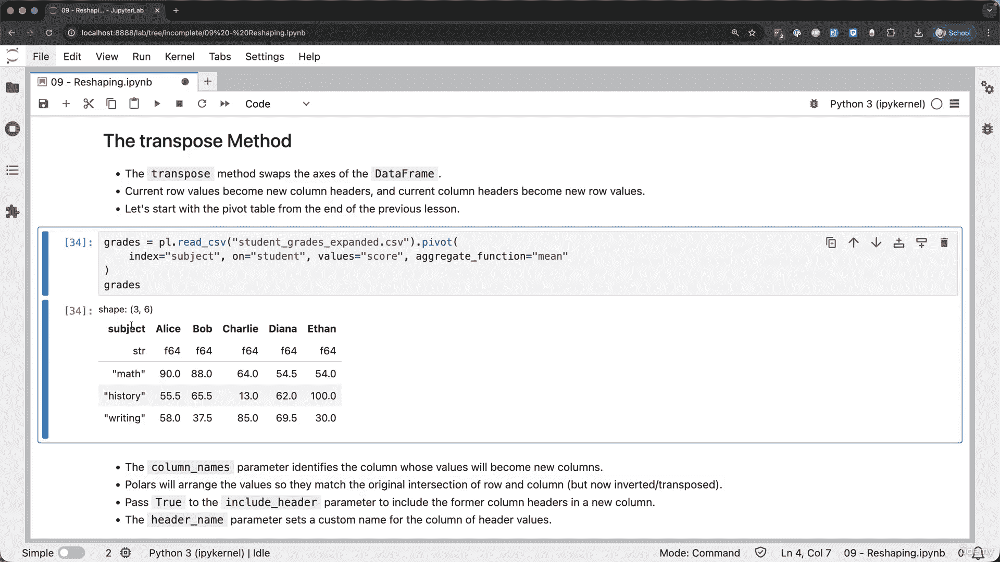
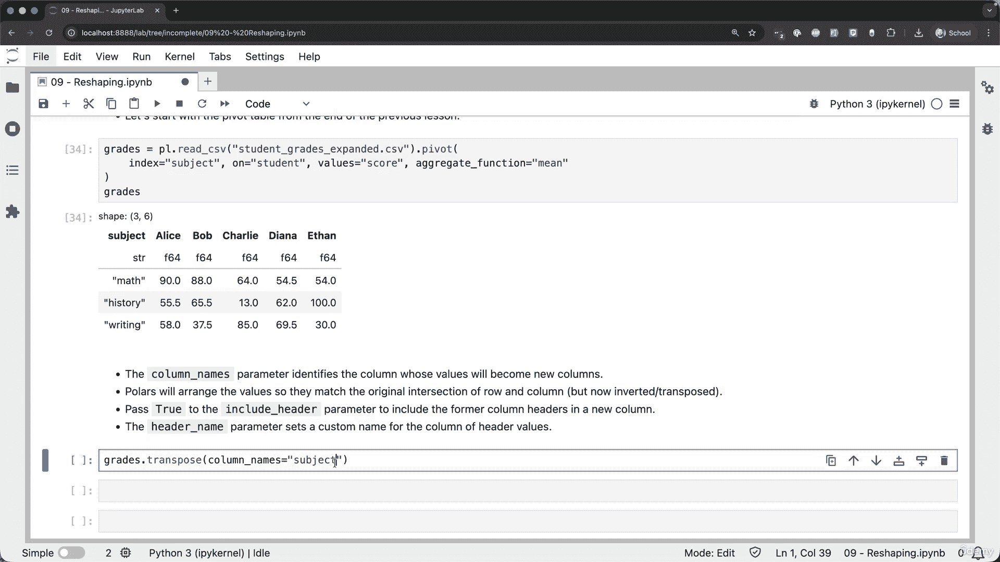
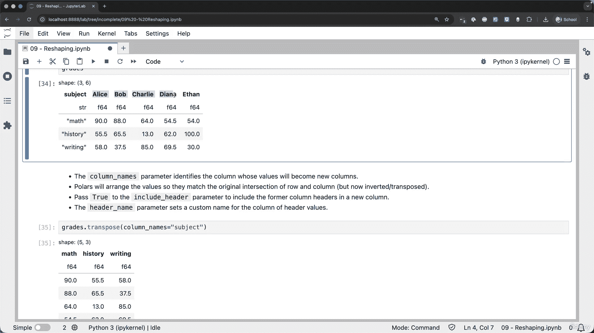
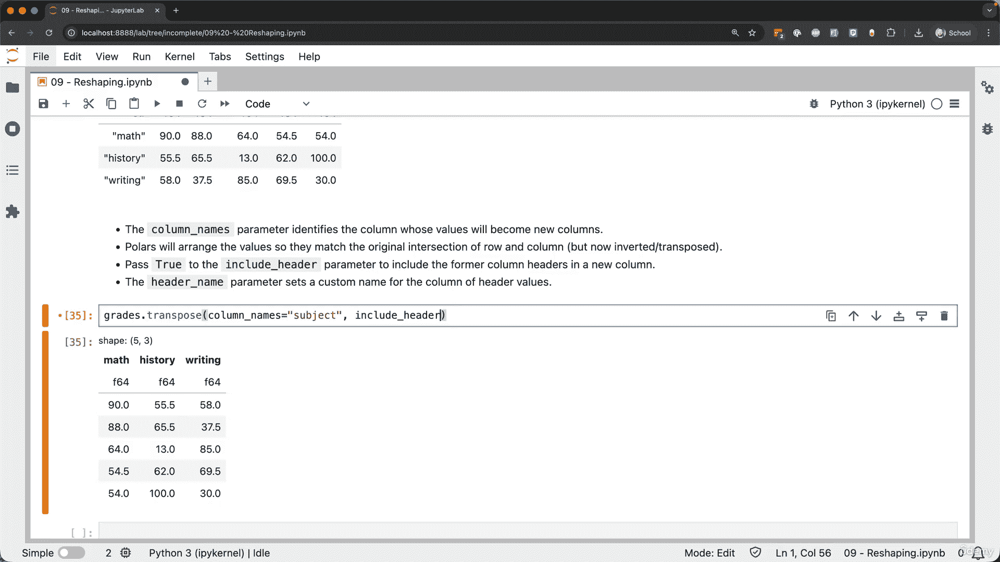
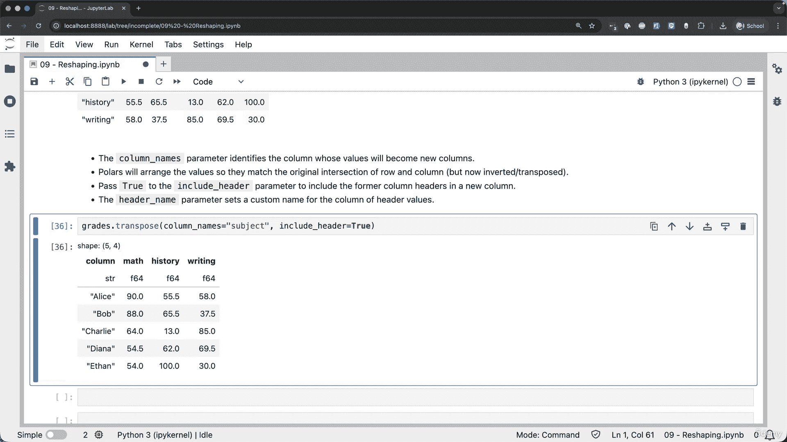
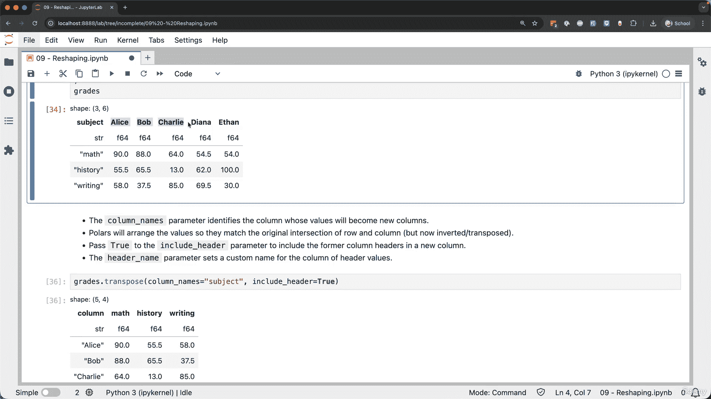
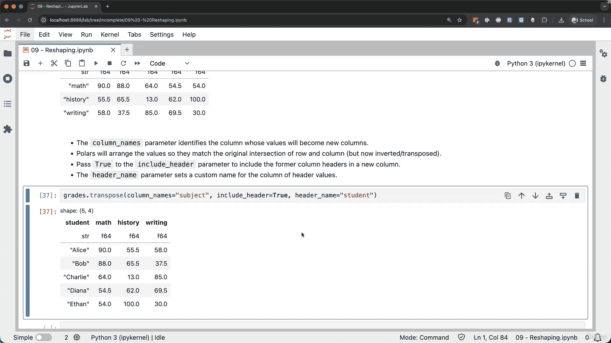
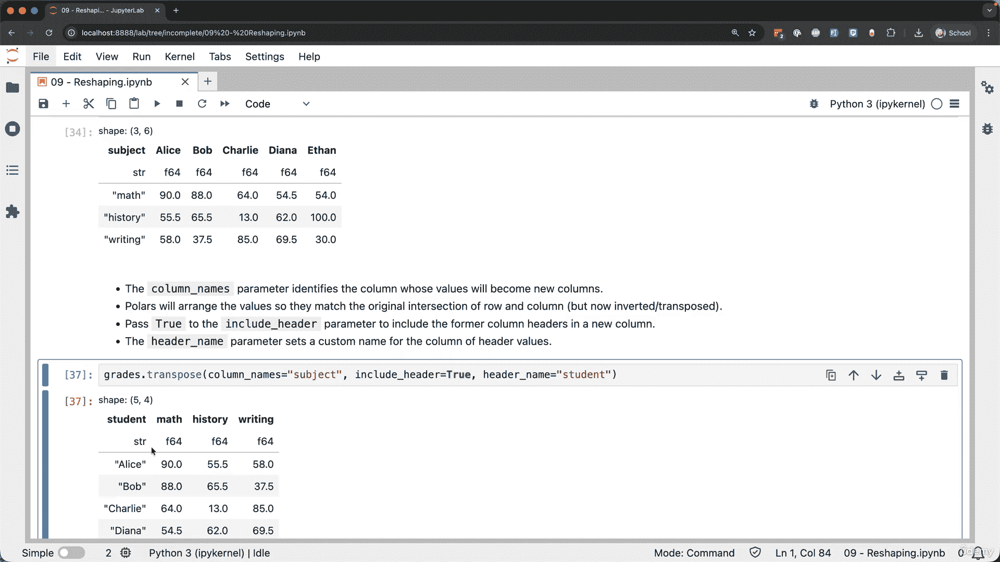
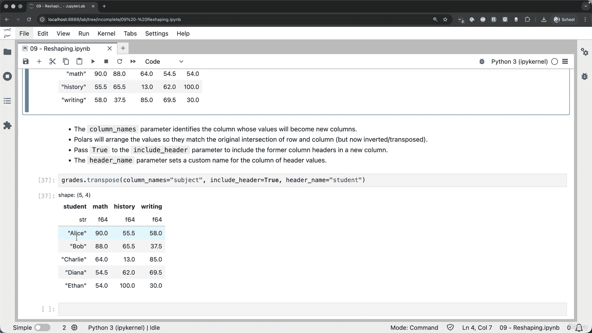

# 📊 Polars 与 Python 数据分析：第27课：transpose 方法

在本节课中我们将要学习 Polars 中的 `transpose` 方法。这个方法会交换 DataFrame 的行轴和列轴，也就是把原来的行变成列、原来的列变成行。我们会结合学生成绩表，理解它如何把学生姓名变成行值、把科目值变成列名，并说明它和 `pivot` 方法的关系，以及 `column_names`、`include_header`、`header_name` 这几个参数的实际作用。学会这些内容后，你就能从不同视角整理和查看数据。

## 🧭 Polars 与 Python 数据分析：第27课：transpose 的核心概念

上一节我们已经接触过用 `pivot` 调整数据视角的方式。本节中我们来看看另一个能完成类似效果的方法，也就是 `transpose`。`transpose` 方法会交换 DataFrame 的轴，核心变化可以用下面的公式表示：

```text
原行值 -> 新列名
原列名 -> 新行值
```

更直白地说，它会把指定的列，例如学生姓名这一列，变成行值；同时把某一列中的值，例如 `subject` 列中的科目值，变成新的列名。这样做的结果就是行和列互换，数据表会从另一个角度展示同一批信息。

需要说明的是，使用 `pivot` 方法并调整 `index` 和 `on` 参数，也能得到完全相同的结果。我们已经见过一种数据表版本：学生姓名作为行值，科目作为列名。`transpose` 只是实现同一结果的另一种方式，所以它并不是全新的数据，而是同一批数据的另一种摆放方式。

## 🛠 Polars 与 Python 数据分析：第27课：执行 transpose



上一节我们理解了 `transpose` 的核心概念，本节中我们来看看具体的代码执行过程。现在我们已经有一个数据框，在这个数据框中，学生姓名是列名，而我们希望把 `subject` 列里的值作为新数据框的列名。接下来对 `grades` 调用 `transpose` 方法，下面是代码示例：

```python
grades.transpose(column_names="subject")
```

第一个参数是 `column_names`。这里传入一个字符串，字符串内容是某个列的名称，这个列的值会用来生成新数据框的列名。换句话说，我们要从 `grades` 中选择一列，取出这一列的不同值，让它们成为新的列标题。这里选择 `subject`，所以新列名来自 `subject` 列中的不同值。

只传这个参数就足以完成轴交换。原来的 `subject` 列值包括 `math`、`history`、`writing`，这些行值会变成新的列标题；原来的列标题会变成新的行值。不过，Polars 的这个设计有一个小特点：默认情况下，原来的列标题变成行值后不能立刻直观看到。这就需要我们继续调整参数，让结果显示得更清楚。

## 👁 Polars 与 Python 数据分析：第27课：include_header 参数

上一节我们看到，默认结果中原来的列标题变成行值后不容易直接看到。本节中我们来看看如何让这些值正确显示出来。可以传入一个额外参数 `include_header`，它的作用是取出原来的列标题，也就是学生姓名，并把它们作为行值正确呈现出来。示例代码如下：

```python
grades.transpose(
    column_names="subject",
    include_header=True
)
```

这种显示方式更符合常规预期，但默认并不是这样。把 `include_header` 设为 `True` 后，我们就得到了更符合预期的结果，这正是理想中想要看到的样子。原来的 `subject` 列值是行值，现在变成列标题；原来的列标题包含五个学生姓名，现在变成一个单独的新列中的行值。默认情况下，Polars 会给这个新列起名为 `column`，不过可以通过额外参数 `header_name` 自定义列名。





## 🏷 Polars 与 Python 数据分析：第27课：header_name 参数

刚才我们提到，新列默认叫 `column`，而它实际表示的是学生姓名。本节中我们来看看如何给这个新列一个更清楚的名字。可以把 `header_name` 设置为 `student`，示例代码如下：

```python
grades.transpose(
    column_names="subject",
    include_header=True,
    header_name="student"
)
```

这样我们就成功完成了转置。`transpose` 本质上就是轴的倒置或交换：原来的行变成列，原来的列变成行。数据框被重新调整，换了一个视角来看待。原来 `math`、`history`、`writing` 这些条目现在成为列，原来学生姓名所在的列变成新列中的行值。这就是 `transpose` 方法的基本用法。

## ✅ Polars 与 Python 数据分析：第27课：总结



本节课中我们一起学习了 Polars 的 `transpose` 方法。它的作用是交换 DataFrame 的行轴和列轴，让原来的行值变成新列名，让原来的列名变成新行值。我们通过学生成绩表示例，说明了如何用 `transpose` 完成数据视角转换，也回顾了它与 `pivot` 在结果上的等价关系。





下面用列表回顾这三个参数的作用。

- `column_names`：指定从哪一列取值来生成新的列名，例如传入 `"subject"`。

- `include_header`：把原来的列标题作为行值显示出来，通常设置为 `True`。

- `header_name`：给保存原列标题的新列命名，例如命名为 `"student"`。







掌握这些内容后，就可以在需要转换数据视角时灵活选择合适的方法。`transpose` 并不改变数据本身，只是把行和列的位置互换，让我们能从另一个方向观察同一批数据。

