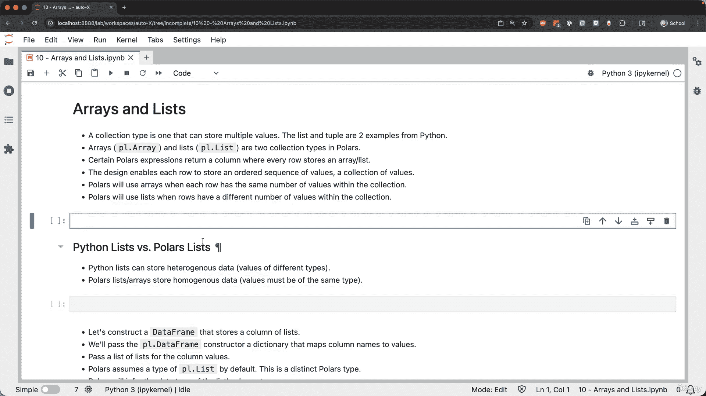
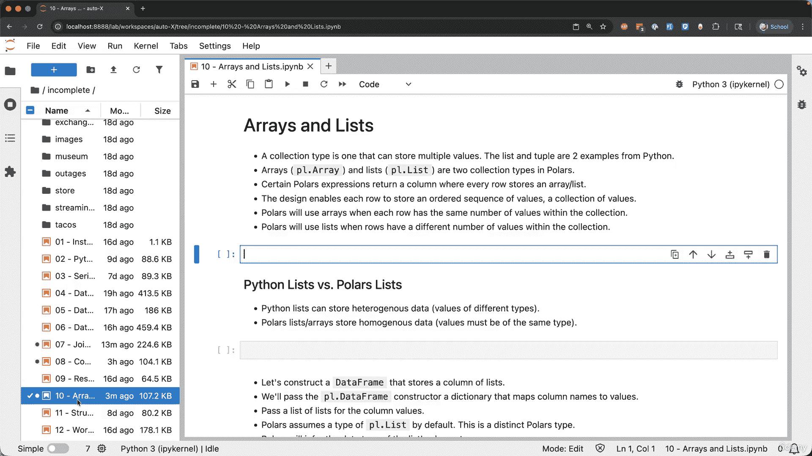
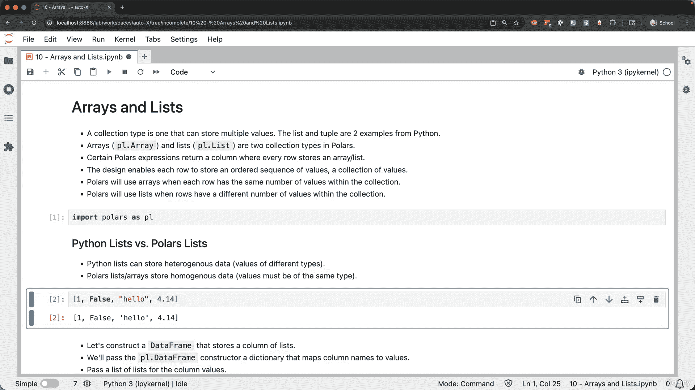
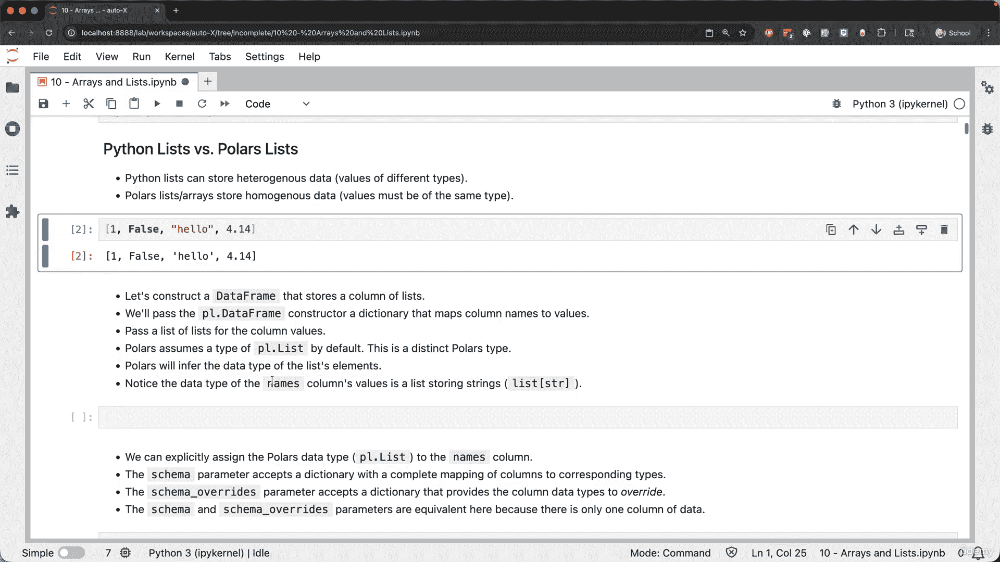
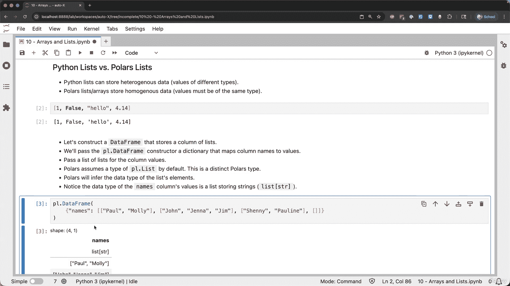
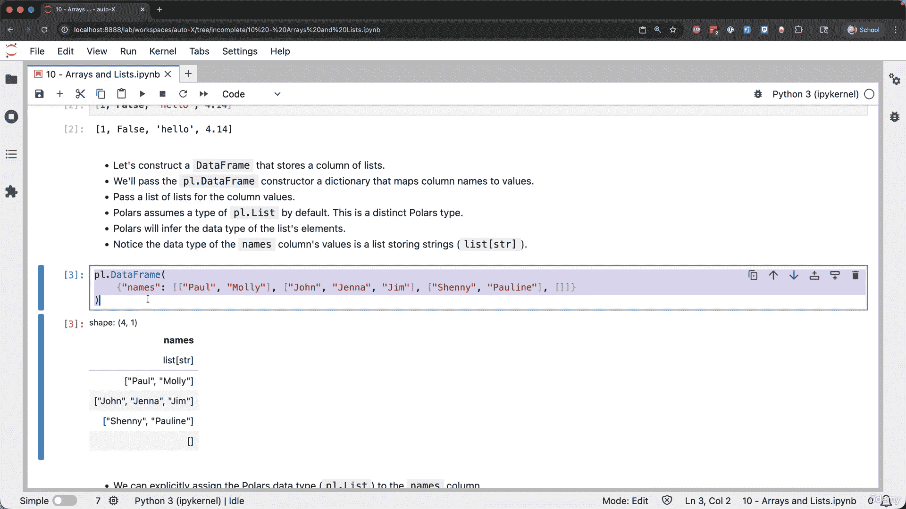
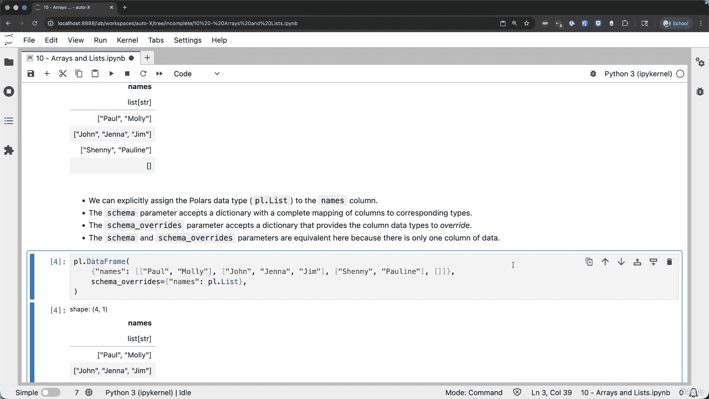
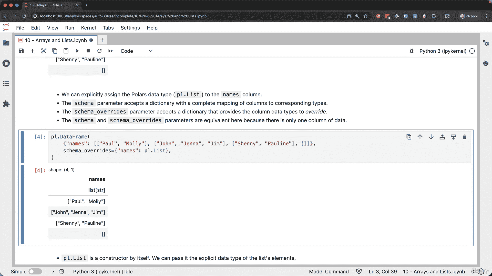
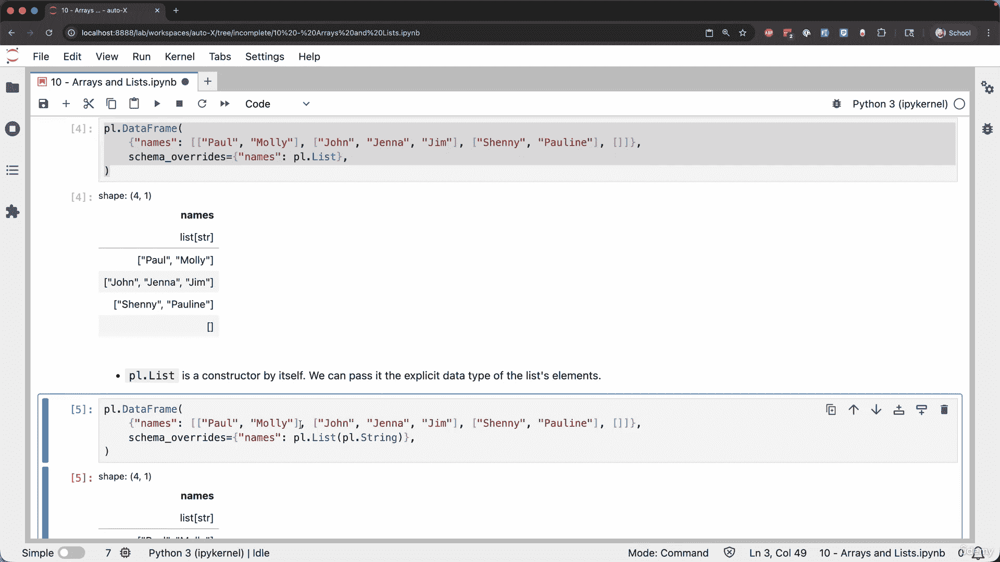
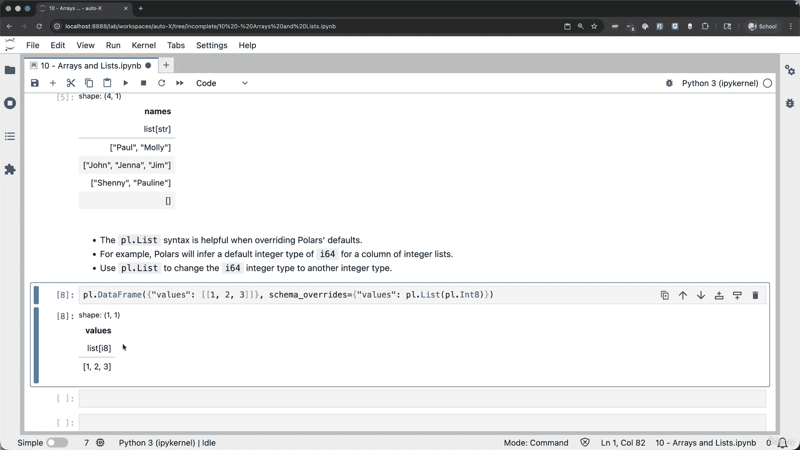

# 📊 Polars 与 Python 数据分析：第28课：数组与列表



在本节课中，我们将要学习 Polars 里的数组和列表这两种集合类型，理解它们和 Python 自带列表的区别，并动手创建包含列表列的 DataFrame。课程会从基本概念开始，再进入代码示例，最后介绍如何显式声明列表类型以及如何覆盖列表内元素的类型来节省内存。

## 🧰 Polars 与 Python 数据分析：第28课：导入库与准备环境

上一节进入了一个新的课程部分，本节我们打开新的 Jupyter Notebook，名字叫 `10 array and lists`。我们照常先导入 Polars 库，用 `import` 关键字导入，并把它命名为别名 `pl`。这样做之后，后面就可以用 `pl` 来访问 Polars 的功能。

```python
import polars as pl
```

## 📦 Polars 与 Python 数据分析：第28课：集合类型的高层理解

上一节完成了环境准备，本节从更高层来看 Polars 中的数组和列表。Python 包含多种集合类型，集合类型就是能够存储多个值的对象。两个常见的集合类型是列表和元组，它们都是按顺序存储一组值。Python 会根据值在集合中的顺序，为每个值分配索引位置。同样的思路也适用于 Polars：某些 Polars 表达式会返回一列，其中每一行的值都是集合类型，每一行的值都是一个完整容器，可以在里面存储多个条目。

需要说明的是，每一行在列下面仍然技术上是 一条记录，但这一行的值实际上像一个盒子，可以按顺序存储多个值。

> 每一行仍然技术上是 一条记录，但这条记录的值像一个盒子，可以按顺序装入多个值。

Polars 使用两种类型来建模这种思路：数组（Array）和列表（List）。理解这两种类型的区别，对后面创建列和选择类型很重要。

## 🧮 Polars 与 Python 数据分析：第28课：数组与列表的区别

上一节介绍了集合类型的基本思路，本节来看 Polars 中数组和列表的差异。Polars 使用数组类型时，每一行的集合长度完全相同，也就是元素数量相等，每一行数组里的元素数量都一样。对比之下，Polars 的列表类型不要求每一行列表里的元素数量相同，因此不同行的列表可以有不同数量的元素。列表因此更灵活，因为某些行的列表可以比其他行更长或更短；数组类型在技术上更高效、更快，所以 Polars 团队通常建议在可以使用时优先使用数组。

以下是两种类型在长度和效率上的对比。

- 数组类型要求每一行集合长度相同，可以写成 `len(row_i) = n`，其中所有行 `i` 的长度都是同一个 `n`。





- 列表类型允许每一行集合长度不同，可以写成 `len(row_i)` 可变，不同行可以有不同元素数量。

- 列表更灵活，因为某些行可以更长或更短。

- 数组更高效、更快，因此在能使用数组时，Polars 团队通常建议使用数组。

## 🐍 Polars 与 Python 数据分析：第28课：Python列表与Polars集合类型的差异

上一节比较了数组和列表的长度与效率，本节快速提醒 Python 列表和 Polars 列表、Polars 数组之间的差异。主要差异是：Python 列表可以存储不同类型的数据。例如，可以在方括号中声明一个列表，里面放一个数字、一个布尔值、一个字符串和一个浮点数，这在 Python 中完全合法，但在 Polars 中不合法。Polars 的列表类型或数组类型，在给定列中、给定行内，存储该类型的数据必须是同质的，也就是一行内集合类型里的数据必须是同一类型，不能有类型差异。

以下是 Python 列表与 Polars 集合类型在类型约束上的主要差异。

- Python 列表可以混合存储不同类型，例如 `[1, True, "hello", 3.14]` 是合法的 Python 列表。

- Polars 的列表或数组在一行内必须保持同质，可以写成 `type(row_i[j]) = T`，其中同一行 `i` 内的所有元素 `j` 都必须是同一个类型 `T`。

- 在 Polars 中，一行内的集合不能出现类型变化，这一点和 Python 列表不同。

## 🍽️ Polars 与 Python 数据分析：第28课：创建包含列表列的DataFrame

上一节提醒了 Python 列表和 Polars 集合类型的差异，本节开始看一个列使用列表类型的例子。下一课会展示一个例子，说明怎样自动得到这种数据类型。下面我们使用 `pl` 进入 Polars，用 `DataFrame` 构造函数从零创建 DataFrame。作为提醒，这个构造函数可以接收一个字典，字典的键是列名，值是对应列的数据。



我们创建一个名为 `names` 的列，给它的值提供一个外层列表。可以想象我们在表示到达晚宴的客人，客人以小组形式出现，所以会有一组人到达，然后又有一组人作为一个团体到达，依此类推。在外层列表中，我们声明多个独立列表，每个列表代表一组参加者。第一组声明两个字符串 `Paul` 和 `Molly`，这可以是到达聚会的第一个小组。第二组是 `John`、`Jenna` 和 `Jim`，注意这一组有三个人，而前一组只有两个人。第三个列表放几个名字，写作 `Sheny` 和 `Pauline`。第四个也是最后一个列表，可以想象有一组人没有到场，用一个空列表来表示。



```python
df = pl.DataFrame(
    {
        "names": [
            ["Paul", "Molly"],
            ["John", "Jenna", "Jim"],
            ["Sheny", "Pauline"],
            [],
        ]
    }
)

print(df)
```

这样会得到一个单列 DataFrame。可以看到 `names` 的类型是列表类型，每一行都存储一个列表，并且具体说明每一行的列表存储字符串。再次说明，Polars 的列表类型不要求每一行长度相同，所以这一行的列表有两个条目，另一行有三个条目，还有一行有零个条目，这完全没问题。如果使用 Polars 的数组类型，每一行数组的长度必须相等，必须包含完全相同的元素数量。再次重申，在 `names` 列中，每一行的条目技术上是 一个对象，但这个对象是集合类型，内部存储多个值，而且这些值会保持顺序，所以 Polars 知道在这个列表中 `Paul` 排在 `Molly` 前面。

## 🏷️ Polars 与 Python 数据分析：第28课：显式声明列表类型

上一节创建了包含列表列的 DataFrame，本节来看如何显式声明列表类型。可以把上面的代码复制粘贴下来，也可以使用 `schema_overrides` 参数显式声明列表类型。例如，在构造函数中加一个逗号，然后提供 `schema_overrides` 参数。这里只有一列，所以提供 `schema_overrides` 或 `schema` 都可以。作为提醒，这个字典接受列名作为键，这里是 `names`，值是期望的类型；在 Polars 顶层有一个列表类型。

以下是显式声明列表类型时可以采用的写法。





1. 使用 `schema_overrides={"names": pl.List}`，显式声明这一列是列表类型。

2. 也可以使用 `schema={"names": pl.List}`，在只有一列时，两者都可以工作。

3. 如果想更明确，可以写成 `pl.List(pl.String)`，表示这一列每一行是列表，列表里存储字符串。

```python
df = pl.DataFrame(
    {
        "names": [
            ["Paul", "Molly"],
            ["John", "Jenna", "Jim"],
            ["Sheny", "Pauline"],
            [],
        ]
    },
    schema_overrides={"names": pl.List},
)

print(df)
```

如果只写 `pl.List`，会得到和前面相同的结果，Polars 会根据初始数据推断每个列表内元素的实际类型是字符串。还可以更显式，让 Polars 期望的不只是列表，而是具体的字符串列表。做法是使用 `pl.List` 这个构造器本身，在 `List` 后面的括号中指定列表内元素的显式数据类型。`names` 列会存储行，每一行条目是列表，而列表内数据类型用 `pl.String` 指定，表示每一行的列表会存储零个或多个字符串。



```python
df = pl.DataFrame(
    {
        "names": [
            ["Paul", "Molly"],
            ["John", "Jenna", "Jim"],
            ["Sheny", "Pauline"],
            [],
        ]
    },
    schema_overrides={"names": pl.List(pl.String)},
)

print(df)
```

执行后会得到同样的结果。当想覆盖 Polars 对某一列的默认类型假设时，这种语法特别有帮助。

## 🔧 Polars 与 Python 数据分析：第28课：覆盖列表元素类型与内存优化

上一节使用了 `pl.List` 和 `pl.List(pl.String)` 来显式声明类型，本节练习再创建一个存储列表类型的 DataFrame，并覆盖列表内元素类型。我们再次访问顶层 `DataFrame` 构造函数，传入一个字典；键叫 `values`，这个名字是任意的。值提供一个列表的列表，例如提供一个列表，里面存储一个嵌套列表，嵌套列表里可以有任意数量的值，这里写 `1、2、3`。

```python
df = pl.DataFrame(
    {
        "values": [[1, 2, 3]]
    },
    schema_overrides={"values": pl.List(pl.Int8)},
)

print(df)
```

这样会得到一个单列 DataFrame，列名是 `values`，每一行存储列表类型，更具体地说，会存储 64 位整数。也可以提供 `schema_overrides` 或 `schema`，用字典里的 `values` 键指定这一列的值采用不同类型。这里可以写 `pl.List`，只写它不会改变结果；但用前面看到的构造器语法，可以告诉 Polars：不要把这些整数当成类似 64 位整数，而更希望把它们当成 8 位整数，因为 8 位整数应该足以完整表示 `1、2、3` 这类值。这样就能覆盖默认推断，仍然会有一个 `values` 列存储列表，每一行存储一个容器类型、集合类型，但现在已经告诉 Polars 把每个列表内部的值当成 8 位整数。对完整列来说，这会产生整体内存减少，因为元素类型占用的宽度更小，可以粗略写成 `memory_total ≈ rows × len(row) × sizeof(element_type)`。

## ✅ Polars 与 Python 数据分析：第28课：总结



上一节通过 `pl.List(pl.Int8)` 覆盖了列表内元素类型并说明了内存优化，本节做一个小结。以上是对 Polars 列表类型的快速介绍，下一课会展示一个例子，说明如何自动得到这种数据类型。本节课中我们一起学习了 Polars 中数组和列表的高层概念、数组要求每行长度相同而列表允许长度不同、Python 列表与 Polars 集合类型在同质性上的差异，还动手创建了包含列表列的 DataFrame，并用 `schema_overrides`、`pl.List` 和 `pl.List(pl.String)` 显式声明类型，最后用 `pl.List(pl.Int8)` 覆盖元素类型来减少内存占用。

