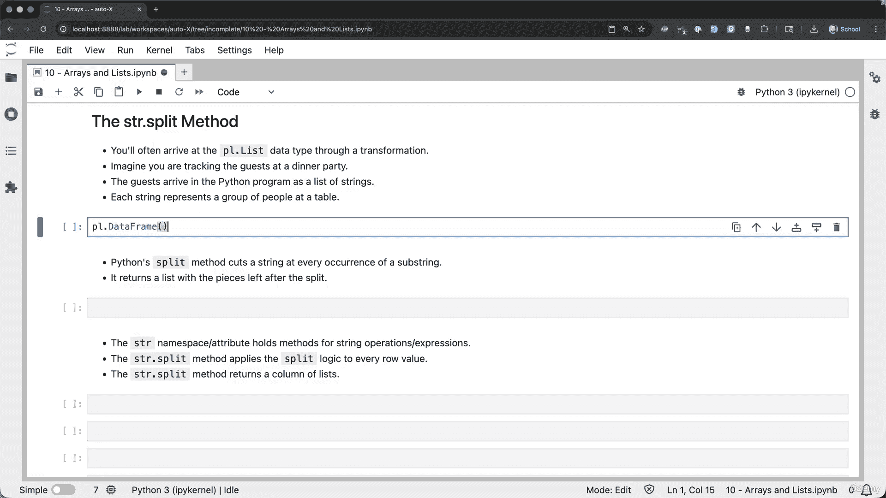
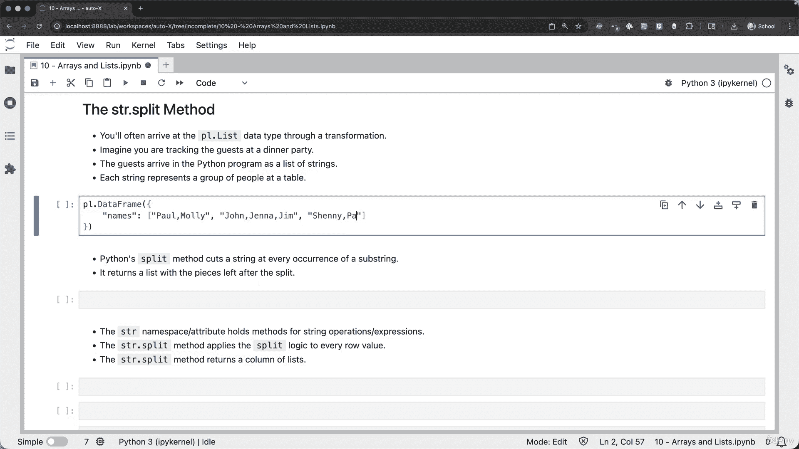
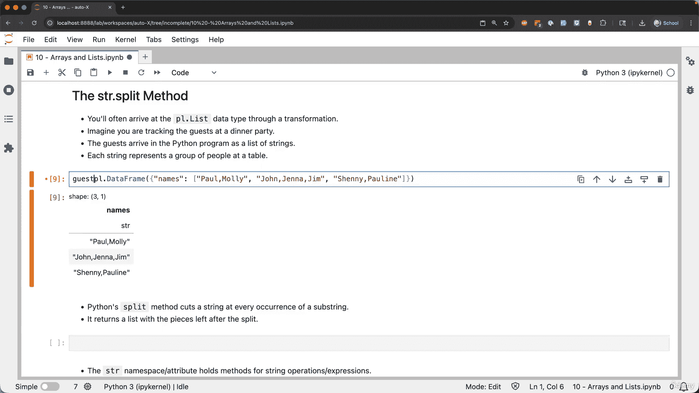
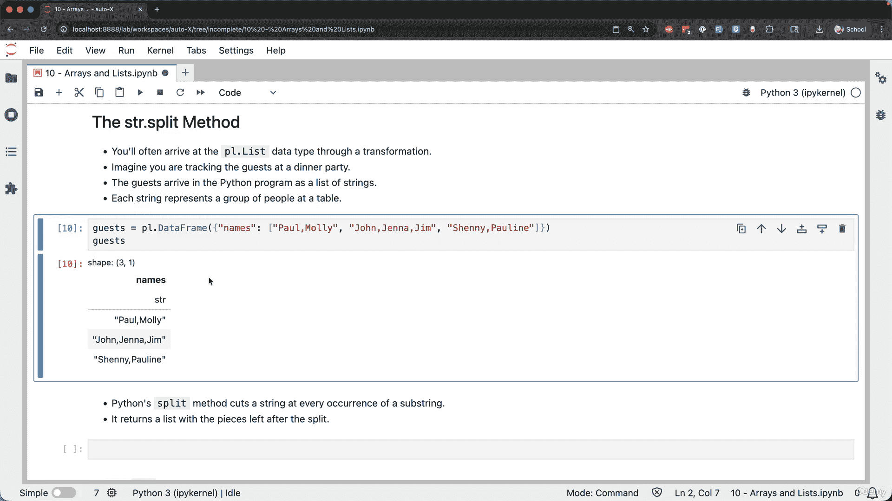
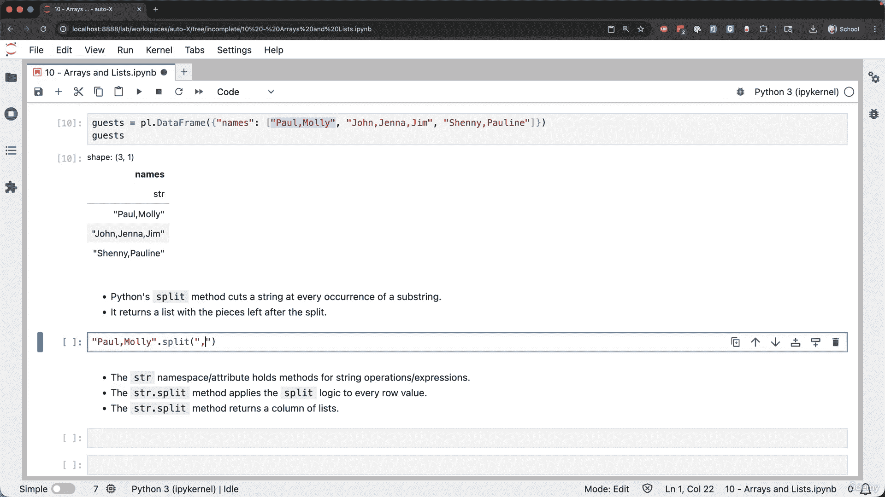
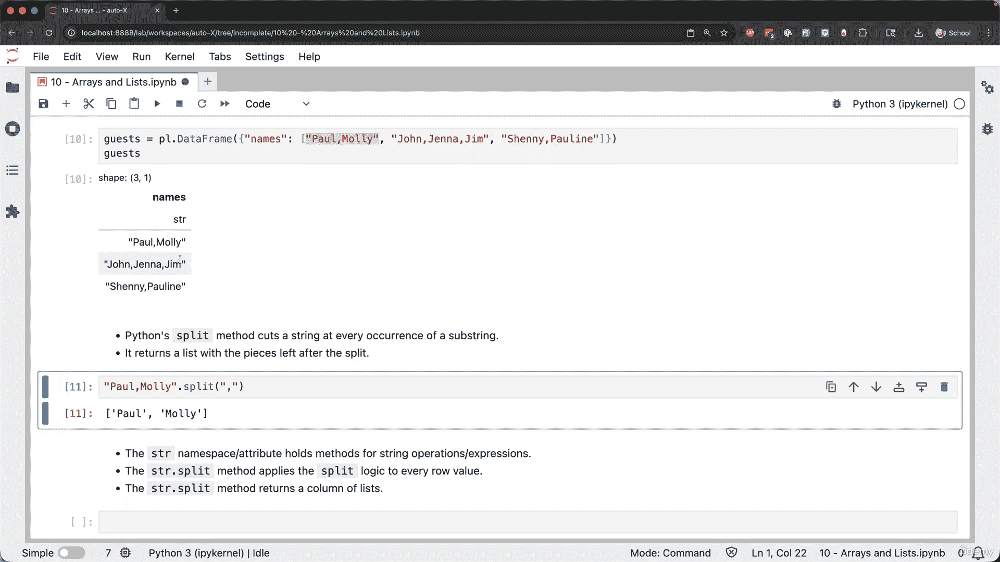
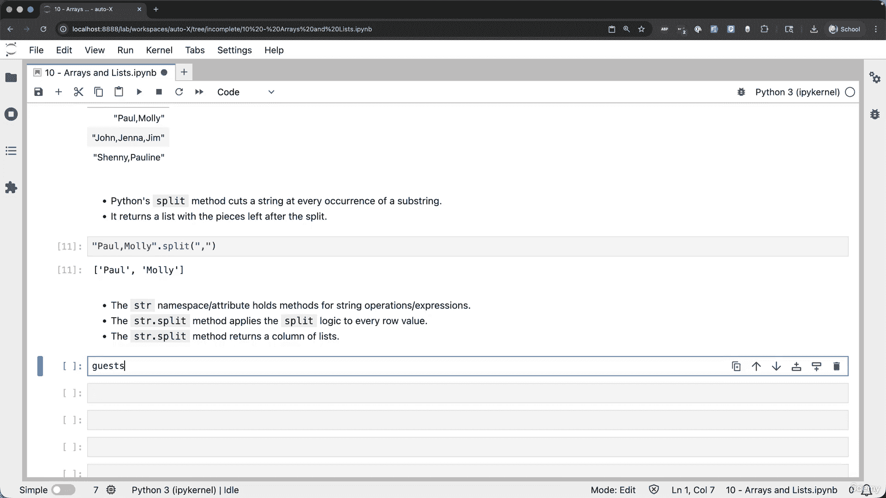
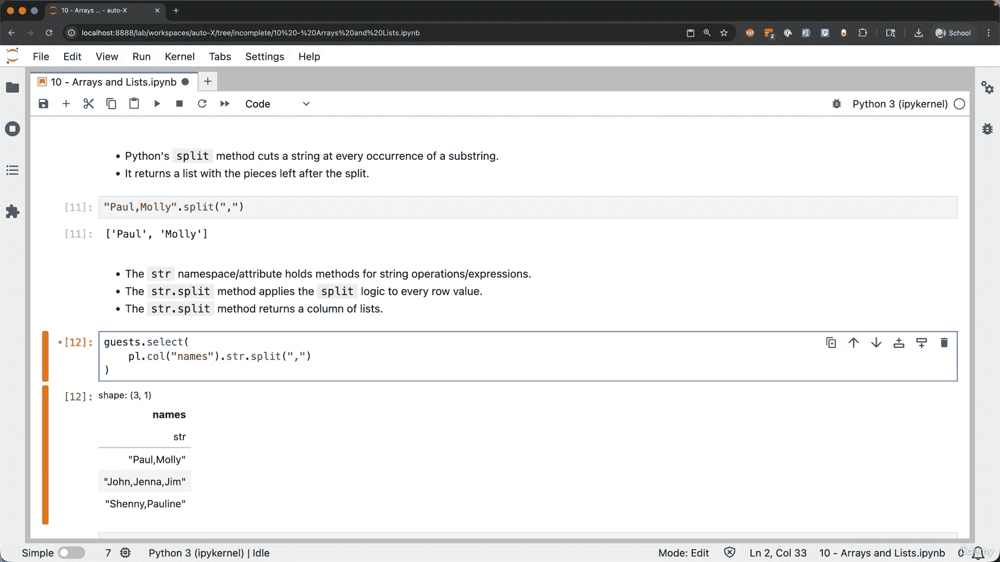
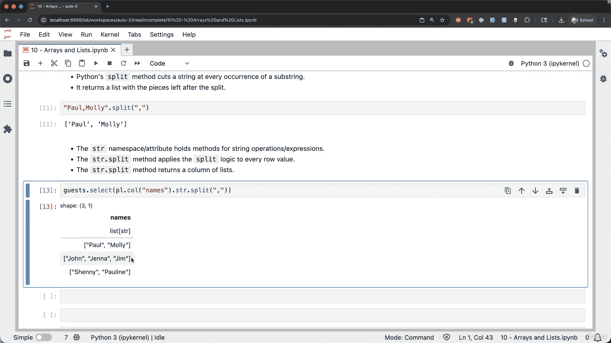

# 🐍 Polars 与 Python 数据分析：p29-129：使用 str.split 生成列表列

在本节课中，我们将学习一个会产生“列表列”的表达式示例。前面我们已经接触过 Polars 中普通的字符串列，本节中我们来看看当一次操作可能生成多个值，并且每一行生成的值数量可能不同时，表达式会如何输出列表类型。课程会继续使用晚餐聚会客人的例子，并对比 Python 原生字符串的 `split` 方法与 Polars 的 `str.split` 方法，最后说明列表列中每个列表长度不必一致这一关键点。

## 📚 Polars 与 Python 数据分析：p29-129：为什么表达式会产生列表列

上一节我们介绍了 Polars 表达式的基本用法，本节中我们来看看表达式产生列表列的原因。通常，当一个操作有可能创建多个值，并且这些值的数量可能逐行不同时，表达式就会产生列表类型。可以用一个简单公式来理解：

```text
可能产生多个值 + 每行数量可能不同 -> List 类型列
```

从实际使用角度看，这种设计很自然，因为真实数据经常把一个字段中的多个信息打包在一起。比如一列字符串中存放了多个名字，每个名字之间用逗号分隔。不同行可能有两个名字，也可能有三个名字，甚至更多名字。Polars 需要一种方式把这些名字放进同一列中，同时又不丢失每个名字的边界。



## 🧑‍🤝‍🧑 Polars 与 Python 数据分析：p29-129：用逗号分隔字符串建模晚餐客人

上一节我们说明了列表列产生的原因，本节中我们继续使用上一课的晚餐聚会例子。假设我们正在为到达晚餐聚会的客人分组建模，但这一次数据以逗号分隔字符串的形式进入程序。下面使用 DataFrame 构造器创建一个 `names` 列，并把一个列表赋给它。需要注意，这次列表里存放的是简单字符串，而不是嵌套列表。



以下是构造示例数据的代码，其中第一组是 `Paul,Molly`，第二组是 `John,Jenna,Jim`，第三组是 `Shny,Pauline`：

```python
import polars as pl

guests = pl.DataFrame({
    "names": [
        "Paul,Molly",
        "John,Jenna,Jim",
        "Shny,Pauline",
    ]
})

guests
```

这里第一组字符串中，Paul 和 Molly 用逗号分隔。第二组使用相同逻辑，用字符串 `John,Jenna,Jim` 表示。第三组用字符串 `Shny,Pauline` 表示。现在这个 DataFrame 中是一个普通的字符串列，可以看到它的类型是 `String`，也就是字符串类型。随后把 DataFrame 赋值给变量 `guests`，并通过输出 `guests` 变量预览数据。

## ✂️ Polars 与 Python 数据分析：p29-129：Python 原生 split 方法回顾

上一节我们准备好了逗号分隔的字符串数据，本节中我们回顾 Python 语言中字符串自带的 `split` 方法。Python 字符串有一个 `split` 方法，它会根据子串的每一次出现来切割字符串。比如复制其中一个字符串 `Paul,Molly`，对这个字符串调用 `split` 方法，并传入分隔符作为参数。分隔符表示希望 Python 在哪些字符处切割字符串。

以下是 Python 原生 `split` 方法的示例，传入逗号后，Python 会基于每一个逗号切开字符串，并返回剩余的两个字符串 `Paul` 和 `Molly`，再把它们打包进一个列表：



```python
"Paul,Molly".split(",")
# ["Paul", "Molly"]
```





这个示例说明，Python 原生字符串方法已经可以完成按逗号拆分的工作。接下来要解决的问题是：如何把同样的逻辑应用到 `guests` 数据框中的每一行值。我们希望在每一行字符串上执行拆分操作，从而提取出彼此独立的名字。

## 🧱 Polars 与 Python 数据分析：p29-129：在 str 命名空间中使用 split



上一节我们回顾了 Python 原生 `split` 方法，本节中我们来看看 Polars 中对应的做法。在 `guests` 数据框中，我们想要从每一行字符串里提取独立名字。`str` 命名空间存放了所有字符串操作方法，其中有一个方便的 `split` 方法，它的作用与 Python 原生 `split` 方法相同。



以下是使用 `guests.select` 配合表达式调用 `str.split` 的代码。这里先选中 `names` 列，再进入 `str` 命名空间，访问 `split` 方法，并指定每一行都按逗号的每一次出现来拆分字符串内容：

```python
guests.select(
    pl.col("names").str.split(",")
)
```

需要记住 Polars 的一般方法论：针对一列的表达式应该只产生一列结果，这样设计是为了保持一致。前面已经见过一个例子，`value_counts` 方法会产生一列 struct 值。也就是说，当 Polars 团队需要捕获多个值，但又必须把它们装进单独一列时，就会选择某种容器类型。这里正是这种情况：拆分字符串后，可能得到零个字符串、一个字符串、两个字符串，或者任意数量的字符串，因此 `split` 方法会返回一个存放列表的列。

现在这个列表列可以容纳不同情况：像 `Paul,Molly` 这样的字符串，两个条目之间只有一个逗号；而第二组字符串有多个逗号。如果字符串中间有 10 个逗号，我们就会得到一个包含 9 或 10 个条目的列表。这个例子展示了真实世界中的方法用法：按照分隔符或定界符的每一次出现切割字符串，会自动得到列表类型的列。

## 📏 Polars 与 Python 数据分析：p29-129：列表长度不必一致

上一节我们看到了 `str.split` 会返回列表列，本节中我们补充一个关键提醒：列表类型并不要求每个列表长度相同。与之互补的是 array 类型，后面会在本节稍后部分看到。在当前结果中，第一个列表存放两个字符串，第二个列表存放三个字符串，这完全没有问题。列表长度不需要在每一行值之间保持一致。

以下是理解列表类型时需要记住的几个要点，它们能帮助初学者避免把列表列和固定长度数组混淆：

- 列表列中的每个列表可以包含不同数量的元素。
- 当前例子中，有的列表有两个字符串，有的列表有三个字符串。
- 列表长度逐行不同是合法的，不需要强制统一。
- 固定长度要求属于 array 类型的讨论范围，后面会继续说明。



这就是对 `str.split` 方法的快速介绍。它是表达式或操作可能产生列表类型列的一个例子，也是理解 Polars 中“一个表达式产生一列结果”这一设计思路的重要案例。

## 🧾 Polars 与 Python 数据分析：p29-129：本节总结

本节课中我们一起学习了 `str.split` 方法如何把逗号分隔的字符串拆分成列表列。我们先理解了表达式在可能产生多个值且每行数量不同时会输出列表类型，然后构造了晚餐聚会客人的逗号分隔字符串数据，回顾了 Python 原生 `split` 方法，接着使用 `pl.col("names").str.split(",")` 在 Polars 中完成逐行拆分，最后说明了列表长度不必一致。核心公式可以概括为：

```text
str.split(分隔符) -> 存放列表的列
```



通过本节内容，我们掌握了在 Polars 中把字符串列拆成列表列的直白做法，也理解了列表类型与后续 array 类型之间的区别。下一节可以继续围绕字符串操作和列表相关操作展开，进一步熟悉 Polars 表达式的能力。
