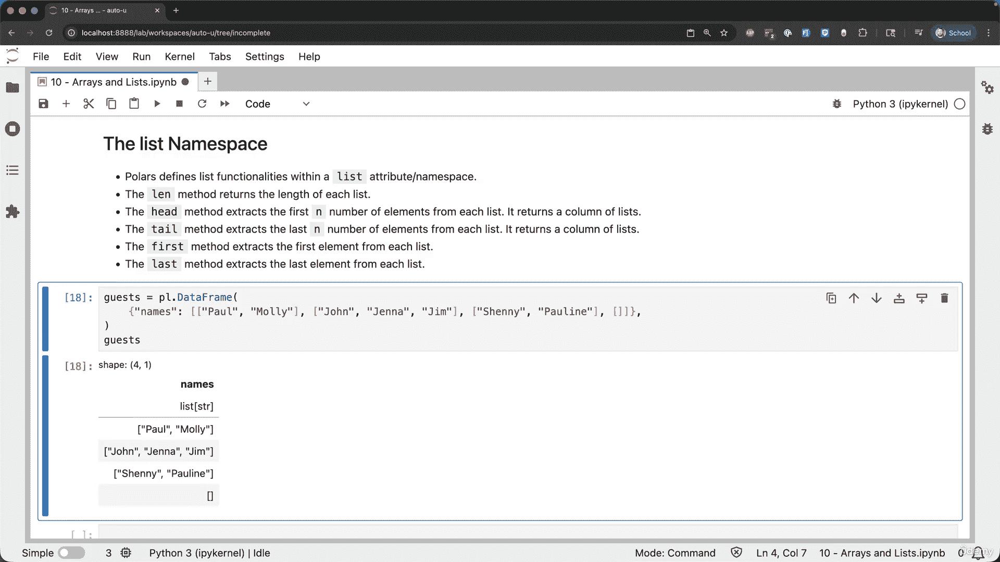
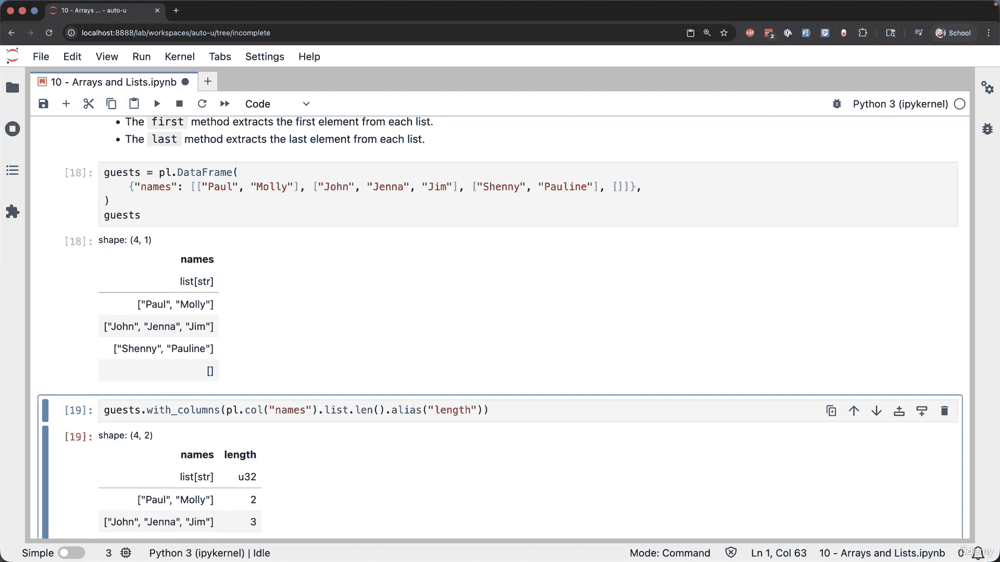
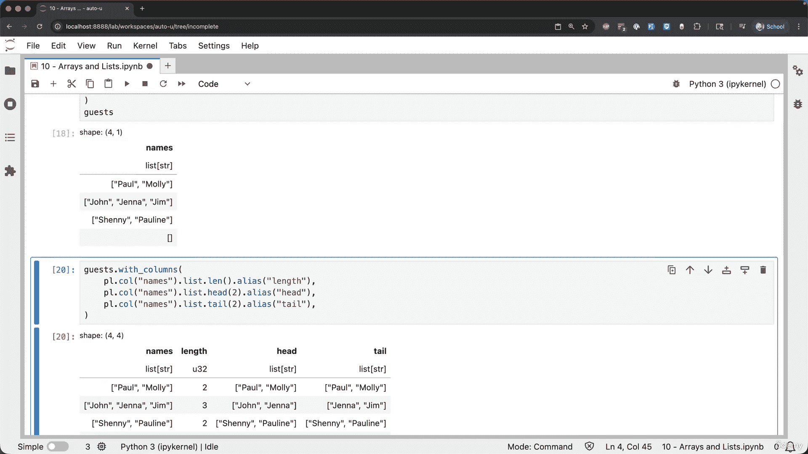
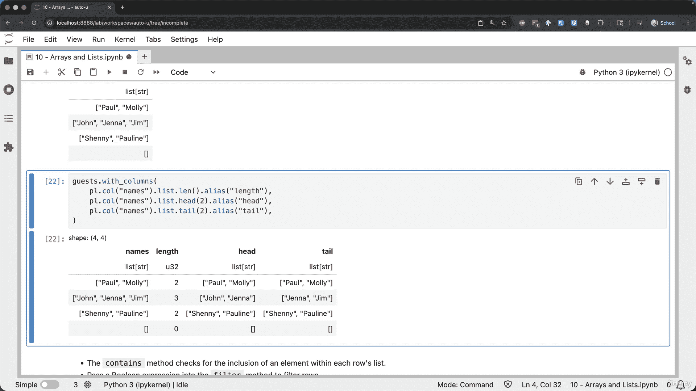
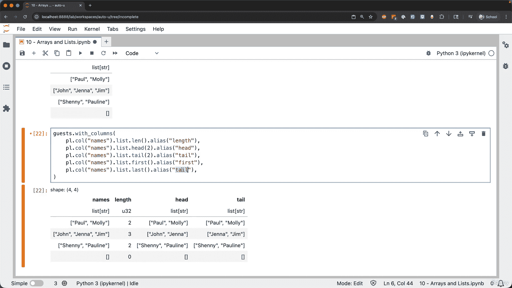
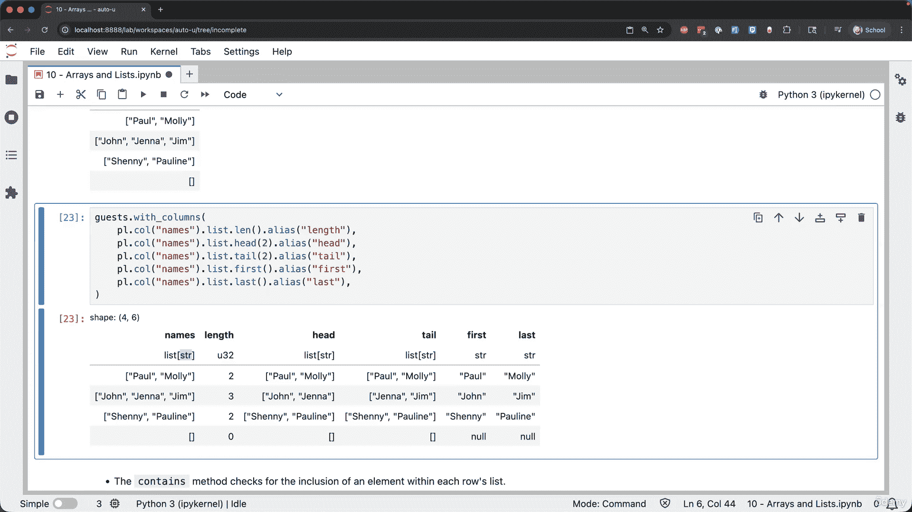
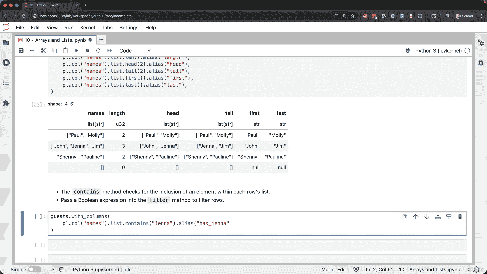
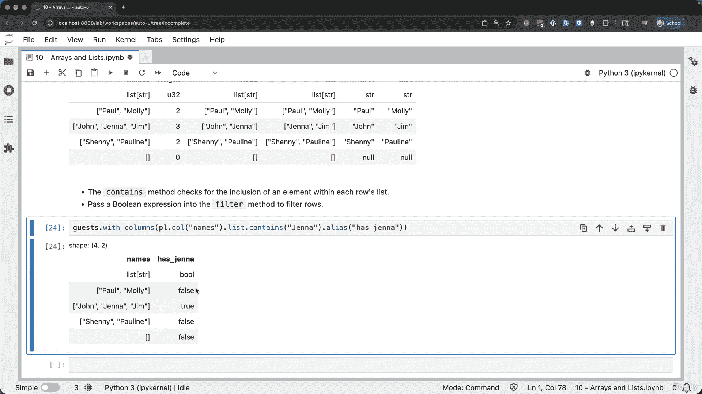
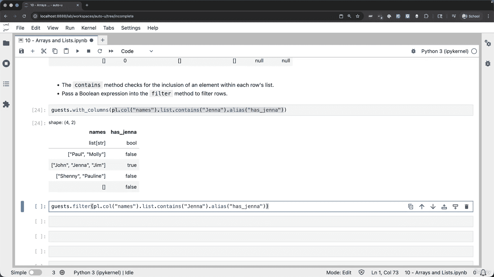
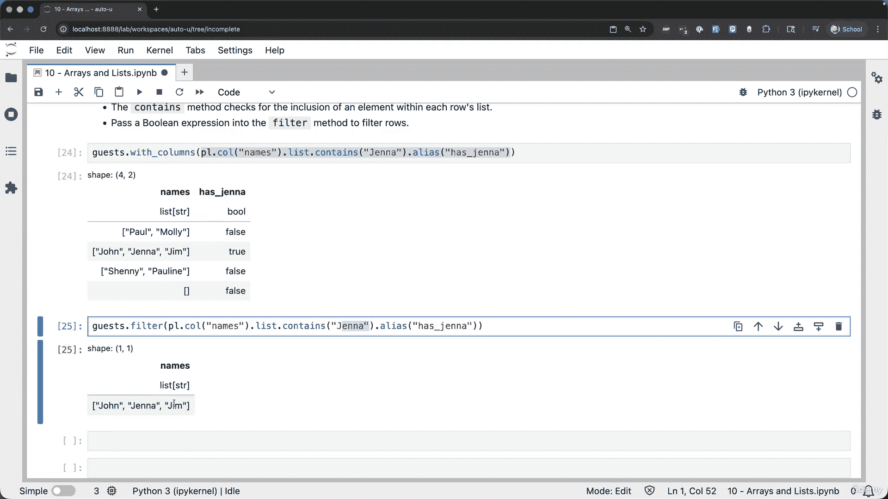

# Polars 与 Python 数据分析：p30：列表（list）命名空间 🐻

在本节课中我们将要学习 Polars 中列表类型列上的 `.list` 命名空间，重点看 `length`、`head`、`tail`、`first`、`last`、`contains` 这些方法。我们会从上一课的 `guests` 数据框架出发，重新执行创建代码，再用 `with_columns` 不断增加新列，观察每一行列表在方法作用后的结果。通过这一讲，初学者可以理解列表列和普通字符串列在方法命名空间上的相似之处，也能掌握用布尔结果配合 `filter` 做行过滤的基本套路。



## Polars 与 Python 数据分析：p30：创建 guests 数据框架 🧱

在开始使用列表方法之前，上一节我们已经有了一段创建 `guests` 数据框架的代码，本节中我们先把它重新执行一遍，并把数据框架准备好。原文里的代码会创建一个只有一列的数据框架，列名是 `names`，这一列的每一行都存放一个列表，列表里面存放字符串值。数据框架的名字叫 `guests`，下面我们先用一段示例代码把这个结构搭出来，方便后续不断添加新列。

```python
import polars as pl

guests = pl.DataFrame({
    "names": [
        ["John", "Jim"],
        ["John", "Jenna", "Jim"],
        [],
    ]
})
```

数据框架准备好后，原文接着调用 `with_columns` 方法来添加一些额外的列，并且会创建一个表达式，专门指向 `names` 这一列。这个套路在后面会反复出现，所以可以先记住一个通用形式：用 `pl.col("names")` 选中列表列，再调用 `.list` 命名空间里的方法，最后用 `alias` 给新列命名。通用写法如下，后面的每个方法都可以套进这个结构里。

```python
guests = guests.with_columns(
    pl.col("names").list.<方法>(...).alias("<新列名>")
)
```

数据框架准备完成以后，下一节我们进入 `.list` 命名空间，先看最基础的 `length` 方法。

## Polars 与 Python 数据分析：p30：list 命名空间与 length 方法 🧮



上一节我们准备好了 `guests` 数据框架，本节中我们来看看 `.list` 命名空间，以及最基础的 `length` 方法。原文指出，所有列表功能或列表方法都放在 `.list` 命名空间里，也就是列表列的 `.list` 属性下面。这个设计原则和 Polars 里其他数据类型的列是一样的，并不是列表列独有的特殊做法。为了先建立整体印象，下面把不同数据类型的命名空间放在一起对比一下：

- 字符串列的方法一般放在 `.str` 命名空间里，原文提到字符串功能都在 `.str` 命名空间中。
- 日期时间列或时间类型列的方法一般放在 `.dt` 命名空间里，原文提到时间数据在 `.dt` 命名空间下面。
- 列表列的方法就放在 `.list` 命名空间里，原文强调这和 `.str`、`.dt` 是完全相同的设计原则。

对比完命名空间以后，我们回到 `names` 列。在 `.list` 后面调用的方法是 `length`，它表示长度，作用是告诉我们每个列表的长度，换句话说，就是每个列表里包含多少个元素。核心概念可以写成：`列表长度 = 列表中的元素个数`。下面这段代码会把长度结果赋给一个新列，列名就叫 `length`。

```python
guests = guests.with_columns(
    pl.col("names").list.length().alias("length")
)
```

执行后可以看到一个新的 `length` 列，它告诉我们每一行列表里有多少个条目。原文特别指出，最后那个空列表的长度是 0。后续的表达式都会非常相似，因为 `names` 列本身没有变化，所以可以直接复制粘贴表达式，只改方法名和新列名。长度方法看完以后，下一节我们看看如何从列表开头和结尾取出一部分元素。

## Polars 与 Python 数据分析：p30：head 与 tail 方法 ✂️



上一节我们看了 `length` 方法，它能告诉我们每个列表里有多少个元素；本节中我们来看看如何从列表开头和结尾取出一部分元素，也就是 `head` 和 `tail`。原文先提醒了一个背景：你可能已经熟悉 DataFrame 上的 `head` 和 `tail` 方法。DataFrame 的 `head` 方法返回数据框架开头指定数量的元素，`tail` 方法返回数据框架末尾指定数量的行。这里的 `head` 和 `tail` 做的事情完全一样，只不过作用对象变成了每一行的列表。下面把 `head` 和 `tail` 的行为用几条要点说明：

- DataFrame 的 `head` 返回开头若干行，`tail` 返回末尾若干行，这是大家可能已经熟悉的背景。
- 列表命名空间里的 `head` 对每一行列表取开头指定数量的元素，`tail` 对每一行列表取末尾指定数量的元素。
- 如果传入参数 `2`，`head(2)` 会提取每一行列表的前两个元素，`tail(2)` 会提取每一行列表的后两个元素。
- 例如三元素列表 `["John", "Jenna", "Jim"]`，`head` 取前两个条目得到 `["John", "Jenna"]`，`tail` 取后两个条目得到 `["Jenna", "Jim"]`。
- 对于空列表，因为没有元素可以提取，`head` 和 `tail` 两列里得到的仍然是空列表。
- 无论传入什么值，`head` 和 `tail` 返回的都是一个新的列表列；即使传入 `1`，得到的也是只包含一个元素的列表列，而不是普通字符串列。

下面用代码把 `head(2)` 和 `tail(2)` 的结果分别放进 `head` 列和 `tail` 列。这里依旧是在 `names` 列上调用 `.list` 命名空间，然后接上对应的方法。



```python
guests = guests.with_columns(
    pl.col("names").list.head(2).alias("head"),
    pl.col("names").list.tail(2).alias("tail")
)
```

以第二行的三元素列表为例，`head` 会取出 `John` 和 `Jenna`，`tail` 会取出 `Jenna` 和 `Jim`；空列表在 `head` 和 `tail` 两列里都会得到另一个空列表。这里要再次注意，`head` 和 `tail` 的结果仍然是列表，只是列表里的元素数量变少了。`head` 和 `tail` 返回的仍是列表，下一节我们看看如何只取一个首元素或尾元素。



## Polars 与 Python 数据分析：p30：first 与 last 方法 🎯

上一节我们看了 `head` 和 `tail`，它们返回的仍然是列表列；本节中我们来看看如何只取每一行列表的第一个或最后一个元素，也就是 `first` 和 `last`。原文指出，如果你只想拉出每一行列表里的第一个条目或最后一个条目，可以使用配套的 `first` 和 `last` 方法。下面归纳 `first` 和 `last` 的几个注意点：

- `first` 方法在 `.list` 命名空间下面，不需要参数，调用后可以把结果命名为 `first` 列。
- `last` 方法同样在 `.list` 命名空间下面，也不需要参数，调用后可以把结果命名为 `last` 列。
- 这两个方法会从每一行列表里取出第一个或最后一个条目。
- 因为 Polars 知道取出来的具体数据类型，所以新列存储的是普通字符串值，而不是字符串列表。
- 空列表里没有任何内容，因此 `first` 和 `last` 两列会存储 `null`，从技术上说空列表里没有东西可以拉出来。

下面用代码演示 `first` 和 `last` 的写法。可以看到它们不需要像 `head` 和 `tail` 那样传入数量参数，直接调用即可。

```python
guests = guests.with_columns(
    pl.col("names").list.first().alias("first"),
    pl.col("names").list.last().alias("last")
)
```



执行后，`first` 列和 `last` 列里是普通字符串或 `null`，不再是列表。这个变化很关键，因为 `head` 和 `tail` 返回列表，而 `first` 和 `last` 返回单个值。到这里我们已经能取长度和首尾元素，下一节我们看看如何在列表里查找指定值。

## Polars 与 Python 数据分析：p30：contains 与 filter 方法 🔎

上一节我们看了 `first` 和 `last`，它们能取出列表里的单个元素；本节中我们来看看如何在列表里查找指定值，也就是 `contains` 方法，并把它和 `filter` 组合起来。原文指出，本讲最后要介绍的方法 `contains` 也位于 `.list` 命名空间里。`contains` 会检查每一行列表里是否包含某个指定值，也就是检查指定值在不在这个列表里。这个作用等价于 Python 里的 `in` 关键字，用来判断某个东西是否存在于每一行列表里。下面梳理 `contains` 与 `filter` 的用法：

- `contains` 用来检查每一行列表是否包含指定值，原文用检查名字 `Jenna` 来举例。
- 在示例数据里，只有第二行的列表包含 `Jenna`，所以结果里只有那一行会得到 `true`。
- 可以给新列起名为 `has_Jenna`，这个新列会产生一个布尔列，列里是 `false` 和 `true`。
- 如果表达式产生的是布尔列，就可以把这个布尔表达式传给 `filter` 方法，用来提取或过滤数据框架里的行。
- 如果想从 `guests` 数据框架里拉出 `names` 列列表包含 `Jenna` 的那些行，只需要复制同一个表达式并传给 `filter`。
- 这样就能在每一行存放的嵌套容器或嵌套有序元素集合里搜索指定值，而不只是搜索普通字符串列。

下面用代码演示 `contains` 生成布尔列，以及如何把这个布尔表达式交给 `filter`。第一段代码添加 `has_Jenna` 列，第二段代码过滤出列表里包含 `Jenna` 的行。

```python
guests = guests.with_columns(
    pl.col("names").list.contains("Jenna").alias("has_Jenna")
)

guests.filter(
    pl.col("names").list.contains("Jenna")
)
```







执行过滤后，只会留下那一行列表里包含字符串 `Jenna` 的记录。原文最后指出，这就是对 `.list` 命名空间里多种方法的一次快速介绍。contains 和 filter 组合后就能完成列表内搜索，下一节我们对本讲内容做总结。

## Polars 与 Python 数据分析：p30：本讲总结 📝



上一节我们完成了 `contains` 与 `filter` 的组合用法，本节中我们对整讲内容做一个收尾总结。本节课中我们一起学习了 Polars 列表列上的 `.list` 命名空间：它和字符串列的 `.str`、日期时间列的 `.dt` 一样，都是按数据类型组织方法的命名空间。我们重新创建了 `guests` 数据框架，并用 `with_columns` 添加新列；用 `list.length()` 得到每个列表的元素个数；用 `list.head(n)` 和 `list.tail(n)` 分别取每行列表开头和结尾的若干个元素，并且知道它们返回的仍然是列表列；用 `list.first()` 和 `list.last()` 取每行列表的第一个或最后一个元素，这两个方法返回普通字符串值，空列表会得到 `null`；最后用 `list.contains("Jenna")` 检查列表里是否存在指定值，得到布尔列，并把布尔表达式交给 `filter` 过滤出列表包含指定值的行。掌握这些方法后，就可以在一行一行的列表数据里做长度统计、首尾截取、首尾取值和包含关系搜索。

