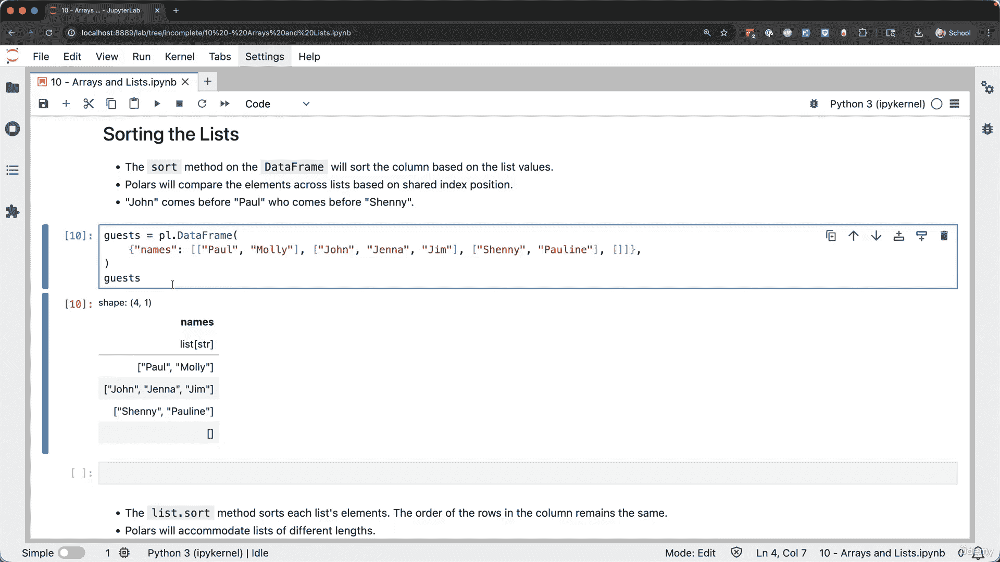
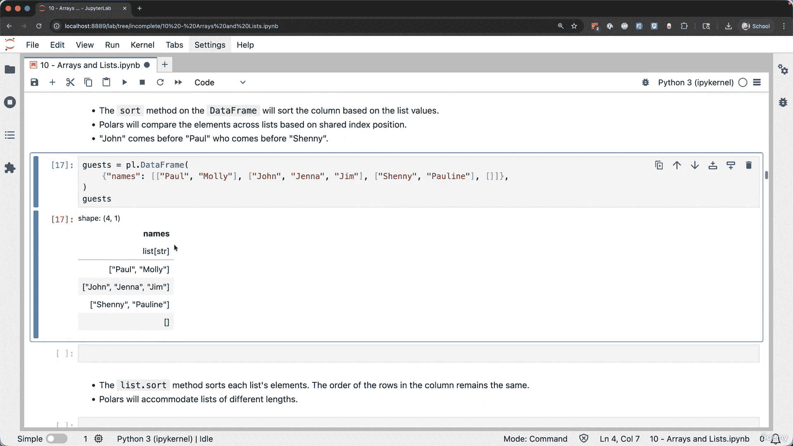
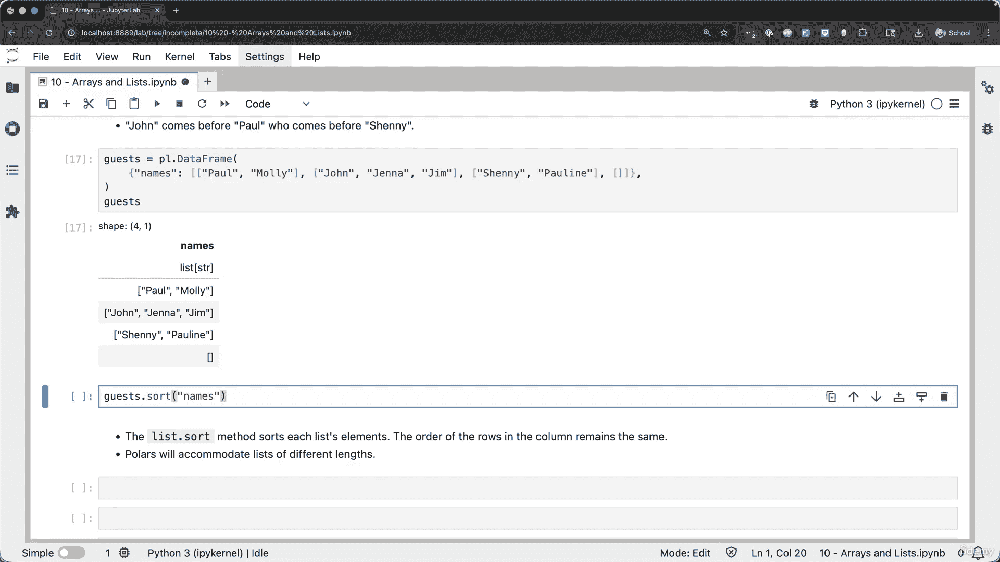
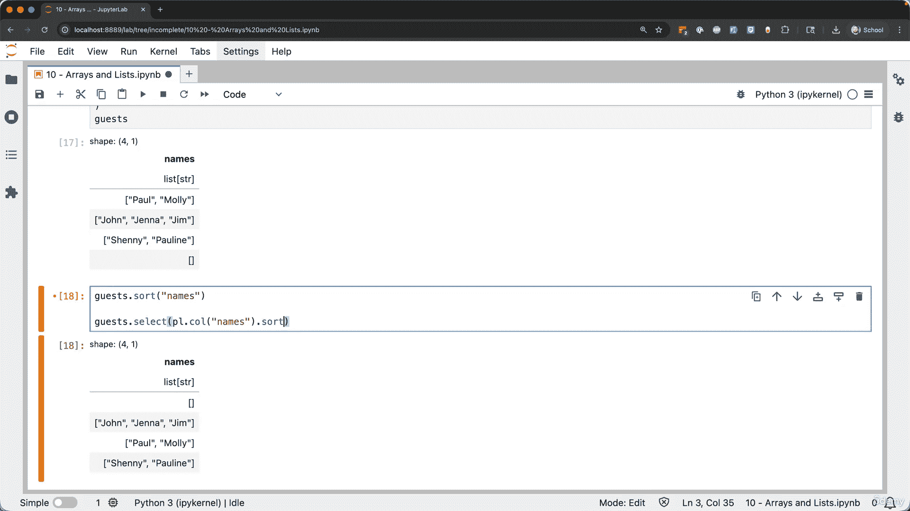
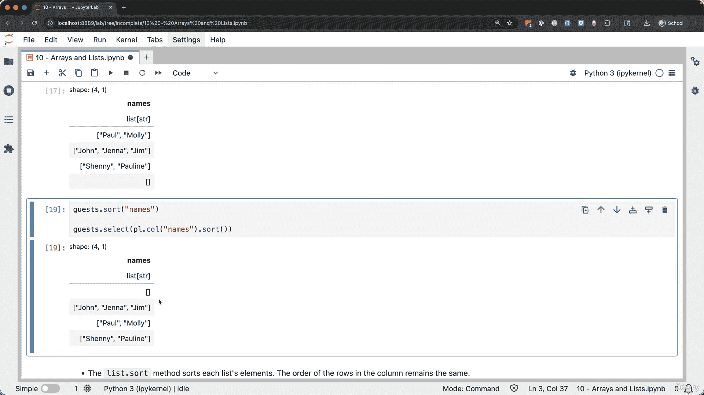
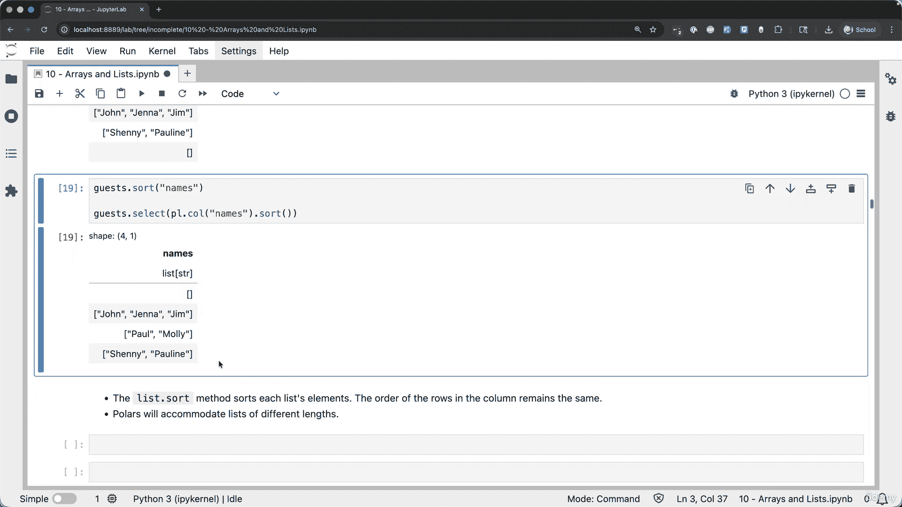
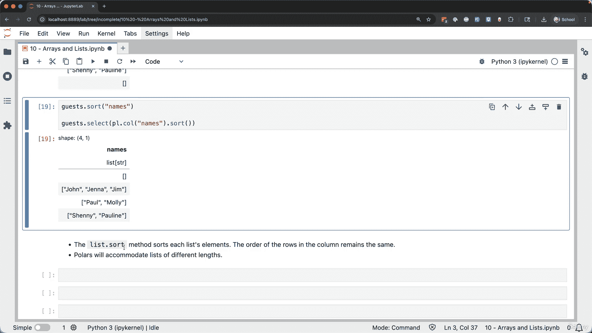
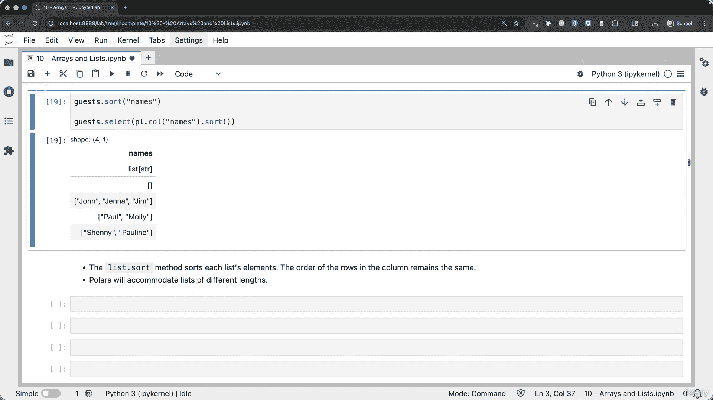
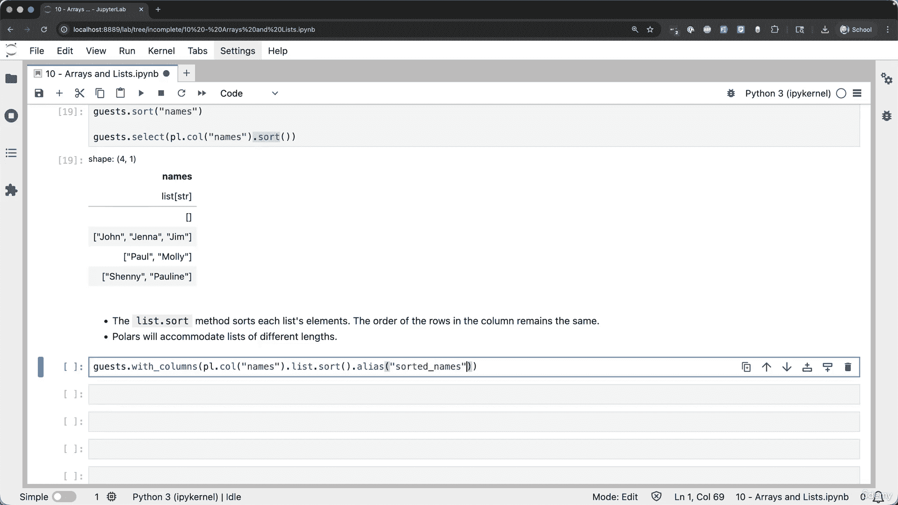
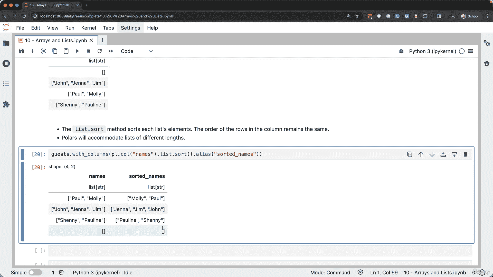

# 📊 Polars 与 Python 数据分析：第31节：列表排序

在本节课中，我们将学习如何在Polars里对存储列表的列进行排序。这个问题看似简单，但实际有几种不同的处理思路。我们会先介绍基于DataFrame的sort方法，然后再介绍list命名空间里的另一个sort方法，最后比较这两者的不同用法。



## 🔍 排序列表列的两种基本思路



首先，我们先来简单谈一谈排序。对于一个存放列表的列，排序其实可以有两种理解：一是把“整个列表”当作排序依据，对行进行排序；二是保持行的顺序不变，只把每个列表内部的元素依次排好。Polars里恰好分别提供了对应的方式。

这里再次使用guests数据框，它里面有一列存储的是字符串列表，列名叫names。提醒一下，在Polars中，DataFrame对象本身就提供了sort方法，可以直接调用。我们先来看第一种思路。

## 🔄 使用DataFrame.sort对整列排序

在DataFrame上调用sort方法时，只需要传入列名即可。这里传的是字符串形式的列名，不需要额外构造表达式。比如：

```python
guests.sort("names")
```

如果在jupyter里执行上面这行，你会看到空列表被排到了最前面，随后其他行按照一定的顺序排列。这是因为Polars会比较每个列表在共享索引位置上的元素，也就是从每个列表的索引0开始逐个比较。举个例子，索引0的位置上，John排在Paul前面，Paul排在Sheny前面。这样一来，整个列的顺序也就确定了。

需要特别说明的是，这里排序的是“列本身”，也就是行的顺序会被完全重新排列。你可以看到，行是按照列表内条目的顺序被重新调整的。但注意，这些列表本身内部的元素是没有被排序的，它们只是被用作整列排序的依据而已。



当然，除了直接在DataFrame上调用sort，还有另一种等效的写法。你可以对guests调用select方法，然后创建一个指向names列的表达式，再在这个表达式上调用sort。例如：

```python
guests.select(pl.col("names").sort())
```





这种写法更偏向“表达式驱动”的风格，但得到的结果和刚才完全相同。它做的事情依然是把行本身的顺序重新排列，列表里的内容不会发生任何变化。换句话说，无论用哪种语法，只要调用的是表达式或者DataFrame上的sort方法，你都是在“整列排序”，而不会修改单个列表内部元素的顺序。

## 🧩 使用list命名空间内的sort排序列表元素

刚才介绍的方法虽然叫“排序”，但排序的目标并不是列表内部元素。如果你希望保持每一行的顺序不变，仅仅把每个列表里的元素按顺序排好，那就需要用到list命名空间里的sort方法。这个方法的调用方式略有不同，接下来我们看具体的例子。







我们可以对guests调用with_columns方法，这样就能同时看到原始列和新生成的列，方便对比。首先创建一个表达式指向names列，然后访问list属性，进入list命名空间，再调用sort方法。注意这里的语法层次很重要：之前我们在顶级调用sort（DataFrame.sort或表达式.sort），而这里是在list命名空间内部使用sort。代码是这样的：

```python
guests.with_columns(
    pl.col("names").list.sort().alias("sorted_names")
)
```

给这个新列起个名字，叫做sorted_names。运行之后，你会看到原始行都保留了下来，每个列表内部的元素也都按字母顺序排好了。比如Molly被放到了Paul前面，Pauline被放到了Shanie前面，等等。当然，空列表还是空列表，它不会变成任何内容。

对比一下前面的结果：使用DataFrame.sort或表达式.sort时，列表内部顺序不变，行顺序改变；而使用list.sort时，行顺序不变，列表内部顺序改变。这就是它们最核心的区别。

## 📝 两种排序方式对比总结

两种方式都介绍完了，下面我们来总结一下。这节课一共介绍了两种“排序列表”的途径，它们的适用场景完全不同。为了让大家更直观地对比，我把关键区别列在下面：

- DataFrame.sort("names") 或者 pl.col("names").sort()：作用于整个列，按列表内容整体排序，结果会重新排列行，但不会改动列表内部的元素顺序。
- pl.col("names").list.sort()：作用于每个列表内部，对每个列表中的字符串单独排序，结果会保持原始行顺序不变，只改变列表内部元素的排列。

所以说，当你看到“排序列表”这个词时，一定要先想清楚：你是想对一组列表进行行级别的排序，还是想对每个列表内部的元素进行排序？在Polars中，这两种需求分别对应不同的sort调用方式。只要结合自己的实际场景选择合适的写法，就不会弄混了。





本节课我们一起学习了Polars中针对列表列排序的两种方式。首先我们了解了DataFrame自带sort方法，传入列名字符串即可对整个列排序，并且会重排行顺序；其次我们学习了list命名空间内的sort方法，它能对每个列表内部元素排序，同时保持原始行顺序。最后我们还通过对比总结出了两种方法的核心区别。希望下次遇到列表排序时，你能快速选出正确的方案。
