# 🧩 Polars 与 Python 数据分析：132：explode 方法

在本节课中，我们将要学习 Polars 里的 `explode` 方法。这个方法可以针对列表中的每一个元素创建一行记录，也就是逐个访问每个容器，把容器里的元素抽取出来，放到各自的新行中。这样处理之后，原本嵌套在列表里的内容会变成平铺的行数据。这里还需要先记住一个关键点：如果某个列表是空列表，它会表现为一行 `null` 或缺失值。这种操作在编程中常被称为 `flatten` 操作，`flatten` 的意思是把多维数据结构变成一维扁平结构。我们这里的技术场景是“列表里面还包含列表”，所以结果就是创建一个没有嵌套内容的、单个扁平一维列表。下面先从方法本身说起。

## 🧠 Polars 与 Python 数据分析：132：explode 方法是什么

`explode` 方法的核心作用是拆行，概念可以用下面的公式描述：`列表中的每个元素 -> 单独一行`。如果原始数据中某一列有 4 行，而每行列表里的元素总共有 8 个，那么拆开之后就会得到 8 行。空列表则记作一行 `null`，可以用公式表示为：`空列表 [] -> 一行 null`。为了更直观，也可以看下面的代码表达：

```python
pl.col("names").list.explode()
```

下面列出理解 `explode` 方法时最需要先掌握的三个要点。

- 方法作用：它会为每个列表中的每个元素创建一行记录，也就是遍历每个容器，把每个元素抽取到自己的新行中。例如 `Molly` 会得到一行，`Paul` 会得到一行，`J`、`Jent`、`Jim` 等也会各自得到一行。
- 空列表处理：如果遇到空列表，这个空列表会表示为一行 `null` 或缺失值，这一点在实际数据中需要特别注意。
- 扁平化含义：编程术语中的 `flatten` 就是把多维数据结构变成一维结构；我们当前的数据技术上是“列表包含列表”的多维结构，而结果是创建一个没有嵌套内容的单个扁平一维列表。

理解这些概念后，我们再看一个容易踩坑的地方：为什么这里不能直接使用 `with_columns`。这会帮助我们理解 `explode` 改变行数之后带来的影响。

## ⚠️ Polars 与 Python 数据分析：132：为什么不能用 with_columns

为了回到初始状态，我们重新执行前面的代码。这里要再次强调，不能在这个场景中使用 `with_columns` 方法。原因在于，`with_columns` 接受表达式，它创建的列需要和原 DataFrame 的长度一致，这样才能把新列添加到已有 DataFrame 上。这个长度要求可以用公式表示为：`with_columns(新列) 要求 原列长度 = 新列长度`。

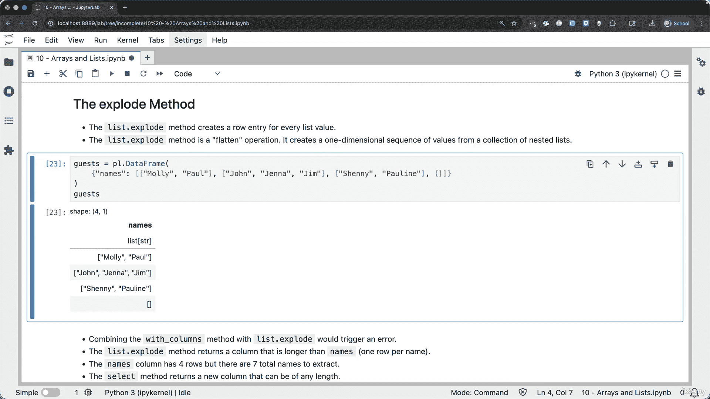

下面把不能使用 `with_columns` 的原因拆成几个点说明。

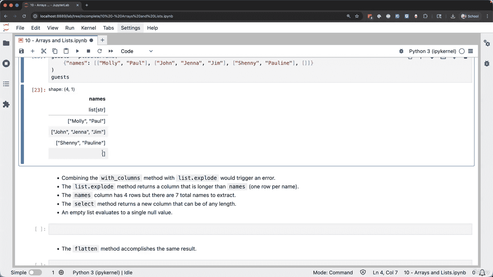

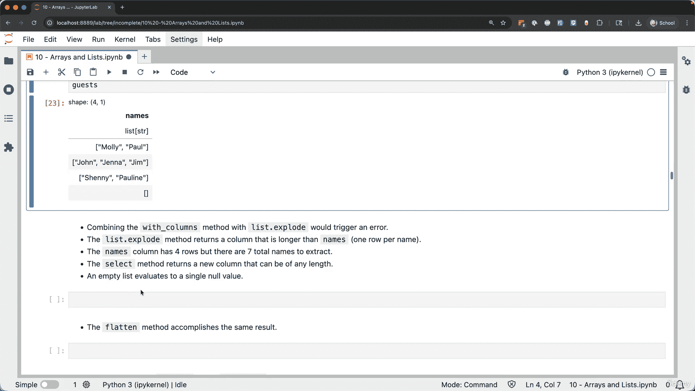

- `with_columns` 接受的是表达式，它期望生成的新列长度和原 DataFrame 一致，从而能够把新列拼接到原表上。
- 当前 DataFrame 的 `names` 列有 4 行，而我们要生成的新列会有 8 行。
- 因为 4 行和 8 行长度不一致，`with_columns` 在这里会触发错误。
- 所以这里不能使用 `with_columns`，而应该改用 `select` 方法。

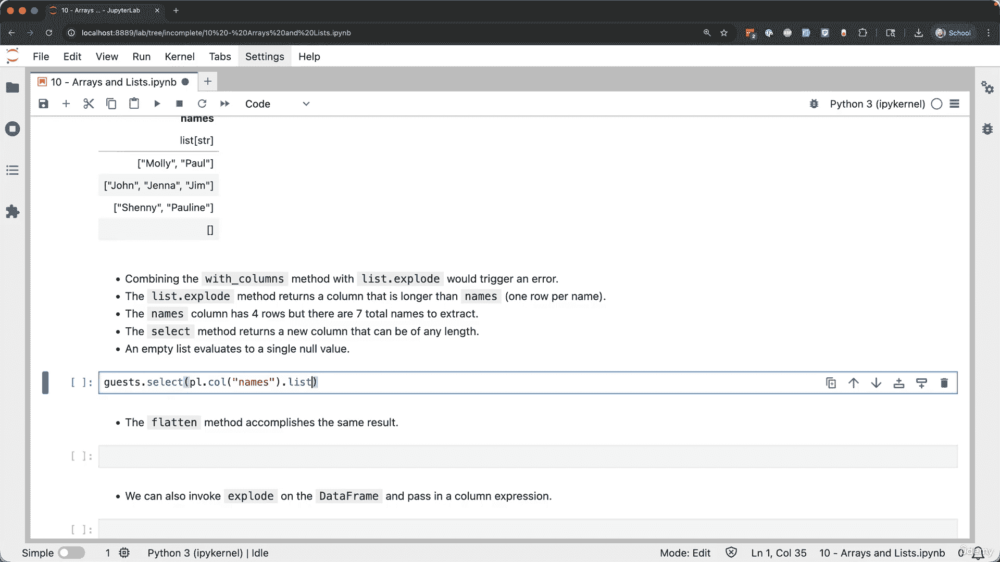

既然 `with_columns` 不合适，本节中我们来看看用 `select` 配合 `list.explode` 的写法。这个写法会生成一个新的 DataFrame，而不是往原表上拼接长度不同的列。

## 🛠️ Polars 与 Python 数据分析：132：使用 select 和 list.explode

这里我们调用 `select` 方法，在表达式中定位 `names` 列，然后进入 `list` 命名空间，调用 `explode` 方法。代码如下：

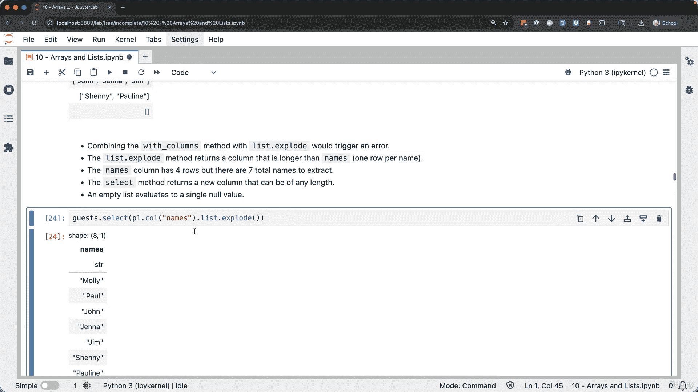

```python
guests.select(
    pl.col("names").list.explode()
)
```

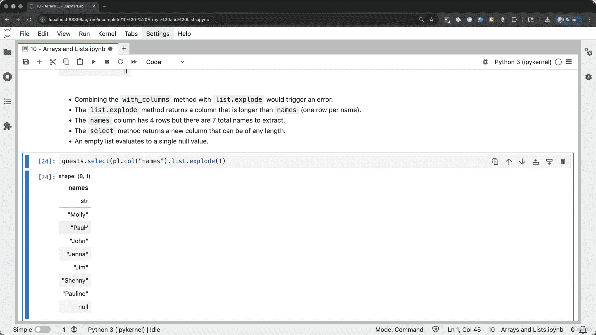

结果可以预期，我们会得到一个包含 8 行的新列。更准确地说，是一个只有一列、共 8 行的 DataFrame。可以看到，每个嵌套列表元素都被抽取到了自己的行中，顺序既保留了列表出现的顺序，也保留了元素在原列表中的顺序。到这里，就完成了完整的扁平化操作。这也是 `explode` 方法最直接的用法。下面我们继续看看 Polars 中另外两种可以得到相同结果的写法。

## 🔁 Polars 与 Python 数据分析：132：另外两种等价写法

在 Polars 中，实际上有几种不同方式可以完成同样的结果。如果不想进入 `list` 命名空间，也可以使用顶层的 `flatten` 方法，它也能得到完全相同的结果。代码如下：

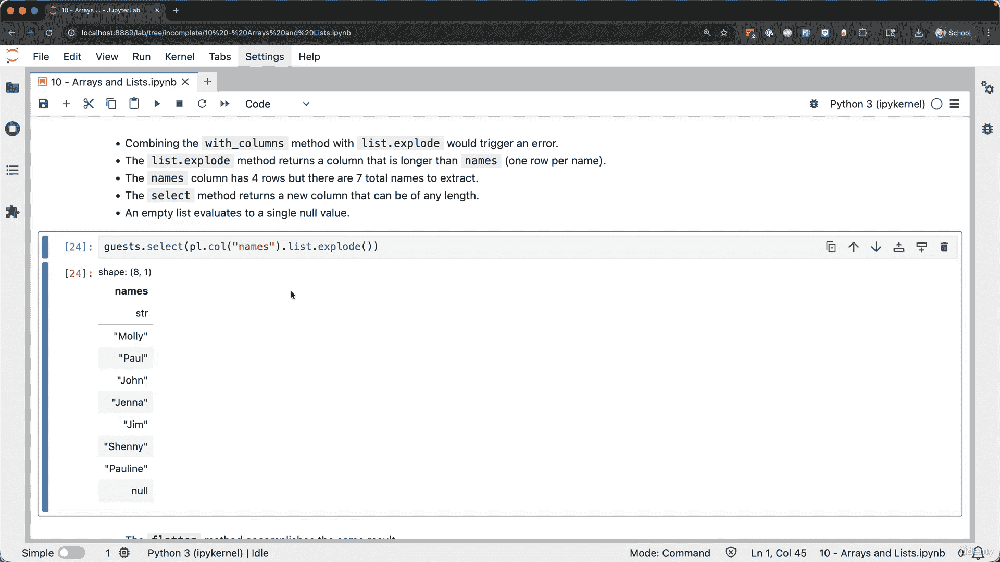

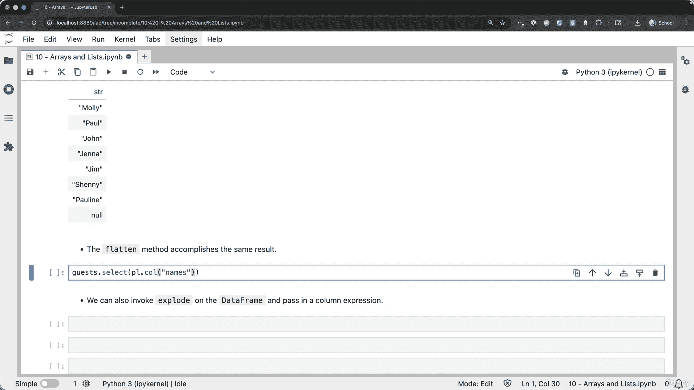

```python
guests.select(
    pl.col("names").flatten()
)
```

这样会得到完全相同的数据框。最后还有一种方式，就是从顶层 DataFrame 本身开始操作，也就是在 `guests` 这个 DataFrame 上调用特殊的 `explode` 方法，并传入存放列表的列。这里创建一个定位 `names` 列的表达式，代码如下：

```python
guests.explode(
    pl.col("names")
)
```

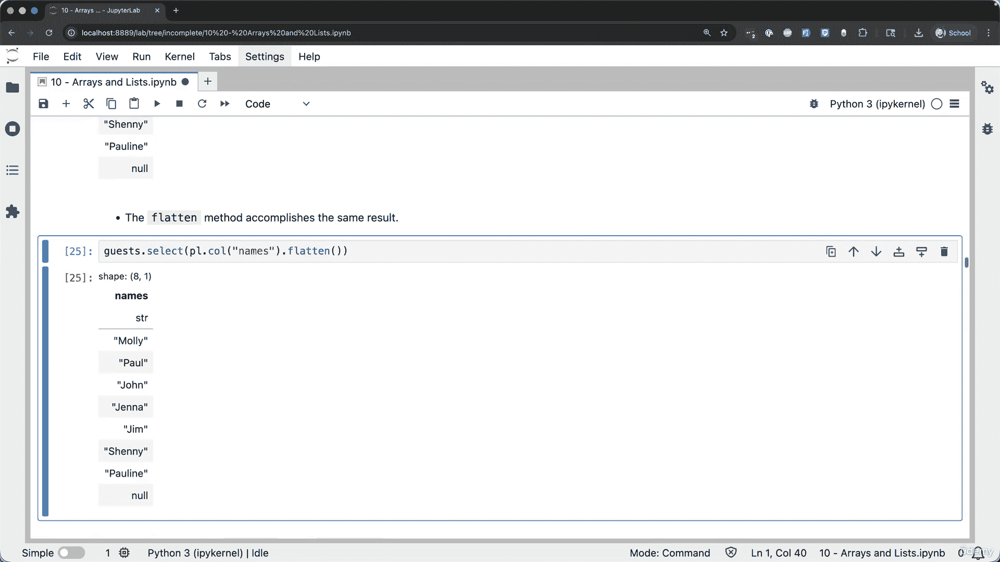

这同样会产生完全相同的结果，也就是一个只有一列、共 8 行的新 DataFrame。三种写法都得到同样结果，接下来处理空列表留下的 `null`。提醒一下，结果末尾有一个 `null` 值，它来自数据集中的空列表。如果想去掉这个值，可以通过方法链调用 `drop_nulls` 方法。

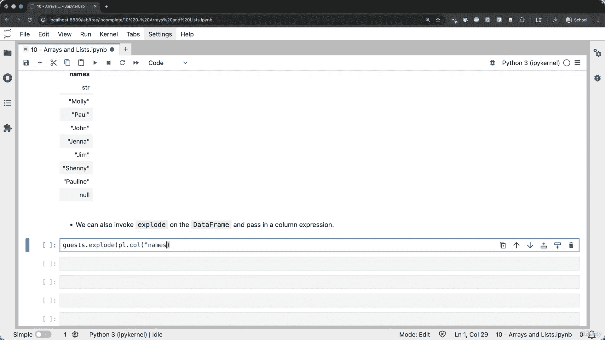

## 🧹 Polars 与 Python 数据分析：132：删除空列表产生的 null

如果想删除这个 `null`，可以直接在结果后链式调用 `drop_nulls`。从技术上说，单独调用 `drop_nulls()` 在这个简单例子里已经够用。但需要记住，如果 DataFrame 有多列，这样做的影响会不同。所以为了更明确，这里传入一个表达式，指定 `names` 列作为检查 `null` 值的列。代码如下：

```python
guests.explode(
    pl.col("names")
).drop_nulls(
    pl.col("names")
)
```

下面给出删除 `null` 的步骤和注意点。

- 先在 `explode` 或 `flatten` 的结果上调用 `drop_nulls` 方法。
- 如果表里只有这一列，单独调用 `drop_nulls()` 已经够用。
- 如果 DataFrame 有多列，删除 `null` 的影响会不同，所以更明确地传入表达式，指定检查 `names` 列。
- 这样会得到一个新的 7 行列，因为原来的 8 行中有一行 `null` 被删除了。

处理完 `null`，最后我们看看实际用途并做总结。这个例子中，如果晚餐聚会按组登记来宾，而我们想抽取所有来宾的完整名单，这个方法就很有帮助。我们从一个“列表的容器”开始，抽取成单个扁平一维的姓名容器，这就是 `explode` 方法。

## 📌 Polars 与 Python 数据分析：132：实际用途与总结

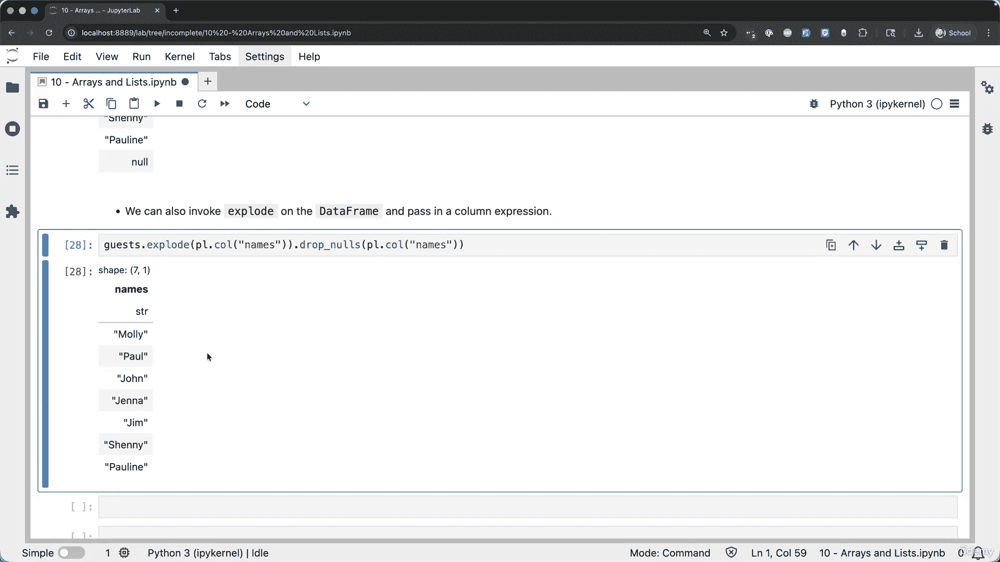

本节课中我们一起学习了 `explode` 方法。它会把列表中的每个元素拆成单独一行，公式可以概括为：`列表容器 -> 扁平一维容器`。空列表会变成一行 `null`，可以用 `drop_nulls` 删除；同时我们了解了不能使用 `with_columns` 的原因，因为原列 4 行和新列 8 行长度不一致会报错。我们掌握了三种等价写法：`pl.col("names").list.explode()`、`pl.col("names").flatten()`，以及 `guests.explode(pl.col("names"))`。这些写法都能把嵌套列表展开成平铺行，并且保留列表出现顺序和元素原顺序。最后，在实际场景中，如果要把按组登记的来宾名单整理成完整的一维名单，`explode` 方法就是直接而清晰的处理方式。

