# 使用Polars和Python进行数据分析：第二部分第33讲：多列列表的爆炸操作 🚀

在本节课中，我们将学习如何对多个包含列表的列执行爆炸（explode）操作。上一节课我们已经见识了 explode 方法如何把单个列表展开成多行，但实际工作中我们经常遇到两个列同时保存列表的情况，这时 explode 会表现得更加灵活。我们会从最简单的等长列表配对开始，然后过渡到长度不一致的共享列表，最后还会讨论两种完全等价的操作顺序。整个过程会配合具体的代码示例，确保你能轻松掌握。

## 回顾 explode 与准备示例数据 🔍

先花一点点时间回顾一下 explode 的核心行为。explode 方法本质上是一个展平操作，它会把一列中的列表拆开，让列表里的每一个元素单独占一行。你可以把列表想象成一个压缩包，explode 就是解压的过程。上一节课我们只对一个列表列做这种解压，但今天我们要同时面对两列列表。

我们沿用之前的 guest 数据框，它最开始只有一个 names 列。现在，我们假设新增一列名为 entrees，这一列同样在每一行都保存一个列表。entrees 列表代表的是送到每张桌子、分给每个人的晚餐菜品。

举个例子，第一行 names 列表是 ["Paul", "Molly"]，对应的 entrees 列表就是 ["fish", "steak"]，表示 Paul 吃了鱼，Molly 吃了牛排。为了保持这种对应关系，我们可以规定：names 列表里有多少个元素，entrees 列表里就有多少个元素。下面这段代码创建了最初的示例数据：

```python
import polars as pl

guests = pl.DataFrame({
    "names": [["Paul", "Molly"], ["John", "Jenna", "Jim"], ["Sheny", "Pauline"], []],
    "entrees": [["fish", "steak"], ["fish", "chicken", "steak"], ["chicken", "steak"], []]
})
```

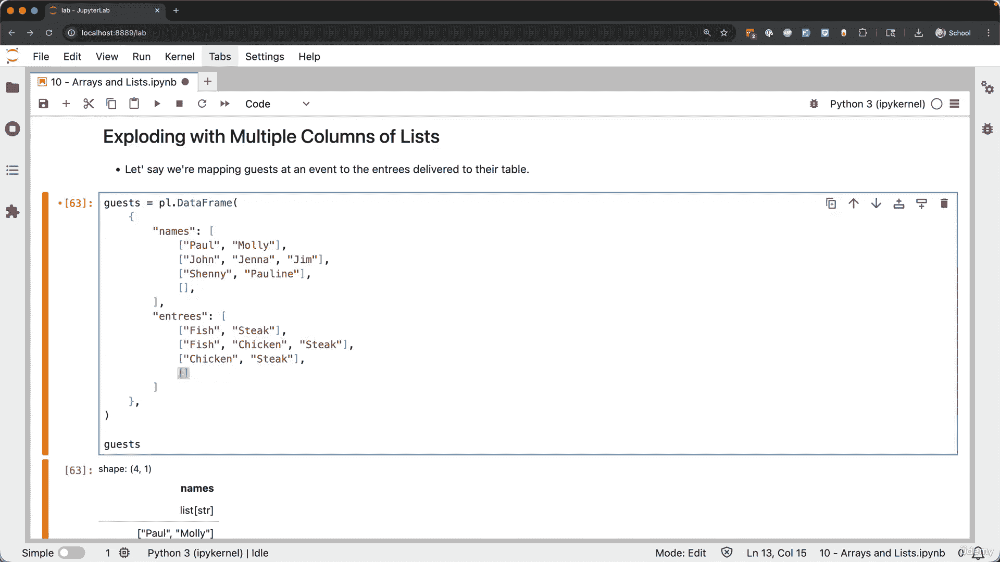

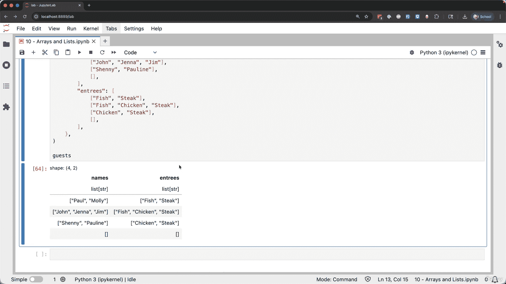

这个数据框一共有四行两列。names 列和 entrees 列存储的都是字符串列表。有一个非常重要的细节：在同一行内，names 列表的长度和 entrees 列表的长度是完全相等的。比如说第二行，names 里有三个人，entrees 里也正好有三道菜，John、Jenna、Jim 分别对应鱼、鸡肉和牛排。第三行是 Sheny 和 Pauline，对应鸡肉和牛排。最后一行是空桌，所以两个列表都是空的。

我们的目标很清晰：创建一个新的数据框，把每个人和他吃到的菜一一连接起来。也就是说，最终结果应该出现 Paul 对应鱼、Molly 对应牛排这样的映射。如果只是简单地把两个列表按位置配对，等长列表会非常方便。

## 多列同时爆炸：等长列表的优雅配对 ⚡

前面提到，当两个列表列等长时，我们其实可以直接把两个列同时传给 explode。具体做法是给 explode 传入一个列名列表，也就是同时传入 names 和 entrees。Polars 看到我们提供了两个列表列之后，会自动采用按位置配对的规则。

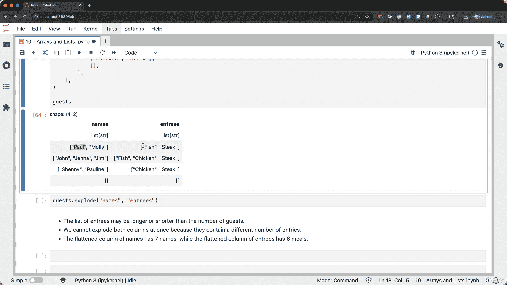

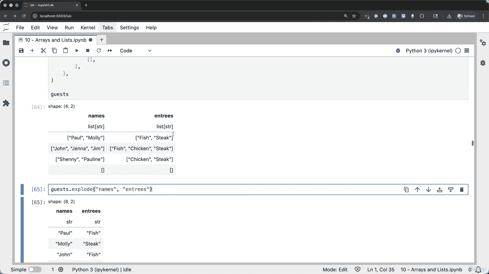

这个规则是什么意思呢？对于任意一行数据，Polars 会假定我们希望把第一个列表的第 0 个元素和第二个列表的第 0 个元素配对，第 1 个元素和第 1 个元素配对，以此类推。举个例子，Paul 在 names 列表中的索引是 0，fish 在 entrees 列表中的索引也是 0，所以 Polars 会把 Paul 和 fish 连接起来。正因为每个列表都等长，这种配对非常容易，也显得特别优雅。

对应代码如下：

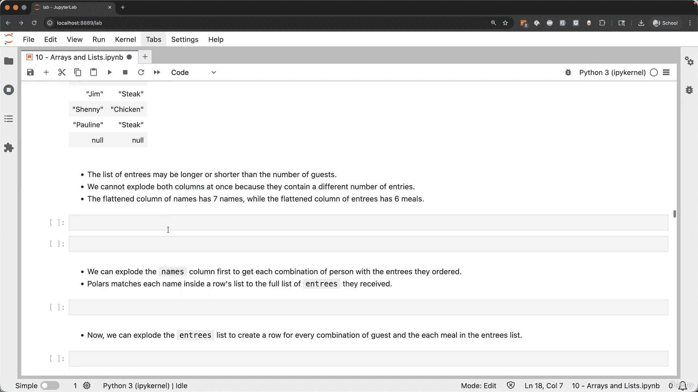

```python
guests.explode(["names", "entrees"])
```

这条语句会返回一个新数据框，其中每个原列表元素都变成了独立的一行。由于列表长度相等，一切都会非常顺畅。当你有两个列表列并且它们等长时，用这种多列同时爆炸的方法再合适不过了。不过，现实数据很少这么完美，所以我们需要考虑更复杂的场景。

## 复杂场景：从“一人一菜”变成“整桌共享” 🍽️

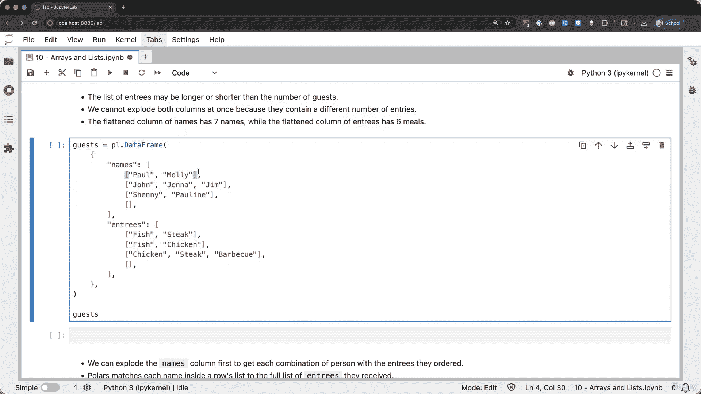

现在我们把示例稍微变复杂一点儿。假设 entrees 列表不再是“菜对个人”的映射，而只是这张桌子所有人共享的一堆菜。换句话讲，entrees 列表的长度可能和人数相等，也可能不相等。我们仍然基于之前的 guest 代码，但需要调整 entrees 列的内容。

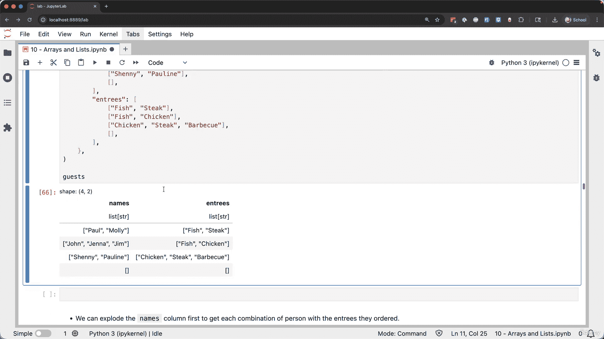

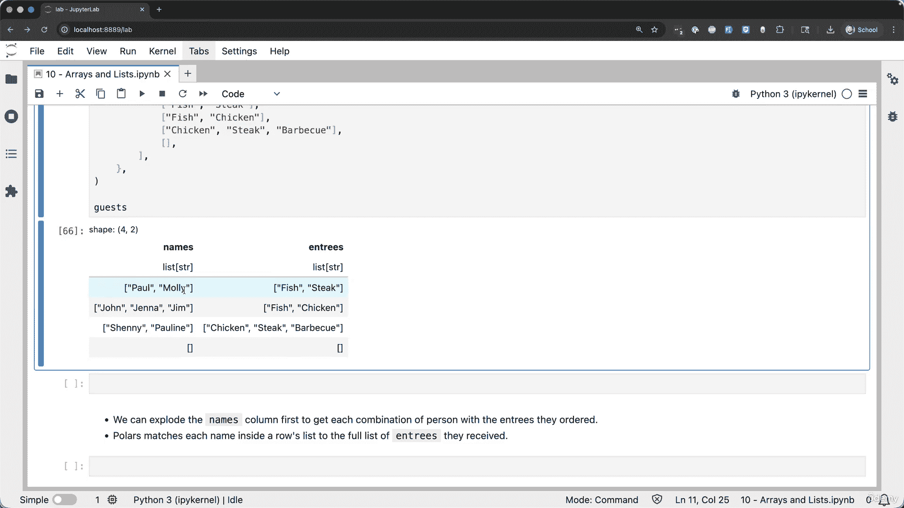

不妨这样假设：第一桌的 Paul 和 Molly 共享鱼和牛排，第二桌的 John、Jenna 和 Jim 只有鱼和鸡肉，第三桌的 Sheny 和 Pauline 则有鸡肉、牛排和烧烤。请注意，第一桌是 2 人 2 菜，第二桌是 3 人 2 菜，第三桌是 2 人 3 菜，第四桌则是空桌，没有任何菜。用代码表示就是：

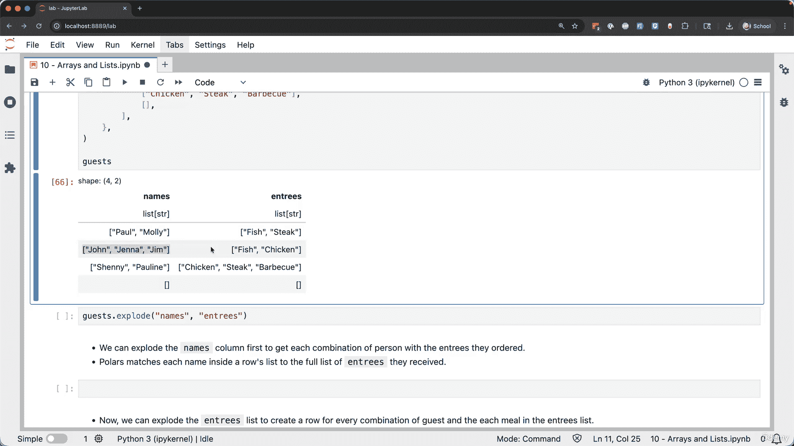

```python
guests = pl.DataFrame({
    "names": [["Paul", "Molly"], ["John", "Jenna", "Jim"], ["Sheny", "Pauline"], []],
    "entrees": [["fish", "steak"], ["fish", "chicken"], ["chicken", "steak", "barbecue"], []]
})
```

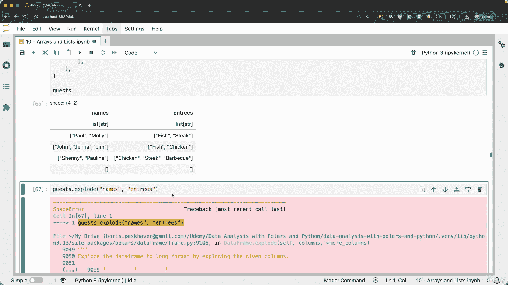

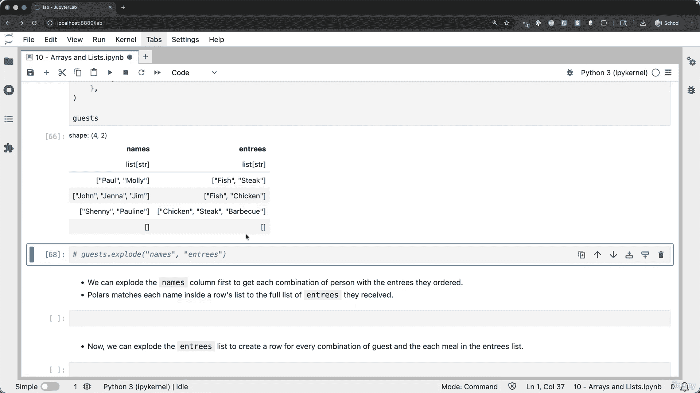

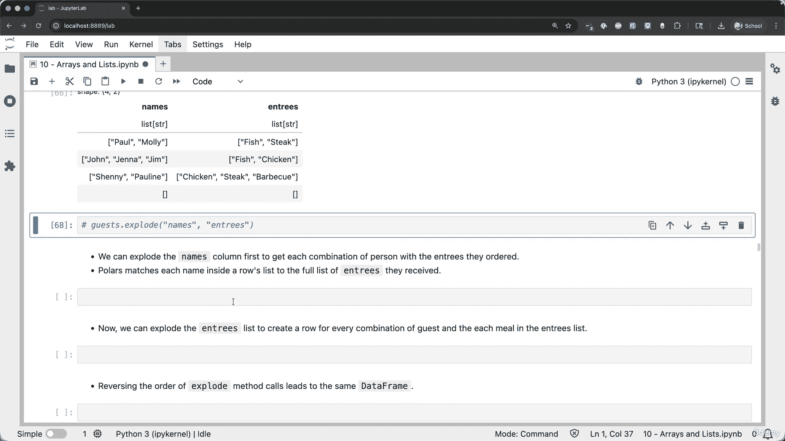

现在问题来了：我们依然想让每个人和他吃到的所有菜连接起来。Paul 那桌有两道菜，所以 Paul 需要出现两行，一行对应鱼，一行对应牛排。Molly 也一样，需要两行分别对应鱼和牛排。对于第三桌，Sheny 和 Pauline 每人都会有三行，分别对应鸡肉、牛排和烧烤。

如果这个时候我们还是直接同时传两个列给 explode，你会立刻发现问题。因为同一行内的两个列表长度不一致，Polars 默认会假设我们想要一对一映射。可现在我们有些列表长，有些列表短，直接运行时就会出现形状错误（shape error）。毕竟一对一映射要求两边元素一样多，现在这个前提已经不成立了。

那么怎么解决呢？其实思路很简单：不要一次性爆炸两个列，而是把 explode 方法一个接一个地链式调用，按顺序爆炸。

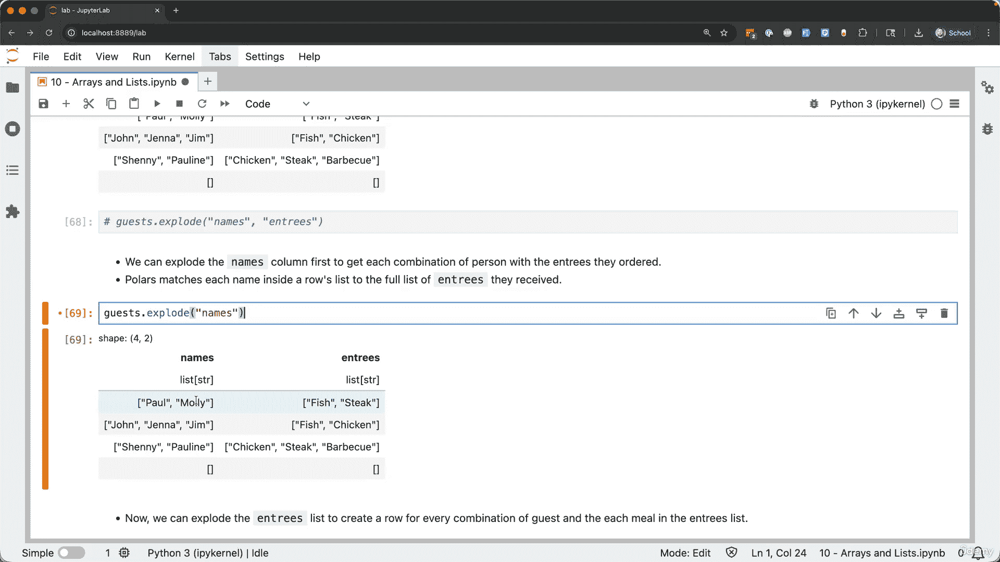

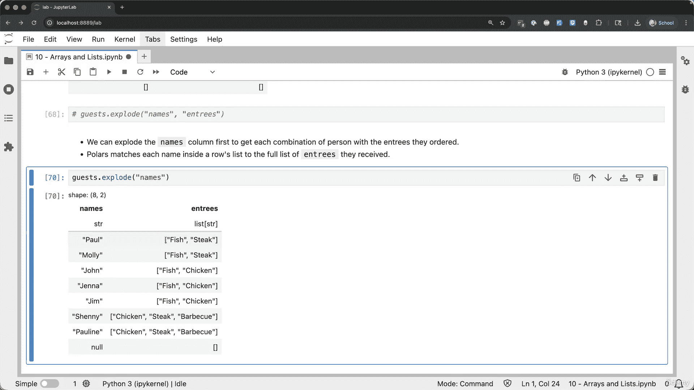

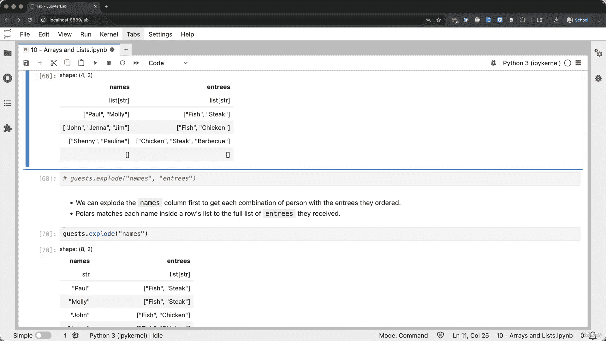

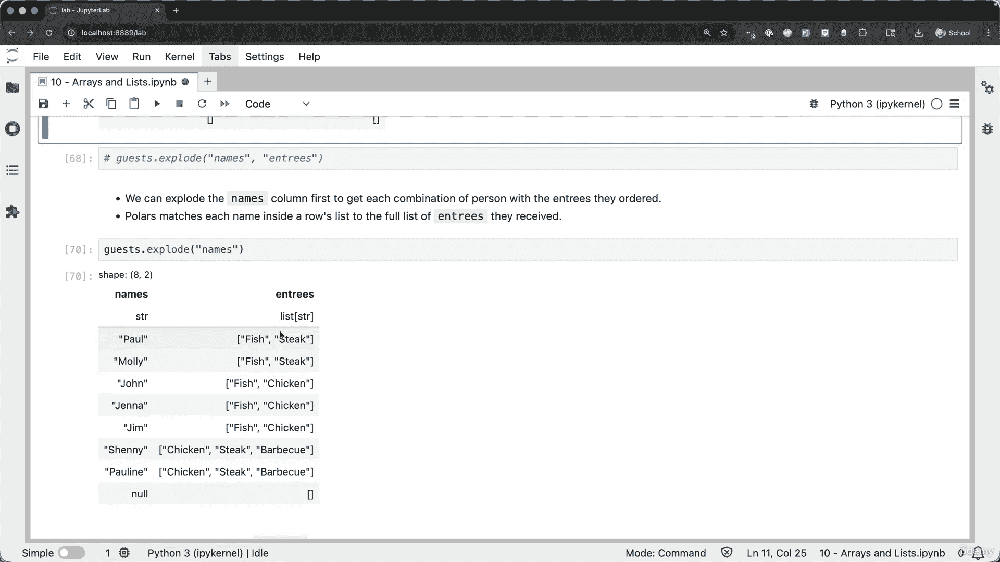

## 顺序爆炸：先展开 names，再展开 entrees 🔗

我们先对 names 列调用 explode。回顾一下，explode 会压平一个列表，把列表里的每个元素提取成独立的一行。所以这一步之后，Paul 会单独占一行，Molly 单独占一行，John、Jenna、Jim 也各自占一行。但有一件事非常关键：每一行仍然保留着这一行原本对应的完整 entrees 列表。

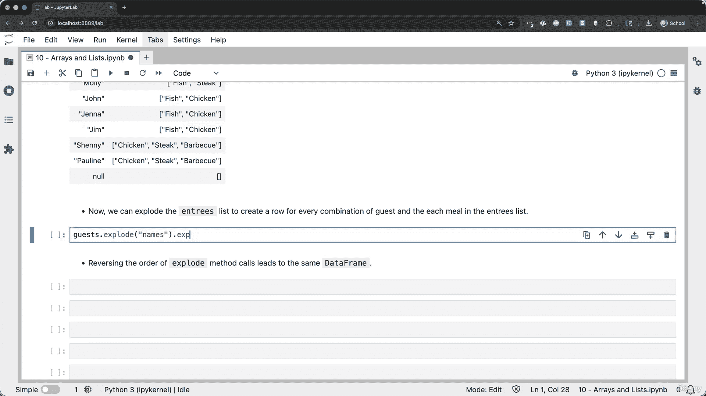

这是什么意思呢？Polars 实际上是在把 names 列拆开，每个列表元素对应一行，但同时会保留这一行其他列的全部值。由于 entrees 列没有被爆炸，它的值仍然是一个完整的列表。于是 Paul 这一行会带着 ["fish", "steak"] 这个完整列表，Molly 这一行也一样。听起来好像是复制粘贴，但这就是我们需要的中间状态。

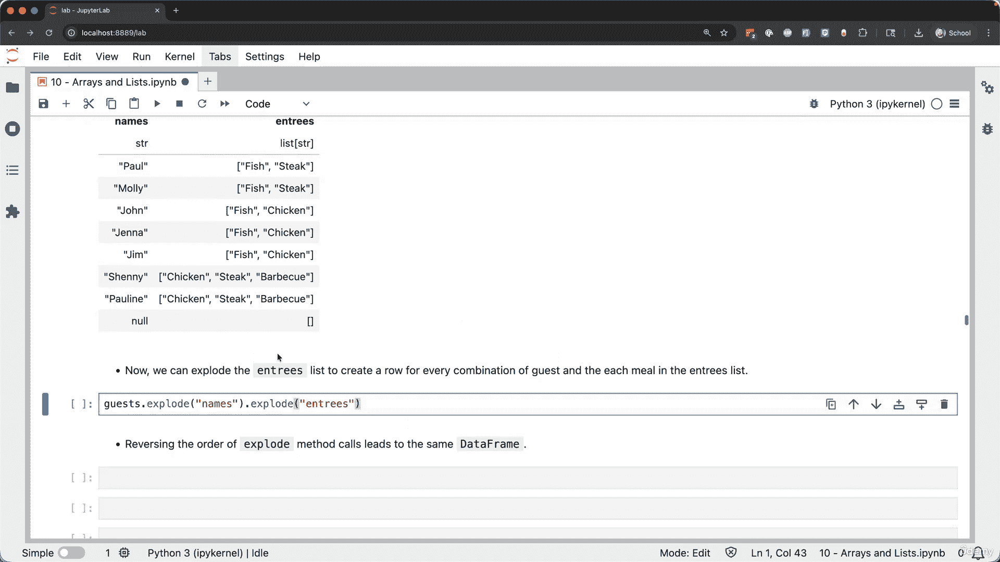

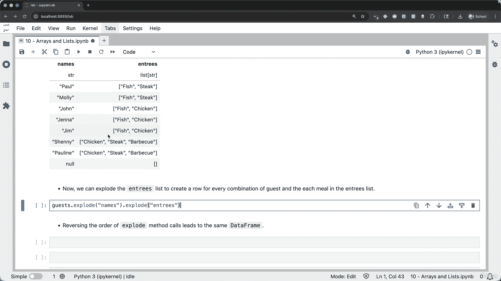

接着，我们再次调用 explode，这次指定 entrees 列。Polars 会把 entrees 列表展开，并把展开后的每个菜都映射到当前行的人物上。这样 Paul 会在第一行对应鱼，下一行对应牛排。Molly 也是如此，先对应鱼，再对应牛排。第三桌的 Sheny 和 Pauline 则会分别得到三行，依次对应鸡肉、牛排和烧烤。完整的链式写法是：

```python
guests.explode("names").explode("entrees")
```

运行之后，我们就得到了所有人和所有菜的映射关系。为什么这里不直接用多列同时 explode 呢？因为数据本身并不存在完美的“连续比较”或一一对应关系。如果我们的目标是把三个人分别映射到三道菜上，那么当然可以用常规的两个列名同时传给 explode。但现在没有这种一对一映射，最合理的做法就是逐个爆炸，把每个人映射到他所在桌子的每道共享菜上。

当然，你也可以换一种解决路径。比如你认为 Jenna 吃到了鸡肉，而 Jim 什么都没吃到，那就可以在这个列表末尾填充一个 None 值，让 Jim 映射到空值。不过这样一来，你需要自己思考三个人和两道菜之间的逻辑关系。如果这条逻辑说的是“三个人共享两道菜”，那我们现在采用的顺序爆炸方案刚刚好。

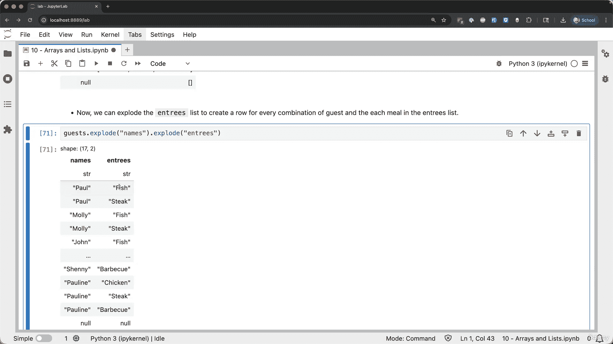

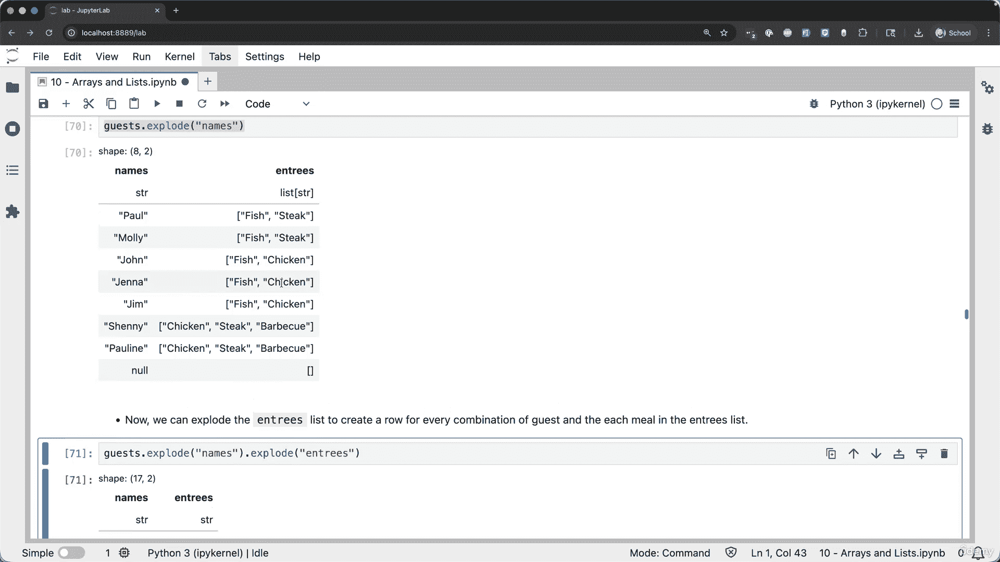

## 两种顺序，结果一致 🔄

你可能已经发现，上面的链式调用是先 names 后 entrees。如果把这个顺序完全反过来，也就是先 explode entrees，再 explode names，结论依然成立，只是中间过程不同。我们不妨把代码写出来看看。

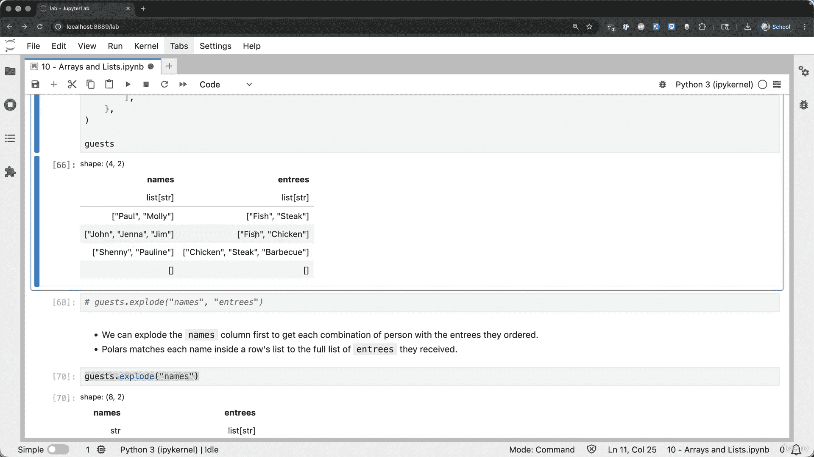

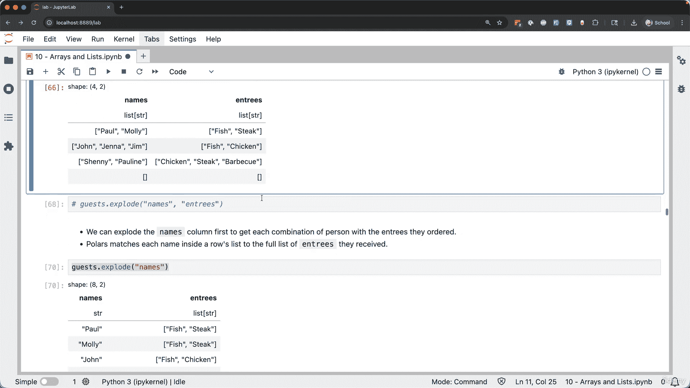

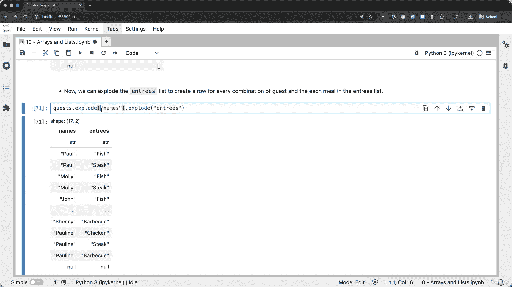

先对 entrees 列 explode，这样我们会在新数据框中为每个 entrees 列表元素创建一行。比如鱼一行、牛排一行、鸡肉一行等等。但需要注意，此时每一行仍会带着对应的完整 names 列表。也就是说，entrees 列表中的第一个元素“鱼”，会被映射到这一行的完整 names 列表上。牛排也一样，entrees 列中每一个嵌套列表的每个元素都会经历相同的过程。

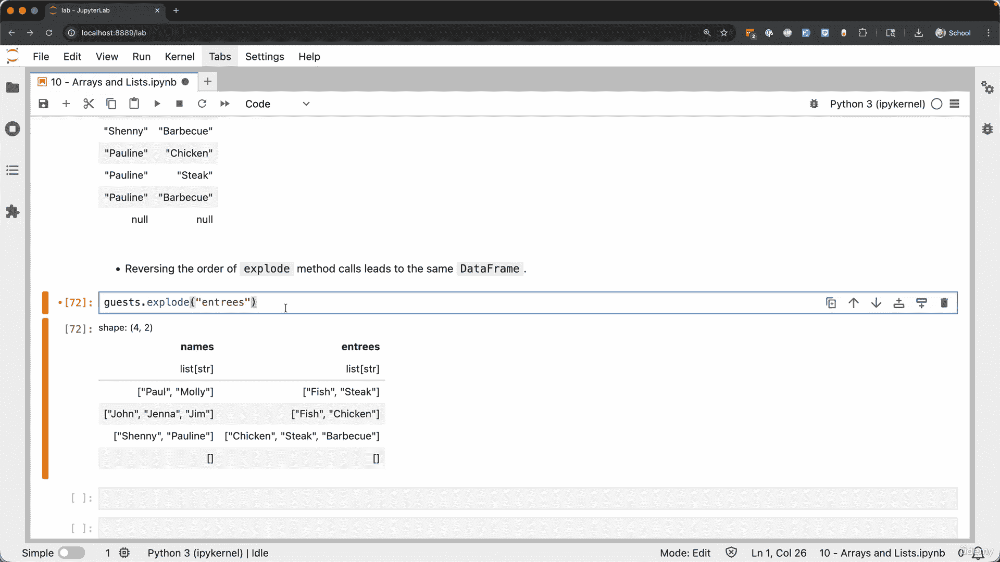

在这个中间结果的基础上，我们再调用一次 explode 并指定 names 列。此时 names 列表中的每个元素都会被展开，并映射到 entrees 列中对应的那一行。于是 Paul 被展开并匹配到鱼，Molly 被展开并匹配到鱼，接下来 Paul 又被展开并匹配到牛排，Molly 也同样匹配到牛排。一直这样处理下去，最终得到一个包含所有组合的数据框。这段代码是：

```python
guests.explode("entrees").explode("names")
```

这个结果和之前的结果在本质上完全一样，都是把每个人和他吃的菜组合起来，只不过行的排列顺序会有一些不同。在这个例子中，我们会得到总数为 17 行的人菜组合。其中每一行都对应一个人和一道菜，只是数据框的行顺序先后有差别，底层信息没有任何丢失。

如果你在数据中使用了 None 填充空值，并且希望删掉这些空值，可以在最后调用 drop_nulls 方法。这个操作会移除空桌带来的空行，也就是那些没有实际菜品的行。代码可以写成：

```python
guests.explode("entrees").explode("names").drop_nulls()
```

这样处理后，数据中只剩下了真实的人菜对应关系，非常干净。

## 总结 📝

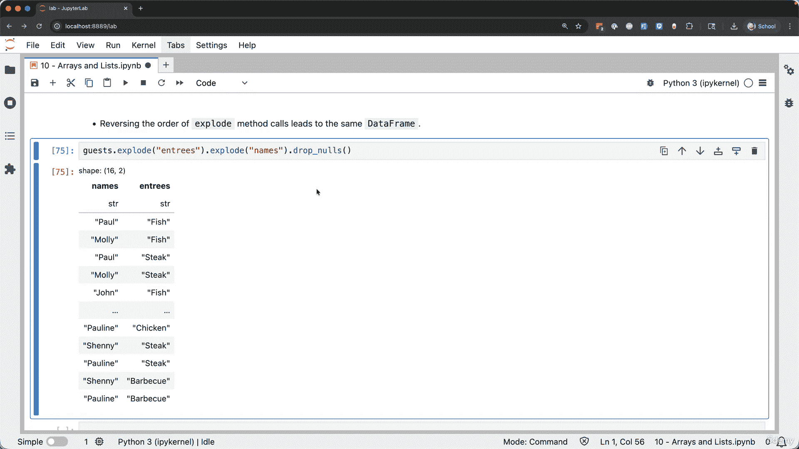

本节课我们一起学习了多列列表的爆炸操作，这也是对上一节课 explode 方法的进一步扩展。我们首先回顾了 explode 方法展平列表的核心作用，然后处理了等长列表的多列同时爆炸，接着又处理了长度不一致的共享列表场景。最关键的一点是：当多个列表列长度一致时，可以直接使用 `df.explode(["列A", "列B"])` 按位置配对；当长度不一致时，就需要通过顺序组合 `df.explode("列A").explode("列B")` 来生成所有组合。顺序甚至可以反转，结果依然大同小异。最后，我们还学习了用 `drop_nulls()` 清理可能出现的空值。再次强调，explode 方法会提取列表中的每个元素到独立行，当你有多个列表列并希望建立一一对应或交叉映射时，顺序组合爆炸是一个十分顺手的方法。
