# 🧮 Polars 与 Python 数据分析：第134节：列表列的数学运算

在本节课中我们将要学习 Polars 中“列表列”的数学运算。所谓列表列，就是某一列的每一行值本身都是一个数字列表。只要满足这个条件，我们就可以使用 `list` 属性或 `list` 命名空间下面额外提供的数学方法。下面我们会先创建一个示例数据框，再逐一看这些方法怎么用、结果是什么，以及空列表这种特殊情况会返回什么。

在开始介绍数学方法之前，我们先创建一个全新的数据框。这个数据框一共包含两列：第一列叫 `employee`，用来存放员工姓名；第二列叫 `emotional damage per meeting`，用来表示每位员工在参加会议时承受的相对“情绪损耗”。第二列中每一行都是一个列表，而列表里又存放该员工在每次会议中得到的评分，因此它实际上是一个“列表的列表”，每个嵌套列表对应一位员工。

```python
import polars as pl

work = pl.DataFrame({
    "employee": ["Alice", "Bob", "Carol", "Dave"],
    "emotional damage per meeting": [
        [6, 10, 8],       # Alice 参加了 3 次会议，评分是 6、10、8
        [7, 8, 1, 1],     # Bob 参加了 4 次会议，评分是 7、8、1、1
        [4, 4],           # Carol 有 2 个值：4 和 4
        [],               # Dave 没有参加会议，所以是空列表
    ],
})
```

这里可以补充说明每位员工的列表含义。Alice 一共参加了三次会议，她的评分分别是 6、10、8；Bob 参加了四次会议，评分是 7、8、1、1，可以理解为有两场比较难的会议、两场比较轻松的会议；Carol 的列表有两个值，分别是 4 和 4；Dave 没有参加会议，所以他的列表是空列表。这样得到的 `work` 数据框中，一列是字符串，另一列存放列表；不过这次不是字符串列表，而是 `i64` 整数列表。

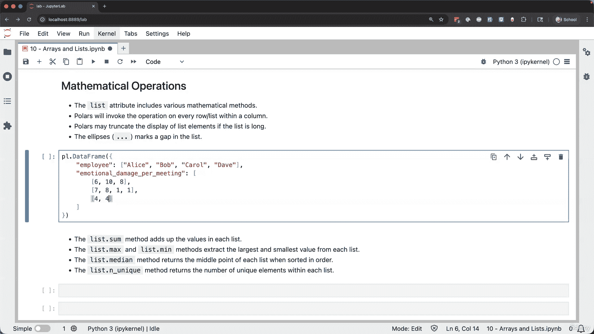

需要特别提示的是，当列表很长时，Polars 可能会截断或限制列表元素的显示。也就是说，它不一定会把完整列表全部打印出来，而是用省略号表示中间还有更多元素。

> 提示：Polars 显示长列表时可能用省略号表示中间还有元素；这和 DataFrame 只显示前五行和后五行、中间用类似省略号分隔是同一个道理。

我们已经把示例数据框赋值给了变量 `work`，并把结果显示在下面。接下来，我们想看一组范围比较广的数学方法，这些方法都可以直接作用在这些列表上。具体做法是取出 `work` 数据框，并调用 `with_columns` 方法。

```python
work.with_columns(
    pl.col("emotional damage per meeting").list.sum().alias("some"),
    pl.col("emotional damage per meeting").list.max().alias("X"),
    pl.col("emotional damage per meeting").list.min().alias("min"),
    pl.col("emotional damage per meeting").list.mean().alias("mean"),
    pl.col("emotional damage per meeting").list.median().alias("median"),
    pl.col("emotional damage per meeting").list.n_unique().alias("n_unique"),
)
```

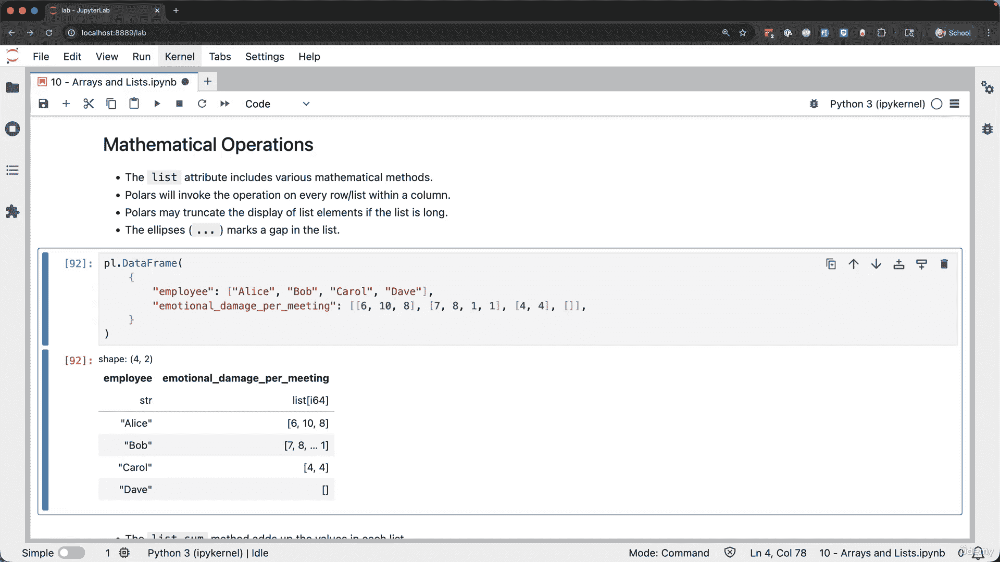

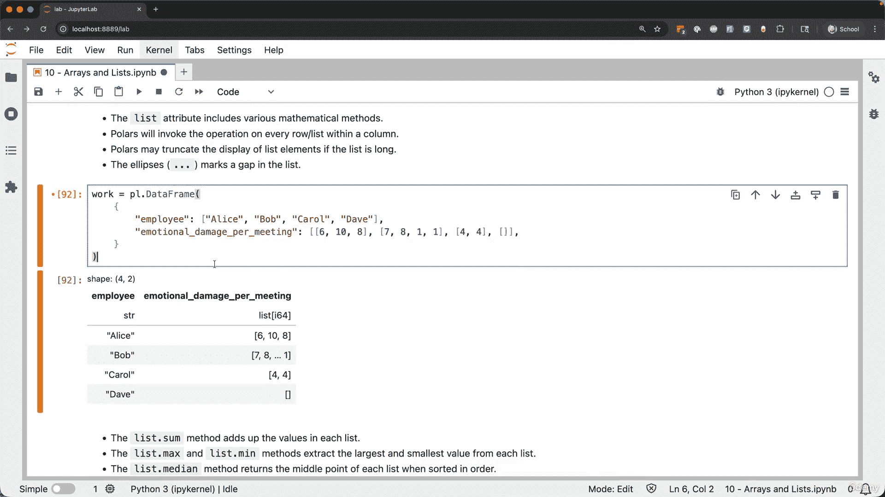

这些表达式都会 targeting 同一个新列，也就是存储整数列表的 `emotional damage per meeting` 列。我们再次访问 `list` 属性或 `list` 命名空间，里面会提供多种方法。首先，我们可以调用 `sum` 方法，把每个列表里的所有元素加起来。这里可以把结果列命名为 `some`，也就是代码里的 `alias("some")`。

对每个列表来说，`sum` 都会计算该列表所有元素的总和。比如 Alice 的列表是 `[6, 10, 8]`，计算公式就是 `6 + 10 + 8 = 24`。如果某一行的列表是空列表，那么求和结果就是 `0`。

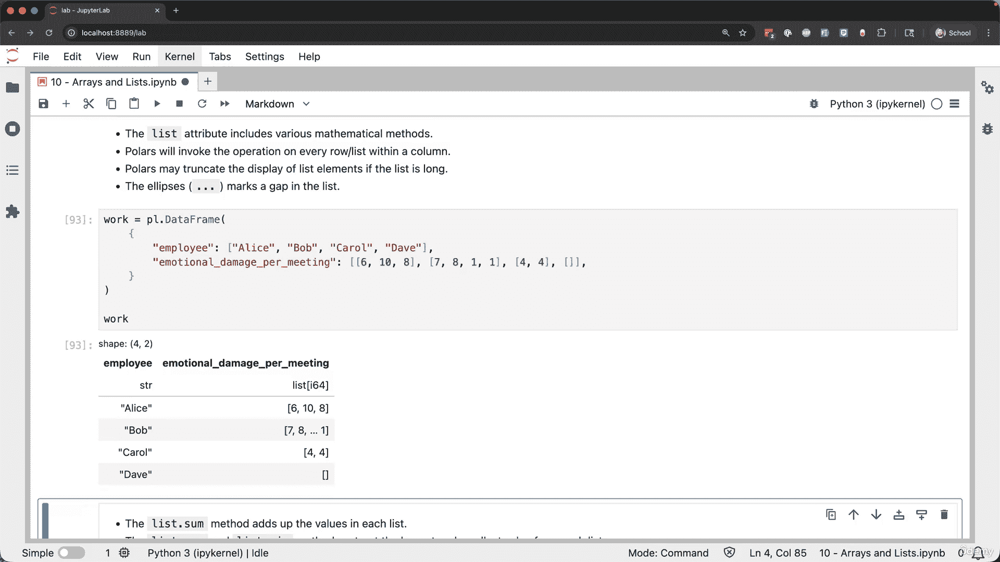

```python
sum([6, 10, 8]) = 24
sum([]) = 0
```

其余很多表达式结构都很类似，所以可以直接沿用这个写法，只替换方法名和别名。我们还会写另一个表达式，仍然 targeting 同一个列。这里有一个 `max` 方法，原文把结果列命名为 `X`；同时也有一个 `min` 方法，把结果列命名为 `min`。这两个方法分别从列表中提取最大元素和最小元素。

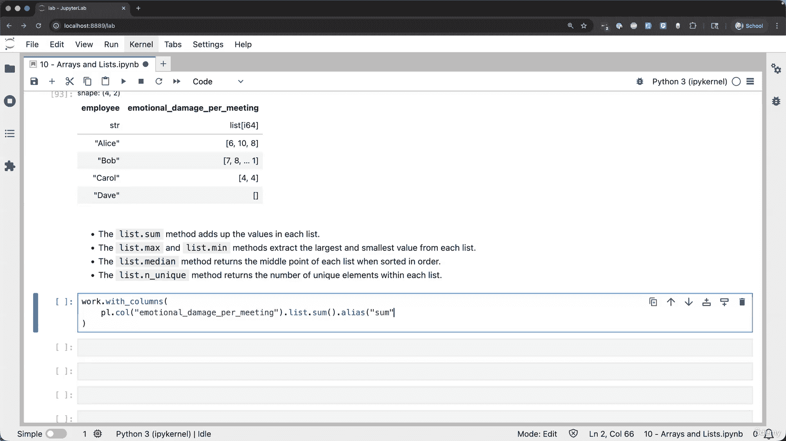

对 Alice 来说，列表中的最大值是 10，也就是说她经历过的最糟糕会议在“情绪损耗”上给了 10 分；列表中的最小值是 6。

```python
max([6, 10, 8]) = 10
min([6, 10, 8]) = 6
```

我们还可以计算列表元素的平均值。这个操作同样是按行、也就是按每个列表分别进行的。这里使用 `mean` 方法，它会给出每个列表的平均值。

```python
mean([6, 10, 8]) = 8
```

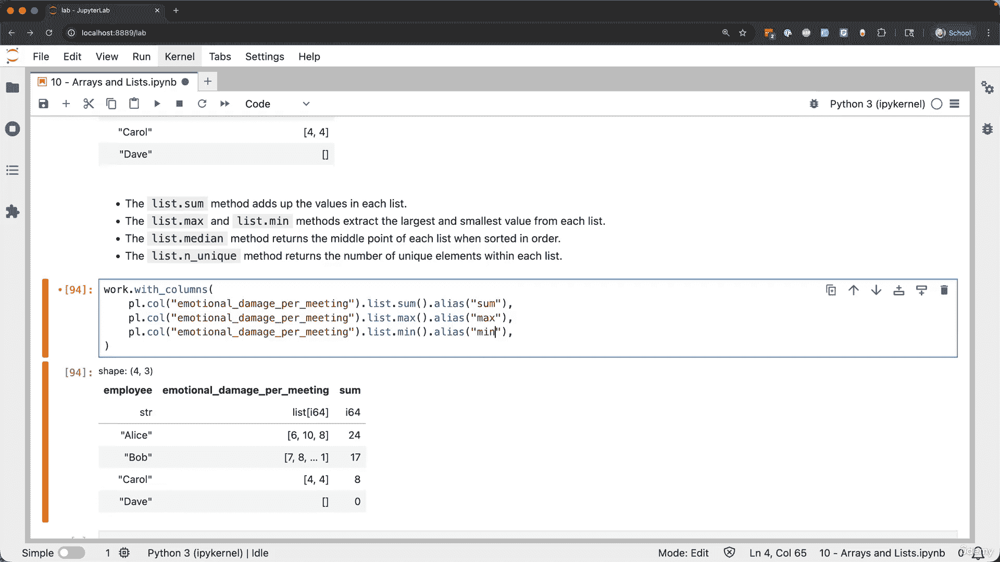

这里需要注意 Dave 的情况：Dave 的列表是空列表。除了 `sum` 之外，`max`、`min` 和 `mean` 这几列都会返回 `null`，因为当一个容器实际上是空的时候，并不存在最大值、最小值或平均值。

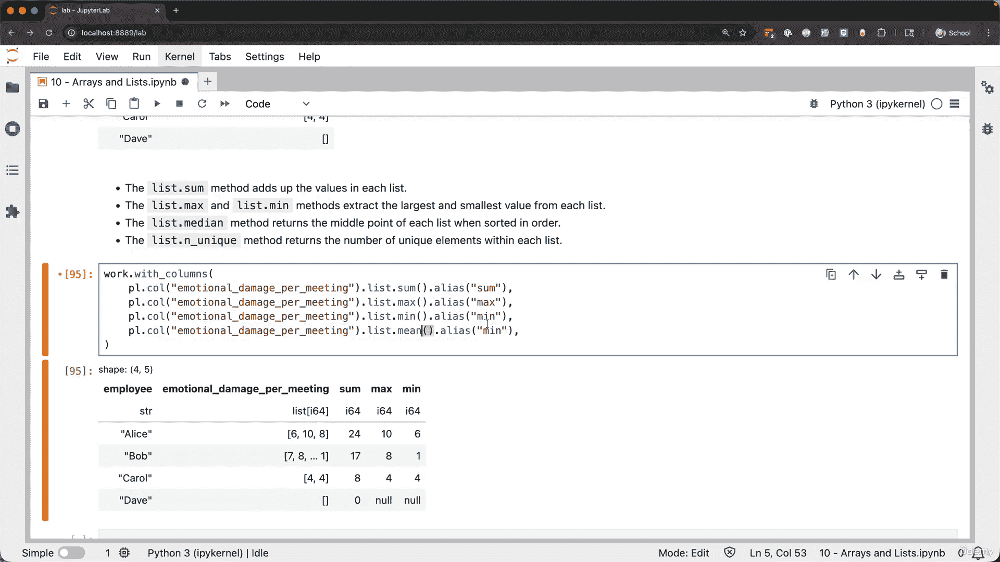

```python
mean([]) = null
max([]) = null
min([]) = null
```

在 `list` 命名空间里还可以使用 `median` 方法。它会在列表所有值按顺序排好之后给出中间位置的值，也就是排序后列表的中点。这样我们可以看到一个有序列表的中间点大概在哪里。

```python
median([6, 10, 8]) = 8
```

最后我们还有 `n_unique` 方法。这个方法之前见过，它会统计列表中唯一值的数量。它并不严格限制只能用于数字列表，但这里用数字列表来演示是一个很好的例子。通过它，可以看到每个列表里到底有多少个不重复的条目。

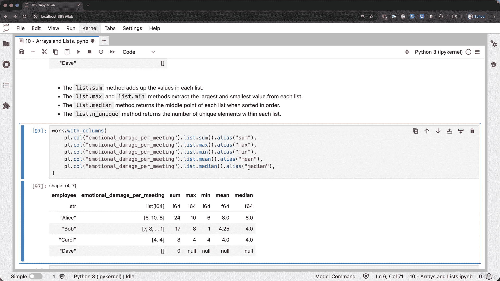

比如 `[6, 10, 8]` 这个列表有三个唯一值，也就是三个不同的数字。也有的列表只有一个唯一数字，比如 `[4, 4]`，因为存在重复值，所以唯一数字只有 4，计数结果是 1。空列表则有 0 个唯一值。换句话说，`n_unique` 统计的是唯一值的数量，基本上不会把重复项重复计算。

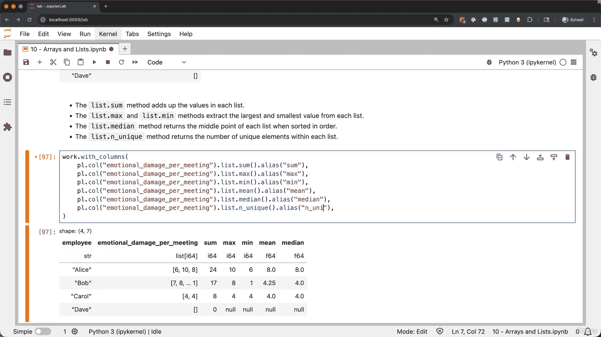

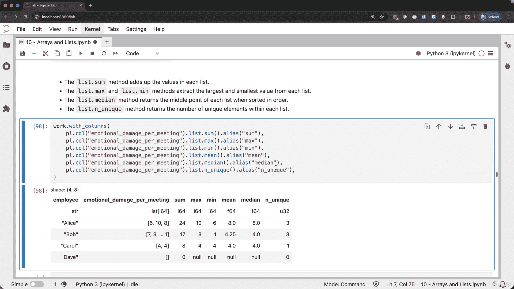

```python
n_unique([6, 10, 8]) = 3
n_unique([4, 4]) = 1
n_unique([]) = 0
```

以上就是对 `list` 属性或命名空间中部分数学相关方法的快速介绍。只要某一列的每一行都存放数字列表，就可以考虑使用这些方法来按行做汇总、极值、平均、中位数和唯一值计数。

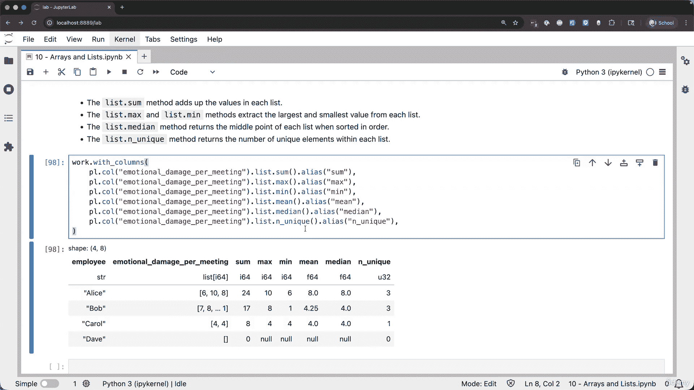

本节课中我们一起学习了 Polars 列表列的数学运算：先创建包含列表列的数据框，再通过 `with_columns` 和 `list` 命名空间调用 `sum`、`max`、`min`、`mean`、`median`、`n_unique` 等方法，并理解了空列表在求和、极值、平均值和唯一值计数中的返回结果。

