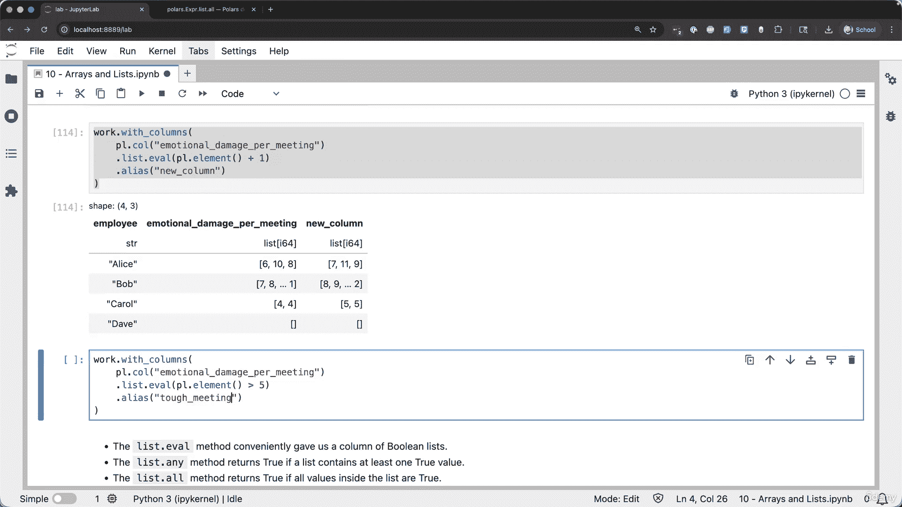
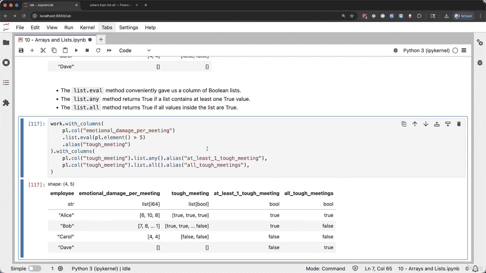
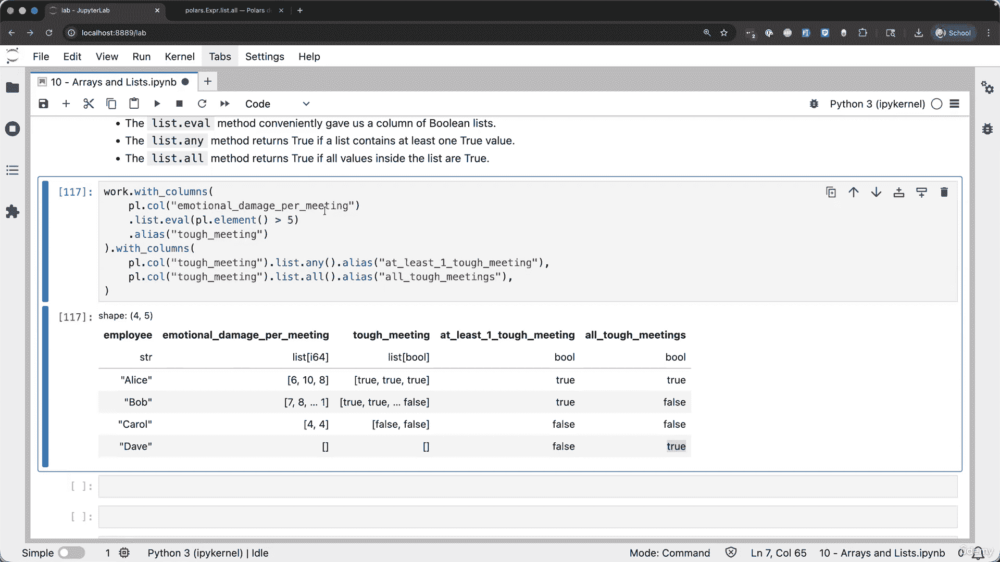
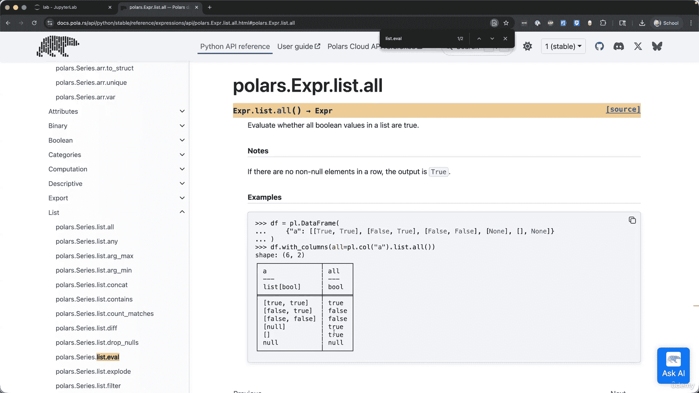
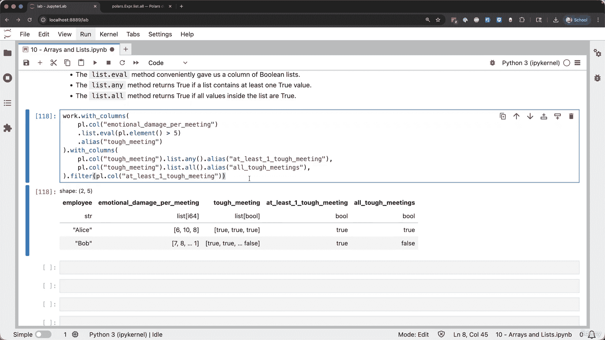

# Udemy - Data Analysis with Polars and Python part2 p35：135：列表 eval、any 和 all 方法 🚀

在本节课中，我们将学习 `list` 属性中几个非常实用的额外方法。它们分别是 `eval`、`any` 和 `all`。这些方法主要用于处理“列中每个单元格都是一个列表”的情况，能帮助我们高效地对每个列表内部的元素进行统一操作和判断。我们会从一个实际的工作场景出发，一步一步演示这些方法到底怎么用、为什么好用。最终你将能够自己写出类似“检查员工是否经历过至少一次超过某阈值的情绪伤害”这样的过滤逻辑。

## 1. eval 方法：对每个列表元素做统一处理 🧮

我们先从 `eval` 方法开始。`eval` 是 `evaluate` 的缩写，意思就是“求值”。它允许我们对给定列表中的每一个元素执行一致的操作或逻辑判断。你可以把它想象成一次“遍历”过程：遍历每一行、遍历每行里的每一个列表，然后对列表中的每个元素做同样的转换或判断，相当于把“逐元素处理”这件事封装成了一个统一的调用，非常方便。

`eval` 方法的一大优势是：当你不知道用哪个现成的 Polars 表达式去实现某种逻辑时，可以自己用 `eval` 写出这个逻辑。换句话说，它为“手动搞定每一个列表元素”打开了一扇门。我们来举一个实际例子。

像往常一样，我们先执行代码。假设我想评估员工的表现，方法是检查他们参加过多少次“困难会议”。我把困难会议定义为“情绪伤害值大于 5”的会议。最终我要做的事情就是：逐个遍历每个列表中的元素，把它们和数字 5 比较，然后生成一个布尔值列表。下面的代码会先获取工作数据框，然后调用 `with_columns` 方法在原有列的基础上创建新列。

```python
import polars as pl

# 假设 df 是工作数据框，其中包含 emotional_damage_per_meeting 列
df = df.with_columns(
    pl.col("emotional_damage_per_meeting").list.eval(pl.element()).alias("new_column")
)
```

我创建的这个表达式针对的是 `emotional_damage_per_meeting` 列，这个列的每一行都存储着一个整数列表。在 `list` 属性中，我调用了 `eval` 方法。这个方法实际上期望一个表达式作为参数。这里的核心是 `pl.element()` 函数，它位于 Polars 的顶层，返回一个专门指向“更大容器中每一个单独元素”的表达式。我们之前没见过它，但它在 `eval` 中是不可或缺的。

## 2. element 函数：一个一个抓住列表里的元素 🔍

让我们更清楚地看看 `element` 函数是怎么工作的。我在 Polars 顶层调用了 `element` 函数，然后对整个表达式调用 `alias` 方法，命名为 `new_column`。运行之后，结果会让我们明白刚才到底做了什么。

```python
df = df.with_columns(
    pl.col("emotional_damage_per_meeting").list.eval(pl.element()).alias("new_column")
)
```

这里做的事情其实非常简单：我们要求 Polars 对每一行中给定列表的每一个元素进行求值，然后直接把元素映射成它自己。比如说，列表里的元素是 6，我们就把 6 变成 6；如果是 10，就变成 10。整个过程没有加任何东西，也没有减任何东西，纯粹是“元素到元素”的映射，看起来似乎没什么用。但好戏在于，一旦把 `pl.element()` 和别的运算符组合起来，我们就拥有了把每个列表元素映射成新列表元素的能力。接下来我们复制这段代码，给元素加上 1。

```python
df = df.with_columns(
    pl.col("emotional_damage_per_meeting").list.eval(pl.element() + 1).alias("new_column_plus_one")
)
```



因为 `element` 函数让我们能逐个访问每个列表元素，所以这里就是在每个元素上加 1。举个例子，原本列表是 `[6, 10, 8]`，经过转换后会变成 `[7, 11, 9]`。这就是一个数学运算的例子。当然，你基本上可以对元素做任何想做的事。比如我最初提到的比较操作：把每个元素和 5 比较，看看是否大于 5。我们建立一个 `tough_meeting` 列来记录结果。

```python
df = df.with_columns(
    pl.col("emotional_damage_per_meeting").list.eval(pl.element() > 5).alias("tough_meeting")
)
```

现在结果就非常直观了：原来的整数列表变成了布尔值列表，每一个布尔值都代表对应元素“大于 5”的计算结果。例如 `[8, 3, 10]` 会变成 `[true, false, true]`。当你拿到一列布尔值列表之后，接下来要做的通常就是判断“这一整组里有没有出现过 true”，或者是“这一整组是不是全部都是 true”。这正是我们马上要讲的 `any` 和 `all` 方法。

## 3. any 和 all：快速判断整组布尔值 ✅

当你处理列中的布尔值列表时，有两个方法特别有用。第一个是 `any`：如果某一行里的列表中至少包含一个 `true`，`any` 就会返回 `true`。换句话说，只要列表里任何一个元素是 `true`，结果就是 `true`。这个方法产生的不是一个列表，而是一个单独的布尔值，它根据整个列表是否包含任何 `true` 来做判断。第二个是 `all`：只有列表中所有值都是 `true` 时，它才返回 `true`。如果列表里哪怕有一个 `false`，`all` 也会返回 `false`。这两个方法正好互补，一个看“有没有”，一个看“是不是全部”。

我们在上面的代码基础上继续操作。现在我们已经有了一个存储布尔列表的 `tough_meeting` 列，接下来链式调用 `with_columns`，并在其中创建两个新列。首先，我们针对 `tough_meeting` 列调用 `list.any()`，把这个结果命名为 `at_least_one_tough_meeting`。这个名称很容易理解：只要布尔列表里至少有一个 `true`，就说明这位员工至少有一场会议的伤害值大于 5，也就是至少经历过一次困难会议。

```python
df = df.with_columns(
    pl.col("tough_meeting").list.any().alias("at_least_one_tough_meeting")
)
```

同样，我们再复制一份表达式，把 `any` 换成 `all`，并命名为 `all_tough_meetings`。如果 `all` 返回 `true`，那就意味着列表中的每一个布尔值都是 `true`，也就是原始列表中每一项都大于 5，完全可以说这位员工的所有会议都是困难会议。

```python
df = df.with_columns(
    pl.col("tough_meeting").list.all().alias("all_tough_meetings")
)
```

来看看结果。在我们的第一个列表中，所有元素都是 `true`，所以 `any` 的结果是 `true`，`all` 的结果也自然是 `true`。同样的逻辑会应用到这一列中的每一个列表。比如某个列表里有 `true` 也有 `false`，那它 `any` 会得到 `true`，但 `all` 就会得到 `false`。这种“至少有一个”“全部都是”的语义在实际业务中非常常见，掌握了这两个方法，过滤逻辑就变得简单明了。

## 4. 空列表的特殊情况 ⚠️





这里有一个需要注意的小细节：空列表。当你遇到一个空列表时，从技术上来说，“这个列表中的所有元素是否都为 true”是有点模糊的，因为里面什么值都没有。Polars 的默认行为是，对于空列表，`all` 方法会评估为 `true`。这看起来似乎有点反直觉，但它是 Polars 正常逻辑的一部分，并且和 Python 内置的 `all` 函数行为保持一致。我们可以看一下官方文档中的示例，那个例子和我们这里非常相似：空列表经过 `all` 运算会得到 `true`。乍一看确实有点奇怪，因为一个没有 `true` 的列表，到底算“全部为 true”还是“没有任何 true”，确实很难说清楚。但这就是 Polars 和 Python 的推理方式。记住这一点就可以了，以后遇到空列表时心里有数，不会感到惊讶。



## 5. 用布尔列进行过滤 🔎

不管怎样，我们已经完成了一个完整的链路：从整数列表到布尔列表，再到布尔值列。现在我们手里有了一列布尔值，当然就可以用它们来做常规的过滤操作了。回到最初的目标：我想知道哪些员工至少经历过一次困难会议。我已经把逻辑写在了 `at_least_one_tough_meeting` 列里，现在只要对这个列进行过滤即可。

```python
df.filter(pl.col("at_least_one_tough_meeting"))
```

这一步不需要再对列做任何转换，因为它本身已经是一个布尔列了。运行过滤后，我们就能看到公司里所有在原始列表中存在大于 5 的元素的员工，也就是至少经历过一次困难会议的员工信息。到这里，我们就把 `eval` 方法以及 `any`、`all` 方法完整地梳理了一遍：`eval` 用来对每个列表元素执行一致的操作或评估，`any` 用来判断列表中是否至少存在一个 `true`，`all` 用来判断列表中是否全部都是 `true`。这些工具组合起来，能帮我们处理非常多的列表级数据逻辑。



本节课中我们一起学习了 Polars 列表属性中的三个重要方法：`eval`、`any` 和 `all`。我们看到了如何用 `eval` 配合 `pl.element()` 对每个列表元素进行数学运算、比较操作，如何用 `any` 和 `all` 将布尔列表汇总成单个布尔值，也认识了空列表在 `all` 方法下的特殊行为。最后，我们还用生成的布尔列完成了实际的过滤。希望你能在实际分析中灵活运用这些方法，从此再也不怕“列表套列表”的复杂数据了。🎯
