# 🧩 Polars 与 Python 数据分析：第136节：拼接列值

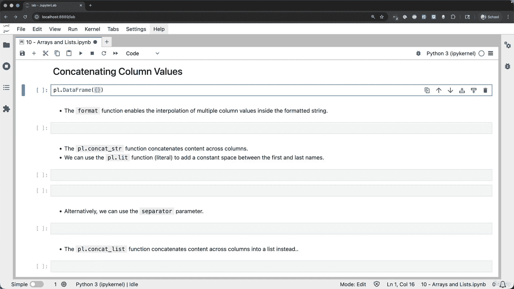

在本节课中我们将要学习如何在 Polars 中把多个字符串列的值拼接在一起，也会学习把多个列合并成一个列表列，再从列表列反向拼接成完整的字符串。整节内容会围绕“列与列之间怎么合并”“列表和字符串怎么互相转换”展开，虽然看起来函数不少，但思路很统一，都是通过表达式组合出想要的结果。

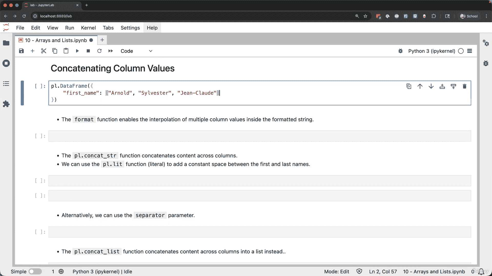

为了先建立整体印象，以下是本节会接触到的主要方法，先有一个大致路线即可，后面会逐个拆开说明。

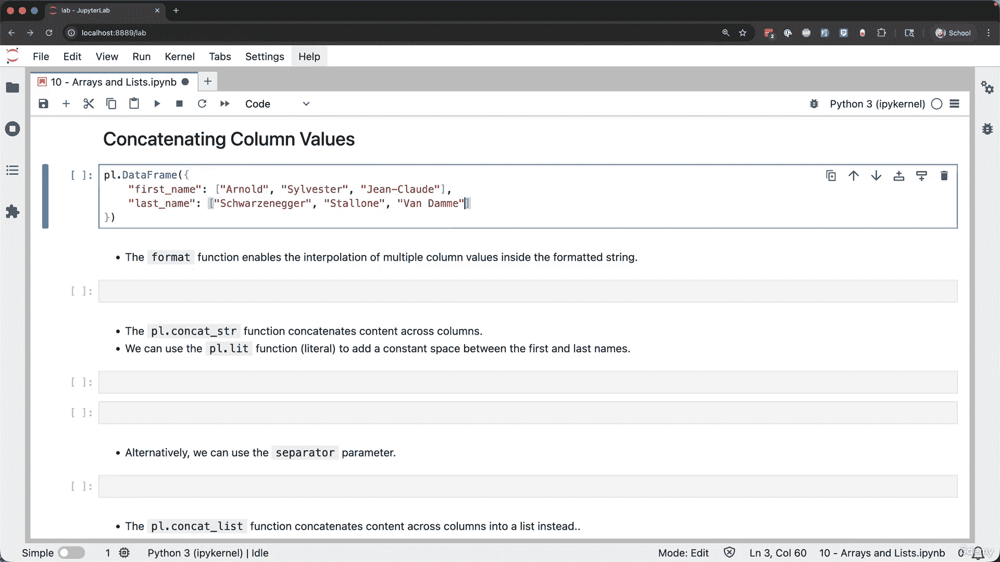

- `pl.format`：用格式字符串把多个表达式注入到一个新字符串中。
- `pl.concat_str`：直接把多个字符串表达式的值拼接起来。
- `pl.concat_list`：把多个列的值合并成一个列表列。
- `list.join`：把列表列中的每个元素用一个分隔符连接成字符串。

有了这个路线图，我们先准备一份示例数据，后面的拼接操作都会围绕这份数据展开。

## 🏗️ Polars 与 Python 数据分析：第136节：创建示例数据框

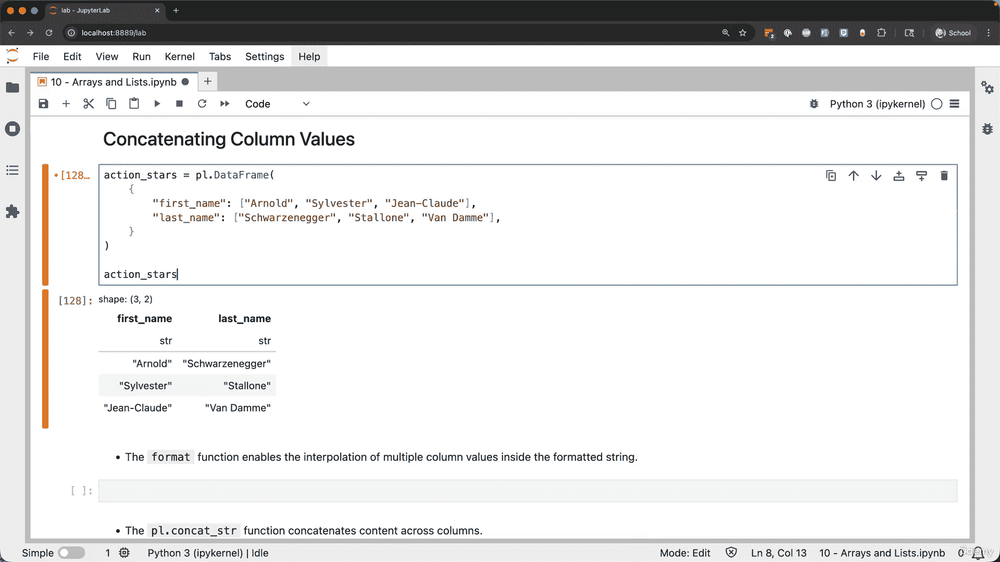

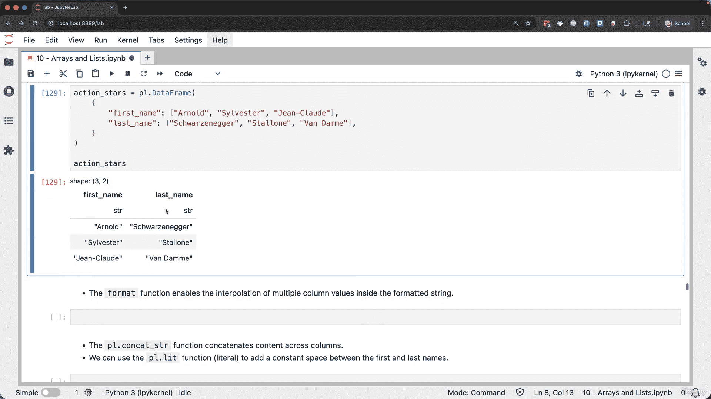

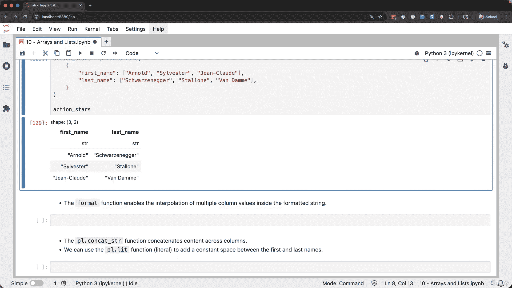

在开始拼接之前，我们需要先有一份数据作为操作对象。本节中我们来看看如何用数据框构造函数创建一个包含名字和姓氏的示例数据框。

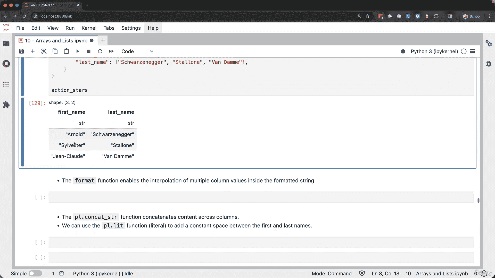

下面的代码会创建一个两列数据框，第一列是 `first_name`，第二列是 `last_name`，分别存放名和姓。

```python
import polars as pl

action_stars = pl.DataFrame({
    "first_name": ["Arnold", "Sylvester", "Jean Claude"],
    "last_name": ["Schwarzenegger", "Stallone", "Van Damme"],
})

print(action_stars)
```

这里 `Schwarzenegger` 是示例中的第一位演员的姓，也可以说他是很多人一直以来的最喜欢的演员之一。接着把 `Stallone` 拼写正确，最后给 `Jean Claude` 配上姓氏 `Van Damme`。这样数据框就由两列组成，把它赋给 `action_stars` 变量，然后输出 `action_stars` 查看结果，确认数据框内容。

数据准备好之后，假设这些数据就是以这种方式进入程序的，现在目标是把 `first_name` 和 `last_name` 两列里的内容拼接起来，得到动作明星的完整姓名。Polars 中通常有多种方式完成这件事，上一节我们准备好了数据，本节中我们来看看第一种常用方法：`pl.format`。

## 🧵 Polars 与 Python 数据分析：第136节：使用 format 拼接姓名

`pl.format` 是 Polars 顶层提供的一个函数，也是拼接多列字符串时很直观的一种方式。本节中我们来看看如何用它把名和姓组合成 `full_name`。

下面的代码在 `action_stars` 上使用 `with_columns` 添加一个新列，并在新列中调用 `pl.format`。

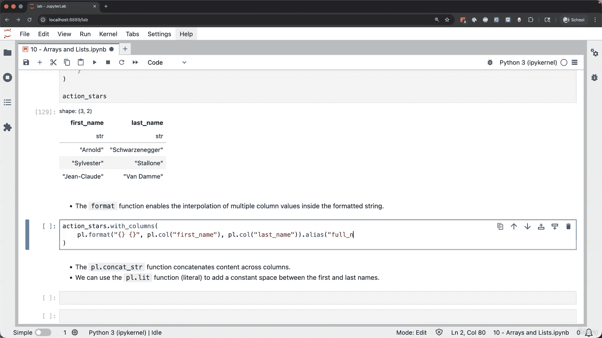

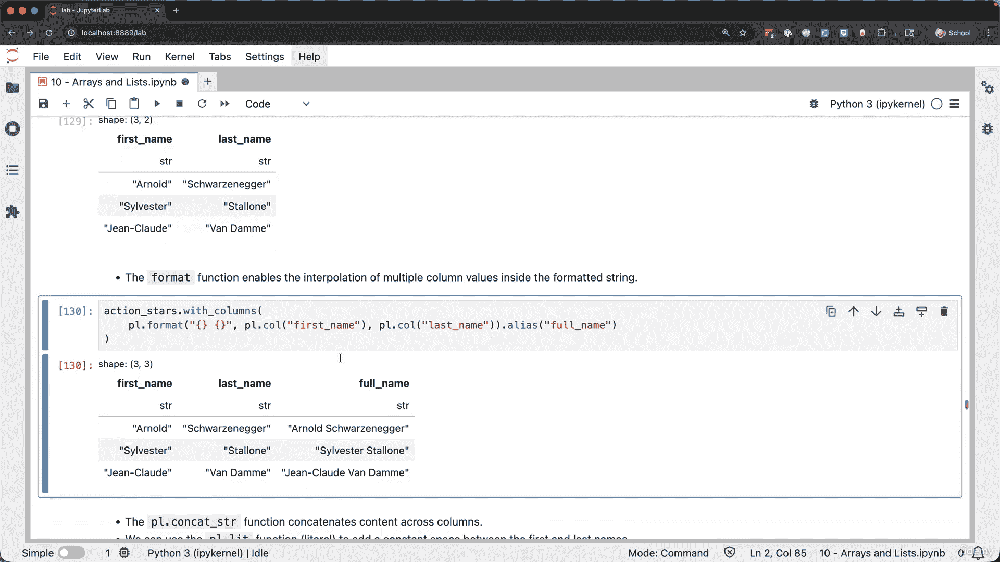

```python
action_stars.with_columns(
    pl.format(
        "{} {}",
        pl.col("first_name"),
        pl.col("last_name"),
    ).alias("full_name")
)
```

`pl.format` 的第一个参数叫格式字符串，它本质上是一个普通字符串，可以包含硬编码的文本，也可以在某些位置注入动态内容。只要想注入动态内容，就放一对花括号作为占位符。这里要拼接两个名字，所以格式字符串中放两对花括号，中间用空格隔开，表示两个动态内容之间有一个空格。

因为格式字符串有两个动态内容的位置，所以字符串后面需要依次提供两个参数，用来表示动态内容从哪里取。这里提供两个 Polars 表达式，第一个表达式指向 `first_name` 列，第二个表达式指向 `last_name` 列。对于任意一行，`first_name` 列里的值会注入第一对花括号，`last_name` 列里的值会注入第二对花括号。最后用 `alias` 方法给 `pl.format` 返回的完整表达式命名为 `full_name`。

这样 Polars 会逐行查找 `first_name` 的值和 `last_name` 的值，把它们按空格分隔放进新字符串里，得到预期结果。格式字符串里也可以混用硬编码内容和动态内容，例如想在完整姓名后面加上 `the great`，也可以直接写在格式字符串里，同时保留花括号注入每一行的动态内容。

使用表达式的好处在于，即使直接传列名字符串也能工作，但表达式还能继续对行值做转换。例如想把名字变成大写，可以在表达式上使用 `.str` 属性，再调用 `to_uppercase()` 方法，代码如下。

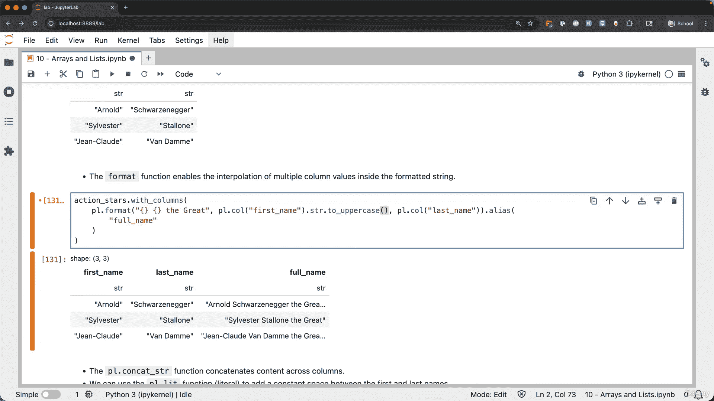

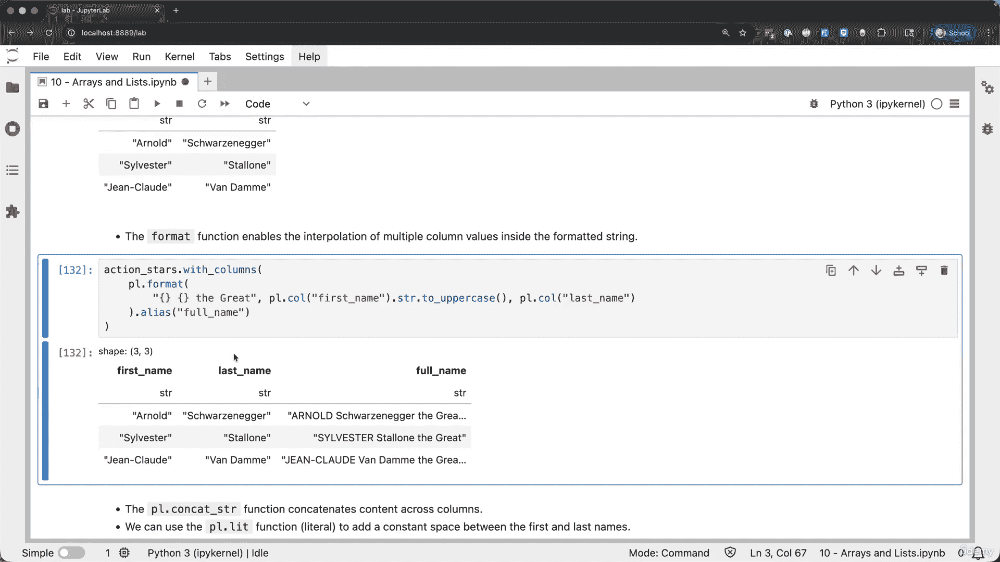

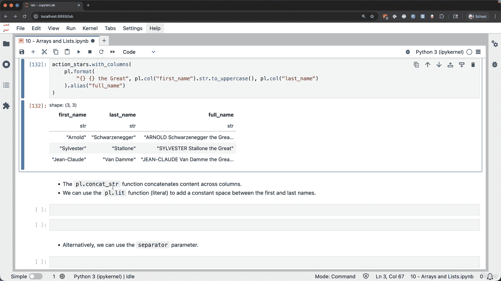

```python
action_stars.with_columns(
    pl.format(
        "{} {} the great",
        pl.col("first_name").str.to_uppercase(),
        pl.col("last_name"),
    ).alias("full_name")
)
```

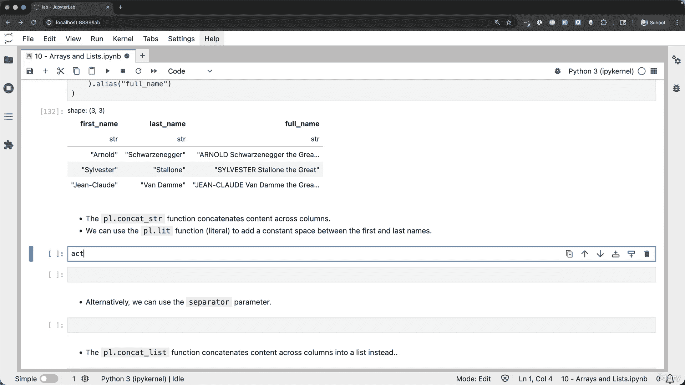

这样每一行的 `first_name` 会先被转换成大写，再被格式化并注入到格式字符串中，最后得到的 `full_name` 里每个名字部分都是大写形式。`pl.format` 是一种拼接多列内容的方法，上一节我们看到了它的灵活性，本节中我们来看看另一种更直接的拼接函数：`pl.concat_str`。

## 🔗 Polars 与 Python 数据分析：第136节：使用 concat_str 拼接字符串

`pl.concat_str` 也是 Polars 顶层提供的函数，其中“字符串”在函数名里缩写为 `str`，所以完整写法是 `pl.concat_str`。本节中我们来看看它如何把多个字符串列自动拼接成一个新列。

下面的代码同样在 `action_stars` 上调用 `with_columns` 添加新列，只不过这次表达式来自 `pl.concat_str`。

```python
action_stars.with_columns(
    pl.concat_str(
        [pl.col("first_name"), pl.col("last_name")]
    ).alias("full_name")
)
```

`pl.concat_str` 和上面的 `pl.format` 很像，它接受一个或多个表达式，并自动把目标列中每一行的内容拼接在一起。这里提供两个表达式，分别指向 `first_name` 和 `last_name`。实际上可以按顺序提供任意数量的表达式，`pl.concat_str` 会把这些字符串列的内容拼接成一个新列。同样可以用 `alias` 给表达式命名，这里叫 `full_name`。

运行后会得到一个新的 `full_name` 列，但要注意 Polars 在这里非常“字面”，它不会自动理解我们希望在两个名字之间加一个空格，所以结果只是把两个字符串直接粘在一起。解决方式之一是在中间注入一个表示空格的动态内容；如果需要一个表达式来表示单个固定的、不变的值，可以使用 Polars 顶层的 `lit` 或 `literal` 函数。

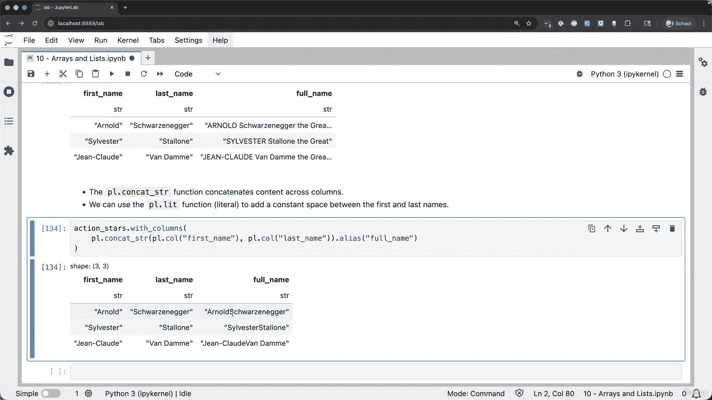

下面的代码用 `pl.lit(" ")` 在名和姓之间插入一个空格。

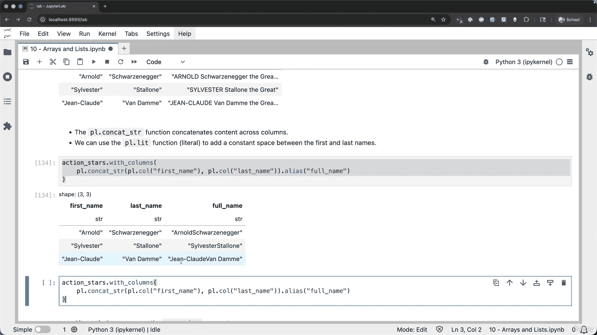

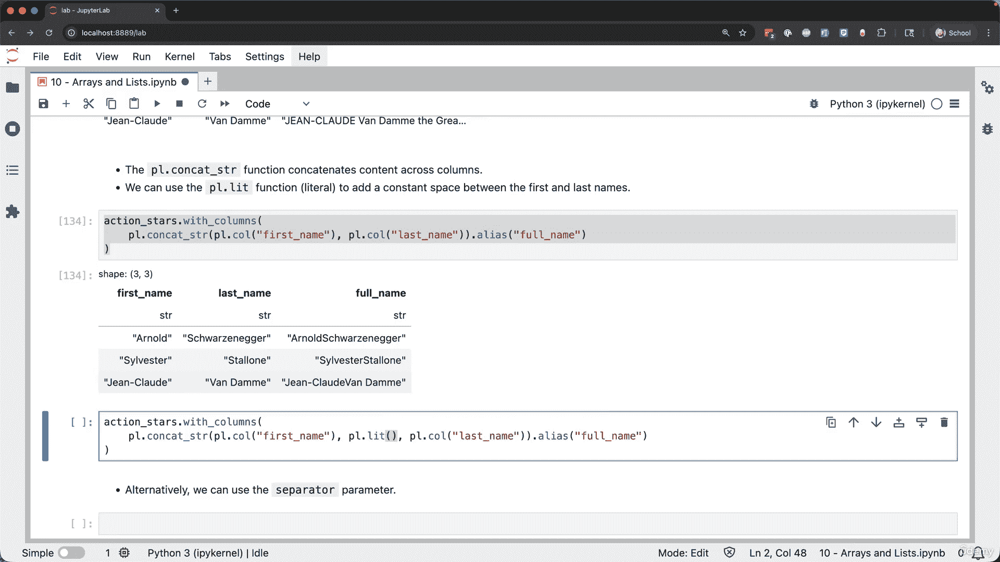

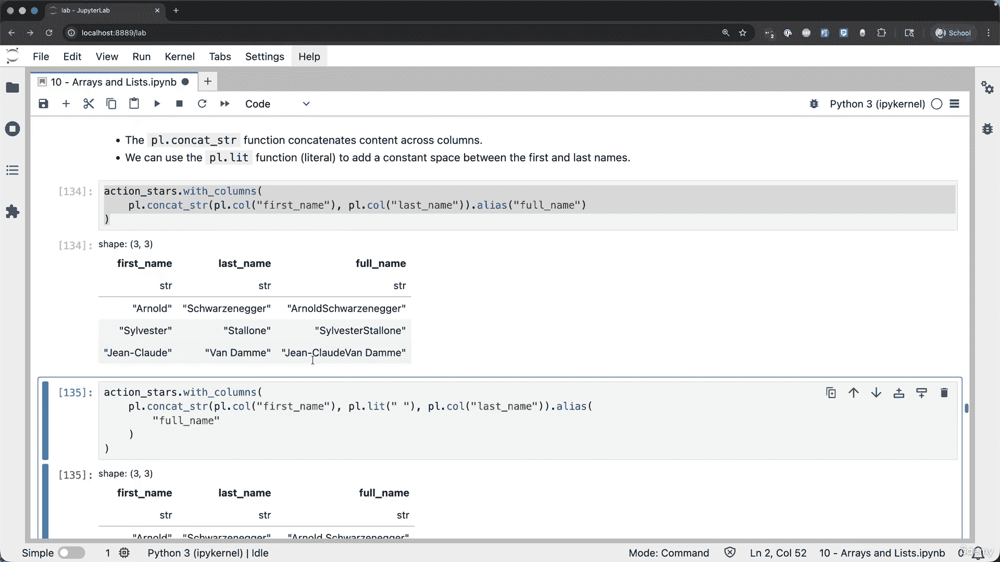

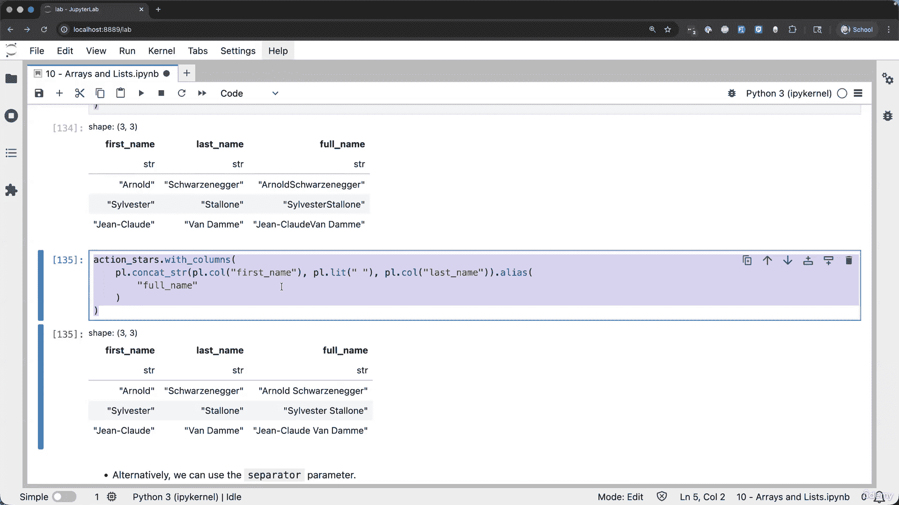

```python
action_stars.with_columns(
    pl.concat_str(
        [pl.col("first_name"), pl.lit(" "), pl.col("last_name")]
    ).alias("full_name")
)
```

`pl.lit` 会返回一个表达式，用来模拟一个常量值，这里传入单个空格字符串，于是拼接顺序变成：`first_name`、空格、`last_name`，结果和 `pl.format` 相同。如果不想使用 `lit`，也可以给 `pl.concat_str` 提供一个额外参数 `separator`，它用来指定分隔符或定界符，也就是在每一段被拼接的表达式之间统一插入的字符。

下面的代码去掉 `pl.lit(" ")`，改用 `separator=" "`。

```python
action_stars.with_columns(
    pl.concat_str(
        [pl.col("first_name"), pl.col("last_name")],
        separator=" ",
    ).alias("full_name")
)
```

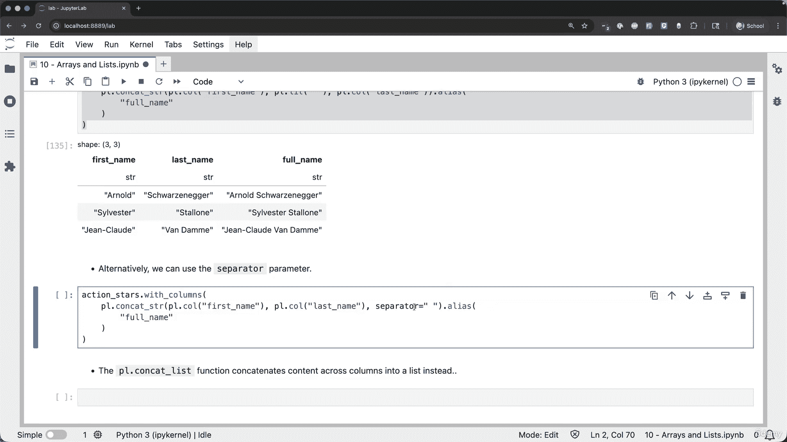

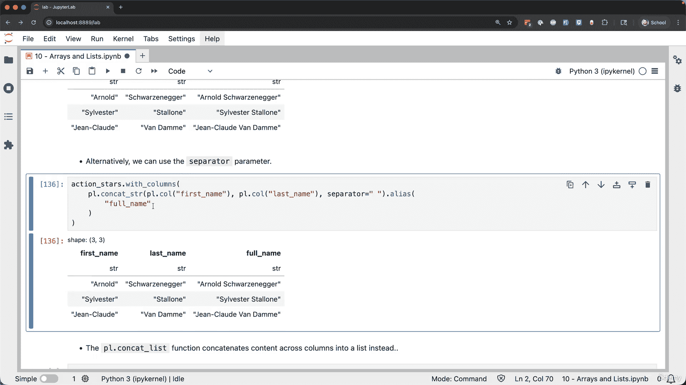

当 `separator` 传入单个空格时，Polars 每次连接两列内容都会用空格分隔文本内容，所以同样能得到正确结果。这就是把多个列的内容拼接成字符串结果的方式。上一节我们处理的是“列到字符串”，本节中我们来看看“列到列表”的另一种合并方式：`pl.concat_list`。

## 📚 Polars 与 Python 数据分析：第136节：使用 concat_list 合并为列表列

`pl.concat_list` 是 Polars 顶层提供的另一个函数，它会把多个列的内容合并到一个列表里。本节中我们来看看如何得到一列“字符串列表”。

下面的代码仍然使用 `with_columns` 创建新列，并在新列中调用 `pl.concat_list`。

```python
action_stars.with_columns(
    pl.concat_list(
        [pl.col("first_name"), pl.col("last_name")]
    ).alias("name_list")
)
```

原理和前面类似，先取 `action_stars` 数据框，再用 `with_columns` 创建新列。`pl.concat_list` 同样返回一个表达式，正好是 `with_columns` 需要的类型。这里提供多个表达式，分别指向 `first_name` 列和 `last_name` 列，然后用 `alias` 把新列命名为 `name_list`，并注意关闭 `pl.concat_list` 和 `with_columns` 的括号。

运行后可以得到一个存储字符串列表的列，每一行都是一个列表，列表里依次放着名和姓。这个结果和本节一直讨论的列表思想是连在一起的：Polars 的列表列可以像普通列一样被整体处理，也可以进一步对列表内部元素做操作。

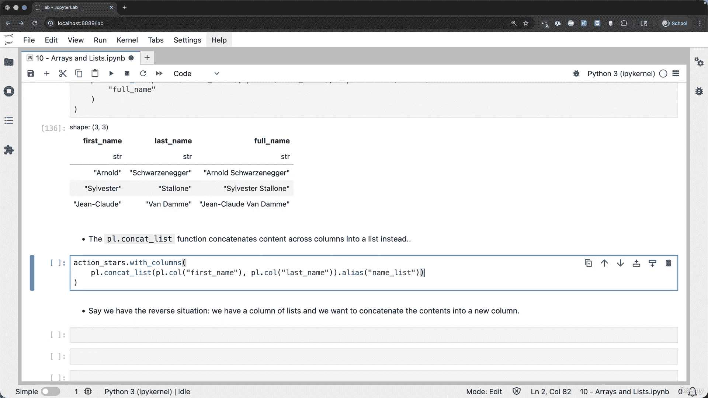

现在换一个场景：假设数据集进入程序时只有这一列，也就是一个没有其他名字的列，每一行都存储一个字符串列表，比如只有 `name_list` 这一列。上一节我们是从多个字符串列合并成列表列，本节中我们来看看反向过程：从列表列开始，把列表里的内容连接成一个完整字符串。

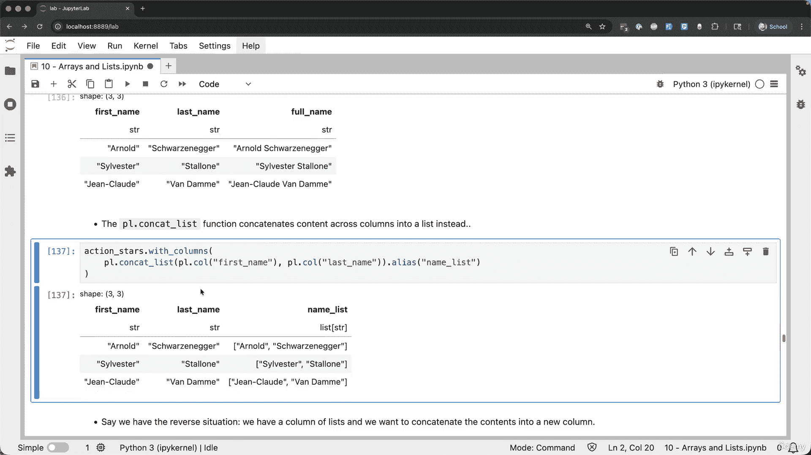

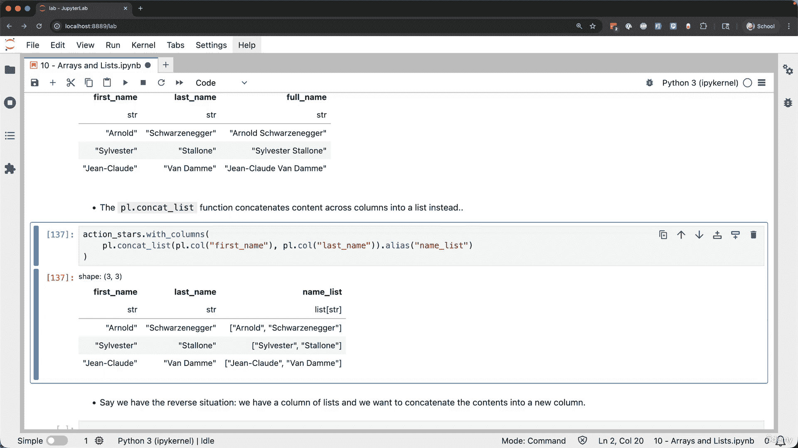

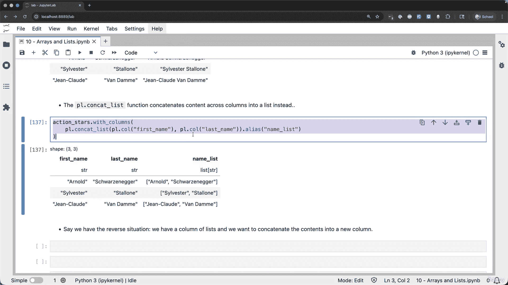

## 🪄 Polars 与 Python 数据分析：第136节：用 list.join 从列表还原字符串

假设现在只有 `name_list` 这一列，两个原始列都不存在，我们仍然希望把 `Arnold` 和 `Schwarzenegger` 合并起来。本节中我们来看看如何对列表列使用 `list.join`。

下面的代码先用 `select` 只针对一个表达式，然后对 `name_list` 列调用 `.list.join(" ")`。

```python
name_list_df = action_stars.select(
    pl.concat_list(
        [pl.col("first_name"), pl.col("last_name")]
    ).alias("name_list")
)

name_list_df.select(
    pl.col("name_list").list.join(" ").alias("full_name")
)
```

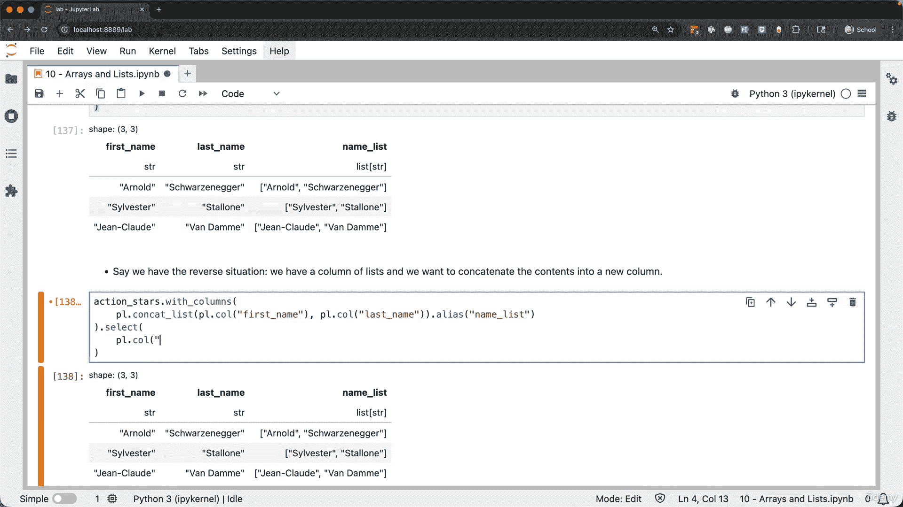

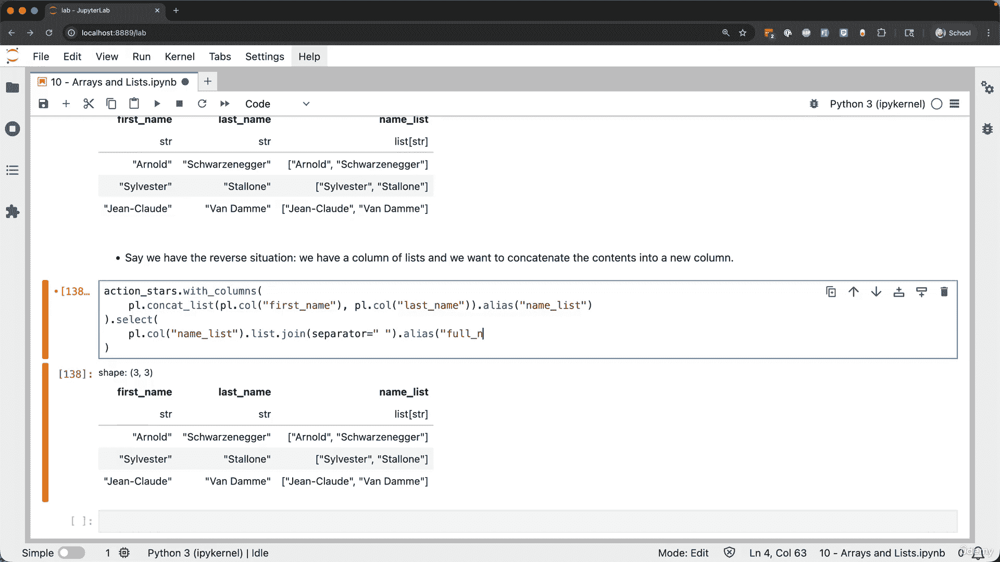

这里先构造出只有 `name_list` 列的数据框，模拟数据只以列表列形式到达程序的情况。然后用 `select` 方法只处理单个表达式，表达式指向 `name_list` 列。因为这一列存储的是列表，所以可以通过 `.list` 属性或命名空间访问列表相关方法，其中一个方法叫 `join`。

`list.join` 和 Python 里的连接操作很像，它会把列表中的每个元素合并、连接成一个新字符串，并用指定的分隔符隔开每一次连接。这里给 `separator` 参数传一个空格，表示每连接两个元素就用空格分开。它不会在开头或结尾额外加空格，只会在每两个相邻元素之间插入分隔符，无论列表里有多少个元素都是这样。

最后用 `alias` 把结果命名为 `full_name`。这样就会从列表开始，把列表内容连接成一个新的字符串，并输出到 `full_name` 列中。

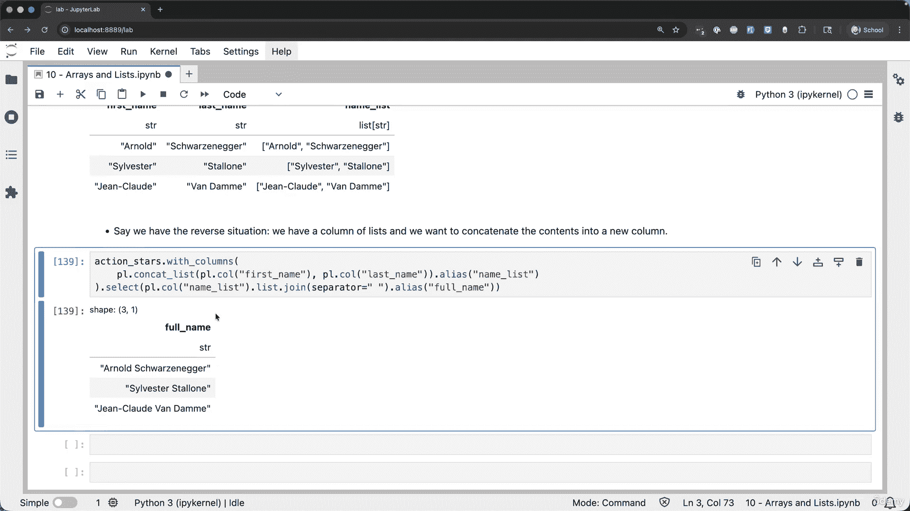

本节课中我们一起学习了 Polars 中拼接列值的几种方式：用 `pl.format` 按格式字符串注入多个表达式的值，用 `pl.concat_str` 直接拼接多个字符串列，用 `pl.concat_list` 把多个列合并成列表列，再用 `list.join` 把列表列还原成字符串。整体来看，Polars 提供了很多选项，但核心做法都是把各种函数调用、方法和表达式组合起来，得到自己想要的结果。

