# 📊 Polars数据分析教程：第37节：Array数组类型

本节我们来学习Polars中的Array（数组）类型。我们会先解释Array和List的异同，然后通过两个实际例子演示如何创建Array列，最后总结Array的适用场景。

**1. 什么是Array？**

既然上一节已经详细介绍了List，现在我们把目光转向它的互补类型——Array。其实Array和List非常相似：它也是一种集合类型，按照顺序存储零个或多个元素。两者最大的区别是：Array要求每一行数组中元素的数量必须相等。换句话说，在一个列中，每一行都存储一个“容器”，但每个容器的长度必须一致，必须包含完全相同的元素个数。所以，当你的数据天然具有固定长度时，Array就是理想的数据类型，而且从技术上说，它比List更节省内存，运行性能也更好。List的优势则在于灵活：它允许不同行拥有不同的长度。用公式来表达这个约束就是：`len(row_i) == len(row_j)`（对任意 i,j）。

**2. 第一个例子：创建Burritos Array列**

接下来，我们动手在Polars的顶层构造一个DataFrame，来创建第一列带有Array值的列。我们使用DataFrame构造函数，向它传入一个字典，字典里先放一个列，名为`burritos`。我们会给`burritos`赋一个列表，而这个列表内部包含两个嵌套列表。你可以把它想象成我给自己点的一份“卷饼午餐订单”。第一个嵌套列表放的是白米饭、斑豆和牛排，第二个嵌套列表放的是糙米、黑豆和鸡肉。代码如下：

```python
import polars as pl

df = pl.DataFrame(
    {
        "burritos": [
            ["white rice", "pinto beans", "steak"],
            ["brown rice", "black beans", "chicken"],
        ]
    }
)
```

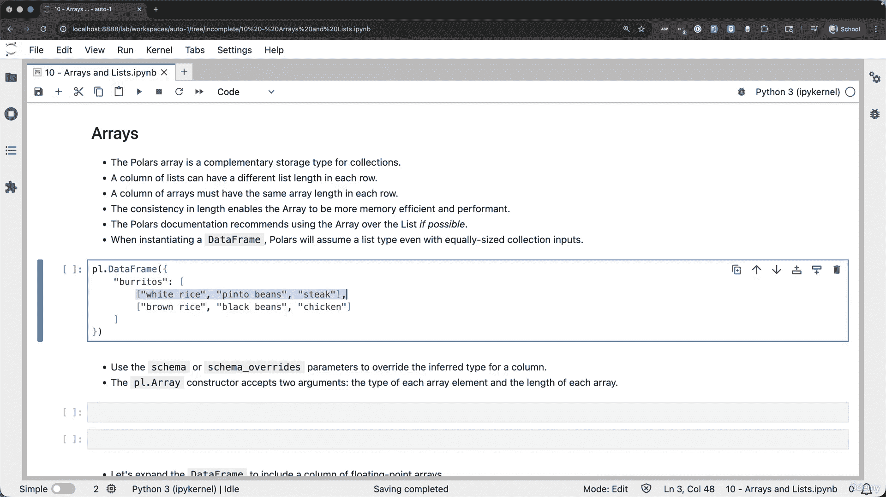

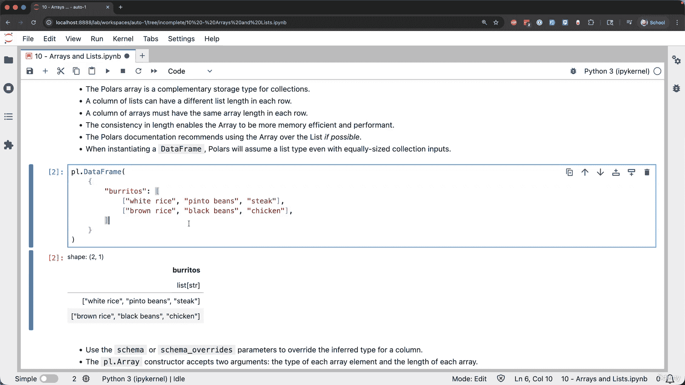

注意，在这个例子里，我们传入的两个嵌套列表长度刚好都是3。但是，Polars在默认情况下总是会选择List类型。所以你运行上面的代码，得到的不是Array列，而是整个章节里我们一直看到的List列。因此，如果我们想要的是Array列，而不是List列，就必须手动指定。

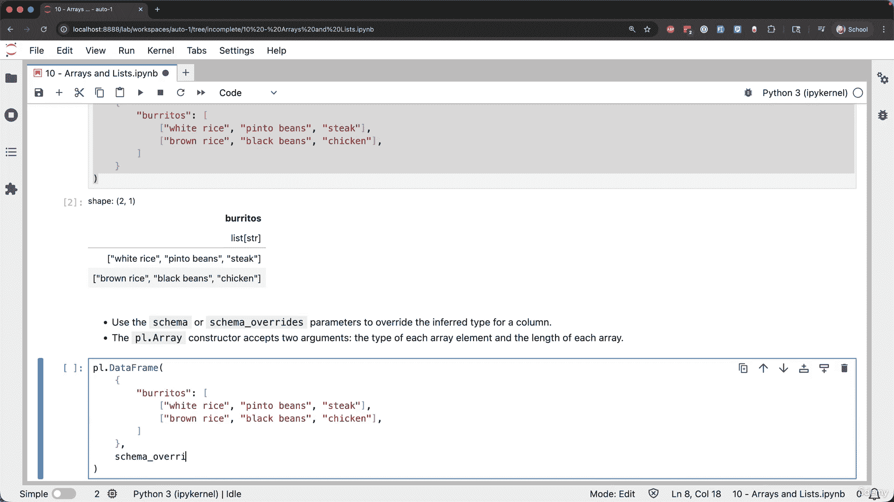

**3. 用schema_overrides手动指定Array类型**

为了手动指定Array类型，我们要用到前面已经见过的`schema_overrides`参数。我们把上面的代码复制一份，然后在初始字典参数之后，传入`schema_overrides`。我们向`schema_overrides`传入一个字典，先锁定`burritos`列，并把它的类型指定为`pl.Array`。Polars的顶层提供了`Array`类型，和所有其他类型一样，直接使用即可。接着，为`pl.Array`构造函数填两个参数：第一个参数是每个数组内部元素的数据类型。因为我们的每个数组都存放字符串，所以这里指定为`pl.String`；第二个参数就是`shape`，用来指定每个数组的长度。之所以需要这个参数，是因为我们前面反复强调过：Array的关键特征就是每个数组必须等长。对我们来说，每个数组有3个字符串，所以`shape`填3。

```python
df = pl.DataFrame(
    {
        "burritos": [
            ["white rice", "pinto beans", "steak"],
            ["brown rice", "black beans", "chicken"],
        ]
    },
    schema_overrides={
        "burritos": pl.Array(pl.String, 3)
    }
)
```

如果在数据中出现了长度不匹配的情况，比如你在某个数组里多传了一个值，导致这个数组有4个元素；或者你声明了`shape=3`，但实际传入的两个嵌套列表各有4个元素，Polars都会报错。Polars会校验你提供的形状声明和实际接收的数据必须一致。

**4. Array类型的细节：长度是类型的一部分**

通过修改`schema_overrides`，我们仍然得到只有一个列的DataFrame，但注意类型已经从List变成了Array。更进一步，这里显示的`array[str, 3]`中的`3`，就是每个数组的实际长度。如果我们传入的列中每一行存储的是4个字符串，这里就会显示`4`。从类型系统来说，长度不同的Array属于完全不同的类型。也就是说，Array类型不仅包含“这是数组”的复合结构信息，还包含内部元素的数据类型，以及数组的长度。这些信息组合在一起，构成了一个相当丰富的类型。

现在，我们把上面的DataFrame赋值给一个叫`lunch`的变量，然后输出这个`lunch`，再访问它的`schema`属性。这样我们就能直观地看到模式长什么样。当然，这里只有一个`burritos`列，但Polars会明确告诉我们：每一行的条目是一个字符串数组，长度为3。

```python
lunch = df
print(lunch.schema)
```

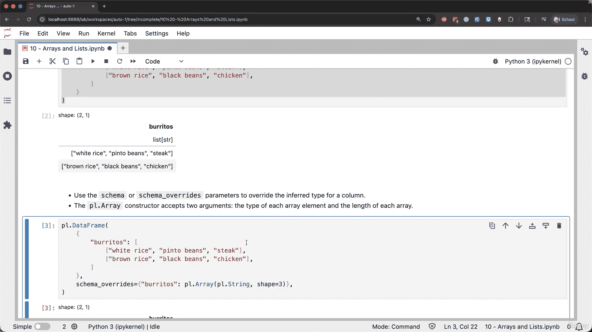

输出结果为：

```python
{'burritos': Array(String, 3)}
```

**5. 第二个例子：添加一个Calories Array列**

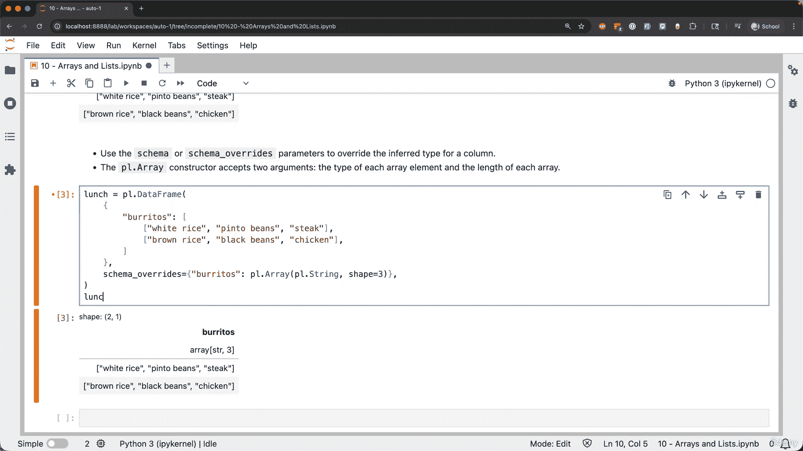

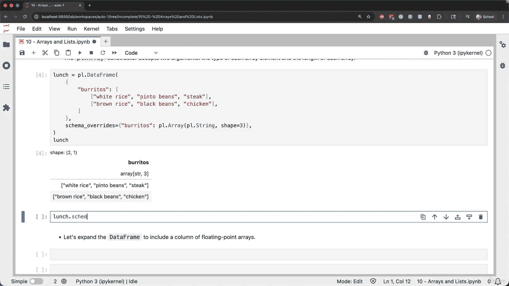

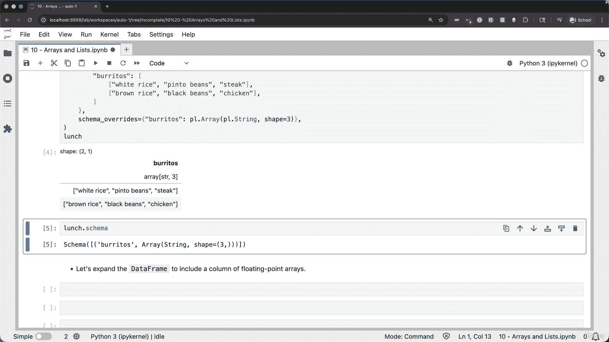

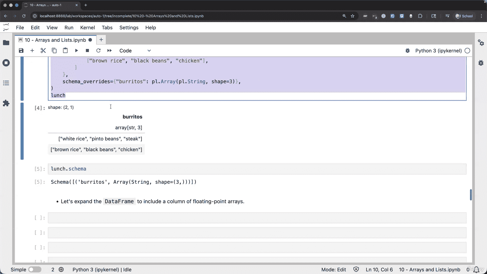

接下来再看一个更完整的例子。我们把上面的整个例子复制一下，然后往DataFrame里增加一个新列，叫做`calories`（卡路里）。这次我们还是使用嵌套列表，但元素类型改用整数。第一个嵌套列表里放`205, 245, 349`，表示列表里每一项对应的卡路里；第二个嵌套列表放`218, 227, 215`。

```python
df = pl.DataFrame(
    {
        "burritos": [
            ["white rice", "pinto beans", "steak"],
            ["brown rice", "black beans", "chicken"],
        ],
        "calories": [
            [205, 245, 349],
            [218, 227, 215],
        ],
    }
)
```

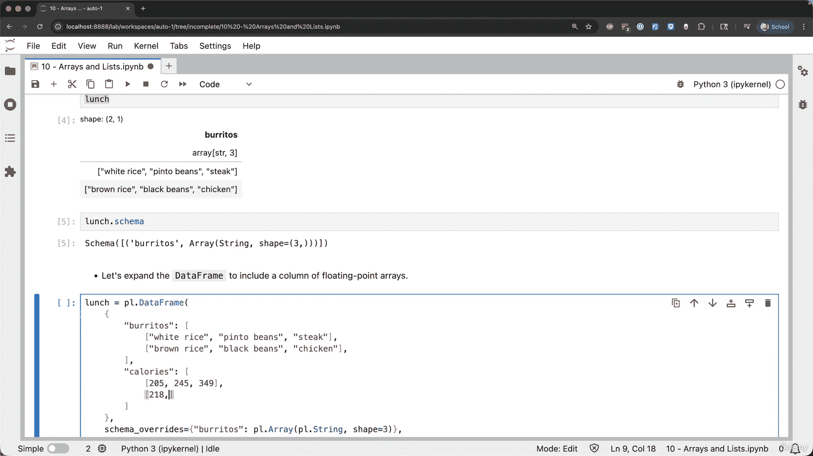

和之前一样，即使我们传入的数据长度完全一致，Polars默认还是会推断为List类型。所以我们必须显式告诉它：我想要Array。这里我们继续使用`schema_overrides`，在字典里增加第二个键值对，第二个键就是新增的`calories`列。在这里，我们还能顺便自定义数组内存储的具体数值类型。比如，如果不想使用默认的64位整数，我们可以把数组指定为无符号整数类型，甚至使用16位变体`pl.UInt16`。然后再次提供`shape`参数来声明数组长度，这里还是3，因为每一行的数组里都有3个元素。最终类型会变成`Array(UInt16, 3)`。

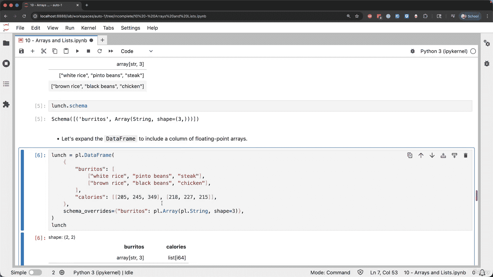

```python
df = pl.DataFrame(
    {
        "burritos": [
            ["white rice", "pinto beans", "steak"],
            ["brown rice", "black beans", "chicken"],
        ],
        "calories": [
            [205, 245, 349],
            [218, 227, 215],
        ],
    },
    schema_overrides={
        "burritos": pl.Array(pl.String, 3),
        "calories": pl.Array(pl.UInt16, 3),
    }
)
```

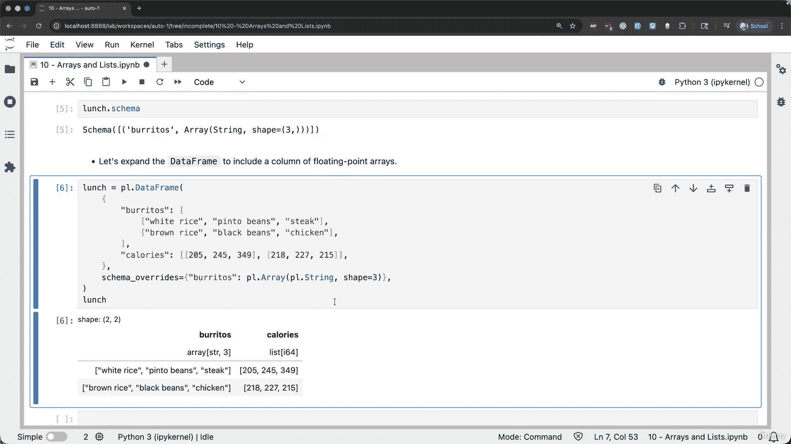

这样，`calories`列的类型就从默认的List变成了Array，并且明确是16位整数、长度固定为3。和List相比，Array多了一个“长度必须一致”的限制，但好处是这类列上的操作通常比List列更快。

**6. 总结**

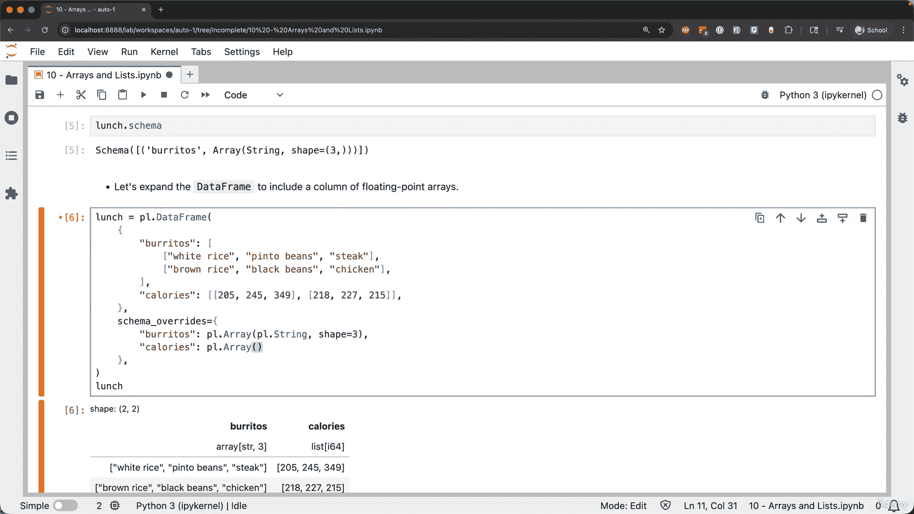

本节课中，我们一起学习了Array类型。我们知道了Array和List几乎相同，但Array要求每一行的元素个数必须相同，因此Array更节省内存，操作也更高效。我们通过两个实际例子，学会了在Polars中创建Array列：第一步是构造包含嵌套列表的DataFrame，第二步是在`schema_overrides`中把目标列的类型显式声明为`pl.Array`，同时提供元素类型和长度。我们还发现Array的声明类型包含长度信息，长度不同就是不同类型。以下是本节课的要点：

- Array 是一种固定长度的集合类型；
- 声明Array需要指定元素类型和长度；
- 固定长度让Array在内存和运算上更高效。

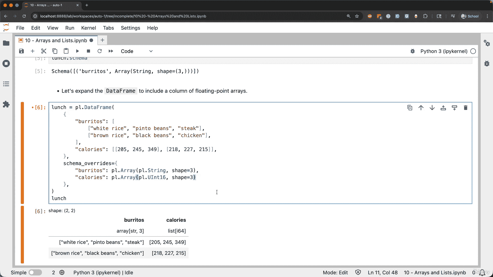

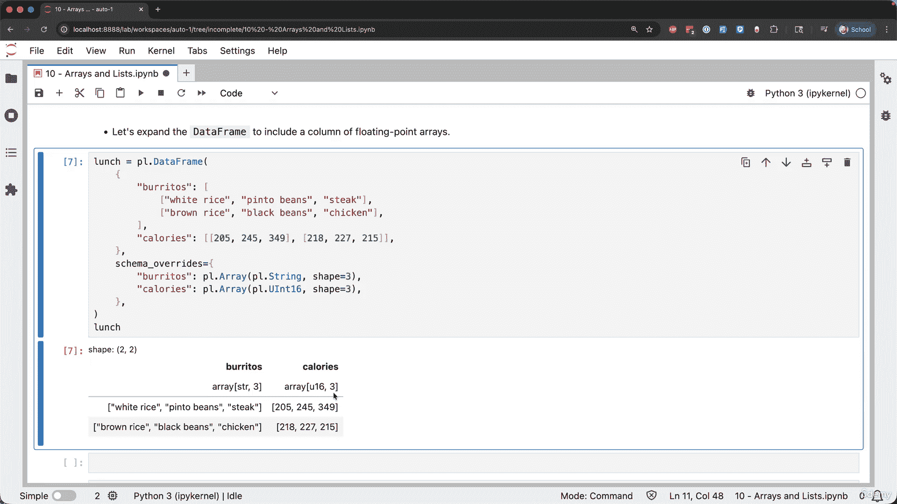

希望这个教程能帮你在需要固定长度集合时，正确选用Array类型。
