# 📊 Udemy - 使用 Polars 与 Python 进行数据分析：138：arr 属性

在本节课中我们将要学习 Polars 表达式中的 `.arr` 属性。前面几个小节里，我们已经探索了多种列表方法，并看到它们都包含在 `.list` 属性中，也可以说都包含在 list 命名空间或 list 对象中。沿着这个规律可以推测，每个表达式上还会有一个互补属性，名字叫 `arr`，它是 array 的缩写。这个属性会暴露一整套方法，用来操作那些在每一行中存储数组值的列。很多方法与 list 命名空间中的互补方法拥有完全相同的名称和功能。对应的核心关系可以写成下面的代码形式。

```python
expr.list.some_method()   # 面向存储列表值的列
expr.arr.some_method()    # 面向存储数组值的列
```

下面执行上一节课的代码。我们已经有一个 `launch` DataFrame，它存储两列，`burritos` 和 `calories`，这两列都在存储数组。可以先确认数据类型，然后对这个数据框调用 `with_columns` 方法。以下是查看 schema 并开始构造列的代码示意。

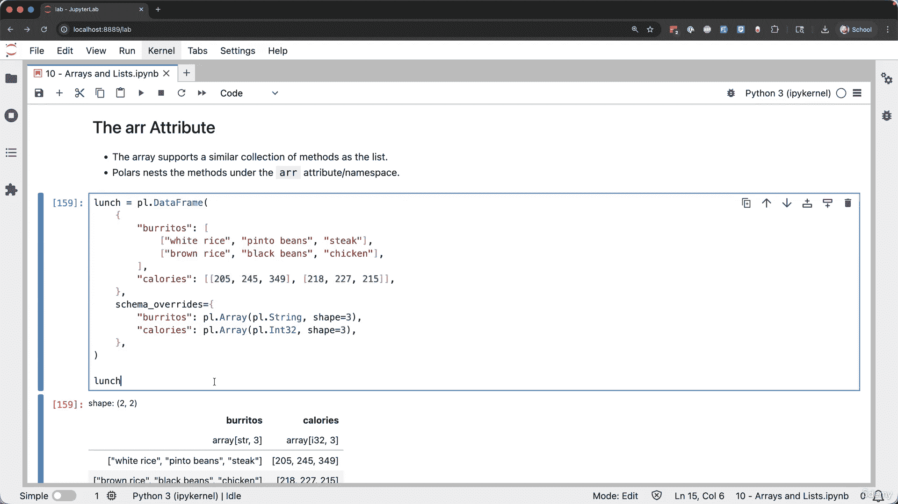

```python
launch.schema

launch = launch.with_columns(
    pl.col("calories").arr.sum().alias("calories_sum")
)
```

## 📚 Udemy - 使用 Polars 与 Python 进行数据分析：138.1：从 list 命名空间到 arr 命名空间

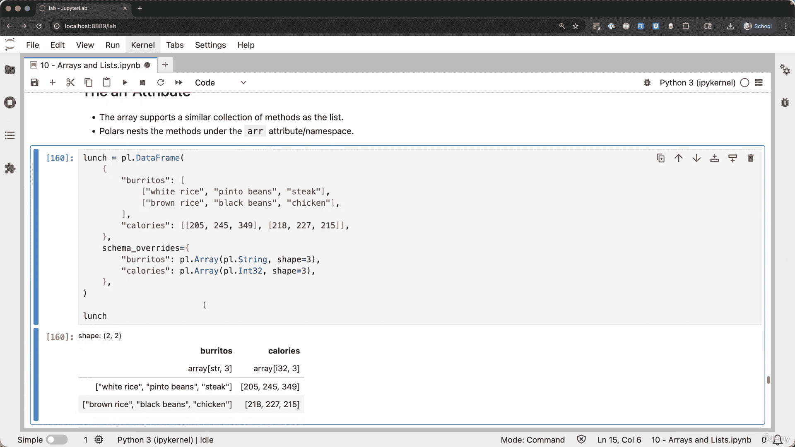

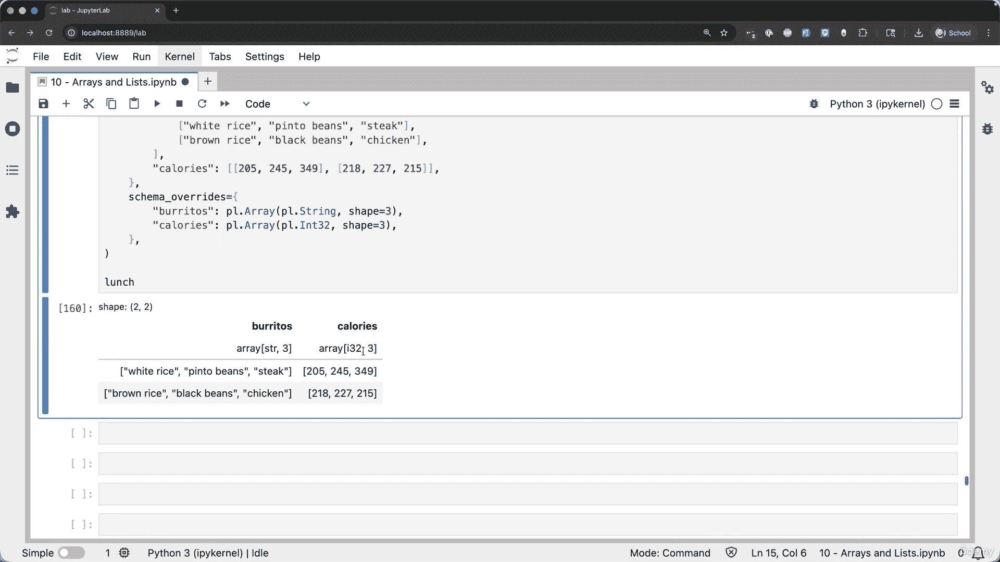

上一节我们回顾了 list 命名空间中的方法，本节中我们来看看互补的 array 命名空间。这里不再访问 `.list`，而是访问 `.arr`，原因是我们面对的是每一行都存储数组值的列，不是列表列。进入 `.arr` 后继续加一个点，就能进入这个属性，也就是进入这个对象，看到很多与 list 对象相似的方法。可以把这个过程理解成先选择列，再进入命名空间，最后调用具体方法。下面的公式描述了按行处理数组的基本思路。

$$
A_i = [a_{i1}, a_{i2}, \dots, a_{in}]
$$

其中，`A_i` 表示第 `i` 行中的数组，`.arr` 命名空间中的方法会对每一行的数组分别执行计算。完成这一层理解后，下面正式从 `calories` 列开始演示。

## 🧮 Udemy - 使用 Polars 与 Python 进行数据分析：138.2：sum、mean、max 与 min

上一节我们说明了 `.arr` 与 `.list` 的对应关系，本节中我们来看看数组列上的求和、平均、最大值和最小值。首先写一个目标为 `calories` 列的表达式，这次访问 `.arr`，并在属性内部调用 `sum` 方法计算每个数组所有元素的和，再把结果列命名为 `calories_sum`。下面继续复制这个表达式，仍然目标同一列，仍然访问 array 命名空间，使用 `mean` 方法计算平均值，并把结果列命名为 `calorie_average`。以下是演示代码。

```python
launch.with_columns(
    pl.col("calories").arr.sum().alias("calories_sum"),
    pl.col("calories").arr.mean().alias("calorie_average"),
)
```

执行后结果与预期一致。799 是某个数组三个元素的和，旁边则是这些元素的平均值。核心计算可以写成以下公式。

$$
\text{arr.sum} = \sum_{j=1}^{n} a_{ij}
$$

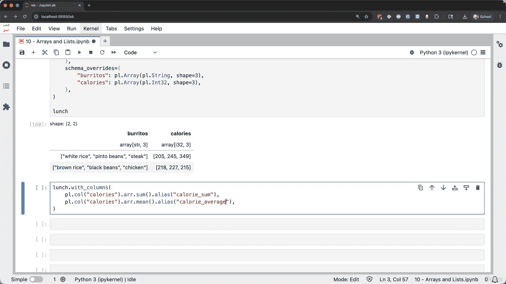

$$
\text{arr.mean} = \frac{1}{n}\sum_{j=1}^{n} a_{ij}
$$

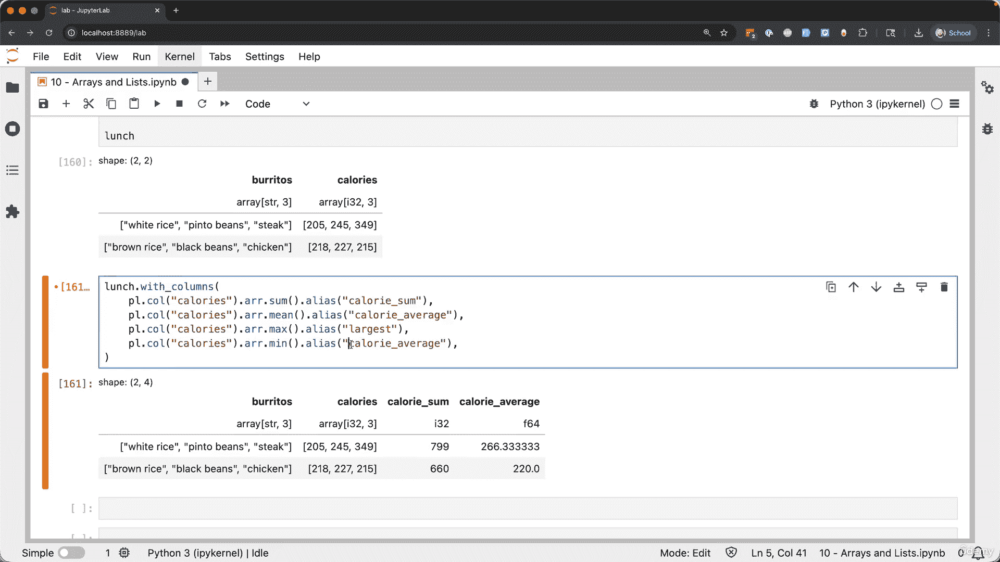

接下来复制表达式继续演示。`.arr` 中还有 `max` 方法，用来提取每个数组中的最大值，所以结果就是该数组的最大元素。`.arr` 中也有 `min` 方法，用来提取给定数组中的最小值。执行结果符合预期，205 是某个数组中的最小元素，215 是另一个数组中的最小元素。以下是对应代码。

```python
launch.with_columns(
    pl.col("calories").arr.max().alias("calories_max"),
    pl.col("calories").arr.min().alias("calories_min"),
)
```

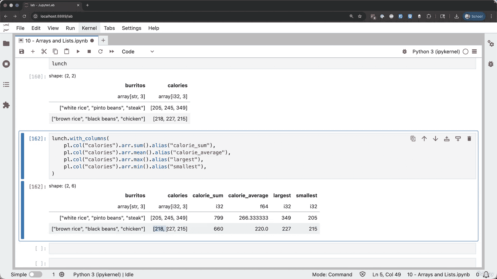

完成这些聚合方法后，下面换一列继续查看数组元素的切片方法。

## 🍚 Udemy - 使用 Polars 与 Python 进行数据分析：138.3：head、tail、first 与 last

上一节我们使用 `calories` 列演示了聚合方法，本节中我们换到 `burritos` 列，看看如何从每行数组中取出部分元素。下面写一个目标为 `burritos` 列的表达式，再次进入 `arr` 命名空间，调用 `head` 方法从每个数组中取出指定数量的元素，实际返回结果是一个列表，因此这里调用 `head(2)` 并把结果列命名为 `first_two`。类似地，下面继续目标 `burritos` 列，在表达式中访问 array 命名空间并调用 `tail` 方法，从每个数组中取出最后两个条目。以下是 `head` 与 `tail` 的代码。

```python
launch.with_columns(
    pl.col("burritos").arr.head(2).alias("first_two"),
    pl.col("burritos").arr.tail(2).alias("last_two"),
)
```

这里可以看到，新列是 list 类型。即使每次取出的元素数量一致，结果仍然是 list 类型，原文作者也不清楚这个设计决定的原因，但原理相同：访问命名空间、调用方法、把内容取出来。接下来还有互补方法 `first`，它只取出每个数组中的第一个元素，结果列可以命名为 `first`。同样还有 `last` 方法，用来取出每行数组中的最后一个元素。以下是代码。

```python
launch.with_columns(
    pl.col("burritos").arr.first().alias("first"),
    pl.col("burritos").arr.last().alias("last"),
)
```

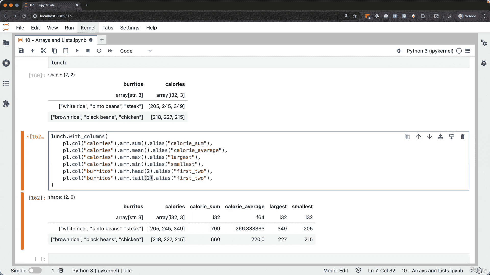

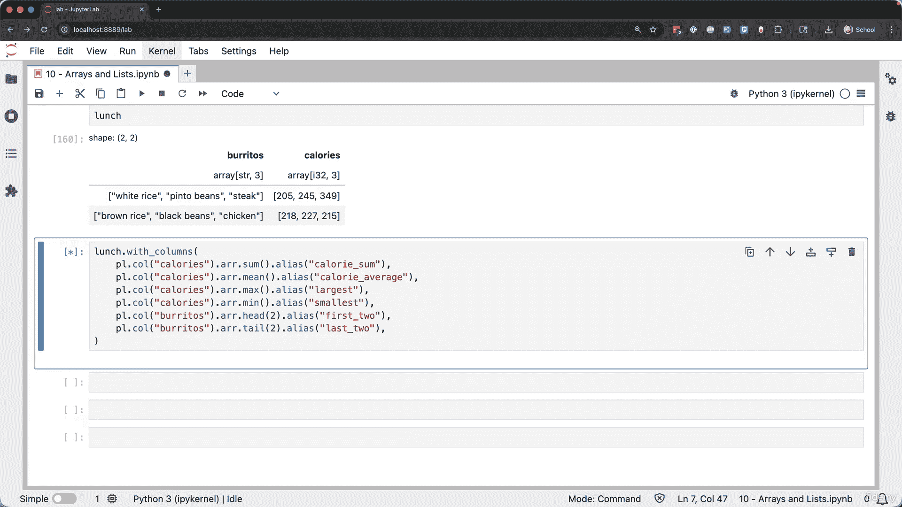

在这个例子里，`burritos` 数组的第一个元素被取出为 white rice，最后一列则取出该数组的最后一个条目 `stake`。所以原则是一致的：当一列存储的是数组值而不是列表值时，就使用这个专用命名空间或相关方法容器，通过它访问一整套用于操作数组列的方法。

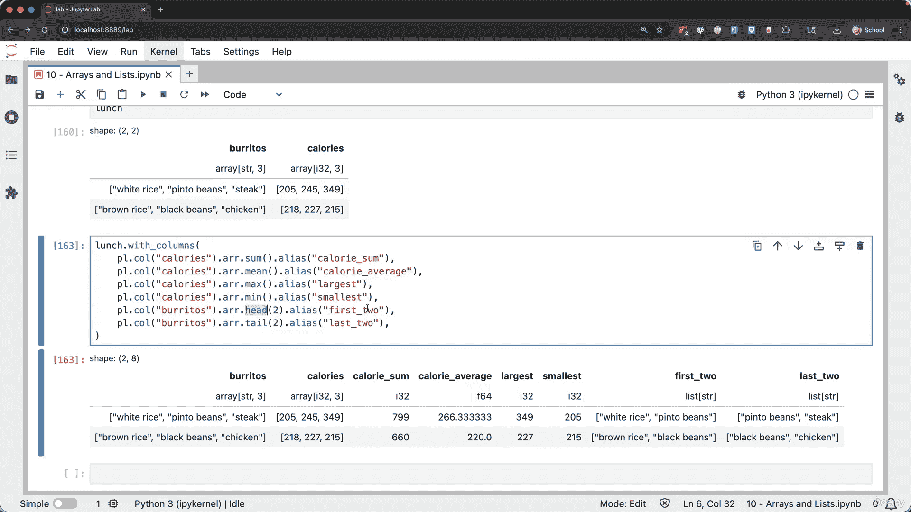

## ✅ Udemy - 使用 Polars 与 Python 进行数据分析：138.4：本节总结

完成 `head`、`tail`、`first` 与 `last` 的演示后，本节接近尾声。以下是本节需要记住的内容。

- `.arr` 是 array 的缩写，是每个表达式上的互补属性，面向行内存储数组值的列。
- `.arr` 与 `.list` 中的很多方法同名同功能，只是适用列的语义不同。
- `sum`、`mean`、`max`、`min` 可以对每行数组分别做聚合计算。
- `head(k)`、`tail(k)`、`first()`、`last()` 可以从每行数组中取出部分元素。
- 选择 `.arr` 还是 `.list`，取决于列里存的是数组值还是列表值。

最后用一句话概括核心原则。

> 列里存数组，就进入 `.arr` 命名空间调用对应方法，再用 `alias` 给结果列命名。

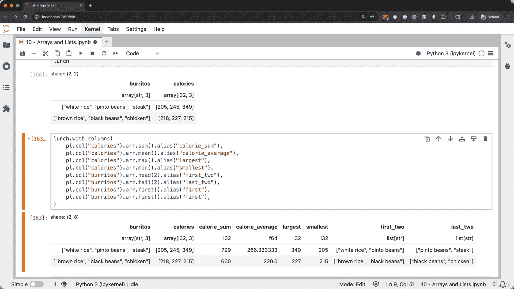

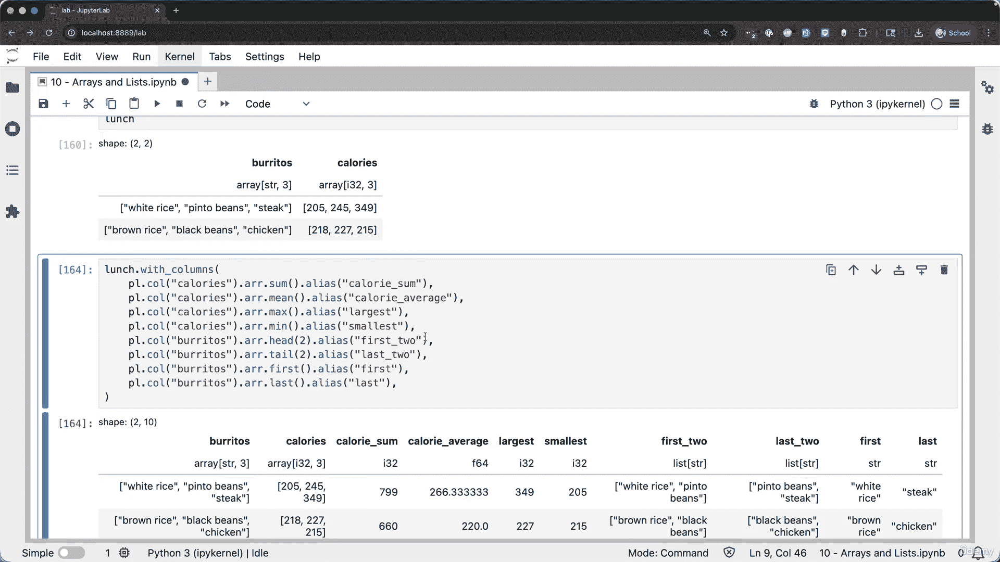

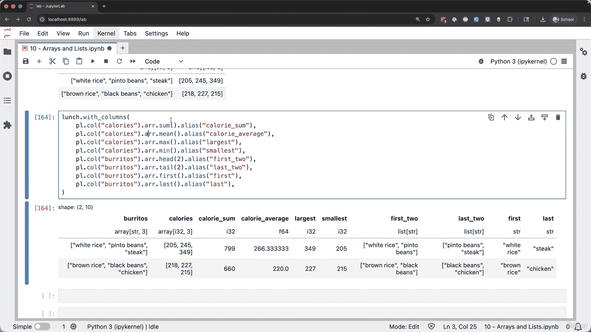

本节课中我们一起学习了 Polars 的 `.arr` 属性：它提供了与 `.list` 相对应的数组方法，可以按行处理数组列，并完成求和、平均、最大、最小、取前几个、取后几个、取第一个和取最后一个等操作。

