# 🧱 Polars 与 Python 数据分析：139：结构体（Structs）入门

在本节课中我们将要学习 Polars 中的结构体（Structs）。结构体可以理解为一种能够在一行里存放多个字段的数据类型，它和 Python 字典很像，但它是 Polars 内部的数据类型。本节会使用一个新的 Jupyter notebook，名称是 11 Structs（原文写作 11 Strs），并且和往常一样先导入 Polars。我们会从最基础的概念开始，逐步看到结构体列长什么样、如何创建、字段如何决定，以及如何通过 schema 查看结构体内部的定义。对初学者来说，可以把结构体想成“一个单元格里放了一个小字典”，这样后面理解字段提取和嵌套数据会轻松很多。

## 🧩 Polars 与 Python 数据分析：139.1：什么是结构体

进入课程的下一节，这一节标题是 Structs。和往常一样，本节使用一个新的 Jupyter notebook，名称是 11 Structs。开始前先导入 Polars 库，使用 `import` 关键字，并用 `as` 关键字指定别名 `pl`。

```python
import polars as pl
```

接下来解释什么是结构体。结构体是一种复合数据类型，意思是这种数据类型能够在自身内部存储多个值。它是 Polars 内置的复合数据类型，和 Python 字典非常相似。Python 字典是一个存储容器，里面包含键值对，其中键是某个对应值的唯一标识。结构体的基本思想和字典一样，区别在于结构体数据会存放在某一行里面。一个列可以包含结构体，每一行是一个结构体，而这个结构体能够在自身内部存储多条信息，这就是结构体的主要优势。也就是说，一行数据、一个列位置里，可以存放多个嵌套的信息。

为了更清楚地理解结构体，下面列出几个关键点。

- 结构体是复合数据类型，能在内部存储多个值。

- 结构体与 Python 字典很相似，都是键值对形式。

- 字典中的键是值的唯一标识，结构体中也使用类似的标识。

- 结构体存放在行内，列中可以包含结构体，每行是一个结构体。

- 结构体的优势是可以在单个列的单行中存储多个嵌套信息。

- Polars 中某些操作会产生结构体列，例如 `value_counts` 方法就是一个例子；本章后续会讨论结构体的更多优势。

这里有一个重要细节和术语差异。Polars 建立在 Rust 之上，在 Rust 中，键经常被称为字段（field）。所以结构体的键，也就是对应值的标识，被称为字段。例如可以说结构体的 `name` 字段对应的值是 `boris`，其中 `name` 是字段标识，`boris` 是对应的值。理解字段这个说法对后面查看 schema 和提取数据都很重要，因为 Polars 文档和输出中会经常使用 field 这个词。

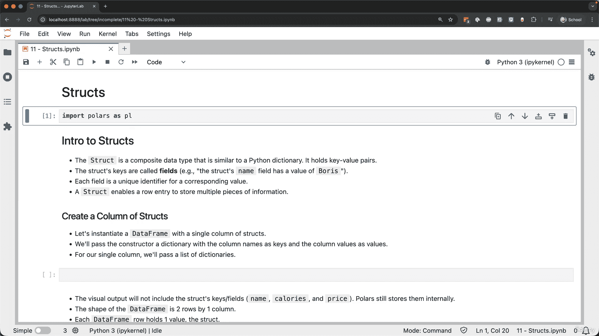

上一节我们介绍了结构体的基本含义和字段术语，本节中我们来看看在 Polars 中创建包含结构体的数据框时，语法大概是什么样。

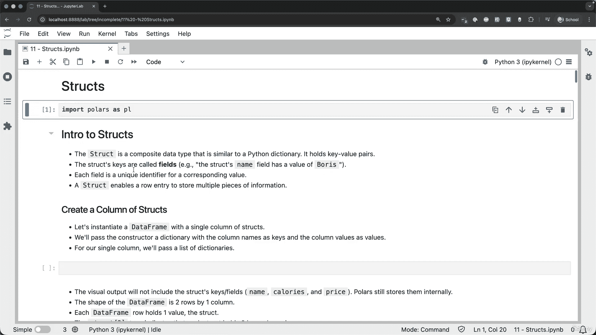

## 🍬 Polars 与 Python 数据分析：139.2：创建包含结构体的数据框

下面从零创建一个新的数据框。这里使用 Polars 顶层的 `DataFrame` 构造器，并给列提供一个字典。我们只创建一个列，列名叫做 `candies`。这个列中要放两个糖果，所以给列提供一个列表。需要提醒的是，在普通情况下，可以给列提供组成该列的标量值，例如一个整数列中每一行存放一个 `Int64` 数值。但在这个 `candies` 列中，我们不提供标量值，而是提供 Python 字典，Polars 会把每个字典转换成对应的结构体。

每个糖果字典中打算存放三类信息，具体如下。

- `name` 字段，用来保存糖果名称。

- `calories` 字段，用来保存卡路里数值。

- `price` 字段，用来保存价格数值。

第一个糖果可以把 `name` 设为 `snickers`，把 `calories` 设为 `200`，把 `price` 设为 `199`。这样就在字典中把字段标识和对应值关联起来。第二个字典也使用同样三个字段，具体值如下。

- `name` 字段设为 `three musketeers`。

- `calories` 字段设为 `250`。

- `price` 字段设为 `249`。

下面是创建数据框的代码示例。原文中价格写的是 `199` 和 `249`，为了和本节后面对 `price` 字段类型的说明保持一致，示例中写成 `199.0` 和 `249.0`；如果数字不带小数点，Polars 可能把价格推断成整数，实际使用时保持同一字段的类型统一即可。

```python
import polars as pl

candies = pl.DataFrame(
    {
        "candies": [
            {"name": "snickers", "calories": 200, "price": 199.0},
            {"name": "three musketeers", "calories": 250, "price": 249.0},
        ]
    }
)

candies
```

这段代码不会产生三个不同的列，尽管每个字典中有三条数据。它会产生一个 `candies` 列，每一行的数据类型是结构体。输出中方括号表示每个结构体存储三个键值对，也就是三个字段。每个结构体内部嵌套了三条信息，而结构体本身是这个列中对应行的值。对初学者来说，可以把它理解成：普通列每个单元格只有一个值，而结构体列每个单元格有一个“小对象”，这个小对象里面还能继续放多个字段。

以下是关于输出和存储方式的关键说明。

- 结构体列的视觉输出不会显示字段名，`name`、`calories`、`price` 不会直接打印出来。

- 字段名虽然没有显示，但它们确实存在于结构体中。

- 视觉输出中看到的是字段对应的值，例如 `snickers`、`200`、`199` 这类值。

- 这个数据框只有一个列，总共有两行。

- 从嵌套信息角度看，它包含六条信息，因为每个结构体内部存了三个键值对。

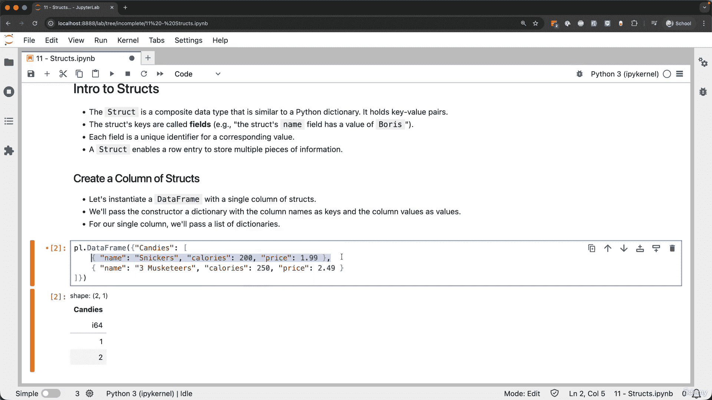

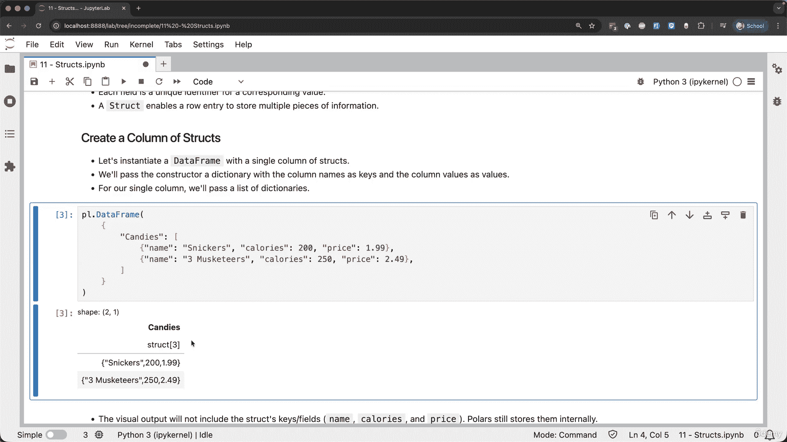

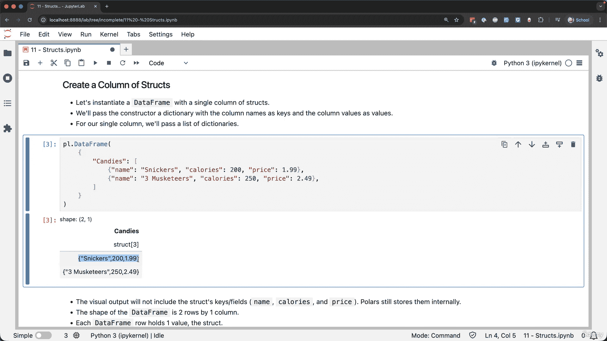

- 每个数据框行存放一个结构体值，而结构体类型能够在自身内部存放多个东西。

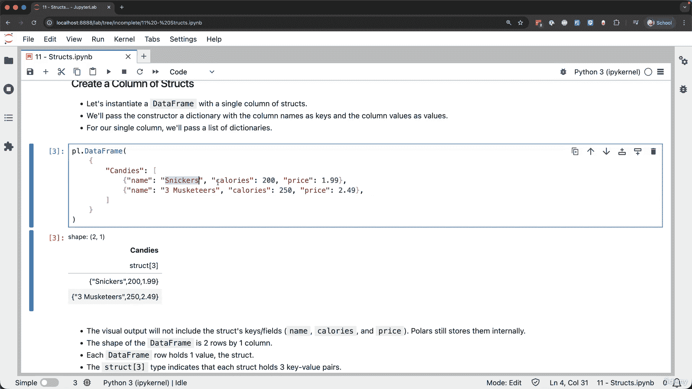

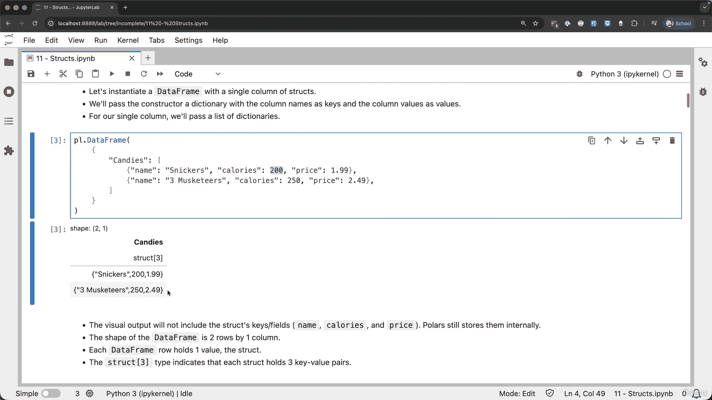

上一节我们创建了结构体列并看到了它的输出形式，本节中我们来看看 Polars 在创建结构体时如何决定字段定义。

## 🧭 Polars 与 Python 数据分析：139.3：第一个字典决定结构体字段

使用结构体语法时需要注意一个细节：Polars 会把列表中的第一个字典当作事实来源（source of truth），用来确定结构体中会有多少个键值对，以及具体是哪些键值对。下面给出一个示例，在第二个字典中额外增加一个第一个字典中没有的键值对，例如 `delicious` 设为 `True`。

```python
import polars as pl

candies_mismatch = pl.DataFrame(
    {
        "candies": [
            {"name": "snickers", "calories": 200, "price": 199.0},
            {"name": "three musketeers", "calories": 250, "price": 249.0, "delicious": True},
        ]
    }
)

candies_mismatch
```

这里出现了字段不匹配。Polars 会查看第一行，也就是列表中的第一个元素，并规定每个结构体只允许有三个键值对，因为第一个字典会作为事实来源。后面的行即使有四个或五个数据，第一行仍然会作为 schema 的定义。Polars 会知道不仅有一个 `candies` 列用来存储结构体，而且每个行结构体具体存储 `name`、`calories`、`price` 这些字段。`delicious` 会被完全忽略。

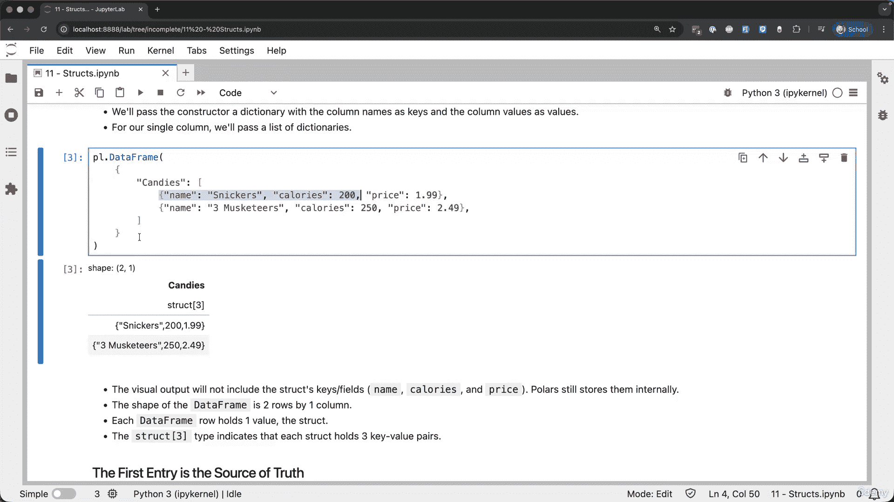

以下列出这条规则带来的关键表现。

- 第一个字典决定结构体包含哪些字段。

- 第一个字典决定结构体包含多少个键值对。

- 后续字典多出来的字段不会自动加入结构体。

- 第一行会被当作 schema 的定义。

- 即使后续行有四个或五个数据，结构体仍然按照第一行定义。

- 在这个例子中，Polars 会忽略 `delicious`，并知道每一行结构体有三个键值对。

上一节我们看到了第一个字典如何决定结构体字段，本节中我们来看看如何用 schema 属性查看这些字段和对应的数据类型。

## 🗂️ Polars 与 Python 数据分析：139.4：用 schema 查看结构体字段

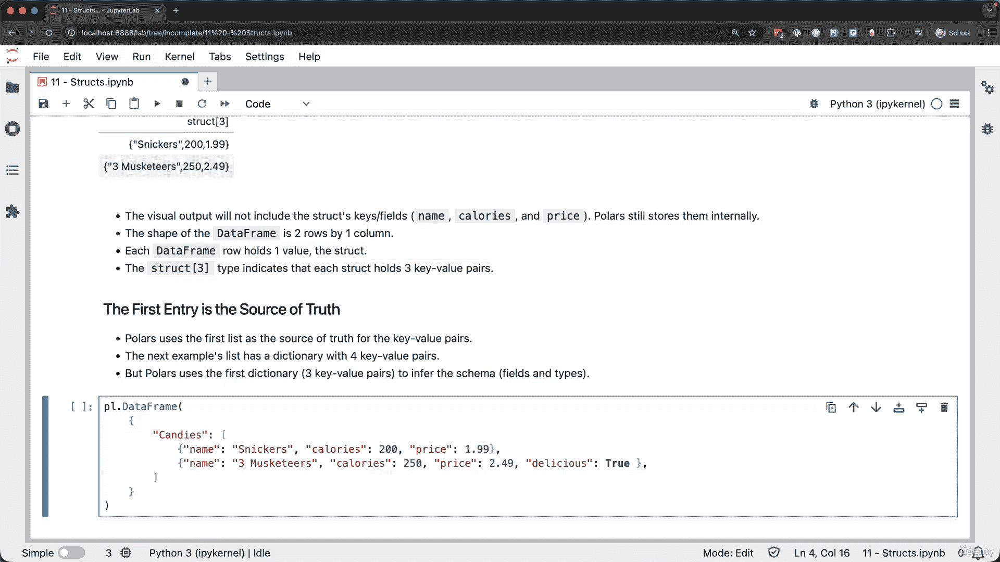

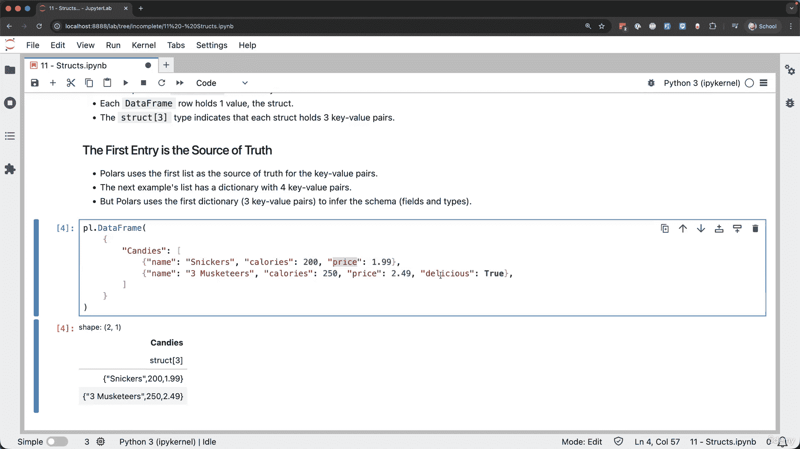

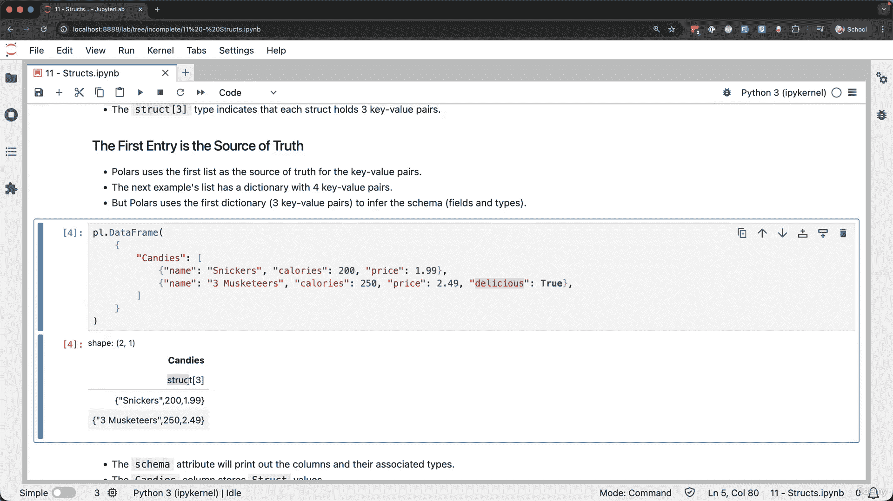

如果想查看结构体内部存储了哪些字段、标签或键，可以使用数据框的 `schema` 属性。下面把数据框赋值给 `candies` 变量并输出，同时查看 `candies.schema`。

```python
import polars as pl

candies = pl.DataFrame(
    {
        "candies": [
            {"name": "snickers", "calories": 200, "price": 199.0},
            {"name": "three musketeers", "calories": 250, "price": 249.0},
        ]
    }
)

candies.schema
```

`candies` 是一个数据框，它只有一个列，但仍然是一个数据框。每个数据框都有 `schema` 属性。通过这个属性可以看到，数据框中有一个 `candies` 列，每一行或每个条目的数据类型是结构体，更具体地说，是一个存储嵌套键值对或字段的结构体。

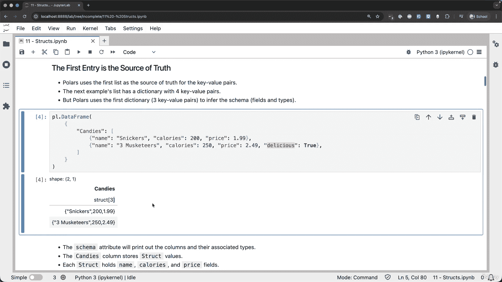

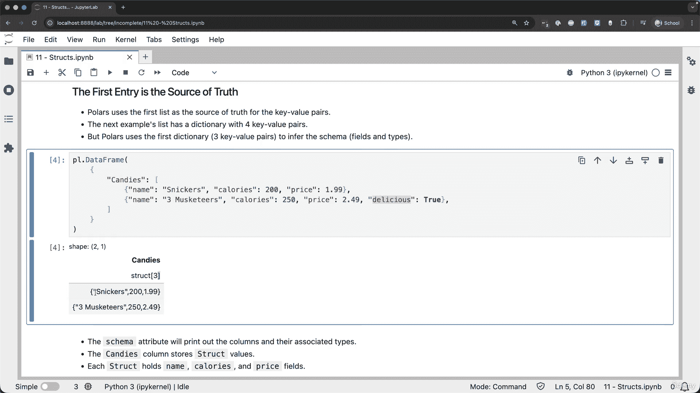

以下是 schema 输出所表达的信息。

- `candies` 列中的每一行都是一个结构体。

- 结构体内部存储嵌套的键值对，也就是字段。

- `name` 字段的值应当是字符串类型。

- `calories` 字段的值应当是 64 位整数类型。

- `price` 字段的值应当是 64 位浮点数类型。

到这里就完成了结构体基本语法的快速介绍。本节后续还会讨论如何得到这种结构体数据，以及如何按照字段名提取值、执行相关操作。后续内容会围绕这些实际用法展开，理解了字段和 schema 之后，再操作结构体就会更顺畅。

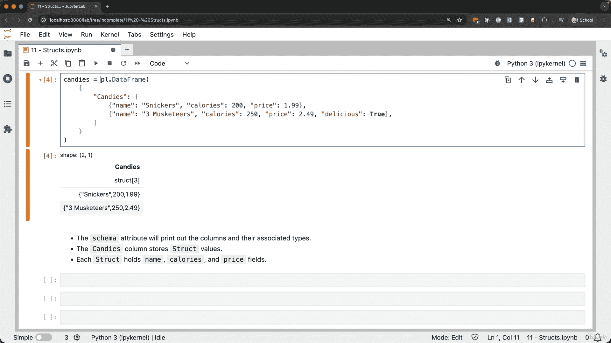

## 🧾 Polars 与 Python 数据分析：139.5：本节总结

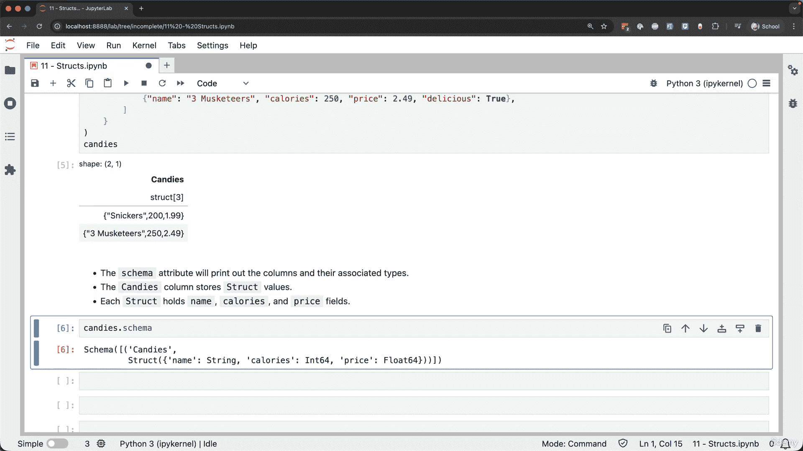

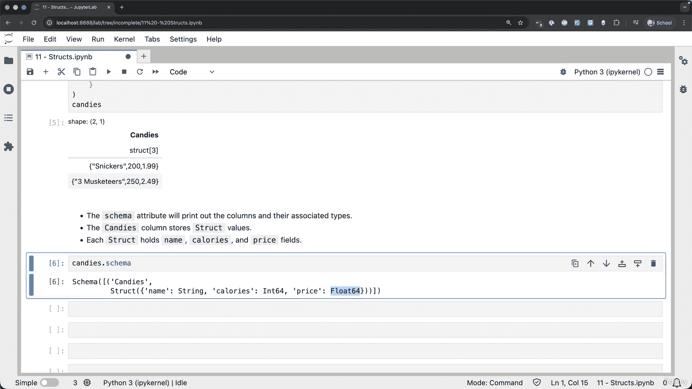

本节课中我们一起学习了 Polars 中的结构体。结构体是一种复合数据类型，可以在单行、单个列位置中存储多个嵌套信息，和 Python 字典很相似。Polars 把结构体的键称为字段，这一点来自 Rust 的术语。我们创建了一个包含 `candies` 列的数据框，用 Python 字典表示糖果信息，Polars 把每个字典转换成了结构体。我们看到结构体列的视觉输出不会直接显示字段名，但字段确实存在。我们还看到第一个字典会作为事实来源决定结构体字段和键值对数量，后续字典多出的字段会被忽略。最后我们使用 `schema` 属性查看了结构体内部的字段及其数据类型。后续课程会继续讨论如何得到这类数据，以及如何按字段名提取值，下一节课见。

