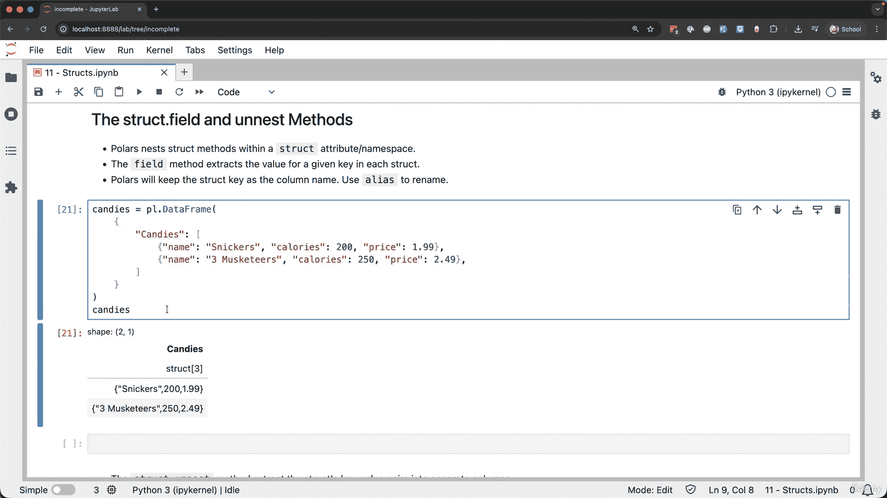
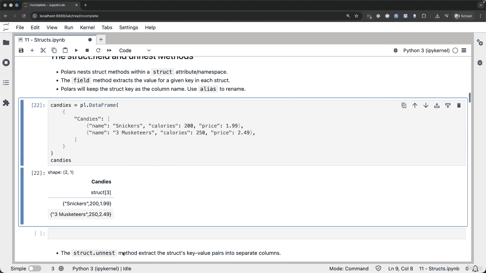
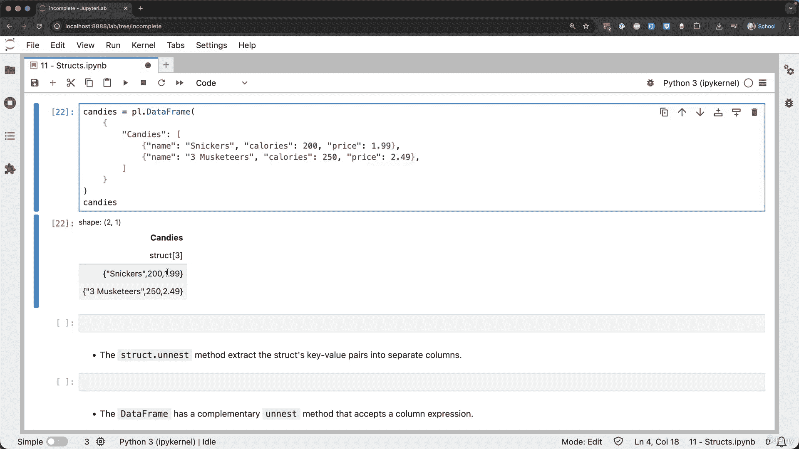
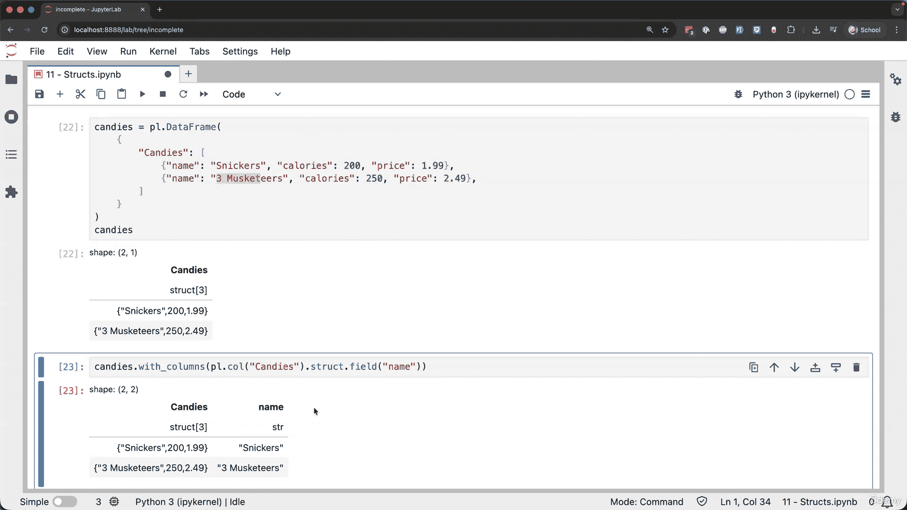
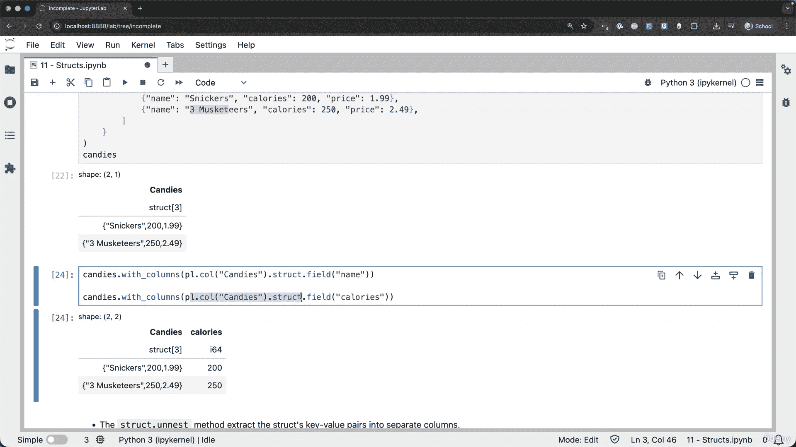
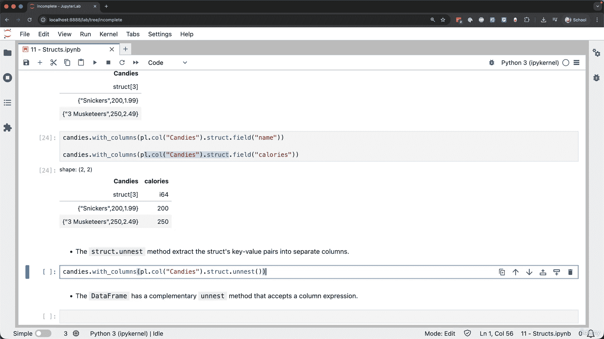
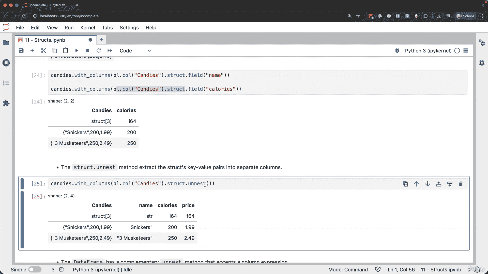
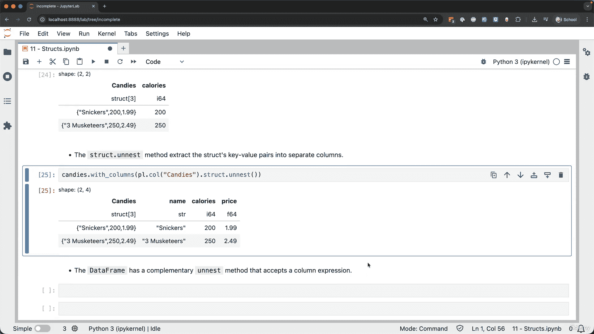
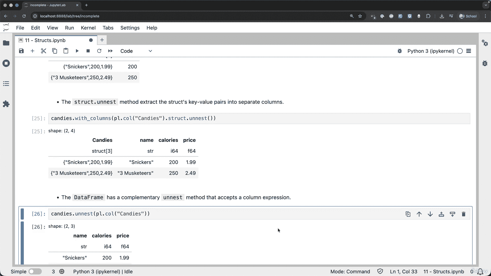
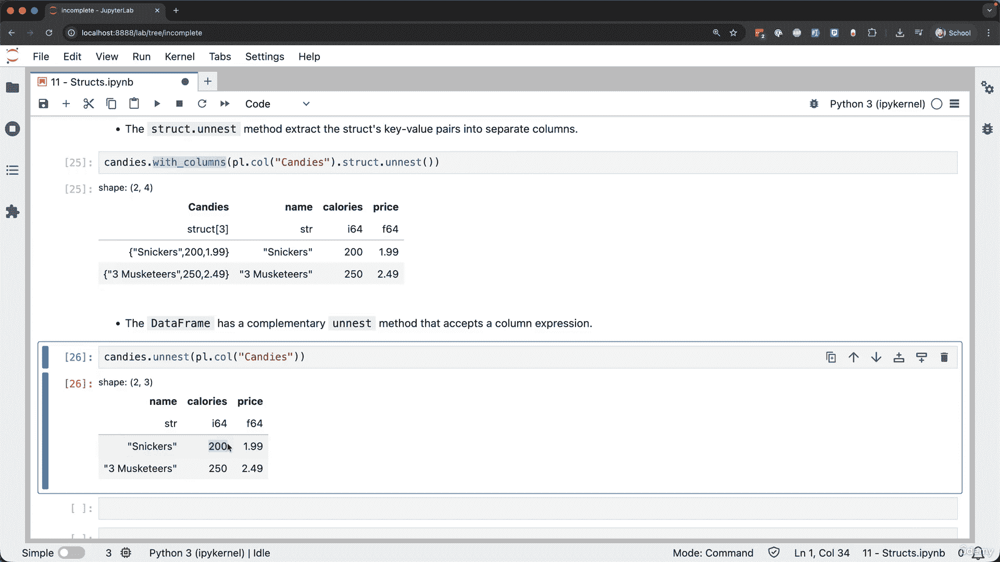

# 📊 使用Polars与Python进行数据分析（第二部分）：第140节：struct的field与unnest方法

在本节课中，我们将学习如何处理 Polars 中的 struct 类型数据，重点掌握 `field` 和 `unnest` 这两个方法。struct 是 Polars 中一种复合数据类型，它可以把多个字段组合在一个单元格里。对于初学者来说，可以把 struct 理解成一个小字典，每个键对应一个字段，每个值就是该字段的数据。实际分析时，这些嵌套字段往往不方便直接使用，所以我们经常需要把它们拆出来，变成普通列。本节课的核心就是解决这个问题。

上一课我们已经准备好了包含 struct 数据的 DataFrame，接下来会在这个基础上演示如何提取字段。现在，我们正式开始。





## 🧭 认识 struct 命名空间



和 Polars 的字符串方法、日期时间方法一样，Polars 把所有与 struct 相关的功能都集中放在一个 `struct` 命名空间里。这个命名空间本质上就是一个属性，你可以直接在任何 Polars 表达式上访问它。简单来说，只要一个列是 struct 类型，你就能通过 `列.struct.xxx()` 的方式去调用相关方法。

在使用这些方法之前，需要确保目标列确实存储的是 struct 值。如果列类型不对，后面的一切操作都无法进行。确认这一点之后，你就可以在 `struct` 命名空间里看到很多与 struct 相关的方法。本节课我们要重点看的是 `field` 和 `unnest` 这两个方法，它们分别负责提取单个字段和展开全部字段。

## 🎯 用 field 方法提取单个字段

我们先把上一课写好的代码继续执行起来。当前数据里有一个名为 `candies` 的单列，这一列中每一行存放的都是 struct。也就是说，每一行都是一个完整的结构体，里面包含了好几个字段。下面我们来看看如何从这些 struct 中提取某个固定字段的值。

假设我们希望从每个 struct 中提取同一个字段的值，比如提取每个糖果的名字。`name` 就是每行 struct 里的一个字段。这里我们调用 `with_columns` 方法，并创建一个针对 `candies` 列的表达式。由于所有 struct 相关方法都存放在 `struct` 命名空间中，所以我们可以直接在表达式上使用 `struct.field` 方法。下面是提取 `name` 字段的代码：



```python
import polars as pl

candies.with_columns(
    pl.col("candies").struct.field("name")
)
```

`field` 方法的工作方式非常简单：你给它一个字段名字符串，它就帮你去每个 struct 中把这个字段对应的值全部拿出来。在这个例子中，字段名恰好也是 `name`，所以得到的新列，列名就叫 `name`。新列里的每个值，就是原来每个 struct 中 `name` 字段的内容。此时这一列存储的是字符串，我们相当于从复合的 struct 数据中提取出了一块独立的数据。

同样的道理，如果想把 `calories` 这个字段也提取出来，语法完全一样，仍然使用 `struct.field` 方法，只需要把字段名改成 `"calories"` 即可。执行之后，你会得到一个名为 `calories` 的列，列中的每个值都来自每个 struct 中的 `calories` 字段。这种写法适合只需要提取一个或者少数几个字段的情况，如果字段很多，手动重复的代价就会变得比较大。



## 🚀 用 unnest 方法展开全部字段

如果想把 struct 中的每个键值对，也就是每个字段，都放到独立的列中，当然可以多次重复写上面的 `field` 调用，一个字段一个字段地提取。不过这样做稍微有点繁琐，Polars 提供了一个更便捷的方法，那就是 `unnest`。下面我们继续使用 `candies` 这个 DataFrame，同样调用 `with_columns` 方法，创建针对 `candies` 列的表达式，然后在 `struct` 命名空间中调用 `unnest`。



```python
candies.with_columns(
    pl.col("candies").struct.unnest()
)
```

这段代码运行之后，`unnest` 会把每个 struct 中的每一个字段都拆分到结果 DataFrame 的独立列中。从结果里可以看到，当前每个 struct 包含三个字段，于是最终得到了 `name`、`calories`、`price` 三列，每一列中保存的都是对应字段的值。因为这里使用的是 `with_columns`，所以原始 DataFrame 的所有列都会被保留，其中也包括原来的 `candies` 列。因此结果中既能看得到展开后的新列，也能看得到原来的 struct 列，你可以根据后续需要决定是否继续保留原来的列。

## 🔁 使用顶层 unnest 方法





除了上面这种写法之外，还有一种方式可以得到完全一样的结果。Polars 的顶层 DataFrame 对象本身也有一个 `unnest` 方法。在我们的例子中，`candies` 这个 DataFrame 可以直接调用 `unnest`，并传入一个指向 struct 列的表达式。我们把 `pl.col("candies")` 传进去，因为 `candies` 列存储的正是 struct 数据。代码如下：

```python
candies.unnest(pl.col("candies"))
```

这个顶层方法会自动把每个 struct 中的全部字段拆出来，生成独立的列。它和前面用 `with_columns` 的方法相比，唯一的区别在于：`with_columns` 会保留原始 DataFrame 的所有列，包括原来的 `candies` 列；而直接调用顶层 `unnest` 时，得到的是一个全新的 DataFrame，这个新 DataFrame 只包含拆出来的字段和值，也就是 `name`、`calories`、`price` 这三列。虽然写法不同，但核心思想完全一致：程序会遍历每一行的 struct 值，把其中对应的字段和值取出来。你可以把 struct 中的每条数据看成一组键值对，字段名是键，字段值是值。展开之后，键变成了新列的列名，值变成了每个 struct 中对应字段取出来的内容。

## 📝 小结





本节课我们一起学习了 Polars 中 struct 类型数据的两个重要方法：`field` 用于提取单个字段的值，`unnest` 用于一次性展开所有字段。我们还对比了 `with_columns` 与顶层 `unnest` 两种写法，知道了它们在是否保留原始列这个细节上的差异。你可以把 struct 中的每条数据想象成一组键值对，字段名会成为新列名，字段值会成为对应列中的值。掌握了这些方法，后续再遇到嵌套数据时，处理起来就会顺手很多。
