# 🐻 Polars 与 Python 数据分析：141：value_counts 方法

## 🧭 Polars 与 Python 数据分析：141：本节概述

在本节课中，我们将学习一个之前见过的方法：`value_counts`。这个方法会返回一列 `struct`，也就是“结构体”类型的列。我们会从 Polars 的核心设计原则讲起，再导入一个简单的颜色数据集，调用 `value_counts` 统计每个颜色出现的次数，然后查看 `schema` 理解 `struct` 里的字段，接着用 `sort` 参数排序，最后复习两种把 `struct` 展开成普通列的方法。整个过程会围绕“单列操作产生单列结果”这个原则展开，帮助初学者理解为什么 Polars 会把多个信息打包进一个 `struct` 列里。

上一节我们介绍了如何展开 `struct` 列，本节中我们来看看 `value_counts` 本身如何返回 `struct`，以及如何对这个结果继续处理。

## 🧱 Polars 与 Python 数据分析：141：单列操作与 struct 返回

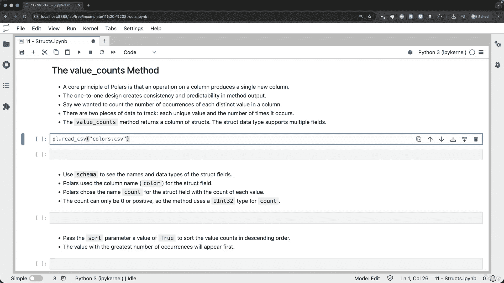

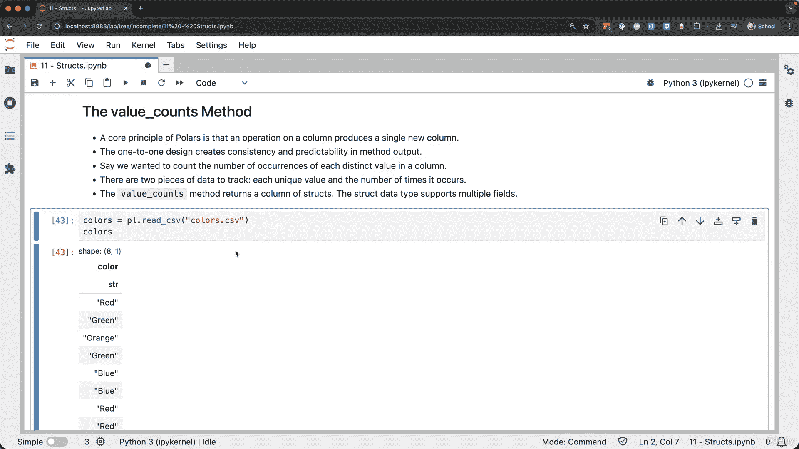

记住，Polars 设计中的一个核心原则是：对一个单列执行操作，会产生一个新的单列。也就是说，旧列和新列之间是一一映射的关系。这个原则让表达式操作保持一致性，也更容易预测结果。可以用下面的公式表示这个核心概念：

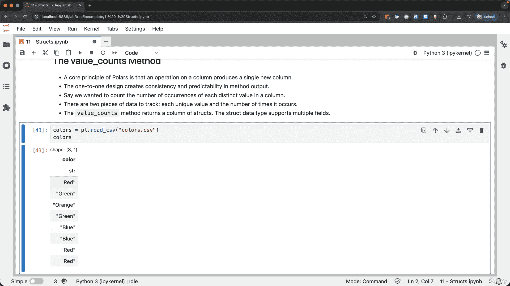

> 核心原则：单列操作产生单列结果；旧列到新列是一一映射。
>
> \[
> \text{单列表达式} \rightarrow \text{单列结果}
> \]

正因为这个原则，当我们用 `value_counts` 统计颜色出现次数时，虽然结果里需要保存“颜色”和“次数”两类信息，但 Polars 仍然希望返回一个单列。Polars 团队的做法是把这两类信息打包进一个 `struct`，因此返回的是一列 `struct`。从行视角看，每一行仍然是一个值，只是这个值内部包含多个字段。

## 📥 Polars 与 Python 数据分析：141：导入数据并调用 value_counts

下面开始导入数据集。数据集来自一个名为 `colors.csv` 的 CSV 文件，这个数据集非常简单、短小，只有一列颜色。我们会把它赋值给变量 `colors`，并在下面输出查看。对应代码如下：

```python
import polars as pl

colors = pl.read_csv("colors.csv")
colors
```

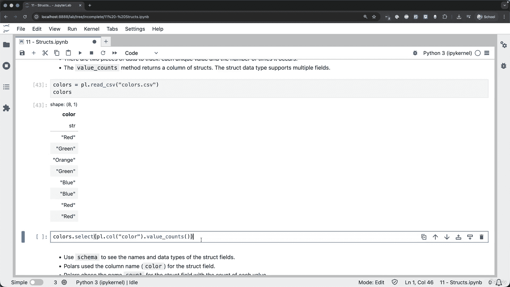

接下来，我们想统计这一列中每个唯一值或每个不同值出现了多少次。换句话说，就是红色出现了多少次，绿色出现了多少次。下面用列表梳理这一小节的步骤，方便初学者跟着操作：

- 读取 `colors.csv`，得到 `colors` 数据框。
- 对 `colors` 调用 `select` 方法。
- 在 `select` 中创建一个表达式，目标列是 `color`。
- 在 `color` 列上调用 `value_counts`，统计每个值出现的次数。
- 用 `alias` 把结果列命名为 `data`，便于理解。

对应代码如下：

```python
colors.select(
    pl.col("color").value_counts().alias("data")
)
```

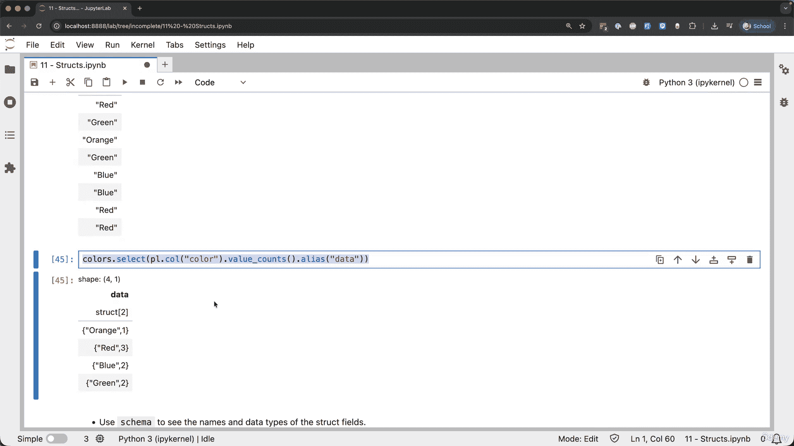

这部分是常规写法。方法名 `value_counts` 的含义就是统计每个值出现的次数。在执行之前，我们需要先想清楚会得到什么结果：结果需要保存两类信息，一类是实际的颜色，比如红色；另一类是这种颜色出现的次数。根据 Polars 的设计原则，单列操作要返回单列结果，所以 Polars 会把“颜色”和“次数”这两个信息打包进一个 `struct`，最终返回一列 `struct`。从单个列表达式返回的结果仍然是一个单列，只是这一列中每一行都存储一个包含两个字段的 `struct`。这两个字段分别表示被计数的实际值和它出现的次数。

## 🔍 Polars 与 Python 数据分析：141：查看 schema 与字段含义

`struct` 列在可视化输出中有一个不太直观的地方：我们通常看不到字段名。如果想看字段名，可以访问 `schema` 属性。下面把前面的代码再写一遍，并附加 `schema` 属性来查看结构：

```python
schema_result = colors.select(
    pl.col("color").value_counts().alias("data")
).schema

schema_result
```

查看后可以看到，Polars 得到一个数据框，其中只有一个 `data` 列，这一列的每一行都存储 `struct`。更具体地说，这个 `struct` 有两个字段：一个是 `color` 字段，类型应该是字符串；另一个是 `count` 字段，类型应该是无符号 32 位整数。`count` 使用无符号 32 位整数，是因为计数只能是 0 或正数。可以用下面的公式描述这个结构：

\[
\text{value\_counts} : \text{color} \mapsto \text{Struct}\{\text{color}: \text{String},\ \text{count}: \text{UInt32}\}
\]

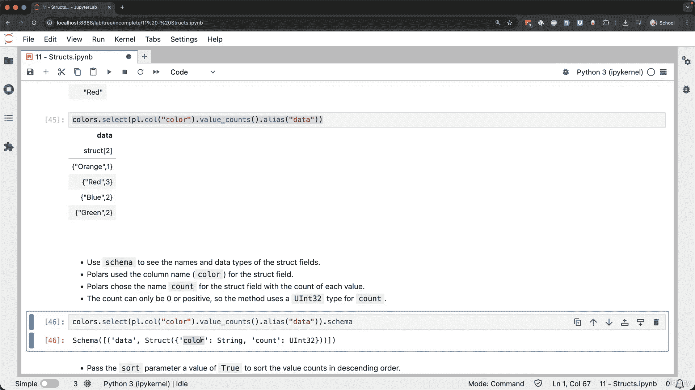

这个设计有一个有意思的地方：它混合了一点动态生成的内容和硬编码的内容。下面用列表说明这两个字段的来源，帮助理解这种混合设计：

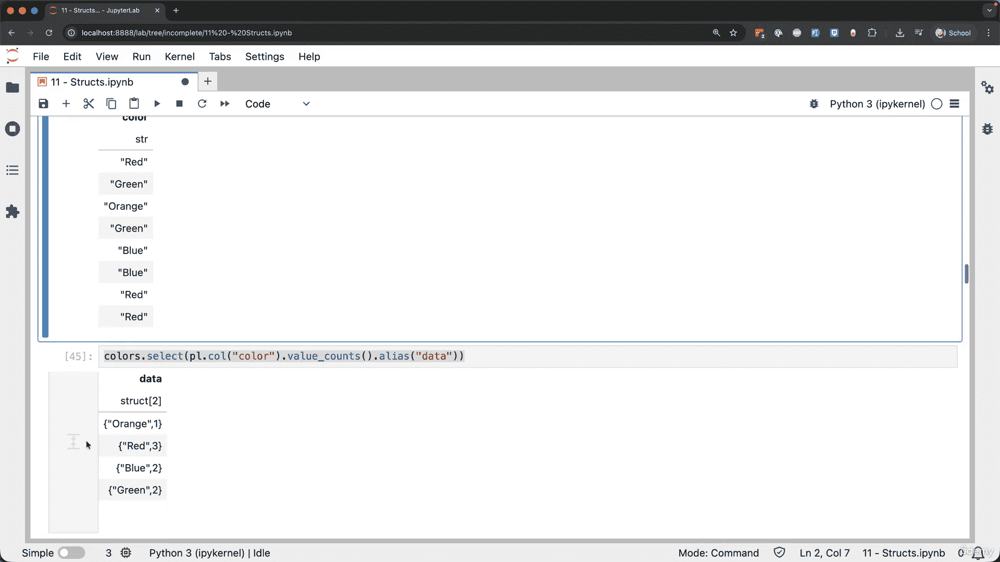

- `color` 字段名来自原始列名，Polars 从原列名中取得这个名字，并把它作为每一行 `struct` 内部的字段名。
- `count` 字段名是 Polars 开发团队选择的固定名称。
- 两个字段作为键或标识符，分别对应颜色值和出现次数。

因此，`color` 字段对应实际颜色，`count` 字段对应它的计数。关键原则仍然不变：新的 `data` 列中每一行都存储一个 `struct`，这个 `struct` 存储两个字段，这两个字段分别作为对应值的键或标识符。

## ↕️ Polars 与 Python 数据分析：141：使用 sort 参数排序

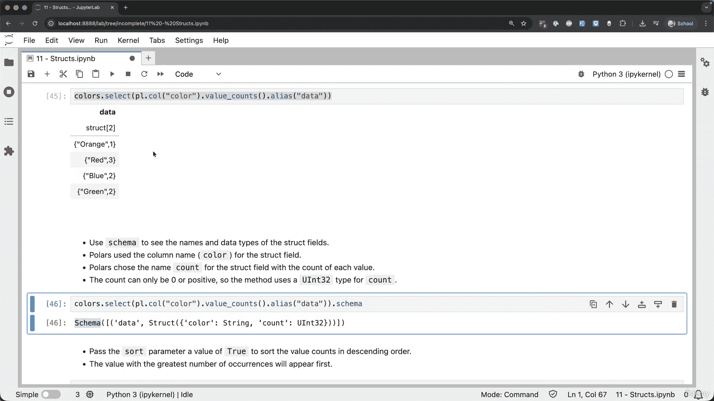

提醒一下，`value_counts` 方法接受一个 `sort` 参数。如果想按计数大小查看结果，可以传入 `sort=True`。下面不再附加 `schema`，直接查看排序后的结果：

```python
colors.select(
    pl.col("color").value_counts(sort=True).alias("data")
)
```

这样就会看到所有计数从高到低排序。红色是这份数据中出现频率最高的值。通过这个参数，我们可以不必自己再排序，直接得到按出现次数排列的统计结果。

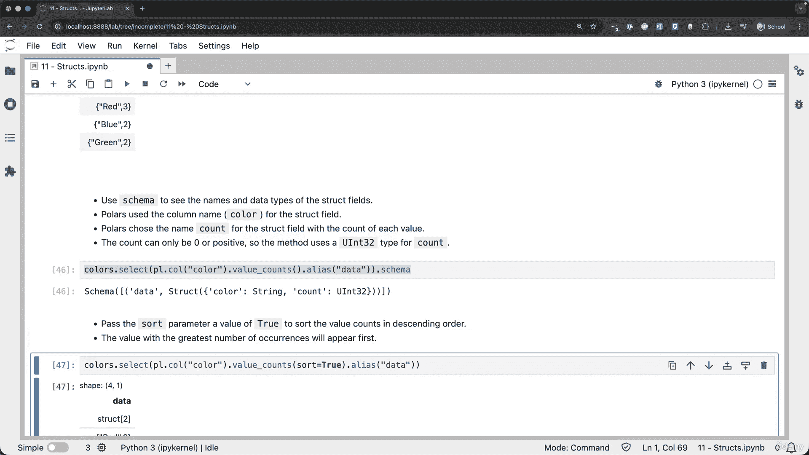

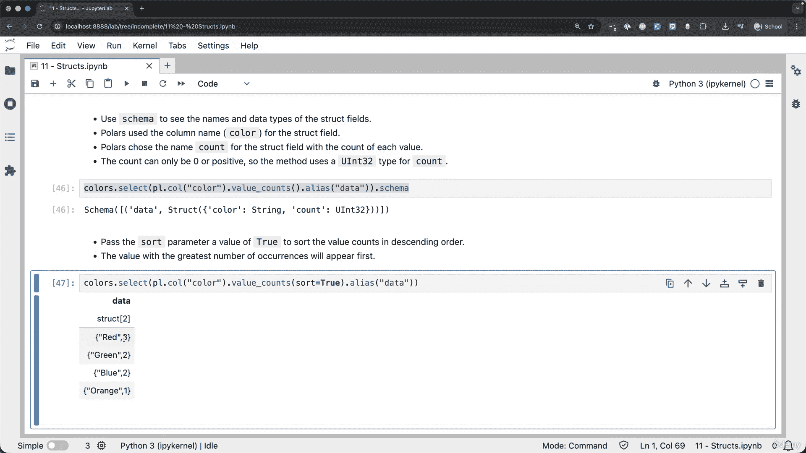

## 🧰 Polars 与 Python 数据分析：141：把 struct 展开成普通列

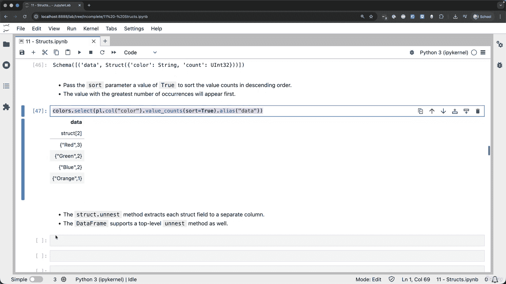

如果调用 `value_counts` 后不习惯 `struct` 这种返回形式，可以把内容提取到单独的列中。上一节我们见过几种做法，本节复习其中两种。下面用列表介绍这两种展开方式，方便对比：

- 第一种方式是使用 `struct` 命名空间中的 `unnest` 方法。
- 第二种方式是使用数据框顶层的 `unnest` 方法，并传入要展开的列名。

第一种方式中，我们调用 `select` 方法，不保留旧内容，然后创建一个针对新 `data` 列的表达式。因为 `data` 是 `struct` 列，所以可以在 `struct` 属性或命名空间中访问大量 `struct` 功能，其中包括 `unnest` 方法。`unnest` 的优势是不需要关心所有字段名，可以直接把所有字段展开成需要的列数。这里有两个字段，因此新数据框中会得到两列。对应代码如下：

```python
colors.select(
    pl.col("color").value_counts(sort=True).alias("data")
).select(
    pl.col("data").struct.unnest()
)
```

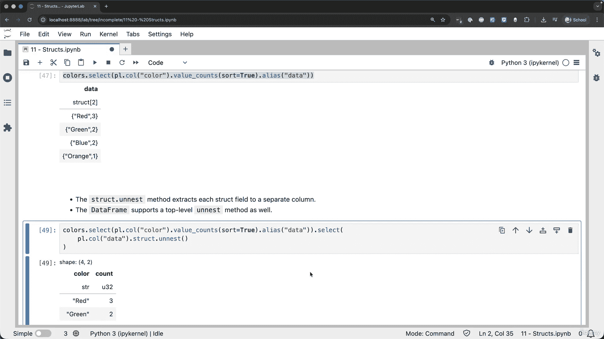

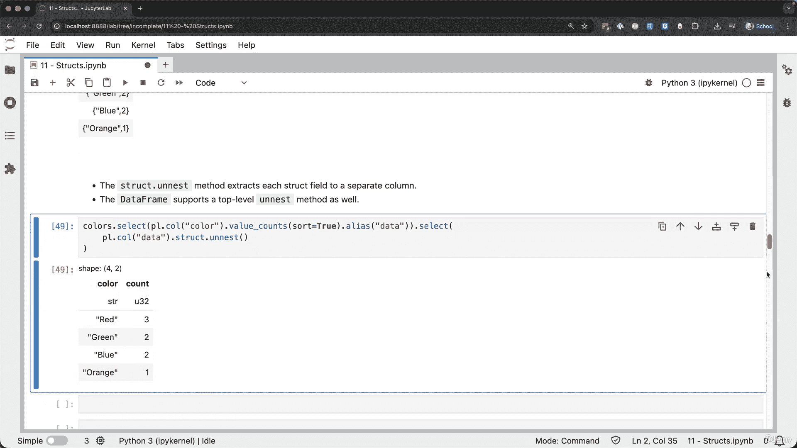

第二种方式做同样的事情：取出数据框，调用顶层的 `unnest` 方法，并传入想展开的列。这里的 `data` 是一列 `struct`，每个 `struct` 都是一个容器，里面存储两个嵌套内容，也就是两个字段。顶层 `unnest` 会把每个字段展开成自己的列名，并把字段值放到对应行的值中。对应代码如下：

```python
colors.select(
    pl.col("color").value_counts(sort=True).alias("data")
).unnest("data")
```

这两种方式会得到完全相同的结果：每个字段变成单独的列，字段值变成对应行的值。

## 🧠 Polars 与 Python 数据分析：141：为什么用 struct 打包多个值

`value_counts` 只是可能返回 `struct` 列的方法之一。通常，当我们对单列执行操作，而这个操作会产生多个关注点或多个需要保存的值时，Polars 团队会巧妙地把这些值打包进一个 `struct`。原因在于，`struct` 是一种复合数据类型，可以在内部存储多个值或多个字段，同时从行视角看仍然是一个数据类型、一个值。这样既遵守了“单列操作产生单列结果”的原则，又能保存多个相关信息。下面用列表总结这一设计思路，便于初学者记忆：

- 单列操作仍然返回单列。
- 多个关注点被打包进 `struct`。
- `struct` 内部可以包含多个字段。
- 从每一行看，这个 `struct` 仍然是一个值。

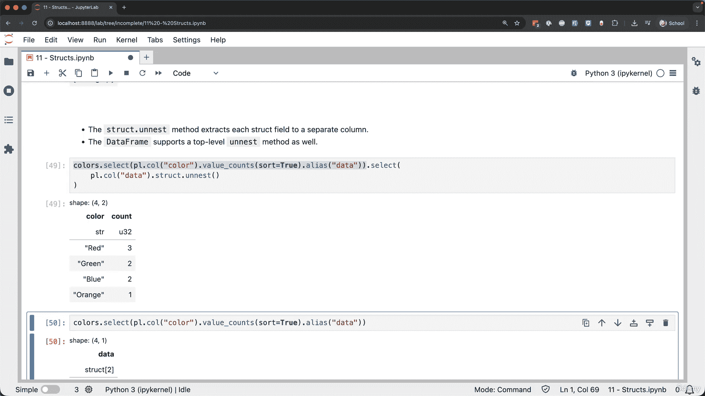

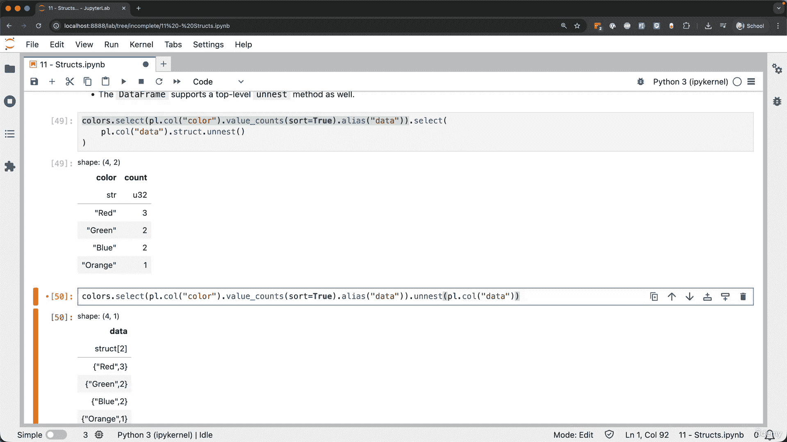

## ✅ Polars 与 Python 数据分析：141：本节总结

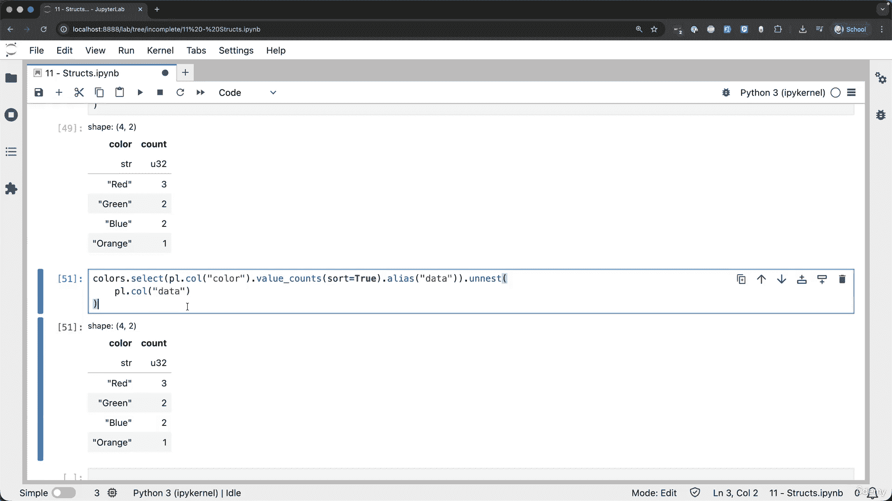

本节课中我们一起学习了 `value_counts` 方法。我们回顾了 Polars 的核心设计原则：单列操作产生单列结果，旧列到新列是一一映射。然后导入 `colors.csv`，用 `select` 和 `pl.col("color").value_counts()` 统计每个颜色出现的次数，并看到结果是一列 `struct`。我们还通过 `schema` 查看了 `struct` 的两个字段：`color` 是字符串，`count` 是无符号 32 位整数；其中 `color` 字段名来自原列名，`count` 字段名由 Polars 团队选择。接着使用 `sort=True` 让计数从高到低排序，看到红色出现最多。最后复习了两种展开 `struct` 的方法：`pl.col("data").struct.unnest()` 和 `.unnest("data")`，两者都会把字段展开成普通列。`value_counts` 只是返回 `struct` 的一个例子，背后体现的是 Polars 用复合类型保存多个值、同时保持单列输出的设计思路。本节内容到这里，下节课再见。

