# 🧭 Polars 与 Python 数据分析：142：重命名字段

在本节课中，我们将要学习 Polars 中 `struct` 命名空间里的 `rename_fields` 方法。这个方法的作用很直接：它可以把每一行 `struct` 里面的字段名重新命名。上一节我们已经用过 `value_counts` 创建结构列，本节中我们来看看怎么在这个基础上修改结构字段的名称。整个流程会从准备数据开始，然后创建 `counts` 变量，接着查看字段顺序，最后用 `rename_fields` 完成重命名并验证结果。下面我们按步骤展开。

## 🧪 Polars 与 Python 数据分析：142：准备数据与创建结构列

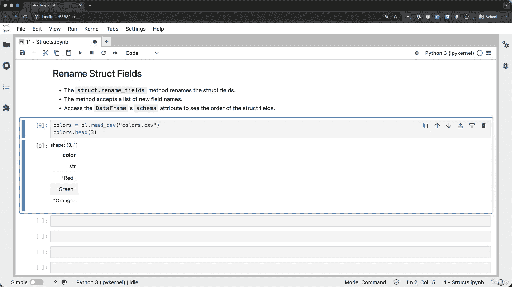

上一节我们介绍了如何从 CSV 文件读取颜色数据，本节中我们先把同样的准备工作做一遍。这里使用上一课的代码，导入 `colors` CSV 文件。接着仍然使用 `value_counts` 方法创建一列 `struct`。具体做法是：取 `colors` 这个 DataFrame，调用 `select` 方法创建新列；在 `select` 里面写一个针对 `color` 列的表达式，然后调用 `value_counts` 方法，并把新列命名为 `data`。这样会得到一个只有一列的新 DataFrame，每一行里的内容都是 `struct`，而且这个 `struct` 里面包含两个字段。为了后续反复使用，我们把结果赋值给变量 `counts`，并输出 `counts` 查看结果。下面按步骤列出从读取数据到得到 `counts` 的流程：

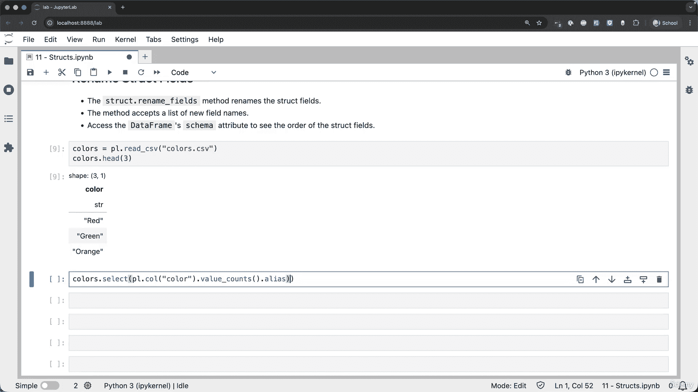

- 导入 `colors` CSV 文件，得到颜色数据 DataFrame。
- 对 `colors` 调用 `select`，创建新列。
- 用针对 `color` 列的表达式调用 `value_counts`。
- 把新列命名为 `data`。
- 将结果赋值给 `counts`，并输出查看。

```python

import polars as pl

colors = pl.read_csv("colors.csv")

counts = (

    colors

    .select(

        pl.col("color").value_counts().alias("data")

    )

)

print(counts)

```

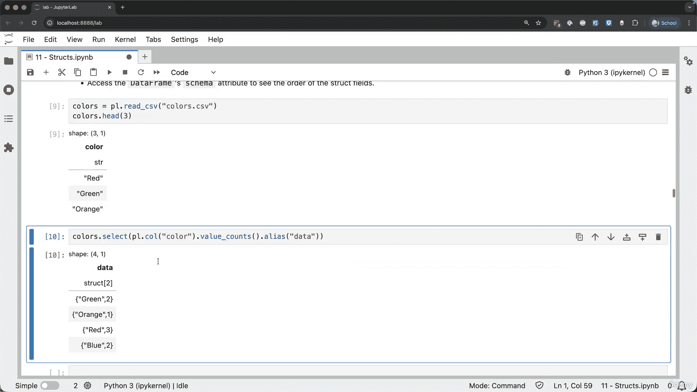

完成这一步后，`counts` 就是一个单列 DataFrame，每一行的 `data` 字段里都装着一个 `struct`，而这个 `struct` 内部有两个字段。这个结果看起来简单，但它是后面演示 `rename_fields` 的基础。接下来我们来看看如何查看这个 `struct` 的字段顺序，因为顺序会直接影响重命名时新名字的排列方式。

## 🔍 Polars 与 Python 数据分析：142：查看字段顺序

上一节我们得到了 `counts` 变量，本节中我们来看看它的 `schema`。可以随时对 `counts` 访问 `schema` 属性，用来看所有列的数据类型。对于 `struct` 类型来说，它的类型定义里不仅包含字段名，还包含每个字段对应的类型。这里可以看到，`color` 字段排在前面，`count` 字段排在后面。这个顺序很重要，因为后面指定新字段名时，就是按照这个顺序来对应替换的。换句话说，如果要把两个字段都重命名，就必须先指定 `color` 要改成什么，再指定 `count` 要改成什么。字段顺序就像排队一样，第一个位置对应第一个新名字，第二个位置对应第二个新名字，不能随意打乱。下面用代码查看 `counts` 的 `schema`：

```python

counts.schema

```

理解这个顺序之后，重命名操作就不会把名字对应错。下一步我们正式进入 `rename_fields` 方法的使用，看看它接收什么参数，以及为什么它要求一次传入完整的字段名列表。

## ✏️ Polars 与 Python 数据分析：142：使用 rename_fields 重命名字段

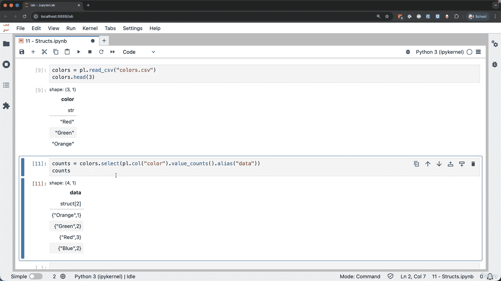

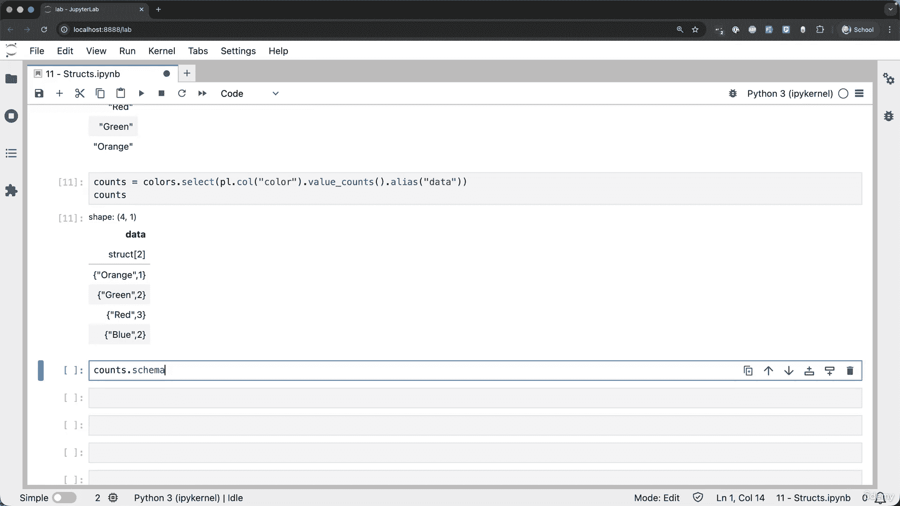

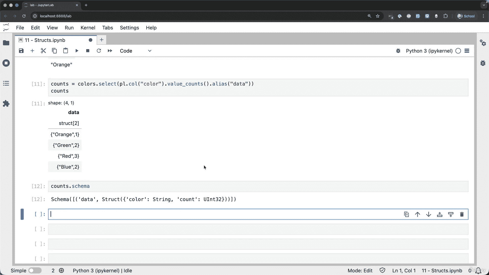

上一节我们确认了 `color` 在前、`count` 在后，本节中我们来看看怎么重命名这两个字段。首先针对上面的 `counts` DataFrame 调用 `select` 方法，然后在里面创建一个针对 `data` 列的表达式。所有和 `struct` 相关的功能都放在 `struct` 属性或命名空间下面，这里可以看到一系列用于处理结构列的方法。我们要调用的是 `rename_fields`。这个方法接收一个列表，列表里存放新的字段名。因为这里有两个字段，所以列表里要提供两个条目：把 `color` 替换成 `hue`，把 `count` 替换成 `occurrences`。核心概念可以用下面的公式表示：

```text

rename_fields([color 的新名字, count 的新名字])

```

对应到本例就是：

```python

counts.select(

    pl.col("data").struct.rename_fields(["hue", "occurrences"])

)

```

这里有一个非常重要的点：`rename_fields` 是“全有或全无”的操作。也就是说，它不是只让你改某一个字段名。如果你想保留其中一个现有字段名，就必须在列表里把这个名字重复写一遍，才能让列表位置继续往后走，从而改到下一个字段。否则没有办法只针对某个特定字段，比如只改 `color`。你必须传入一个列表，里面包含你希望所有字段最终使用的名字。下面用一个引用块强调这个规则：

> 注意：`rename_fields` 需要一次传入完整的字段名列表，不能只写要修改的那一个字段。

执行上面的代码后，表格里不会出现明显的视觉变化，因为字段名并不会直接打印在 DataFrame 的显示结果里。为了确认重命名确实生效，我们需要访问这个 DataFrame 的 `schema` 属性来检查。下一节我们就来验证结果，并看看怎样把修改后的结果保存回 `counts` 变量。

## ✅ Polars 与 Python 数据分析：142：验证与保存结果

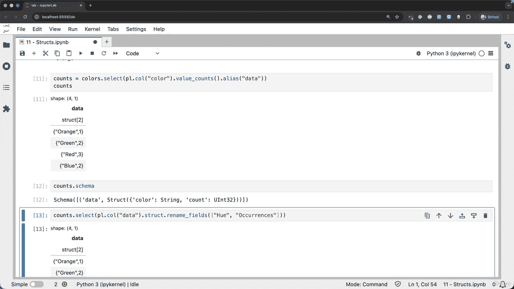

上一节我们调用了 `rename_fields`，本节中我们来确认它是否真的修改了字段名。通过访问结果 DataFrame 的 `schema` 属性，可以看到每一行里的 `struct` 已经拥有两个新字段名：`hue` 和 `occurrences`。这说明重命名操作已经生效。如果想把这次修改保留下来，可以把新的 DataFrame 覆盖回 `counts` 变量。这样现在的 `counts` DataFrame 中，每一行 `struct` 存储的字段名就变成了 `hue` 和 `occurrences`。下面展示验证和覆盖的写法：

```python

result = counts.select(

    pl.col("data").struct.rename_fields(["hue", "occurrences"])

)

print(result.schema)

counts = result

```

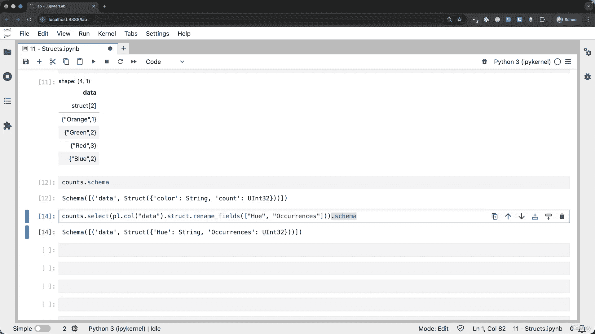

完成覆盖后，后续再使用 `counts` 时，结构列里的字段名就是新的名字了。这里虽然代码不长，但验证这一步不能省，因为字段名不像普通列那样一眼就能看到，必须通过 `schema` 来确认。到这里，`rename_fields` 方法的主要用法和注意事项就都走完了。

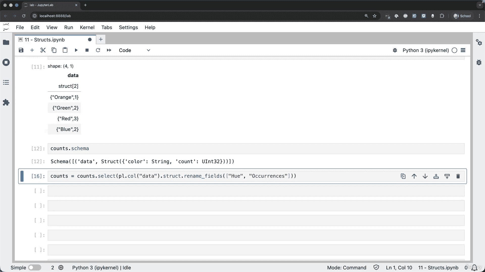

## 📝 Polars 与 Python 数据分析：142：总结

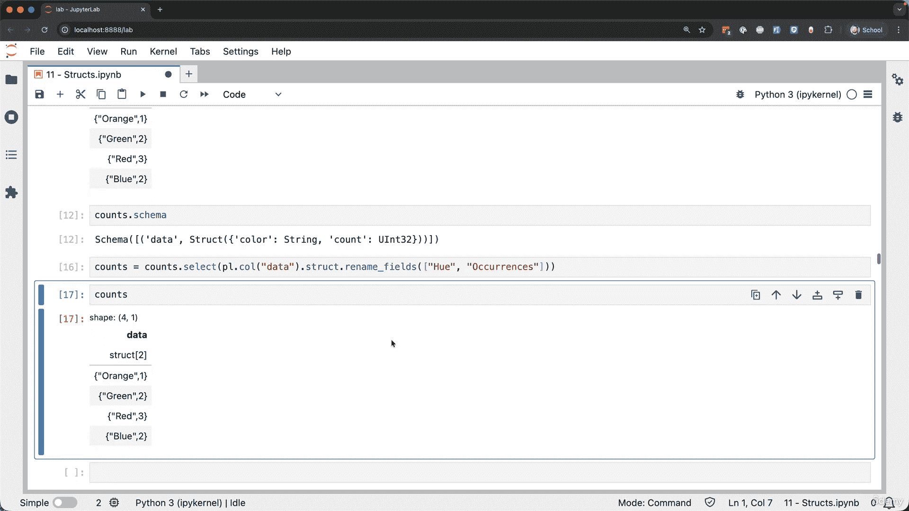

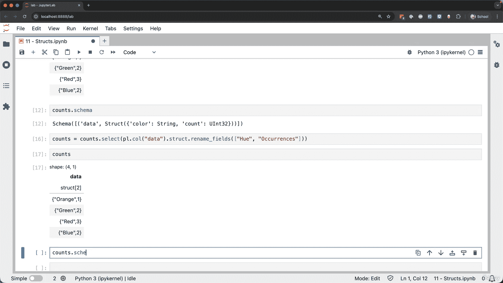

本节课中我们一起学习了 Polars 中 `struct.rename_fields` 的用法。我们先从 `colors` CSV 文件读取数据，用 `value_counts` 创建了包含 `struct` 的 `counts` 列；然后通过 `schema` 查看了 `struct` 内部字段的顺序，理解了 `color` 在前、`count` 在后；接着使用 `rename_fields` 传入完整的新字段名列表，把 `color` 改成 `hue`，把 `count` 改成 `occurrences`；最后用 `schema` 验证结果，并把新的 DataFrame 覆盖回 `counts`。需要记住的是，`rename_fields` 是全有或全无的操作，必须一次提供所有字段的最终名称，不能只改其中一个字段。掌握这个方法和字段顺序规则后，就能更灵活地处理 Polars 中的结构列了。

