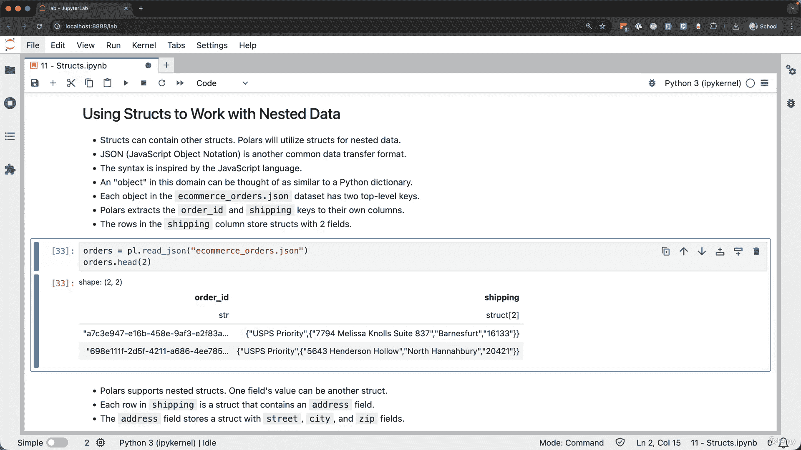
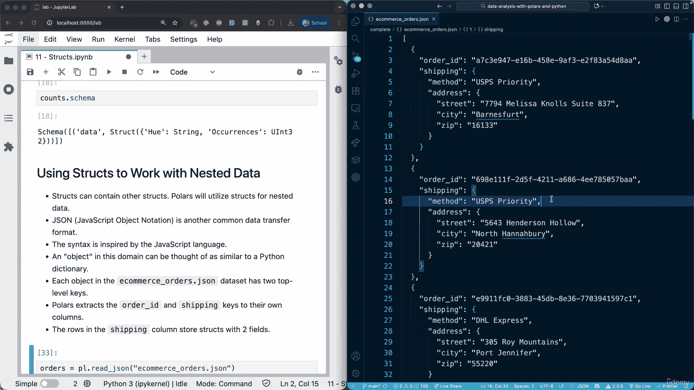
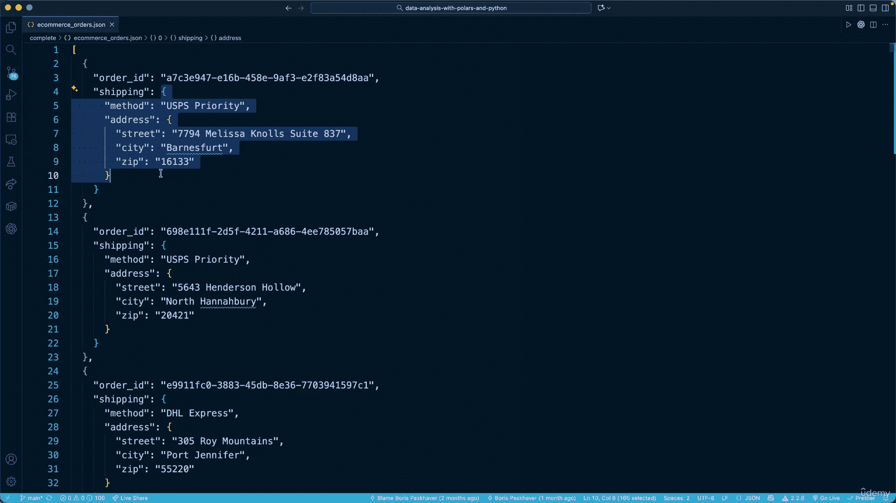
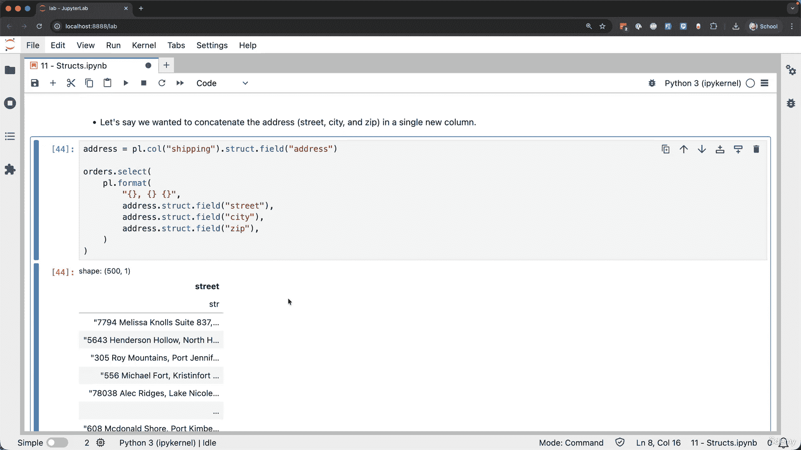

# 🧩 Polars 与 Python 数据分析：143：使用 Struct 处理嵌套数据

在本节课中，我们将学习 Polars 如何用 Struct 处理嵌套数据，重点理解 JSON 这种嵌套结构如何变成 DataFrame 里的 Struct 列，以及如何用 `unnest`、`struct.field`、`format` 等方法把嵌套内容拉平或拼接成新列。学习这一节的意义在于，现实中的数据并不总是规整的表格，很多数据会以对象或字典的形式层层嵌套，掌握 Struct 的处理方式，才能把复杂数据整理成可以分析的行列结构。

## 🧩 Polars 与 Python 数据分析：143：从 JSON 认识嵌套数据

上一节我们已经接触过 Polars 的列操作和表达式，本节中我们来看看 Struct 最常见的出现场景。你遇到 Struct 的一个常见场景，是 Polars 导入嵌套数据。所谓嵌套数据，就是数据结构内部还装着其他数据，数据里面还有数据，一层套一层。

在 Python 里最接近的类比，是想象一个字典，其中某个键对应的值又是另一个字典。字典本身是键值对的容器，例如键是 `a`，值是另一个字典，而这个字典内部还可以继续包含键值对。下面用公式和代码描述这个核心概念。

```
Struct = { field_1: value_1, field_2: value_2, ... }
```

```
nested = {
    "a": {
        "b": 1,
        "c": 2
    }
}
```

本课会导入一种不同的文件格式，叫作 JSON。JSON 是 JavaScript Object Notation 的缩写，是一种常见的数据传输和数据存储格式。CSV 很好用，但它专门面向表格数据，也就是按行和列存储的数据。现实世界里的数据并不总是严格的表格，例如与 Web API 交互、向服务器发请求时，服务器返回的数据经常不是文件，而是 JSON 这样的格式。JSON 在传输数据时更优雅，也能捕捉数据内部的嵌套复杂信息。

在进入代码之前，先建立整体认识：JSON 的顶层很像 Python 列表，也像 JavaScript 里的数组，它是一个容器，可以按顺序存放很多元素。下面用几个要点把 JSON 和 Python、Polars 的对应关系串起来。

- JSON 顶层数组等价于 Python 列表，也等价于 JavaScript 数组，它们是按顺序存放多个元素的容器。





- JSON 数组里存放的每个“对象”，在 JavaScript 术语里叫对象，在 Python 里接近字典，在 Polars 里接近 Struct。

- 对象内部有键、字段或属性，它们作为标识符，对应各自的值。

- 外层列表里的每个条目代表一个电商订单，每个订单都带有很多信息。

- 订单里可能有 `order_id`，还可能有 `shipping`，而 `shipping` 的值本身又是另一个对象。

- 这种设计的原因，是为了把相关信息组织并收集到嵌套容器或嵌套对象里，用一种更优雅的方式组织不同数据。

- 在 `shipping` 对象里，有 `method` 键，还有 `address` 键，而 `address` 又是一個对象，内部包含 `street`、`city`、`zip` 等键。

- 这三个与地址相关的属性被组织在 `address` 对象里，这种组织方式和 Python 字典没有本质区别。

理解了这个类比后，接下来看看 Polars 如何读取这种文件，并把嵌套对象映射成数据框中的列。

## 🧩 Polars 与 Python 数据分析：143：读取 JSON 并观察 Struct 列

上一节我们建立了 JSON 像列表和字典的直觉，本节中我们来看看 Polars 如何读取 JSON 文件。Polars 顶层提供了一个函数 `read_json`，用来导入 JSON 文件。示例文件叫 `ecommerce_orders.json`，扩展名是 `.json`，文件名里带下划线。读取后可以看到一个数据框，里面有两列：`order_id` 和 `shipping`。请记住这两个列名，后面理解嵌套结构时会用到。



下面是对应的读取和预览代码。

```
import polars as pl

orders = pl.read_json("ecommerce_orders.json")
orders.head(2)
```

读取之后，可以把数据框赋值给 `orders` 变量，再用 `head(2)` 预览前两行。为了理解 Polars 到底读到了什么，可以切换到 VS Code 这类文本编辑器查看文件内容。Polars 的 `read_json` 读取的就是这种 JSON 结构。JSON 顶层类似 Python 列表或 JavaScript 数组，数组里存放很多对象，每个对象代表一个电商订单。

Polars 最终要把数据放回 DataFrame 这种表格格式，也就是由行和列组成。Polars 会注意到每个条目里的两个顶层键：`order_id` 和 `shipping`。`order_id` 很容易映射成字符串列，因此 `order_id` 列中每一行的值都是字符串。`shipping` 在 JSON 里是一个对象，因此 Polars 会把这一块建模成 Struct 列。回到 Jupyter Notebook 后，可以看到结果正是如此：所有订单条目提取顶层 `order_id` 后得到字符串列，而 `shipping` 顶层键被提取成含两个顶层字段的 Struct。

## 🧩 Polars 与 Python 数据分析：143：查看 Schema 理解嵌套层级

上一节我们看到 `shipping` 被读成了 Struct 列，本节中我们来看看这个 Struct 内部到底藏了多少层。真正有意思的地方在于，这里隐藏了很多复杂性，因为 Struct 内部还会存储 Struct。Struct 可以包含其他 Struct，就像字典可以包含其他字典。

为了证明这一点，可以访问 `orders` 数据框的 `schema` 属性，查看数据到底如何存储。下面是查看 schema 的代码。

```
orders.schema
```

查看 schema 后，可以看到 `order_id` 列的所有值都是字符串，`shipping` 列的所有值都是 Struct。每一行里的 Struct 都有一个 `method` 字段，值是字符串；还有一个 `address` 字段，值是另一个 Struct。也就是说，每一行不仅存储一个 Struct，而且这个 Struct 内部还包含另一个 Struct，这种层级可以继续向下延伸很多层。

在 `address` 字段里，Struct 内部有三个字段：`street`、`city`、`zip`，它们都是字符串。可以用下面的代码描述这个嵌套结构。

```
shipping: Struct({
    method: String,
    address: Struct({
        street: String,
        city: String,
        zip: String
    })
})
```

理解了 schema 之后，下一步就是把嵌套数据提取出来，表示成 Polars 数据框里规范的表格格式。这里会用到前面见过的一些技术。

## 🧩 Polars 与 Python 数据分析：143：用 unnest 拉平第一层

上一节我们看清了 Struct 的嵌套层级，本节中我们来看看如何把 Struct 列的内容提取到普通列里。把 Struct 列内容提取成数据框中各自列的一种方法，是 `unnest` 方法。第一种做法是对 `orders` 调用 `unnest`，它需要一个表达式来定位存放 Struct 的列。当前只有一个 Struct 列，就是 `shipping`，所以表达式可以定位 `shipping`。

`unnest` 会提取 Struct 字段，但只向下展开一层。也就是说，它会取出 Struct 内的 `method` 和 `address` 字段，提取成各自的列。执行后可以看到 `method` 和 `address` 两列。但 `address` 本身仍然是 Struct，仍然存储三个字段 `street`、`city`、`zip`。

下面是第一层展开的代码。

```
orders.unnest("shipping")
```

另一种得到同样结果的方式，是调用 `select` 方法。可以保留 `order_id` 列，然后把 `shipping` 列作为表达式目标，在 `struct` 命名空间里调用 `unnest` 方法。这个写法稍微啰嗦，但结果相同。代码如下。

```
orders.select(
    "order_id",
    pl.col("shipping").struct.unnest()
)
```

现在数据框已经把部分嵌套数据向上移动了一层，变成基于列的格式。当前唯一的问题是，`address` 仍然是 Struct 列，所以需要重复一次同样的逻辑，把 `address` 列里每个 Struct 的内容展开。下一节就继续处理这一层。

## 🧩 Polars 与 Python 数据分析：143：再次 unnest 地址字段

上一节我们展开了 `shipping` 的第一层，本节中我们来看看如何继续展开 `address`。可以把前面的代码复制下来继续修改，对当前数据框再次调用 `unnest`，并传入一个表达式，目标是存放 Struct 的 `address` 列。这样就能把 Struct 里所有嵌套字段 `street`、`city`、`zip` 拉出来，变成三个对应的列，并把字段值填入对应行值。

下面是连续展开两层的代码。

```
orders.unnest("shipping").unnest("address")
```

这样所有嵌套数据就被拉到了同一行里，形成了规范的表格格式。如果回到 `select` 的写法，逻辑也很相似。起始数据框仍然是 `orders`，调用 `select` 保留 `order_id`，再保留 `method` 列，然后复制一个表达式，目标指向 `address` 这个 Struct 列，在它上面访问 `struct` 命名空间并调用 `unnest` 方法，同样能得到相同结果，把三个 Struct 字段拉成各自的列。

对应的 `select` 写法如下。

```
orders.select(
    "order_id",
    pl.col("shipping").struct.unnest()
).select(
    "order_id",
    "method",
    pl.col("address").struct.unnest()
)
```

到这里，嵌套字段已经被拉平成普通列。接下来考虑一个实际问题：如果希望给这三列改名，应该如何操作。

## 🧩 Polars 与 Python 数据分析：143：用 rename_fields 重命名嵌套字段

上一节我们拉平了地址字段，本节中我们来看看如何在展开前后修改列名。现在已经得到三列，可以使用合适的重命名方法，例如 `rename` 来改名。另一种做法是在 `unnest` 之前修改 Struct 字段名，这样展开后列就会直接使用新名字。

下面用代码展示这个思路。假设三个字段原本是小写的 `street`、`city`、`zip`，希望把每个字段的首字母大写。在调用 `unnest` 之前，仍然访问 Struct 命名空间，调用上一课见过的 `rename_fields` 方法。这个方法需要一个列表，把三个字段重命名为 `Street`、`City`、`Zip`，然后再让 Polars 把每个 Struct 里的字段展开成数据框中的列。

```
orders_flat = orders.unnest("shipping")

orders_flat.select(
    "order_id",
    "method",
    pl.col("address")
      .struct.rename_fields(["Street", "City", "Zip"])
      .struct.unnest()
)
```

这样会得到同样的数据框，但列名已经变成首字母大写的形式。重命名本身不复杂，关键是理解重命名可以发生在展开之前，字段名会直接影响展开后的列名。了解了字段改名后，最后再练习一个把嵌套字段拼接成单列的例子。

## 🧩 Polars 与 Python 数据分析：143：用 format 拼接完整地址

上一节我们处理了字段重命名，本节中我们来看看如何把多个嵌套字段拼成一个字符串列。假设不把内容提取成三个独立列，而是创建一个确定的地址列，由 `street`、`city`、`zip` 的字符串拼接而成。目标是把这些字符串内容收集到一个单列里的拼接字符串中。

回到 `orders` 数据框，原始 `shipping` 列仍然存储 Struct。要创建这个单列，可以调用 `select` 产生一个新列。Polars 顶层有一个很方便的函数 `format`，适合构建带空格的动态字符串，并向其中注入动态内容。可以想象有一个字符串，需要注入三块内容：`street`、`city`、`zip`，它们之间还需要逗号和空格分隔。

希望最终的字符串格式是：先是街道，然后逗号加空格，再是城市，然后空格，最后是邮编。因此格式字符串里需要三个花括号，用来标记三个动态内容的位置。`format` 后面需要三个表达式，分别对应三个花括号。下面是完整代码。

```
address = pl.col("shipping").struct.field("address")

orders.select(
    pl.format(
        "{}, {} {}",
        address.struct.field("street"),
        address.struct.field("city"),
        address.struct.field("zip")
    ).alias("full_address")
)
```

第一个花括号对应 `street`。要取得 `street` 的值，需要逐行遍历 `shipping` 这个 Struct，直到拿到想要的那个值。代码先定位 `shipping` 列，它是 Struct 列；要访问每一行 Struct 里的字段，需要使用 `struct` 命名空间和 `field` 方法；这个 Struct 的顶层字段是 `address`，而 `address` 本身又存储一个包含 `street`、`city`、`zip` 的 Struct；所以还要再次使用 `struct.field` 访问 `street` 字段。

剩下两个表达式非常相似，只需把第二个写成 `city`，第三个写成 `zip`。表达式之间要用逗号隔开。`format` 会创建单列，对原数据框的每一行遍历 `shipping` 列，进入 Struct 字段 `address`，取出三块信息，按照字符、空格和逗号的组合拼进动态字符串，最终得到需要的结果。

如果觉得代码复杂，可以把复杂表达式赋给变量来简化。例如把定位 `address` 的表达式赋给 `address` 变量。表达式只是动态构建块，它本身不知道将来会用在哪个数据框里，它只是指令；在表达式上继续叠加指令，就能构建更复杂的表达式。`address` 表达式的含义是：无论用在哪里，都定位名为 `shipping` 的列，该列存储 Struct，在每个 Struct 中定位 `address` 字段并给出对应值。以这个表达式为基础，可以继续构建表达式，访问 `address` Struct 里的不同字段，例如 `street`、`city`、`zip`。这样能让代码更清爽，最终结果完全相同。

## 🧩 Polars 与 Python 数据分析：143：关键结论与总结

上一节我们完成了地址拼接练习，本节中我们来收束本课的关键结论。现实世界里的数据并不总是规整的表格形状。使用 JSON 时，会看到数据以更接近对象或字典的存储格式存在：有键对应值，而值可以是其他对象，在 Python 里就是其他字典，也就是其他键值对连接。

Polars 需要把所有内容表示成按行和列组织的表格格式，所以当 Polars 导入带嵌套结构的 JSON 文件时，会把相应列建模为 Struct。接下来就需要使用本段学过的技术，例如 `unnest` 方法、`struct` 命名空间里的 `field` 方法，把包含在内部的嵌套数据提取到高层列中，让它们成为数据框里的独立列。

下面把本课的核心操作和结论整理成要点。

- `read_json` 可以读取 JSON 文件，并把顶层对象映射为数据框列。

- JSON 对象在 Polars 里会变成 Struct 列，Struct 可以嵌套 Struct。

- `unnest` 一次只展开一层，因此多层嵌套需要连续展开。

- `struct.field` 可以按字段名访问嵌套内容，适合构建表达式。

- `rename_fields` 可以在展开前修改 Struct 字段名，从而影响展开后的列名。

- `pl.format` 可以把多个嵌套字段拼接成一个动态字符串列。

- 表达式是可叠加的构建块，可以先赋给变量，再组合成更复杂的表达式。



本节课中我们一起学习了 Polars 如何用 Struct 处理嵌套数据，包括 JSON 与字典的类比、`read_json` 读取文件、通过 schema 查看嵌套层级、用 `unnest` 逐层拉平数据、用 `rename_fields` 重命名字段，以及用 `format` 拼接完整地址。本节内容到这里，希望这些内容清楚易懂，下一节继续学习新的主题。

