## 🧩 Udemy - 使用 Polars 和 Python 进行数据分析（第 2 部分）：p44-144：使用 Struct 识别跨列重复项

在本节课中，我们将要学习 Struct 的另一个实用场景：识别多列值组合后的重复项。前面我们已经接触过单列重复的判断方式，本节会把问题升级到多列组合重复，并看看 Struct 如何像一个容器一样，把多列值打包起来做比较。整个流程会从重新导入数据开始，再回顾单列重复筛选，然后进入多列组合重复的挑战，最后用 `pl.struct`、`is_duplicated`、`filter` 和 `sort` 把重复行找出来并排在一起。

上一节我们介绍了如何通过 `filter` 方法筛选满足条件的行，本节中我们来看看如何用 `is_duplicated` 识别重复值。首先重新执行上一课的导入代码，读取电商订单 JSON 文件。提醒一下，这里使用 `unnest` 方法按顺序把嵌套 Struct 字段展开成单独的列，当前 `orders` 数据框有 5 列。课程前面已经介绍过 `filter` 方法，它可以提取满足某种条件的行子集。比如想找出 `zip` 列中存在重复值的行，就可以对 `orders` 数据框调用 `filter`，针对 `zip` 列创建表达式，再调用 `is_duplicated` 方法。只要某一行在 `zip` 列里出现重复，表达式就会返回 `True`，换句话说，某个邮编在列中出现次数超过一次，就会被标记出来。

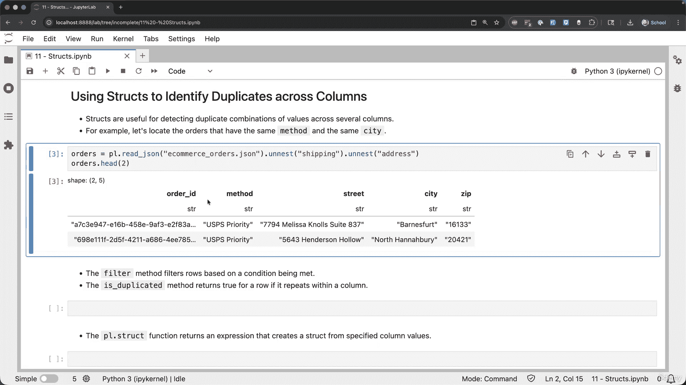

下面是识别 `zip` 单列重复行的代码示例，核心是 `filter` 加 `is_duplicated`。

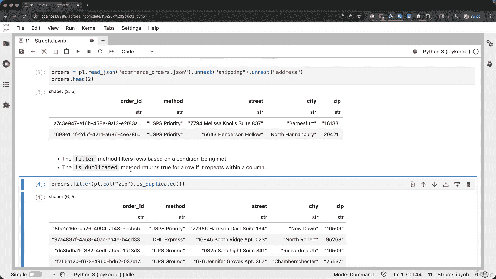

```python
orders.filter(
    pl.col("zip").is_duplicated()
)
```

这样就能提取出 `zip` 邮编重复的行，例如可以看到 `16509` 这个邮编，后面又重复出现了一次。

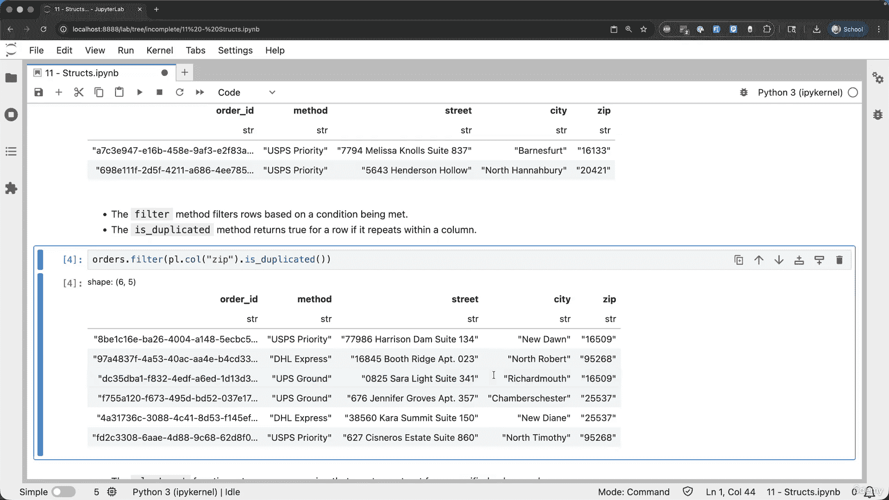

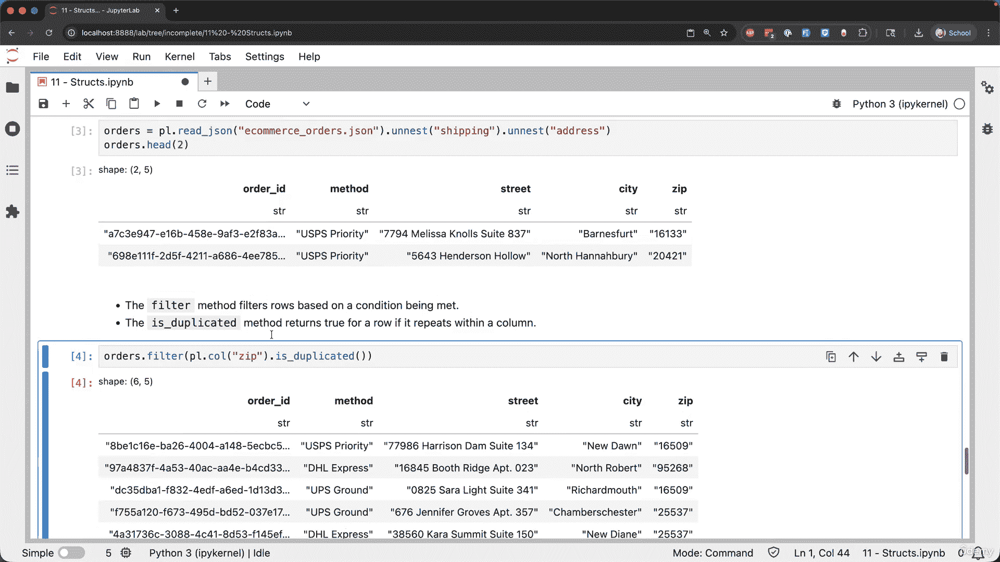

上一节我们回顾了单列重复的筛选方式，本节中我们来看看多列组合重复的挑战。假设现在想提取 `method` 列和 `city` 列组合重复的行。比如某一行同时有 `USPS Priority` 和 `Barnesfor`，这个组合就是我们要识别的重复。也就是说，不是单纯看 `method` 列里的值重复，也不是单纯看 `city` 列里的值重复，而是同一行里这两个字段的组合，在两行之间重复，这才是我们要找出来的内容。

> 注意：这里比较的是整个 Struct 里的键值对是否完全一致，`method` 和 `city` 两个值都必须匹配。

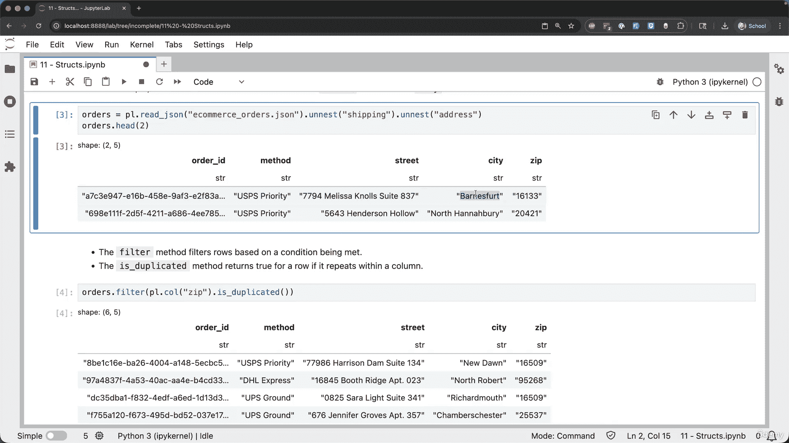

要完成这个任务，可以使用 Struct。可以创建一个 Struct，把这一列和那一列的内容打包进同一个 Struct 中。Struct 类型同样支持 `is_duplicated` 方法，用来识别 Struct 内所有条目或键值对完全相同的行。下面用代码演示。这里对 `orders` 数据框调用 `select` 方法，并引入 Polars 顶层的 `pl.struct` 函数。调用 `pl.struct` 时，传入想纳入 Struct 的列名字符串，就能把对应列的值收进新生成的 Struct 里。

比如指定 `method` 列和 `city` 列，就会得到一个新列，当前这个新列叫 `method`，你可以给它换一个名字。Polars 做的是遍历 `orders` 的每一行，把 `method` 的值和 `city` 的值打包进这个新列里的同一个 Struct。带 Struct 的列支持 `is_duplicated` 方法。

```python
orders.select(
    pl.struct("method", "city").alias("method")
)
```

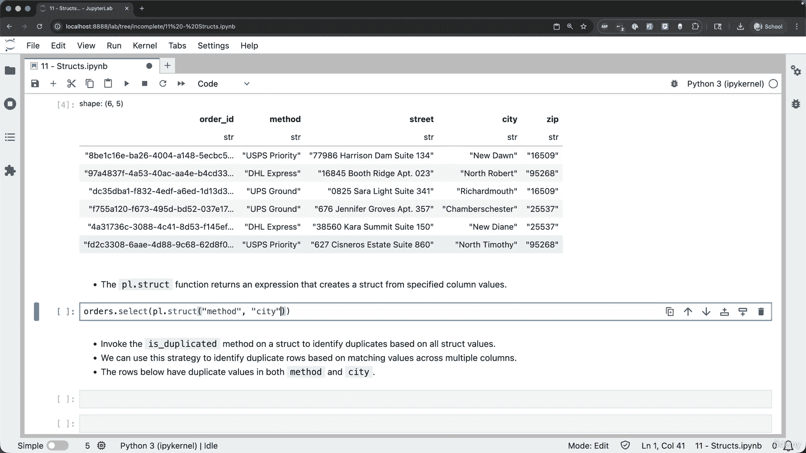

既然已经能把多列打包成 Struct，接下来就复制这个表达式，并在后面调用 `is_duplicated` 方法。再用 `alias` 给这一列命名，比如命名为 `is_duplicate`。这样会得到一列布尔值，凡是出现 `True` 的地方，就表示这个 Struct 的键值对在列中别处重复了，并且 `method` 的值和 `city` 的值都必须匹配。

```python
orders.select(
    pl.struct("method", "city").is_duplicated().alias("is_duplicate")
)
```

一旦得到能产生布尔值列的布尔表达式，就可以把它传给 `filter` 方法做过滤。下面是提取并查看多列组合重复行的完整步骤，按顺序理解即可。

1. 用 `pl.struct("method", "city")` 把 `method` 和 `city` 两列打包成一个 Struct。
2. 对这个 Struct 调用 `.is_duplicated()`，得到一列布尔值。
3. 把完整的布尔表达式传给 `orders.filter(...)`，筛选出重复行。
4. 用 `.sort(["method", "city"])` 先按 `method` 排序，再按 `city` 排序，让重复行挨在一起。

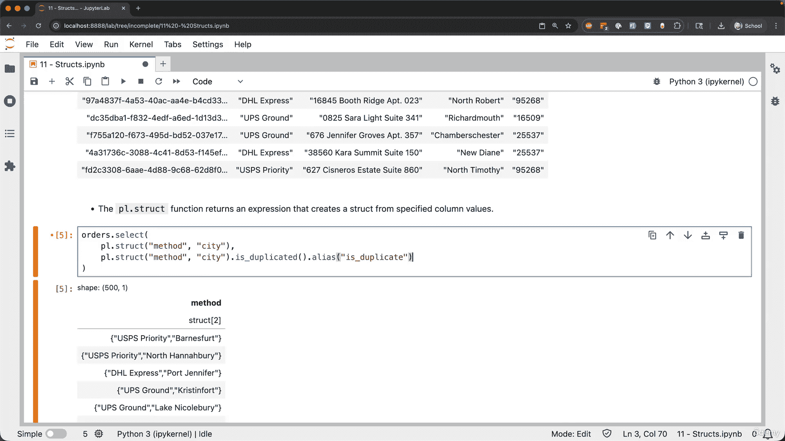

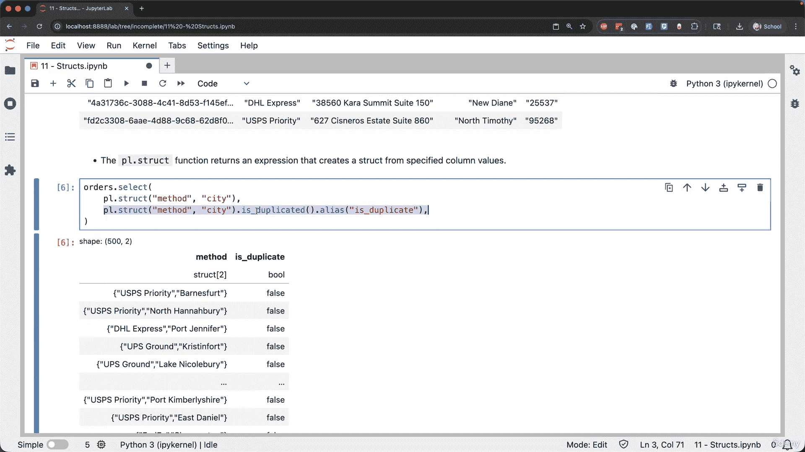

下面把完整表达式放进 `filter` 中。这里再次对 `orders` 数据框调用 `filter`，传入刚才的完整表达式，生成布尔列，从而提取出 `method` 和 `city` 两列组合重复的所有行。为了让结果看起来更清楚，再调用 `sort` 方法，先按 `method` 排序，再按 `city` 排序，这样重复行就会相邻显示。

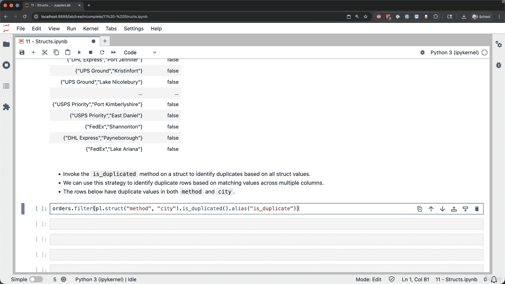

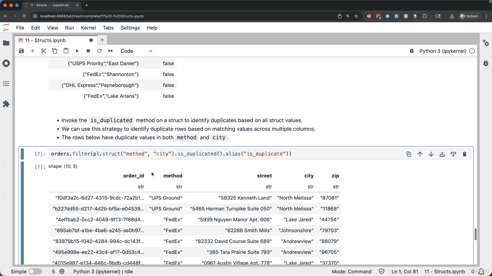

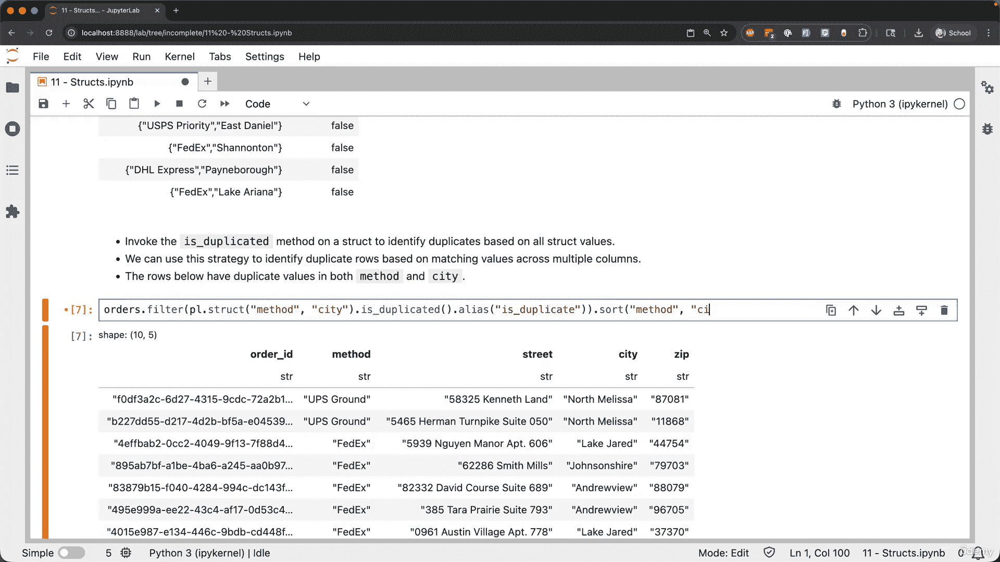

```python
orders.filter(
    pl.struct("method", "city").is_duplicated()
).sort(["method", "city"])
```

结果中可以看到，例如前两行的 `method` 是 `Fedex`，`city` 是 `Andview`，这两行里这个组合重复出现。其他行组合也遵循同样的规律：至少会有两条记录，它们的 `method` 值和 `city` 值都与数据框里的另一行完全匹配。这就是 Struct 的另一个有意思的用法：可以把 Struct 当作容器，把多列的值打包起来，用于重复比较。

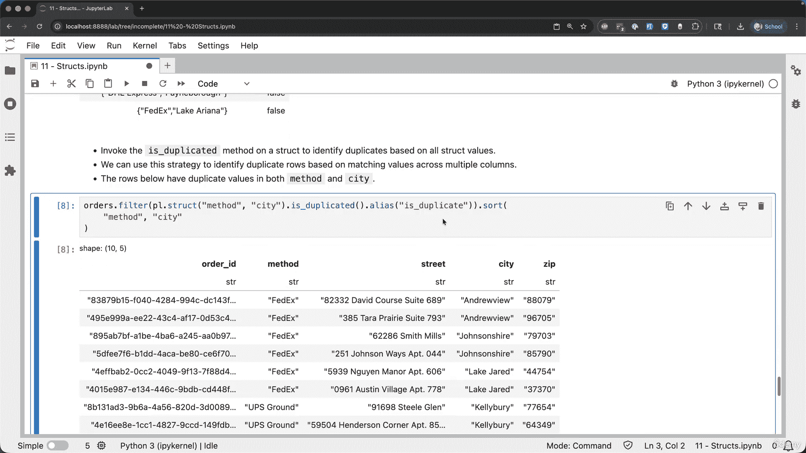

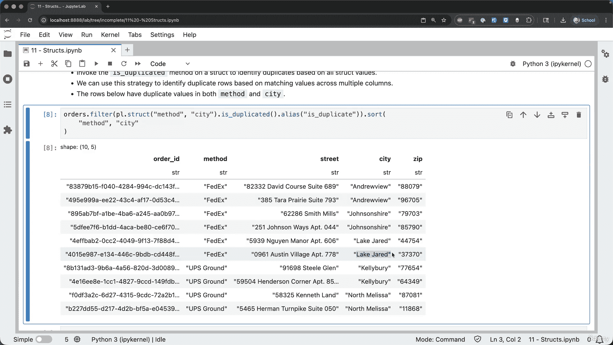

本节课中我们一起学习了如何使用 Struct 识别跨列重复项。我们先回顾了单列 `zip` 的 `is_duplicated` 筛选方式，然后面对 `method` 与 `city` 组合重复的挑战，用 `pl.struct("method", "city")` 把两列打包成一个 Struct，再调用 `is_duplicated` 得到布尔列，最后通过 `filter` 提取重复行，并用 `sort` 让重复行相邻显示。核心公式可以概括为：`重复组合 = Struct(method, city) 的键值对在列中出现次数 > 1`。

