📊 Polars与Python数据分析：第145节：介绍数据集

在本节课中，我们将要学习课程下一部分的内容，这一部分的主题是“处理文本数据”。在这个部分里，我们会介绍多种对数据列进行字符串操作的方法，包括把字符串转为小写、把字符串转为大写、删除字符串开头和结尾的空白字符，以及在字符串中搜索内容等。换句话说，本部分会围绕基于文本和字符串的操作展开，并为后续更复杂的数据清洗与展示打基础。

🧭 Polars与Python数据分析：第145节：文本处理目标与工具准备

在正式进入具体操作之前，本节先明确文本处理的目标，并准备接下来要使用的工具。为了学习这一部分，我们会新建一个Jupyter Notebook，名称是“12 working with text data”，也就是“12 处理文本数据”。和往常一样，我们先用`import`关键字导入Polars库，再用`as`关键字给它起一个别名；原文口述为别名P，代码中通常写成`pl`，这样后续调用更简洁。

以下是本节会涉及的字符串操作示例：

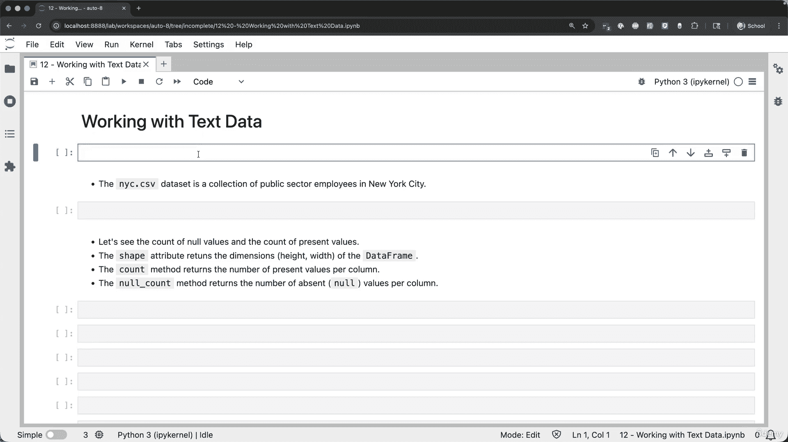

- 把字符串转换为小写；
- 把字符串转换为大写；
- 删除字符串开头和结尾的空白字符；
- 在字符串内部搜索指定内容；
- 以及其他更多基于字符串的处理方式。

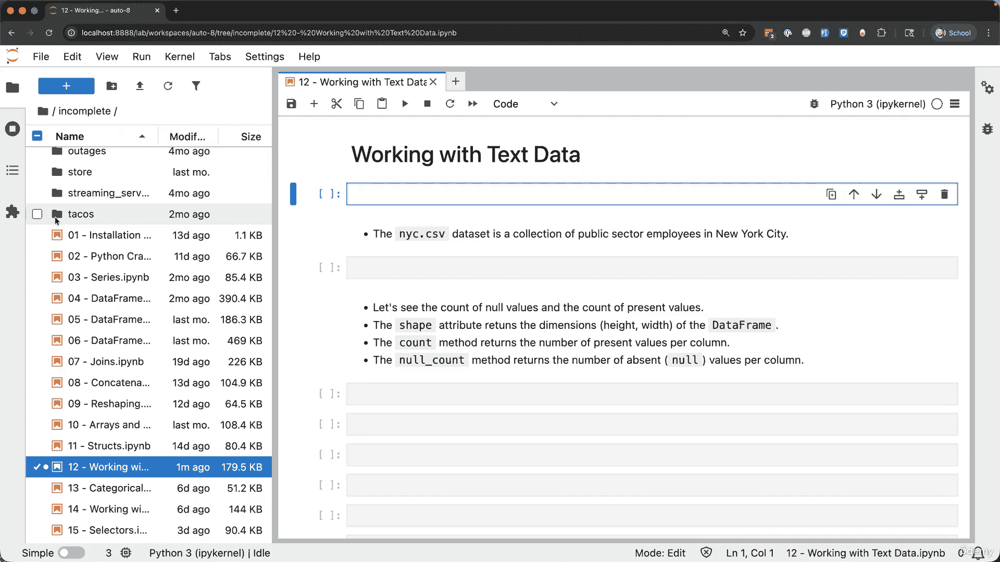

这些操作看起来简单，但在真实数据中非常常用，因为原始数据经常会出现大小写不统一、前后带空格、文本内容需要筛选等问题。准备好工具之后，下一步就是读取本节要使用的数据集，并观察它的结构和特点。

📥 Polars与Python数据分析：第145节：读取纽约市员工数据集

工具准备好后，本节开始读取数据集。本节使用的数据保存在名为`nyc.csv`的文件中，我们可以使用Polars的`read_csv`函数把它读进来。这个数据集是一组纽约市公共部门员工的信息集合，里面记录了员工所在机构、姓名、工作区域、职位、薪资和支付方式等内容，适合用来练习文本列的各种处理方式。

以下是读取数据并赋值给变量`nyc`的基础代码：

```python
import polars as pl

nyc = pl.read_csv("nyc.csv")
nyc.head(1)
```

读入数据后，我们会把数据框赋值给变量`nyc`，然后调用`head`方法并传入参数`1`，只查看第一行数据，用来快速回忆数据长什么样。对于这个数据集，我们可以看到每位员工对应的信息主要包括以下内容：

- 员工所属机构名称；
- 员工姓氏；
- 员工名字；
- 员工中间名首字母；
- 员工工作所在的城市行政区；
- 员工实际职位名称；
- 员工薪资；
- 员工支付方式。

这个数据集一读入就能看出格式不太常规，例如很多列中的字母全部是大写。后续我们会讨论如何转换和操作这些文本，让它们看起来更整齐、更适合展示。这个数据集也是目前课程中遇到的最大数据集，它共有6,225,611行和8列；了解这一点后，我们继续查看它的整体规模和结构。

🗂️ Polars与Python数据分析：第145节：查看数据规模与列结构

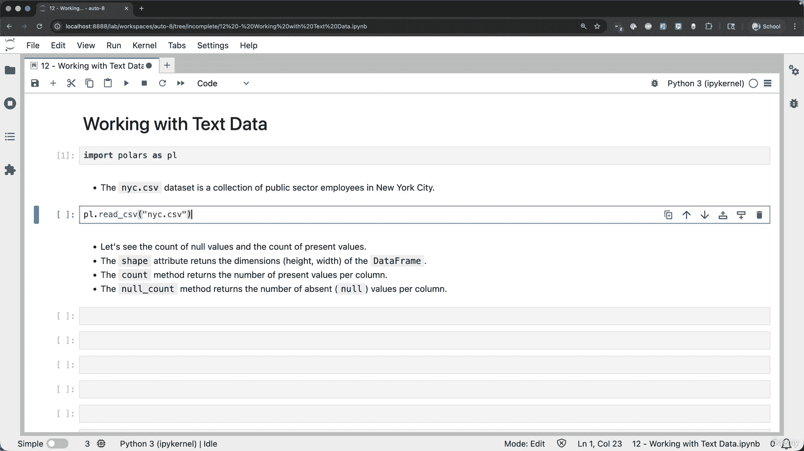

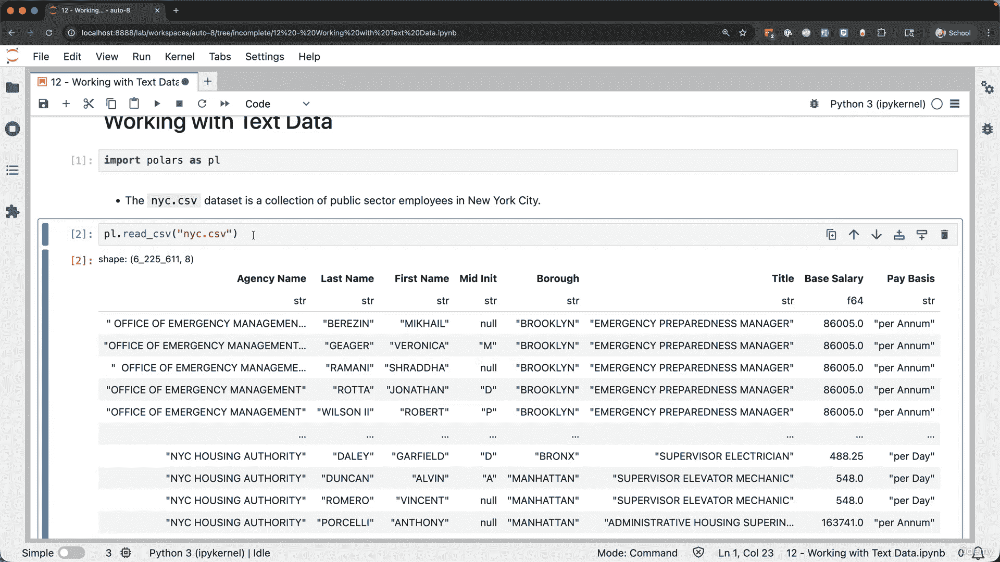

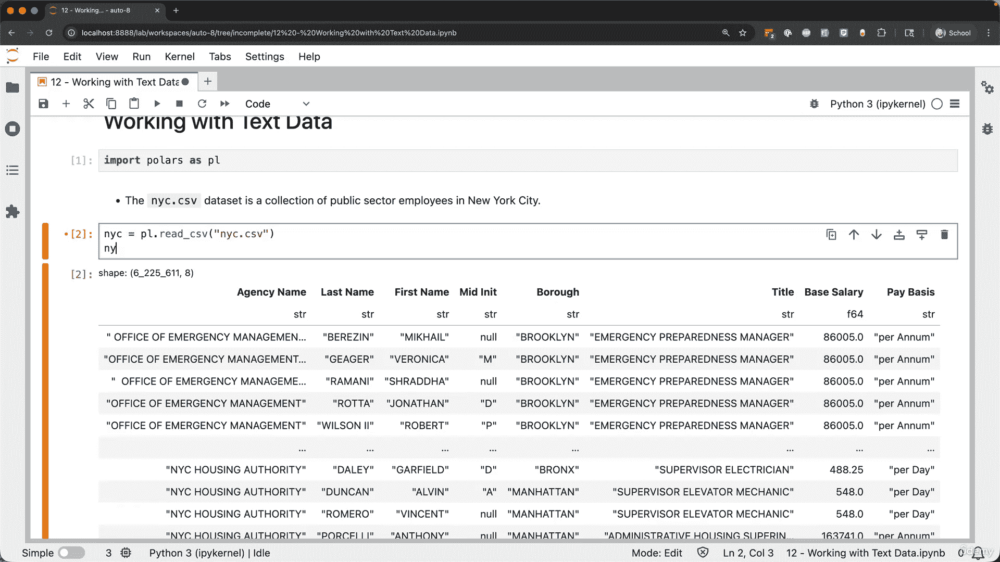

读取数据之后，本节来查看数据框的规模和基本结构。和往常一样，我们可以对数据框做一点简单分析，先确认自己正在处理什么。原文已经给出了行数，这里再提醒一次：可以访问数据框的`shape`属性，它会返回一个元组，里面包含完整维度信息；在这个例子中就是约622万行、8列。

以下是查看数据规模的基础代码：

```python
nyc.shape
```

数据规模可以用公式理解为：

\[
\text{数据规模} = 6{,}225{,}611 \text{ 行} \times 8 \text{ 列}
\]

查看完整体维度之后，我们自然会关心每一列到底有多少有效内容、有多少空值。为了回答这个问题，可以使用`count`方法和`null_count`方法，它们分别从“有值”和“缺失”两个方向描述同一件事；下一节就围绕这两个方法展开。

🧮 Polars与Python数据分析：第145节：检查非空值与缺失值

上一节我们查看了数据框的行列规模，本节来看看每一列的非空值和缺失值情况。如果想查看存在值的数量，以及缺失值或空值的数量，可以使用两个互补的方法：`count`和`null_count`。其中，`count`会返回原始数据框中的所有列，以及每一列中非空值的数量；这里的“非空值”可以理解为格子里有内容，“缺失值”可以理解为格子里没有内容。

以下是检查非空值和缺失值的基础代码：

```python
nyc.count()
nyc.null_count()
```

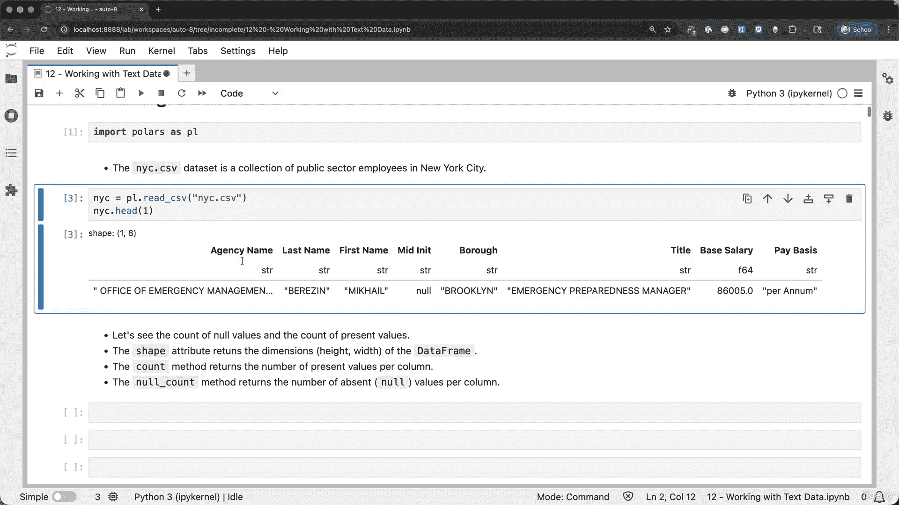

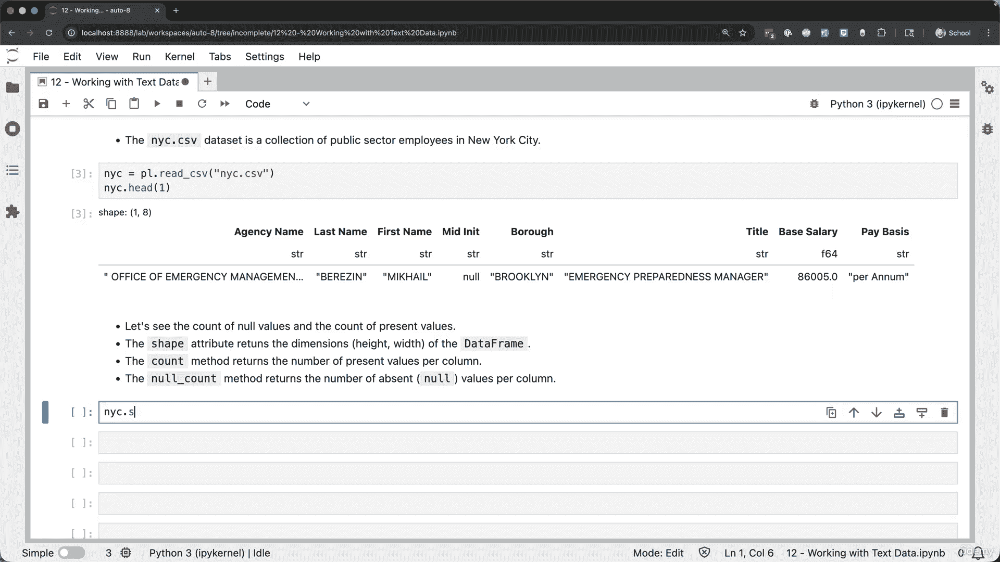

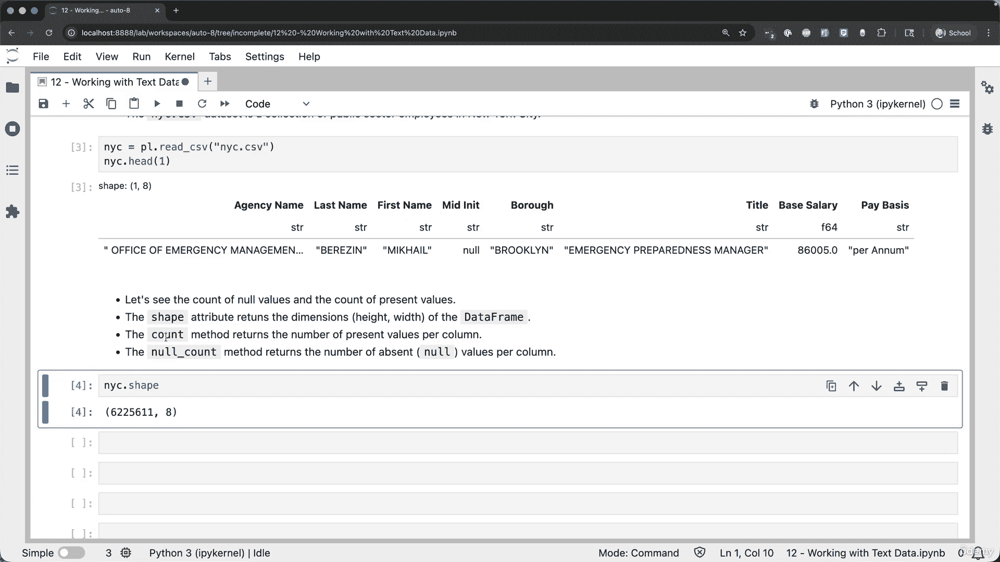

`count`方法会给出每一列的非空值数量，而`null_count`方法做的是相反方向的统计，它会告诉我们每一列中有多少个缺失值或空值。二者之间的关系可以用公式表示为：

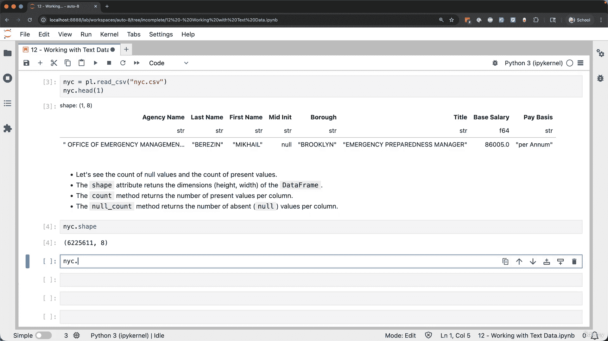

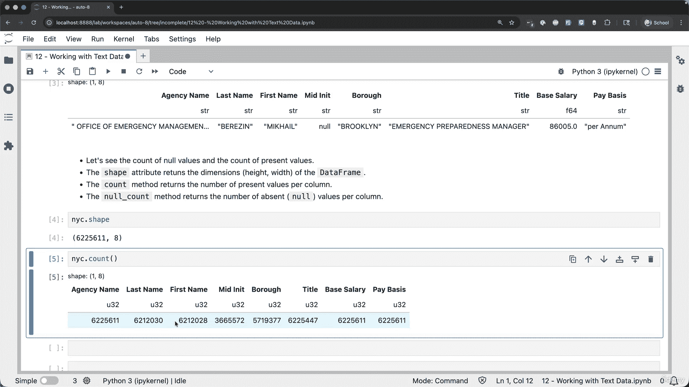

\[
\text{非空值数量} + \text{缺失值数量} = \text{总行数}
\]

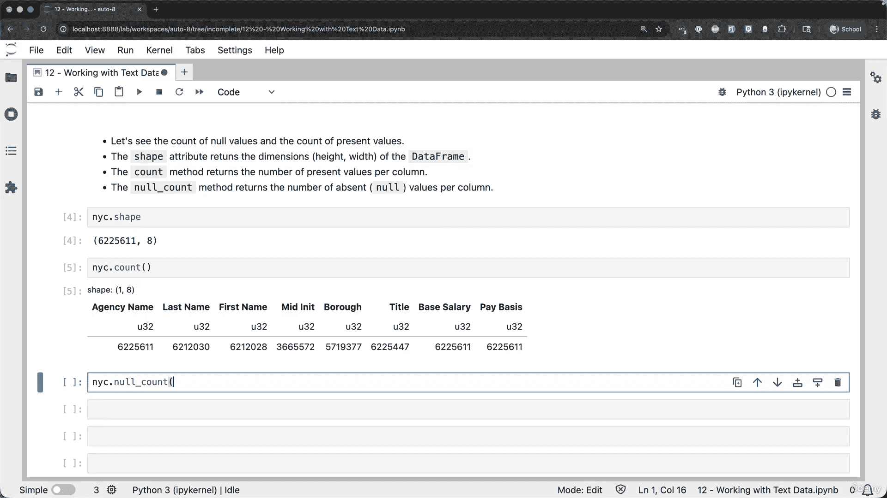

\[
\text{缺失值数量} = \text{总行数} - \text{非空值数量}
\]

从`count`的结果可以看到，各列的非空值数量并不一致，这说明数据框中存在缺失值。继续调用`null_count`后，可以看到每一列的缺失值数量；有些列没有缺失值，而姓名相关列，尤其是中间名首字母列，会有大量缺失值。理解这些缺失情况后，我们就完成了对本节课数据集的初步认识，也为后续字符串操作做好了准备。

✅ Polars与Python数据分析：第145节：本课总结

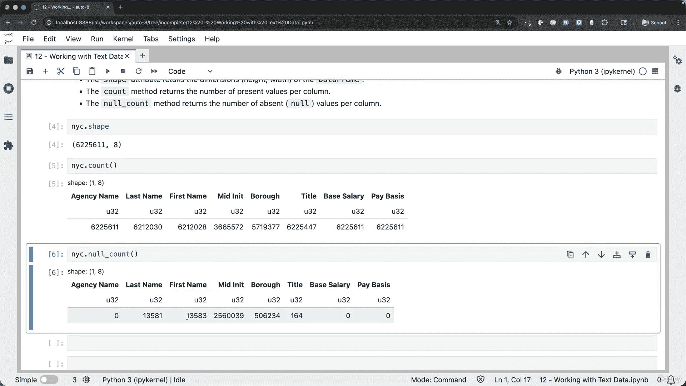

本节课中，我们一起学习了“处理文本数据”这一部分的导入内容，并介绍了字符串操作的主要方向，包括大小写转换、删除首尾空白、在字符串中搜索内容等。我们还新建了名为“12 working with text data”的Jupyter Notebook，导入了Polars库，读取了纽约市公共部门员工数据集`nyc.csv`，查看了数据框的行列规模，并通过`count`和`null_count`理解了非空值与缺失值之间的关系。接下来，我们会继续在后续课程中探索各种字符串操作和文本操作，期待在下一节课程中继续学习。

