# 📊 Polars 与 Python 数据分析（第2部分）：第46节：大小写转换

## 🧭 Polars 与 Python 数据分析（第2部分）：第46.1节：本节概述

在本节课中我们将要学习 Polars 中与字符串大小写转换相关的操作。前面已经多次看到，Polars 会把相关方法集中放在同一个属性或命名空间下面，我把它理解成一种基于命名空间的分组方式。本节会围绕 `.str` 这个字符串命名空间，介绍 `to_lowercase`、`to_uppercase`、`to_titlecase` 这三个方法，并演示如何用 `select` 处理单列，以及如何用 `with_columns` 和 `pl.String` 批量处理所有字符串列。对于初学者来说，可以先把它理解成“先选列，再调用字符串工具箱里的方法”，这样后面看代码会更容易。

下面先看 Polars 如何组织字符串相关方法，理解命名空间之后，再进入具体的大小写转换。


## 🧱 Polars 与 Python 数据分析（第2部分）：第46.2节：字符串命名空间

上一节概述了本节要学习的内容，本节来看看 Polars 中方法分组的基本规则。前面已经多次看到，Polars 会把相关方法放在同一个属性或命名空间下面，我把它理解成一种基于命名空间的分组方式。例如，所有日期时间相关方法都放在 `.dt` 下面，结构体相关功能放在 `.struct` 下面。字符串操作也遵循类似原则，所有基于字符串的操作都会放在 `.str` 属性下面，`str` 就是 string 的缩写。

为了更直观地理解这种分组方式，下面是几个常见命名空间及其用途：

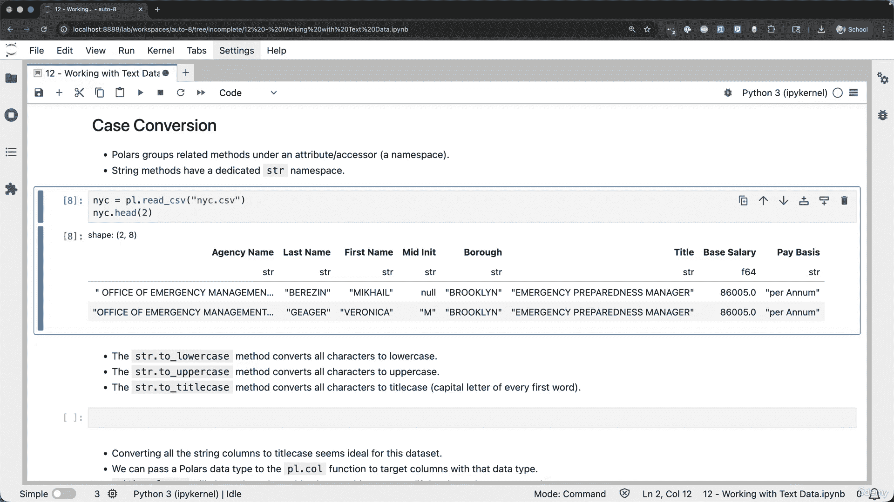

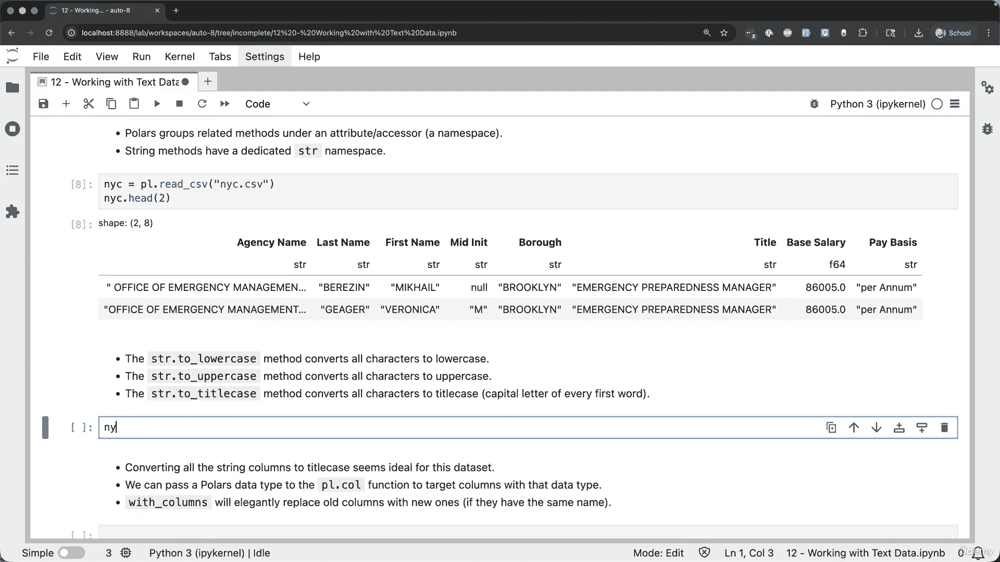

- `.dt`：存放日期时间相关方法。

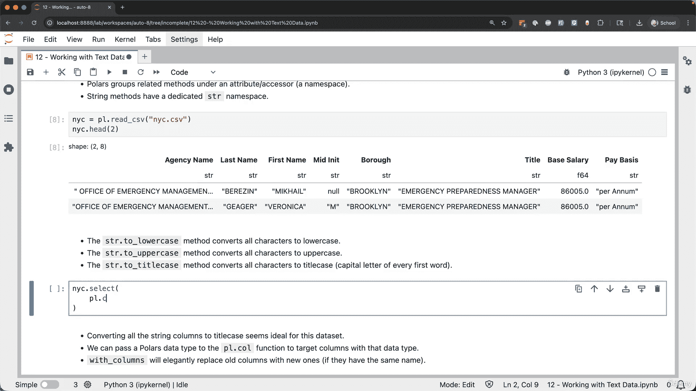

- `.struct`：存放结构体相关功能。

- `.str`：存放字符串相关操作，是 string 的缩写。

从这些例子可以看出，命名空间就像不同类别的工具箱，先找到工具箱，再调用里面的具体方法。接下来我们仍然要创建表达式，然后修改这个表达式，让它指向一列或多列，并执行某种基于字符串的操作。这里沿用上一课的导入代码，并假设数据框名为 `nyc`。

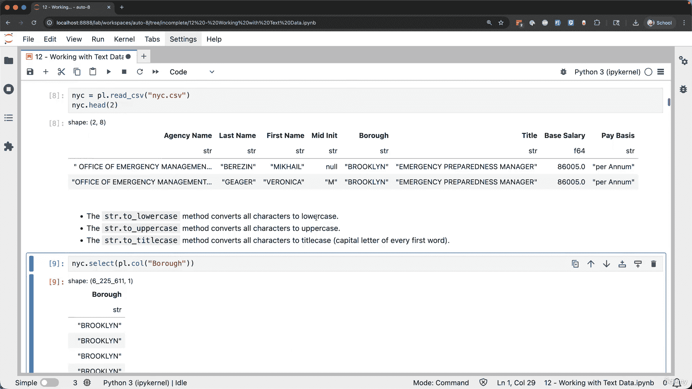

核心概念可以用下面的公式描述：

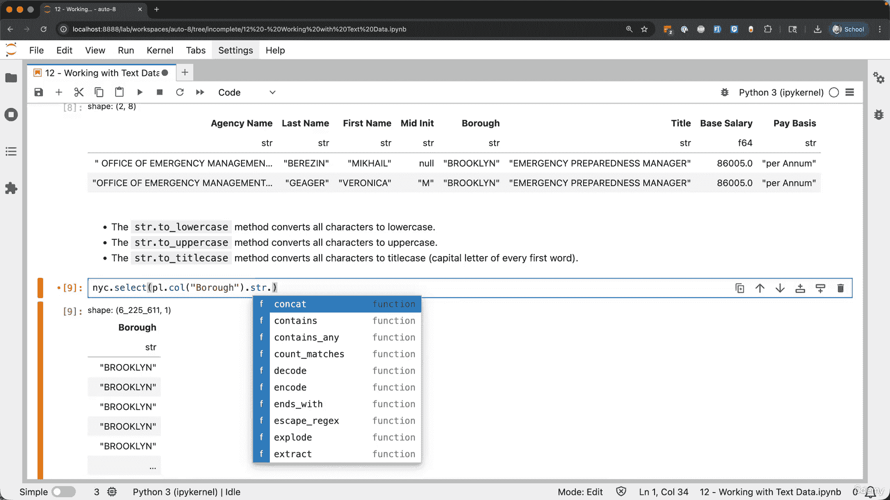

```text
表达式 = pl.col("列名").str.方法名()
```

理解命名空间之后，接下来看最简单的大小写转换操作。


## 🔡 Polars 与 Python 数据分析（第2部分）：第46.3节：大小写转换入门

上一节介绍了字符串方法都放在 `.str` 命名空间下，本节来看看最基础的大小写转换。先从最简单的事情开始，也就是改变字符的大小写，例如转成大写、转成小写等。下面从 `nyc` 数据框开始，并使用 `select` 方法。

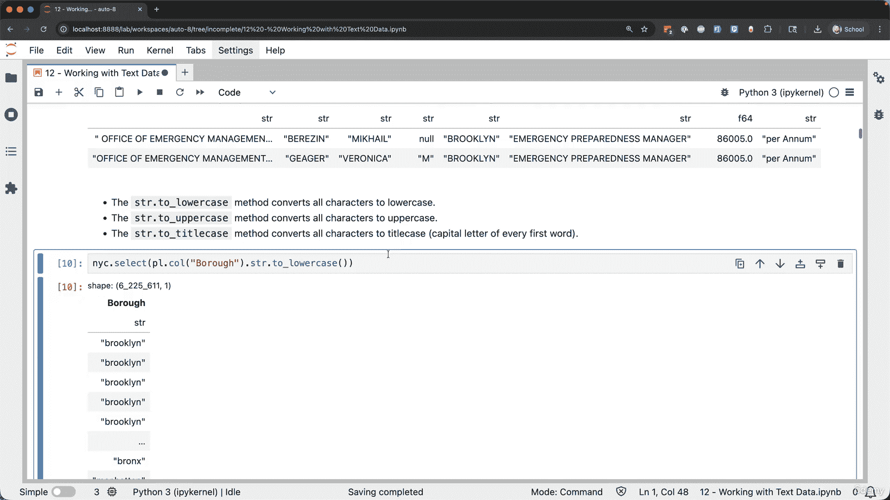

在上面可以看到 `borough` 列，这里用 `pl.col` 函数把目标指向该列，当前每个值都是全大写。如果想把这一列转成全部小写，可以使用 `to_lowercase` 方法，它同样位于 `.str` 命名空间下面。也就是说，在 `.str` 里面有各种与字符串操作相关的方法，在这里可以找到 `to_lowercase`。

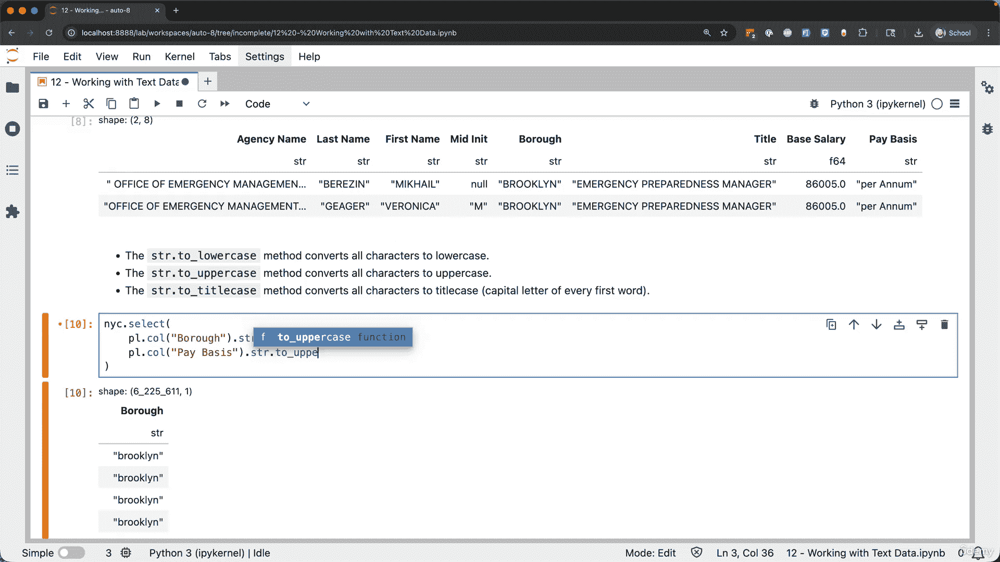

```python
nyc.select(
    pl.col("borough").str.to_lowercase()
)
```

执行后会返回该列，并且所有值都是小写。同时在 `pay_basis` 列里可以看到字符处于一种普通的大小写状态，其中有小写字符，也有大写字符。既然存在 `to_lowercase` 方法，就可以推测还存在 `to_uppercase` 方法，用来把字符转成大写。下面可以创建另一个表达式，再次指向 `pay_basis` 列，访问 `.str` 属性或命名空间，并调用 `to_uppercase` 方法，这样就会把该列每个字符串值都改成大写。

```python
nyc.select(
    pl.col("pay_basis").str.to_uppercase()
)
```

掌握小写和大写两个基础方法后，我们继续看一种更适合名称列的标题式大小写。


## 🏷️ Polars 与 Python 数据分析（第2部分）：第46.4节：标题式大小写

上一节演示了全小写和全大写转换，本节来看看 `to_titlecase` 方法，这也是我经常使用的一个方法。它会使用一种称为标题式大小写的方式，也就是保留每个单词的首字母大写，其余字符保持小写。核心概念可以写成下面的公式：

```text
标题式大小写 = 每个单词首字母大写 + 其余字符小写
```

这个方法非常适合 `agency_name` 列。对于这种值，我可能既不希望全部小写，也不希望全部大写，而是希望 `Office` 中的 `O` 大写，同样位置上的 `O`、`E`、`M` 也各自大写，也就是每个单词首字母大写，其余部分小写。

下面仍然使用同样的原则，创建一个表达式指向 `agency_name` 列，访问 `.str` 属性，并调用 `to_titlecase` 方法。执行后就可以看到漂亮的格式，所有单词首字母都大写。

```python
nyc.select(
    pl.col("agency_name").str.to_titlecase()
)
```

这是一个很常见的格式约定。所以还可以进一步简化操作：直接选中 `nyc` 数据框中的所有字符串列，并把它们全部转成标题式大小写。单个列演示完成后，下面看一种更优雅的批量处理方式。


## 🧰 Polars 与 Python 数据分析（第2部分）：第46.5节：批量转换字符串列

上一节对 `agency_name` 单列做了标题式转换，本节来看看如何一次性处理所有字符串列。下面取出 `nyc` 数据框，并使用 `with_columns` 方法。因为这里不会给新列提供不同的列名，所以这种方式会覆盖 `nyc` 中已有的列，至少会覆盖那些发生变化的列。

这里从 `pl.col` 函数开始。需要提醒的是，`pl.col` 除了可以传入列名，还可以传入 Polars 数据类型。因此这里传入 `pl.String` 数据类型，这会创建一个表达式，目标指向所有持有字符串值的列。由于这些列都持有字符串值，就可以对这个表达式捕获到的所有列执行基于字符串的方法或基于字符串的操作。核心表达式可以写成：

```python
nyc.with_columns(
    pl.col(pl.String).str.to_titlecase()
)
```

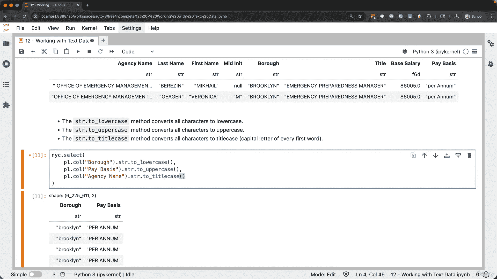

为了让初学者更容易操作，下面把批量转换的步骤拆开说明：

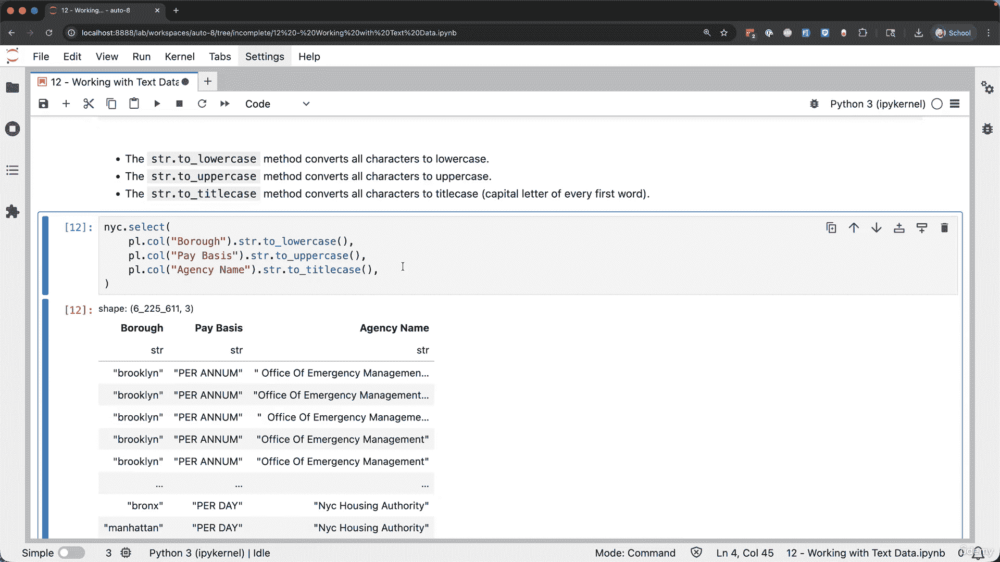

- 使用 `with_columns` 保留原数据框结构，并在同名列上写入转换结果。

- 使用 `pl.col(pl.String)` 选中所有字符串类型的列。

- 在选中的列上访问 `.str` 命名空间。

- 调用 `to_titlecase` 方法完成标题式大小写转换。

同样遵循前面的原则，这里访问 `.str` 并调用 `to_titlecase` 方法。这样所有字符串列，例如 `agency_name`、`last_name`、`first_name` 等，都会变成标题式格式。可以看到，姓名或机构名中的每个单词首字母都会大写，其余部分保持小写。这样简单的一行代码就非常优雅地把所有字符串列转换完成，使它们比最初导入数据集时看起来更可展示。


## ✅ Polars 与 Python 数据分析（第2部分）：第46.6节：本节总结

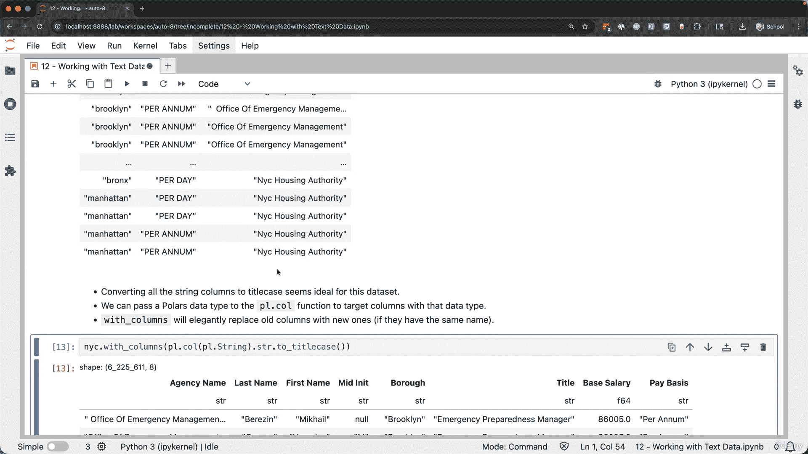

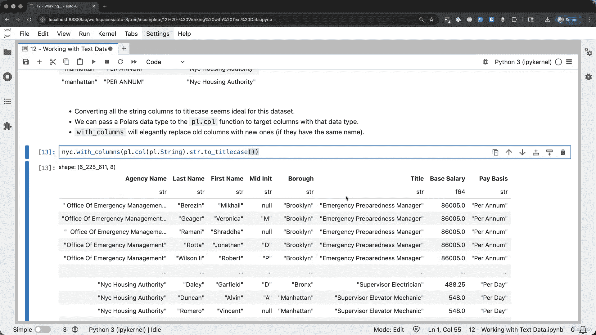

本节课中我们一起学习了 Polars 中字符串大小写转换的基本用法。我们理解了 Polars 会把相关方法放在同一个属性或命名空间下，例如日期时间在 `.dt`、结构体在 `.struct`、字符串在 `.str`。随后我们使用 `select` 对 `borough` 列调用 `to_lowercase`，对 `pay_basis` 列调用 `to_uppercase`，并使用 `to_titlecase` 把 `agency_name` 列转换为标题式大小写。最后我们使用 `with_columns` 配合 `pl.col(pl.String)`，一次性把所有字符串列转换为标题式大小写，让数据比最初导入时更加整齐和可展示。

