# 使用Polars和Python进行数据分析：第2部分第47课：移除空白字符 🧹

在本节课中，我们将学习如何处理字符串中多余的空白字符。这类操作在实际数据分析中非常普遍，比如从外部系统导入数据时，经常会在字符串的开头或结尾混入一些看不见的空格。我们首先回顾Python内置的字符串处理工具，然后重点介绍Polars库中对应的三个方法，最后通过一个组合操作的示例，把清洗空白和转换大小写这两个步骤串联起来。

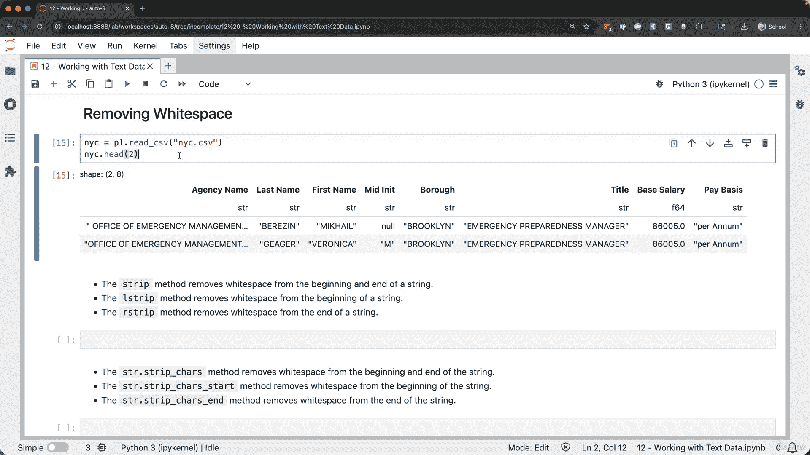

## 回顾Python中的strip系列方法 🐍

在正式进入Polars之前，我们先快速回忆一下Python原生的字符串处理方式。毕竟Polars的很多设计思路都借鉴了Python的标准库，理解了基础版本，后面再看Polars的版本就会轻松很多。

我们先导入数据集，然后构造一个带有大量空白字符的字符串，看看不同的方法分别会带来什么效果。

```python
import polars as pl

# 假设我们有一个字符串，前后都加了很多空格
s = "  polars  "
```

如果使用`strip`方法，它会同时删除字符串开头和结尾的空白字符，也就是左侧和右侧都清理干净，结果就是`"polars"`。

如果你只想处理开头的空白字符，那就要用到`lstrip`方法，`l`代表`left`，即左侧。这个方法只移除开头的空格，结尾的空格会原封不动地保留。相应地，还有`rstrip`方法，它专门移除结尾的空白字符，而开头的不动。

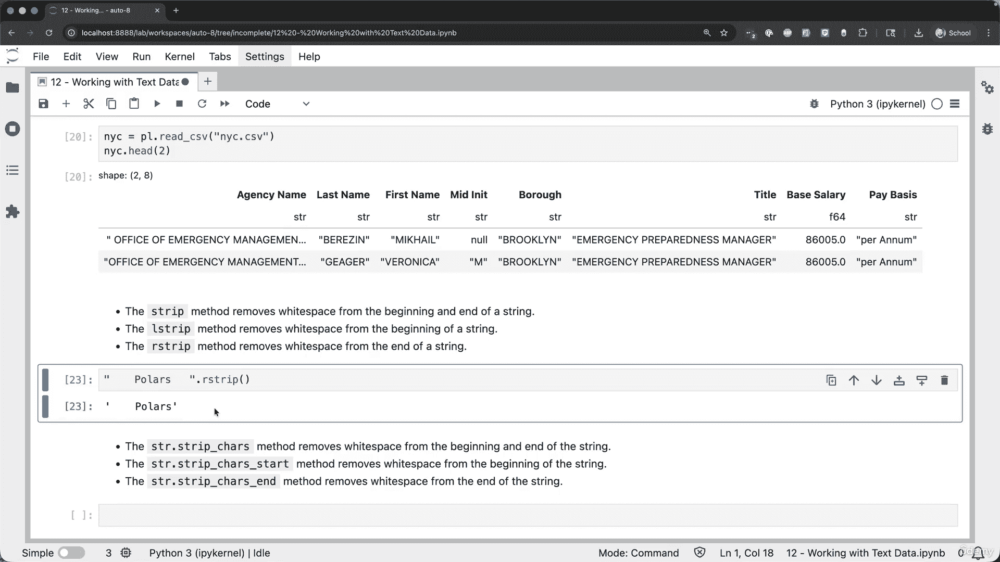

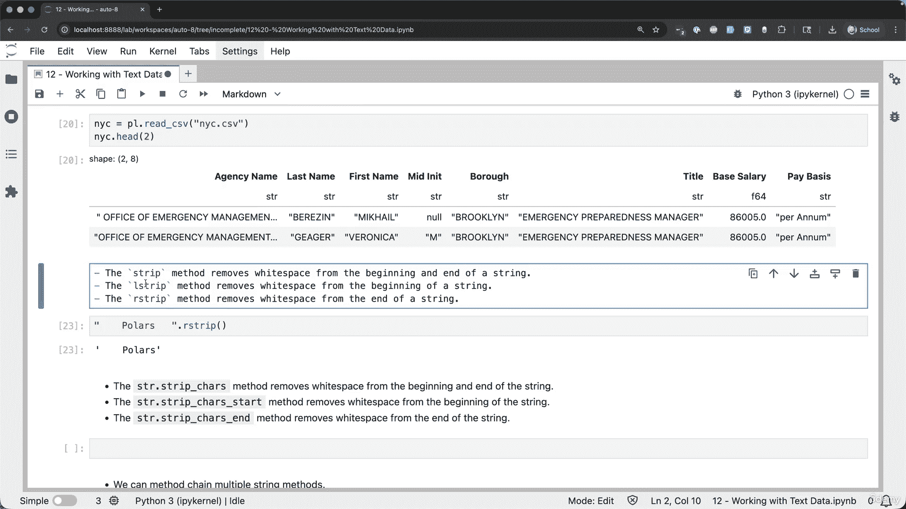

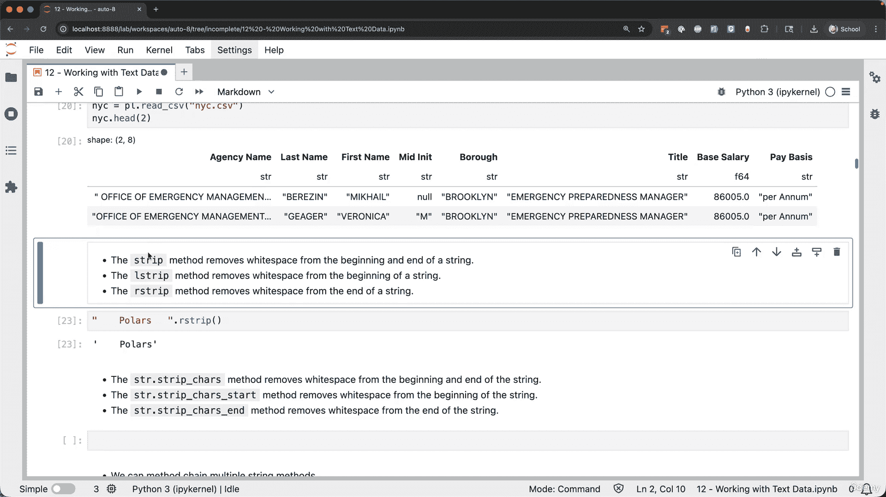

在实际操作中，大多数情况下我们直接使用`strip`就好，因为它一次性覆盖了所有情况。毕竟你很少会希望保留某一边的空格。

## Polars中的对应方法 🔧

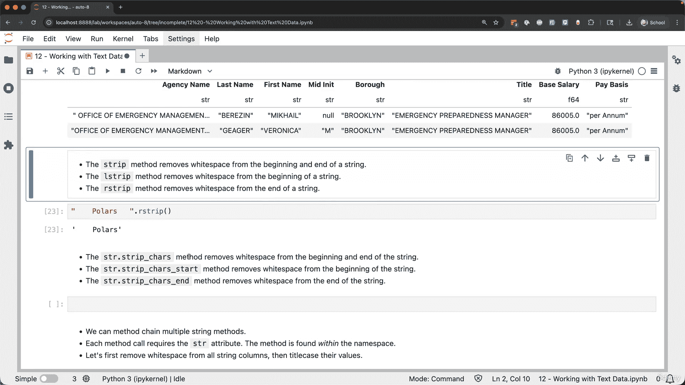

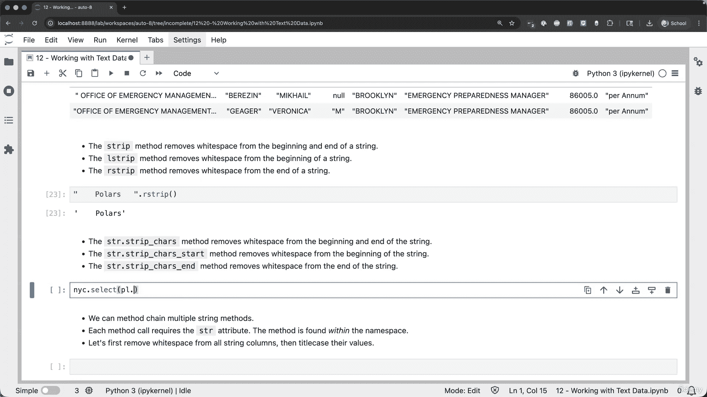

类似地，Polars库也提供了三个功能一致的方法，只不过在命名上稍微有点区别。为了保持与Pandas等库的区分，Polars在字符串命名空间（`str`）下给出了以下三个方法：

- `str.strip_chars()`：等价于Python的`strip`，移除字符串开头和结尾的空白字符。  
- `str.strip_chars_start()`：对应`lstrip`，只移除开头的空白字符。  
- `str.strip_chars_end()`：对应`rstrip`，只移除结尾的空白字符。

这三个方法都位于`str`命名空间内，使用时需要通过`pl.col("列名").str`来调用。下面我们用一个真实数据列来演示。假设数据集中有一个`agency_name`列，里面有很多字符串的末尾带着多余空格。

```python
# 先看一下原始数据，注意有些字符串结尾有空格
df.select(pl.col("agency_name")).head()
```

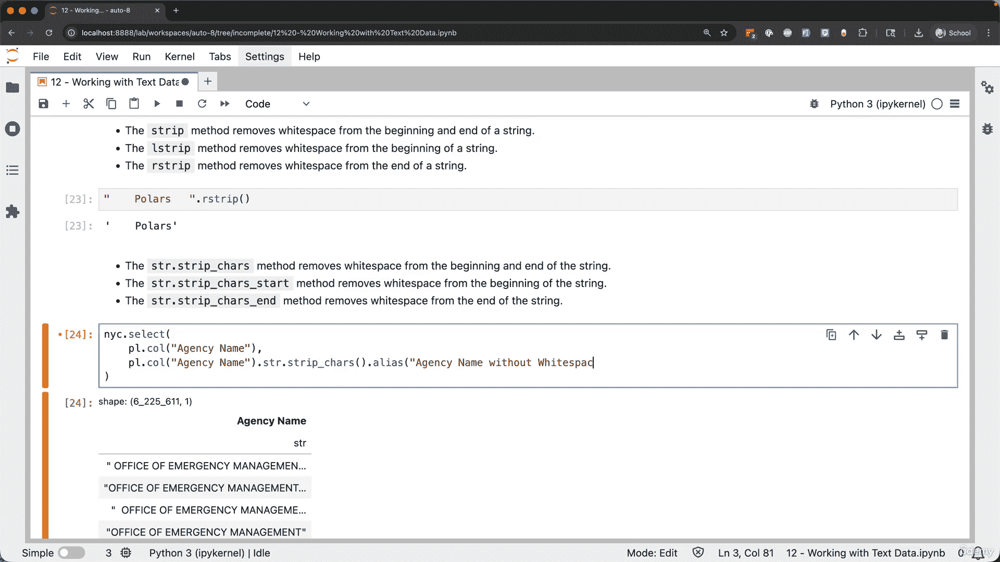

你可能不太容易一眼看出来，但仔细看引号后面，确实有不少空白。这种情况通常来自糟糕的数据源，比如某些老系统导出时会把字符串变成全大写，或者带上多余的空格。幸运的是，Polars让清洗工作变得极其简单。

我们直接对这个列应用`strip_chars`方法，并起一个别名，让结果更清晰。

```python
df.select(
    pl.col("agency_name").str.strip_chars().alias("agency_name_without_whitespace")
)
```

对比一下前后的输出，差异立刻就能看到。新生成的列中，每个字符串的开头和结尾都没有多余空格了。

## 组合多个字符串操作 🔗

当然，我们完全可以自由组合多个基于字符串的操作，这正是Polars表达式系统的一大优势。比如，把前一节课学到的“转换为标题大小写”和本节课的“去除空白”结合起来，先清洗掉字符串两端的空格，再立刻把所有单词转换成首字母大写的形式。

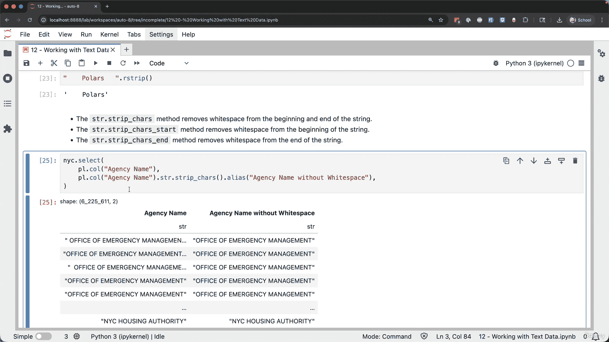

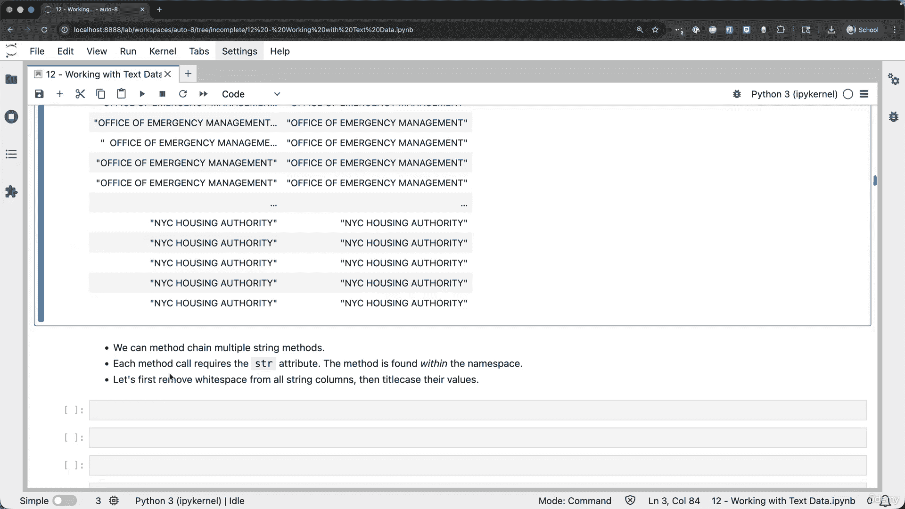

这种场景很典型：几乎不会有人希望数据列里保留无意义的空白，所以清洗往往是第一步。实现起来也非常优雅，只需要一行表达式。我们可以借助`with_columns`方法，把同样的逻辑应用到所有字符串列上。

首先，我们创建一个针对所有字符串列的表达式，通过向`pl.col`传入`pl.String`数据类型来实现。这样一来，我们自然可以使用`str`命名空间下的任何字符串方法。

```python
df.with_columns(
    pl.col(pl.String).str.strip_chars()
)
```

上面这步已经把所有字符串列中的首尾空白清理干净了。接下来，如果你想继续转换大小写，可以直接在该表达式后面再链式调用另一个方法。这里有一个常见的误区：有人觉得既然两个方法都在同一个`str`命名空间里，就可以直接连着写`strip_chars().to_title_case()`，这是不行的。虽然它们都属于`str`命名空间，但每次调用方法之前都必须重新写出`str`前缀，因为`str`是表达式的一个属性，只有通过它才能访问到后续的方法。实际上，`pl.col(pl.String)`创建了一个表达式，`str.strip_chars()`在该表达式上执行并返回一个新的表达式。如果要在这个新表达式上再执行操作，就必须再次通过`str`属性来获取方法。

正确的写法是这样：

```python
df.with_columns(
    pl.col(pl.String).str.strip_chars().str.to_title_case()
)
```

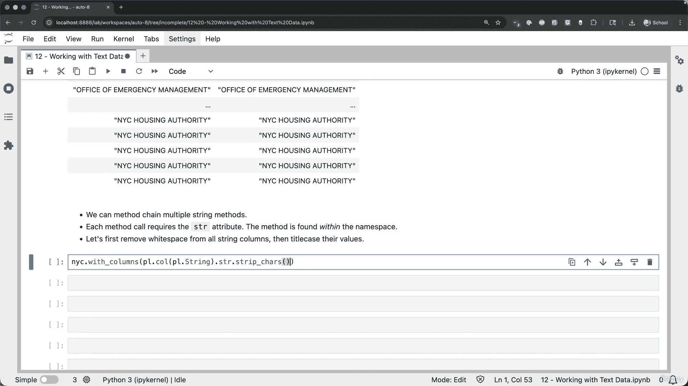

这样我们就同时完成了两件事：移除空白字符，以及把每个单词转换为标题大小写。处理完的数据集看起来就清爽多了。

## 总结 📝

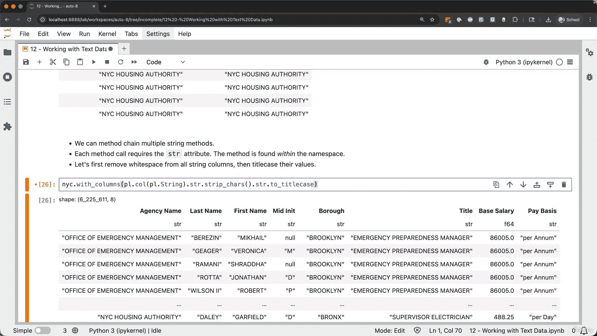

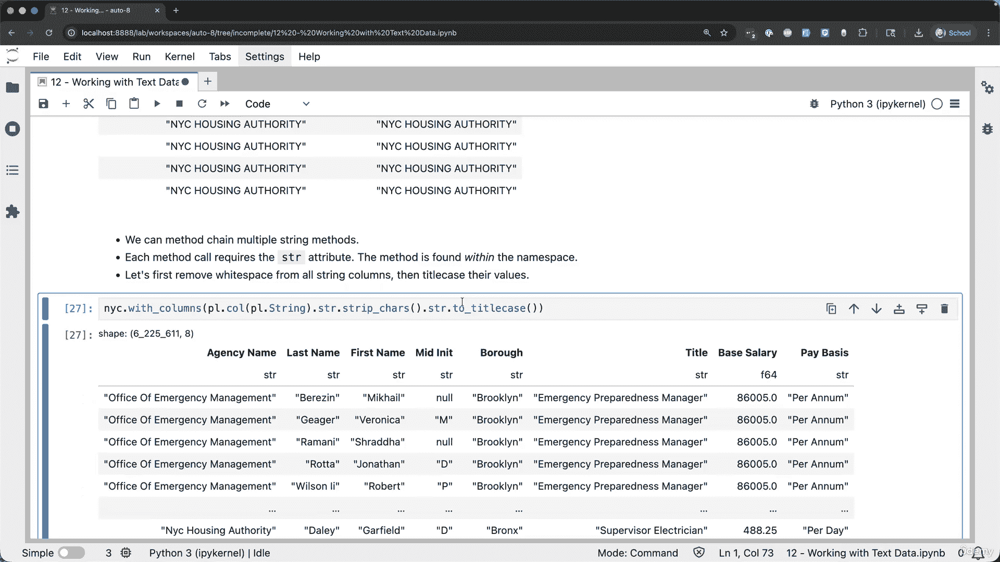

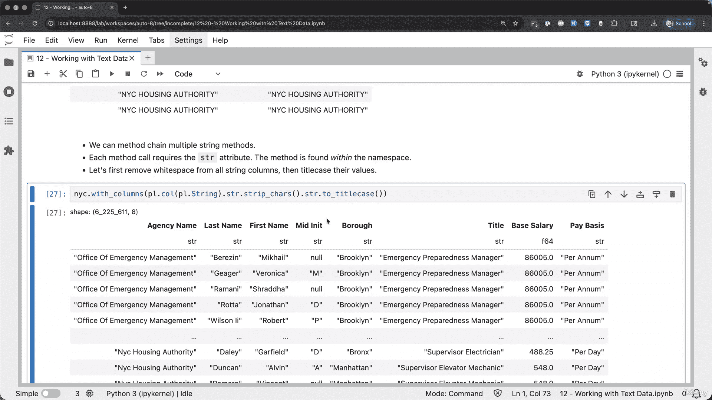

本节课我们一起学习了如何移除字符串中的空白字符。我们先回顾了Python内置的`strip`、`lstrip`、`rstrip`，明确了它们各自的作用范围。然后我们对应地学习了Polars中的`str.strip_chars`、`str.strip_chars_start`、`str.strip_chars_end`三个方法。接着，我们通过一个实际列展示了`strip_chars`的清洗效果。最后，我们利用`with_columns`和`pl.col(pl.String)`，把移除空白和标题大小写转换组合在了一个表达式中，同时掌握了链式调用时重复`str`前缀的要点。希望这些技巧能帮助你更高效地处理字符串数据。

