# Udemy - Data Analysis with Polars and Python part2：p48：移除前缀与后缀 ✂️

在本节课中，我们将学习如何使用Polars库中的`strip_prefix`和`strip_suffix`方法，从字符串列的每个值中移除固定开头的文本或固定结尾的文本。这个操作在数据清洗中非常常见，比如当你从某个系统导出的数据中，每个条目都带有统一的前缀或后缀，而你希望把它们去掉，只留下核心信息。接下来，我们会用实际的纽约市（NYC）数据来演示这些方法的具体用法，并一步一步解释其中的细节。

## ✨ 一、为什么需要移除前缀或后缀？

有时候，你可能想从给定字符串的开头或结尾移除一段固定的文本。举个例子，假设你的数据集中有一个“机构名称”列，里面的每个值都以“office of”开头，这显然不是你想要的最终展示形式。为了处理这类情况，Polars提供了两个方法：`strip_prefix`和`strip_suffix`。前者负责去掉开头的固定部分，后者负责去掉结尾的固定部分。掌握了这两个方法，你就能够非常轻松地整理出干净、简洁的字符串数据。

## 📚 二、回顾上一节课的代码

在开始之前，我们先来回顾一下前面课程中的代码。这里我有一段来自之前课程的代码，仍然在导入NYC DO CSD文件。在上一节课的末尾，我们还应用了`with_columns`方法。这个方法做的事情是：将每一个字符串列都做处理，一方面去除每个列首尾两端的空白字符，另一方面把字符转换成标题大小写（title case）。所以你可以看到，比如在“agency_name”列中，每个字符串的开头都有相同的前缀内容。下面就是我们准备的基本数据预览代码：

```python
import polars as pl

# 假设 df 是从 NYC DO CSD 文件读取的数据框
# 上一节课已经对全部字符串列做了清洗
df = df.with_columns(
    pl.col(pl.Utf8).str.strip_chars().str.to_titlecase()
)
```

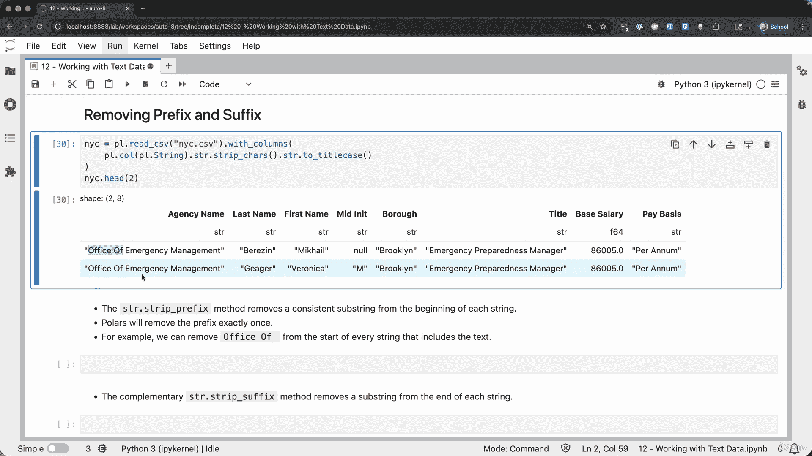

注意，这里并不是说“agency_name”列中的每一个值都包含“office of”，只是其中一部分值带有这个前缀。假设我现在想要把这些带有“office of”开头的字符串中的这个前缀移除掉。换句话说，我希望“agency_name”列最终只显示“emergency management”这样的内容，而不是“office of emergency management”。这时候，`strip_prefix`方法就能派上用场了。

## 🔧 三、使用 `strip_prefix` 移除前缀

使用`strip_prefix`方法，你可以移除字符串开头的那段共同前缀，从而有效地删去部分内容。我们先来看看具体如何操作。我们可以先对数据框调用`select`方法，然后在表达式中访问`str`属性，再调用`strip_prefix`方法。为了让你更清楚地看到效果，我们先展示一下“agency_name”列原本的样子，然后再展示处理后的结果。请看下面的代码：

```python
# 查看原始列
df.select(pl.col("agency_name"))

# 使用 strip_prefix 移除"office of"
df.select(
    pl.col("agency_name").str.strip_prefix("office of").alias("agency")
)
```

上面的代码中，我给`strip_prefix`传入了一个字符串参数，这个参数就是你要查找并移除的前缀。Polars会检查每个字符串的开头，如果发现匹配，就把这部分剪掉。在示例里，我传入的是“office of”。但是这里有一个非常重要的细节需要注意：这样做确实会移除“office of”这九个字符，但原来的字符串是“office of emergency management”，移除之后，剩下的部分会以一个空格开头，因为“office of”后面本来就有个空格。也就是说，你会得到“ emergency management”，前面带着一个空格，这显然不是我们想要的。

那么，如何解决这个问题呢？这里有两条解决思路可以参考：

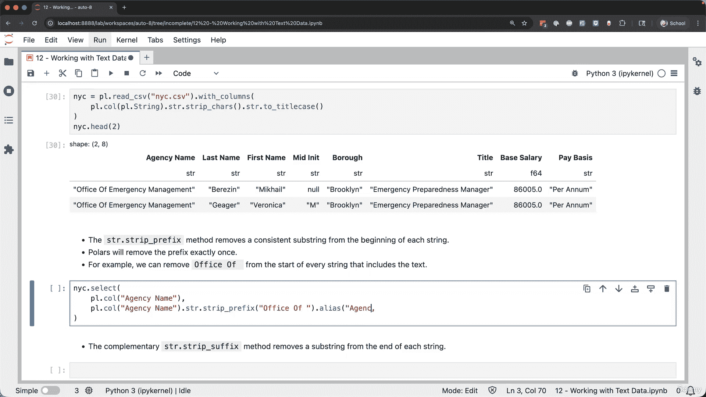

- 第一种：在调用`strip_prefix`之后继续调用`strip_chars`，用来去掉首尾的空白字符。
- 第二种：直接在传入的字符串参数里加上这个空格，即传入`"office of "`，这样空格也被看作是要移除的一部分。

我们来看看第二种方法的代码：

```python
df.select(
    pl.col("agency_name").str.strip_prefix("office of ").alias("agency")
)
```

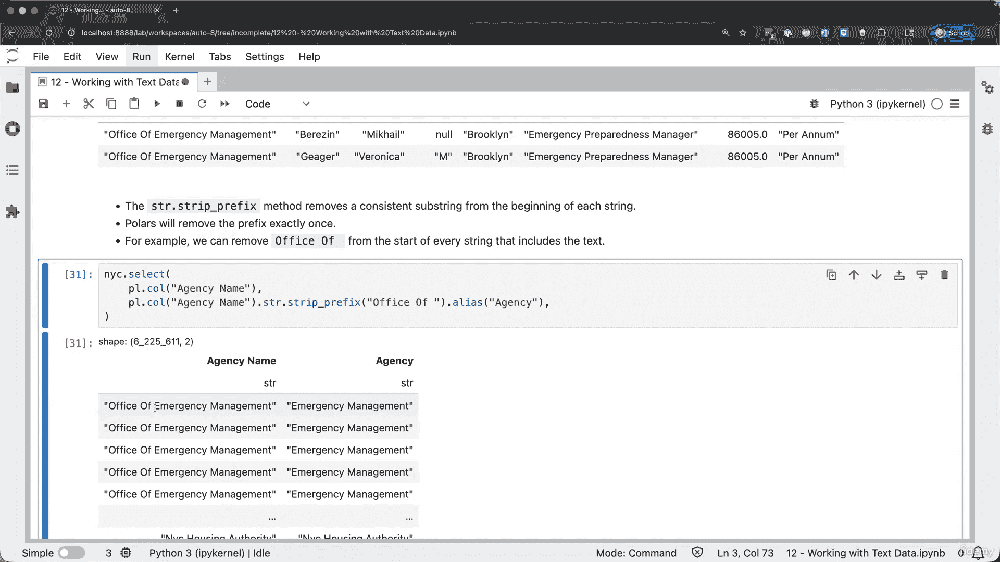

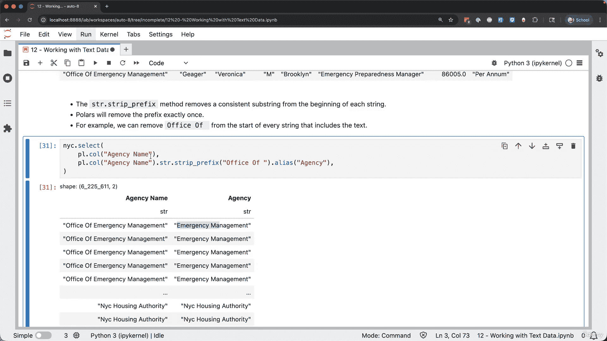

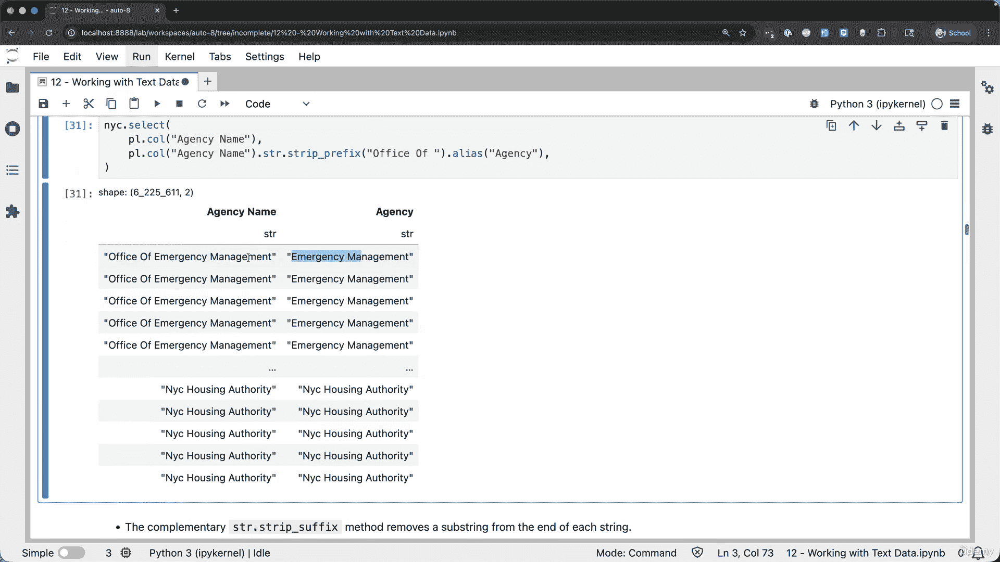

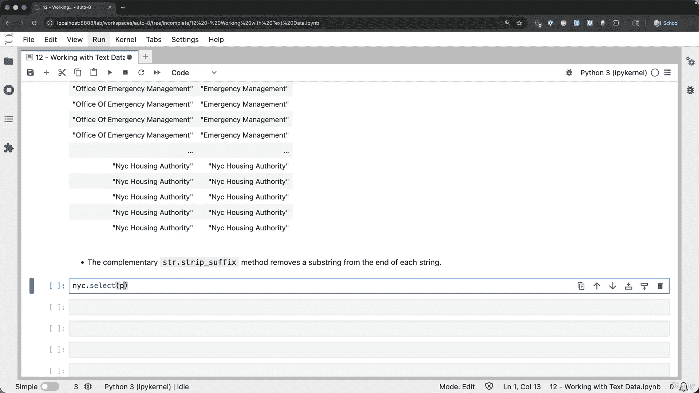

同时，我们还可以使用`alias`方法给新生成的这一列起一个名字，比如叫`"agency"`。现在你再运行代码，就能看到区别了：只要在“agency_name”列中遇到了“office of ”这个完整的前缀，Polars就会把这一整段移除掉，剩下的就是“emergency management”这样的简洁名称。

## 🧹 四、使用 `strip_suffix` 移除后缀

刚才我们看到了如何移除开头的固定内容，接下来我们来看看与之互补的方法——`strip_suffix`。这个方法负责从字符串的末尾移除指定的子串。同样地，我们先看一下“agency_name”列当前的样子。你可能注意到，有些值是以“authority”结尾的，比如“NYC housing authority”。如果我们想去掉末尾的“authority”，让机构名称变成“NYC housing”，就可以使用`strip_suffix`。

它的使用原则和`strip_prefix`完全一样：先写表达式，然后访问`str`属性，再调用`strip_suffix`方法。这里顺便解释一下这两个单词：`strip`表示移除，`suffix`表示出现在字符串末尾的内容。所以`strip_suffix`的意思就是“移除后缀”。代码如下：

```python
df.select(
    pl.col("agency_name").str.strip_suffix(" authority").alias("agency")
)
```

注意，在代码中我传入的字符串是`" authority"`，也就是一个空格加上“authority”。这样做是因为我不想只移除“authority”这几个字母，而把多余的空格留在那里。我想移除的是任何字符串末尾包含“authority”的完整部分，所以把空格也包含进来会干净很多。同样地，我们也可以用`alias`给这个新列取一个不同的名字，比如也叫`"agency"`。这样处理后，你就能看到所有以“authority”结尾的字符串都去掉了这个后缀，剩下的就是简洁的机构名称了。

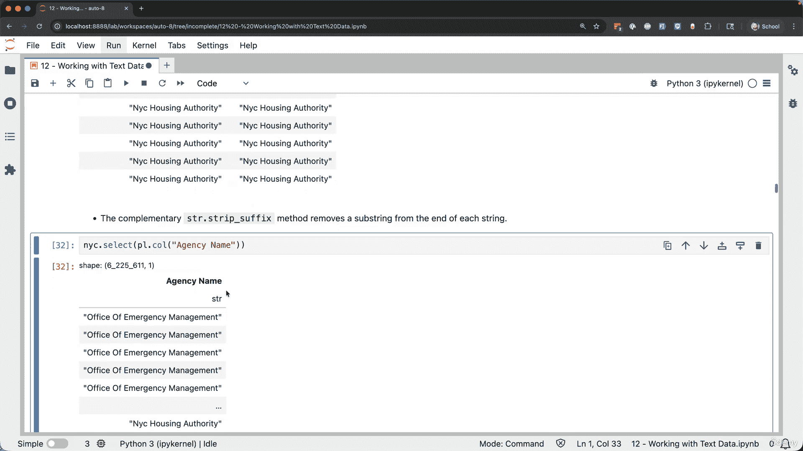

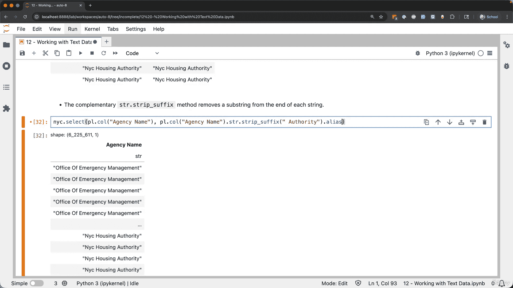

## 🔗 五、组合使用前缀和后缀移除

当然，你完全可以把这两个操作组合在一次调用中完成。比如，我们可以先写一个表达式，获取“agency_name”列，然后通过一连串的方法调用，先移除通用的前缀“office of ”（注意后面带空格），再移除通用的后缀“ authority”（前面带空格）。这样，Polars就会依次执行这两个操作，最终得到一个既没有固定前缀也没有固定后缀的干净列。代码就像下面这样：

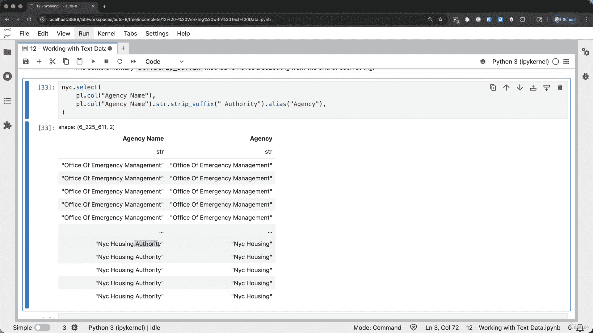

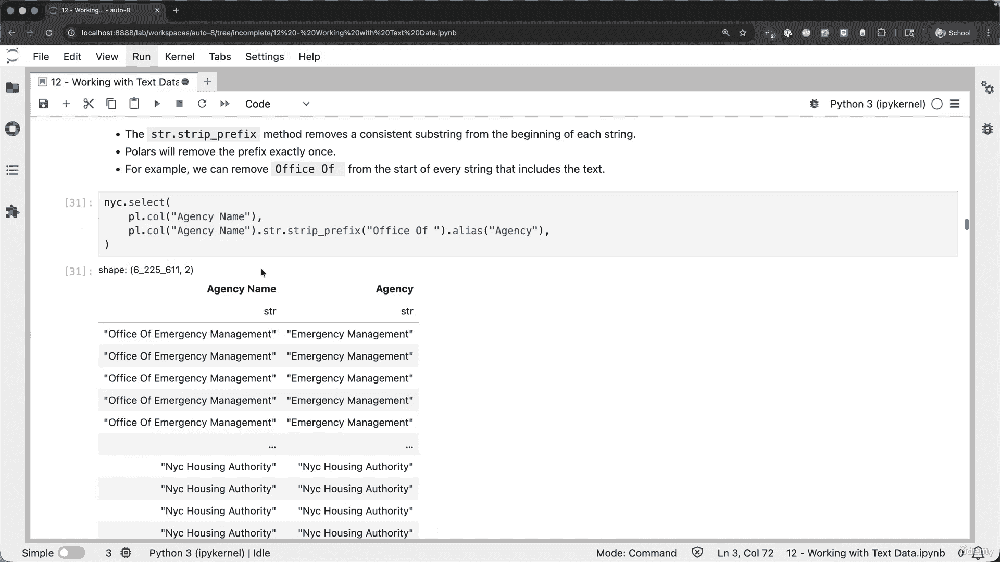

```python
df.select(
    pl.col("agency_name")
    .str.strip_prefix("office of ")
    .str.strip_suffix(" authority")
    .alias("agency")
)
```

从上面这个例子你可以看到，两个操作都能在同一个连续的表达式调用中执行。本质上，`strip_prefix`和`strip_suffix`做的事情就是从给定字符串的开头或结尾移除指定内容。通过组合它们，你可以灵活地清理各种带有固定前后缀的数据。

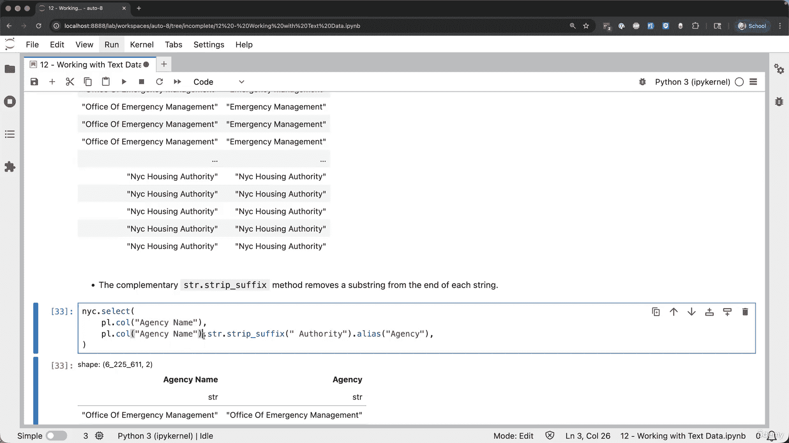

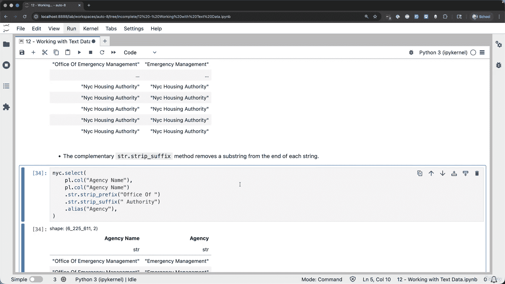

## 🎯 六、总结

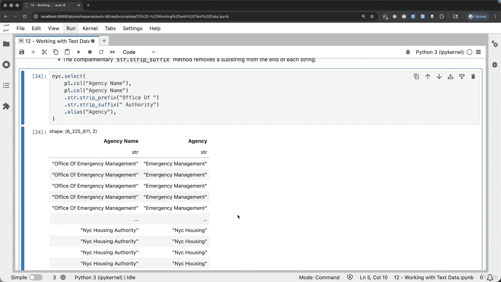

本节课中，我们一起学习了Polars中两个非常实用的字符串处理方法：`strip_prefix`和`strip_suffix`。我们首先回顾了上一节课中如何处理字符串列并生成基础数据，接着通过实际例子演示了如何使用`strip_prefix`移除字符串开头的前缀，并强调了移除后可能留下空格的问题，以及如何通过额外添加空格来解决。然后我们学习了对应的`strip_suffix`方法，用来移除字符串结尾的后缀。最后，我们还展示了如何将这两个方法串联在一起，在一个表达式中同时完成前后缀的移除操作。希望你在实际的数据清洗中，能够灵活运用这两个方法，让字符串数据变得整齐干净。
