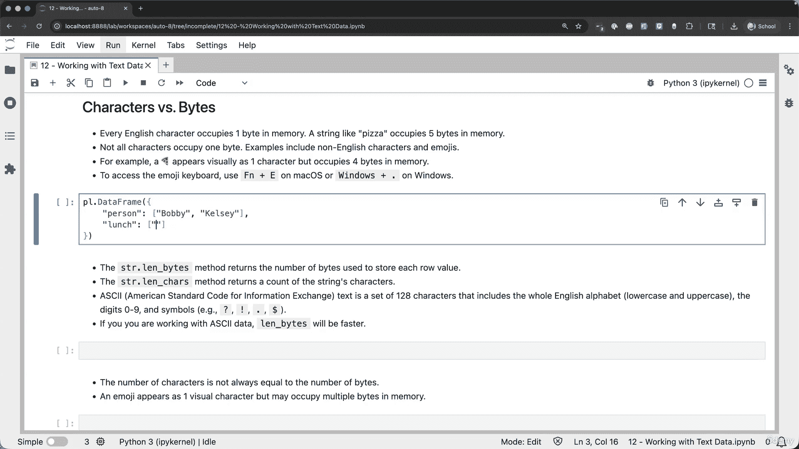
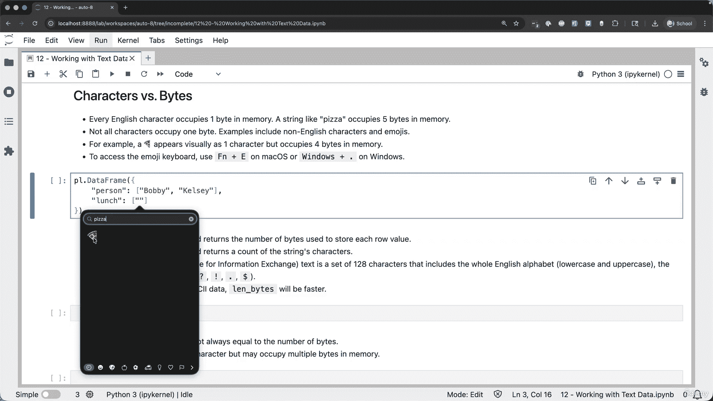
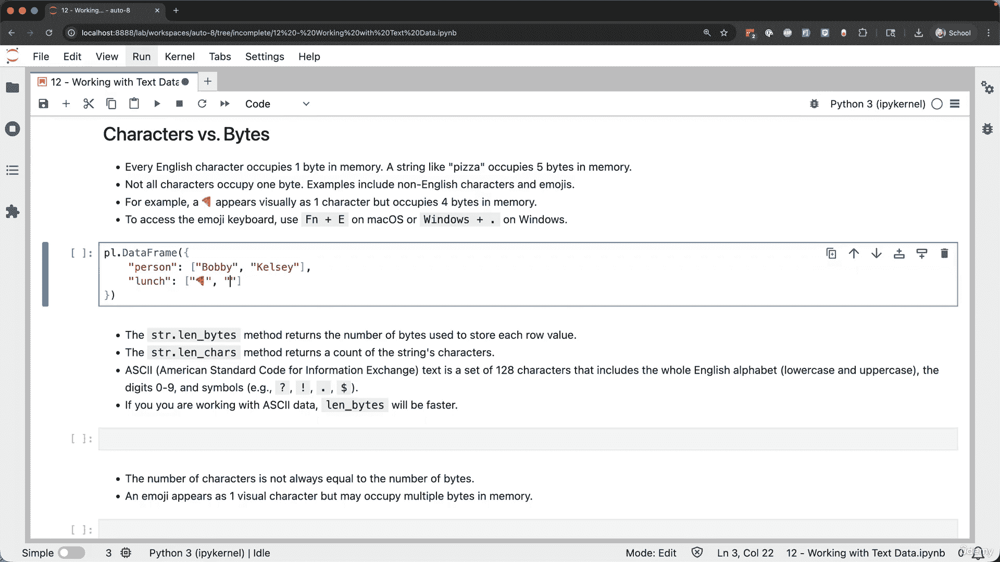
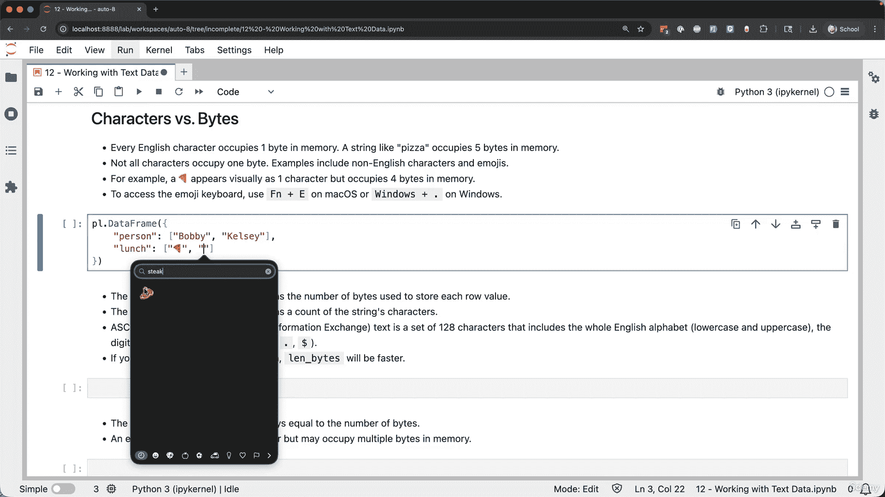
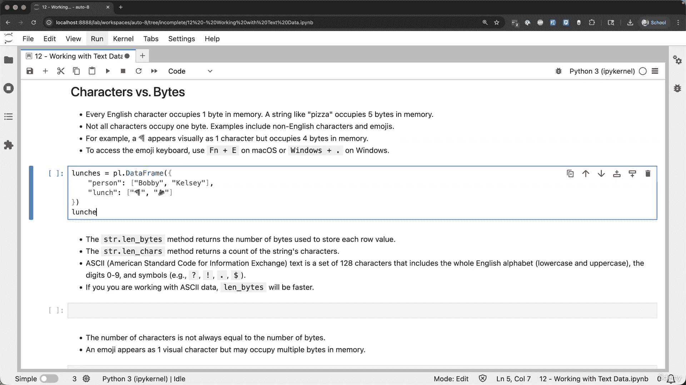
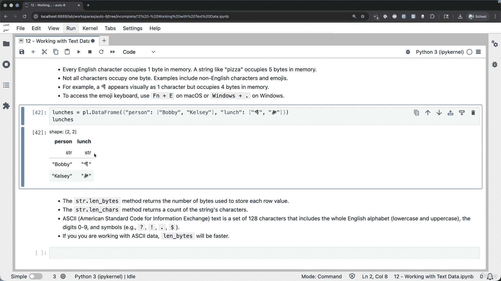
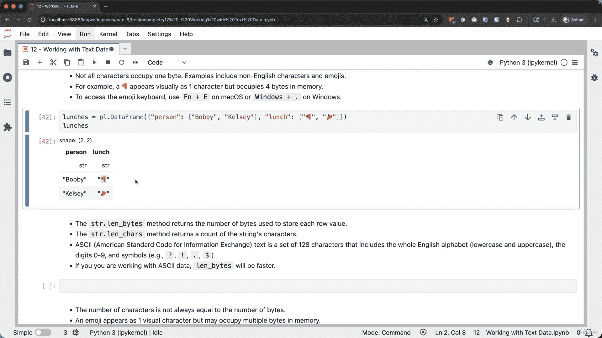
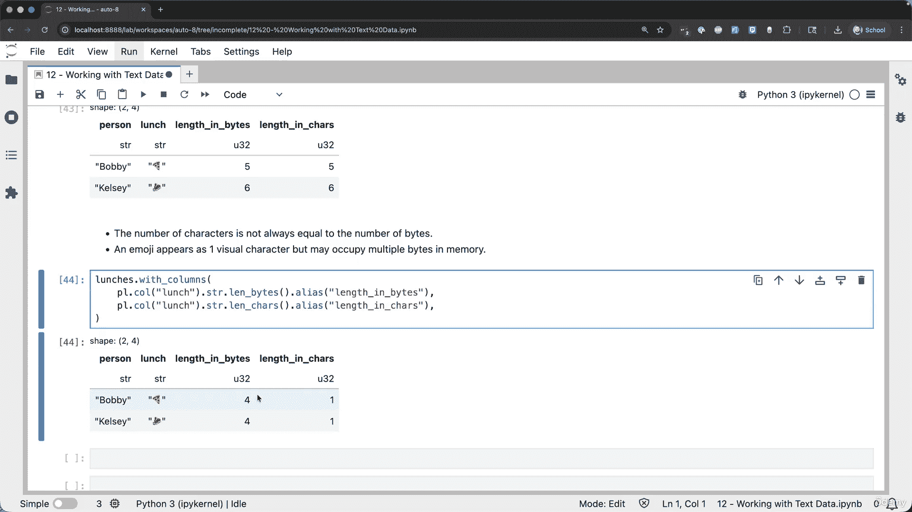

# 🧮 Polars 与 Python 数据分析：第49节：字符与字节

在本节课中，我们将要学习 Polars 中“字符”和“字节”的区别，理解为什么很多字符串方法名会带 `chars` 或 `bytes` 后缀，并通过一个包含英文姓名和食物 emoji 的示例 DataFrame，观察同一个字符串在“视觉字符数”和“内存字节数”上的不同结果。这个主题看起来只是一个长度计算问题，实际会影响我们对字符串清洗、截取、计数和内存占用的理解，因此需要从最基本的概念开始梳理。

## 🧭 Polars 与 Python 数据分析：第49.1节：为什么区分字符和字节

在进入代码之前，我们需要先建立一个背景。之前介绍过 Polars 中的 `strip` 家族方法，这些方法用于去除字符串开头或结尾的空白。它们的方法名都包含 `chars` 这个词，例如 `strip_chars`。如果观察 Polars 字符串方法的命名习惯，会发现很多方法要么以 `chars` 结尾，要么以它的对应概念 `bytes` 结尾。Polars 团队这样命名，是为了明确告诉使用者：当前操作针对的是视觉字符，还是内存中的字节。理解这个划分，能够帮助我们读懂方法名，也能避免在字符串长度和字符串处理上产生误解。

字符和字节的区别可以用一个很直白的方式理解。字符是我们在屏幕上看到的一个字形，例如字母 `B`、数字 `5`、问号、井号、美元符号或者一个 emoji。字节是计算机内存中的计量单位，用来表示某个内容占用了多少内存空间。内存大小的单位包括字节、千字节、兆字节、吉字节等，它们反映的都是数据在计算机内存中占用的空间。对于英文字符，视觉字符和内存字节之间通常是一一对应的：一个英文字符占用一个字节。像问号、井号、美元符号、😊等常见符号，原文在这里同样将它们视为屏幕上的一个视觉字符，并说明它们通常按一个字节来理解；不过真正表情符号的字节占用会在后文单独说明。核心概念可以用下面的公式表示：

```text
英文字符串：len_chars("Bobby") = 5，len_bytes("Bobby") = 5
表情符号：len_chars("🍕") = 1，len_bytes("🍕") = 4
```

Polars 面临的挑战在于，并不是每一个视觉字符都只占用一个字节。非英文字符可能在屏幕上看起来只是一个字符，但在计算机内存中会占用多个字节。另一个常见例子是 emoji。一个 emoji 在视觉上可能只是一个字符，但在内存中可能占用两个、三个或四个字节。理解了这一层背景之后，我们进入示例，看看 Polars 如何把这种差异暴露出来。

## 🧱 Polars 与 Python 数据分析：第49.2节：创建示例数据

在理解了字符和字节的基本差异之后，我们来看看如何在 Polars 里创建示例数据。首先从零创建一个新的 DataFrame。我们会访问顶层的 DataFrame 构造器，并创建一个包含两列的 DataFrame：第一列叫 `person`，第二列叫 `lunch`。这里可以用字典来指定列名和列内容。`person` 列可以赋值为一个包含两个字符串的列表，内容是 `Bobby` 和 `Kelsey`。这一列存储的是字符串，并且这些字符串的内容全部由英文字母组成。如果问这两个字符串的长度，大多数人会直接数字符个数：`Bobby` 有 5 个字符，`Kelsey` 有 6 个字符。

这些英文字符在内存中也会占用字节。对于英文字符，视觉字符和内存字节之间的映射非常简单，是一对一关系：一个英文字符占用一个字节。接下来创建第二列 `lunch`，同样赋值为一个存储字符串的列表，但这里每个条目存储的是某种食物的 emoji 图标。如果不熟悉如何调出 emoji 键盘，可以使用操作系统提供的快捷键。在 macOS 电脑上，可以按 `Fn + E`，`Fn` 键通常位于键盘左下角；在 Windows 电脑上，可以同时按 Windows 键和句点键，也就是 `Win + .`，这样会打开 emoji 键盘，既能搜索 emoji，也能选择 emoji。调出键盘后，可以为 Bobby 搜索 `pizza`，点击披萨图标，把它放进字符串；然后为 Kelsey 的午餐条目执行同样的操作，搜索 `steak`，选择牛排图标。



这两个字符在视觉上都只是一个字符，但它们都是 emoji，在内存中实际会占用多个字节。按照原文说明，每个 emoji 会占用四个字节，相当于四个英文字母占用的内存。然后把这个 DataFrame 赋值给 `lunches` 变量，并预览 `lunches`。从表面看，这两列都只是普通的字符串值，而且它们确实是有效的字符串值，由有效字符组成。示例代码如下：





```python
import polars as pl

lunches = pl.DataFrame({
    "person": ["Bobby", "Kelsey"],
    "lunch": ["🍕", "🥩"],
})

print(lunches)
```



数据准备好之后，下一步就是比较字符长度和字节长度，看看 Polars 如何在 API 层面处理这种不确定性。

## 🔍 Polars 与 Python 数据分析：第49.3节：用 len_chars 与 len_bytes 观察差异

上一节创建了包含英文姓名和食物 emoji 的 DataFrame，本节我们来看看如何计算字符长度和字节长度。在 `str` 命名空间下，如果想询问字符串长度，Polars 并没有提供一个单独的 `len` 方法，而是提供了两个方法：`str.len_bytes()` 和 `str.len_chars()`。原文口述为 `L bys` 和 `lens chars`，对应到 Polars API 就是 `str.len_bytes()` 与 `str.len_chars()`。这样设计的原因是，单说“字符串长度”在 Polars 看来存在歧义。Polars 不知道你问的是字符长度，也就是字符串呈现给我们的视觉字符数量，还是字节长度，也就是字符串在内存中占用的内存量。

先看 `person` 列，这个例子更容易理解，因为 `person` 只存储英文字母，而英文字符和字节之间是一对一映射。`Bobby` 有 5 个字符，也会在计算机内存中占用 5 个字节；`Kelsey` 有 6 个字符，也会占用 6 个字节。可以使用 `with_columns` 方法添加新列，先访问 `str` 命名空间，再调用 `str.len_bytes()`，并用 `alias` 方法给结果列改名，例如改成 `length_in_bytes`。然后在下一行复制同样的表达式，仍然目标 `person` 列，但把方法换成 `str.len_chars()`，并把列名改成 `length_in_chars`。因为这里处理的是英文字母，两个结果会完全一致。示例代码如下：







```python
lunches.with_columns(
    pl.col("person").str.len_bytes().alias("length_in_bytes"),
    pl.col("person").str.len_chars().alias("length_in_chars"),
)
```

真正会出现区别的地方，是询问 `lunch` 列中各个值的字符长度和字节长度。下面应用同样的逻辑：取 `lunches` DataFrame，调用 `with_columns` 方法添加额外列，但这次目标列是 `lunch`。在 `str` 命名空间下调用 `str.len_bytes()`，给结果列命名为 `length_in_bytes`；再复制整个表达式，仍然目标 `lunch` 列，但改为调用 `str.len_chars()`，给结果列命名为 `length_in_chars`。示例代码如下：

```python
lunches.with_columns(
    pl.col("lunch").str.len_bytes().alias("length_in_bytes"),
    pl.col("lunch").str.len_chars().alias("length_in_chars"),
)
```

这时就能看到两个方法的区别。披萨 emoji 和牛排 emoji 在屏幕上对我们来说都是一个视觉字符，因此 `length_in_chars` 列中，披萨 emoji 的值是 1，牛排 emoji 的值也是 1。但在后台，这些 emoji 实际占用四个字节的内存，相当于一个包含四个英文字符的字符串占用的内存量，因此 `length_in_bytes` 列中的值是 4。看到这些结果之后，就能理解 Polars 为什么要在方法名里区分 `chars` 与 `bytes`，也能理解为什么不能想当然地认为“一个视觉字符就是一个字节”。

## 🧩 Polars 与 Python 数据分析：第49.4节：方法命名规则与使用建议

前面通过 `len_chars` 与 `len_bytes` 看到了实际差异，本节我们把这些现象归纳成命名规则和使用建议。Polars 团队在 `str` 命名空间中的很多方法名末尾加上 `bytes` 或 `chars`，原因在于只要存在“按字节处理还是按字符处理”的歧义，Polars 就需要明确知道使用者的意图。换句话说，Polars 会问：你是在问字符串有多少个视觉字符，还是在问字符串在内存中占用多少个字节。下面列出两种常见后缀及其含义，方便初学者快速判断方法作用：

- 以 `_chars` 结尾的方法：按视觉字符处理，例如计算字符数、按字符去除内容。

- 以 `_bytes` 结尾的方法：按内存字节处理，例如计算字节数、按字节处理内容。

- 这种命名的目的：消除歧义，让代码明确表达“按字符”还是“按字节”计算。

掌握这组命名规则之后，我们再来看一个与 `strip` 有关的例子。像 `strip_chars` 这样的方法，名字里带 `chars`，是因为 Polars 团队要表达：这里会基于视觉字符从字符串中移除内容，而不是基于某些内存位或字节来移除。举例来说，不是要从一个 20 字节的字符串中移除四个字节，而是按照字符层面的含义处理字符串内容。字符串命名空间中的许多方法都会根据目标是字符还是字节，在名称中带上 `chars` 或 `bytes`。可以用下面的引用概括这种设计思路：

> Polars 在方法名后加 `chars` 或 `bytes`，是在明确询问：你要按屏幕上的视觉字符处理，还是按内存中的字节处理？

很多情况下，处理纯英文字母时不需要担心这种区别，因为一个视觉字符和一个内存字节之间是一一映射。但示例已经说明，这种一一映射并不总是成立。使用 Polars 处理字符串时，需要了解自己手上的数据类型，也需要明确自己到底要求 Polars 计算什么。只有把“字符数”和“字节数”分清楚，才能在遇到非英文字符、emoji 或混合文本时写出符合预期的代码。

## 📌 Polars 与 Python 数据分析：第49.5节：本节总结



本节课中我们一起学习了 Polars 中字符与字节的区别，以及这种区别为什么会体现在方法命名上。我们回顾了 `strip` 家族方法与 `chars` 后缀的关系，理解了字符是屏幕上的视觉字形，字节是内存中的计量单位；对于英文字符，二者通常一一对应，一个字符占用一个字节，但非英文字符和 emoji 可能一个视觉字符占用多个字节。随后创建了包含 `person` 和 `lunch` 两列的 DataFrame，用 `Bobby`、`Kelsey` 以及披萨、牛排 emoji 展示了表面上的字符串值与底层内存占用的差异。通过 `str.len_chars()` 与 `str.len_bytes()`，我们看到英文姓名的字符长度和字节长度一致，而 emoji 的字符长度是 1，字节长度是 4。最后归纳了 Polars 方法名中 `chars` 与 `bytes` 的命名规则：只要存在歧义，方法名就会明确说明当前操作针对视觉字符还是内存字节。掌握这些内容后，我们在使用 Polars 处理字符串时，就能更准确地理解方法行为，也能避免把字符数和字节数混为一谈。

