# 🧵 Polars 与 Python 数据分析：第 50 节：字符串切片

在本节课中，我们将要学习 Polars 中的字符串切片。字符串切片的意思是，从一个字符串里面提取一部分字符，或者提取一段字符序列。这个操作在数据清洗里很常见，例如用地区名称的前几个字母生成缩写代码。下面会从基本概念开始，逐步介绍 `slice`、`head` 和 `tail` 三种方法，并说明索引、起始位置和字符数量的关系。

## 🧩 Polars 与 Python 数据分析：第 50 节：字符串切片的概念

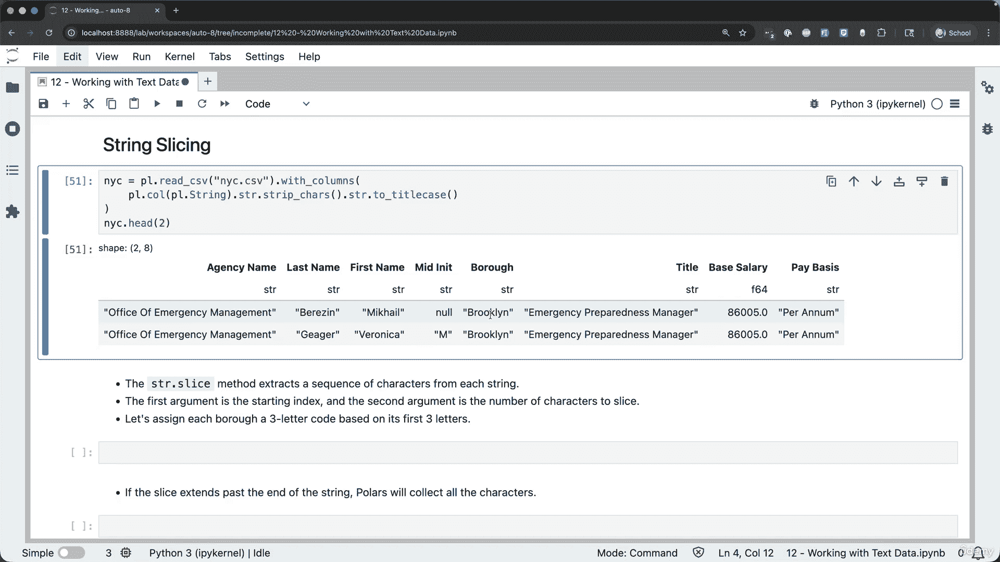

上一节没有涉及字符串切片，本节先说明它的核心含义。字符串切片可以理解成“从字符串中截取一段”。用公式表示就是下面这样。

\[
\text{切片结果} = \text{字符串}[\text{起始索引} : \text{起始索引} + \text{字符数量}]
\]

在 Polars 中，常见写法如下。

```python
pl.col("borough").str.slice(start, length)
```

这里的 `start` 是起始索引，`length` 是要取出的字符数量。理解这一点之后，下面重新执行导入代码，并观察 borough 列。可以看到数据中有一个 borough 列，原文中也把它写作 borrow 列。我们可以假设 borough 列中每个字符串的前三个字符可以作为 borough 的代码。这样就不需要写出完整的 Brooklyn，而是直接取前三个字母 BRO。在下方演示中，也可以拿 NYC 作为示例字符串来理解这个过程。

## 🚀 Polars 与 Python 数据分析：第 50 节：重新导入数据并查看 borough 列

在了解了字符串切片的目标之后，本节看具体代码。先重新执行前面的导入代码，然后对 DataFrame 调用 `select` 方法。第一个表达式用来显示原始的 borough 列，因此直接在表达式中指定这一列。第二个表达式同样取 borough 列，但会继续调用字符串方法。把表达式拆成多行，方便观察。下面是第二个表达式，在 `.str` 属性下面访问 `slice` 方法。

```python
df.select(
    pl.col("borough"),
    pl.col("borough").str.slice(0, 3).alias("code")
)
```

`slice` 方法会从字符串中提取一段字符序列，并接受两个参数。对于 borough 列中的每个值，这段代码都会切出或提取前三个字符组成的子集。下面复制这段代码到下方继续演示。如果调用 `slice` 方法时提供一个很大的字符数量，例如 100，这个数量会超过字符串实际最后一个索引的位置，但这不会成为问题。Polars 会尽量取出能取到的字符。如果从索引位置 0 请求 100 个字符，得到的就是完整的原始字符串。再次把这段代码复制到下方，用来说明这个行为。

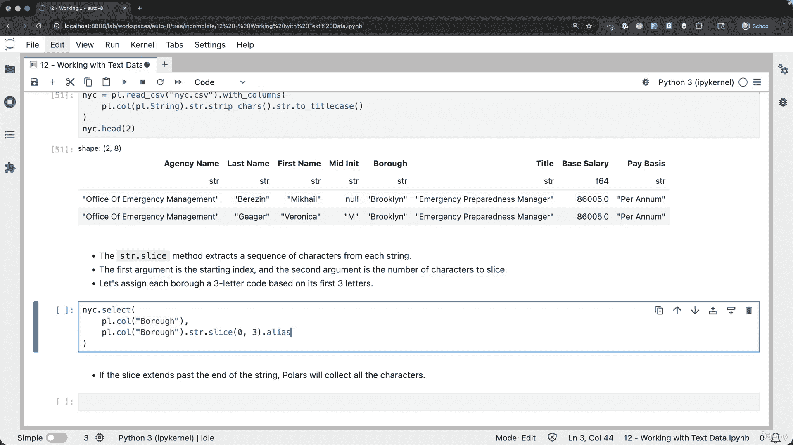

```python
df.select(
    pl.col("borough").str.slice(0, 100).alias("code")
)
```

## 🔢 Polars 与 Python 数据分析：第 50 节：slice 的参数含义与索引规则

上一节已经看到 `slice` 的基本用法，本节把两个参数的含义说明白。`slice` 的第一个参数是起始索引位置，也就是从字符串的哪个位置开始取字符。索引位置从 0 开始。下面列出 Brooklyn 这个字符串中的索引对应关系，帮助理解起始索引。

- 在 Brooklyn 中，大写字母 B 的索引是 0。
- 字母 R 的索引是 1。
- 第一个字母 O 的索引是 2。
- 后面的字符按照同样方式依次递增。

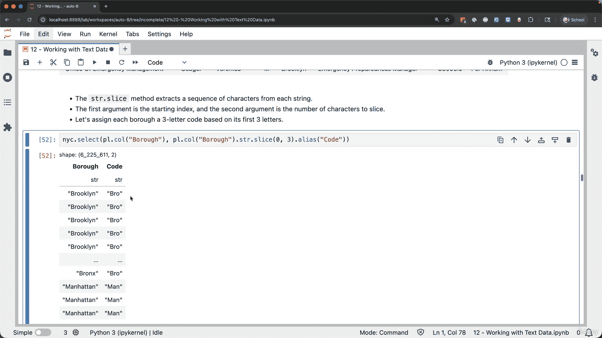

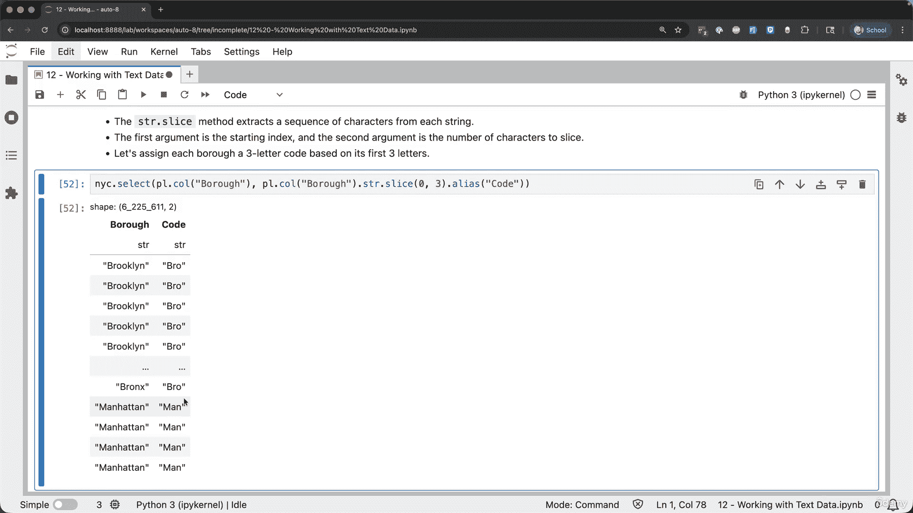

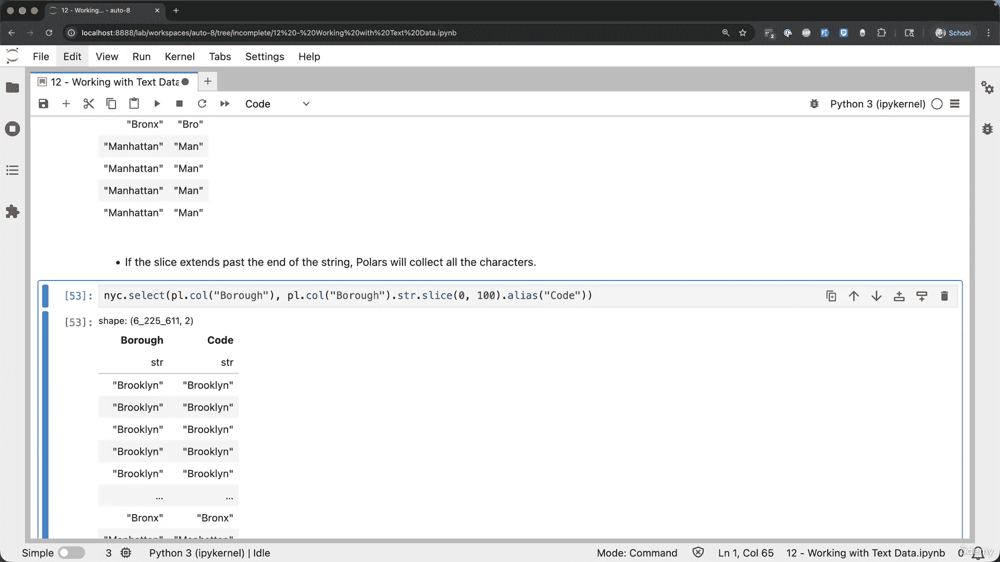

因此，如果想取前三个字符，就要从索引 0 开始。第二个参数位于起始索引之后，表示希望取出多少个字符。在这个例子里，第二个参数指定为 3。这里需要注意，第二个参数并不是指定“到索引位置 3 停止”。这里看起来停在索引 3 附近，只是因为起始索引是 0，刚好产生了这种对应关系。第二个参数不是结束位置，而是取出多少个字符。因此可以理解为：起始索引为 0，取出 3 个字符，并为结果提供别名 `code`。

```python
pl.col("borough").str.slice(0, 3).alias("code")
```

## 🎯 Polars 与 Python 数据分析：第 50 节：从中间开始切片

掌握了基本索引规则后，本节看从中间开始切片的情况。如前面提到，不一定要从字符串开头开始，也可以从中间开始。第二个参数仍然表示总共取出的字符数量，而不是结束索引。例如，可以从索引位置 2 开始，这个位置是每个字符串中的第三个字符，然后总共取出 5 个字符。这里不是要求停在索引 5，因为那样只会产生 3 个字符；这里要求的是从索引 2 开始取出 5 个字符。这样 code 列中的每个值都会有 5 个字符。具体来说，会取原字符串索引 2、3、4、5、6 对应的字符，一共 5 个字符。

```python
df.select(
    pl.col("borough"),
    pl.col("borough").str.slice(2, 5).alias("code")
)
```

## ⚡ Polars 与 Python 数据分析：第 50 节：head 和 tail 快捷方法

前面使用 `slice` 手动指定索引和字符数量，本节看两个快捷方法。如果希望从字符串开头或字符串结尾开始提取，会有一些快捷方法。将这部分复制到下方继续演示。`.str` 命名空间下还有两个方法，分别叫 `head` 和 `tail`，它们和 DataFrame 的 `head`、`tail` 方法很像。DataFrame 的 `head` 和 `tail` 用来取前几行或后几行，而这两个方法把相同逻辑应用到每一行字符串的字符上。下面列出两个快捷方法的作用。

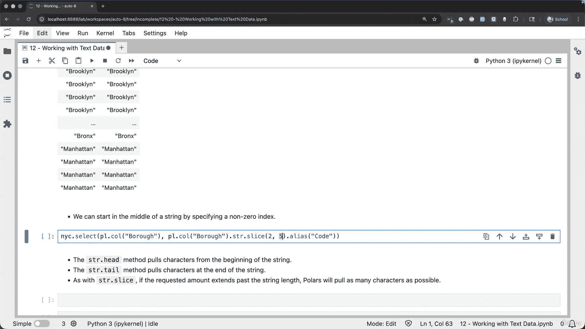

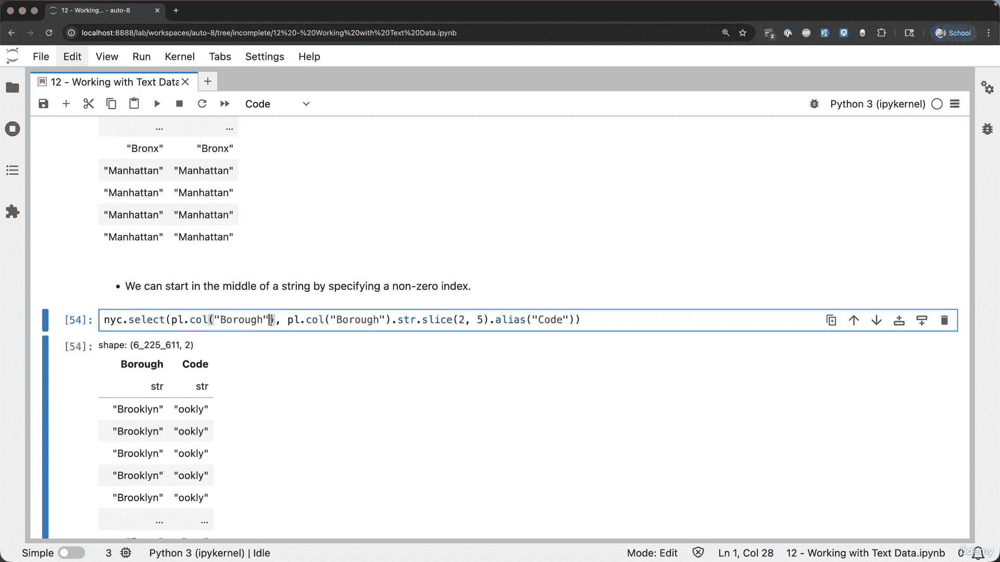

- `head(n)`：从字符串开头取出 `n` 个字符。
- `tail(n)`：从字符串末尾取出 `n` 个字符。

`head` 方法接受一个参数，用来指定从字符串开头取出多少个字符。例如，再次创建一个表达式，目标仍然是 borough 列，访问 `.str` 属性，再访问 `head` 方法，并提供参数 3。这个写法是 `slice(0, 3)` 的替代语法。这里表示从开头开始，取出每个字符串的前三个字符，并把结果命名为 `code`。

```python
df.select(
    pl.col("borough"),
    pl.col("borough").str.head(3).alias("code")
)
```

查看结果可以看到，已经取出了前三个字符。作为另一种写法，也可以把每个表达式放在不同行。下面展示互补的 `tail` 方法。再次创建一个表达式，目标仍然是 borough 列，访问 `.str` 属性，然后使用互补的 `tail` 方法，它会从字符串末尾开始取字符。如果希望得到最后四个字符，并且不想关心每个字符串中的索引位置，只需要从末尾开始取四个字符，就可以直接调用 `tail` 方法并传入参数 4。把这一列命名为 `code2`，它会取出每个字符串的最后四个字符。对于 Brooklyn，结果就是 KLYN，其他值以此类推。

```python
df.select(
    pl.col("borough"),
    pl.col("borough").str.tail(4).alias("code2")
)
```

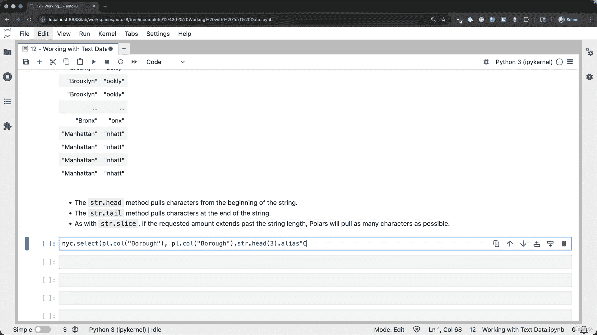

## 🧠 Polars 与 Python 数据分析：第 50 节：三种方法对比

前面分别介绍了 `slice`、`head` 和 `tail`，本节把三种方法放在一起对比。它们都会从字符串中取出一部分字符，也就是取出一个字符子集，具体结果取决于指定的参数。下面列出三种方法的区别。

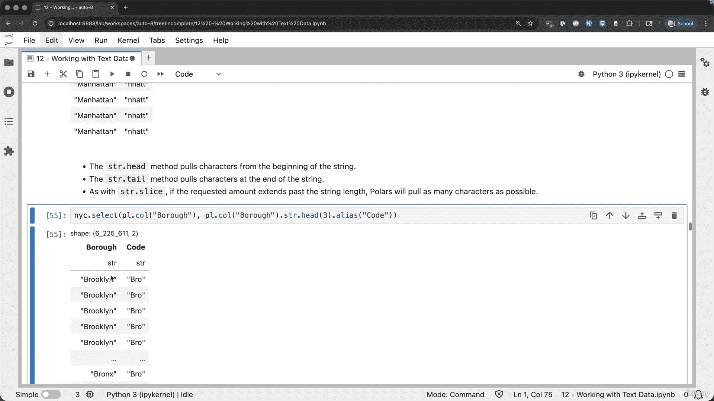

- `slice(start, length)`：从指定索引开始，取出指定数量的字符。
- `head(n)`：从字符串开头开始，取出 `n` 个字符。
- `tail(n)`：从字符串末尾开始，取出 `n` 个字符。

可以用下面的公式理解 `head` 和 `slice` 的关系。

\[
\text{str.head}(n) \approx \text{str.slice}(0, n)
\]

\[
\text{str.tail}(n) = \text{从字符串末尾取 } n \text{ 个字符}
\]

## 📝 Polars 与 Python 数据分析：第 50 节：本节总结

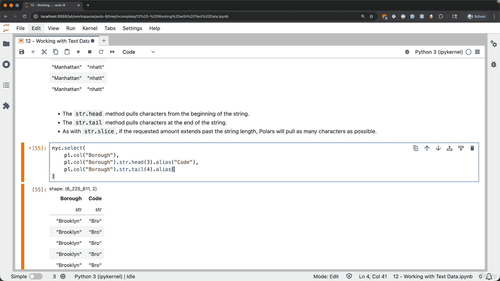

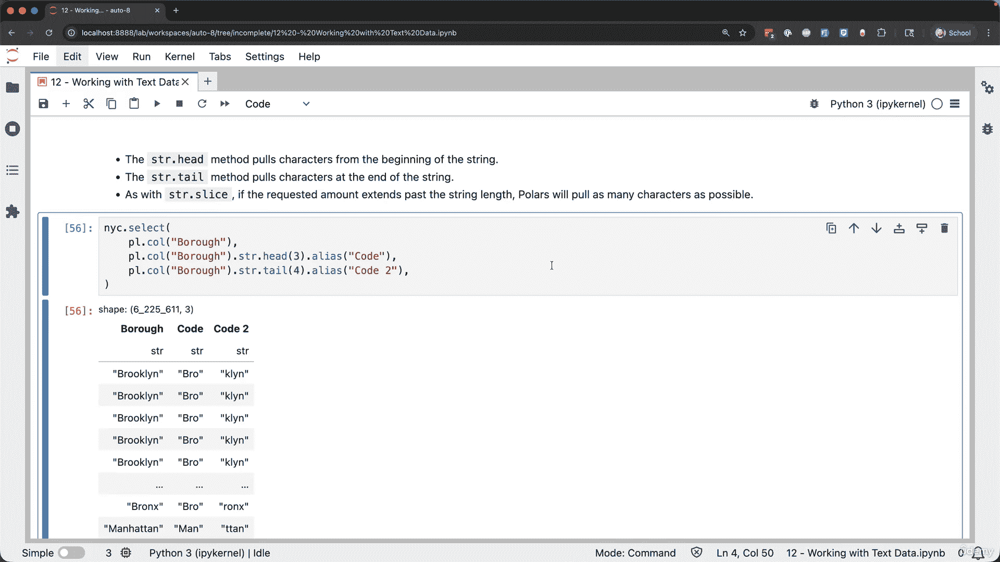

本节课中，我们一起学习了 Polars 中的字符串切片。先理解了字符串切片是从字符串中提取一部分字符，然后使用 `slice(start, length)` 从指定索引开始取出指定数量的字符，并明确了索引从 0 开始、第二个参数表示字符数量而不是结束索引。接着学习了从中间开始切片的方法，最后介绍了 `head(n)` 和 `tail(n)` 两个快捷方法，它们分别从字符串开头和结尾取出指定数量的字符。这些方法看起来简单，但在生成代码、提取前缀后缀和清洗文本数据时很常用。
