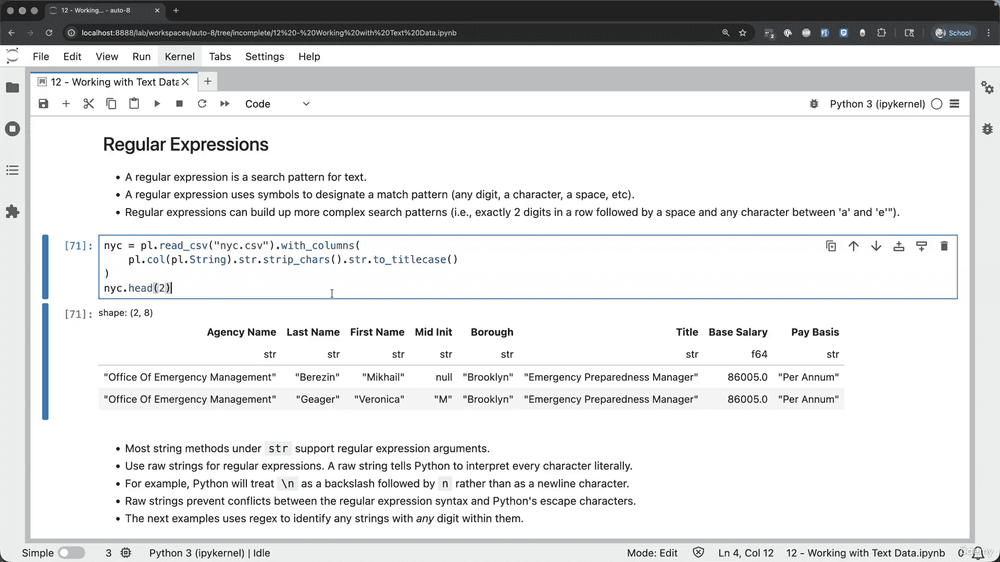
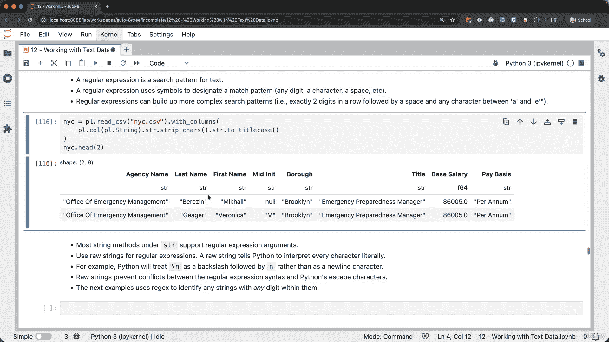
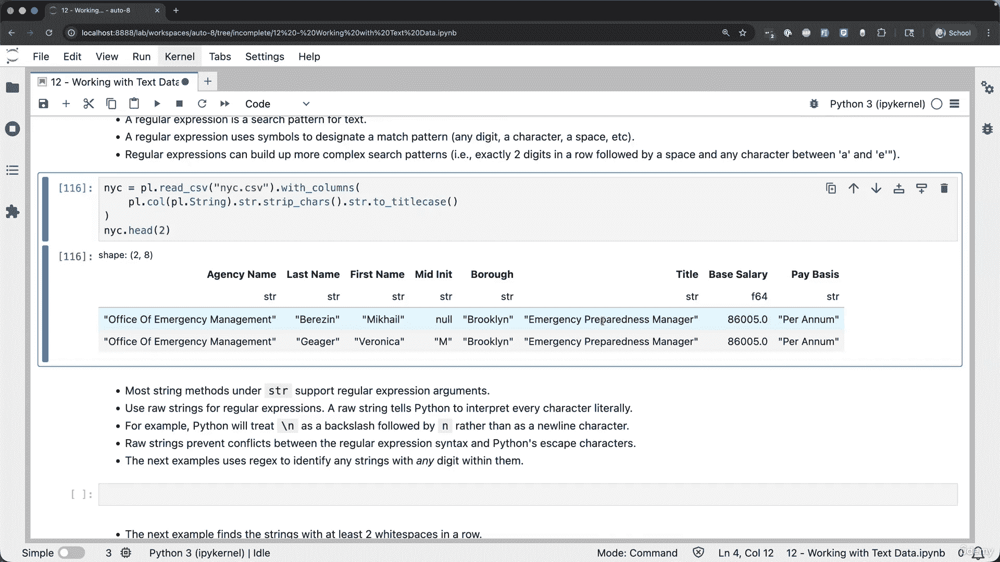
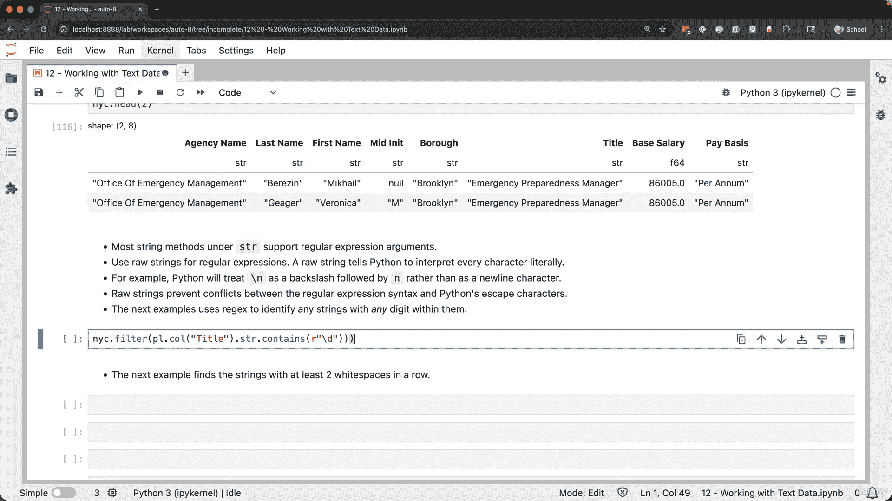
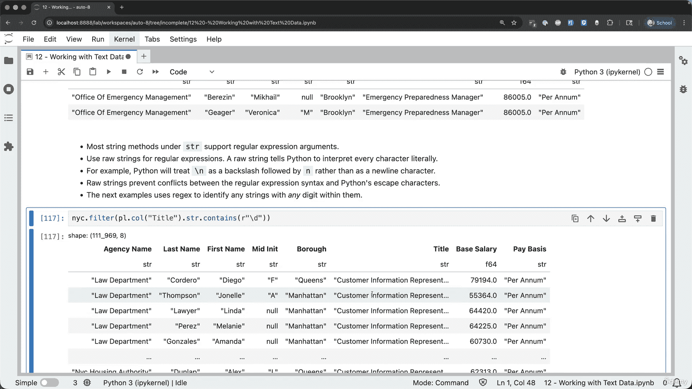
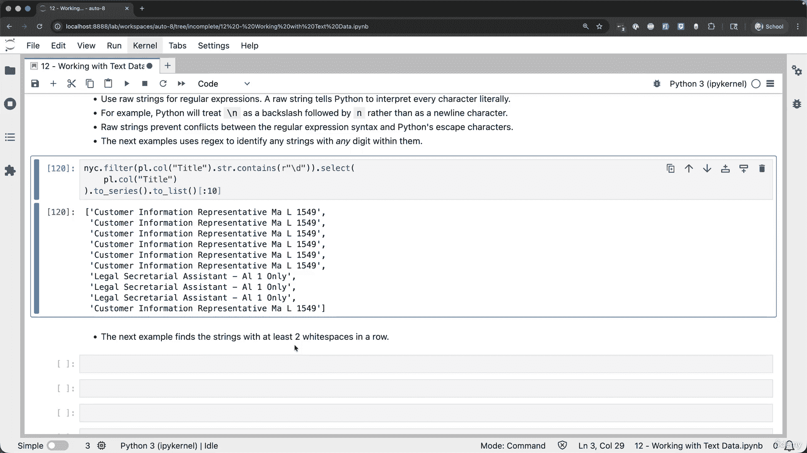
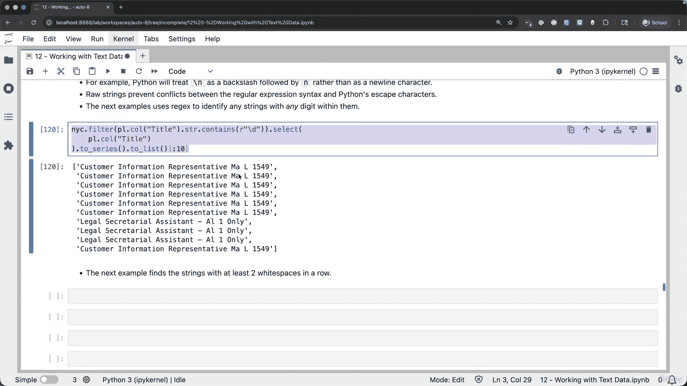
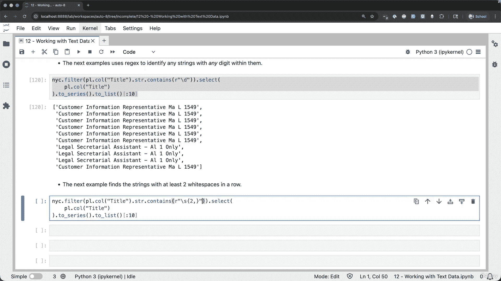
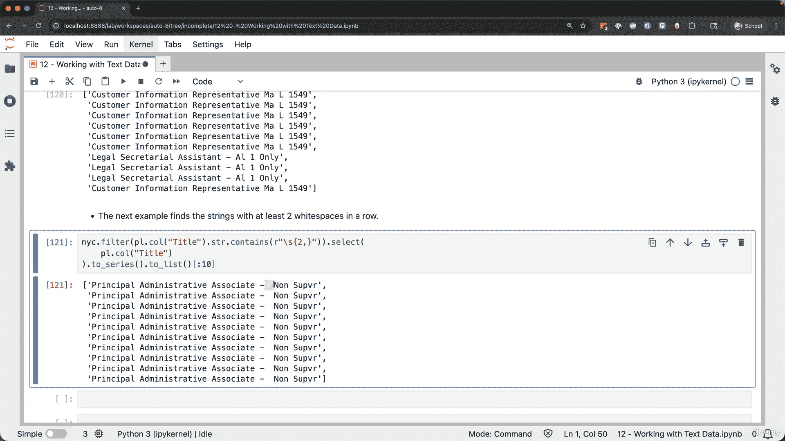

# 📊 Polars与Python数据分析：第52讲：正则表达式入门


在本节课中，我们将要学习Polars中正则表达式的基础知识。正则表达式可以理解成一种“文本搜索模板”，它用一组有特殊含义的符号来描述想找的内容。普通字符串搜索更像拿一句话去原文里对照，而正则表达式更像拿一张带通配符的模板去原文里套，因此能表达更复杂的搜索逻辑。下面先说明正则表达式是什么，再通过两个Polars筛选例子演示用法。

## 🧩 Polars与Python数据分析：第52讲：正则表达式是什么


上一节概述里，我们已经知道正则表达式是一张搜索模板。本节中，我们先把这张模板的概念说清楚。正则表达式本质上就是文本的搜索模式，我们使用一组符号组合来指定搜索模式。它的强大之处在于可以搜索比“连续一串字符”复杂得多的内容。像“以什么开头”“以什么结尾”“包含什么”，以及查找连续四个字母这类需求，用普通字符串方法还能应付；但如果要写更复杂的逻辑，例如查找连续两个数字、数字范围是1到9、后面紧跟一个空格、再后面是A到E之间的任意字符，就可以用正则表达式构建这种复杂搜索模式。

可以用公式把这种思路写出来：

```text
正则表达式 = 一组带有特殊含义的符号组合
复杂搜索模式 = 多个正则符号按规则拼接
```

正则表达式的内容很多，大学里甚至有成体系的课程专门讲它，相关符号也非常多。本节只介绍基础部分，并演示Polars完整支持Python中常见的正则表达式语法。理解概念后，下一步准备代码环境。

## 🛠️ Polars与Python数据分析：第52讲：准备导入与筛选思路




上一节我们说明了正则表达式是复杂搜索模板。本节中，我们看看如何把它放进Polars代码里。先像之前一样执行上一课准备好的导入代码。然后从一个简单例子开始：再次使用`filter`方法提取满足条件的行，目标仍然是`title`列，这次要取出`title`值中包含数字的行，也就是包含0到9中某个数字的行。





下面是这个例子的基本思路：

```python
import polars as pl

# 假设 df 是当前作业数据
result = df.filter(
    pl.col("title").str.contains(r"\d")
)
```

这段代码里，我们调用`filter`方法，创建一个针对`title`列的表达式，并使用之前介绍过的`str.contains`方法。`str.contains`里面传入的就是正则表达式。正则表达式由各种符号组成，每个符号代表一种搜索模式。例如数字在正则里的符号是`\d`，`\d`表示一个数字字符。代码环境准备好后，本节中我们来看看为什么写正则时推荐使用原始字符串。

## 🔤 Polars与Python数据分析：第52讲：用原始字符串写正则


上一节我们写了一个包含`r"\d"`的筛选表达式。本节中，我们解释这个`r`前缀的作用。处理正则表达式时，一个很重要的建议是使用Python的原始字符串。原始字符串会告诉Python非常字面地解释字符串内容。例如，普通字符串里的`\n`通常表示换行；但正则表达式里也会大量使用反斜杠、字符和点号等符号，这就可能让Python的转义语法和正则符号发生冲突。

在字符串前面加一个`r`，就会创建原始字符串，让Python把字符串里的内容都当作字面内容处理。这样Python看到`\n`时，不会把它理解成换行符，而是理解成反斜杠后面跟着字母`n`。这样可以避免Python把正则表达式符号误认为Python自己的语法结构。另一个例子是`\t`，在Python普通字符串里它表示制表符；我们不希望它在正则里被错误解释，因为`\t`在正则中可能有别的含义。任何时候创建要传给这类方法的正则表达式，都可以在字符串前加`r`，然后自由使用需要的正则符号。

使用原始字符串的要点如下：

- 在字符串前加`r`，例如`r"\d"`，让内容按字面解释。
- 避免`\n`被Python解释成换行，从而干扰正则匹配。
- 避免`\t`被Python解释成制表符，从而干扰正则匹配。
- 大多数Polars字符串方法都支持正则表达式，传入正则时优先使用原始字符串。

掌握原始字符串后，本节中我们回到最初目标：筛选`title`中包含数字的行。这里放入`\d`，它会匹配0到9中的任意数字，并且只要至少出现一次就算命中。可以用下面的公式理解：

```text
\d = 0 到 9 中的任意一个数字字符
str.contains(r"\d") = 标题中只要出现一个数字就保留该行
```

执行筛选后，由于Polars默认显示设置的限制，结果里虽然会出现看起来满足条件的行，但屏幕上不一定能直接看到数字。完成这个筛选后，下一节我们临时查看结果，证明数字确实被匹配到了。

## 📋 Polars与Python数据分析：第52讲：查看筛选结果


上一节完成了包含数字的筛选。本节中，我们临时查看一下结果，证明这些标题里确实有数字。下面这段代码不是教程中必须复制的代码，只是为了展示匹配确实生效。可以先调用`select`方法单独取出`title`列，此时得到一个单列DataFrame；再把它转换成Series对象，前面已经有一段时间没专门讲Series了；然后把Series转换成Python列表。不需要查看所有条目，只取列表前10个元素即可。

下面是临时查看前10个标题值的代码：

```python
titles = (
    df.filter(pl.col("title").str.contains(r"\d"))
      .select("title")
      .to_series()
      .to_list()
)

titles[:10]
```

执行后可以看到这一列的前10个值，这些职位标题都在某个位置包含数字。例如可以看到`154.9`，也可以看到数值`1`等。这个检查步骤说明筛选条件确实命中了数字。确认第一个例子有效后，下一节我们再看一个普通字符串很难表达的匹配：连续空白。

## ␣ Polars与Python数据分析：第52讲：用 \s{2,} 匹配连续空白






上一节我们验证了`\d`能筛出包含数字的标题。本节中，我们看看正则表达式更适合处理的复杂模式。例如想找出字符串中至少有两个连续空白的情况：有些行可能正好两个空白，有些行可能三个、四个甚至十个空白。用普通字符串把所有变化都写进搜索模式并不方便，因为组合太多；正则表达式可以直接表达“至少两个，更多也可以”的逻辑。

这个模式里有两个核心符号，下面分别说明：

- `\s`表示一个空白字符，直接写`\s`只匹配一个空白。
- `{2,}`表示前面的内容至少出现两次，也就是两个或更多。
- 组合成`\s{2,}`，就表示连续两个或更多空白字符。
- 从技术上说，这个数量可以一直增加到无穷，因此三个、四个、十个连续空白都能匹配。

对应代码可以写成：

```python
result = df.filter(
    pl.col("title").str.contains(r"\s{2,}")
)
```

这里复制前面的代码，只修改正则表达式本身，也就是搜索模式；仍然保留`r`来创建原始字符串。执行后会得到符合预期的结果，列表中的值都是至少包含两个连续空白的例子。如果存在超过两个连续空白的行，也会出现在这个过滤集合里。掌握连续空白示例后，下一节我们看看正则更常见的用途。





## ☎️ Polars与Python数据分析：第52讲：正则的常见用途


上一节我们用一个连续空白例子看到了正则的组合能力。本节中，我们看看它在实际文本提取中的常见方向。正则表达式相关的教材很多，本节没有时间深入讲解所有可能的符号，但可以组合出很多变化，用复杂搜索模式从一段文本中提取需要的信息。

下面是正则表达式常见的两类用途：

- 提取地址：地址文本往往有门牌号、街道名等组合模式，可以用正则描述。
- 提取电话号码：电话号码通常有稳定模式，例如三个数字、一个短横线、再三个数字，后面还可以继续按类似方式组合。



电话号码的模式可以用公式表示为：

```text
\d{3}-\d{3}-\d{4}
```

这个公式只是示意，实际电话格式要按数据调整。核心思路是用正则表达式定义搜索逻辑，再去原始字符串中查询这种复杂模式。希望这些例子能说明正则表达式的价值，也能看到它可以和Polars中各种字符串操作配合使用。上一节我们看了几个示例和用途，下一节对整节课做总结。

## ✅ Polars与Python数据分析：第52讲：总结


本节中，我们对整节课做总结。本节课中我们一起学习了Polars中正则表达式的基础用法：正则表达式是文本搜索模式，用符号组合描述复杂匹配；Polars支持Python中常见的正则语法；使用`str.contains`时可以传入正则表达式；写正则时推荐使用原始字符串`r"..."`，避免Python转义和正则符号冲突；`\d`可以匹配任意一个数字字符，`\s{2,}`可以匹配连续两个或更多空白字符；执行筛选后，由于Polars默认显示设置，结果中不一定直接看到数字，可以临时把标题列转换成列表并切片查看前10个值来验证；正则还可以用于地址、电话号码等复杂模式提取，并能和Polars的各种字符串操作配合使用。

下面是本节课的要点回顾：



- 正则表达式是一种复杂文本搜索模式。
- `\d`表示0到9中的任意一个数字字符。
- `\s`表示一个空白字符，`{2,}`表示至少两个。
- `r"\d"`和`r"\s{2,}"`是原始字符串写法。
- `str.contains`可以接收正则表达式进行筛选。
- 正则表达式可以和Polars的字符串操作一起使用。

