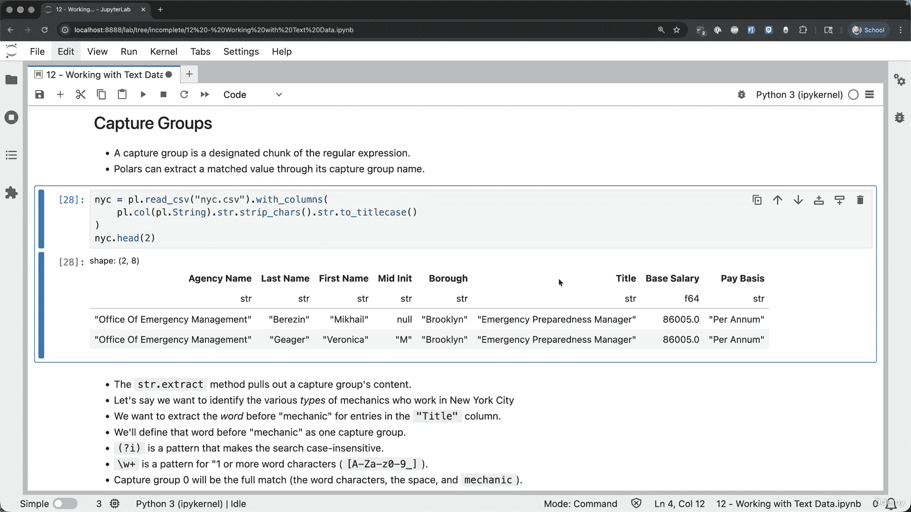
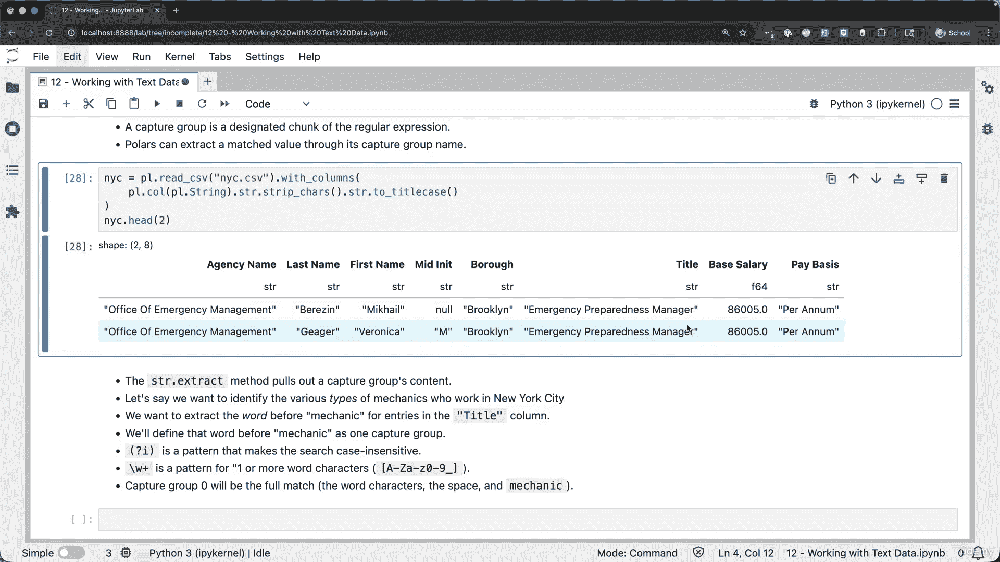
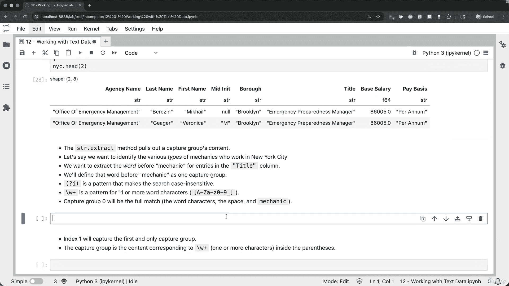
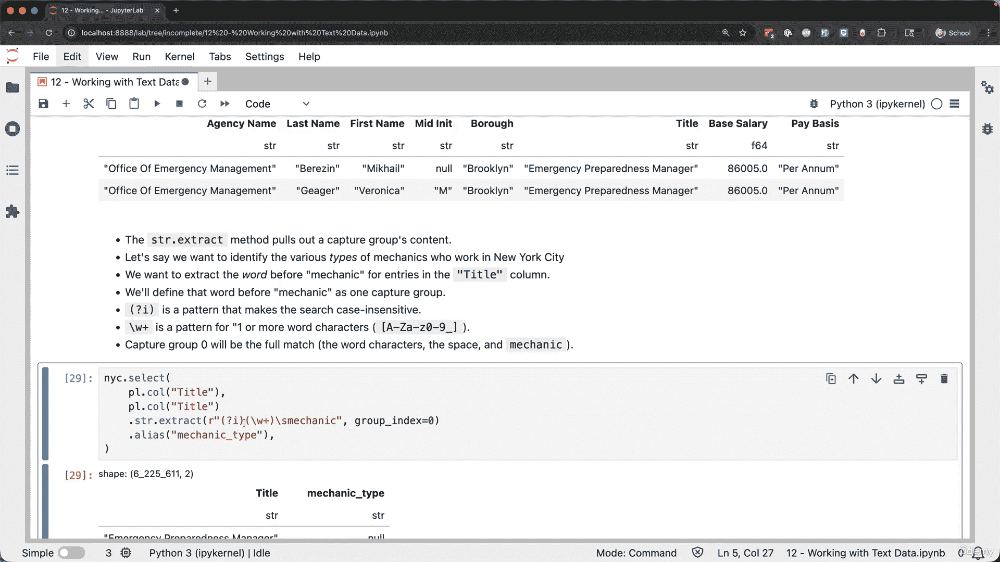
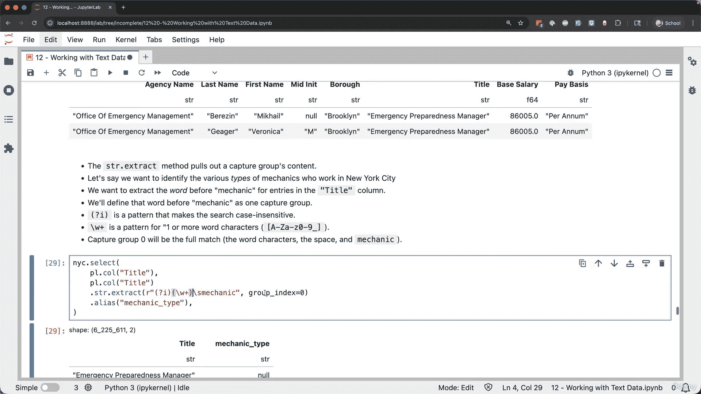
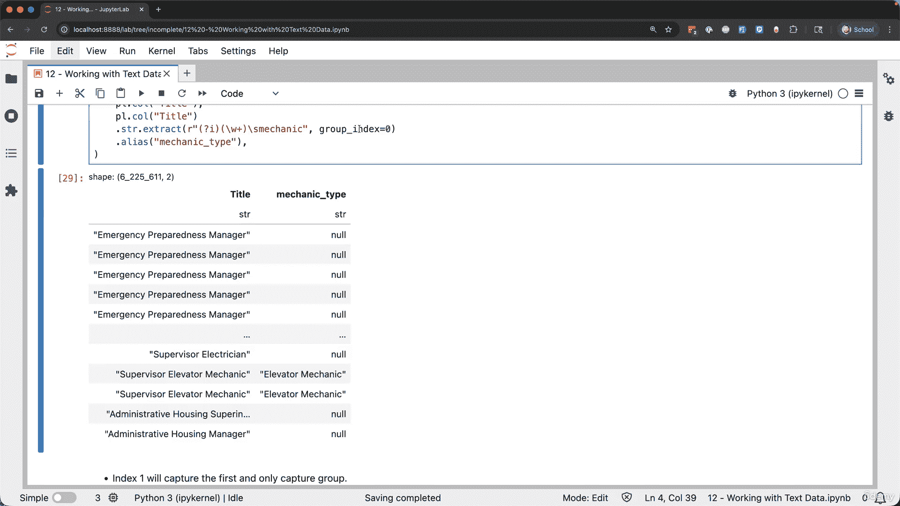
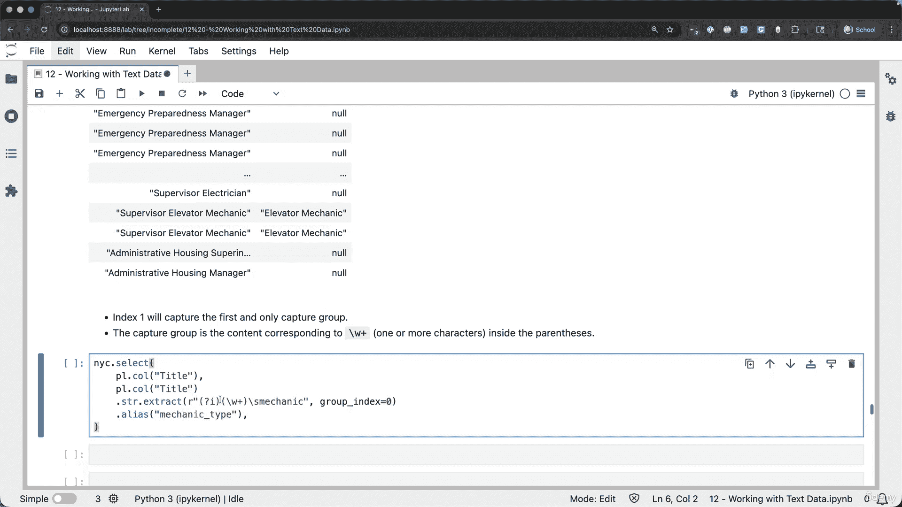
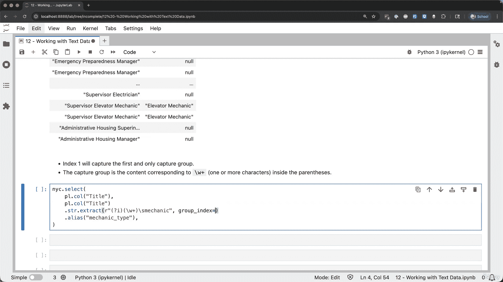
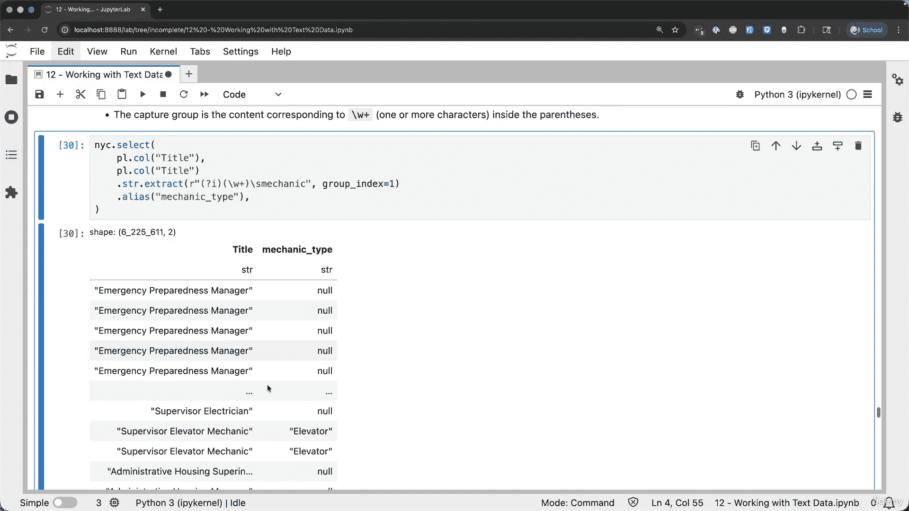
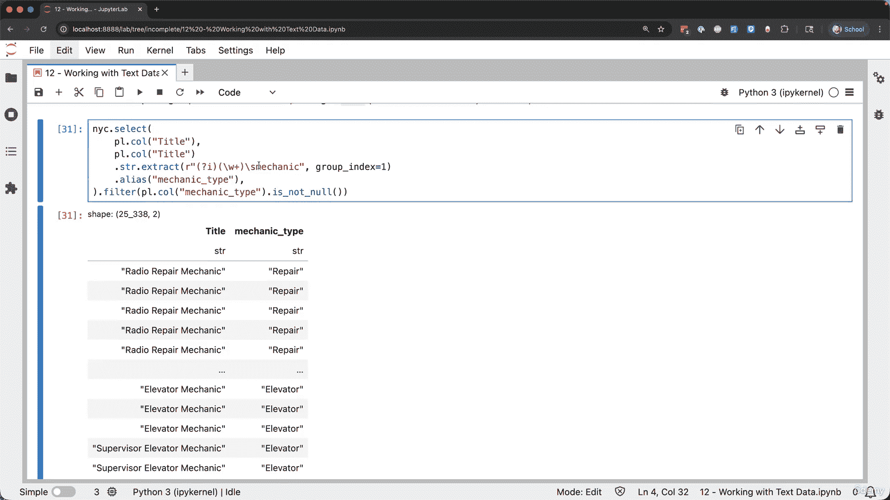

## 🧩 Udemy Polars与Python数据分析：第53节：捕获组

### 📌 Udemy Polars与Python数据分析：第53节：本课概述



在本节课中，我们将要学习Polars里的捕获组，也就是capture groups。上一节课我们介绍了正则表达式的基本思想，本节会在这个基础上继续扩展，看看怎样用捕获组把一段更长的搜索模式中真正想要的部分单独拿出来。我们会从一个纽约市职位标题的例子出发，先构造正则表达式，再用`str.extract`和`group_index`把`mechanic`前面的词抽出来，最后说明Polars底层使用Rust正则实现这个细节。下面按步骤展开，尽量用大白话把每个环节讲清楚，让初学者也能跟上。

### 🧭 Udemy Polars与Python数据分析：第53节：捕获组是什么





上一节我们认识了正则表达式的基本用法，本节我们来看看捕获组到底是什么。捕获组是更大的正则表达式搜索模式中被专门指定出来的一块内容或一部分模式。捕获组的作用，是让我们能够隔离并聚焦搜索模式中的某一部分，从而把由捕获组指定或标识出来的那一段内容单独提取出来。声明捕获组的方式很直接：对于搜索模式中的任意一部分，只要用一对圆括号把它包起来，Polars和正则表达式库就能够从更大的模式中只提取出这一部分。

下面列出捕获组最核心的几个要点，方便先建立整体印象。

- 捕获组是搜索模式中一个被指定出来的小块内容。  
- 捕获组可以隔离并聚焦模式的一部分。  
- 声明方式是用圆括号包住想提取的那部分模式。  
- Polars和正则表达式库可以只提取括号对应的那一部分。  

理解了这些要点之后，下一节我们用一个实际例子看看捕获组为什么有用。

### 🏙️ Udemy Polars与Python数据分析：第53节：从职位标题中提取mechanic前面的词

前面我们知道了捕获组的定义，本节我们来看看它在真实数据里的用途。先执行导入代码，数据里有一个`title`列，这个列中包含纽约市各种不同的职位。可以假设纽约市有很多种机械师岗位，这些岗位的职位标题都会包含`mechanic`这个词，而且`mechanic`前面还会出现另一个词，例如`elevator mechanic`或者`technical mechanic`。现在的目标是：把`mechanic`前面的那个词抽出来。为了做到这一点，需要以`mechanic`为基础构造一个搜索模式，这个模式能够定位类似`elevator mechanic`这样的内容，但最终只想要`mechanic`前面的词。下面就以NYC数据为例，把这个逻辑一步步搭起来。

### 🛠️ Udemy Polars与Python数据分析：第53节：用str.extract构造搜索模式

上一节我们明确了要抽取`mechanic`前面的词，本节我们来看看在Polars里怎样写这个提取逻辑。下面以NYC数据为例，调用`select`方法。第一个表达式目标仍然是`title`列，因为要保留原始职位标题，方便观察提取结果是怎么工作的。第二个表达式也目标`title`列，这里使用`str`命名空间里的一个新方法`extract`。这个方法叫`extract`，因为它允许我们把正则表达式搜索模式中的一部分拉出来，这部分由捕获组指定。使用`extract`时需要传入一个正则表达式，所以会创建一个以字母`r`开头的原始字符串，后面接普通的双引号字符串。

这里顺带解决一个之前提过的大小写敏感问题。如果`mechanic`写成大写`M`，或者中间某个字母随机大写，就会出现匹配问题。一种办法是先把数据规范化，另一种办法是设计一个不关心字母大小写的正则表达式搜索模式。实现方式是用一个特殊语法：先写一对圆括号，里面写问号和字母`i`，也就是`(?i)`。这里的`i`可以理解为insensitive的缩写，表示后面所有内容都忽略大小写。例如写一个字母`M`，它会同时匹配小写`m`和大写`M`。

接下来构造真正的搜索模式。想要的内容是：若干个英文字母组成的词，长度不限，因为`mechanic`前面的词可能是3个字母、5个字母或者12个字母，但它一定是英文字母的组合；然后是一个空格；最后是`mechanic`这个词。首先，为了表示任意数量的英文字母字符，写`\w`。`\w`表示一个单词字符，包括a到z，也技术上包括数字0到9和下划线，但它只匹配一个单词字符。后面加一个加号`+`，表示前面这个模式出现一次或多次。所以`\w+`表示一行中一个或多个单词字符，不管是一个、五个还是十个，都能匹配，这正好可以匹配`mechanic`前面的词。之后要指定一个空格，可以用`\s`表示。最后写上硬编码的单词`mechanic`。因为前面已经用`(?i)`解决了大小写问题，所以不用纠结`mechanic`具体写成什么大小写，只要这些字符出现就能匹配。

核心模式可以写成下面这样。

```text
(?i)(\w+)\smechanic
```

这个模式可以工作，但它会把完整的职位标题拉出来，包括前面的词、空格和`mechanic`。现在想放大并聚焦前面这一部分，因为真正想捕获的是`mechanic`前面的那个词。做法是在正则表达式中让Polars和正则表达式库把这一部分识别为捕获组，也就是更大搜索模式中一个独立的部分。具体做法就是用一对圆括号把`\w+`包起来，这样就创建了一个捕获组。这样Polars就会跟踪这个捕获组，并且能够把它单独拉出来。

### 🔢 Udemy Polars与Python数据分析：第53节：group_index与完整匹配

上一节我们把`\w+`包成了捕获组，本节我们来看看`group_index`怎样控制提取结果。为了把内容拉出来，需要给`extract`提供一个额外参数`group_index`。先把它设为0，并把新列命名为`mechanic_type`。`group_index=0`的作用是拉出完整正则匹配，也就是整个`词 + 空格 + mechanic`，而不是只拿`mechanic`前面的词。下面先看这个效果，稍后解释索引规则。对于没有`mechanic`这个词的行，因为没有匹配，结果会是`null`。对于类似`elevator mechanic`的内容，会得到完整正则匹配，也就是一个词、一个空格、再跟`mechanic`。

`group_index=0`总是表示完整匹配。之后每定义一个捕获组，就会从下一个索引开始取。第一个捕获组对应`group_index=1`。如果定义第二个捕获组，例如想捕获`mechanic`后面的内容，那就是第二个捕获组，对应`group_index=2`。总结一下：`group_index=0`取完整正则匹配，`group_index=1`、`group_index=2`等依次对应定义的捕获组。

下面用引用块记住这个规则，方便以后快速回忆。

> 记忆规则：`group_index=0`取完整匹配，`group_index=1`取第一个括号里的捕获组，`group_index=2`取第二个括号里的捕获组，依次往后。

理解了索引规则之后，下一节我们就把`group_index`改成1，真正抽出想要的词。







### 🎯 Udemy Polars与Python数据分析：第53节：用group_index=1提取捕获组





前面看了`group_index=0`会拿到完整匹配，本节我们来看看怎样只拿第一个捕获组。下面复制前面的代码并粘贴，然后把`group_index`改成1。因为这里只有一个写在圆括号里的捕获组，所以`group_index=1`就能提取出想要的内容。结果中会看到所有不匹配的行仍然存在，而在匹配的位置，确实抽出了`mechanic`前面的词。例如这里会拉出`elevator`，因为它正是`mechanic`前面的词。这样做是因为要求正则表达式聚焦在圆括号指定的捕获组上，并通过`group_index=1`在结果集合中定位这个捕获组。这个捕获组的逻辑就是一行中一个或多个单词字符，也就是`\w+`。

示例代码可以写成下面这样。



```python
nyc.select(
    pl.col("title"),
    pl.col("title")
      .str.extract(r"(?i)(\w+)\smechanic", group_index=1)
      .alias("mechanic_type")
)
```

如果只想保留真正抽出来的词，不想看到那些`null`，可以加一个快速过滤操作。目标是`mechanic_type`列，使用`is_not_null`方法过滤，只留下非空行。过滤后可以看到，例如`repair`是六个字母，被完整抽出来了；`elevator`是八个字母，也被抽出来了。不管前面的词是两个字母、五个字母还是十二个字母，这个正则都能动态匹配。

过滤代码可以写成下面这样。

```python
nyc.select(
    pl.col("title"),
    pl.col("title")
      .str.extract(r"(?i)(\w+)\smechanic", group_index=1)
      .alias("mechanic_type")
).filter(
    pl.col("mechanic_type").is_not_null()
)
```

### 📚 Udemy Polars与Python数据分析：第53节：学习重点与Rust正则实现差异

上一节已经完成了提取和过滤，本节我们来看看这节课真正要掌握的重点，以及一个容易忽略的实现细节。这个正则语法不仅看起来复杂，而且学习起来需要不少时间。本节的目标不是让你背下所有符号，因为这种写法本身很复杂，也高度依赖你想抽取什么内容。更希望你能看到正则表达式的价值：它可以被用来构建更复杂的搜索模式，从而用动态查询从字符串中抽出特定部分，也可以进一步用捕获组缩小范围，隔离出搜索模式中的某一块或某个子集，最后只取出那一块内容。

下面列出本节希望掌握的几个学习重点，方便复习时抓住主线。

- 捕获组可以把大模式中的一部分单独标记出来。  
- `\w+`表示一个或多个单词字符，用来匹配`mechanic`前面的词。  
- `\s`表示空白字符，这里用来匹配空格。  
- `(?i)`表示后面的匹配忽略大小写。  
- `group_index=0`取完整匹配，`group_index=1`取第一个捕获组。  
- 可以用`is_not_null`过滤掉没有匹配到的空值。  

最后补充一个容易漏掉的细节。Polars底层建立在Rust之上，Rust是和Python不同的编程语言。Rust和Python都支持正则表达式，但它们各自使用不同的代码实现自己的正则表达式搜索模式。因为Polars底层依赖Rust，所以构造搜索模式时使用的模式和符号，实际上来自Rust实现，而不是Python实现。换句话说，如果去查Python的正则表达式文档并看到一些符号，它们可能和Rust实现中的符号存在差异。有些地方比较相似，例如`\s`始终表示空白，`\d`表示数字，这些比较统一；但其他一些情况可能会有差别。如果去看Polars文档，它可能会链接到Rust的定义，那个定义才是查找字符或符号含义的可靠来源，因为底层运行的是Rust引擎，需要按照Rust的预期来写这些符号和字符，而不是按照Python的预期来写。

### ✅ Udemy Polars与Python数据分析：第53节：总结



本节课中我们一起学习了捕获组的定义、声明方式、在Polars中的使用、`group_index`的含义、过滤空值的方法，以及Polars底层使用Rust正则实现这一细节。我们从纽约市职位标题的例子出发，构造了`(?i)(\w+)\smechanic`这个模式，用圆括号把`\w+`声明为捕获组，再用`str.extract`和`group_index=1`把`mechanic`前面的词抽出来，最后用`is_not_null`过滤掉没有匹配的行。希望这些内容能帮助你理解正则表达式和捕获组的好处，下一节课再见。

