# Udemy - 使用 Polars 和 Python 进行数据分析（第2部分）：第54讲-第154节：🧹 替换值

在本节课中，我们将学习如何在 Polars 中替换一个或多个子串。替换操作就是把文本中指定的子串出现位置换成另一个字符串，它和现代文本编辑器或文字处理软件里的“查找并替换”是一回事。完整流程是：先指定要搜索的子串，再指定要替换成什么；然后执行导入代码，准备好 NYC 数据框；接着比较 `replace` 和 `replace_all` 两个方法；最后用正则表达式处理大小写不敏感的搜索。为了便于初学者理解，下面会从概念、代码和结果三个角度展开，并尽量用直白的话说明每一步在做什么。

## 1. 替换值的基本思路

上一节概述了完整流程，本节先建立基本概念。Polars 把字符串处理方法放在 `str` 命名空间下，可以把 `str` 理解成字符串专用工具箱，`replace`、`replace_all` 都在这个工具箱里。实际使用时，我们先执行导入代码，准备好 `nyc` 这个 NYC 数据框，后面所有示例都基于它。目标列是 `agency_name`，该列中存在 `office of` 这样的子串，我们想把它替换成 `department of`。

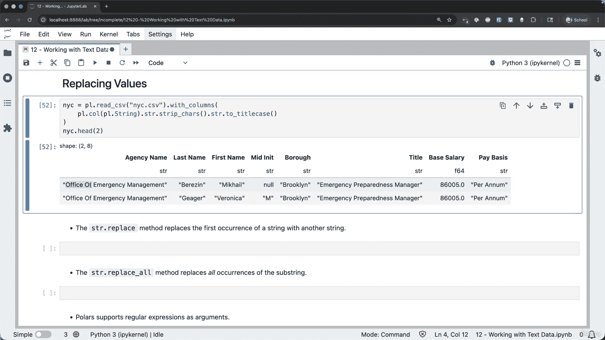

下面先列出本教程反复用到的几个核心概念，方便后面看代码时对照：

- 搜索模式：要被找出来的子串，也可以写成正则表达式。

- 替换文本：找到匹配后要放进去的新字符串。

- 单次替换：`str.replace(搜索模式, 替换文本)` 只替换第一个匹配。

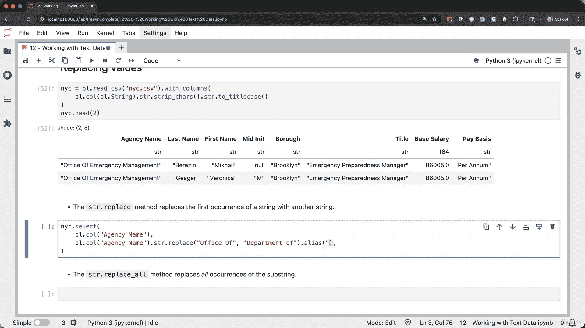

- 全部替换：`str.replace_all(搜索模式, 替换文本)` 替换所有匹配。

- 大小写不敏感正则：`r"(?i)搜索内容"` 中的 `(?i)` 表示后续匹配不区分大小写。

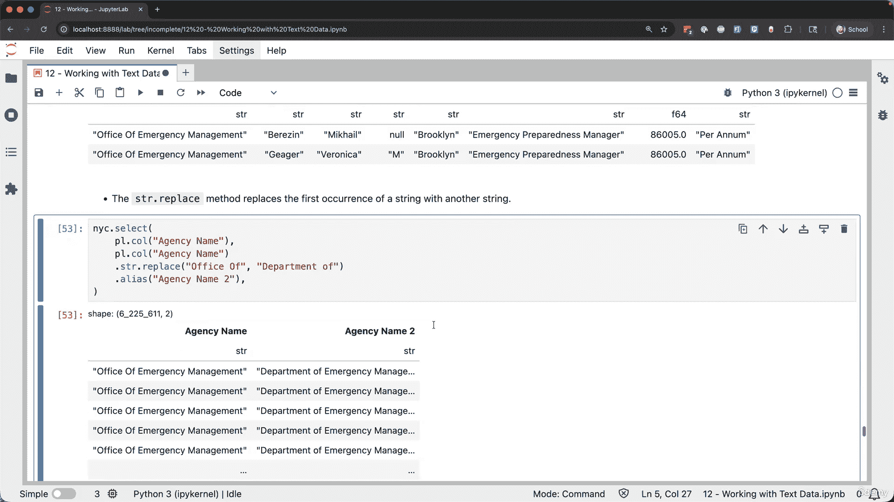

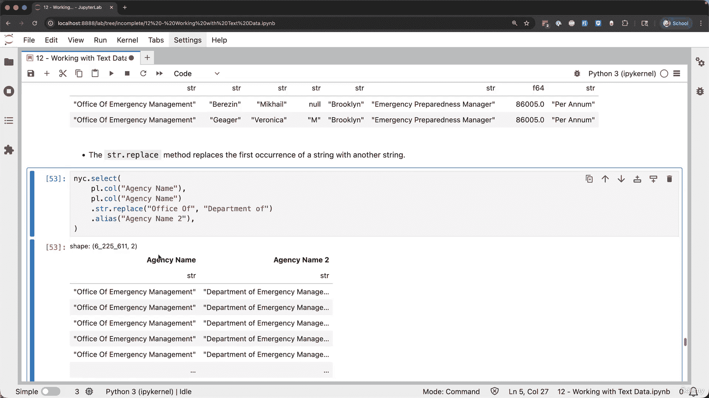

有了这几个概念，我们进入实际代码，先看只替换第一个匹配的方法。

## 2. 用 replace 替换第一个匹配

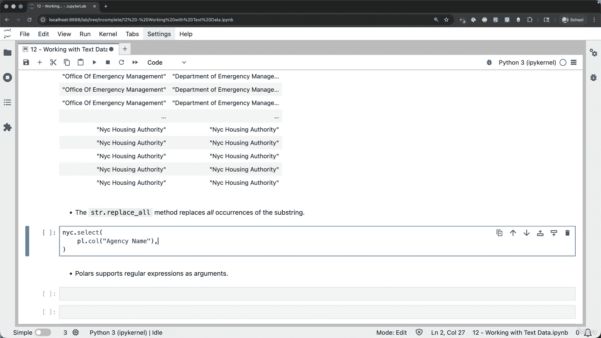

上一节我们列出了核心概念，本节中我们来看看 `str.replace` 的用法。这个方法只替换第一个出现的子串，后面的同名子串不会继续替换。为了同时看到替换前后的效果，可以在 `select` 中先取原列，再用一个独立表达式取同一列并执行替换。`replace` 的第一个参数是要搜索的内容，第二个参数是要替换成的内容。我们搜索 `office of`，替换为 `department of`，并且让搜索时的大小写与原文一致，这样更容易看清替换带来的影响。第二个表达式生成的列必须改一个名字，否则会和上面的原列冲突，这里命名为 `agency_name2`。

```python
nyc.select(
    pl.col("agency_name"),
    pl.col("agency_name")
      .str.replace("office of", "department of")
      .alias("agency_name2")
)
```

运行后可以看到，Polars 第一次遇到 `office of` 时，会把它替换成 `department of`。这个第一次匹配无论出现在字符串开头，还是出现在字符串中间，都会被替换；但只有第一次出现的匹配会被替换，后面的匹配保持原样。这就是 `replace` 与全部替换方法的区别。下面我们看看与它互补的 `replace_all` 方法。

## 3. 用 replace_all 替换全部匹配

上一节看到 `replace` 只处理第一个匹配，本节中我们来看看 `replace_all` 如何替换所有出现的位置。`replace_all` 是 `replace` 的互补方法，它会将某个子串的所有出现都替换成另一个字符串。为了把两个方法放在一起比较，这里故意做一个看起来有点傻的示例：从 NYC 数据框开始，调用 `select`，针对 `agency_name` 列，搜索连续出现的 `OF`，并把它替换成 `!!`，这样在结果里很容易用眼睛识别。我们把只替换一次的结果列命名为 `replace`，把全部替换的结果列命名为 `replace_all`。具体做法是把同一段表达式复制到下一行，只把方法从 `replace` 换成 `replace_all`，并改掉列名。

```python
nyc.select(
    pl.col("agency_name").str.replace("OF", "!!").alias("replace"),
    pl.col("agency_name").str.replace_all("OF", "!!").alias("replace_all")
)
```

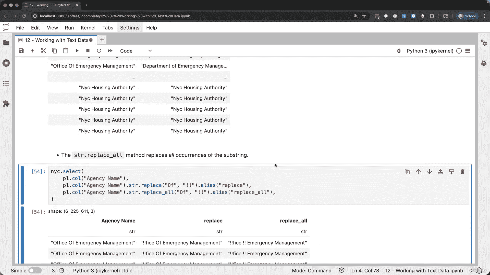

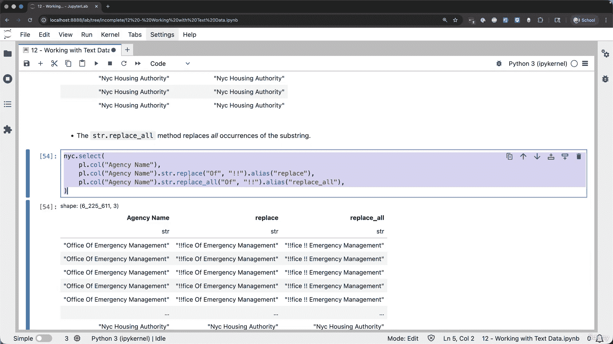

运行后可以并排看到差异。举例来说，`OF` 既可能出现在 `office` 里面，也可能出现在同一字符串的另一个位置。`replace` 只替换第一个匹配，所以第一个 `OF` 变成 `!!`，后面的 `OF` 不变；`replace_all` 则会替换每一个出现位置，每次遇到 `OF` 都会换成 `!!`。通过这个对比，`replace` 和 `replace_all` 的边界就很清楚。除了普通字符串，这两个方法还可以接收正则表达式，下一节我们看看怎样用正则控制大小写。

## 4. 用正则表达式控制大小写

上一节用普通字符串做了并排比较，本节中我们来看看正则表达式的用法。除了直接传普通字符串，`replace` 和 `replace_all` 的参数也可以传正则表达式，这让搜索模式更灵活。下面的例子想替换字母 `E` 和 `M` 连在一起的所有出现。列里可能同时存在大写和小写的组合，例如一个位置是 `EM`，另一个位置是 `em` 或 `Em`，大小写并不统一。正则表达式可以很方便地控制这一点：我们保留替换文本 `!!`，把搜索内容从硬编码字符串改成正则。写法是使用 `r` 前缀的原始字符串，再在开头加上 `(?i)`，它表示后续匹配不区分大小写。

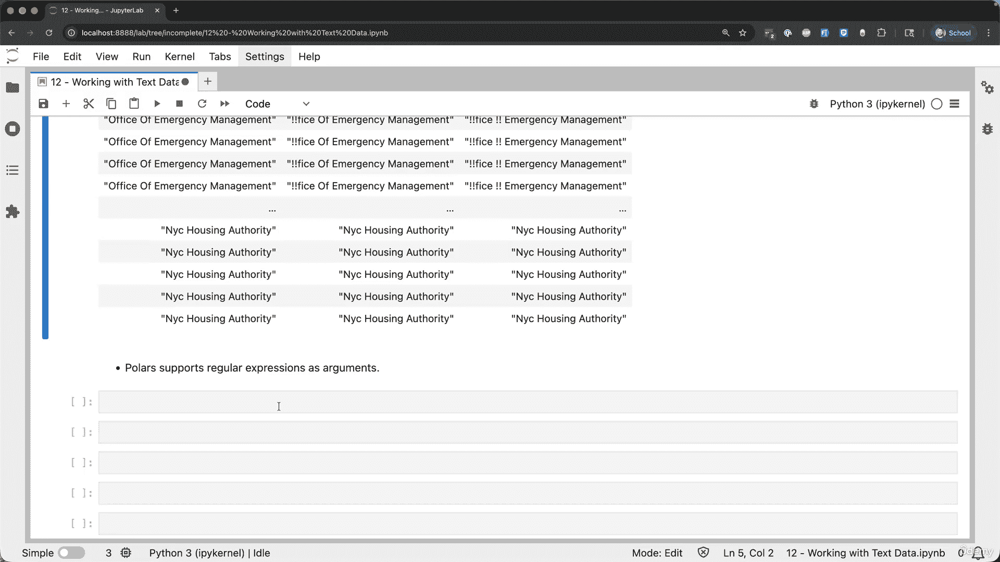

```python
pattern = r"(?i)em"

nyc.select(
    pl.col("agency_name").str.replace(pattern, "!!").alias("replace"),
    pl.col("agency_name").str.replace_all(pattern, "!!").alias("replace_all")
)
```

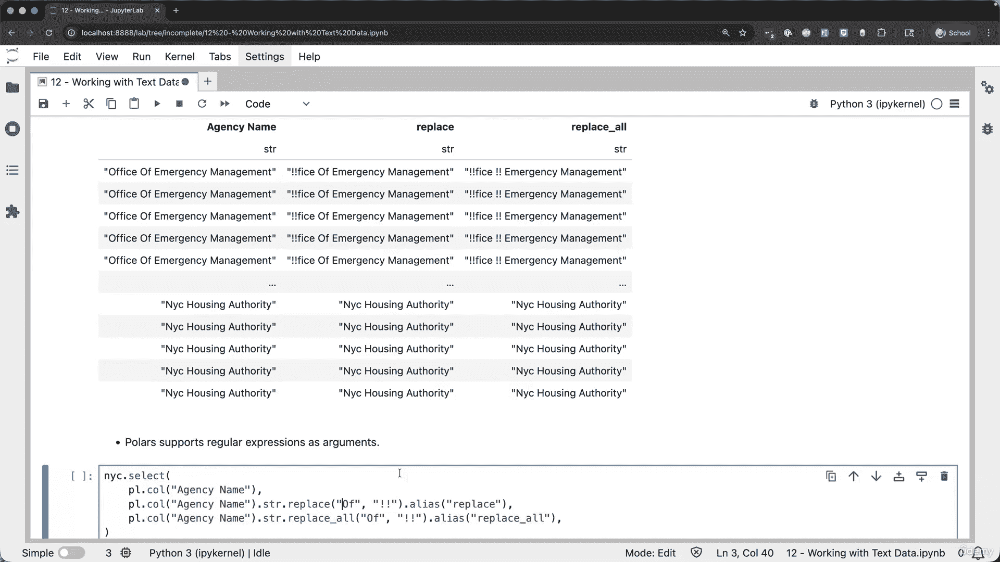

这里的 `(?i)` 会让 Polars 在匹配时忽略字符大小写，`em` 会按顺序匹配 `E` 和 `M` 的任意大小写组合，因此 `EM`、`em`、`Em`、`eM` 都能被找到并替换成 `!!`。`replace` 仍然只替换第一个匹配，即使这个匹配来自正则表达式，所以第一个匹配会被换成 `!!`，后面的匹配保持不变；例如第一个匹配可能是大写 `E` 加小写 `M`，它会被替换，而后面的 `EM` 保持不动。`replace_all` 则会找到正则模式的两次出现，并考虑大小写不敏感规则，把两次都替换掉；其中原本全小写的那次也会被替换。这个例子展示了正则表达式的强大之处：它能构造更动态、更自定义、更灵活的搜索模式。你也可以在 `str` 命名空间下的 `replace`、`replace_all` 以及其他多种方法中使用正则表达式。

## 5. 总结

前面我们分步骤学习了替换值的基本流程，本节最后做一个小结。本节课中我们一起学习了 Polars 中替换字符串值的方法：查找替换的含义、`replace` 只替换第一个匹配、`replace_all` 替换全部匹配，以及用正则表达式实现大小写不敏感搜索。整个过程从准备 NYC 数据框开始，围绕 `agency_name` 列演示了普通字符串和正则表达式两种搜索方式，并通过并排输出观察替换前后的差异。

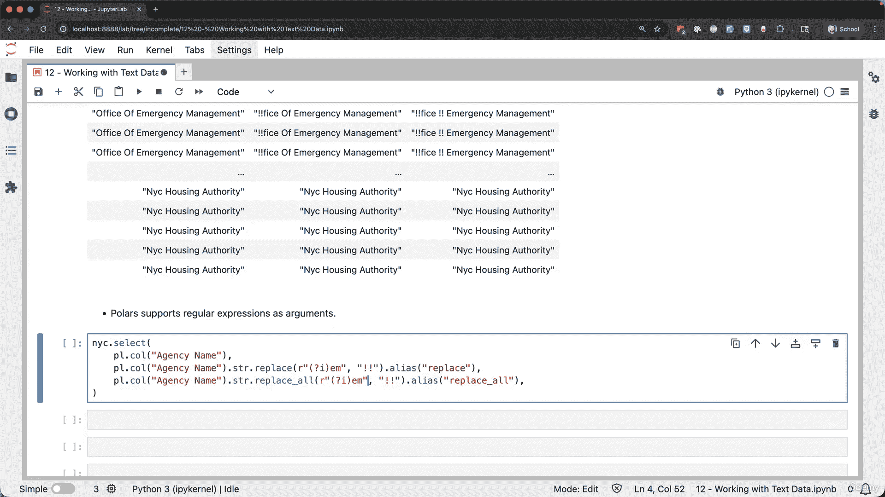

最后把本节要点归纳如下，方便复习时快速对照：

- `str.replace(...)` 的公式是 `str.replace(搜索模式, 替换文本)`，它只替换第一个匹配。

- `str.replace_all(...)` 的公式是 `str.replace_all(搜索模式, 替换文本)`，它替换所有匹配。

- 大小写不敏感正则的公式是 `r"(?i)模式"`，其中 `(?i)` 控制后续字符不区分大小写。

- 正则表达式可以用于 `replace`、`replace_all` 以及 `str` 命名空间下的其他多种方法。

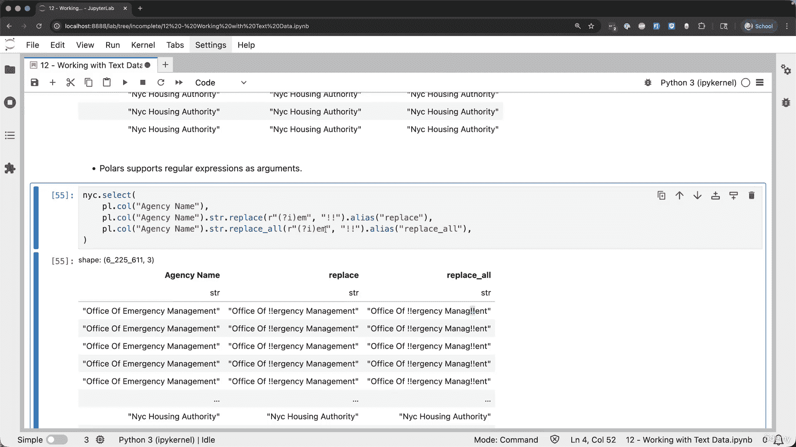

这些内容构成了本节替换值的完整用法，掌握后就可以在 Polars 中按需选择单次替换、全部替换或正则替换。

