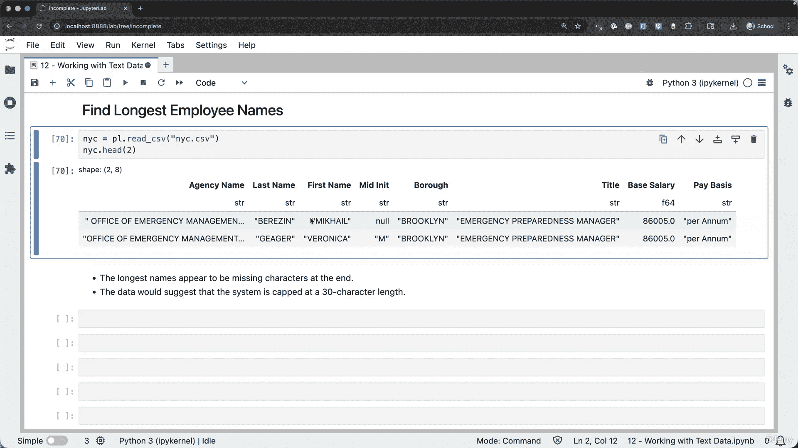
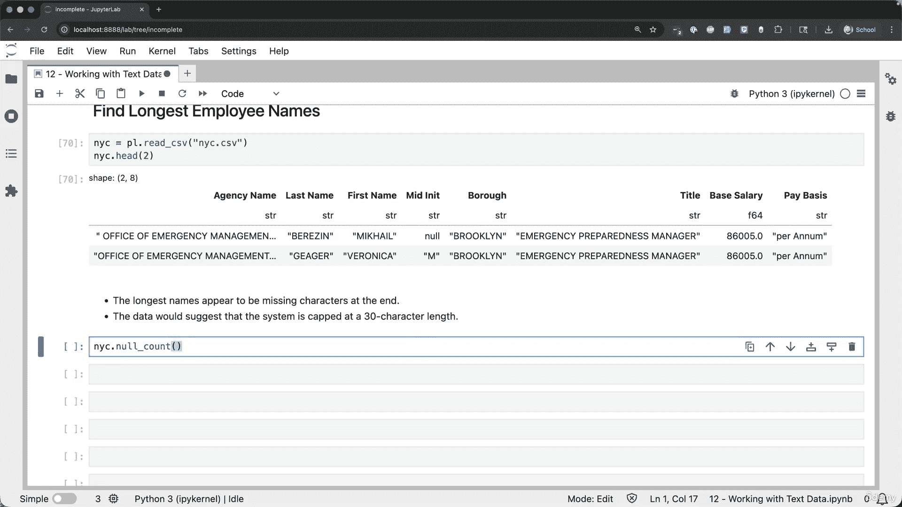
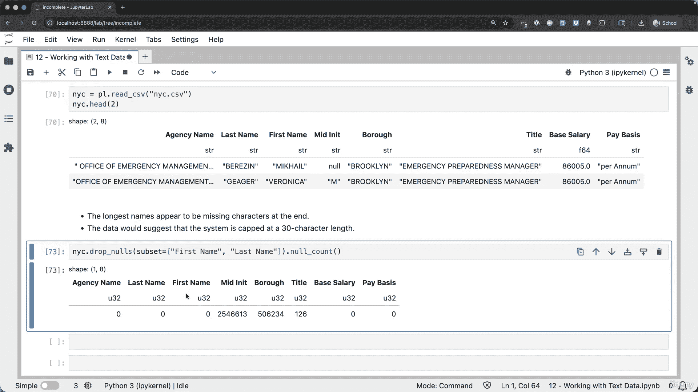
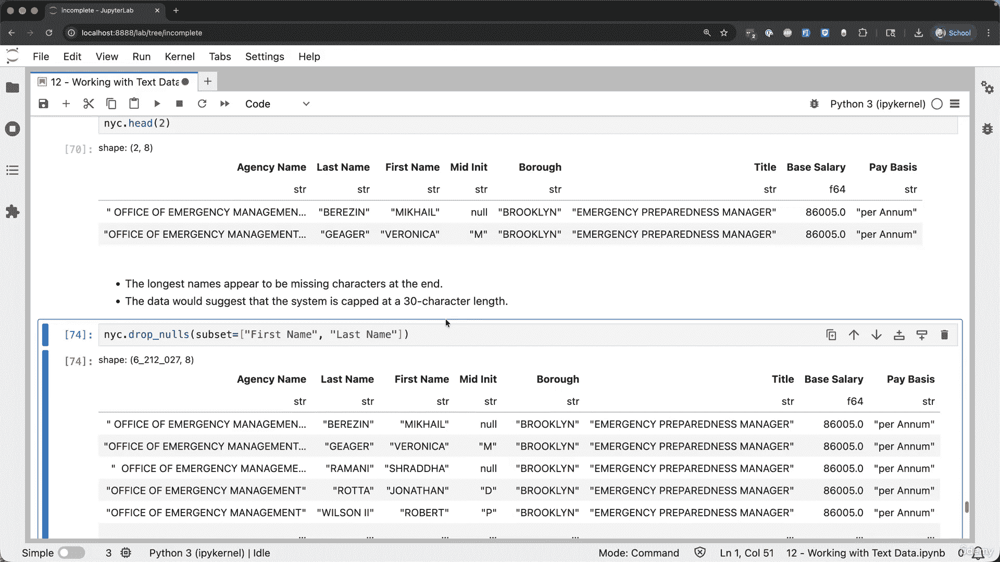
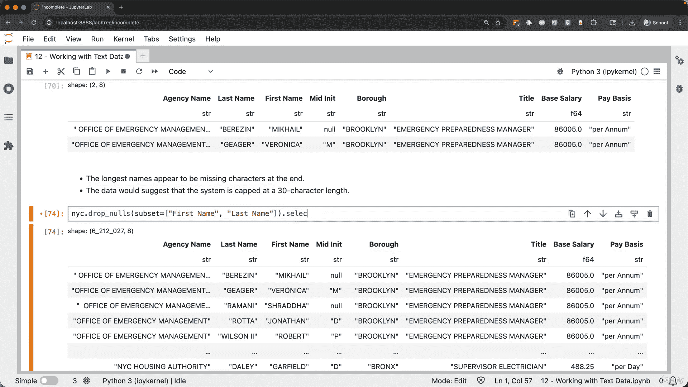
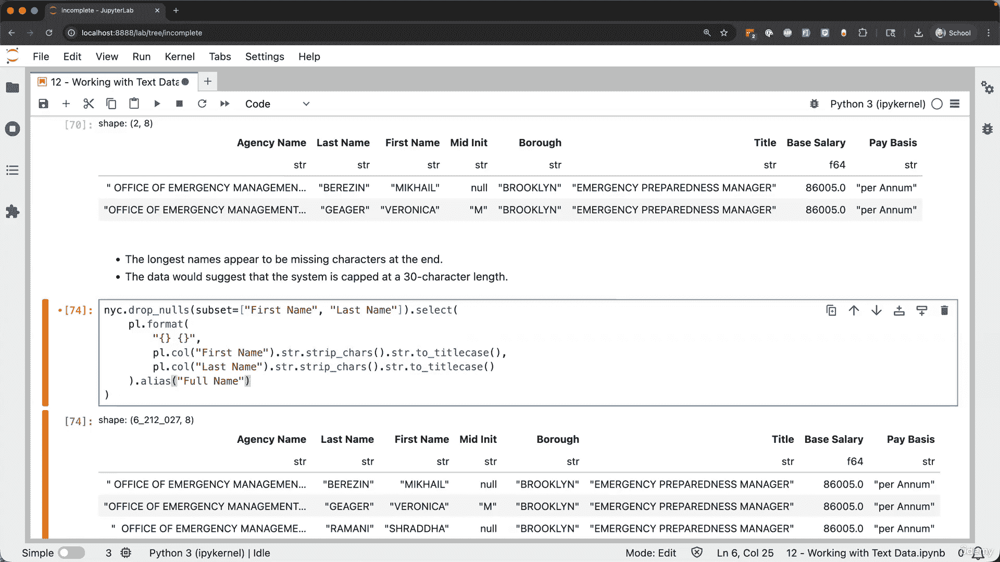
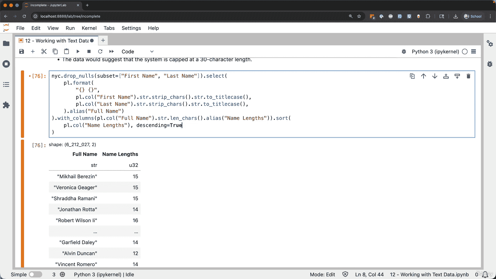
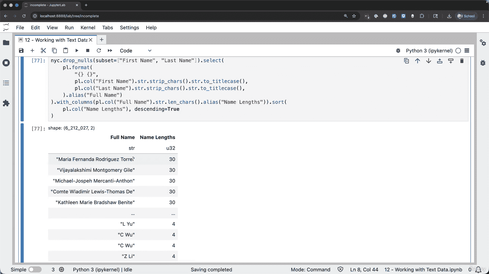
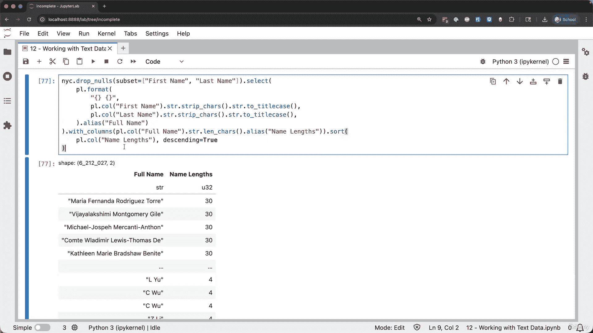

# 📊 Polars 与 Python 数据分析：155：查找最长员工姓名

在本节课中我们将要学习一个真实世界中的数据处理问题，并借助它把本节前面见过的多个字符串方法组合起来使用。我们的目标是找出姓名最长的员工：先把 `last_name` 拼接到 `first_name` 后面，形成员工全名，再计算全名的字符长度，最后按长度排序。需要注意，这个解法不一定是最好或最最优的方案，它只是到达目标结果的一种方式。Polars 往往提供多种表达式、方法和写法来完成同一件事，因此鼓励你多实验、多比较，看看哪种方式最适合你。

下面我们先把问题拆开，再一步一步实现。整个教程会覆盖数据导入、缺失值处理、姓名清洗与拼接、长度计算、排序，以及最后对字符串方法的复习。学习时不必急着记代码，先理解每一步为什么这样做，再回头看代码会更轻松。

## 🧩 Polars 与 Python 数据分析：155：问题定义与数据准备

上一节我们介绍了本节会用到的多种字符串方法，本节中我们来看看如何把它们放进一个完整案例。这里会重新执行导入代码，并先移除之前的格式化处理。之前可能做过删除空白、转换标题大小写之类的事情，这些操作稍后会重新加回来，正好用来复习这些方法如何工作。现在先按原样导入数据集，从原始数据开始处理。

要解决的问题是：定位姓名最长的员工，这里的“最长”按全名总字符数计算。员工全名由 `last_name` 列的内容拼接在 `first_name` 列内容后面得到，示例中可以跳过 `middle_initial` 列。接着计算全名长度，再按最长姓名排序或排名。第一步先查看 NYC 数据框，并利用 `null_count` 方法查看每一列有多少缺失值。查看后发现，`first_name` 和 `last_name` 两列存在空值，而空值会在拼接这两列内容时造成问题。一个简单方案是在拼接前删除 `first_name` 或 `last_name` 中存在缺失值的所有行。

以下是本问题的核心步骤，先列出来方便建立整体印象：

- 按原样导入 NYC 数据集。



- 查看各列缺失值数量，确认 `first_name` 与 `last_name` 的缺失情况。

- 在拼接前删除 `first_name` 或 `last_name` 缺失的行。

- 拼接全名并计算字符长度。

- 按全名长度降序排序，查看最长姓名。

核心概念可以用公式表示：



```text
full_name = strip(title(first_name)) + " " + strip(title(last_name))
name_len = len_chars(full_name)
```

具体删除缺失值时，可以调用数据框顶层的 `drop_nulls` 方法。它接受 `subset` 参数，我们可以传入一个列名列表，指定检查 `first_name` 和 `last_name`。这样 Polars 会删除这两列中任意一列存在缺失值的行。删除后再调用 `null_count`，这两列应显示为 0，实际结果也确实如此。



```python
df = df.drop_nulls(subset=["first_name", "last_name"])

df.null_count()
```

到这里，数据准备和缺失值处理就完成了。下一节我们进入姓名拼接环节，看看如何用 `format` 把姓和名组合成一列。

## 🧱 Polars 与 Python 数据分析：155：清洗姓名并拼接全名

上一节我们处理了缺失值，本节中我们来看看如何把姓和名拼成完整姓名。缺失值移除后，下一步是把 `last_name` 拼接到 `first_name` 后面。这里可以调用 `select` 方法，并选择使用 Polars 顶层的 `format` 函数。`format` 函数接受一个字符串，在字符串中可以指定动态内容注入区域，因此可以把固定内容和逐行变化的内容混合起来。

具体做法是：在字符串里放一对花括号，用来注入名字；然后放一个空格，空格始终固定；再放第二对花括号，用来注入姓氏。花括号的数量等于 `format` 后面需要传入的参数数量，这些参数会说明每个花括号实际填入什么内容。第一对花括号需要填入 `first_name`，因此可以创建针对 `first_name` 列的表达式来逐行提取。

为了让字符数计算准确，现在适合先去掉姓名开头和结尾的空白。因为如果名字或姓氏开头意外多了空格，或者多了多个空格，最终长度计算就会被扭曲。可以进入 `str` 命名空间，使用 `strip_chars` 方法删除所有前导和尾随空白。当前姓名都存储为大写字母，这对长度计算没有影响，但为了让结果更易读，可以顺便转成标题大小写：每个姓名的首字母大写；如果单元格中有多个单词，每个单词首字母大写，其余字母小写。这里可以继续方法链，再次访问 `str` 命名空间下的 `to_titlecase` 方法。





这样处理后，第一姓名参数就完成了：取任意行的 `first_name`，去掉前导和尾随空白，转成标题大小写，然后注入第一个花括号。还需要在初始字符串后提供第二个参数，说明第二个花括号填入什么。第二个参数与第一个非常相似，可以把表达式复制下来，唯一区别是改为从 `last_name` 列插值。最后给新列起名，例如 `full_name`。

以下是拼接全名时可以组合的关键字符串操作，先列出来方便复习：

- `str.strip_chars()`：删除前导和尾随空白，避免额外空格影响长度。

- `str.to_titlecase()`：把姓名转换为标题大小写，让展示更自然。

- `pl.format()`：用花括号占位，把固定空格和动态姓名拼成完整字符串。

对应代码可以写成下面这样：

```python
df = df.select(
    pl.format(
        "{} {}",
        pl.col("first_name").str.strip_chars().str.to_titlecase(),
        pl.col("last_name").str.strip_chars().str.to_titlecase()
    ).alias("full_name")
)
```

查看结果时，`select` 中只有一个表达式，因此数据框应只有一列。实际结果中可以看到 `full_name` 列共有 6200000 行，姓名已经比较整齐地组合在一起。完成拼接后，下一节我们就来计算每个全名的字符长度，并按长度排序。

## 📏 Polars 与 Python 数据分析：155：计算长度并按最长排序

上一节我们得到了全名列，本节中我们来看看如何计算长度并找出最长姓名。接下来要计算每个姓名的长度，并且按字符而不是按字节计算。因为当前主要处理英文字母，字符计数与字节计数在技术上通常相同；除非数据中藏有 emoji，或者姓名中包含非英文语言字符，那是另一种可能。这里直接选择按字符计算。

可以调用 `with_columns` 方法，创建针对 `full_name` 列的表达式，在 `str` 命名空间下访问 `len_chars` 方法，计算字符长度，并给新列起名 `name_lens`。这样每一个姓名都会对应一个字符长度值。

完成长度计算后，需要按这个整数列排序，让长度最大的姓名出现在最前面。调用 `sort` 方法时，可以传表达式，也可以直接传字符串；这里传入针对刚创建的 `name_lens` 列的表达式，同时把 `descending` 参数设为 `True`，让最高值或最大值排在最前。

以下是长度计算和排序的关键步骤，按顺序理解即可：

- 用 `with_columns` 新增长度列。

- 用 `str.len_chars()` 按字符计算长度。

- 用 `sort(..., descending=True)` 把最长姓名排到最前。

核心公式可以写成：



```text
name_lens = len_chars(full_name)
sorted_df = sort(df, by=name_lens, descending=True)
```

对应代码如下：

```python
df = df.with_columns(
    pl.col("full_name").str.len_chars().alias("name_lens")
)

df = df.sort(pl.col("name_lens"), descending=True)
```

最终结果中，字符数为 30 的最长姓名会最先出现。这里还能观察到系统本身的一些信息：很多姓名似乎被截断了，例如某个名字可能本来应类似 `Tories`，另一个可能类似 `Anthony`。这暗示 NYC 系统可能把人员姓名总长度限制在 30 个字符，所以这些姓名被截断。也正因为原始数据形状如此，最长姓名不止一个人，有几个人在技术上并列。完成排序后，下一节我们对本节用到的字符串方法做一次复习，并总结整个案例。

## 🧠 Polars 与 Python 数据分析：155：字符串方法复习与课程总结



上一节我们完成了最长姓名的查找，本节中我们对用到的字符串方法做一次复盘。这个案例很好地复习了本节探索过的多个字符串方法：`strip_chars` 用来去空白，`to_titlecase` 用来转标题大小写；当然也有对应的小写化和降大小写方法。还可以使用 `replace` 方法替换内容，可以按字符计算长度，也可以按字节计算长度，等等。

可以看到，我们一步步构建了较复杂的表达式序列，最终目的就是计算每个字符串的长度。这个案例展示了一个更贴近真实业务的 Polars 使用场景，全部围绕实际业务问题展开。希望这个例子对你有帮助，也能让你看到 Polars 在真实数据处理中的用法。

以下是本节复习到的字符串能力，可以课后自己练习：

- 清洗：`strip_chars` 去除前后空白。

- 展示：`to_titlecase` 转换标题大小写，也可使用小写化方法。

- 替换：`replace` 替换字符串内容。

- 测量：按字符或按字节计算长度。

- 组合：`pl.format` 拼接固定内容和动态内容。





本节课中我们一起学习了如何用 Polars 解决“查找最长员工姓名”的实际问题：先检查并删除 `first_name` 与 `last_name` 的缺失值，再用 `pl.format` 拼接全名，用 `strip_chars` 和 `to_titlecase` 清洗姓名，用 `len_chars` 计算字符长度，最后用 `sort` 按长度降序排列。还观察到 NYC 系统可能存在 30 字符的姓名长度上限，因此出现多个并列最长姓名。下节课见。

