## 🐱 Polars 与 Python 数据分析（第二部分）：156：分类数据（Categorical Data）

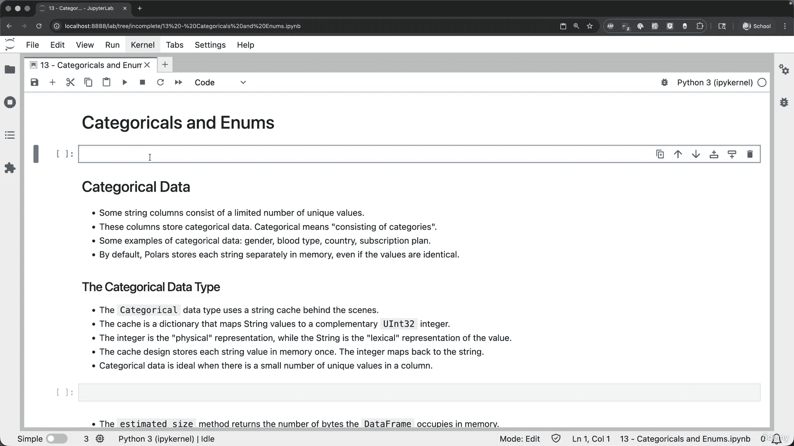

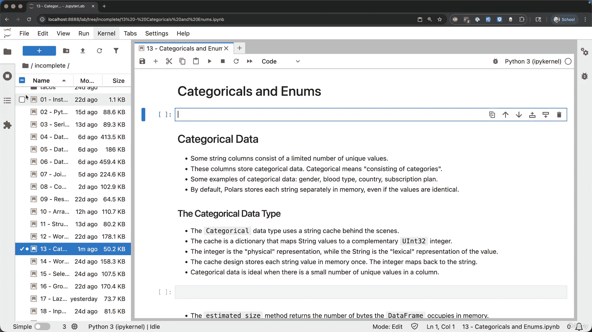

在本节课中，我们将要学习 Polars 中的分类数据和枚举。分类数据（Categoricals）和枚举（Enums）是 Polars 中一列可以容纳的两种数据类型，这两种类型的主要好处是减少数据总共占用的内存。使用更少的内存，会加速我们在这份数据上执行的操作。我们会新建一个 Jupyter Notebook 来完成本节内容，这个 Notebook 叫 `13 categoricals and enums`。按照惯例，我们先用 `import` 关键字导入 Polars 库，并把它赋别名 `pl`。

```python
import polars as pl
```

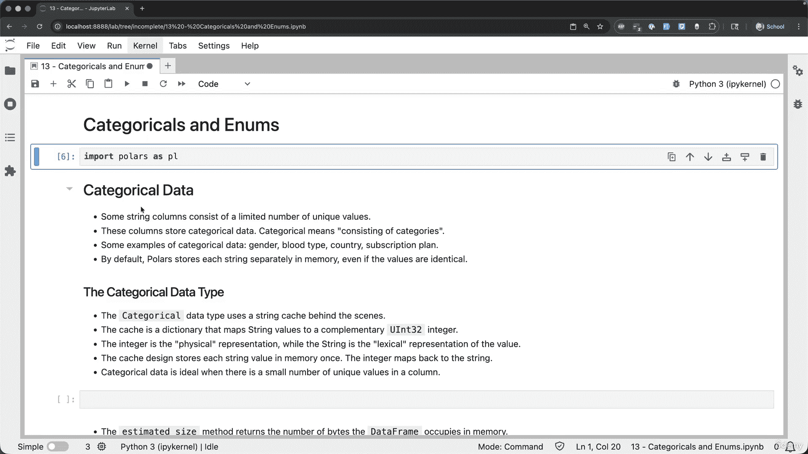

在前面概述中，我们知道了分类数据能帮助节省内存。本节中我们来看看现实世界里的分类数据，以及 Polars 为什么要专门为它设计一种数据类型。到目前为止，每当我们从数据集中导入字符串列时，都会把这些列保留为字符串。Polars 会把每一个字符串都存到内存中，不管这个字符串重复了多少次。有时我们会遇到一种情况：数据集非常长，但某个字符串列里唯一值或不同值的数量其实很少。例如，可以想象一个包含 1000 万行的数据集。

有些现实世界中的概念，其所有可能取值数量很少，因此这些值会在数据中反复出现。例如血型、性别、国家等字段，它们的不同取值数量通常不会很多。以国家列为例，世界上大约有 170 个国家，这意味着同样的 170 个值会在 1000 万行里一遍又一遍重复。我们实际上不需要把所有重复出现的值都完整地存到内存中。分类数据类型允许我们简化或优化存储设计，从而减少总内存占用。如果你对底层计算机科学概念感兴趣，可以继续了解，但不需要完全理解这些概念也能使用分类数据。

理解了分类数据的现实动机后，本节我们来看看 Polars 在底层如何把字符串变成更省内存的形式。Polars 会把每一个唯一字符串映射到一个对应的整数。例如在国家列中，假设“United States”和“Canada”在列里反复出现，Polars 会把“United States”映射到某个整数，比如 0，这个数字只是示例，具体是多少并不重要。它也可能把“Canada”映射到整数 1。

```python
country_mapping = {
    "United States": 0,
    "Canada": 1,
}
```

这样做的原因是，存储整数通常比存储文本或字符串更便宜，内存开销更小。Polars 在幕后把每个唯一字符串映射到对应整数后，实际上存储的是一列整数，而不是一列字符串。如果我们需要对这些字符串做操作，Polars 可以轻松地在整数和它所代表的字符串之间映射回来。这里的优势是，我们不再需要一遍又一遍复制字符串“United States”，而是重复数字 0。重复数字 0 通常更便宜，也更少占用内存。

理解了映射原理后，本节我们正式导入一份健身房会员数据，并查看它占用了多少内存。我们先使用顶层的 `read_csv` 函数读取一个新文件，文件名为 `gym_memberships.csv`。这是一个虚构的健身房会员集合，里面有 1000 个不同会员。每个会员都有一个唯一的会员 ID，还有他们注册的会员等级、最喜欢的课程、健身房所在城市、上个月的访问次数，以及他们是否是活跃会员。数据集中包含以下字段。

- `member_id`：每个会员唯一的会员 ID。
- `membership_tier`：会员在健身房注册的会员等级。
- `favorite_class`：会员最喜欢的课程。
- `city`：健身房所在城市。
- `visits_last_month`：会员上个月的访问次数。
- `is_active`：会员是否为活跃会员。

我们可以把读取结果赋值给 `gym` 变量，并用 `head` 方法预览前几行。

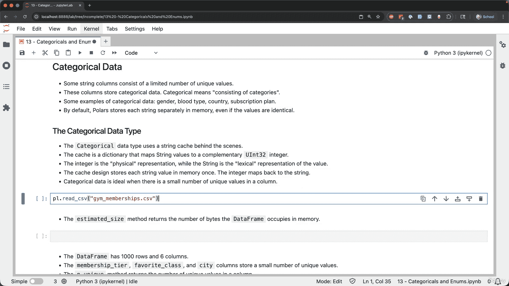

```python
gym = pl.read_csv("gym_memberships.csv")
gym.head()
```

你可能还记得，DataFrame 支持 `estimated_size` 方法，它会返回这个 DataFrame 在内存中占用的总字节数。当前这三列字符串都按字符串类型存储。只要出现重复值，比如 `bronze` 或 `Pilates`，Polars 就会在内存中重复存储这些字符串。内存中会有多个位置分别存储 `Pilates`、`Pilates`、`Pilates` 等。我们可以调用 `estimated_size` 查看当前占用的总字节数。

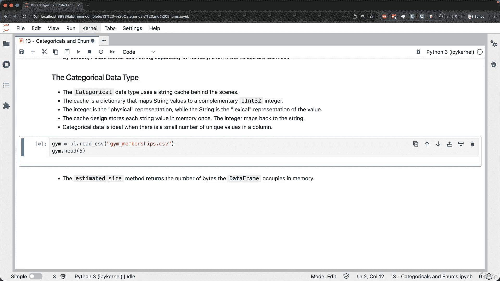

```python
gym.estimated_size()
```

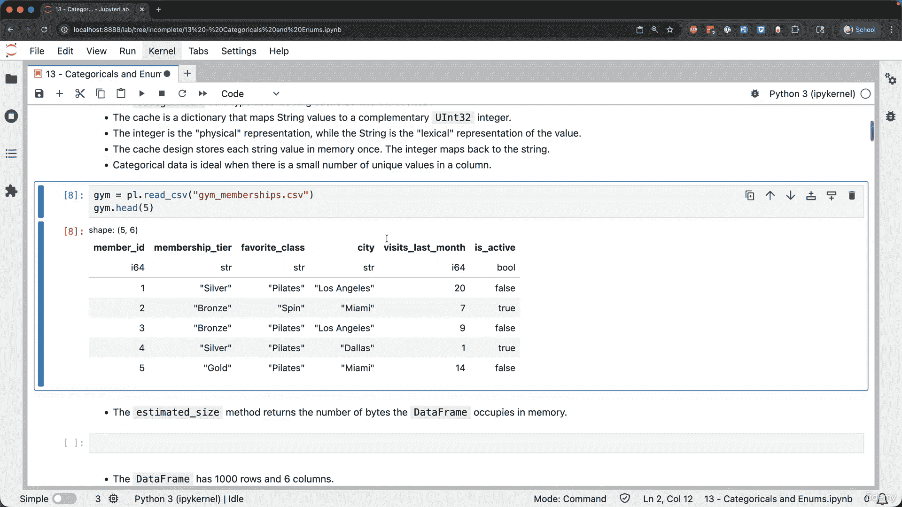

这个数字本身不是重点，重点是把它作为基准，和后面转成分类列之后的内存占用做比较。下面我们来看看如何找出适合转成分类列的字段。第一步是确定哪些列适合转成分类列，判断方法是看哪些列的唯一值数量很少。

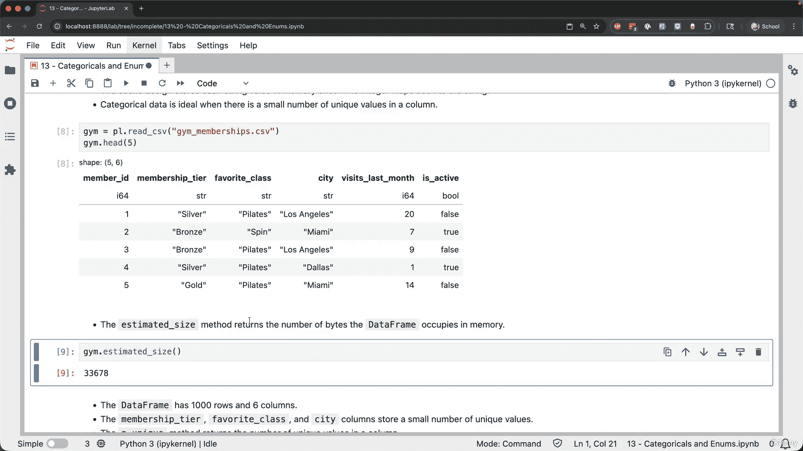

我们可以在 `gym` 数据框上调用 `select` 方法。Polars 顶层有一个 `all` 函数，它会创建一个表达式，目标是指定数据框中的每一列。然后我们使用 `n_unique` 方法，它是“number of unique”的缩写，表示唯一值数量。

```python
gym.select(pl.all().n_unique())
```

这段代码会返回一个只有一行的数据框，显示每一列中唯一值或不同值的数量。运行后我们会看到类似下面的结果。

- `membership_tier`：只有 3 个不同的字符串，在 1000 行中重复出现。
- `favorite_class`：只有 4 个不同的课程值。
- `city`：只有 5 个不同的城市。
- `member_id`：有 1000 个不同值，每行都不重复。
- `visits_last_month` 和 `is_active`：唯一值数量少，但它们已经是整数和布尔类型，通常比字符串占用更少内存。

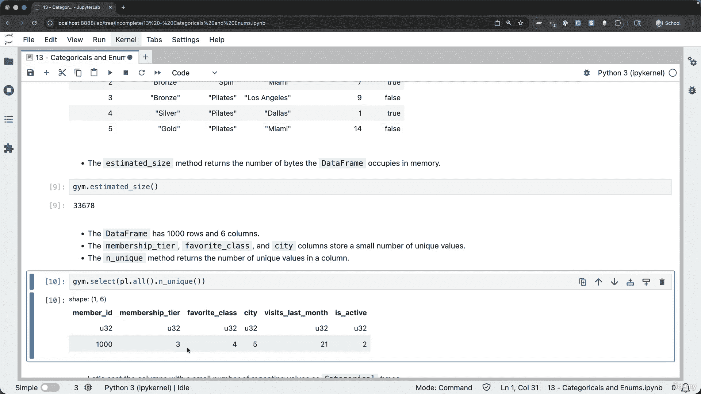

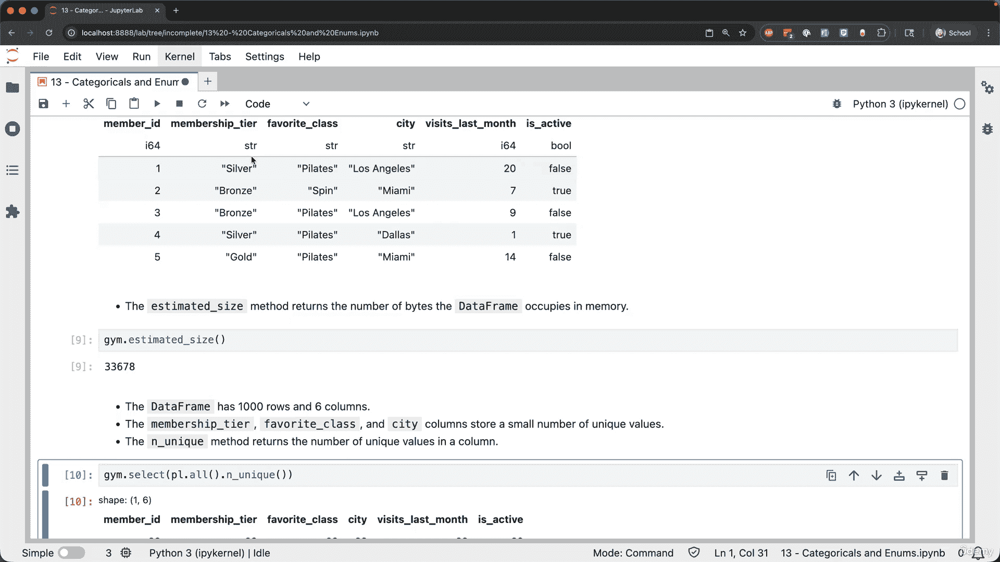

因此，`membership_tier`、`favorite_class` 和 `city` 这三个字符串列很适合转成分类列。反例是 `member_id`：在 1000 行数据中有 1000 个不同条目，没有重复，所以把它转成分类列没有意义。`visits_last_month` 和 `is_active` 的唯一值数量也少，但它们已经是整数和布尔类型，通常不需要担心内存问题。所以我们把目标放在前面三个字符串列上，把它们全部转成分类列。

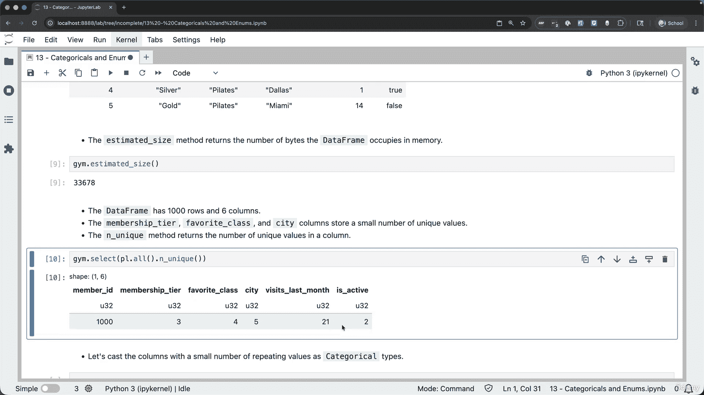

上一节我们找到了候选列，本节我们使用 `schema_overrides` 参数完成转换。我们把上面的读取代码复制到下方，并提供 `schema_overrides` 参数，传入一个字典。字典的键是我们想指定的列，值是我们希望 Polars 使用的目标数据类型。具体转换步骤可以概括为下面几步。

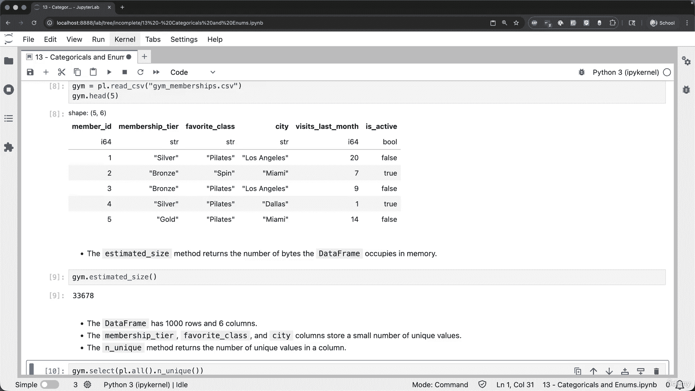

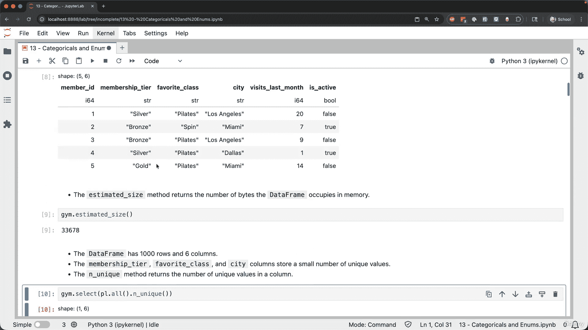

1. 复制前面的 `read_csv` 读取代码。
2. 在 `read_csv` 中加入 `schema_overrides` 参数。
3. 用字典的键指定要转换的列名。
4. 用字典的值指定目标类型 `pl.Categorical`。
5. 对三个字符串列分别设置分类类型，然后执行代码。

```python
gym_cat = pl.read_csv(
    "gym_memberships.csv",
    schema_overrides={
        "membership_tier": pl.Categorical,
        "favorite_class": pl.Categorical,
        "city": pl.Categorical,
    },
)
gym_cat
```

对于 `membership_tier` 列，我们到 Polars 顶层找到 `Categorical` 类型，注意首字母大写。分类类型很适合字符串列中存在少量重复值的情况。我们对另外两个字符串列应用同样的转换：把 `favorite_class` 从字符串列改为分类列，把 `city` 列也改为分类列，因为 `city` 中只有 5 个不同城市。执行后可以看到，这些列不再是普通字符串，而是显示为 `cat` 数据类型，`cat` 是 categorical 的缩写。这个缩写看起来像 cat，比较有趣。

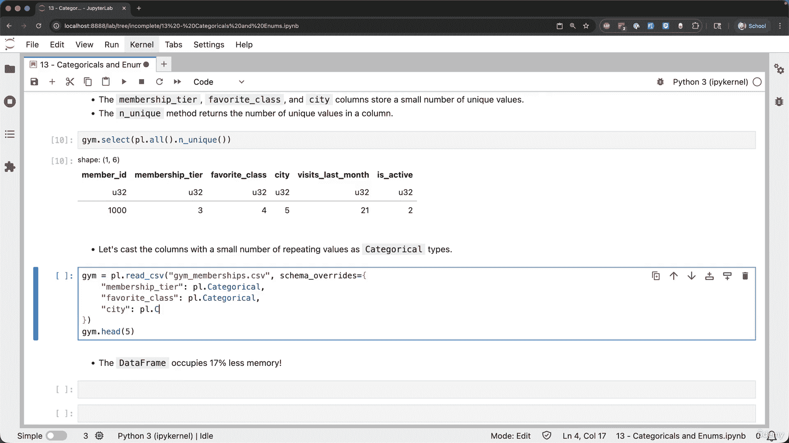

转换完成后，本节我们做关键的内存对比。我们拿现在这个存储分类列的 `gym` 数据框，调用 `estimated_size` 方法，查看它占用的字节数。我们会得到 `28128` 字节。把这个值除以上面调用 `estimated_size` 时得到的原始值，就可以看到内存比例。原来字符串版本占用一定字节，现在分类版本占用另一组字节。

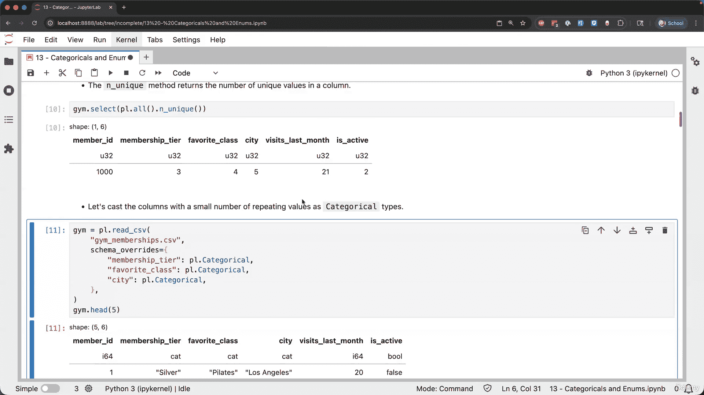

```python
# 新占用字节
new_size = gym_cat.estimated_size()

# 概念公式
# 内存比例 = 新占用字节 / 原占用字节 ≈ 83%
# 内存减少比例 ≈ 1 - 83% = 17%
```

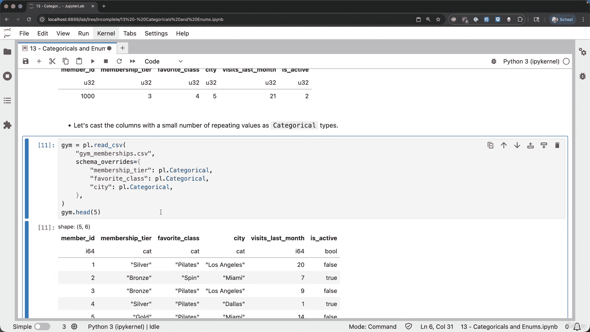

比较结果可以整理为下面几点。

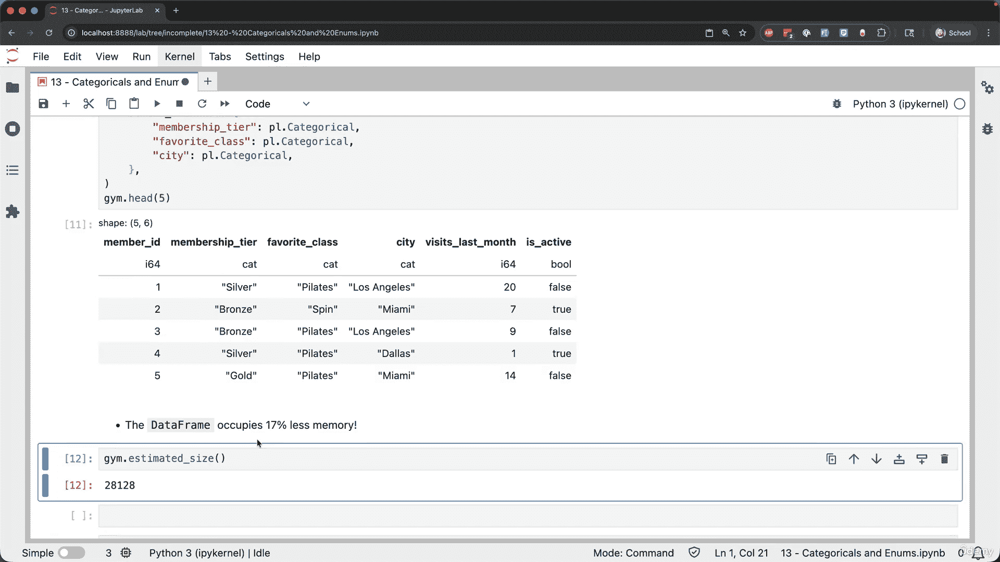

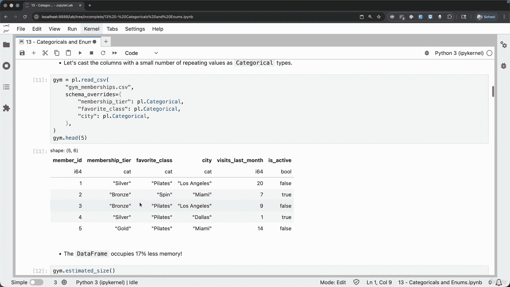

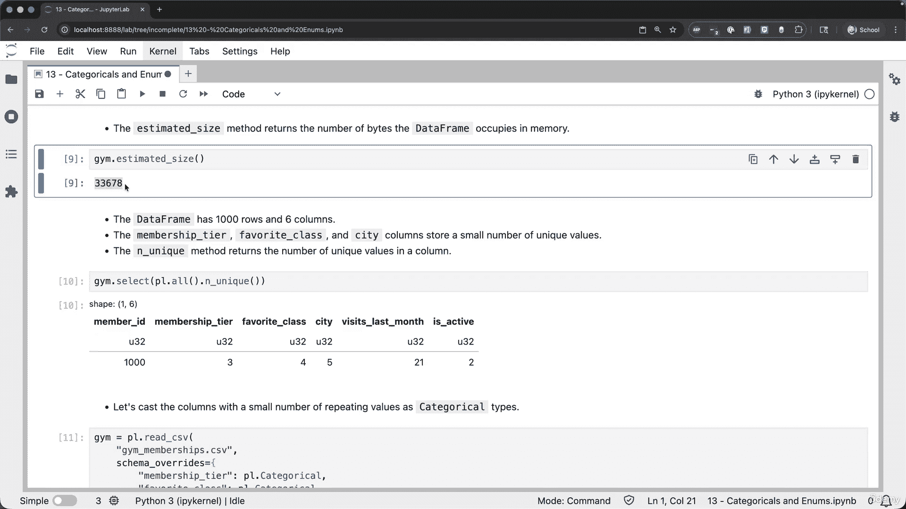

- 分类版本大约占用 `28128` 字节。
- 分类版本的大小大约是原始字符串版本的 `83%`。
- 总内存消耗减少了接近 `17%`。
- 对于 1000 行的数据框，内存本来就不大，但数据量增长后会更加明显。

如果数据集有数百 MB 或数 GB，减少 17% 的总内存消耗会很有意义。到这里，分类数据类型的优势和用途应该比较清楚了。我们把它用于字符串列，适用场景是较大的数据集中，某一字符串列只有少量不同值或唯一值。转成分类列后，Polars 会使用底层算法把每个字符串映射到整数，整数通常占用更少内存。同时，Polars 仍然能够优雅地映射回原始字符串，供常规操作使用，最终我们得到的数据框会消耗少得多的内存。

## 🧾 Polars 与 Python 数据分析（第二部分）：156.6：总结

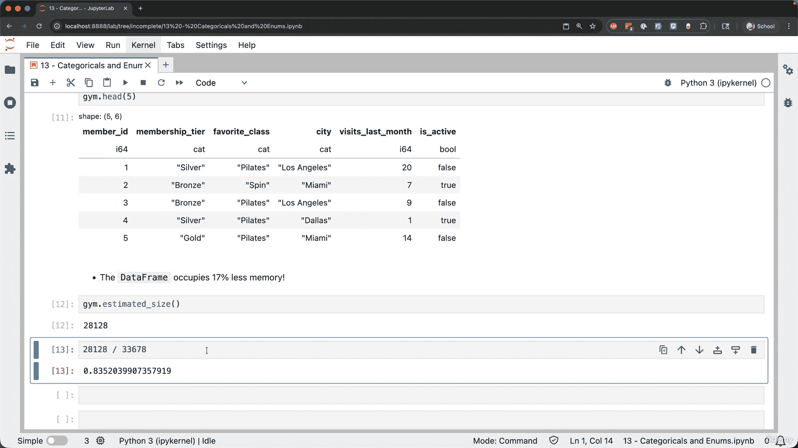

在完成前面的原理、导入、候选列判断、转换和内存比较后，本节我们做最后总结。本节课中我们一起学习了 Polars 中的分类数据和枚举，重点是分类数据。分类数据和枚举是 Polars 中列可以容纳的两种数据类型，主要收益是减少数据占用内存，并通过更少内存加速操作。我们了解了字符串列在重复值很多时会重复存储，而分类数据会把每个唯一字符串映射到整数，例如 `"United States" -> 0`、`"Canada" -> 1`，从而减少内存开销。我们还通过健身房会员数据，使用 `n_unique` 找出唯一值少的字符串列，用 `schema_overrides` 和 `pl.Categorical` 完成转换，并比较了转换前后的内存占用。示例中内存大小约变为原来的 `83%`，总内存减少接近 `17%`。在数据量更大的场景中，这种节省会更加明显。

