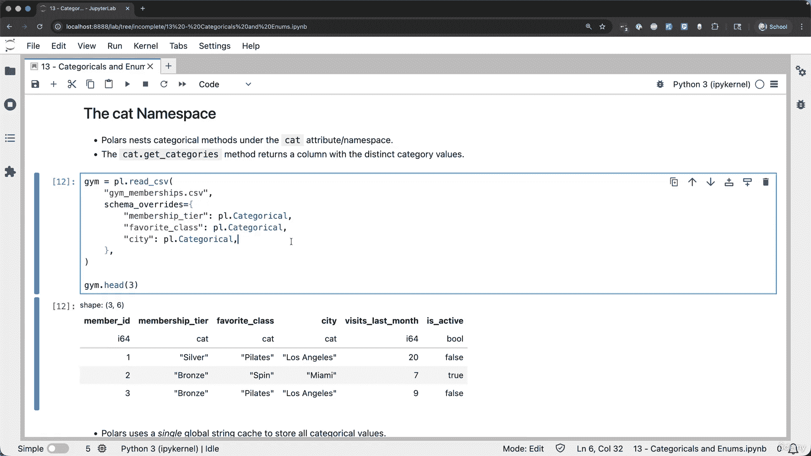
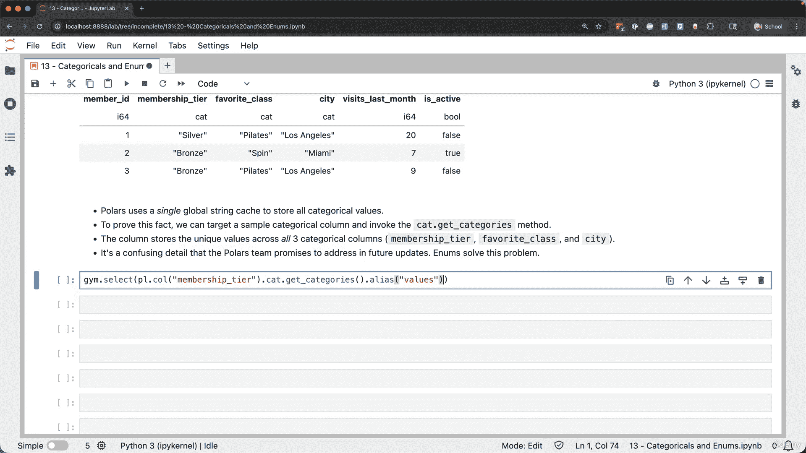
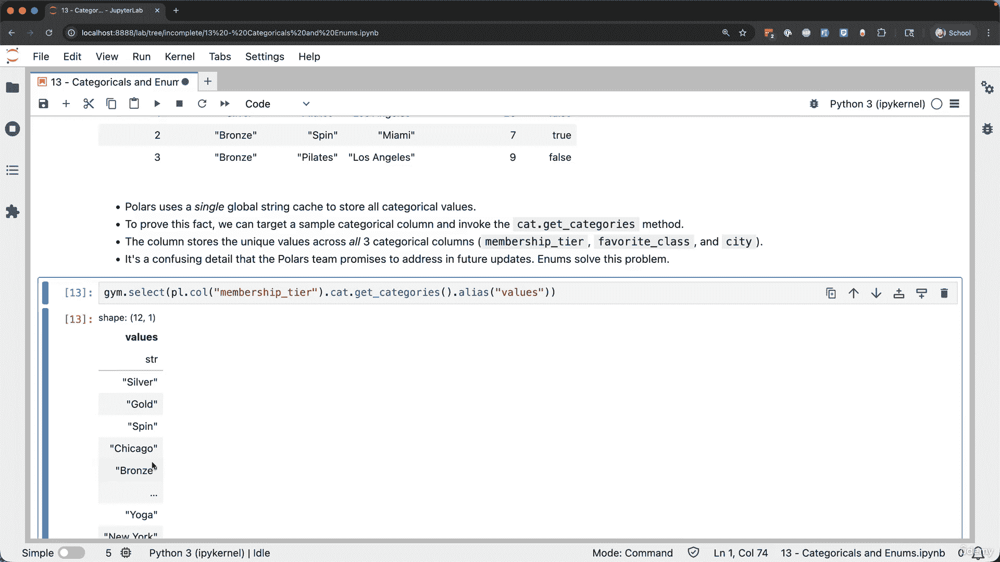
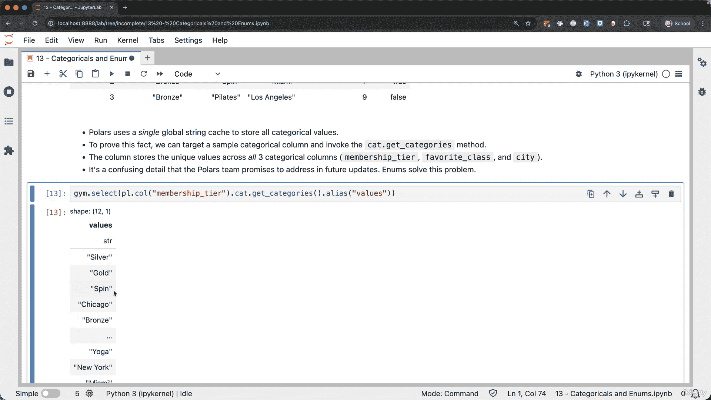
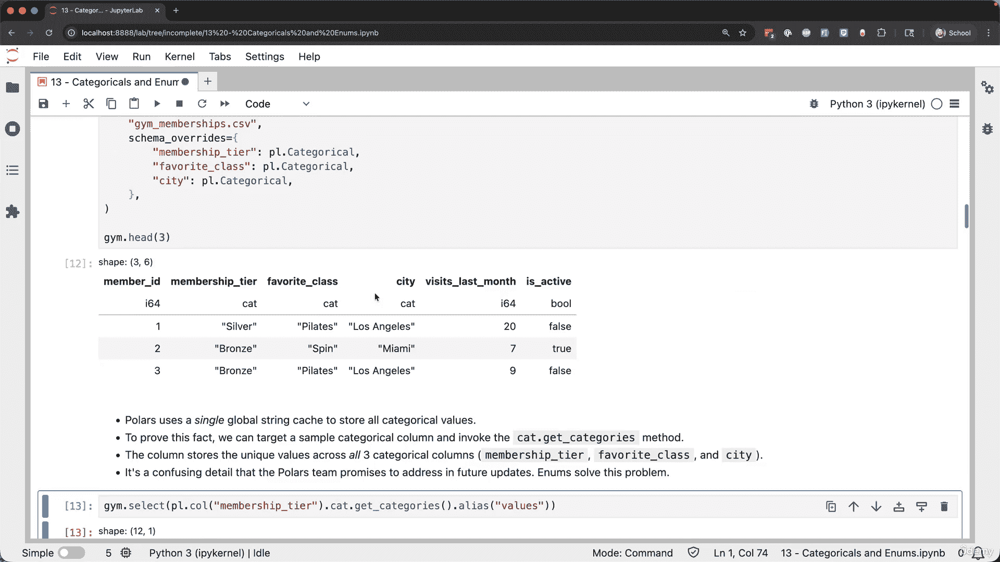
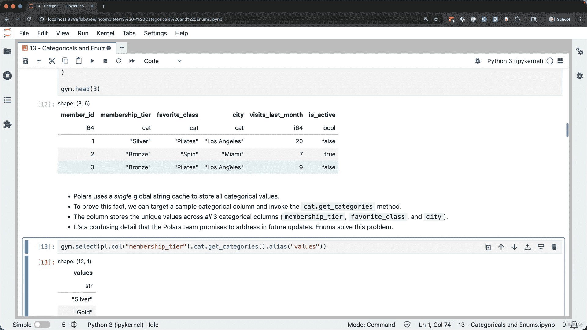
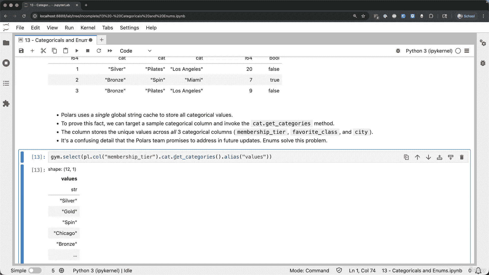
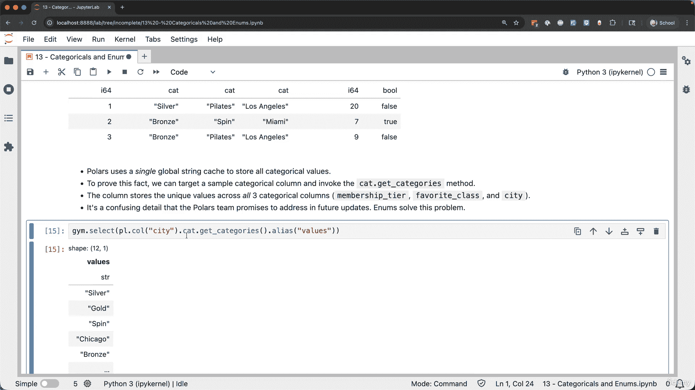

# Polars 与 Python 数据分析：157：cat 命名空间 🧭

在本节课中我们将要学习 Polars 中 cat 命名空间的基本用法，重点理解 get_categories 方法，以及 Polars 为什么会用一份全局字符串缓存保存所有分类值。课程会从分类转换之后的常见状态讲起，再进入代码演示，最后说明这个行为为什么容易让人困惑，并引出下一课的 enum 类型。整个内容会尽量用直白的话解释，让初学者能够把概念和代码对应起来。

## 🚀 分类转换之后的常见情况

上一节我们介绍了把字符串列转换成分类值，本节中我们来看看转换完成之后通常会遇到什么情况。通常，把某一列的字符串数据转换成用来存储分类值的类型之后，你就会继续做剩下的数据分析工作，几乎会完全忘记分类值的存在。这个做法本身很自然，因为分类值只是数据准备的一部分，后面还有很多分析步骤要做。不过，分类类型确实有一些细微差别需要指出来。理解这些差别之后，我们就可以很自然地过渡到互补的 enum 类型，下一课会正式介绍 enum。下面先执行上一课中的导入代码，把环境和数据准备好，这是继续操作的前提。

## 🗂️ cat 命名空间与 get_categories 方法

上一节提到分类转换后容易忽略分类类型，本节中我们来看看 cat 命名空间提供了什么。Polars 有一个顶层 cat 命名空间或属性，它可以在你拥有的任何表达式上使用，用来访问与存储分类数据的列相关的一系列方法。需要说明的是，可用方法并不多，因为分类列本身能做的事情有限。其中一个可用的方法叫 get_categories，它会返回一列，包含所有不同的分类值。这里先记住它的作用，后面会用代码演示。下面列出与 cat 命名空间相关的要点，方便你快速对照。

- `cat` 是顶层命名空间或属性，可在任意表达式上访问分类列相关方法。
- 可用方法数量不多，因为分类数据可做的操作有限。
- `get_categories` 是其中一个方法，返回包含所有不同分类值的列。

这些要点看起来简单，但真正容易出问题的地方不在方法名，而在 Polars 如何保存这些分类值。接下来看这个关键机制。

## 🌍 单一全局字符串缓存

上面介绍了 cat 命名空间和 get_categories，本节中我们来看看 Polars 保存分类值的方式。这里是主要容易混淆的点：Polars 会使用单一全局字符串缓存来存储程序中所有分类值。上一课我们讲过把每个唯一字符串映射到对应数字的想法。Polars 确实会做这种映射，但它不是按列分别做，而是对整个数据批次做。换句话说，membership tier 中的所有唯一值、favorite class 中的所有唯一值，以及 city 中的所有唯一值，会合并到一份全局缓存中。每个不同的字符串值都绑定自己的唯一整数，但这些值不按列分离，也不互斥。这个机制可以用下面的公式表示。

```text
全局字符串缓存 = { membership_tier 的唯一值 } ∪ { favorite_class 的唯一值 } ∪ { city 的唯一值 }

每个不同字符串值 s -> 一个全局唯一整数 f(s)
```

> 关键结论：Polars 的分类值缓存不是按列隔离，而是整个程序共用一份全局字符串缓存。

理解这个公式后，就能理解为什么对任意一个分类列调用 get_categories，都会看到缓存中的所有值，包括来自其他列的值。这个现象第一次看到时很容易让人困惑。下面用 gym 数据框实际演示。



## 🧪 在 gym 数据框上观察结果

上一节说明了全局缓存的概念，本节中我们来看看它在代码里的表现。我们取出 gym 数据框，调用 select 方法，并选择一个分类列作为例子，比如选择 membership_tier。结果中的类型会显示为 cat，这说明该列确实是分类类型。和许多其他方法一样，分类数据的方法嵌套在一个属性下面，这里需要的属性叫 cat。在这个对象内部有一批方法，数量不算多，我们要用的是 get_categories。调用后可以把结果列命名为 values。下面是对应的代码示例。

```python
gym.select(
    pl.col("membership_tier").cat.get_categories().alias("values")
)
```

你可能以为，因为这里针对的是 membership_tier，所以结果只会看到 bronze、silver 和 gold。它们确实会出现，silver、gold、bronze 都会出现，而且每个只出现一次。但结果中还会出现另外两个列的唯一值，而这两个列之前也被转换成了分类值。例如，spin 明显来自 favorite_class 列，Chicago 这样的值来自 city 列。Polars 会把所有分类列中的不同值都存进同一份全局字符串缓存，get_categories 返回的正是这份缓存。下面是这个结果的含义拆解。

- 结果中会出现当前列自己的不同分类值，例如 bronze、silver、gold，各一次。
- 结果中还会出现其他分类列的不同值，例如来自 favorite_class 的 spin。
- 结果中还会出现来自 city 的不同值，例如 Chicago。
- 原因是所有分类列共用一份全局字符串缓存，而不是每列各有一份缓存。

看到这里，你就明白为什么结果会比预期多出一些值。这个现象不是错误，而是 Polars 当前分类类型的设计行为。接下来我们换一列调用，看看结果是否一样。

## 🔄 换一列调用也得到相同结果

上一节我们在 membership_tier 上看到了全局缓存的效果，本节中我们来看看换成其他列会怎样。如果把代码中的列替换成 favorite_class，或者替换成 city，我们会得到完全相同的结果集合。也就是说，不管当前表达式指向哪一个分类列，get_categories 拿到的都是同一份全局缓存中的不同值。这一点可能仍然让人困惑，但它是理解 cat 命名空间行为的关键。下面是替换列后的代码示意。

```python
gym.select(
    pl.col("favorite_class").cat.get_categories().alias("values")
)

gym.select(
    pl.col("city").cat.get_categories().alias("values")
)
```





这两段代码和前面针对 membership_tier 的代码会得到相同结果集合。你不需要把每个值都背下来，只需要记住：get_categories 看的是全局缓存，不是当前列自己的独立分类表。理解了这一点，下一课的内容就很容易接上。







## 🧭 下一课：enum 类型



上一节我们确认了不同分类列会共享同一份全局缓存，本节中我们来看看下一课会如何解决相关问题。在下一课中，我们会讨论 enum 类型如何帮助我们解决这个问题，同时也会介绍 enum 提供的其他优势。enum 可以作为分类类型行为的一个补充，让你在处理固定取值集合时拥有更合适的工具。这里先建立预期：cat 命名空间让我们能读取分类值缓存，而 enum 会在语义和隔离性上提供不同的选择。

## ✅ 总结



本节课中我们一起学习了 Polars 的 cat 命名空间，以及 get_categories 方法的基本用法。我们了解到，分类转换之后通常会继续做数据分析，但分类类型有一些细节需要注意；cat 是顶层命名空间或属性，可在任意表达式上访问分类列相关方法；get_categories 会返回所有不同的分类值。更重要的是，我们理解了 Polars 使用单一全局字符串缓存保存程序中所有分类值，这个缓存不是按列隔离的，所以对任意分类列调用 get_categories 都会看到所有分类列的不同值。最后，我们引出了下一课的 enum 类型，它会帮助解决这里遇到的问题，并带来其他优势。

