# 📊 Polars与Python数据分析：第58节：枚举类型Enums


在本节课中我们将要学习Polars里的枚举类型（Enum）。它是分类类型（Categorical）的互补数据类型，二者非常相似，几乎一模一样。我们还会学习什么时候应该优先使用枚举，如何创建枚举，如何把枚举应用到CSV读取时的`schema_overrides`参数里，以及枚举为什么能进一步节省内存。为了让初学者更容易理解，我们会把概念拆成几个小节，逐步说明。


## 🧩 Polars与Python数据分析：第58节：枚举与分类类型的区别


上一节我们接触了分类类型，本节中我们来看看枚举类型和分类类型到底差在哪里。枚举是分类类型的互补数据类型，两者非常相似，几乎相同。唯一的区别是：枚举要求你在提前知道所有可能值或所有可能变体时使用；只要你能提前把这些值写出来，就可以把字符串列转换成这个枚举类型。这样做的收益是更好的内存优化。


分类类型也有自己的优点：你不需要提前知道或写出所有值。但是，如果你拿到的数据集不仅有一列包含少量重复值，而且你还能提前知道这些值全部是什么，那么这种场景就应该优先使用枚举，而不是分类类型。这也是Polars团队的官方建议。


> Polars团队官方建议：如果你提前知道所有值，就优先使用枚举类型；否则枚举和分类类型非常相似，它们服务的目的也相似，都是处理“字符串列中只有少量唯一不同值”的情况。

  
为了证明枚举能带来进一步的内存收益，本课会用代码示例做对比。接下来我们先从创建枚举类型开始。


## 🛠️ Polars与Python数据分析：第58节：创建三个枚举类型


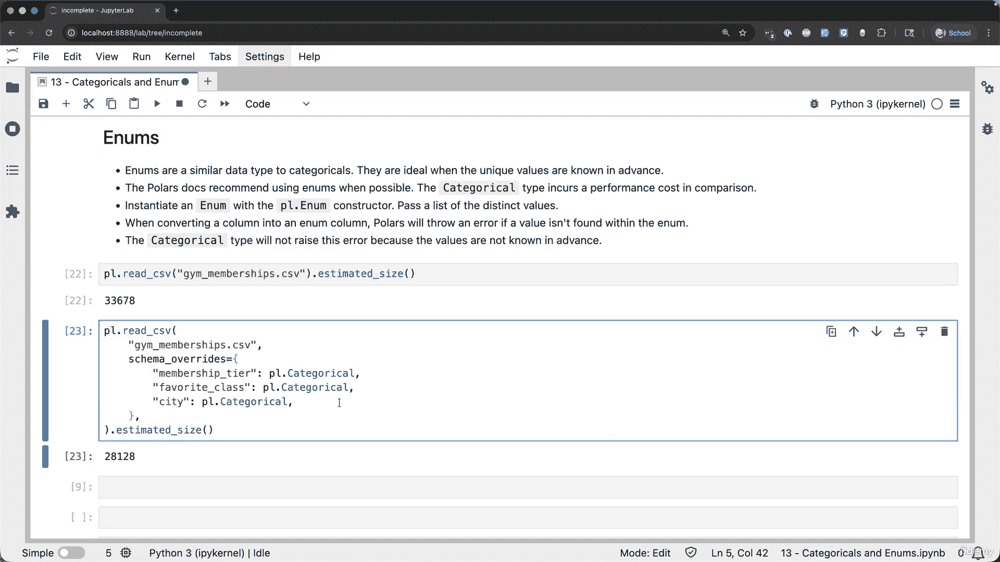

上一节我们说明了枚举适合“提前知道所有值”的场景，本节中我们来看看如何实际创建枚举。课程开头有两个来自之前课程的代码样本：第一个是常规读取CSV，所有列都存成字符串，尤其是`membership_tier`、`favorite_class`和`city`这三列；我们在这里看到了以字节为单位的内存占用。第二个样本在读取后把这三列转换成分类类型，Polars需要自己找出所有唯一值并创建分类类型，我们能看到内存大约减少了17%。现在我们要看看能否用枚举类型继续改进。


首先，因为这三列存储的是不同的不同值集合，所以我们要创建三个枚举类型。创建时使用Polars的顶层类型`pl.Enum`，也就是Polars库里的`Enum`类。可以把它理解成Polars中的一种类型。实例化时传入一个普通Python列表，列表里放上你预期在任何要转换成该枚举类型的列中会出现的所有可能变体或值。


需要特别注意的是：如果某一列里出现了你没有在这个列表中提供的值，Polars会抛出异常。Polars期望列中遇到的每个值都能在这个列表里找到。因为你提前写出了所有值，Polars就能据此做优化。以下是创建三个枚举类型的代码示例：


```python
import polars as pl

tiers_enum = pl.Enum(["Bronze", "Silver", "Gold"])
cities_enum = pl.Enum(["Miami", "Chicago", "Los Angeles", "New York", "Dallas"])
class_enum = pl.Enum(["HIIT", "Yoga", "Spin Class", "Pilates"])
```


上面代码里，会员等级只有Bronze、Silver、Gold三种。可以假设我们提前知道健身房就这三个等级，它们不会变化，每天拿到的数据也一致，这就是枚举的完美例子。`pl.Enum(...)`返回的是Polars枚举类型，可以看到它包含三个类别；把它赋给变量`tiers_enum`，相当于在Polars里创建了一个新类型，这个类型的值只能是这三个可能值之一。


接着对另外两列重复这个过程。城市列的不同值是Miami、Chicago、Los Angeles、New York和Dallas，共五个，赋给`cities_enum`。最喜欢的课程列的不同值是HIIT、Yoga、Spin Class和Pilates，其中HIIT按原文理解是High Intensity Interval Training，即高强度间歇训练；把这些值放进`class_enum`。这些工作需要在前面提前做好，但现在我们有了三个枚举类型，就可以把它们当作类型用在`schema_overrides`参数里。下一节我们看看具体怎么应用。


## 📥 Polars与Python数据分析：第58节：在schema_overrides中应用枚举


上一节我们创建了三个枚举类型，本节中我们来看看如何把它们应用到CSV读取过程中。下面复制之前的读取代码，先不担心`estimated_size`，稍后再回来看内存。把读取结果赋给`gym`。然后把原来的分类类型替换成上面创建的枚举类型：`membership_tier`使用`tiers_enum`，`favorite_class`使用`class_enum`，`city`使用`cities_enum`。注意各个键值对之间要有逗号。


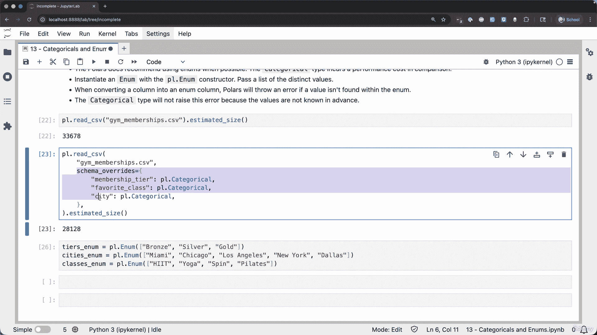

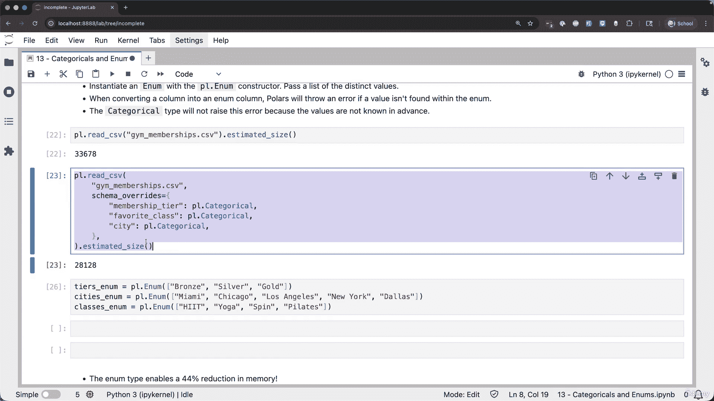

```python
gym = pl.read_csv(
    "gym.csv",
    schema_overrides={
        "membership_tier": tiers_enum,
        "favorite_class": class_enum,
        "city": cities_enum,
    },
)
```


这样做的含义是：对每一列，我们都指定了一个结果集合。Polars会拿列里的所有值去和这个集合比较，检查所有城市是否都能在对应集合中找到。因为Polars提前知道一切，并且知道这个集合不能扩大也不能缩小，所以它可以进一步优化。接下来我们用`head`方法预览数据集的第一行，看看效果。下一节我们检查列类型和功能是否变化。


## 🔍 Polars与Python数据分析：第58节：检查类型与功能


上一节我们把枚举应用到了读取参数中，本节中我们来看看读取后的列类型。用`head`预览后，可以看到这些列的类型已经改变：它们最初是字符串，后来在分类类型示例中变成`cat`，现在变成了第三种类型，也就是枚举。除了类型不同，其他功能完全一样。


这里有一个很有意思的点：不管你的列存储的是分类类型还是枚举类型，这两种类型的所有方法仍然都放在`cat`或categorical命名空间里。因此可以调用上一课见过的同一个`get_categories`方法。调用后可以看到，这里只显示`membership_tier`列里的不同值。Polars当然知道这些值，因为我们在前面的`pl.Enum`里已经为它定义好了。以下是检查列类型和调用方法的示意：


```python
print(gym.head())
print(gym.select(pl.col("membership_tier").cat.get_categories()))
```


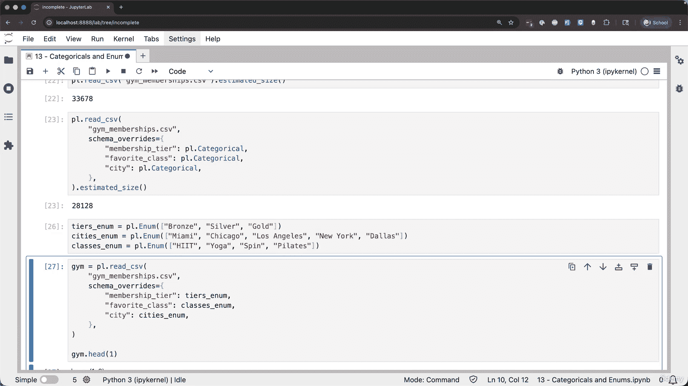

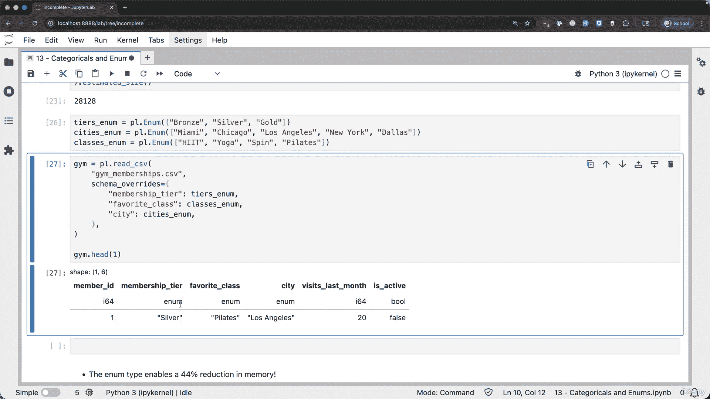

不过现在还有一个关键变化：枚举让你从单一的全局字符串缓存中解耦出来。如果把下面的代码复制并替换成其他列，例如`favorite_class`和`city`，就能看到所有类别或不同枚举变体实际上都存储在完全独立的分组里。这会让我们更容易提醒自己：某一列里到底有哪些真正的唯一不同值。下一节我们专门比较内存占用。


## 📦 Polars与Python数据分析：第58节：比较内存占用


上一节我们看到枚举在功能上和分类类型几乎一样，本节中我们来看看它真正漂亮的地方，也就是Polars团队推荐“提前知道值就用枚举”的原因。我们调用`estimated_size`方法，得到数据框在当前计算机内存中占用的总字节数。注释里已经提前写了结果，但这里还是要实际证明一下。把枚举方式得到的数字和上面两个数字比较：一个是分类方式，一个是原始字符串方式。把数字相除可以发现，使用枚举方式时，只占原始内存的56%或57%。


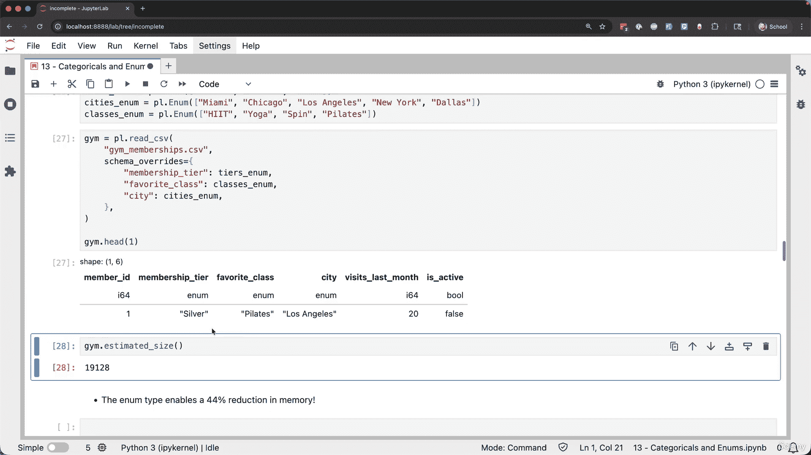

\[
\text{Enum内存占比}\approx\frac{\text{Enum内存}}{\text{字符串内存}}\approx56\%\sim57\%
\]


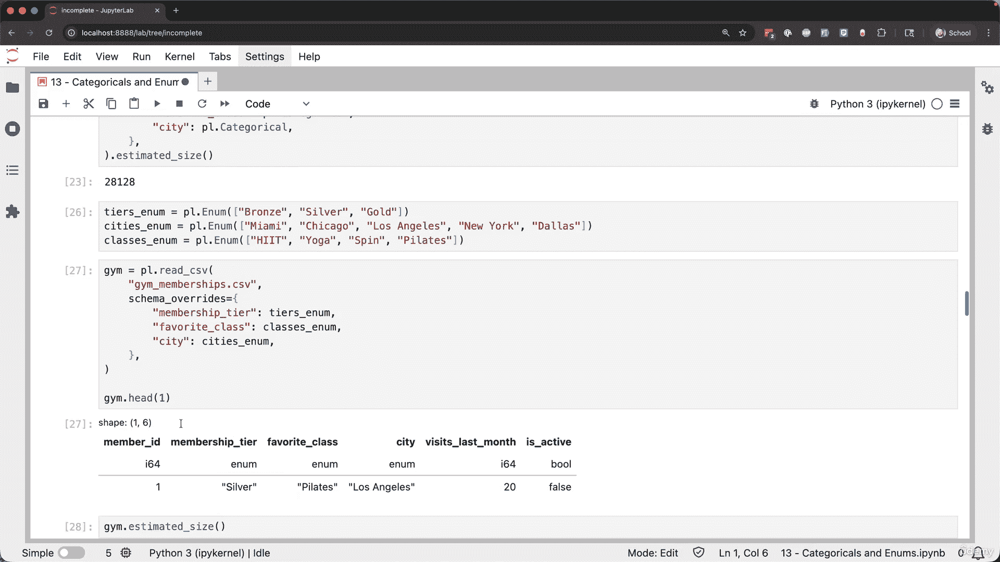

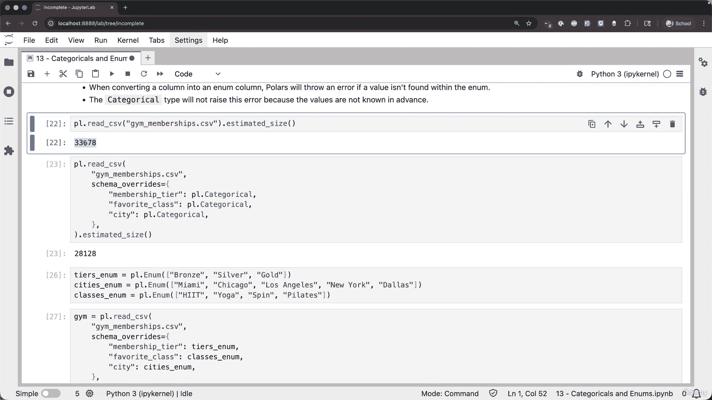

换句话说，这个数据集占用的总内存几乎减少了一半。可以想象一下，如果数据集有GB级别，这种优化会非常显著。而且未来所有查询，例如过滤、连接，都会因为需要处理的内存更少而显著更快。枚举的好处不止一个，接下来我们看看它如何解决分类类型的一个问题。


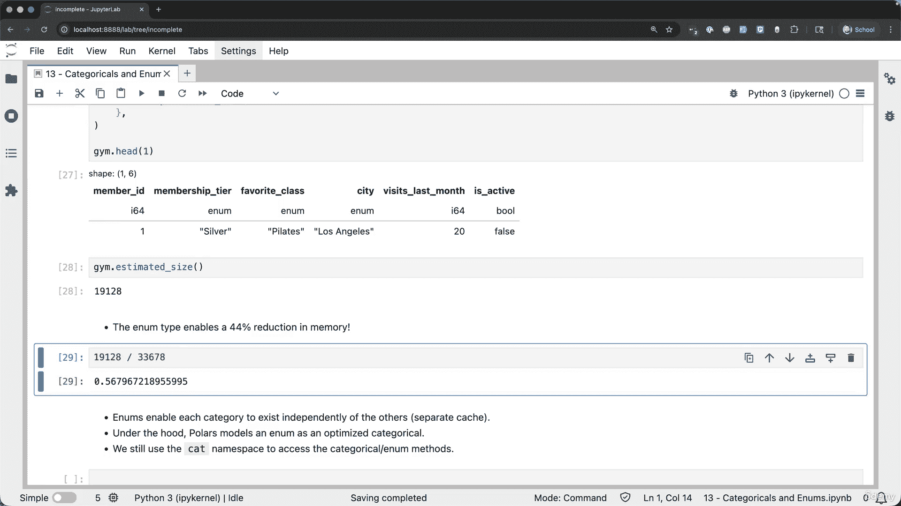

## 🧠 Polars与Python数据分析：第58节：解决全局缓存问题


上一节我们证明了枚举能大幅节省内存，本节中我们来看看枚举的另一个好处。上一课我们遇到一个问题：Polars会把多列的所有不同值都放在分类类型的分组或缓存下面。使用枚举方案后，这个问题解决了，现在各个枚举类型完全独立、完全分开。例如，下面可以对新的`gym`数据框调用`select`方法，创建一个针对`membership_tier`列的表达式。


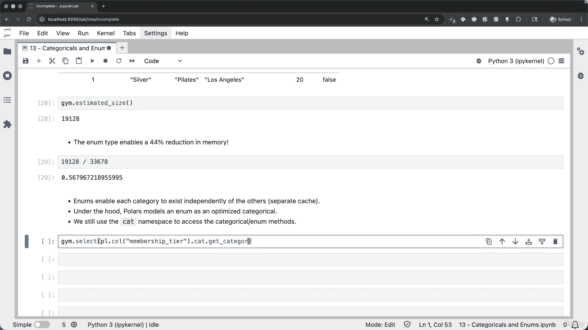

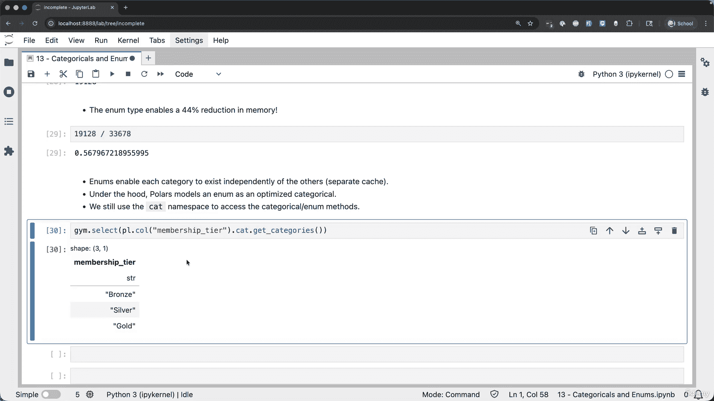

```python
gym.select(pl.col("membership_tier").cat.get_categories())
```


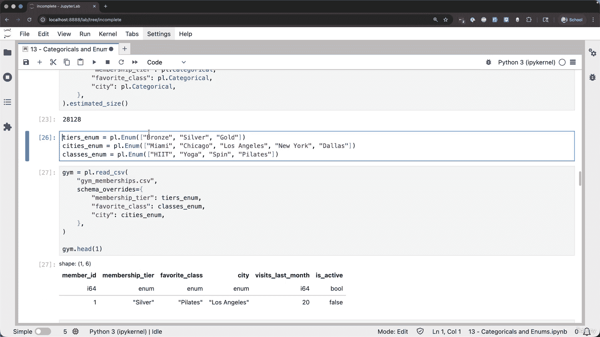

调用`get_categories`后，看到的只是`membership_tier`里的不同值，因为我们在前面已经为Polars完美定义好了这些值。现在你已经和单一的全局字符串缓存解耦。把这段代码复制到下面，替换成`favorite_class`列，再替换成`city`列，就能看到所有类别或不同枚举变体都存储在完全独立的分组里。这样当然更容易提醒我们：给定列里所有真正唯一的、不同的值是什么。枚举还有其他有趣的注意事项和优势，我们会在下一课继续探索。接下来做一个小结。


## ✅ Polars与Python数据分析：第58节：总结


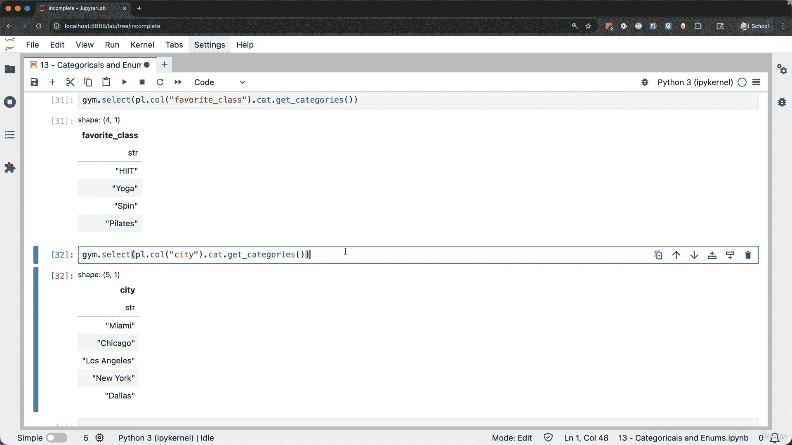

本节课中我们一起学习了Polars的枚举类型。枚举是分类类型的互补类型，二者几乎相同，唯一区别是枚举要求你提前知道并写出所有可能值。提前知道所有值时，优先使用枚举而不是分类类型，这是Polars团队的官方建议。我们创建了`pl.Enum([...])`形式的三个枚举类型，把它们放进`schema_overrides`，把字符串列直接读成枚举；检查后发现列类型从字符串变成`cat`再变成枚举，但功能保持一致。通过`estimated_size`比较，枚举只占用原始字符串内存的56%到57%，几乎减半，未来过滤和连接也会更快。枚举还让不同列的不同值完全独立，不再共用单一的全局字符串缓存。关键要点是：如果你提前知道所有值，就优先选择枚举类型；否则枚举和分类类型非常相似，它们都适合处理只有少量唯一不同值的字符串列。
