# Polars 与 Python 数据分析实战：第59节：Enums、Categoricals 与排序 🧭

在本节课中，我们将要学习 Polars 中 `Enum` 类型和 `Categorical` 类型在排序与过滤上的关键区别。上一节我们介绍了 `Enum` 的基本用法，本节我们来看看它在真实业务逻辑中的优势、可能带来的困惑，以及它和 `Categorical` 在排序行为上的不同。我们会从自定义排序、过滤比较、动态数据适配和类型选择几个角度展开，帮助你在实际分析中选对工具。

## Polars 与 Python 数据分析实战：59.1：Enum 与 Categorical 的基本区别 🧩

当我们使用 `Enum` 数据和 `Categorical` 数据时，会有一些有意思的细节和区别，尤其是在排序方面。有时我们可以利用 `Enum` 的优势来实现真实业务逻辑，但 `Enum` 的这种设计有时也可能带来问题。每当我们声明一个 `Enum`，就像上一节课那样，我们也会同时指定一种排序顺序，而这种排序顺序会打破字符串常规的字母排序。换句话说，如果某一列被赋予 `Enum` 类型，我们实际上是在表达“bronze 排在 silver 前面，silver 排在 gold 前面”。如果这一列是普通字符串，字母序并不是这样：bronze 会排在 gold 前面，因为 B 在 G 前面；gold 又会排在 silver 前面，因为 G 在 S 前面。使用 `Enum` 时，我们会选择覆盖这个默认顺序，并声明自己的排序顺序。同样的逻辑不适用于 `Categorical`，`Categorical` 通常仍按你预期的字母顺序排序。

为了更清楚地理解这两种类型的使用方式，下面列出本课示例代码中采用的基本设置。

- `membership_tier` 和 `favorite_class` 继续依赖上方定义的 `Enum` 类型。
- `city` 改用 `Categorical` 类型。
- `Categorical` 的效率比 `Enum` 稍低，但仍然比直接存储字符串更高效。

```python
import polars as pl

df = df.with_columns(
    pl.col("membership_tier").cast(
        pl.Enum(["bronze", "silver", "gold"])
    ),
    pl.col("favorite_class").cast(pl.Enum([...])),
    pl.col("city").cast(pl.Categorical),
)
```

执行这段代码后，可以看到 `membership_tier` 是 `Enum`，`favorite_class` 是 `Enum`，而 `city` 是 `Categorical`。这也说明，同样是节省内存、优化字符串存储的类型，`Enum` 和 `Categorical` 在排序语义上并不完全一样。下面我们进一步看看 `Enum` 的排序顺序是如何被声明顺序决定的。

## Polars 与 Python 数据分析实战：59.2：Enum 的自定义排序 🏅

如前所述，`Enum` 声明中各个取值的顺序决定了排序顺序。我们来看看对 gym 数据框按 `membership_tier` 排序时会发生什么。这里的排序方法叫 `sort`，可以指定要排序的列；甚至不需要写表达式，直接传入列名即可。

```python
gym.sort("membership_tier")
```

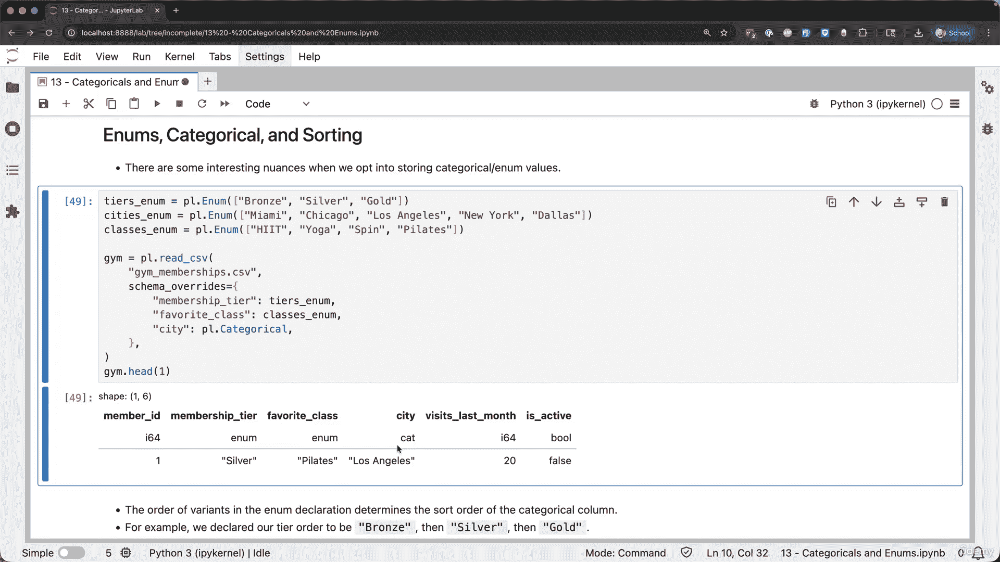

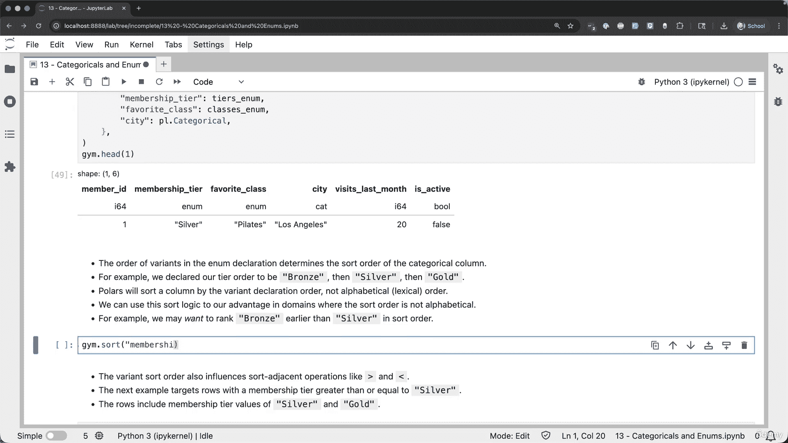

排序结果不会按字母顺序排列，而是按照 `Enum` 中定义条目的顺序排列：bronze 在前，然后是 silver，最后是 gold。结果确实就是按这个顺序排的。如果你希望按照某种业务观念排序，例如健身房认为 gold 会员比 bronze 会员更重要，因为 gold 会员每月可能带来更多收入，那么这种排序可能就是你要的。有时你会希望对小规模唯一值数据按排名或层级排序，其中一个值比另一个值更有价值，或者代表更高层级。这时你可以用 `Enum` 声明自定义排序顺序，摆脱字符串默认的字母排序。

不过，这种设计也可能让人感到意外。因为你可能本来想按字母顺序排序，然后看到结果时觉得哪里不对；答案是没有出错，这只是使用 `Enum` 时的一个细节。为了更直观地掌握这个规则，下面列出 `Enum` 排序的几个关键观察点。

- `Enum` 的排序顺序来自声明时的取值顺序。
- 排序结果可以体现业务优先级，例如 gold 高于 silver，silver 高于 bronze。
- 这种排序会覆盖普通字符串的字母序。
- 如果你期待字母序，需要意识到 `Enum` 可能不会按字母序返回结果。

\[
\text{Enum 自定义排序：}\quad \text{bronze} \prec \text{silver} \prec \text{gold}
\]

\[
\text{普通字符串排序：}\quad \text{bronze} \prec \text{gold} \prec \text{silver}
\]

理解排序之后，我们还需要注意，排序并不是唯一受影响的操。与排序相邻的一些操作也会受到 `Enum` 排序顺序的影响，下一节我们来看看过滤操作。

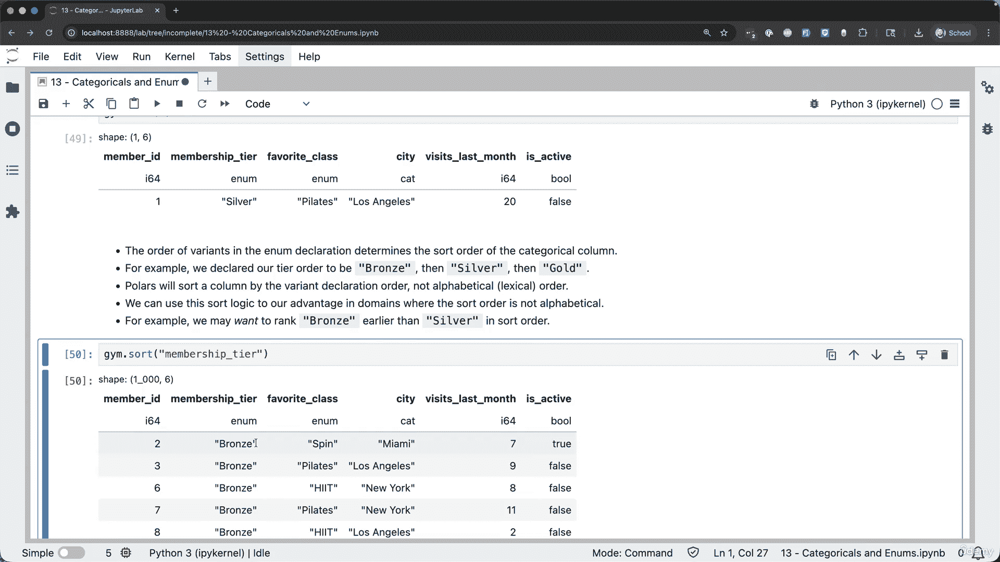

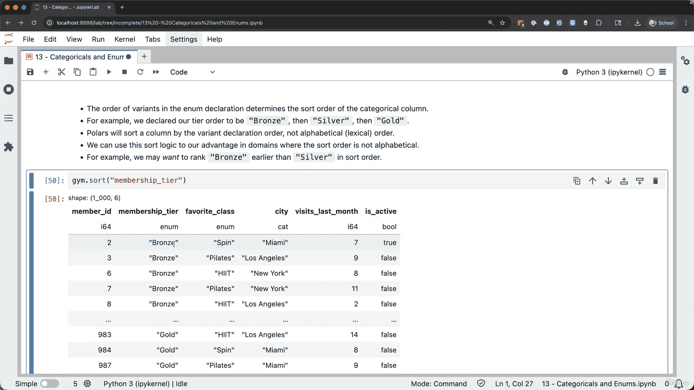

## Polars 与 Python 数据分析实战：59.3：过滤操作也受 Enum 顺序影响 🔎

与排序相邻的其他操作也可能受到影响。例如，我们调用 `filter` 方法，并在表达式中再次定位 `membership_tier` 列，然后写一个类似“大于或等于 silver”的条件。

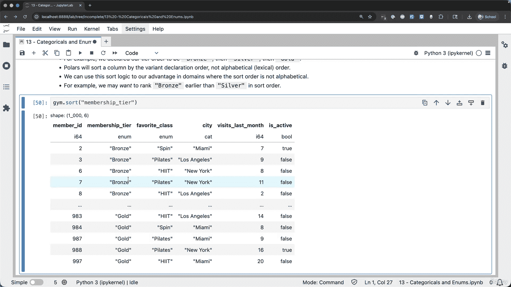

```python
gym.filter(pl.col("membership_tier") >= "silver")
```

这个条件要求取出 `membership_tier` 列中等于 silver 或大于 silver 的所有行。按照我们的自定义排序顺序，大于 silver 的值包括 gold。因此，这里会取出 silver 和 gold 对应的所有行；从上方这个 `Enum` 的排序视角来看，任何大于或等于 silver 的值都会包括 silver 和 gold。我们实际上是在这里重新定义自定义排序逻辑，这也是 `Enum` 排序影响过滤的典型例子。

为了更清楚地理解过滤时的比较逻辑，下面列出几个需要注意的点。

- `>= "silver"` 不是简单按字母序比较，而是按 `Enum` 声明顺序比较。
- 在 bronze、silver、gold 的顺序中，silver 和 gold 都满足条件。
- 过滤操作会复用 `Enum` 的自定义排序语义。
- 如果换成普通字符串列，比较结果可能完全不同。

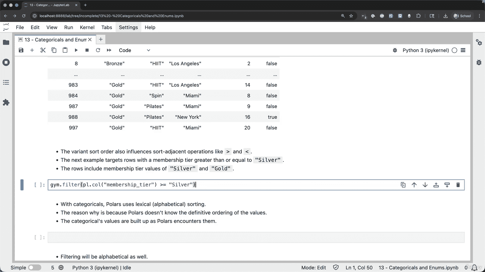

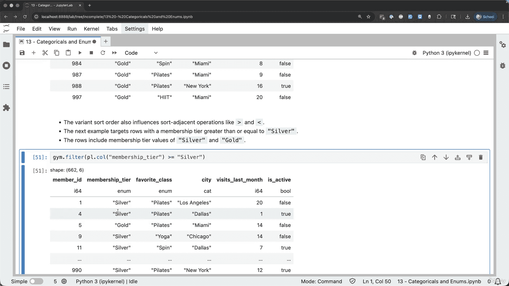

\[
\text{Enum 过滤条件：}\quad \text{membership\_tier} \ge \text{silver}
\quad \Longrightarrow \quad \{\text{silver}, \text{gold}\}
\]

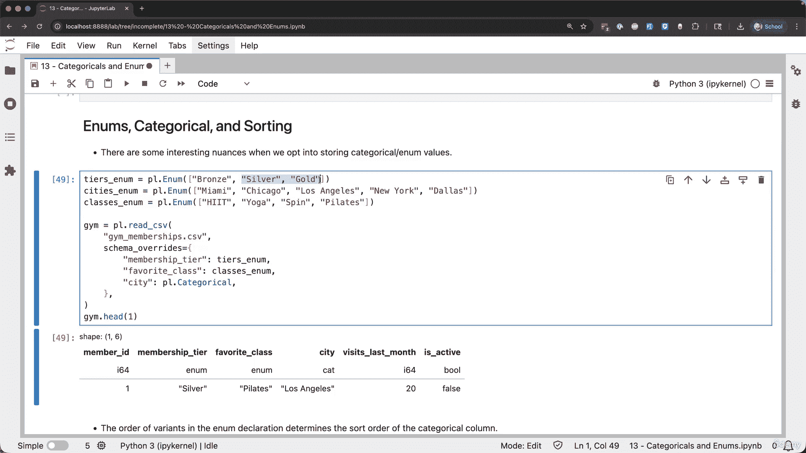

既然 `Enum` 会改变排序和过滤行为，那么 `Categorical` 又会怎样呢？接下来我们会看到，`Categorical` 通常保持常规的字母排序行为。

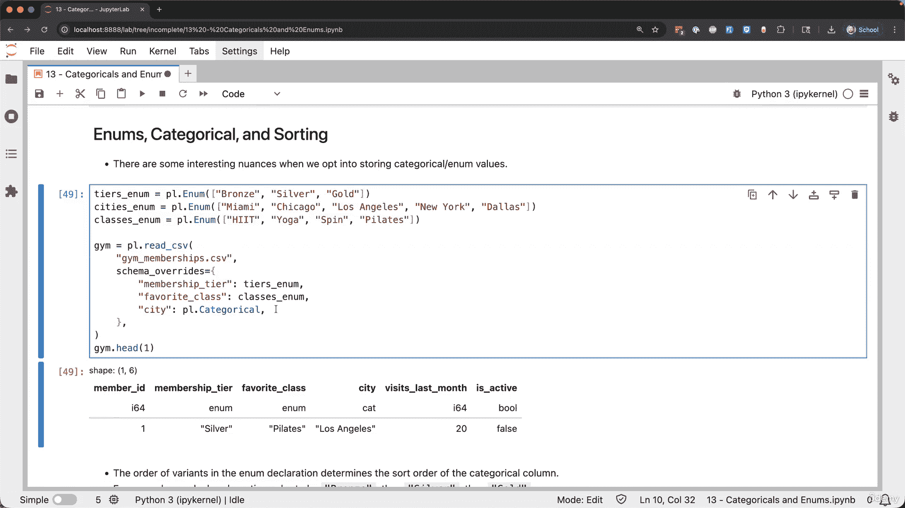

## Polars 与 Python 数据分析实战：59.4：Categorical 的默认排序与适用场景 📊

对于 `city` 这样的 `Categorical` 列，我们会得到常规排序行为。下面再次使用 gym 数据框，调用 `sort` 方法，按 `city` 进行普通排序。

```python
gym.sort("city")
```

可以看到，这里会得到常规的字母排序：Chicago 确实是列表中字母序最靠前的城市，New York 是字母序最靠后的城市。Polars 会使用字母排序，文档中有时也把这种排序称为词典排序。之所以要区分这一点，是因为 Polars 不知道这些值的确定顺序；事实上，每次 Polars 解析数据框时，这个顺序都是动态生成的。这正是 `Categorical` 适合动态数据的原因：你可能无法提前完美预测所有数据，数据变化很多，条目也不一定全部已知，而 Polars 会非常优雅地为你找出所有唯一值集合。不过，你也要付出一点代价：与 `Enum` 相比，`Categorical` 会稍微多消耗一点内存。使用 `Enum` 时，你需要预期自己提前知道所有取值，而且这些取值通常不会变化；你希望把它们写一次，然后后续一直按这个定义工作。

为了更完整地比较 `Categorical` 的特点，下面列出它在实际使用中的几个关键特征。

- `Categorical` 通常按字母序或词典序排序。
- `Categorical` 的顺序是动态生成的，适合无法提前完全确定唯一值的数据。
- `Categorical` 比普通字符串更省内存，但通常比 `Enum` 稍多占一点内存。
- `Categorical` 的过滤比较也按字母序进行，而不是按自定义业务顺序。

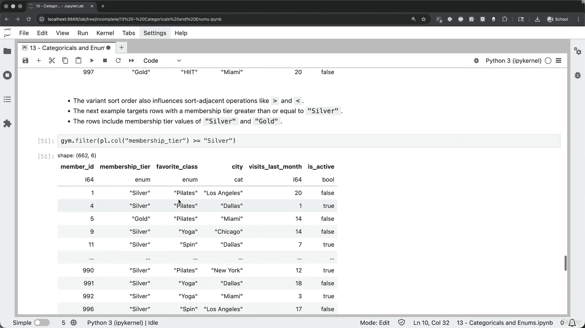

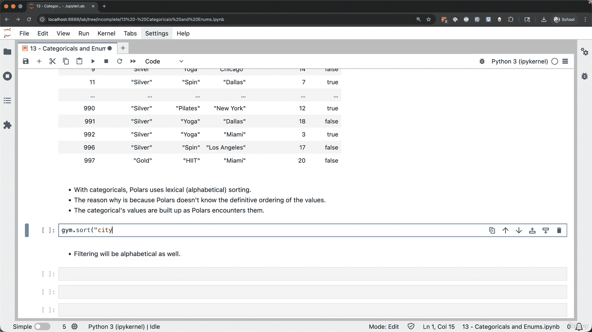

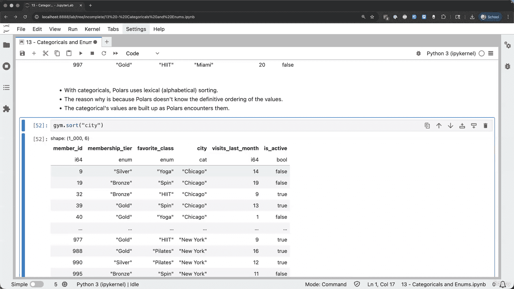

```python
# Categorical 的排序示例
gym.sort("city")

# Categorical 的过滤示例
gym.filter(pl.col("city") > "Los Angeles")
```

这里按 `city` 过滤“大于 Los Angeles”时，实际上就是对字符串做字母比较，选出所有在字母表中排在 Los Angeles 后面的值。基本上，只要首字母大于 L，就会包含进来，因此 Miami 和 New York 对应的行会进入结果。这正是普通字符串列会有的行为，也是 `Categorical` 会有的行为。相比之下，`Enum` 的排序顺序不同，所以过滤结果也可能不同；使用 `Enum` 时要特别留意这一点。下面我们把这些差异汇总起来，看看如何选择合适的数据类型。

## Polars 与 Python 数据分析实战：59.5：如何在 Enum 与 Categorical 之间选择 🧠

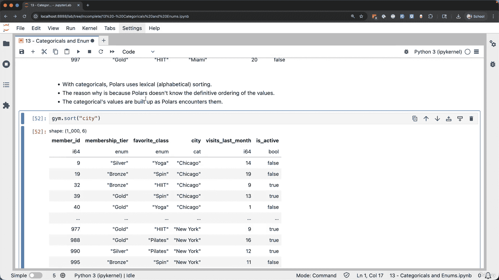

你需要根据数据本身以及你对数据的了解程度，思考到底该用哪种数据类型，并为任务选择最合适的工具。无论选择 `Enum` 还是 `Categorical`，相比普通字符串都能获得好处，因此它们都值得放进你的 Polars 工具箱。`Enum` 适合取值集合固定、需要业务排序或层级排序的场景；`Categorical` 适合取值集合动态、无法提前完全枚举、但仍希望比字符串更高效存储的场景。

为了帮助初学者快速做决定，下面列出选择时可以参考的对比点。

- 如果所有取值都已知、基本不变，并且排序顺序有业务含义，优先考虑 `Enum`。
- 如果唯一值可能动态变化、无法提前全部列出，优先考虑 `Categorical`。
- 如果只需要按字母序排序和过滤，`Categorical` 的行为更符合常规预期。
- 如果需要自定义排序和基于层级的过滤，`Enum` 更合适。
- 两种类型通常都比普通字符串更高效，但内存和语义上各有取舍。

```python
# 选择逻辑示意
if 取值集合固定 and 需要业务排序:
    dtype = pl.Enum(["bronze", "silver", "gold"])
else:
    dtype = pl.Categorical
```

## Polars 与 Python 数据分析实战：59.6：本节小结 ✅

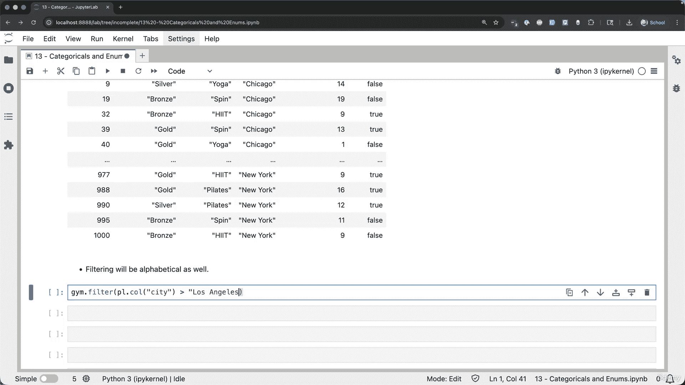

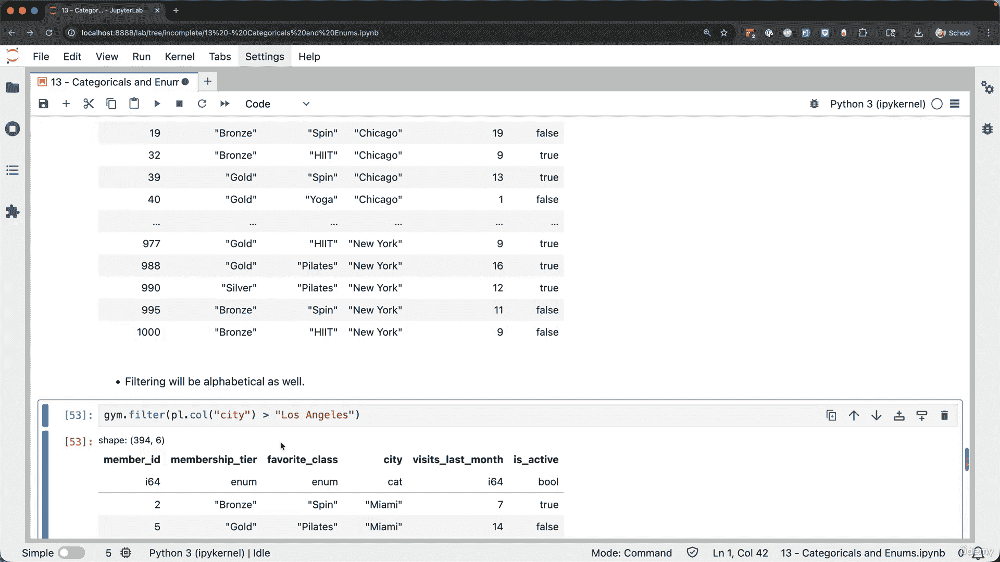

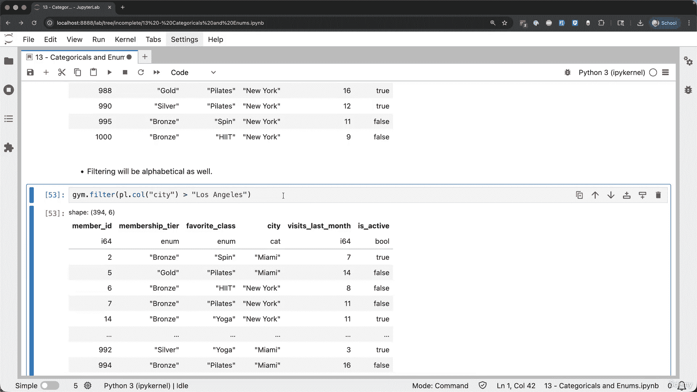

本节课中，我们一起学习了 `Enum` 与 `Categorical` 在排序和过滤上的核心区别。`Enum` 会按照声明顺序建立自定义排序，因此 bronze 可以排在 silver 前面，silver 可以排在 gold 前面，并且这种顺序会影响过滤比较；`Categorical` 通常按字母序或词典序排序，更适合取值动态、无法提前完全枚举的数据。使用 `Enum` 时，你需要提前知道所有取值并接受它覆盖默认字母序；使用 `Categorical` 时，你会获得更灵活的动态唯一值处理能力，但内存开销通常比 `Enum` 稍高。两者都比普通字符串更有优势，实际使用时根据数据特征和业务需求选择即可。

