# 📅 Polars与Python数据分析（第二部分）：第160节：导入包含日期时间的数据集

在本节课中，我们将正式进入课程的新章节，这个章节的标题是“处理日期和时间”。我们将使用Polars来处理时间数据，也就是与日期和时间相关的数据。我们将学习如何把字符串列转换成日期时间列，以及反过来操作；还会学习提取日期时间中的各个组成部分，比如月份、年份、星期几；讨论如何过滤时间序列数据，如何对时间做加法和减法，如何处理时区，等等。本节是这一章的第一节，我们要做的第一件事，就是导入一个带有日期时间的数据集，看看Polars在默认情况下是怎么对待这些字符串的，然后再介绍几种转换成真正日期时间类型的办法。相信学完本节，你就知道拿到含时间的数据后，第一步该做什么了。

## 准备工作：打开新的笔记本并导入Polars

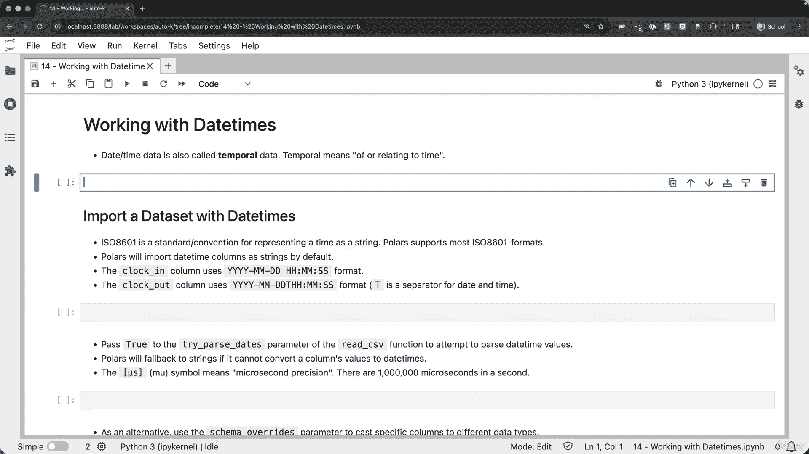

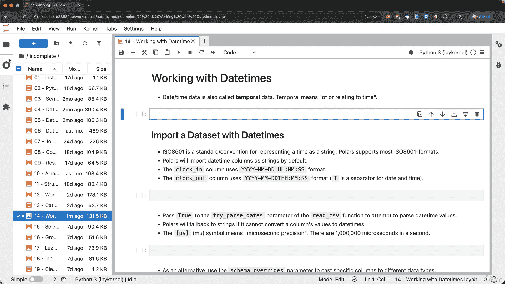

首先，我们还是按照老习惯，打开一个新的Jupyter notebook，给它命名为`14_working_with_datetimes`。这个笔记本将会专门用来做本章的实验。打开之后，我们做任何Polars操作之前，都要先把Polars库导入进来。导入方法很简单，就是用`import`关键字，然后给这个库一个别名`pl`。这样后面写代码的时候，就不用每次都打一长串“polars”了，直接用`pl`就行。下面是导入代码：

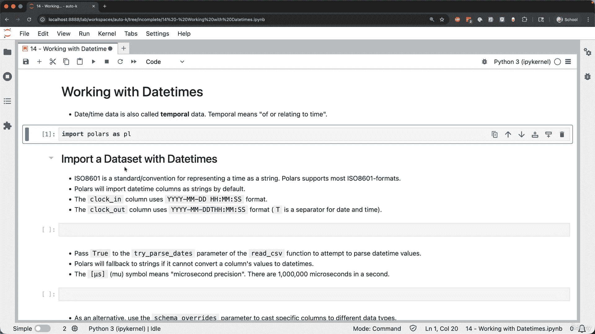

```python
import polars as pl
```

导入成功后，我们立刻开始下一步：读取一个现成的数据集。这里我们使用`pl.read_csv`这个函数，然后读取名为`clockintimes.csv`的文件。读取之后，你会看到一个DataFrame，里面包含了员工的打卡时间信息。我们来看一下原始数据长什么样子。

## 默认导入行为：字符串还是字符串

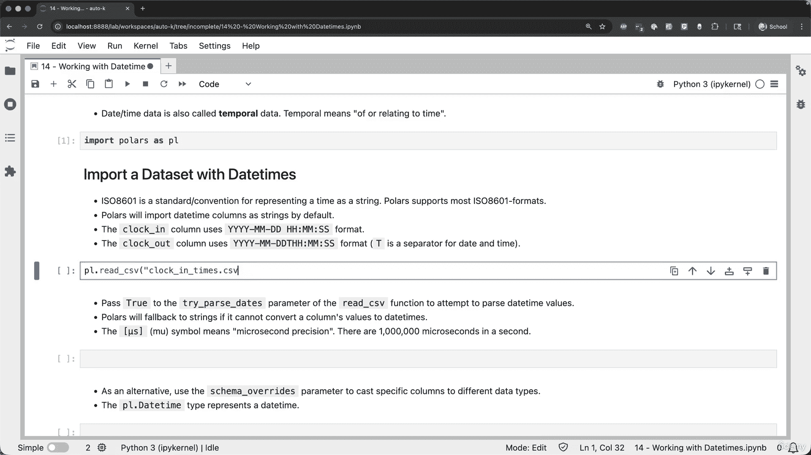

我们之前已经见过很多次了，Polars在做CSV导入的时候，默认是不会从字符串列里去推断日期时间类型的。它宁可保留原始的字符串类型，也不肯“自作聪明”地帮你把看起来像时间的字符串转成时间。这其实是Polars的设计哲学：尽量保持数据原样，把转换的选择权交给你。所以，你会看到这两个列，`clock_in`和`clock_out`，里面存的值明显是用字符串来表示的日期时间，但Polars默认就是视它们为普通字符串。

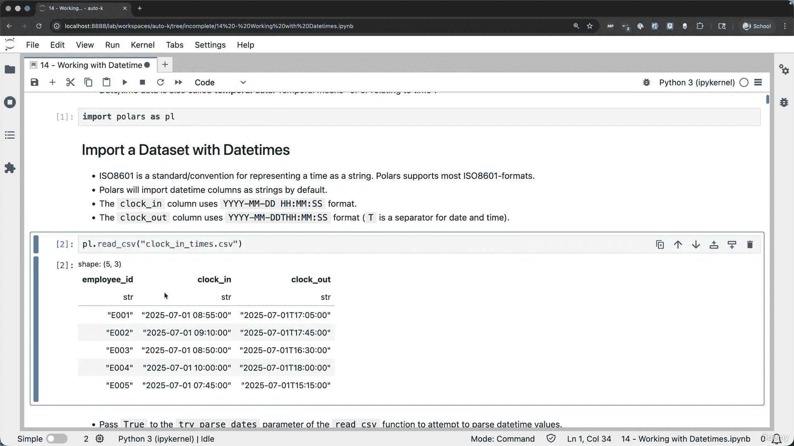

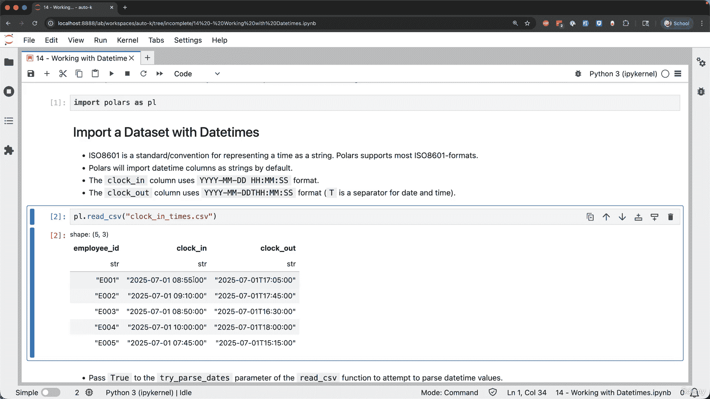

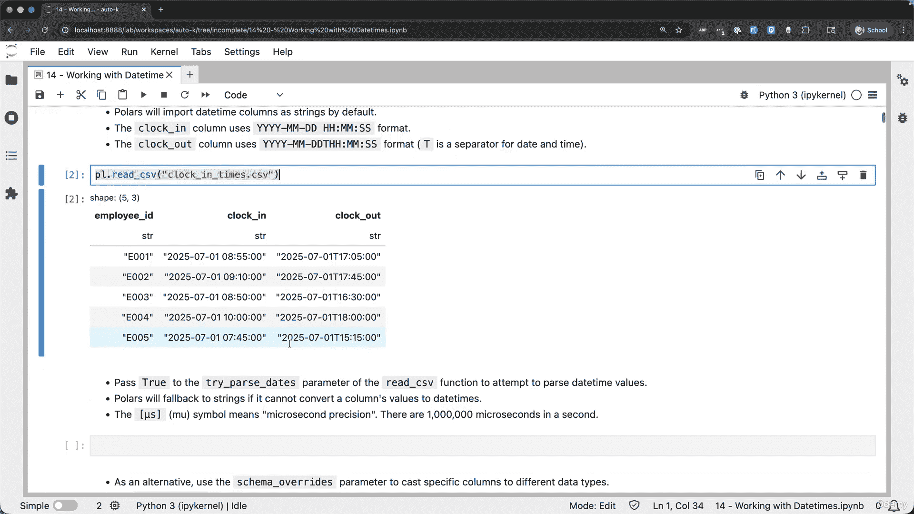

我们仔细看一下这两个列的格式。它们其实长得有点类似，但又有点不一样。两者都包含年份、月份、日期，然后还有小时、分钟、秒。区别在于`clock_out`这一列里面，日期和时间之间有一个大写的字母`T`作为分隔符。这个`T`是国际标准ISO 8601里表示日期时间分隔的常见符号。所以，这两个格式虽然有点差异，但都属于非常常见、非常标准的日期时间字符串格式。正因为它们“守规矩”，Polars才能轻松地把这两列都转换成真正的日期时间列。

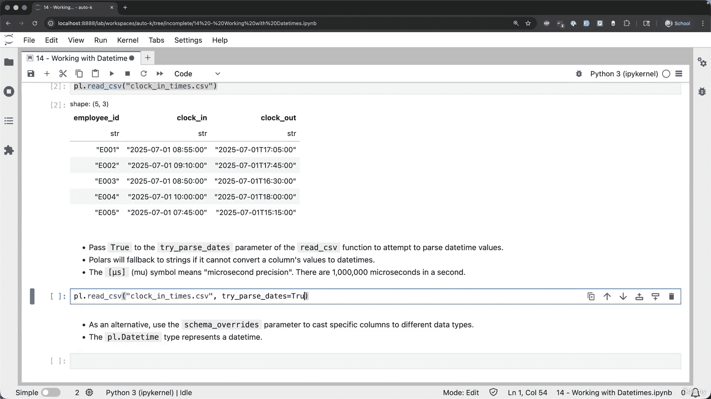

为了让这个区别更直观，我们可以在下面运行代码看一下这两列当前的数据类型。你会看到两个列的显示结果里都写着`str`，也就是字符串类型。这没什么好奇怪的，因为Polars默认就是按字符串读取的。你不用慌，我们马上就有办法把它们变成日期时间类型。

## 方法一：用 try_parse_dates 参数自动解析

如果你原始数据里的字符串列，用的都是这种常见的、符合约定的日期时间格式，那么最简单的转换方法就是：在`read_csv`函数里传一个`try_parse_dates`参数，并把它的值设置为`True`。也就是说，你只要在导入的时候多写一个参数，Polars就会自动去识别那些长得像日期时间的字符串，并把它们转成日期时间类型。下面是具体的代码：

```python
df = pl.read_csv("clockintimes.csv", try_parse_dates=True)
```

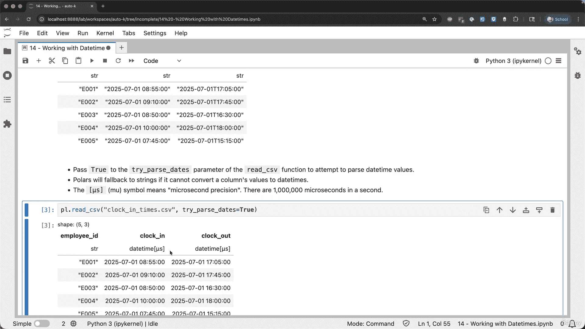

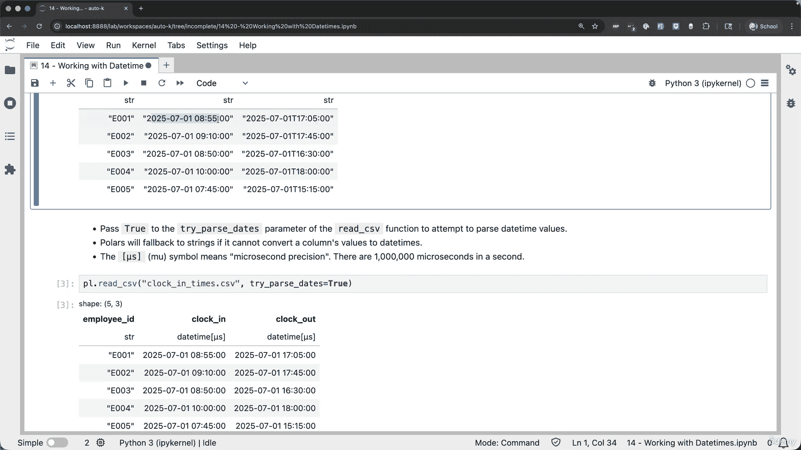

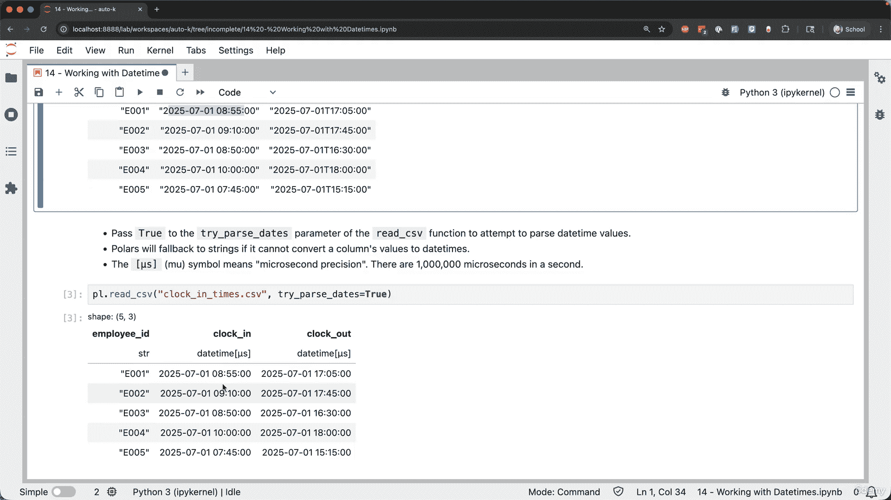

运行完这个代码之后，你再去看DataFrame，就会注意到`clock_in`和`clock_out`这两列的数据类型已经变成`datetime`了。你看，就是这么简单，一行代码就搞定了。

不过这里也要提个醒：有时候，如果你的字符串里存的日期时间格式比较“非主流”，比如不是标准的`YYYY-MM-DD`这种，而是什么`月/日/年`加奇怪的分隔符，那么`try_parse_dates`可能会失效，不能正确解析。对于这种特殊情况，我们会在下一节课专门讲怎么处理。在这一节，大家先记住这个参数的用法，并且看到它能够成功解析常规格式就好。

## 方法二：用 schema_overrides 参数显式指定类型

除了`try_parse_dates`，我们还有一个办法，那就是使用`schema_overrides`参数。这个参数我们在前面应该也见过，它的作用是允许你传一个字典进去，告诉Polars：对于某些特定的列，我希望你用我指定的数据类型来推断，而不是用默认的那套推断规则。这里有一个很贴心的地方：你不必把每一列都写出来，你只需要写那些你想覆盖默认类型的列就行了，剩下的列Polars还是会按它自己的默认逻辑来处理。

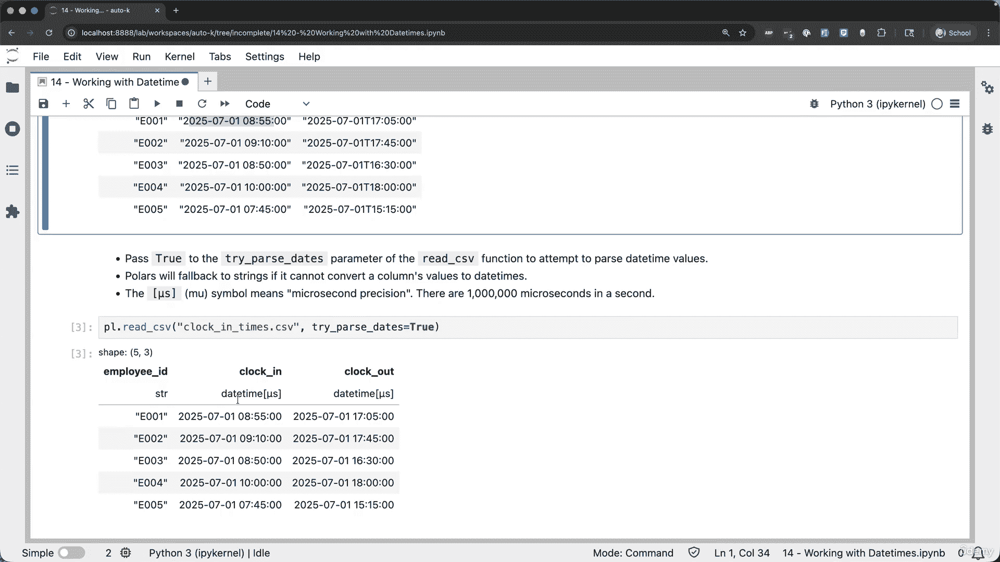

比如，我们现在可以写一个字典，把`clock_in`和`clock_out`这两列都指定为`datetime`类型。在Polars的顶层命名空间里，你可以找到所有支持的数据类型，其中就有这个`datetime`类型。我们直接在`pl.Datetime`这样的写法里使用它。代码如下：

```python
schema_overrides = {
    "clock_in": pl.Datetime,
    "clock_out": pl.Datetime,
}

df = pl.read_csv("clockintimes.csv", schema_overrides=schema_overrides)
```

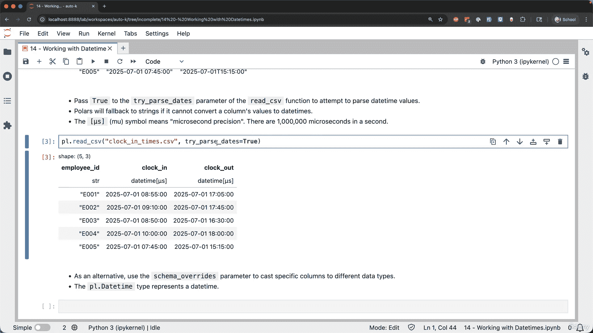

你会发现，运行结果和上面用`try_parse_dates`得到的结果是一模一样的。这两种方式都是在导入的时候完成转换，你选哪一种都可以，完全看个人喜好。我个人觉得，如果只是图方便，`try_parse_dates=True`会更省事；如果你需要对每一个列进行更精细的控制，那`schema_overrides`会更合适。

## 方法三：导入之后用 str.to_datetime 方法转换

上面两种方式都是在导入数据的时候做转换。但现实情况中，你可能早就已经把数据给读进来了，数据框已经在内存里了，你不想回头再去改导入代码。这种情况下，还有没有别的办法？答案是有的。你可以直接去转换那个列本身。

具体的做法是，用`with_columns`方法配合`str.to_datetime`。这里的`str`是Polars里的一个命名空间，专门放各种字符串处理方法。我们之前学习字符串操作的时候，应该已经接触过这个命名空间了。在这个`str`命名空间下面，有一个叫做`to_datetime`的方法，这个方法能够把当前列里的所有值逐一转换成日期时间值，然后返回一个全新的日期时间列。

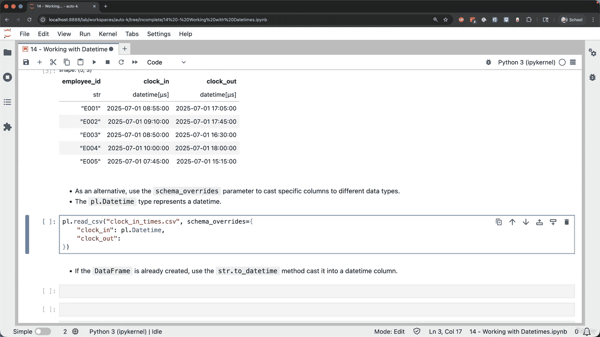

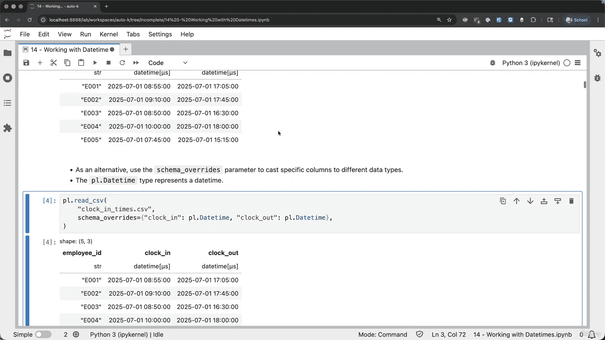

下面我们来看具体的例子。我们先用`pl.read_csv`把数据读进来，并赋值给一个名为`clock_in_times`的变量，这里就当作我们没有用刚才那两种参数，所以读进来后是原始的字符串版本。然后我们调用`with_columns`方法，在方法里面选择`clock_in`这个列，接着调用它的`str.to_datetime`方法。注意，因为我们没有给这个新列指定新的名称，所以转换后的列会直接替换掉原来那个同名的列。我们把表达式复制一下，再把目标列改成`clock_out`，于是两列都被转换了。代码如下：

```python
clock_in_times = pl.read_csv("clockintimes.csv")

clock_in_times = clock_in_times.with_columns(
    pl.col("clock_in").str.to_datetime(),
    pl.col("clock_out").str.to_datetime(),
)
```

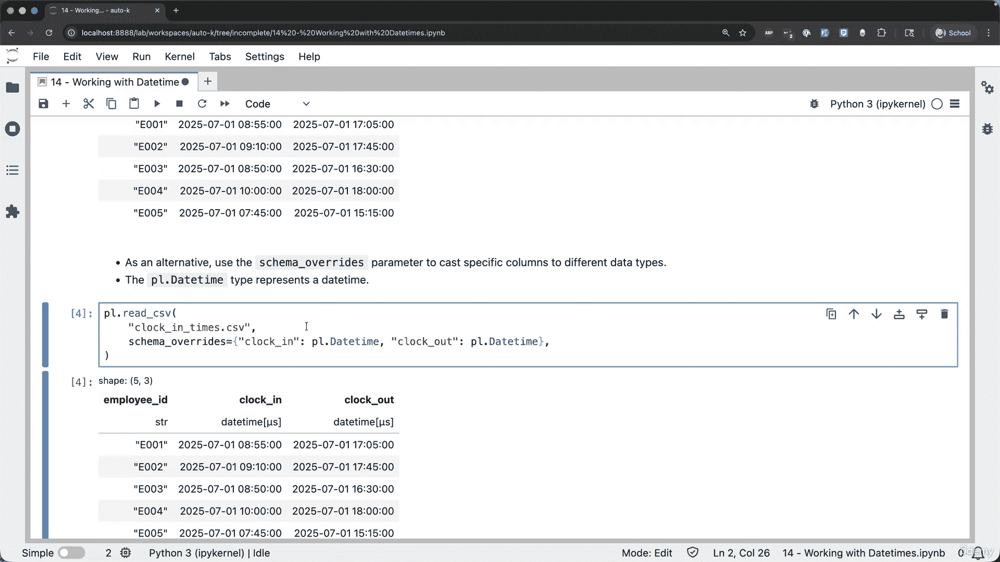

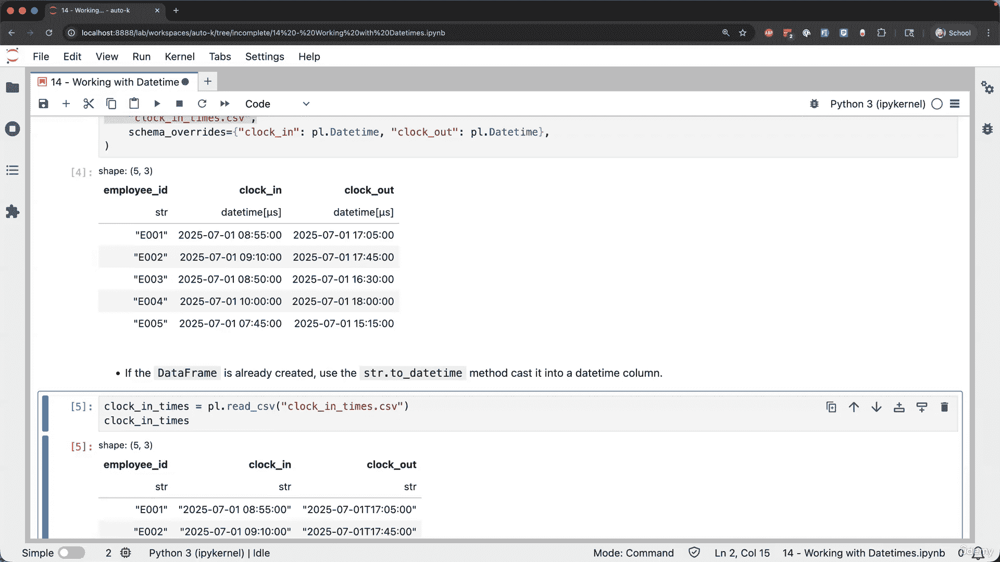

运行完之后，你会得到和前面完全一样的结果：两个`datetime`类型的列。所以你看，不管是导入时转换，还是导入后再转换，Polars都给你准备好了相应的工具。你完全可以根据自己的使用场景来选。

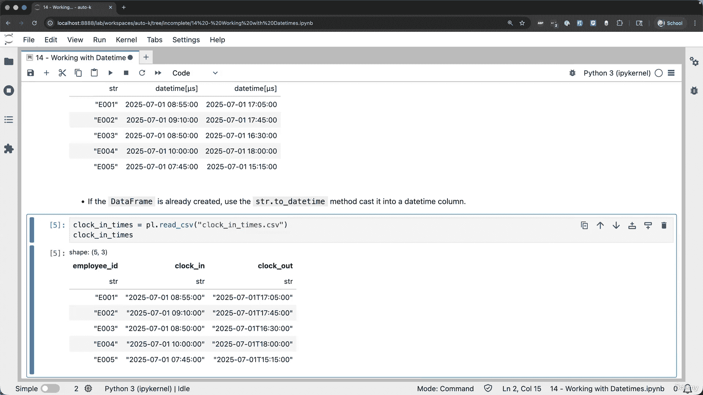

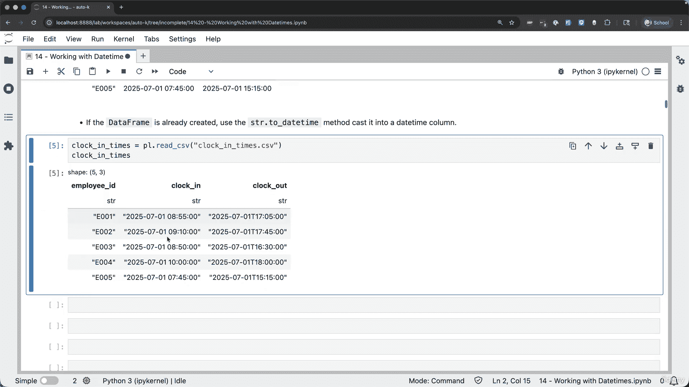

## 为什么要把字符串列转成日期时间列？

现在你可能会想：费这么大劲把字符串转成日期时间，到底图什么？原因很简单：一旦列变成了`datetime`类型，你就能够使用所有和日期时间相关的功能了。因为日期时间是一种专门的数据类型，Polars在处理时间数据的时候，可以对这种列执行很多操作，而这些操作是无法对字符串列进行的。你想想，对于Polars来说，字符串就是一串字符文本，没有任何数学或时间上的含义。你让一列字符串加7天，Polars会一脸懵：这一堆字母和数字，怎么加？这种操作没有意义。但如果你有一个日期时间列，然后你想给这一列里的每一个值都加上7天，那就是小菜一碟了。

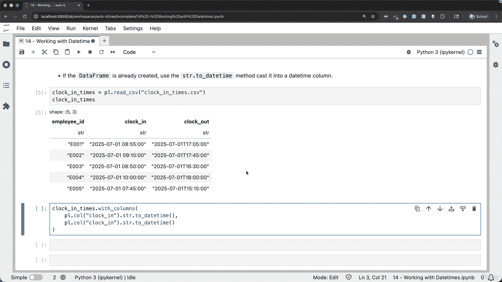

另外，你还会注意到，在`datetime`类型的显示结果旁边，有一个特殊的小符号`μ`。这个符号叫“μ”，是希腊字母。它的出现并不代表列里有什么奇怪的字符，而是用来表示存储格式的精度水平的。具体来说，`μ`这个符号在时间单位里代表“微秒”（microseconds）。这里补充一个知识点：一秒里面有100万个微秒。也就是说，如果你的数据对时间精度要求特别高，连微秒级别的差异都想保留下来，Polars是完全可以支持的。我自己在实际工作中，还真没遇到过数据精确到时分秒以下的情况，通常到秒就已经很细了。但万一你就是那个需要处理微秒级数据的幸运儿，Polars已经准备好了，你不用担心它不支持。这也是为什么你会看到`datetime`类型下面会标出这么细的精度说明，告诉你这个时间戳的存储格式到底能精确到什么程度。

说回到类型本身。`datetime`类型表示的是有日期又有时间的一个时间点，它会同时记录日历上的某一天，以及这一天中的某个具体时刻。比如我们的数据里有一个值，表示的是2025年7月1日上午8点55分，那么用`datetime`类型就能精确地表示这个瞬间。除了`datetime`，还有两个与之互补的类型，一个是`date`类型，它只存储日历日期，不带时间部分；另一个是`time`类型，它只存储时间，不带日期部分。这三个类型各有各的用途，之后我们都会用到。

## 总结

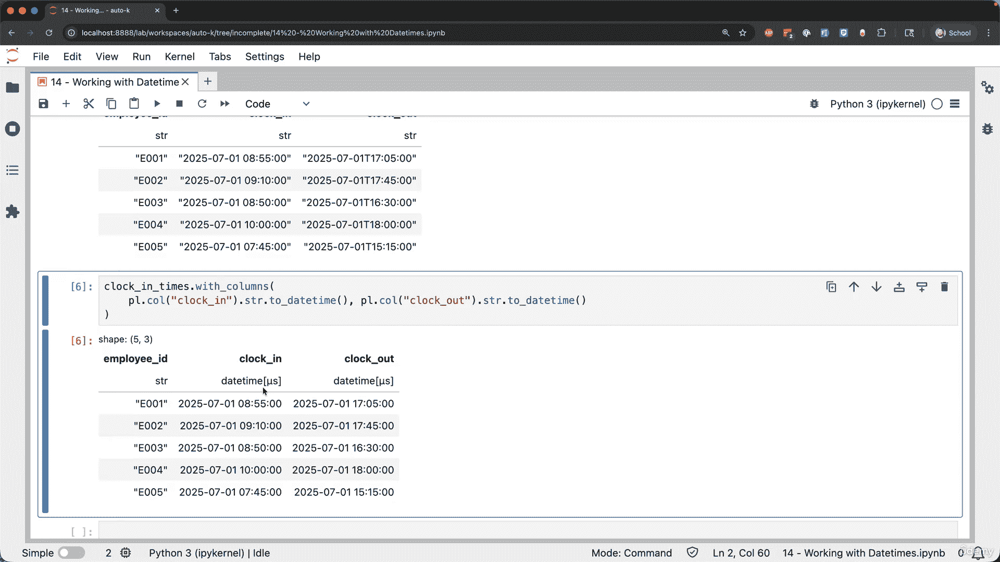

这节课的内容就到这里了。我们一起学习了如何导入一个带有日期时间的数据集。首先，我们看到了Polars的默认行为：它把看起来像日期的字符串当成普通字符串处理，不会自动推断。接着，我们介绍了三种转换办法。第一种是在`read_csv`里设置`try_parse_dates=True`，让Polars自动解析常见格式；第二种是用`schema_overrides`参数，传入一个字典来逐列指定数据类型为`datetime`；第三种是导入之后，使用`with_columns`和`str.to_datetime`来手动转换列。我们还解释了为什么要做这个转换，因为只有`datetime`类型才能享受加减时间、提取月、年、工作日、过滤时序数据等等一整套时间相关的操作。最后还认识了`datetime`类型旁边的`μ`符号，以及`date`和`time`两个兄弟类型。在下一节课里，我们将进一步探索处理时间数据的各种方法。到时候见。
