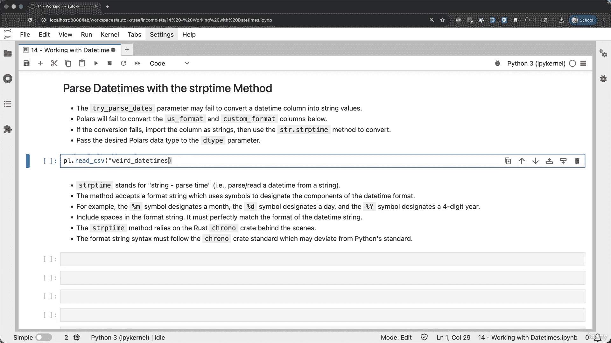
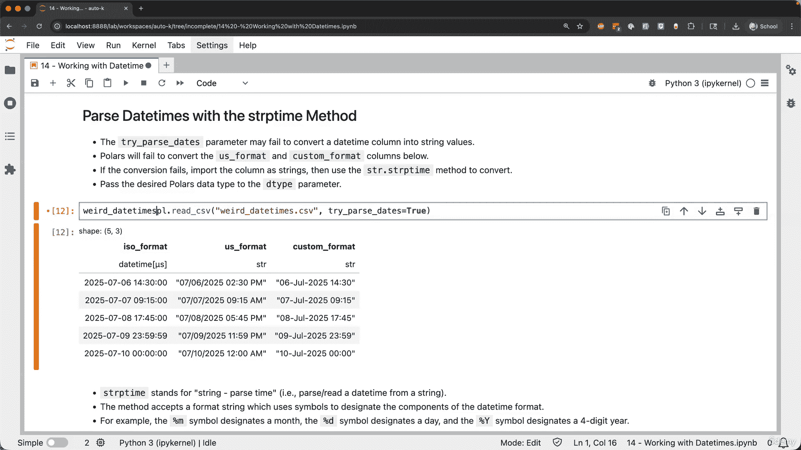
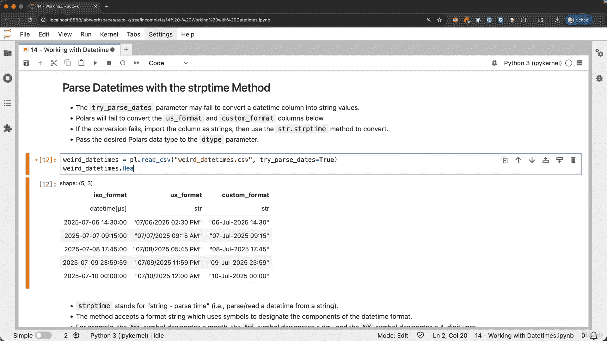
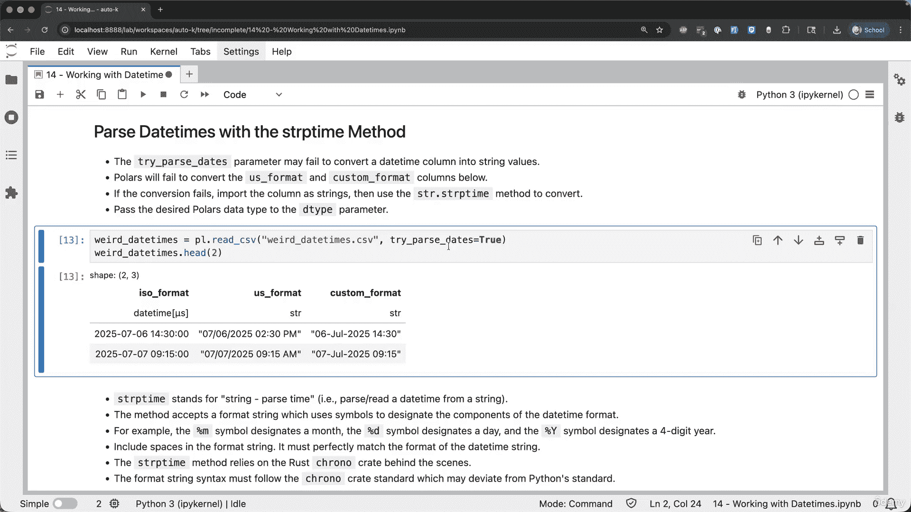
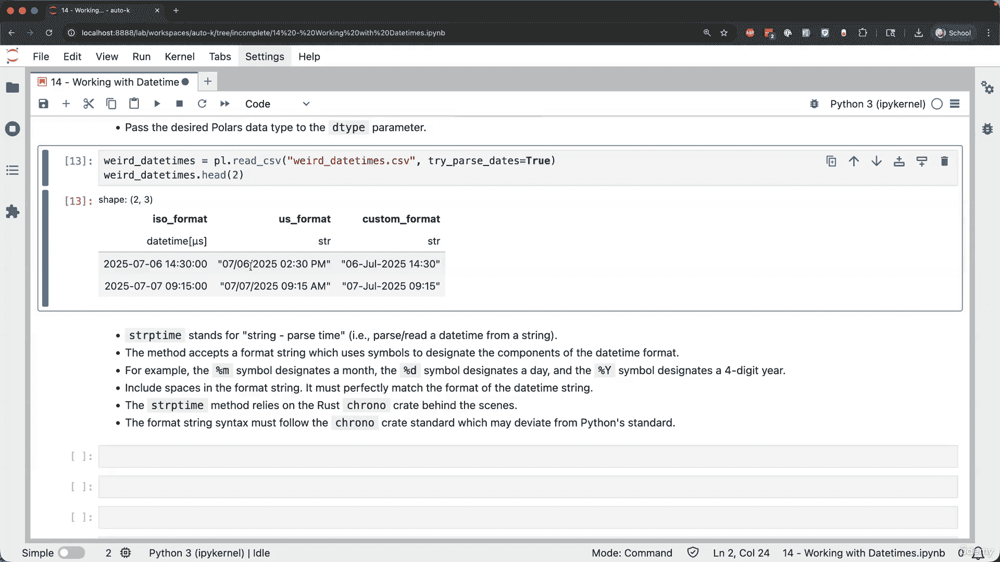
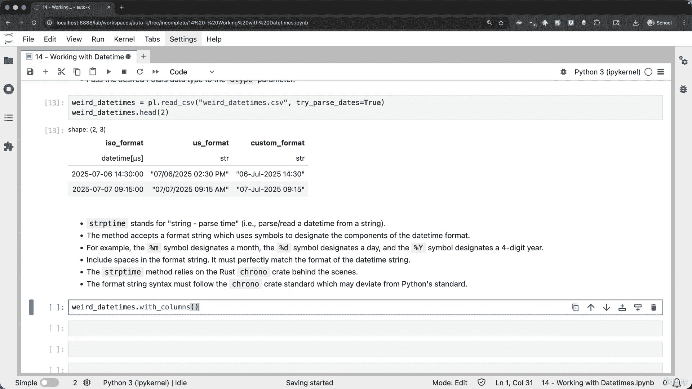
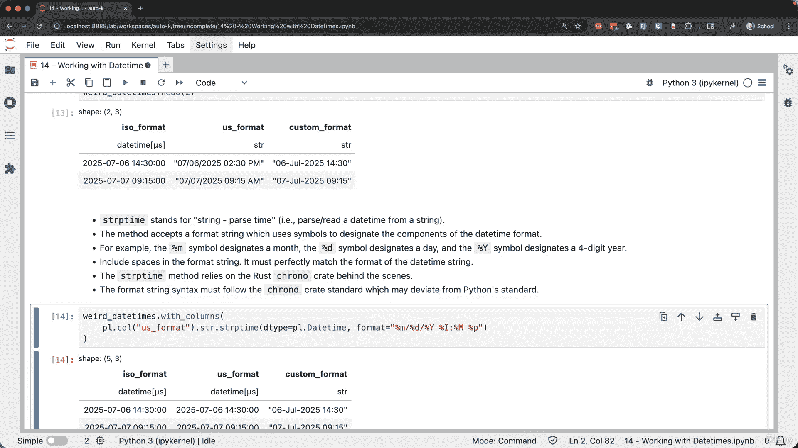
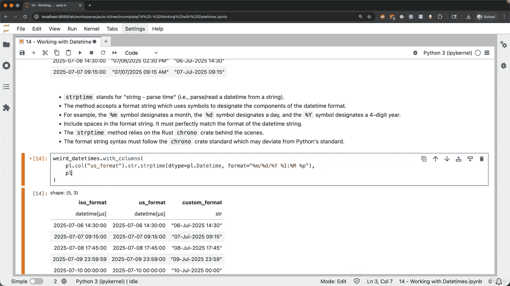
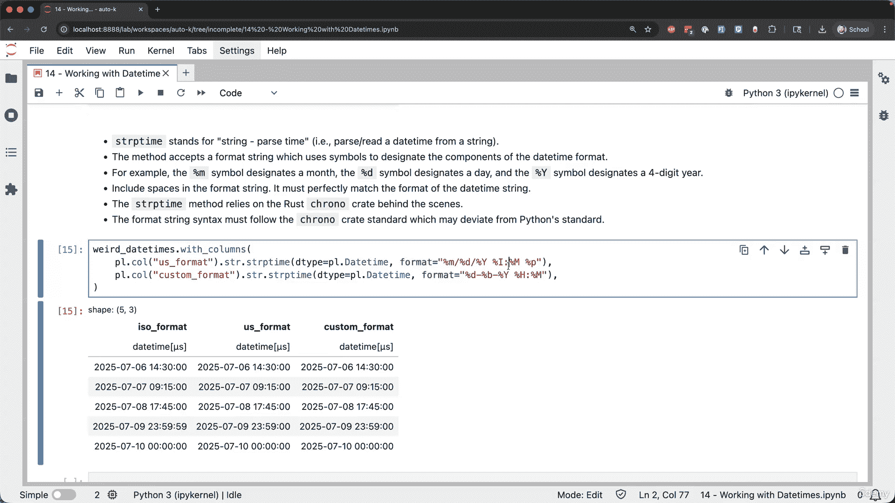

# 📊 Polars 与 Python 数据分析：161：使用 strptime 方法解析日期时间



在本节课中，我们将要学习 Polars 在字符串日期时间转换失败时，如何使用 `str.strptime` 方法手动解析日期时间。我们会先导入一个包含多种奇怪日期时间格式的数据集，观察 `try_parse_dates=True` 能自动识别哪些列；再分别针对美式格式和自定义格式编写格式字符串；最后说明格式符号的来源和大小写敏感性。整个流程会从读取数据开始，逐步过渡到手动指定格式，让初学者也能理解每一步在做什么。

## 📥 导入包含多种日期时间格式的数据

上一节我们已经接触过自动解析日期时间的方法，本节中我们来看看自动解析失败时应该如何处理。有时 Polars 无法把字符串列转换为日期时间列，原因是它无法识别字符串的格式。为了演示，我们先使用 `read_csv` 函数导入一个名为 `Weirddatetimes.csv` 的新数据集。这个数据集不是为了展示正常格式，而是为了展示几种容易让自动解析失效的日期时间写法。

以下是导入数据的代码示例：

```python
import polars as pl

weird_datetimes = pl.read_csv(
    "Weirddatetimes.csv",
    try_parse_dates=True,
)
```





这个数据集包含三列，三列都用不同的存储格式保存日期时间或某个时间点。第一列是上一课见过的格式：年、月、日，使用 `T` 作为分隔符，后面是小时、分钟和秒。第二列稍有不同：月、斜杠、日、斜杠、年，然后一个空格，再是当天时间；不过这一列使用 AM/PM 标记，而不是 24 小时制。第三列是 `custom_format` 列，可能是最独特的存储格式：月份名称缩写在这里出现，例如 `Jul` 表示七月，然后是日、年和时间。

上一段介绍了三种格式，本节中我们来看看自动解析参数的效果。我们给 `try_parse_dates` 参数传入 `True`。Polars 能在哪里成功转换，就会在哪里转换；在这个场景中，只有 ISO 格式列会被转换。也就是说，这一列会变成日期时间列。Polars 无法识别模式、无法强制转换为对应日期时间的地方，Polars 会保留默认的字符串列。因此，另外两列需要多做一些工作，才能正确转换为与这一列类型相同的日期时间列。

先尝试 `try_parse_dates` 并保留它成功转换的结果，通常是合理的做法。以下是保存结果并预览前两行的代码：

```python
weird_datetimes = pl.read_csv(
    "Weirddatetimes.csv",
    try_parse_dates=True,
)

print(weird_datetimes.head(2))
```





这一段代码把读取结果赋给新变量，变量名可以叫 `weird_datetimes`；然后用 `head` 方法预览前两行，提醒我们数据长什么样。这样做的目的不是马上完成全部转换，而是先保留 Polars 已经自动识别出来的结果，再集中处理它没有识别出来的列。



## 🧩 使用 `str.strptime` 解析美式格式

前面我们看到了自动解析只能处理部分列，本节中我们来看看如何手动解析剩余列。在字符串命名空间下有一个很好用的方法，叫 `string.parse_time`，缩写为 `strptime`。这个方法的名字来自“从字符串中解析时间”，也就是从字符串中解读、读取时间。理解方法名的含义以后，再看后面的参数会更容易。

它的工作方式是：先定位一个列，例如 `US_format` 列，这一列使用非传统的字符串日期时间存储格式；然后给 `string.parse_time` 方法传入一个格式字符串。格式字符串会使用特殊符号来指定格式中的各个组成部分。例如，这里月份在最前面，然后是斜杠，然后是日，再是斜杠，再是年，依此类推。我们需要把字符串的各个片段拆解成时间单位，然后使用特殊符号按正确顺序标记这些组成部分。本质上，我们是在给 Polars 提供一张“速查表”，让它映射到对应的日期时间对象。

下面是给 `US_format` 列编写表达式的示例。我们调用 `with_columns` 方法，从针对上方 `US_format` 列的表达式开始；在这个表达式里访问 `str` 属性，并使用 `string.parse_time` 方法：

```python
weird_datetimes = weird_datetimes.with_columns(
    pl.col("US_format").str.strptime(
        dtype=pl.Datetime,
        format="%m/%d/%Y %I:%M %p",
    )
)
```

第一个参数是 `dtype`，它是 data type 的缩写，用来指定希望转换成的数据类型。与时间相关的数据类型不止一种：有 `Datetime`，也有 `Date` 和 `Time`，它们是三个不同的东西。这里传给该参数的参数值就是一个 Polars 数据类型，所以我们从 `pl` 库中指定需要 `Datetime`。更重要的是第二个参数 `format`。你看到它被绿色高亮，可能觉得语法奇怪，这只是因为 `format` 同时是 Python 的内置关键字，和这个参数同名；代码会按预期工作。

上一段提到了格式字符串，本节中我们来看看其中符号如何对应。以这一行数据为例，它从数字月份开始；在格式字符串中，表示数字月份的特殊符号是 `%m`。不需要记住所有符号；通常需要转换格式时，查文档，找到对应的时间单位和它的符号即可。最重要的细节是理解逻辑：我们要构建一个格式字符串，精确匹配数据的结构。因此，所有内容都要标记出来，包括斜杠和空格。

以下是美式格式的符号拆解和对应代码：

```text
%m  -> 两位数字月份
/   -> 字面量斜杠
%d  -> 两位数字日
/   -> 字面量斜杠
%Y  -> 四位完整年份
空格 -> 日期与时间之间的字面量空格
%I  -> 12 小时制小时
:   -> 字面量冒号
%M  -> 分钟
空格 -> 分钟与 AM/PM 之间的字面量空格
%p  -> AM/PM 标记
```

月份之后会有一个斜杠；然后是日，日的符号是 `%d`。这里必须强调大小写非常关键，因为这些符号会因大写或小写而变化。例如 `%m` 是小写月份，和 `%M` 大写分钟不同。日之后还有另一个斜杠；然后是四位完整年份，用 `%Y` 表示，这是完整年份的符号。然后日期和时间之间有一个空格；接着是小时、冒号、分钟，以及 AM/PM 标记。小时用 `%I`，是大写 I；然后冒号；分钟部分用 `%M`，是大写 M。注意月份是小写 `m`，分钟是大写 `M`，这一点非常重要。分钟和 AM/PM 标记之间还有一个空格，所以格式字符串里也要包含这个空格；AM/PM 标记的符号是小写 `%p`。如果把模式完整写对，并传给 `string.parse_time` 的 `format` 参数，Polars 应该能成功读取 `US_format` 列中仍然是字符串的数据，并把这些值转换成对应的日期时间。

## 🧾 解析自定义格式列





美式格式解析完成后，本节中我们再来练习一次自定义格式列。原理相同。下面创建一个针对 `custom_format` 列的表达式，在 `str` 命名空间下使用 `string.parse_time` 方法，从字符串列中解析日期时间或某种日期、时间类型。对于 `dtype` 参数，我们指定需要 `Datetime` 类型，这种类型会在自身内部同时保存日期和时间。然后是格式字符串。

以下是自定义格式的代码示例：

```python
weird_datetimes = weird_datetimes.with_columns(
    pl.col("custom_format").str.strptime(
        dtype=pl.Datetime,
        format="%d-%b-%Y %H:%M",
    )
)
```

这个格式字符串从数字格式的日开始，对应 `%d`，上一行也见过这个符号；然后是一个短横线；接着是作为文本的缩写月份名称，它有特殊符号，即小写 `%b`；然后是一个短横线；再是完整年份，即大写 `%Y`，上面也见过；然后一个空格；接着是 24 小时制的小时，因为这里的 `14` 表示下午两点半，也就是 14:30，所以 24 小时制小时用大写 `%H`；然后当然是冒号；分钟部分用大写 `%M`，上一行也见过。

尽管 `try_parse_dates` 没有成功，但使用 `string.parse_time` 方法后，我们能够成功把字符串列转换成日期时间。如果你遇到某种非传统格式，例如数据来自奇怪系统，用符号或奇怪的间隔符，或者用文本字符和数字字符混合表示日期或时间，只要能用格式字符串正确向 Polars 解释其结构，就能成功转换成日期时间列。

## ⚠️ 格式符号的来源与注意事项

上一节我们完成了手动解析，本节中我们来看看一个重要注意事项。前面讨论正则表达式时也提到过类似问题：这里使用的日期时间解析功能依赖 Rust 生态中的一个特殊 crate。Rust 中的 crate 类似 Python 中的库，就是开发者编写的一段代码。关键点是：Polars 底层建立在 Rust 之上，因此会使用基于 Chrono crate 决定的特殊符号。Python 等价实现从字符串解析日期时间时，与 Rust 的做法之间可能存在细微差异。例如，一种语言可能使用某个小写字母，另一种语言可能使用另一个小写字母。

因此，使用这个方法时，最终的权威来源应当是 Rust 的 Chrono crate，用查清时间组件与对应符号的映射关系。需要注意，如果使用了错误的速查表或错误的映射指南，就会指定错误的内容，Polars 可能无法成功解析内容。以下是核心注意事项的汇总：

- `strptime` 的格式符号由 Rust Chrono crate 决定，不完全等同于 Python 的日期时间格式符号。
- 格式字符串必须精确匹配原始字符串，包括斜杠、短横线、空格和大小写。
- 月份 `%m` 与分钟 `%M` 大小写不同，符号含义也不同。
- 遇到不确定的符号时，优先查阅 Rust Chrono crate 的文档。

## ✅ 总结



本节课中我们一起学习了 Polars 中字符串日期时间的解析方法。我们先导入一个包含多种日期时间格式的数据集，并使用 `try_parse_dates=True` 观察自动解析只能处理 ISO 格式列；然后使用 `str.strptime` 和格式字符串分别解析美式格式与自定义格式；最后说明了格式符号的大小写敏感性，以及这些符号来源于 Rust Chrono crate。只要能够准确描述字符串结构，就可以把非传统格式的字符串列转换为日期时间列。本节课内容就是这些，下一节课再见。

