📅 Polars与Python数据分析：第2部分第62讲（162）：解析日期与时间


在本节课中，我们将学习如何在 Polars 中解析日期（date）和时间（time）列。在上一节课中，我们已经把字符串列转换成了 datetime 列，并且提到过 Polars 除了 datetime 之外，还支持 date 列类型和 time 列类型。这节课的重点，就是展示如何从已有的字符串数据中得到这些不同的类型。为了做到这一点，我们会继续沿用上一节课的数据和代码，先复习一下原来的转换方式，再在此基础上加入新的操作，最后对比几种不同的解析方法。


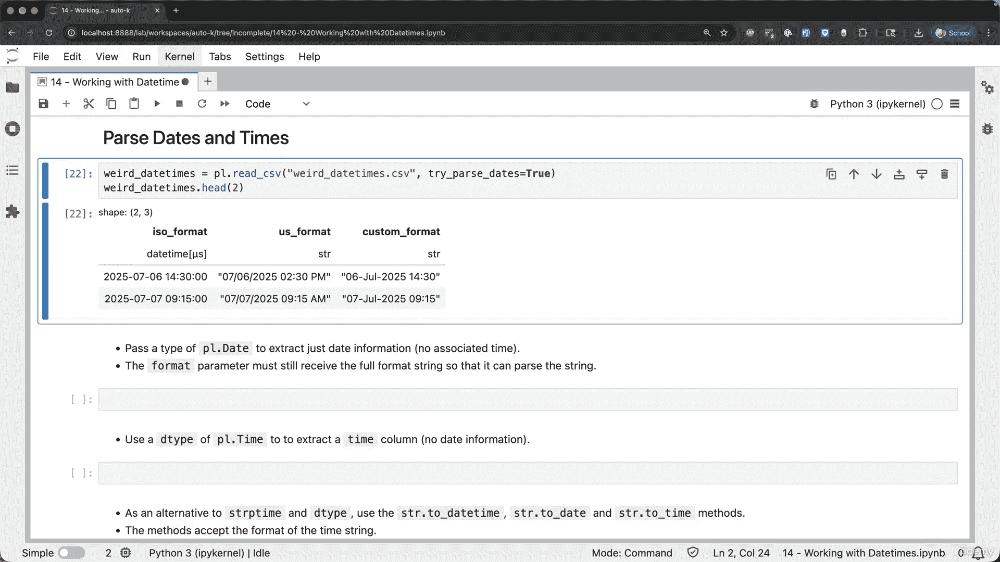

### 回顾与导入

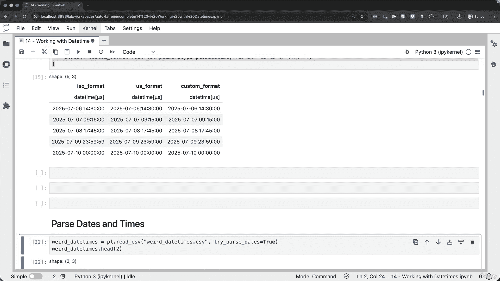

首先，我们把上节课写好的导入代码重新执行一遍。为了方便大家理解，这里直接复制了上节课末尾的代码。在上一节课中，我们使用了字符串命名空间下的 `strptime` 方法，也就是字符串解析时间的方法，把原始的时间字符串转换成了 datetime 列。下面的代码展示了这个基本操作。


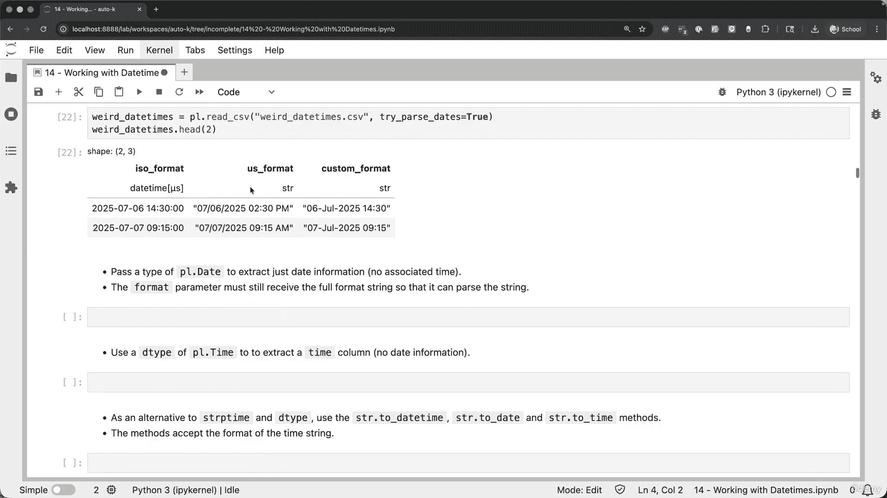

```python
import polars as pl

# 假设原始数据中有这样一个包含 ISO 格式时间字符串的列
df = pl.DataFrame({
    "trip_start_time": ["2023-01-01T08:30:00", "2023-01-02T09:15:00"],
    "us_format": ["01/01/2023 08:30:00", "01/02/2023 09:15:00"],
})

# 将 ISO 字符串解析为 datetime 列
df = df.with_columns(
    pl.col("trip_start_time")
    .str.strptime(pl.Datetime, "%Y-%m-%dT%H:%M:%S")
    .alias("trip_start_datetime")
)
print(df)
```


运行这段代码之后，我们就得到了一个 datetime 列。这个列里保存的是完整的日期和时间信息，可以理解为既有年月日，也有时分秒。接下来，我们来试试如何从这个字符串中提取日期。


### 使用 strptime 提取日期（date）

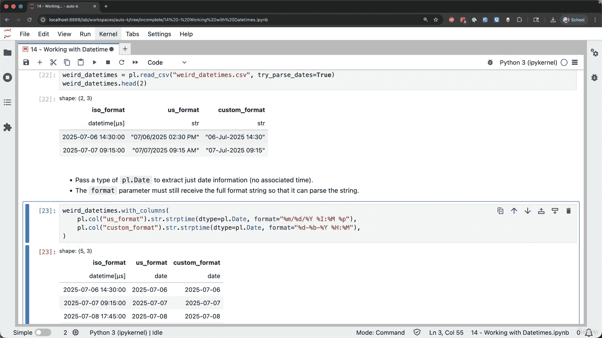

要提取日期，我们仍然使用 `strptime` 方法，只需要把请求的数据类型（requested type）从之前的 `pl.Datetime` 改成 `pl.Date`。这里要说明一下，`pl.Date` 是 Polars 顶层的一个数据类型，可以直接使用。修改后的代码如下所示。


```python
df = df.with_columns(
    pl.col("trip_start_time")
    .str.strptime(pl.Date, "%Y-%m-%dT%H:%M:%S")
    .alias("trip_date")
)
print(df)
```


这里有一个非常重要的注意事项：即使我们最终只需要日期部分，在 `format` 参数中仍然要提供完整的格式字符串。换句话说，原始字符串中的年、月、日、小时、分钟、秒等每一个组成部分，都要有对应的符号。为什么连用不到的时分秒也要写出来？因为 Polars 必须先把字符串完整地解析成对应的 datetime 对象，然后再从这个对象中取出日期部分。如果格式字符串不完整，Polars 就无法正确理解原始文本，转换自然也就无法成功。同样的原则，也适用于后面要介绍的 time 列提取。

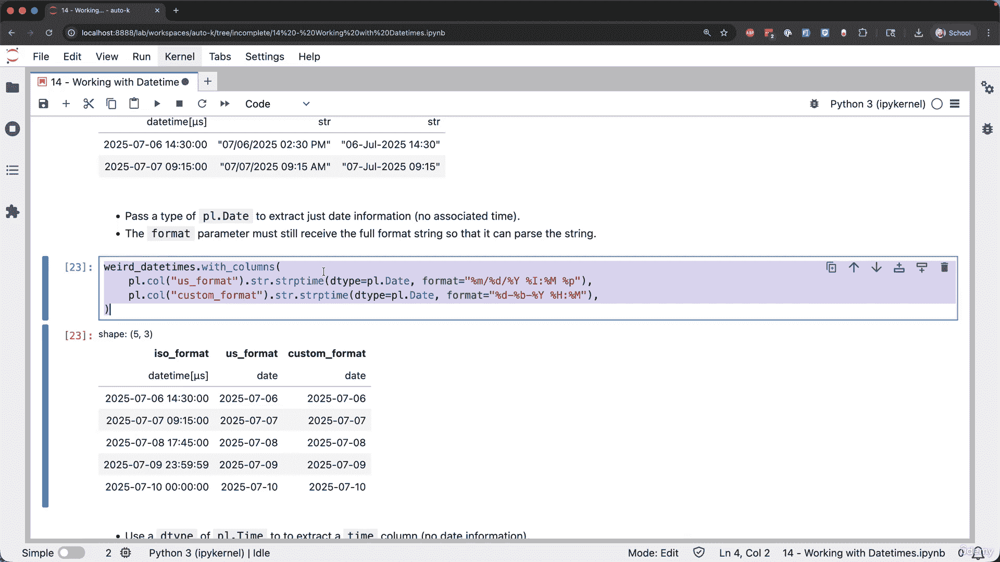

运行上面的代码后，我们可以同时看到原来的 datetime 列和新生成的 `trip_date` 列。原来的 datetime 列来自 ISO 格式的原始 `trip_start_time` 列，它保存的是完整的日期时间。而 `trip_date` 列里的每个值都是 date 对象，只保存实际的日期信息，也就是年月日。它不像 datetime 那样还带着一个配套的时间组件。你可以把 datetime 理解成一个完整的日期时间，而 date 只是把时间部分丢掉了。这样做的好处是，后续对日期进行分组统计时，不会受到时间的影响。


### 使用 strptime 提取时间（time）

我们已经知道如何提取日期了，那么第三种可能存储的数据类型就是 time 列。time 列表示某一个时刻，但没有对应的日期。换句话说，如果 datetime 是日期加时间，那么 date 是只取日期，time 则是只取时间。现在我们来复制一份代码，并把请求的数据类型从 `pl.Date` 改成 `pl.Time`。注意，`Time` 的 `T` 是大写，因为它是 Polars 库中的另一个顶层数据类型。


```python
df = df.with_columns(
    pl.col("trip_start_time")
    .str.strptime(pl.Time, "%Y-%m-%dT%H:%M:%S")
    .alias("trip_time")
)
print(df)
```


你会看到，这一次 `format` 字符串没有发生任何变化。原因很简单，原始列中的文本形状没有改变，依然是完整的日期时间字符串。Polars 需要根据原始形状来解析，所以格式字符串保持完全一致。运行之后，我们就得到了一列纯时间值。这一列的值只包含一天中的时刻，例如小时、分钟和秒。有了 time 列，你可以做各种和时间相关的操作，比如计算两个时刻之间的差值。但要注意的是，此时你已经丢失了日期信息，因为时间本身并不知道它属于哪一天。所以，到底该用 date 还是 time，完全取决于你的分析目标。


### 处理日期和时间分开存储的情况

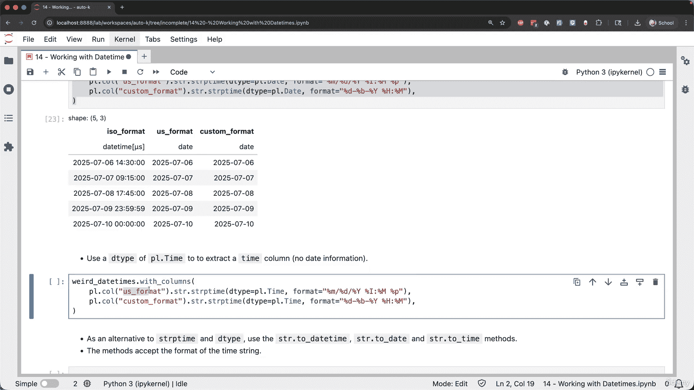

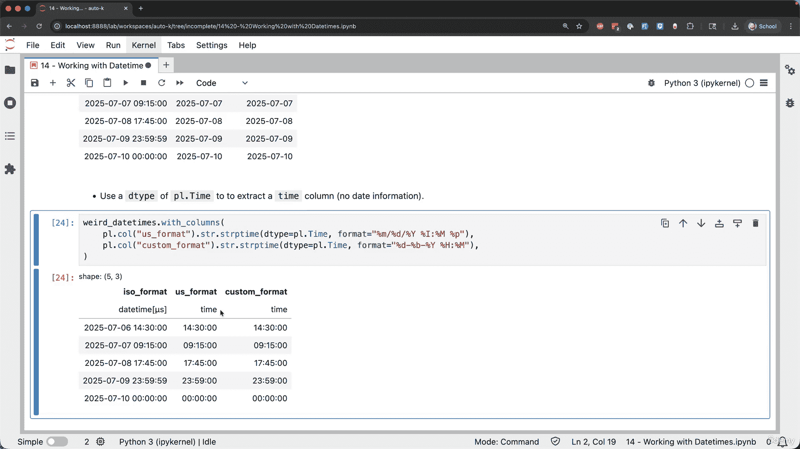

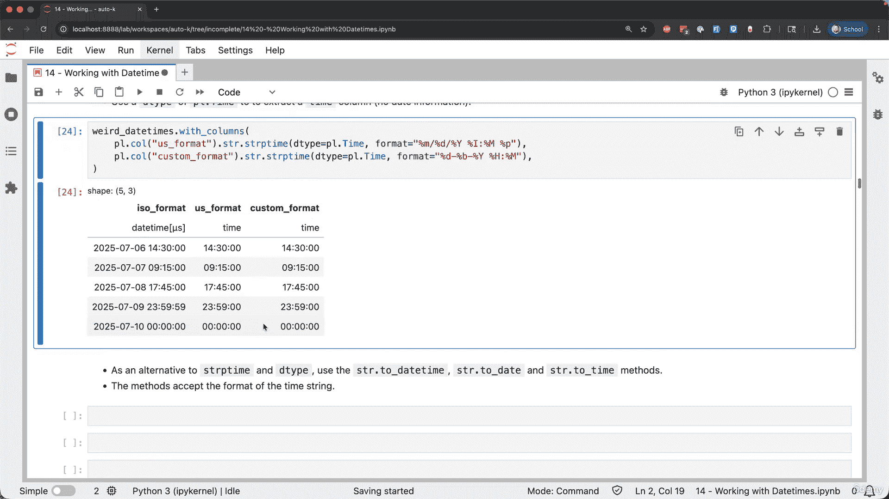

在实际工作中，你得到的数据集不一定是像我们刚才那样，把日期和时间放在同一个字符串里。有时候，日期和时间可能分别在两个不同的列中，例如一列是日期字符串，另一列是时间字符串。这时候，你就需要分别对这两列进行解析，把日期列解析成 date 类型，把时间列解析成 time 类型。处理的方法和我们前面用过的 `strptime` 一样，只需要给不同列传入对应格式的字符串即可。这种做法同样能够达到最终目的，所以当你遇到这种数据形态时，不必额外为难，直接分列处理就行。


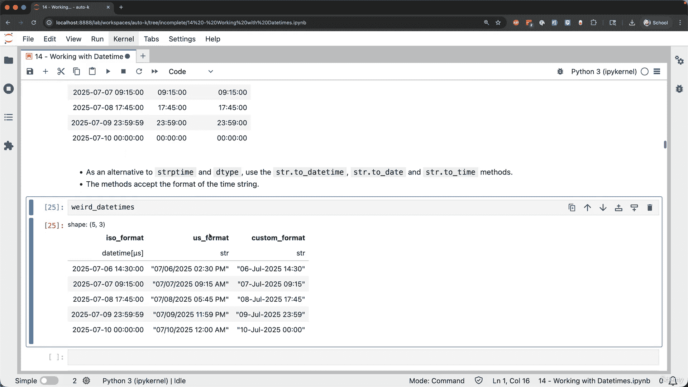

### 使用 to_datetime、to_date 和 to_time

除了 `strptime` 方法之外，Polars 的字符串命名空间里还提供了几个配套的专用方法，分别是 `to_datetime`、`to_date` 和 `to_time`。这三个方法专门用来把字符串列转换成对应的日期时间类型，使用起来更加直接。下面我们就来逐一看看它们是怎么用的。

先从 `to_datetime` 开始。我们调用 `select` 方法，把 `us_format` 这一列选出来，然后在这一列上应用 `to_datetime`。之前我们看到 `to_datetime` 在很多时候不需要传自定义参数，只要 Polars 能够理解字符串的格式即可。但是，对于 `us_format` 这一列，默认的做法是行不通的。原因是 `to_datetime` 使用的自动解析算法和解析 `trip_start_time` 时是一样的，它能识别常见格式，却识别不了美国风格的日期格式。因此，我们需要手动把 `us_format` 对应的格式字符串传进去。我们可以从原来的代码中找到这个格式字符串，然后作为参数传给 `to_datetime`。代码如下。


```python
df.select(
    pl.col("us_format")
    .str.to_datetime("%m/%d/%Y %H:%M:%S")
    .alias("date_time")
)
```


这里使用 `alias` 方法把结果列命名为 `date_time`。由于 `select` 会生成一个新的 DataFrame，所以结果中只会包含这个新列。这个 `date_time` 列同时保留了日期和时间信息。

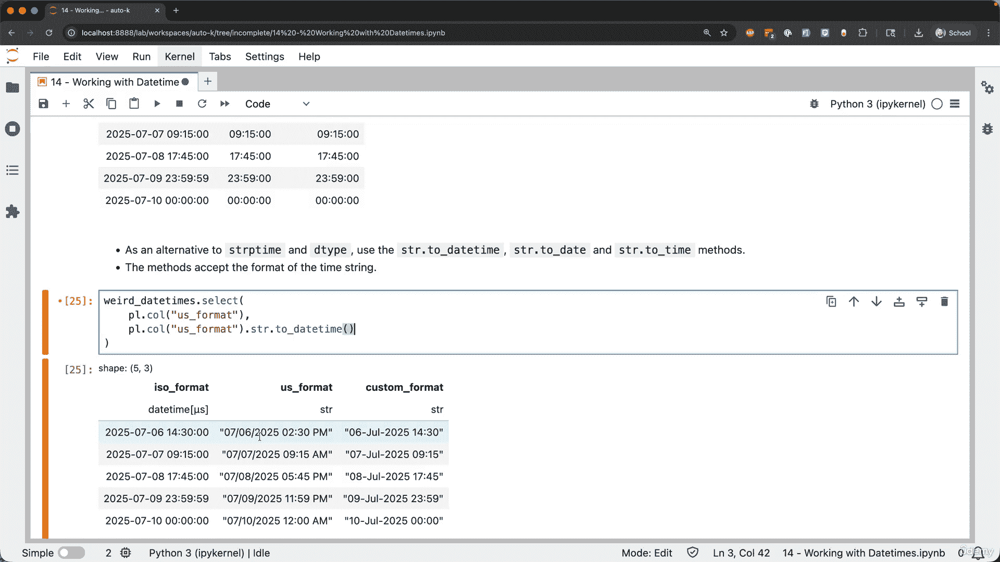

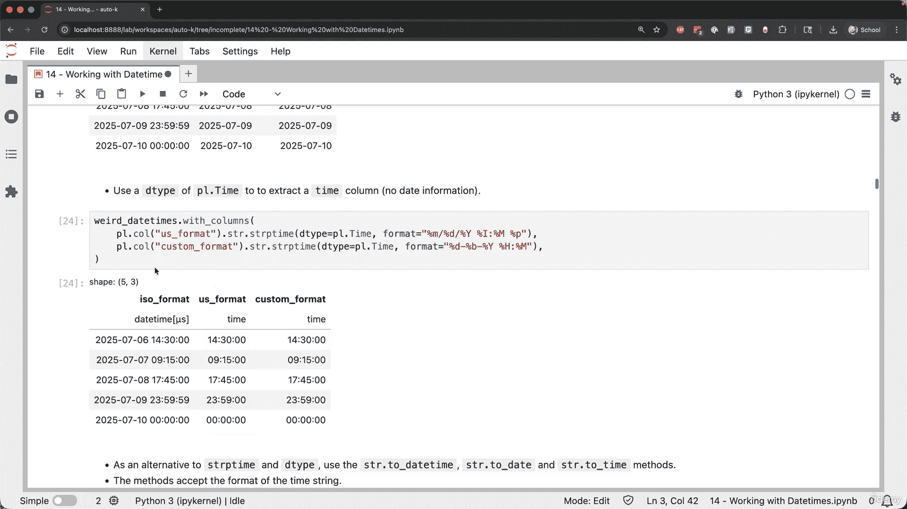

接下来我们把 `to_datetime` 换成 `to_date`。这里仍然需要传格式字符串，因为 `us_format` 列中文本数据的原始形状没有改变。Polars 只有借助格式字符串，才能理解文本里各个组成部分的含义，然后正确完成转换，并把日期部分提取出来。我们把结果列命名为 `date`。


```python
df.select(
    pl.col("us_format")
    .str.to_date("%m/%d/%Y %H:%M:%S")
    .alias("date")
)
```


正如你可能已经猜到的，第三个方法是 `to_time`。它的作用是把字符串列中的值转换成 time 值。用法和前两个方法完全一样，我们同样要传入格式字符串，并把结果列命名为 `time`。


```python
df.select(
    pl.col("us_format")
    .str.to_time("%m/%d/%Y %H:%M:%S")
    .alias("time")
)
```


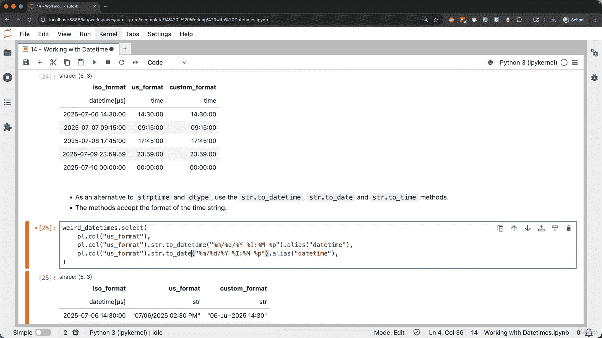

如果你把上面的三个 `select` 结果放在一起看，会发现它们来自同一个原始字符串列，但输出却完全不同。原始列 `us_format` 中存的是同样的美国格式日期时间字符串，通过三个不同的方法，我们分别得到了完整的 `date_time` 列、只含日期的 `date` 列和只含时间的 `time` 列。这正好说明了 Polars 的灵活性：你可以根据实际需求选择保留全部信息，还是只保留日期或时间。

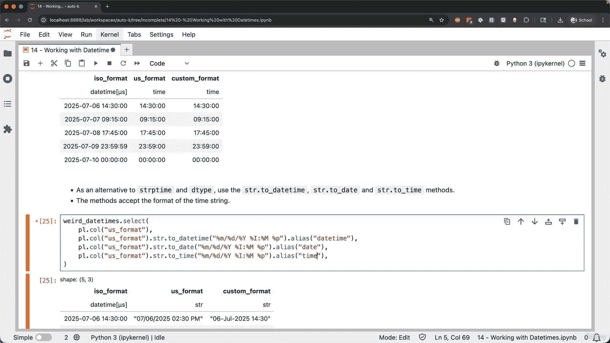

为了方便记忆，我们可以把今天涉及的方法整理成下面这个列表。

- `strptime`：通用字符串解析方法，通过 `pl.Date`、`pl.Time` 等参数指定最终目标类型。
- `to_datetime`：将字符串列转为完整的 datetime 列。
- `to_date`：将字符串列转为 date 列，只保留日期。
- `to_time`：将字符串列转为 time 列，只保留时间。


### 总结

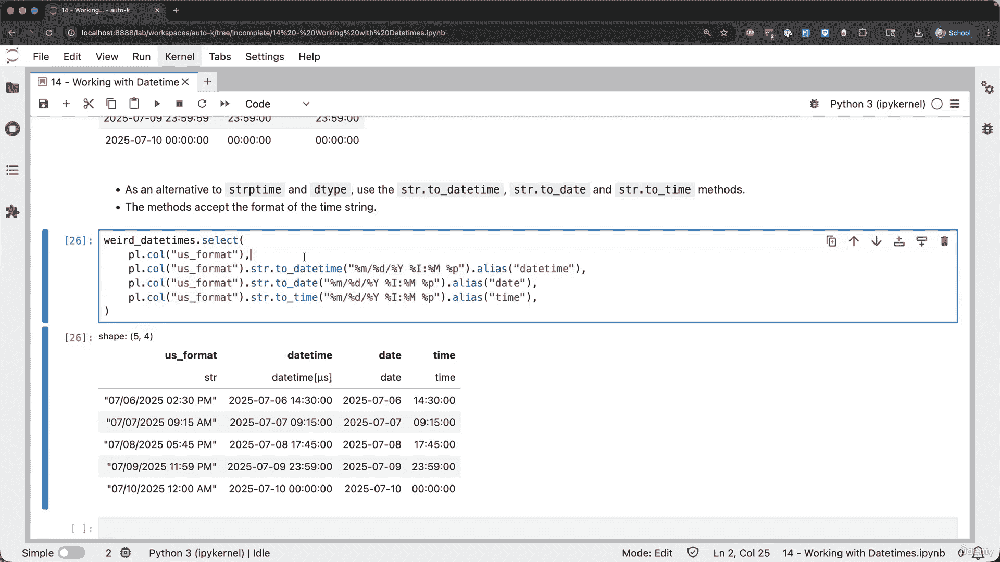

本节课我们一起学习了如何在 Polars 中解析日期和时间。我们首先回顾了上一节课的 `strptime` 方法，并演示了如何把请求的数据类型改为 `pl.Date` 和 `pl.Time`，从而分别生成 date 列和 time 列。在这个过程中，我们特别强调了格式字符串必须完整，哪怕只需要提取一部分内容也是如此。接着，我们讨论了日期和时间分开存储时的处理方式，也就是对每一列分别解析。最后，我们学习了字符串命名空间下的三个专用方法：`to_datetime`、`to_date` 和 `to_time`，再加上灵活通用的 `strptime` 方法，它们一起构成了处理日期时间解析的主要工具。在以后的分析中，你可以根据手头的数据格式选择最方便的方法，不需要死记硬背。

