# 📚 Polars与Python数据分析（Part 2）：第163讲：将日期转换为字符串

## 🧭 本节概述

在本节课中，我们要学习一个很实用的反向操作：如何把一个 `datetime` 列转换成字符串列。上节课我们学会了怎么把字符串变成日期时间，这节课我们反过来，而且还能指定字符串的展示格式。这个过程在导出报表、写报告的时候特别有用，因为不是每个人都喜欢看“2024-07-01 09:00:00.123456”这种原始形式。我们会先认识一下 Polars 的 `dt` 命名空间，然后使用 `dt.to_string` 来生成默认字符串，再学习如何自定义格式，最后还会提醒大家一个容易踩的小坑。如果你完整地跟下来，后续处理时间数据时会轻松很多。

## 🔄 反向操作：从日期时间到字符串

之前我们见过了如何把字符串列转成日期时间列。现在，我们要演示的是完全相反的过程：怎样把一个 `datetime` 列转成字符串列，尤其是带指定展示格式的字符串。话不多说，先从执行导入代码开始。这里有一个 `clock_in_times.csv` 文件，导入后我们已经成功把其中两列转换成了 `datetime` 类型进行存储。

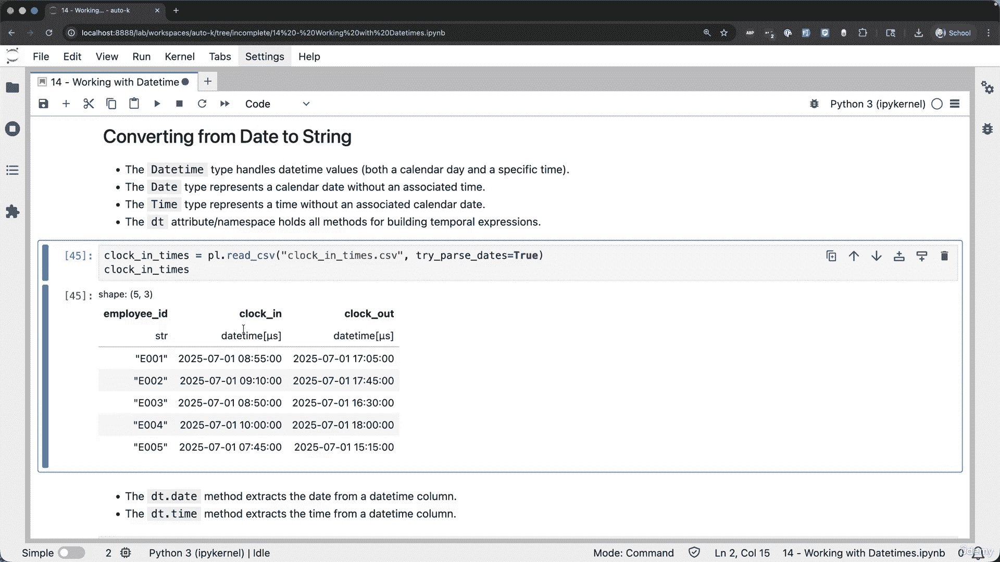

```python
import polars as pl

clock_in_times = pl.read_csv("clock_in_times.csv").with_columns(
    pl.col("clock_in").str.to_datetime(),
    pl.col("clock_out").str.to_datetime(),
)
```

这段代码只是把数据读进来，并且把两个用于记录打卡时间的列转换成了 `datetime` 类型。如果你对 `str.to_datetime` 的细节还不太清楚，可以回到上一节课去复习一下。这里我们已经有一个可以直接使用的日期时间列，接下来要做的所有操作都会围绕它展开。

你可以看到，对于存储日期时间、日期或时间的列，Polars 会把所有相关方法都放在一个很方便的 `dt` 命名空间下面。`dt` 就是 **date time** 的缩写。这个命名空间就像一个小工具箱，把关于日期时间的常用操作都收纳在一起，用起来非常顺手。这种设计让你在写代码的时候，只需要输入一个点，IDE 就会自动提示所有可用方法，非常方便。

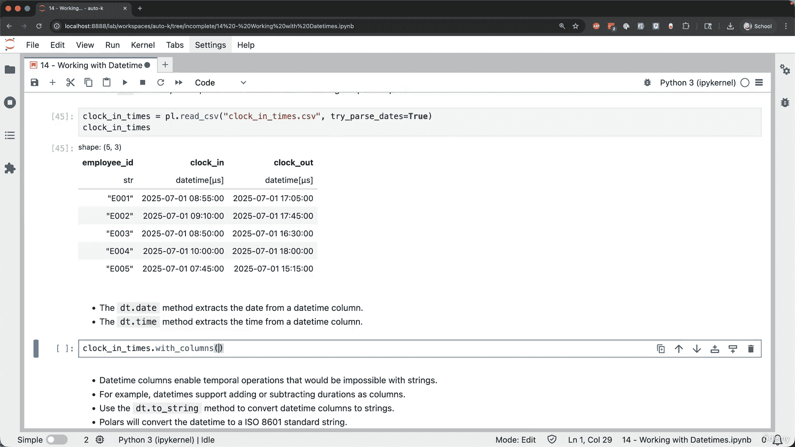

先简单看两个能够快速上手的方法：`date` 和 `time`。

以下是两个常用的提取方法：
- `dt.date()`：提取出日期部分。
- `dt.time()`：提取出时间部分。

它们和我们上一课看到的方法非常相似，只不过上一课是把字符串转成日期/时间，而现在是把一个 `datetime` 列变成只包含日期的列，或者只包含时间的列。换句话说，方向完全反过来了。

直接看例子。我们拿上面的 `clock_in_times` 数据框，调用 `with_columns` 方法，目标选 `clock_in` 列。在 `dt` 命名空间下面，可以访问 `date` 方法，它会把这个 `datetime` 列转换成只含日期信息的列，也就是把时间部分去掉。这里我们给新列起名为 `clock_in_date`。

```python
clock_in_times = clock_in_times.with_columns(
    pl.col("clock_in").dt.date().alias("clock_in_date")
)
```

类似地，第二个表达式还是针对 `clock_in` 列，`dt` 属性下面还有一个配套的 `time` 方法。它能把 `datetime` 列转换成只含时间的列，我们称它为 `clock_in_time`。

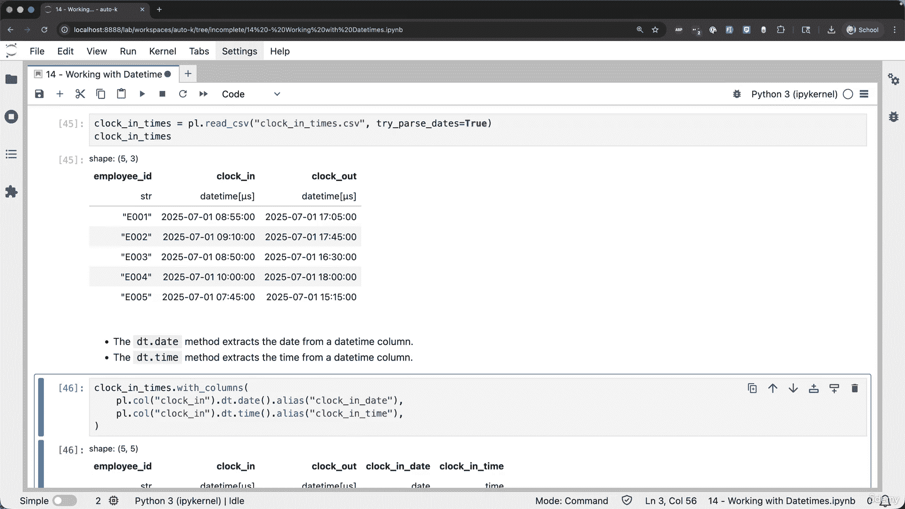

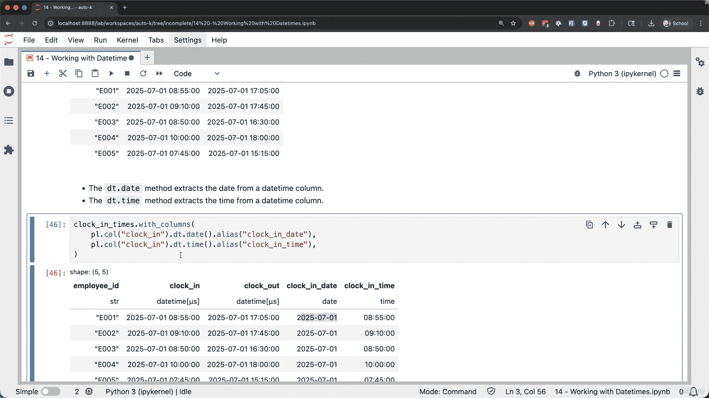

```python
clock_in_times = clock_in_times.with_columns(
    pl.col("clock_in").dt.time().alias("clock_in_time")
)
```

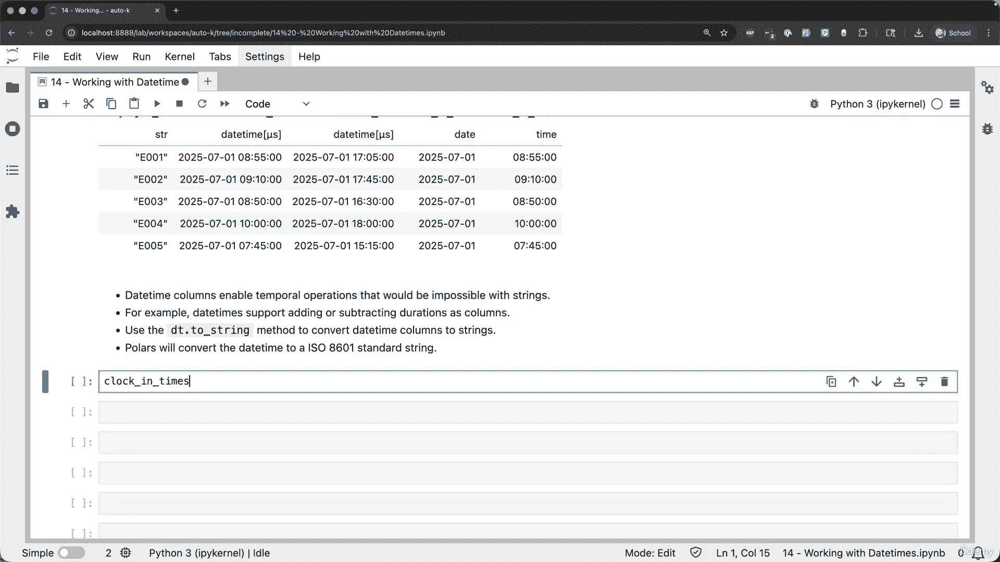

这样一来，你就看到 Polars 从原来的 `datetime` 列中提取出了不同的信息片段。因为源列已经是 `datetime` 类型，Polars 提取数据会容易得多，它不需要面对字符串或文本表示，内部已经是正确的对象和数据类型，所以可以很轻松地把这些信息拆到独立的列里。如果源列是文本，你还得先去解析，现在完全省掉了这一步。

## 🔤 使用 dt.to_string 得到默认字符串

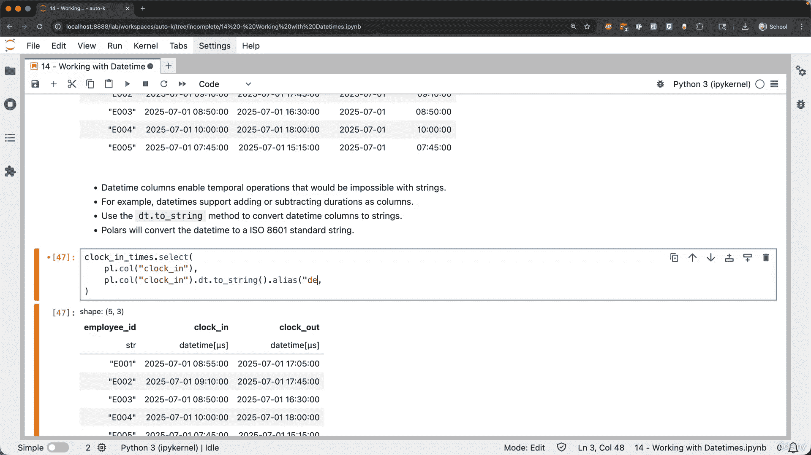

现在，我们来聊聊怎样把这几种日期时间类型的列转换回字符串列。有些时候，你需要先对数据做一些处理，这些处理会在后续课程中逐步介绍；处理完后，你可能希望把 `datetime` 列再变成字符串的表示形式。那要怎么做呢？

从下面开始，我们继续使用 `clock_in_times` 数据框。调用 `select` 方法，目标选择 `clock_in` 列，先让它作为原始样子的示例。`dt` 属性下面有一个很方便的 `to_string` 方法，它会给出 `datetime` 默认的字符串表示。我们把这个新列命名为 `default`。

```python
clock_in_times.select(
    pl.col("clock_in").dt.to_string().alias("default")
)
```

如果你只是需要一个字符串表示，用这个方法就够了。可以看到结果中包含了年、月、日、时间，甚至末尾可能还有微秒或纳秒这些更小的单位。默认格式虽然信息齐全，但可读性一般。如果你只是想在日志里快速看一眼数据，这个默认值完全够用。

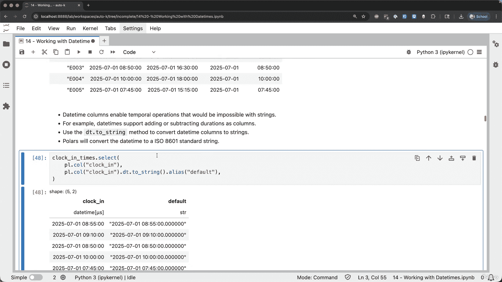

## 🎨 自定义字符串格式

也许你不想用这种默认格式，而是希望按照自己定义的格式来展示。这时候，你可以给 `to_string` 方法传入一个格式化字符串。这个格式化字符串使用的符号和字符，我们在前面的课程里已经介绍过了，只不过这次是反着用：之前我们是用它来告诉 Polars 如何解析字符串，现在是用它来告诉 Polars 如何从 `datetime` 列生成字符串。

我们把刚才那个表达式复制过来，改一改。我打算输出完整的月份名字，也就是 `July`、`September` 这种，而不是数字月份。要表示完整的月份名，可以用 `%B`。然后，我们写一个空格，再接上日期中的“日”，用 `%d` 表示。后面加一个逗号，再补一个空格，最后是四位数的年份，用 `%Y` 表示。完整的格式化字符串是 `"%B %d, %Y"`。

```python
clock_in_times.select(
    pl.col("clock_in").dt.to_string("%B %d, %Y").alias("formatted")
)
```

你会看到，从同一个 `datetime` 列，我们得到了更易读的内容。这种形式特别适合导出数据或者做报告，因为很多业务人员可能不太愿意看那种带微秒的原始数据，看到 `July 1, 2024` 这种会舒服得多。你可以根据自己的需要随意组合各种格式符号，自由度很高。

## ⚠️ 对 date 列使用 dt.to_string：注意一个坑

为了证明这种功能不仅仅适用于字面上的 `datetime` 列，我们也来看看其他类型。对 `clock_in` 列，先调用我们刚才用过的 `date` 方法，这会生成一个真正存储 `date` 类型的列。不管底层类型是什么，我们依然可以访问 `dt` 下面的所有功能。

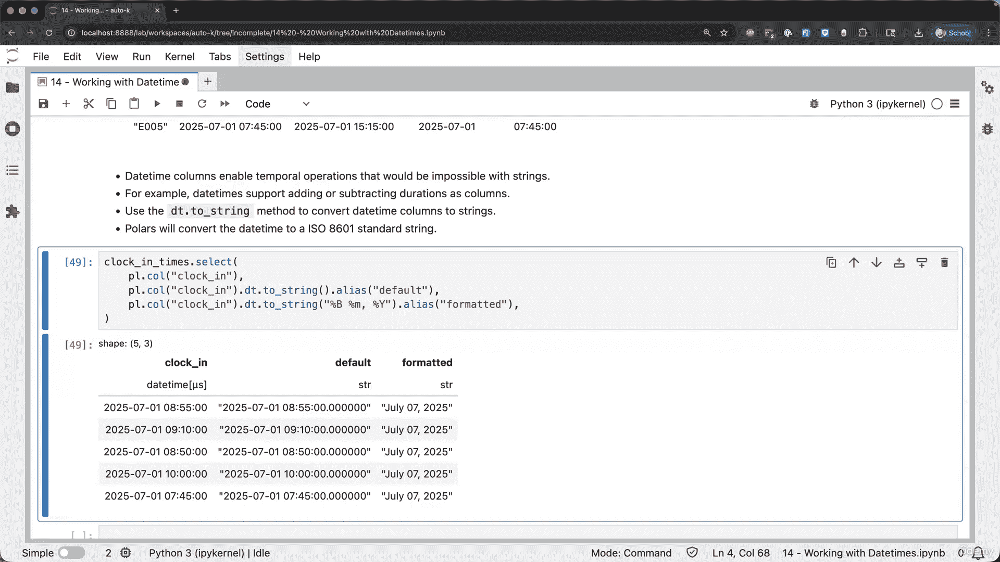

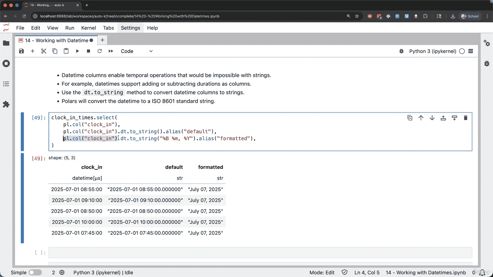

不过，有一点要记住：在调用 `to_string` 时，不能直接链式写 `.dt.date().to_string()`。因为 `dt.date()` 返回的仍然是一个表达式，而这个表达式自己也有一个 `dt` 属性，`dt` 属性下面才有 `to_string` 方法。所以正确的写法是 `.dt.date().dt.to_string()`。

```python
clock_in_times.select(
    pl.col("clock_in").dt.date().dt.to_string().alias("date_default")
)
```

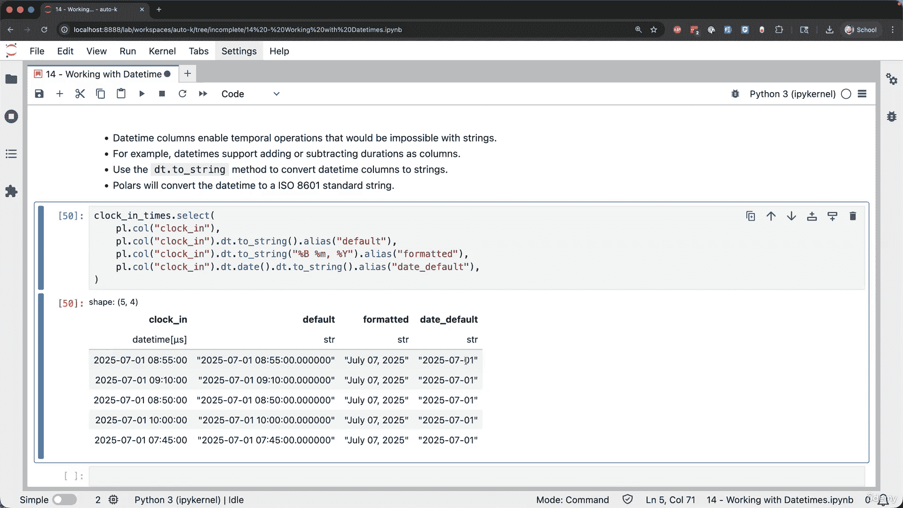

也就是说，当我们先把 `datetime` 列转换成普通 `date` 列，再把它转成默认的字符串表示，得到的结果就是上面这样。如果你想自定义格式，也是完全可以的。比如我们可以继续使用刚才那个格式串，因为这里面完全不涉及小时、分钟、秒，只有月、日和年的表示，而这些信息 `date` 列都是有的。

```python
clock_in_times.select(
    pl.col("clock_in").dt.date().dt.to_string("%B %d, %Y").alias("date_formatted")
)
```

这里正好也提醒大家一个容易出错的地方：如果你让 Polars 从一个 `date` 列里输出小时、分钟、秒，那就会报错，因为 `date` 列里压根没有存储这些时间单位。不过在上面的格式串里，所有需要的信息都是可用的，所以能顺利得到自定义格式的字符串。

## ✅ 总结

本节课我们一起学习了如何把 `datetime`、`date` 或 `time` 列转换回字符串列。我们先用 `dt.date()` 和 `dt.time()` 把 `datetime` 列拆成日期和时间，然后又介绍了 `dt.to_string()` 的默认用法，接着用格式串实现自定义展示，并讨论了 `date` 列使用 `dt.to_string` 时需要注意的链式写法以及可能遇到的错误。总的来说，当你需要最终确定报表、为日期时间数据选择最终展示形式时，`dt.to_string()` 就是那个把数据转成文本的好帮手。

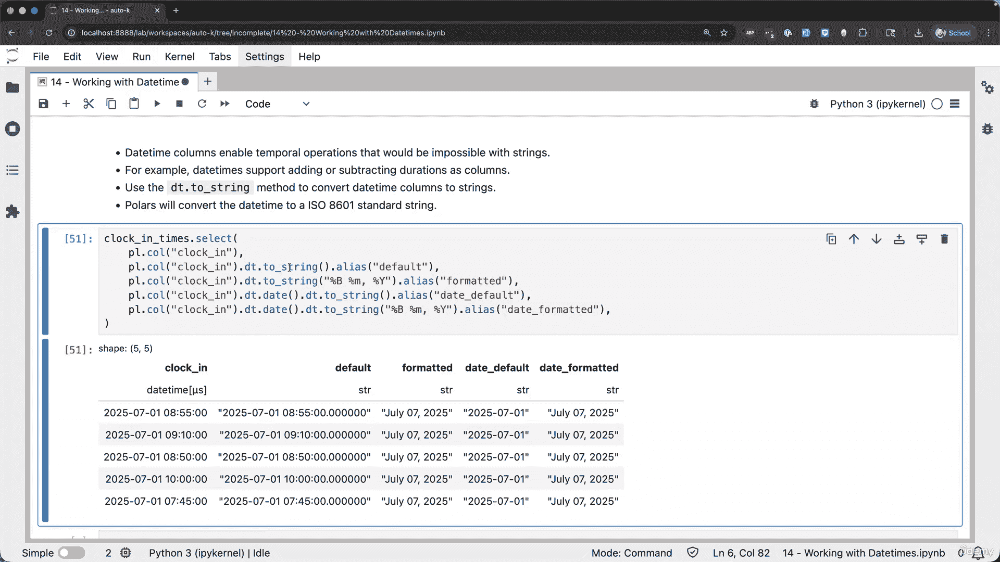

> 核心公式：`datetime/date/time列 → dt.to_string(格式串) → 字符串列`
