# 📊 使用Polars和Python进行数据分析：第2部分第64讲：提取日期时间组件

在本节课中，我们将一起学习如何使用Polars库中`dt`命名空间下的各种方法来提取日期时间组件。我们会通过一个美国历史事件的数据集来演示这些方法，其中包括千禧年、世纪、年、月、日、季度、星期几、月天数、一年中的第几天，以及一些返回布尔值的有趣方法。

## 📥 导入历史事件数据集

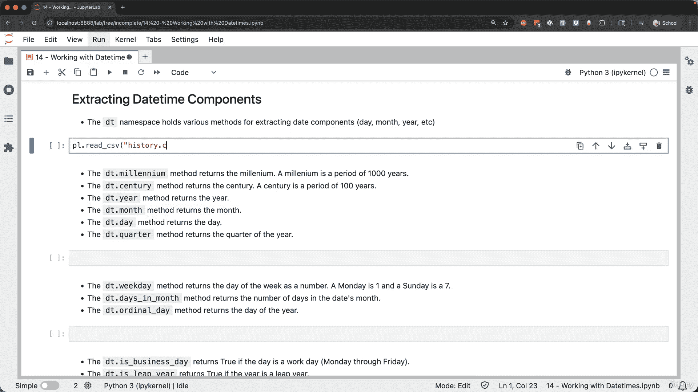

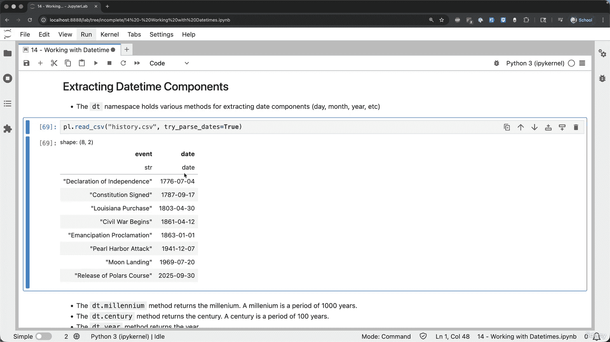

在上一部分内容中，我们已经熟悉了字符串列和日期时间列之间的相互转换。基于这个基础，我们可以继续往前探索表达式构建器上`dt`（datetime）属性下面提供的一大堆方法了。为了有一个具体的练习对象，我们先导入一个全新的数据集。

使用`read_csv`函数读取`history.csv`文件，这个文件收集了美国历史上的一些重要事件。每一行都有一列事件名称和一列发生日期。日期是比较常见的“年-月-日”格式，也就是用短横线把年份、月份和日期分隔开。我们可以在读取时加上`try_parse_dates=True`参数，这样Polars就能轻松地把这些字符串值转换成真正的日期值。

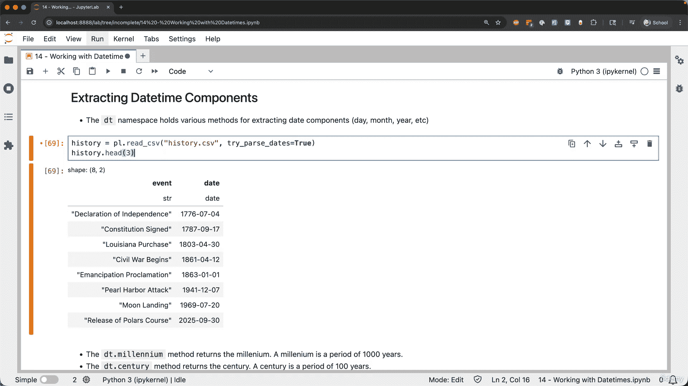

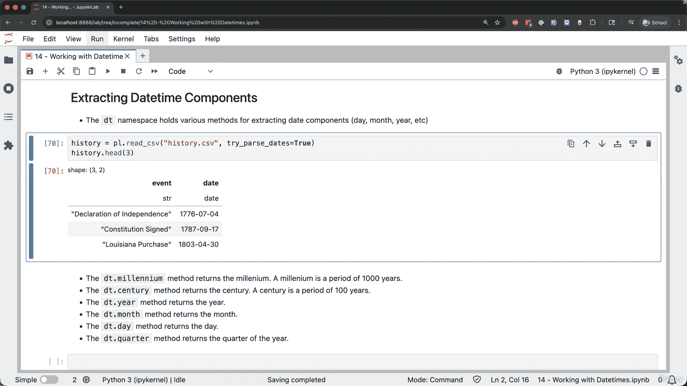

```python
import polars as pl

history = pl.read_csv("history.csv", try_parse_dates=True)
history.head()
```

将数据框赋值给变量`history`，再用`head`方法预览前几行，看看数据的样子。接下来，我们就正式进入`dt`属性，开始尝试它的各种方法。

这里需要说明一下，我们虽然是在日期值上做演示，但是这些方法同样适用于日期时间值。因为它们使用同一个命名空间和属性，所以只要数据是日期或日期时间类型，你都可以放心使用这些技巧。

## 🧩 提取千禧年、世纪、年、月、日

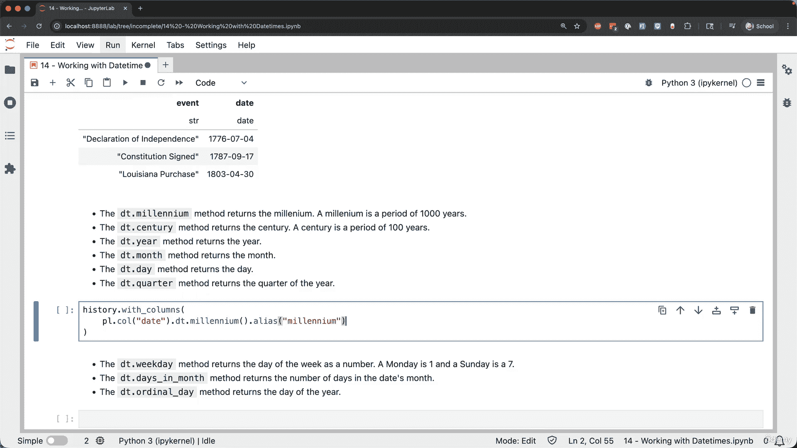

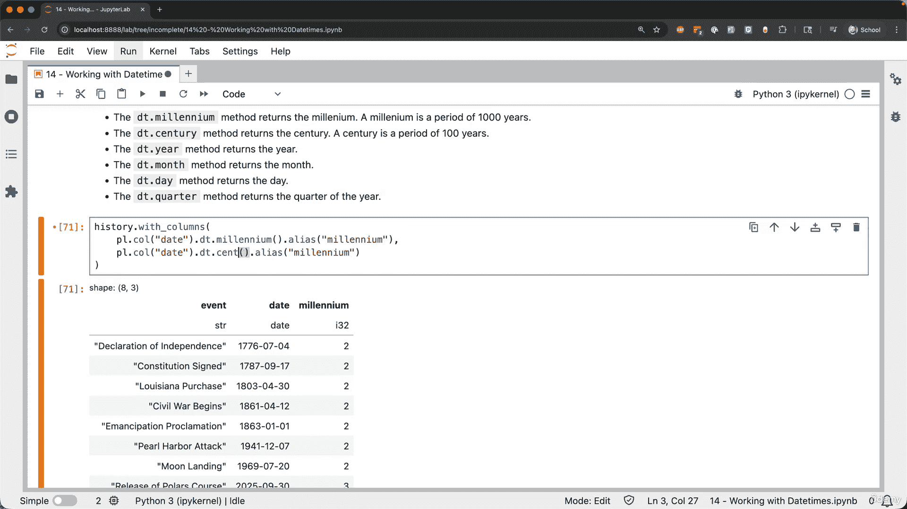

现在我们从`history`数据框出发，调用`with_columns`方法构建多个表达式。这些表达式都针对`date`列，并且都会访问`dt`属性。以下是我们即将尝试的几个方法：

- `millennium()`：告诉你事件发生在第几个千禧年。
- `century()`：告诉你事件发生在哪个世纪。
- `year()`：提取年份。
- `month()`：提取月份。
- `day()`：提取具体的日期数字。

先来看第一个方法：`millennium`。注意这个词的拼写有两个`l`和两个`n`，不要写错了。它的作用就是告诉你某个事件发生在第几个千禧年。一个千禧年就是1000年。比如，从结果中可以看到，大部分事件都发生在第二个千禧年，也就是公元1000年到2000年之间；其中有一件具有转折意义的重要历史事件，则出现在第三个千禧年。这个结果和我们预期的完全吻合。

接下来是`century`方法，它直接告诉我们事件发生在哪个世纪。对于任何一个给定的日期，我们当然也可以拆出更小的单位，比如年、月、日，它们都有对应的补充方法。我们用`year`方法提取年份，并把新列命名为`year`；用`month`方法提取月份，命名为`month`；用`day`方法提取日子，命名为`day`。下面是一段完整的示例代码：

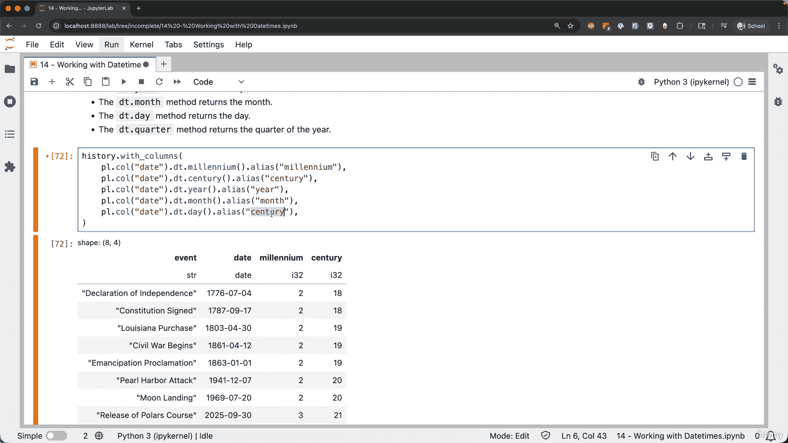

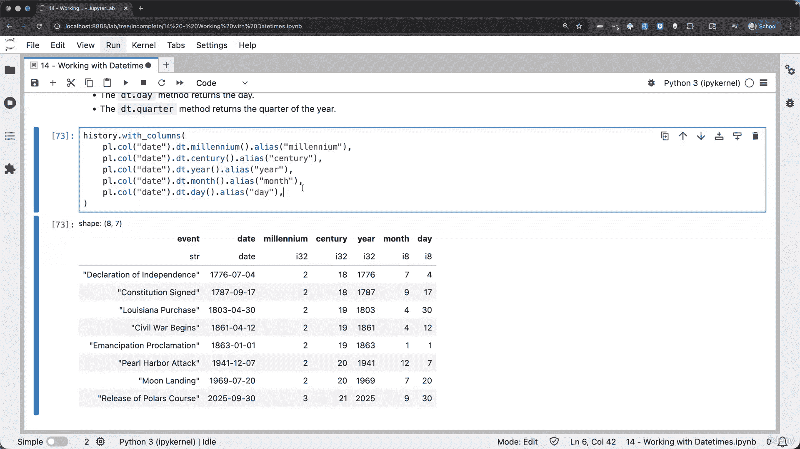

```python
history = history.with_columns([
    pl.col("date").dt.millennium().alias("millennium"),
    pl.col("date").dt.century().alias("century"),
    pl.col("date").dt.year().alias("year"),
    pl.col("date").dt.month().alias("month"),
    pl.col("date").dt.day().alias("day"),
])
history.head()
```

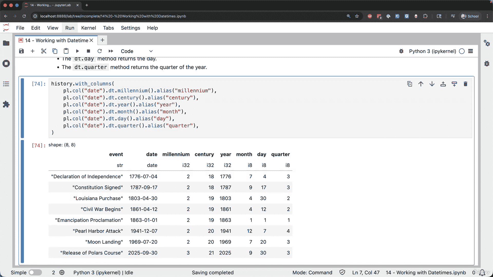

运行之后，你会发现这些新生成的列里存储的都是`Int32`或者`Int8`类型的整数。换句话说，我们成功地从日期列中抽取出了一组组数值整数。再次强调，这种功能能够实现的前提是我们拥有日期类型的值。如果依旧把数据存成字符串，那么这些操作都不可能完成。所以，在数据分析之前把字符串列转换成日期列，是一件非常重要的事情。

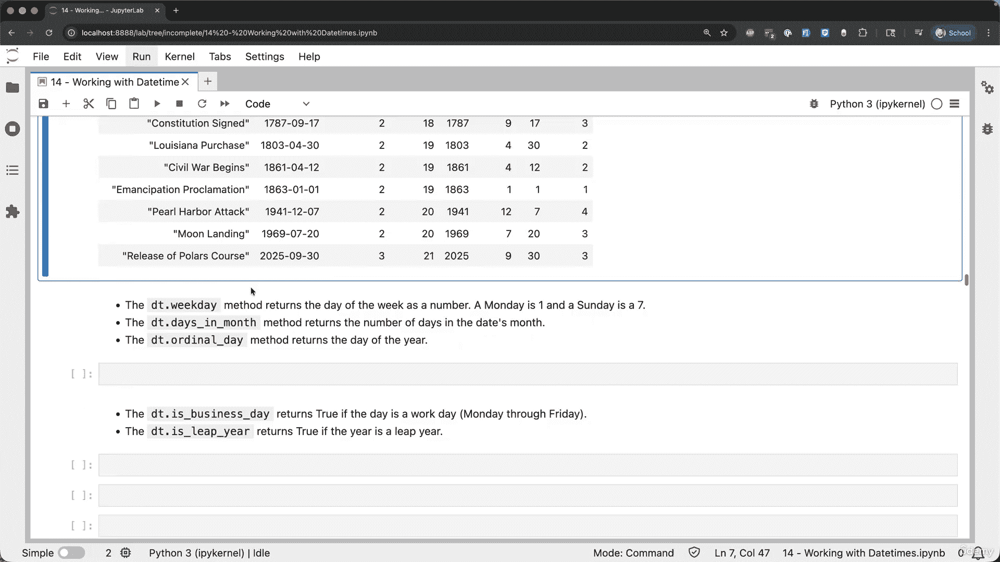

## 📅 提取季度、星期几、月天数与年内序号

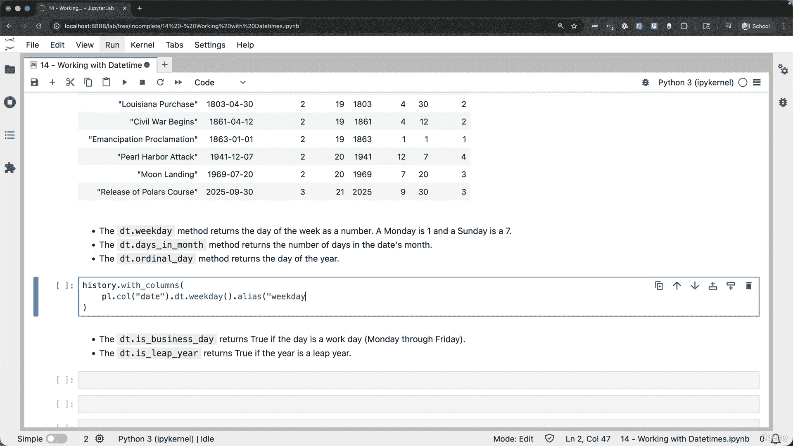

在实际工作里，尤其是商业场景中，我们经常需要知道一个日期属于哪个季度。一年有四个季度，每个季度对应三个月的区间。Polars为此提供了一个非常方便的`quarter`方法，它和前面讲的几个方法逻辑一模一样，也是在`dt`命名空间下面，用来告诉我们事件发生在第几季度。

下面我们再展示几个更有意思的方法。继续使用`history`和`with_columns`，我们需要构建一个针对日期列或任何时间类型列的表达式。我们指定`date`列，然后访问`dt`属性。以下是一个小列表，可以帮助你快速了解这几个方法：

- `weekday()`：以数字形式返回星期几，周一为1，周日为7。
- `days_in_month()`：返回日期所在月份的天数。
- `ordinal_day()`：返回一年中的第几天，1月1日就是第1天。

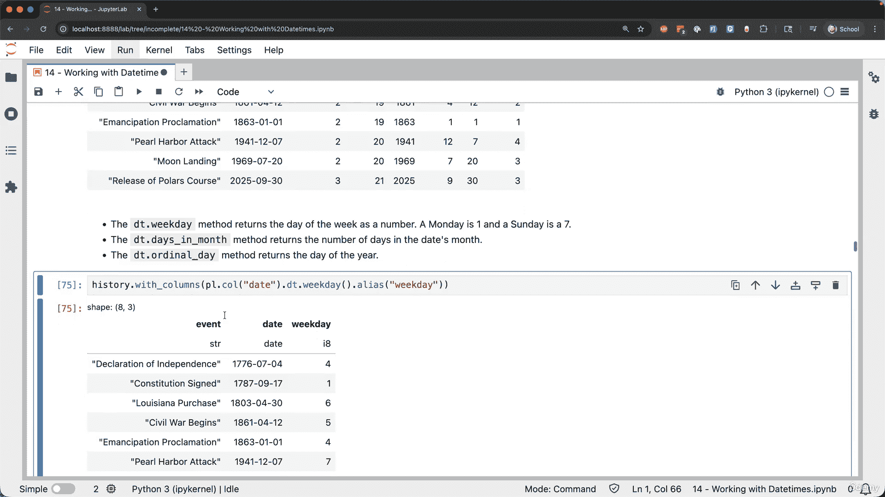

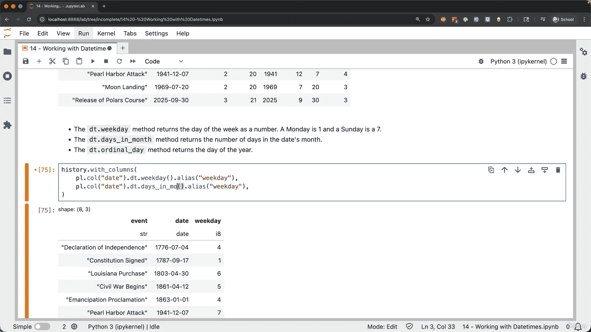

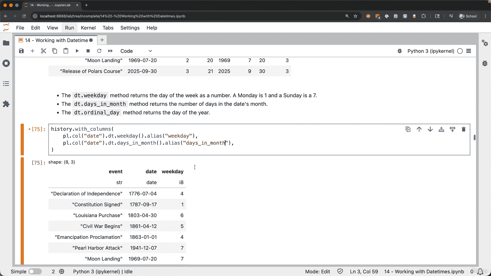

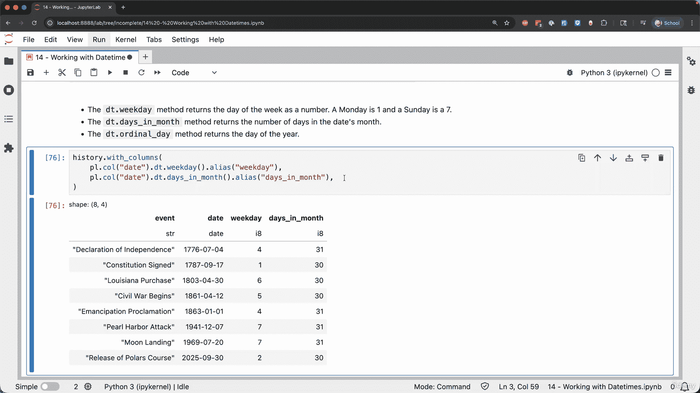

`weekday`方法很有趣，它返回的是一个数字，方便进行后续的数值计算。比如，我们来看《独立宣言》签署那天，`weekday`的值是4，说明那是一个星期四；而美国宪法签署那天，`weekday`的值是1，说明那是一个星期一。这种数字化的星期几信息，在很多业务报表里都非常有用。

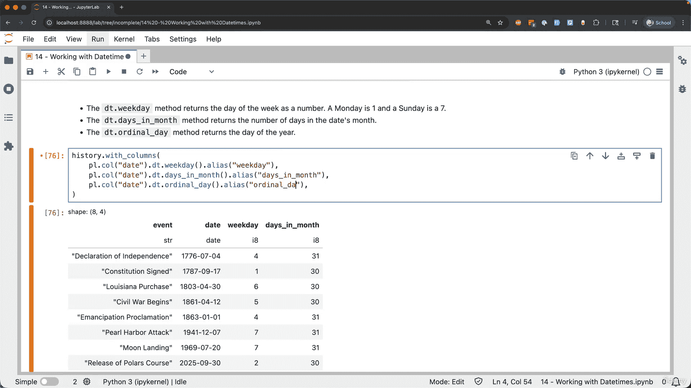

`days_in_month`方法就更加直观了，它会告诉你某个日期所在月份一共有多少天。比如，数据集里的第一个事件发生在1776年7月，那个月有31天，所以结果就是31。

最后是`ordinal_day`方法，它会告诉你某一天是一年里的第几天。一年有365天，比如说1月1日就是第1天。通过这个方法，你可以轻易地知道某件事发生在一年中的具体第几天。下面把这三个方法的代码写在一起：

```python
history = history.with_columns([
    pl.col("date").dt.quarter().alias("quarter"),
    pl.col("date").dt.weekday().alias("weekday"),
    pl.col("date").dt.days_in_month().alias("days_in_month"),
    pl.col("date").dt.ordinal_day().alias("ordinal_day"),
])
history.head()
```

## 🔢 整数类型的选择逻辑

到目前为止，我们看到的这些方法，返回的都是整数。实际上，Polars内部可能会使用多种不同的整数类型来存储这些结果，包括8位整数、16位整数和32位整数。这是根据数值大小和潜在范围来决定的。比如月份最多只有1到12，完全不需要用大整数来存储，所以Polars会选择较小的类型；而年份的数值范围就大多了，因此Polars会为它选择`Int32`。这些细节都不需要你手动操心，Polars会自动根据数据范围选择最合适的数据类型。你只需要知道，这些方法返回的都是新的整数列就可以了。

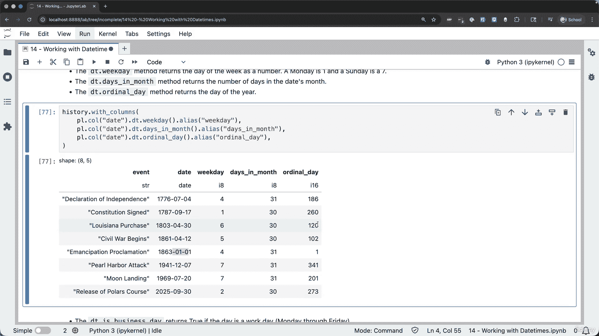

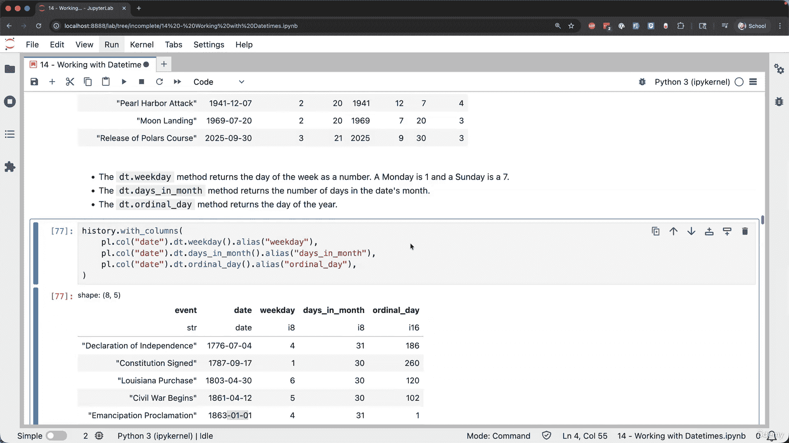

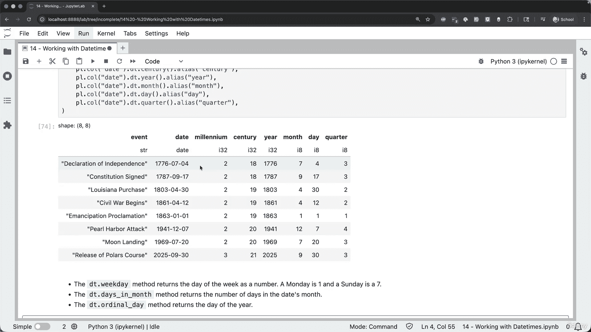

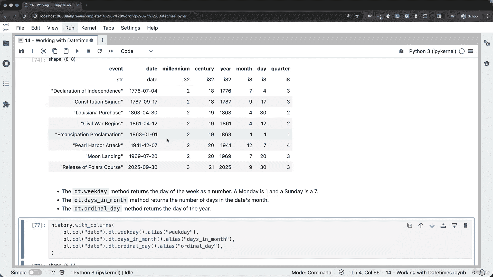

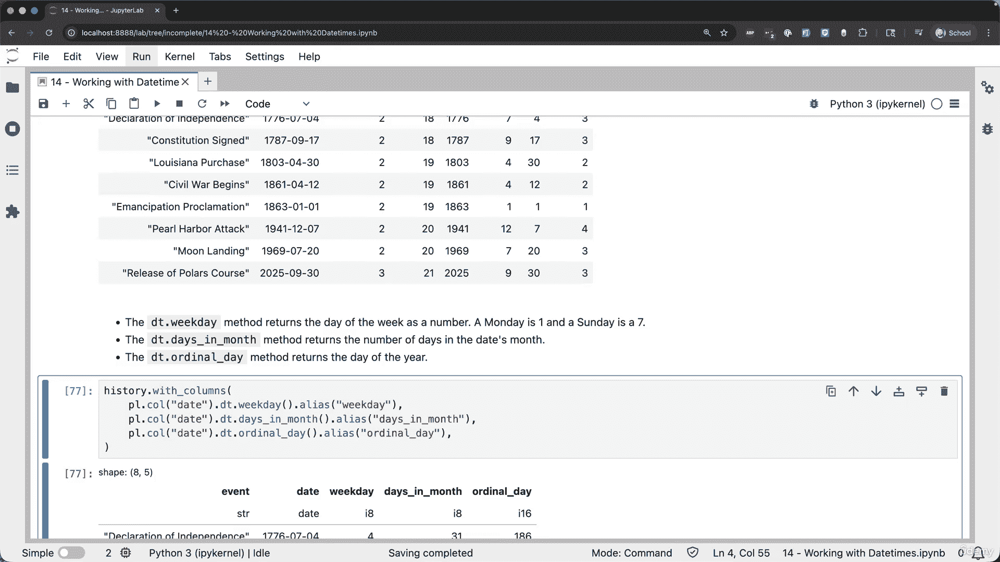

## ✅ 返回布尔值的方法

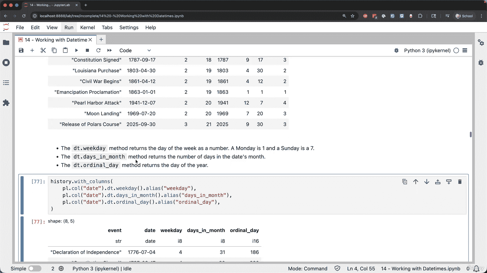

除了整数，Polars当然还提供了一些返回其他数据类型的方法，比如布尔值。当你手里有一列布尔值时，就可以用`filter`方法对数据进行过滤了，这一点我们会在下一节课中正式看到。这里先介绍两个对日期列中的每个值返回布尔值的方法。下面是一个简单的说明列表：

- `is_business_day()`：如果是周一至周五，返回`True`，否则返回`False`。
- `is_leap_year()`：如果是闰年（那一年有2月29日，全年366天），返回`True`，否则返回`False`。

我们来看看`is_business_day`方法。同样，我们把这个表达式写进`with_columns`，指定`date`列，再访问`dt`属性。如果事件发生在一个工作日，也就是周一到周五，结果就是`True`；反之，如果是周末，结果就是`False`。我们把新列叫作`is_business_day`。

另一个方法是`is_leap_year`，它会直接告诉你某一年是不是闰年。所谓闰年，就是那一年里存在2月29日，全年总共有366天。我们把新列叫作`is_leap_year`。下面是完整的示例代码：

```python
history = history.with_columns([
    pl.col("date").dt.is_business_day().alias("is_business_day"),
    pl.col("date").dt.is_leap_year().alias("is_leap_year"),
])
history.head()
```

其中有些方法可能比较冷门，不太常用，但这恰恰体现了Polars库的强大和灵活性。在`dt`命名空间下，它为你提供了这么多开箱即用的方法。更重要的是，拿到这些布尔值之后，你完全可以配合`filter`方法继续做各种条件筛选，后面的课程里会有更详细的演示。

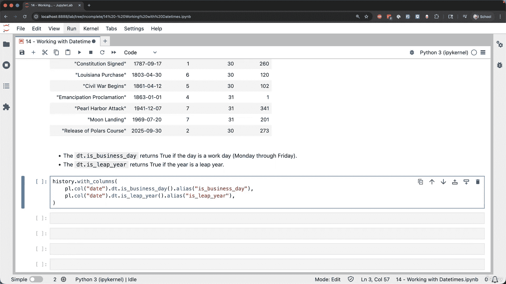

## 📝 小结

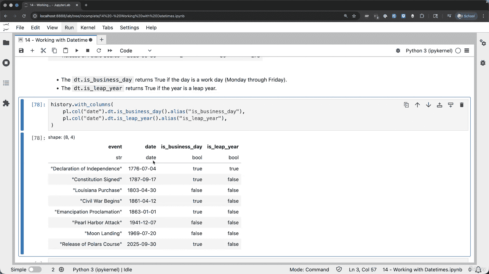

本节课中，我们一起快速浏览了Polars中`dt`属性下的许多功能。我们专门把这一套方法应用在日期类型列上，但就像前面说的，它们同样适用于日期时间列，因为日期时间值本身就包含了所有你需要的信息。不过，你一定要清楚自己正在处理的数据类型：如果你面对的是一个只有时间、没有日期的列，那么上面介绍的很多功能都会失效。一切取决于你列里存储的是哪种数据，以及你能从这些数据中提取出哪些时间单位。希望这节课的内容能够帮助你打下扎实的基础，我们下节课再见！
