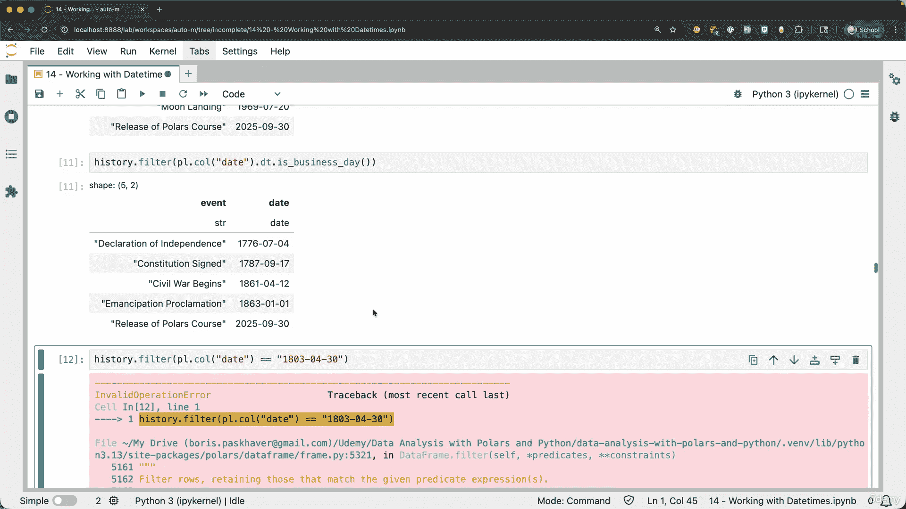
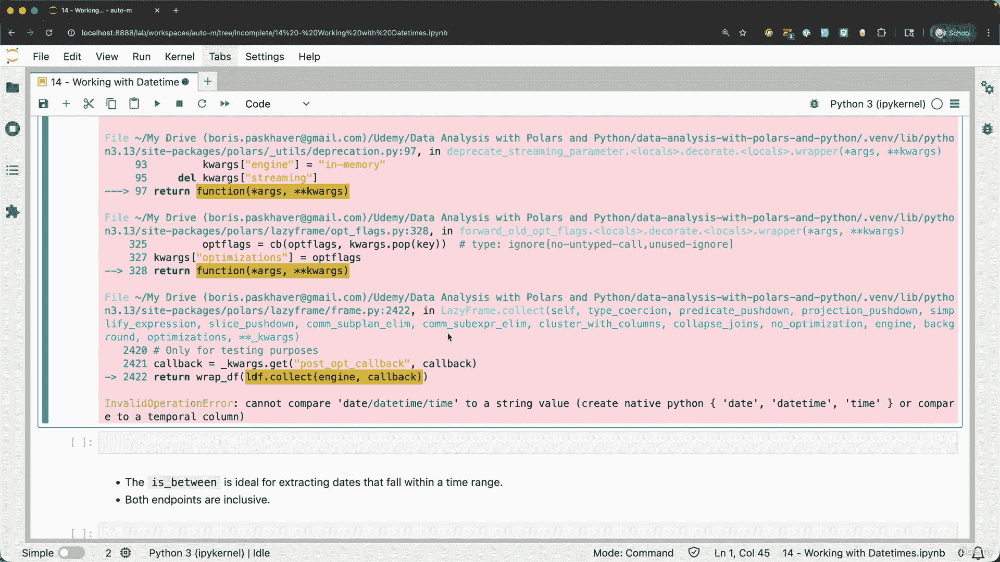
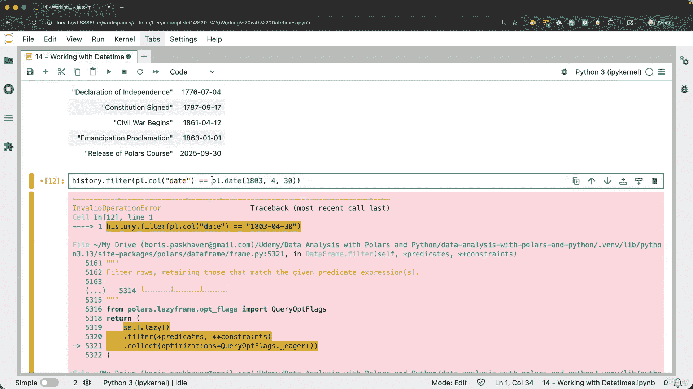
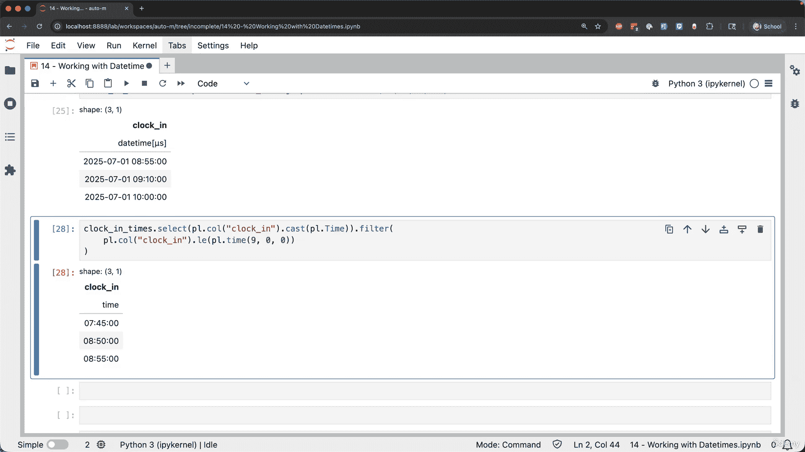

# 📅 Polars 与 Python 数据分析：第165课：按日期、时间和日期时间筛选

## 🧭 课程概述

在本节课中我们将要学习如何在 Polars 中按日期、时间和日期时间列筛选数据。上一部分内容已经接触过 `filter` 方法，本节会把重点放在日期类型上，同时也会延伸到日期时间类型和纯时间类型。核心思路可以用下面这个公式概括：

```python
df.filter(条件表达式)
# True  -> 保留该行
# False -> 排除该行
```

理解这个公式之后，日期筛选、时间筛选和日期时间筛选本质上都是同一件事：构造一个逐行返回真或假的表达式，再交给 `filter` 方法处理。下面从最基础的筛选规则开始，逐步进入具体日期、范围比较、日期时间以及纯时间的写法。


## 1. 🧱 先理解 filter 的判断规则

上一节我们介绍了 `filter` 的基本用途，本节先把这个方法的判断规则讲清楚。重新执行导入代码，把 history 数据集读进来之后，可以看到 `date` 列存储的是 `date` 类型。这里先记住这一点，后面课程还会看到如何筛选存储日期时间值的列，以及只存储时间的列。

在 Polars 中，要基于一个或多个条件的满足情况提取行子集，需要使用数据帧上的 `filter` 方法。`filter` 方法接收一个表达式，这个表达式会为每一行计算出一个布尔值。下面用三条规则概括它的工作方式：

- 表达式按行计算，每一行都会得到一个 `True` 或 `False`。

- 当 Polars 在某一行看到 `True`，就会保留这一行。

- 当 Polars 在某一行看到 `False`，就会把这一行从最终结果集中排除。

掌握了这三条规则之后，就可以进入具体例子。上一课曾经看到，如果定位一个类似 `date` 的日期时间列，并访问 `dt` 属性，就能调用 `is_business_day` 方法。这个方法会在某一行是工作日时返回 `True`，工作日指星期一到星期五。下面代码展示了这种筛选方式：



```python
df.filter(
    pl.col("date").dt.is_business_day()
)
```

这个表达式会生成一串真和假，然后作为筛选依据。最终结果只保留日期落在星期一到星期五之间的行。接下来我们在业务日筛选的基础上，看看如何按一个具体日期做等值筛选。


## 2. 🎯 按具体日期做等值筛选

上一节我们使用业务日条件保留工作日，本节来看看如何提取某个具体日期的事件。假设要提取发生在 1803 年 4 月 30 日的事件，需要先调用 `filter` 方法，再把目标对准 `date` 列。做等值比较时可以使用等号运算符，Polars 会把 `date` 列中的每一个行值与右侧的值进行比较。



这里的关键问题是：右侧应该如何表示这个日期。直接写普通字符串不行，因为 Polars 期望比较双方的数据类型一致。例如写成 `"18030430"`，这是常见的“年月日”格式，但它仍然是字符串。运行后会得到类似下面的错误提示：

> 错误提示示例：Cannot compare a Date/Datetime/Time column to a string value.



Polars 要求右侧是一个真正的日期对象。创建这个日期对象有两种思路：使用 Polars 库中的表达式，或者使用 Python `datetime` 模块中的有效日期构造。因为 Polars 已经把相关功能内置在库中，所以这里优先使用 Polars 的写法。在 Polars 顶层 `pl` 下面可以访问 `date` 函数，这个函数接受的参数与 Python `datetime` 模块里的 `date` 类构造器相同。该函数接收三个参数：年、月、日。

```python
df.filter(
    pl.col("date") == pl.date(1803, 4, 30)
)
```

这段代码会提取日期匹配 1803 年 4 月 30 日的事件。这里要记住一个关键点：右侧需要一个有效的日期构造，也就是日期对象或日期表达式，才能完成比较。为了避免混淆，下面把 Polars 中“创建值的函数”和“表示类型的类”区分清楚：

- `pl.date` 是小写函数，用来创建不带时间部分的日期值。

- `pl.time` 是小写函数，用来创建不带日期部分的时间值。

- `pl.datetime` 是小写函数，用来创建同时包含日期和时间的值。

- `pl.Date`、`pl.Time`、`pl.Datetime` 是大写类型，用在你需要向 Polars 提供具体类型的地方。

这个大小写区别很重要。例如在使用 `schema_overrides` 字典，或者使用 `cast` 方法把列值转换成另一种数据类型时，需要使用大写版本，表示真正的类型本身。如果只是想创建一个实例，用于比较或运算，就使用小写函数。选错选项也不用担心，通常会直接得到错误，再修正即可。理解了这一点之后，继续看等值筛选的方法式写法。除了双等号，还可以使用便捷的 `eq` 方法，它只是把表达式展开成方法调用形式。下面代码在末尾传入一对括号，结果与双等号完全一致：

```python
df.filter(
    pl.col("date").eq(pl.date(1803, 4, 30))
)
```

这样完成的是日期的精确等值判断。接下来把思路扩展到大于、小于、大于等于这类比较，用它们提取相对于另一个时间点的行。


## 3. 📈 用大于、小于等比较筛选日期

上一节完成了具体日期的等值筛选，本节来看看相对比较。可以使用大于、小于、大于等于这些符号，提取相对于另一个时间点的行。假设要提取日期大于 1800 年 1 月 1 日的所有行，也就是发生在这个日期之后的行。下面代码调用 `filter`，定位 `date` 列，并使用大于符号：

```python
df.filter(
    pl.col("date") > pl.date(1800, 1, 1)
)
```

对于大于符号，还有对应的 `gt` 方法，表示 greater than。下面代码展示方法式写法，两种方式可以按个人偏好选择：

```python
df.filter(
    pl.col("date").gt(pl.date(1800, 1, 1))
)
```

这里并不强制使用 Polars 的类型。也可以使用 Python `datetime` 模块中的日期时间类型来构造比较对象。这个模块不属于 Polars，而是 Python 标准库的一部分，社区常见别名是 `dt`。`dt` 模块中同样有 `date`、`time`、`datetime` 这些类。把前面代码里的 `pl.date` 换成 `dt.date`，会得到完全相同的结果：

```python
import datetime as dt

df.filter(
    pl.col("date") > dt.date(1800, 1, 1)
)
```

所以，用哪种对象来建模比较值取决于个人习惯，比较时仍然是拿每一行值与右侧对象逐一比较，原理完全一致。掌握单边比较后，下一步自然会遇到“落在一个时间范围内”的需求，下面用两种写法完成这个任务。


## 4. 🔲 用 is_between 和 century 筛选时间范围

上一节使用大于和小于做单边比较，本节来看如何筛选落在一个范围内的日期。假设要找出 19 世纪的日期，也就是 1800 年到 1899 年之间的日期。这个问题有几种解法，下面介绍其中两种。第一种是调用 `filter`，定位 `date` 列，然后使用表达式构造器上的 `is_between` 方法。这个方法接收两个参数，分别表示范围起点和范围终点。

```python
df.filter(
    pl.col("date").is_between(
        pl.date(1800, 1, 1),
        pl.date(1899, 12, 31),
        closed="both"
    )
)
```

两个端点都包含在内，因此会提取落在这个范围内、或者正好等于这两个端点的所有日期，也就是 19 世纪的所有事件。第二种写法也能得到同样结果。再次使用 `filter` 和 `date` 列，在 `dt` 属性下有一个便捷的 `century` 方法，它会返回某个日期所属的世纪，返回值是一个普通整数。把这个整数与 19 比较，就能取出 19 世纪的记录：

```python
df.filter(
    pl.col("date").dt.century() == 19
)
```

这里可以使用 `eq` 方法，双等号同样可行。代码筛选 `date` 列世纪值等于 19 的行，会得到与 `is_between` 相同的三行结果。这里需要说明，原文有一句口误提到 18 世纪，但代码实际比较的是 19，前面范围也是 1800 到 1899，因此以代码和范围为准，筛选的是 19 世纪。日期列的这些原则同样适用于日期时间列和时间列，下面读取第二个 CSV 文件来演示日期时间筛选。


## 5. 🕒 筛选日期时间列

上一节处理的是纯日期列，本节把同样的原则应用到日期时间列。下面再次读取第二个 CSV 文件 `clockintimes.csv`，并应用尝试解析日期参数，把它设置为 `True`：

```python
clock_in_times = pl.read_csv(
    "clockintimes.csv",
    try_parse_dates=True
)
```

这个文件中的列存储的是日期时间值。先选择 `clock_in` 列，并对它排序，让顺序为升序。排序通常会让筛选操作更快，因此建议总是对将要作为筛选依据的列排序。下面代码选择并排序该列，然后输出查看：

```python
clock_in_times.select(
    pl.col("clock_in")
).sort("clock_in")
```

现在有一列存储日期时间值，每一行既有实际日期，也有对应时间。对于这种数据，仍然使用 `filter` 方法。创建一个表达式，定位要比较行值的列。这次换一种比较方式，使用大于等于，右侧需要建模一个有效的日期时间条目。Polars 库中有对应的 `datetime` 函数来创建这种记录。这个构造器接收六个参数：年、月、日、小时、分钟、秒。

```python
clock_in_times.filter(
    pl.col("clock_in") >= pl.datetime(2025, 7, 1, 8, 53, 0)
)
```

这段代码寻找值大于等于 2025 年 7 月 1 日早上 8 点 53 分的行，也就是发生在这个时间点或之后的行。结果中会省略 7 点 45 分和 8 点 50 分的条目，因为它们发生得更早。最终保留的是早上 8 点 53 分及之后发生的行。大于等于也有对应的 `ge` 方法，可以得到完全相同的结果：

```python
clock_in_times.filter(
    pl.col("clock_in").ge(pl.datetime(2025, 7, 1, 8, 53, 0))
)
```

这就是日期时间列的筛选示例。接下来利用这一列创建一个纯时间列，继续看时间类型如何处理。


## 6. ⏰ 筛选纯时间列

上一节筛选的是日期时间列，本节把日期部分去掉，只保留时间。可以从 `clock_in_times` 中取出 `clock_in` 单列，然后使用 `cast` 方法把列的数据类型转换成另一种类型。这里正好对应前面提到的类型与函数的区别：要转换成纯时间列，需要使用大写的 `pl.Time` 类型。指定类型时使用大写版本，创建实例时使用小写版本。

```python
time_only = clock_in_times.select(
    pl.col("clock_in").cast(pl.Time)
)
```

这样就把日期部分剥离掉，得到纯时间列。同样的原则也适用于这个数据帧：调用 `filter`，创建一个表达式定位唯一的 `clock_in` 列，然后使用小于等于比较。右侧使用 Polars 的 `time` 函数，这是第三种可用选项。该函数参数是小时、分钟、秒。下面代码筛选早上 9 点及之前的打卡时间：

```python
time_only.filter(
    pl.col("clock_in") <= pl.time(9, 0, 0)
)
```

结果会提取所有发生在 9 点之前的行。小于等于对应的便捷方法是 `le`，原理相同：

```python
time_only.filter(
    pl.col("clock_in").le(pl.time(9, 0, 0))
)
```

如果希望使用 Python 标准库 `datetime` 模块中的对应对象，也完全可以，例如 `dt.time(9, 0, 0)`。到这里，日期、日期时间和纯时间三种列的筛选方式都已经串起来。最后对 `filter` 方法做一个快速回顾：它的工作方式与平时一样，只需要构造某种布尔表达式，Polars 就能据此判断哪些行保留、哪些行省略。


## 🧾 总结



本节课中我们一起学习了如何在 Polars 中按日期、日期时间和纯时间列筛选数据。我们先用公式 `df.filter(条件表达式)` 理解了 `filter` 的基本规则：每一行计算布尔值，`True` 保留，`False` 排除。随后用 `dt.is_business_day()` 筛选工作日，用 `pl.date()` 做具体日期等值比较，并区分了小写函数与大写类型。接着使用大于、小于、`gt`、`eq`、`is_between` 和 `dt.century()` 完成相对比较和范围筛选。最后读取 `clockintimes.csv`，使用 `pl.datetime()` 筛选日期时间列，并使用 `pl.Time` 转换出纯时间列，再用 `pl.time()` 和 `le` 完成时间筛选。整个教程的核心仍然是那一句话：构造布尔表达式，交给 `filter` 判断每一行保留还是排除。

