# 🕒 Polars 与 Python 数据分析（Part 2）：第66节（P66/166）：时间的加法与减法（一）

在本节课中我们将要学习在 Polars 里怎样对时间做加法和减法。开始前会先重新执行历史数据框的导入代码，得到后面要用的 `history` 数据框。接着会使用两个熟悉的数学符号：加号 `+` 用来加时间，减号 `-` 用来减时间，也就是在历史数据中向后移动。归根到底，我们加或减的是一个 **duration**，它也叫 **time delta**。duration 用来描述一个时间区间或时间跨度，例如 5 小时 40 分钟就是一个 duration。它本身没有绑定具体日期或时间，只表示一段可以拿来和日期时间列组合使用的时间区间，用来向前加一段时间，或者向后减一段时间。

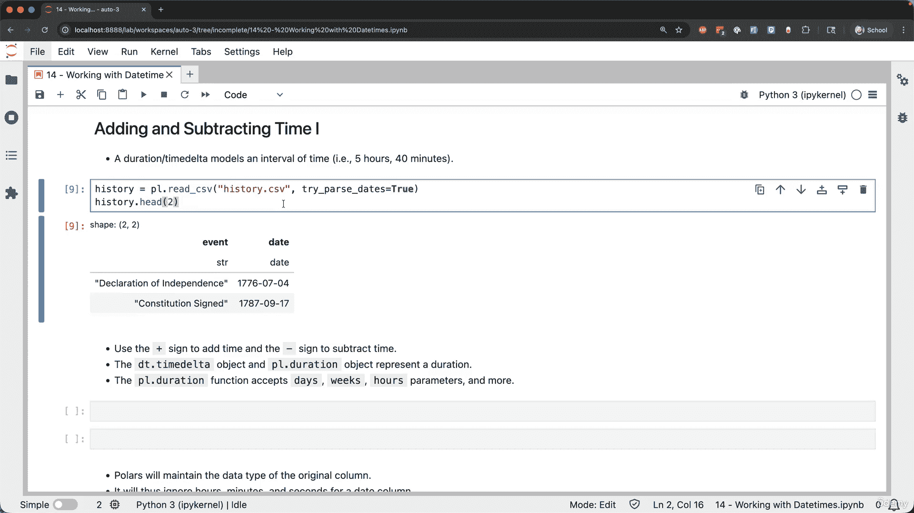

上一节我们了解了 duration 的基本含义，本节先看固定时长的加法。用公式表达就是：

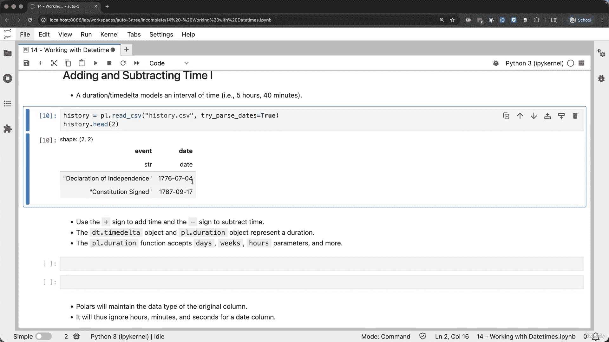

\[
\text{新时间列} = \text{原时间列} + \text{duration}
\]

## ➕ 1. 用加号给日期列增加固定时长

假设要把 `date` 列里的每个日期都加上正好 3 天，可以使用 `with_columns` 创建一个针对 `date` 列的表达式，在表达式里写加号，并使用 Polars 顶层提供的 `duration` 函数来构造时间区间。对应代码如下：

```python
history.with_columns(
    (pl.col("date") + pl.duration(days=3)).alias("new date")
)
```

查看 `duration` 函数的参数可以看到它支持多种时间单位，并且这些参数可以混合搭配。以下是 `duration` 里常见的参数示例：

- `weeks`
- `days`
- `hours`
- `minutes`
- 以及类似的时间单位

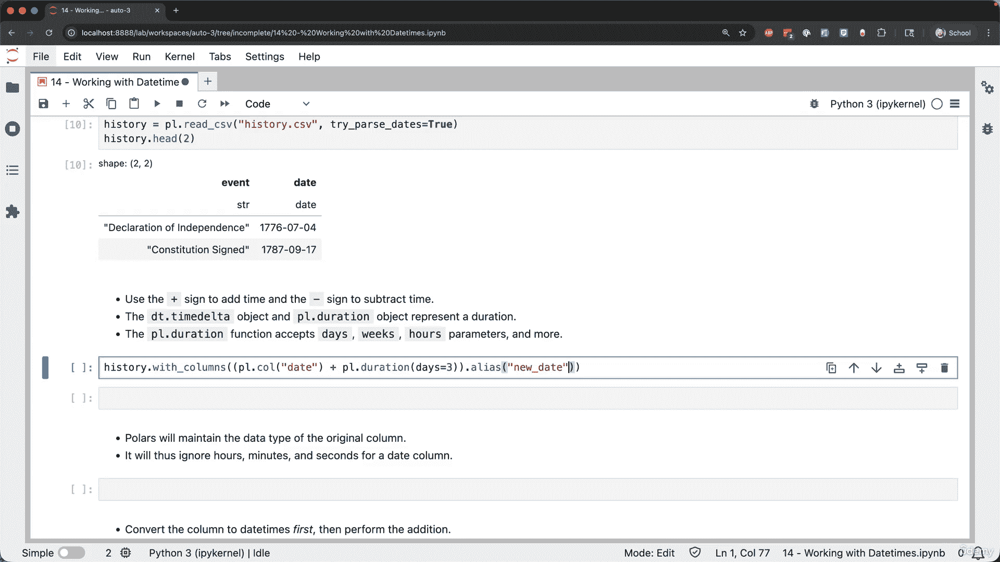

如果只想加 3 天，就设置 `days=3`。注意，这里会形成一个新的表达式；如果希望给新列一个不同的名字，需要先把完整表达式用括号包起来，再调用 `alias` 方法，例如命名为 `new date`。这样在 `new date` 列里，每个日期都会比 `date` 列中的日期正好晚 3 天。

如果不喜欢加号，也可以使用更偏方法调用的 `add` 方法。其原理相同，代码如下：

```python
history.with_columns(
    pl.col("date").add(pl.duration(days=3)).alias("new date")
)
```

`add` 方法既接受 Polars 的 duration，也接受 Python `datetime` 模块里的 `timedelta` 对象。如果更习惯使用 Python 原生对象，Polars 也支持。一般更建议尽量留在 Polars 内完成操作，因为已经在使用 Polars；同时要知道，Polars 和 Python 内置的 `date`、`datetime`、`time`、`timedelta`/duration 等对象配合良好。这里同样使用 `pl.duration(days=3)`，再调用 `alias("new date")`，结果和上面用加号的写法一致。

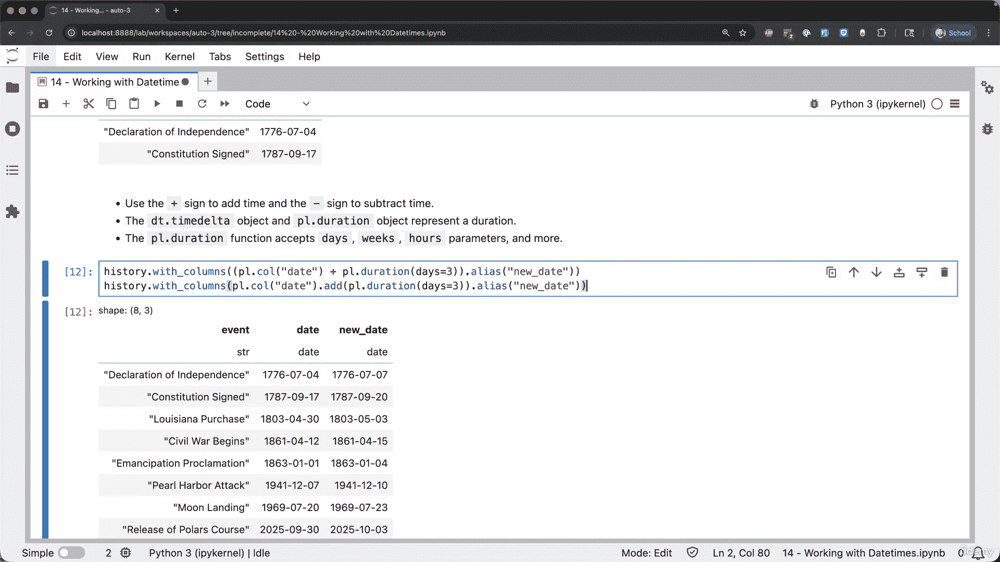

还可以混合多个时间单位。例如加入 `weeks=8`，表示总共加 8 周零 3 天。计算关系如下：

\[
8\text{周} + 3\text{天} = 8 \times 7 + 3 = 59\text{天}
\]

因此，这会给 `date` 列里的每个条目加上 59 天。

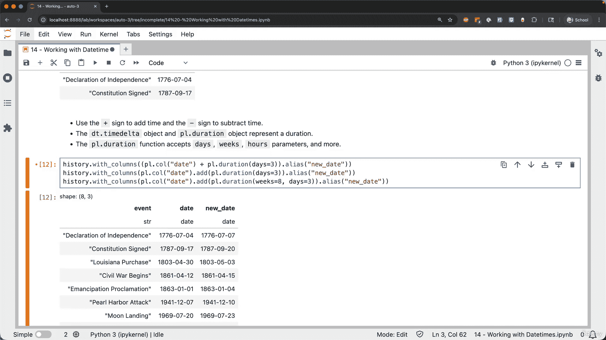

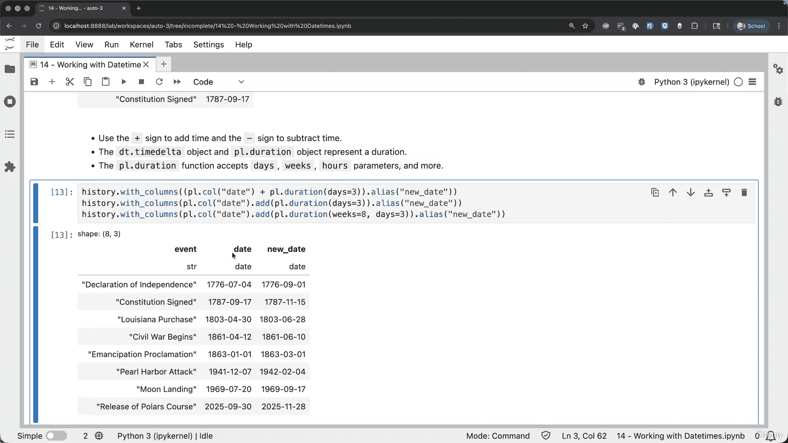

## ➖ 2. 用减号或 sub 方法向前回退时间

加号用于向前移动或增加时间区间；如果要向后移动，就使用减号或互补的 `sub` 方法。例如，要把每个日期减去 3 天，也就是向前回退 3 天，仍然使用 `duration` 函数，只是把运算符换成减号。代码如下：

```python
history.with_columns(
    (pl.col("date") - pl.duration(days=3)).alias("new date")
)
```

这里使用 `with_columns` 取 `date` 列，写减号，指定 Polars 的 `duration` 函数，并设置 `days=3`。把整个表达式用括号包起来后调用 `alias`，同样命名为 `new date`。因为使用了减号，所以现在是在向后移动时间；每个日期都会减去 3 天这个 duration 或时间区间。

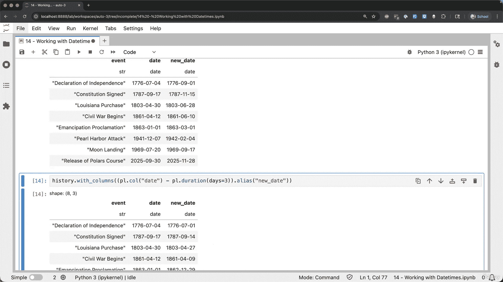

对应的 `sub` 方法写法如下：

```python
history.with_columns(
    pl.col("date").sub(pl.duration(days=3)).alias("new date")
)
```

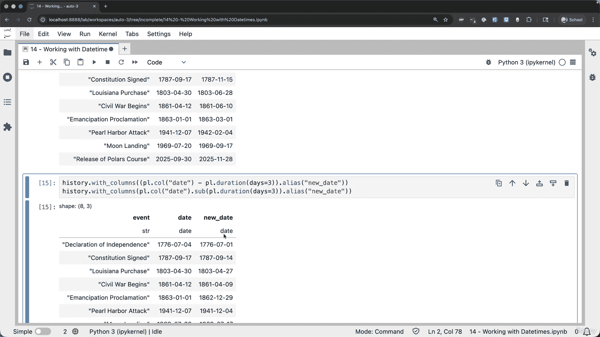

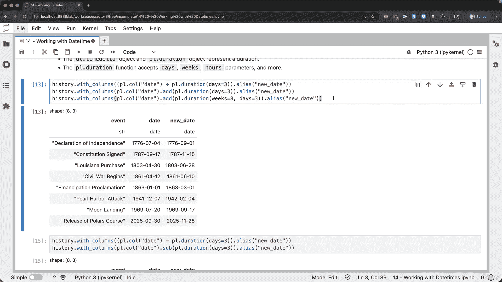

这同样是创建表达式，调用 `sub` 方法，传入 `duration` 函数，并设置要减去的 `days=3`，最后对完整表达式调用 `alias("new date")`。

## ⚠️ 3. 注意数据类型：日期列加时间仍然是日期列

这里有一个值得注意的细节：Polars 会保持原始列的数据类型。也就是说，因为起点是 `date` 列，给它加时间后得到的结果仍然是 `date` 列。即使混合使用小时、分钟、秒这样的单位，结果也一样。为了演示，可以向上复制包含 8 周零 3 天的那行代码，粘贴到下面，并加入 `hours=5`。代码如下：

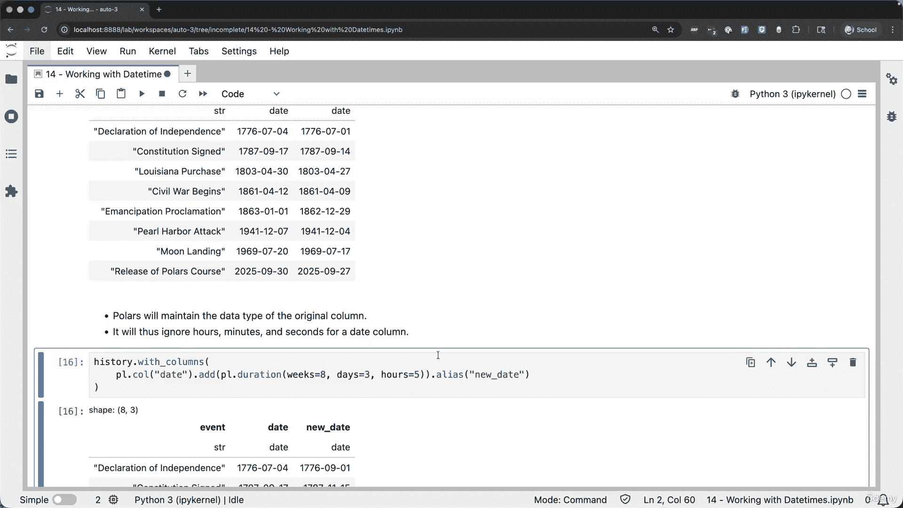

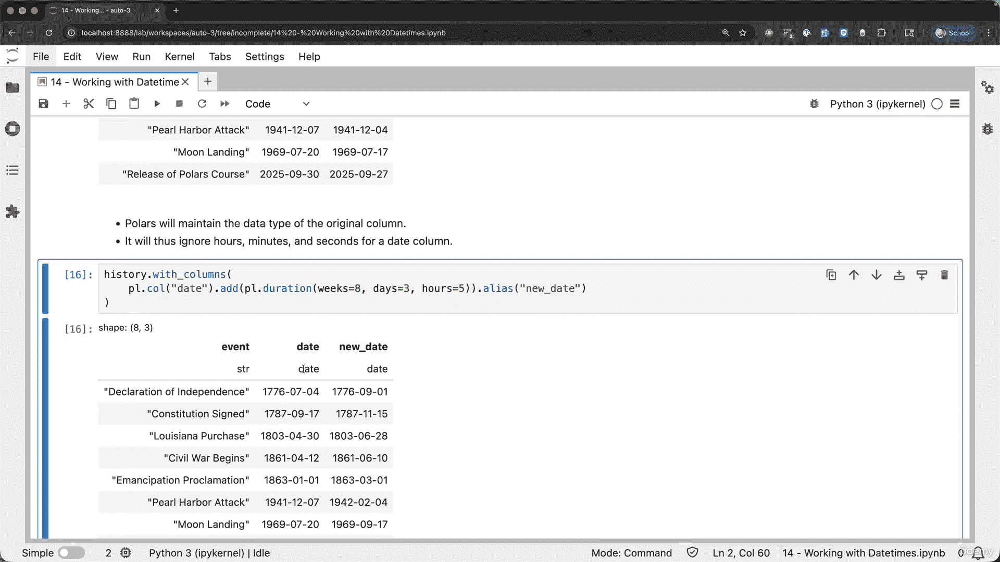

```python
history.with_columns(
    (pl.col("date") + pl.duration(weeks=8, days=3, hours=5)).alias("new date")
)
```

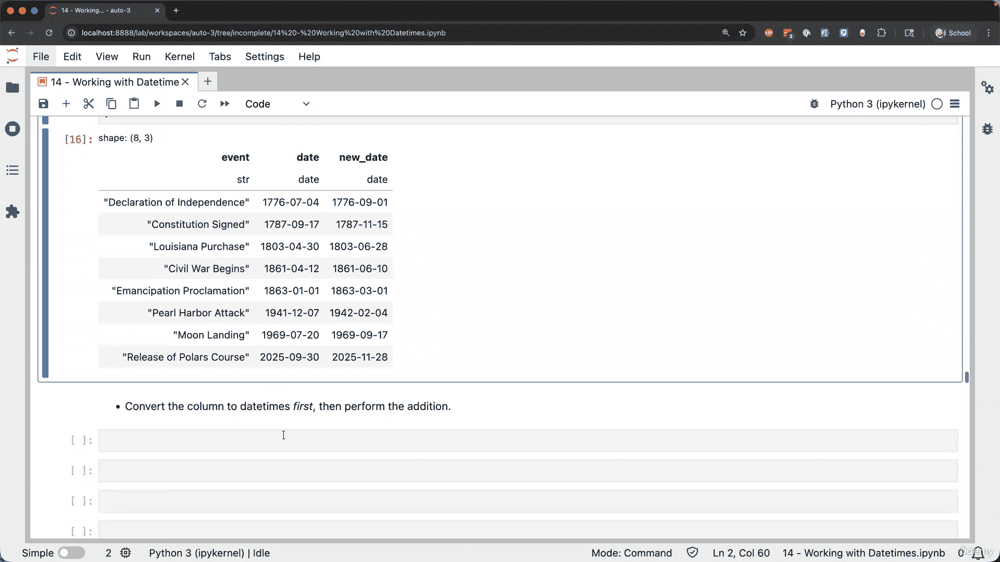

这看起来开始涉及时间概念，但 Polars 会完全忽略时间部分，因为原始列是 `date` 列，返回的仍然是新的 `date` 列。因此它仍然只加 8 周零 3 天，完全忽略小时。

如果确实想加时间，必须先把原始 `date` 列转换成 `datetime` 列，让每条记录带上时间单位，然后再执行加法。例如，取 `history` 数据框，针对当前存储日期值的 `date` 列，使用 `cast` 方法转换数据类型，并在 Polars 顶层访问 `Datetime` 类型。需要注意：类型使用大写版本，表达式里作为函数使用时使用小写版本；这里是 `Datetime` 类型，所以是大写 `D`。转换后可以调用 `add` 方法，并把新列命名为 `new date`。代码如下：

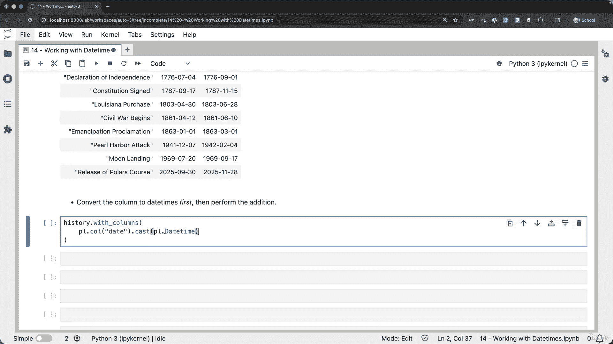

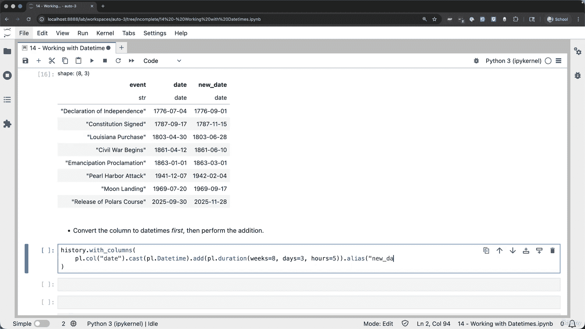

```python
history.with_columns(
    pl.col("date")
      .cast(pl.Datetime)
      .add(pl.duration(hours=5))
      .alias("new date")
)
```

现在可以看到，起点是 `date` 列，先转换成 `datetime` 列。因为原日期没有小时、分钟、秒可以提取，Polars 默认假定为午夜，也就是 `0:0:0` 或午夜时间。随后会给每个原始条目统一加上 5 小时。关键结论是：Polars 会保持原始列的数据类型，所以要先转换类型，再执行时间加法。

以上是在 Polars 中加减固定时长的一种方式。下一节课会展示一种稍微更高级、通常也更推荐的方式。

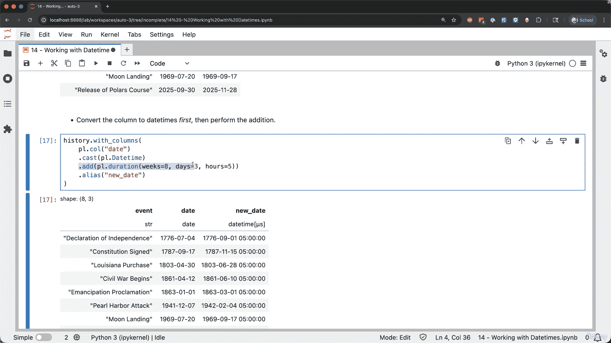

本节课中我们一起学习了：duration 和 time delta 的含义，如何使用加号、减号、`add` 方法和 `sub` 方法给日期时间加减固定时长，如何混合多个时间单位，以及日期列保持数据类型时为什么要先用 `cast(pl.Datetime)` 转换再执行时间加法。

