# Polars 与 Python 数据分析：167：加减时间 II ⏱️

在本节课中，我们将学习 Polars 中另一个非常实用的时间加减方法，也就是 `dt.offset_by`。上一课我们用的是 `duration` 来做时间加减，本节要看的 `offset_by` 会更智能一些，因为它能理解时间中的一些细微规则，例如不同月份天数不同、闰年等情况。下面我们先从准备数据开始，再一步步看它怎么用，以及它为什么在某些场景下比普通 `duration` 更可靠。

### Polars 与 Python 数据分析：167.1：准备数据 📦

在上一课中，我们介绍了用 `duration` 做时间加减；本节中我们来看看新方法需要的数据准备。这里会引入一个全新的数据集，文件名为 `deliveries.csv`。这个文件里有两列，分别是 `order date` 和 `delivery date`，它们都可以被转换成日期或日期时间类型的列。本课只关注 `order date` 这一列，因此我们先把它单独选出来，并转换成 `datetime`。

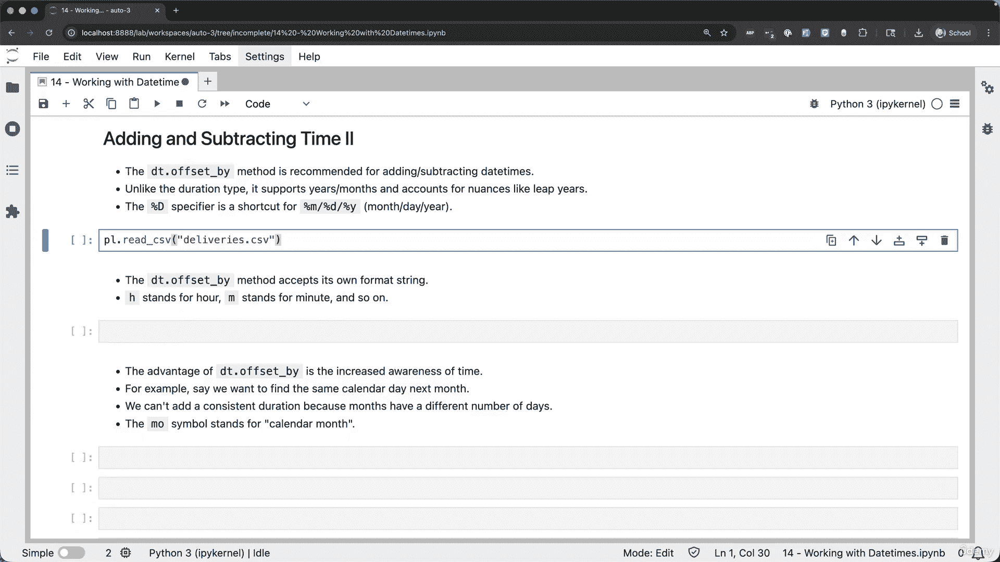

下面是准备数据时会用到的基本思路，也就是先读取 CSV，再用 `select` 创建表达式，最后用 `str.to_datetime` 做转换：

```python
import polars as pl

deliveries = (
    pl.read_csv("deliveries.csv")
    .select(
        pl.col("order_date").str.to_datetime("%m/%d/%Y")
    )
)

deliveries.head(2)
```

这里先调用 `select` 方法，并创建一个只针对 `order_date` 列的表达式。为了把它转换成日期时间值，可以使用字符串属性下面的 `str.to_datetime` 方法。这个方法第一个参数是格式字符串，参数名也叫 `format`。格式字符串的作用是告诉 Polars 这段文本的结构长什么样，这样它才能正确解析出日期时间。课程里的写法是“月份/日期/年份”，也就是 `%m/%d/%Y`，这当然可以正常工作，于是我们就得到了新的日期时间列。由于这种“月/日/年”的写法非常常见，课程还提到一个更短的写法 `%D`，作者说它和完整序列效果一样，可以减少一点代码量；使用前可以确认它与你数据中的年份格式是否匹配。转换完成后，我们得到一个只包含 `order_date` 一列、且该列存储日期时间值的 DataFrame，并把它赋值给 `deliveries` 变量，再用 `head(2)` 预览前两行。

数据准备好之后，下面进入本节课的核心内容，也就是用 `offset_by` 来加减时间。

### Polars 与 Python 数据分析：167.2：使用 offset_by 加减固定时间 ➕

上一节我们把 `order_date` 转成了日期时间列；本节中我们来看看怎么用 `dt.offset_by` 给这一列统一加上或减去一段时间。这里的核心关系可以写成：`新时间 = 原时间 + offset_by("固定时间量")`。也就是说，`offset_by` 会生成一个新列，它把一个固定的时间间隔应用到 `order_date` 的每一个条目上。默认情况下，它是向前移动时间，也就是做加法。

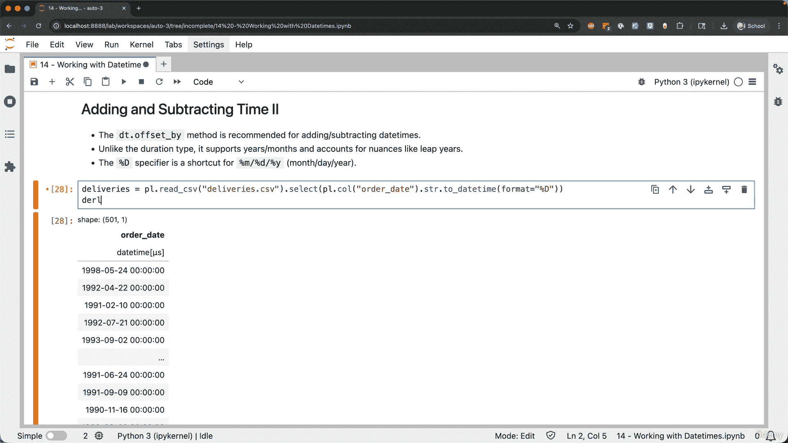

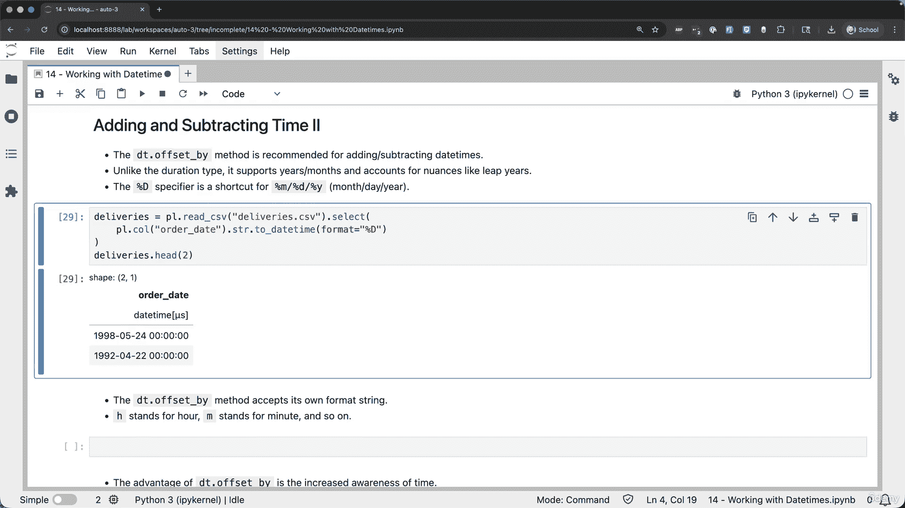

下面是使用 `with_columns` 和 `dt.offset_by` 的示例代码：

```python
deliveries.with_columns(
    pl.col("order_date")
      .dt.offset_by("12h30m")
      .alias("time_in_12_and_a_half_hours")
)
```

这里先取 `deliveries` 数据框，调用 `with_columns` 方法，并创建一个针对 `order_date` 列的表达式。接着不是用 `duration` 做加减，而是进入 `dt` 属性，访问 `offset_by` 方法。`offset_by` 和格式字符串很像，也需要一个格式字符串，用特殊符号表示时间单位。课程里用 `H` 表示小时，用 `M` 表示分钟，并在符号前写数量；在实际 Polars 字符串中常写成小写 `h` 和 `m`，含义一致。以下是使用 `offset_by` 时需要记住的几个单位和写法：

- `h` 表示小时，例如 `"12h"` 表示向前移动 12 小时。

- `m` 表示分钟，例如 `"30m"` 表示向前移动 30 分钟。

- 组合起来写 `"12h30m"`，表示向前移动 12 小时 30 分钟。

- 如果要向后退，就在数字和单位组合前面加负号，例如 `"-12h30m"`。

- 月份使用 `"mo"` 表示，例如 `"1mo"` 表示加一个月。

上面的代码还用 `alias` 给新列重命名，课程里把它叫做类似 `"time_in_12_and_a_half_hours"` 的名字，从技术上说的确就是“12 个半小时之后的时间”。这种写法和上一课直接用加号配合 `duration` 函数没有本质区别，结果都是向前移动 12 小时 30 分钟。如果想让时间倒退，只需要在数字和符号组合前加一个负号，它就会向后移动同样的时间；课程示例中，这样会得到前一天上午 11:30。

掌握了基本用法之后，我们再来看看 `offset_by` 在跨月场景里的优势。

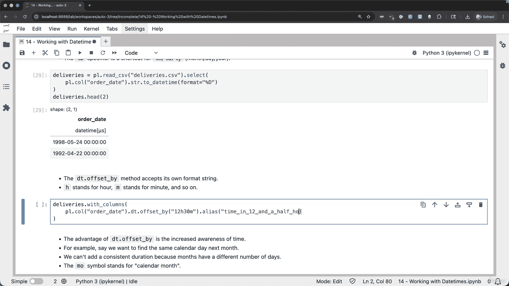

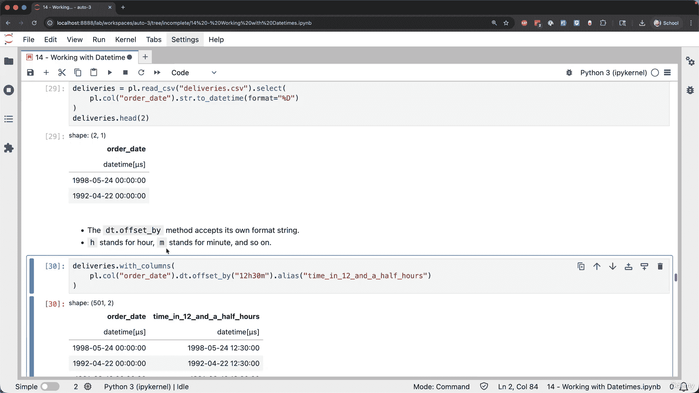

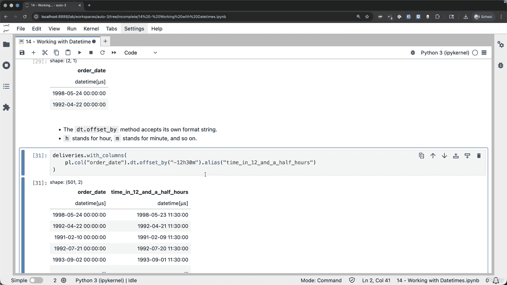


### Polars 与 Python 数据分析：167.3：offset_by 的优势：跨月与闰年 🗓️

上一节我们掌握了 `offset_by` 的基本单位和加减写法；本节中我们来看看它为什么比普通 `duration` 更智能。假设我们想取 `order_date` 中每个日期在“下个月同一日历日”的日期，例如课程提到的 1998 年 6 月 24 日，或者 1992 年 5 月 22 日往后一个月这种情况。问题在于，`duration` 只能加一个固定长度的时间，但不同月份长度不同，有的月份 30 天，有的 31 天，二月还可能是 28 天。以下是 `duration` 在跨月时容易遇到的问题：

- 加 28 天不能保证总是下个月同一天。

- 加 30 天或 31 天也会在某些月份出错。

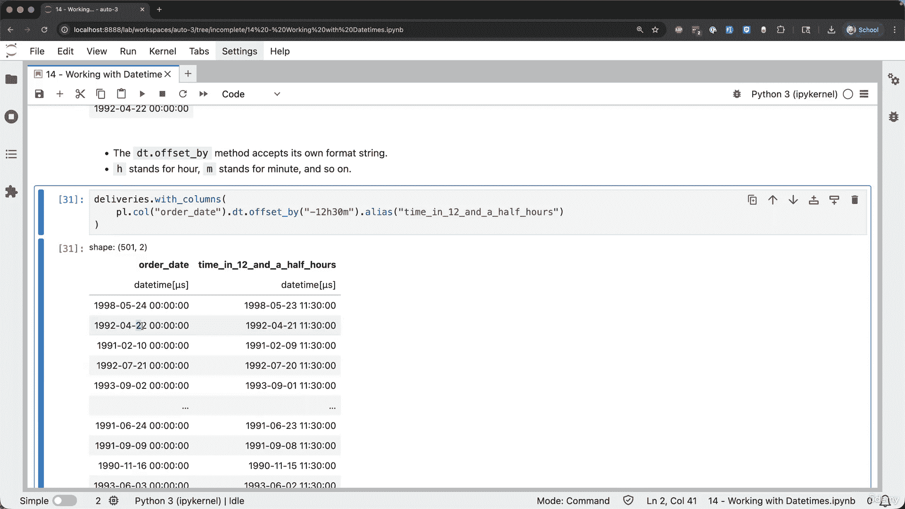

- 因此，用固定 `duration` 很难稳定地落到“下个月同一日历日”。

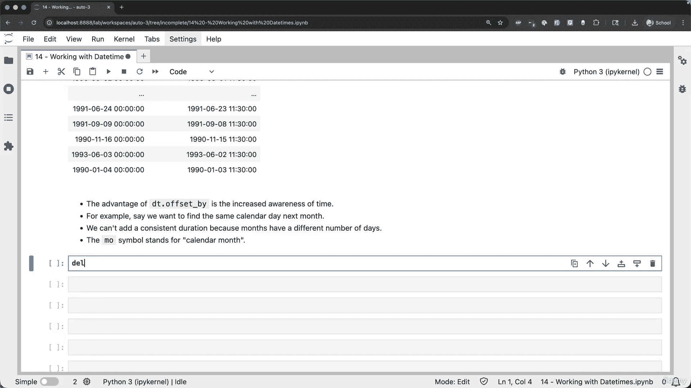

幸运的是，`offset_by` 提供了一个专门表示月份的写法 `"mo"`，它会给每个给定日期正好加一个月，而不是机械地加固定天数。下面是课程中的跨月示例代码：

```python
deliveries.with_columns(
    pl.col("order_date")
      .dt.offset_by("1mo")
      .alias("same_calendar_day_next_month")
)
```

这段代码同样取 `deliveries`，调用 `with_columns`，创建针对 `order_date` 的表达式，然后在 `dt` 属性下调用 `offset_by`。这里数量写 `1`，单位写 `"mo"`，表示加一个月，并把新列命名为类似“下个月同一日历日”的名字。正如前面所说，这个方法更精细，能理解时间的细微差别；课程示例中，它可以准确向前推进一个月，落到 6 月 24 日，而且对每一行都按同样原则处理。`offset_by` 也更了解闰年以及各种时间细节，这些细节在其他数据集中可能引发问题，尤其是当你用 `duration` 随意加时间时，结果可能不够精确、不够精细。相比之下，`offset_by` 不那么容易出错，也更经过实践检验。

到这里，`offset_by` 的优势就比较清楚了，下面我们对本节课做一个小结。

### Polars 与 Python 数据分析：167.4：总结 🧾

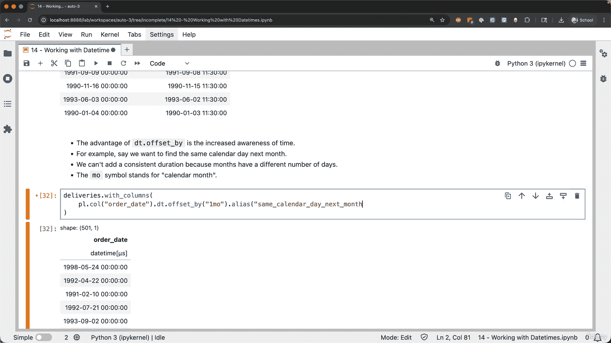

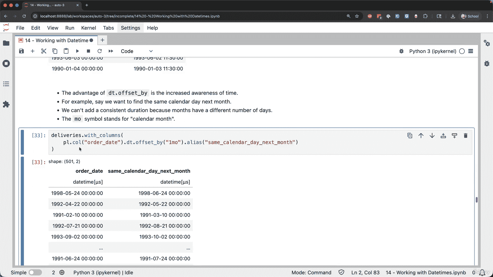

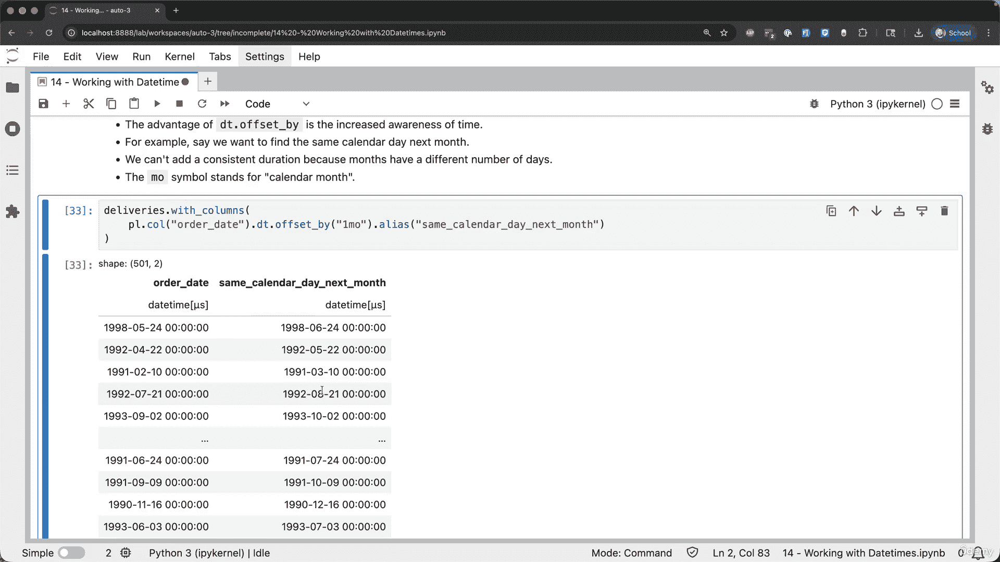

本节课中，我们一起学习了 Polars 中用 `dt.offset_by` 做时间加减的方法。我们先准备了 `deliveries.csv`，把 `order_date` 用 `str.to_datetime` 转成日期时间列；然后使用 `with_columns` 配合 `dt.offset_by`，通过类似 `"12h30m"` 的格式字符串向前或向后移动固定时间；最后又看了它在跨月场景中的优势，也就是用 `"1mo"` 加一个月，避免 `duration` 因月份天数不同而出错。`offset_by` 能理解更多时间规则，例如月份长度和闰年，因此比简单的 `duration` 更稳健。本节到这里，下节课继续。

