# 🕒 Udemy - Data Analysis with Polars and Python：168：Durations（持续时间类型）

在本节课中，我们将要学习 Polars 中的 duration 数据类型。上一节课我们学习了如何从包含日期和日期时间的列中加上或减去 duration；本节中我们来看看 duration 作为一种有效数据类型时该怎么理解和使用。简单说，duration 表示一段时间的长度、间隔或跨度，它不指向某个具体日期，也不指向某个具体时刻。原文把这种数据称为 interval of time，也就是时间间隔。理解这一点之后，后面看到日期相减得到 duration 就不会觉得奇怪了。下面是本节目标列表。

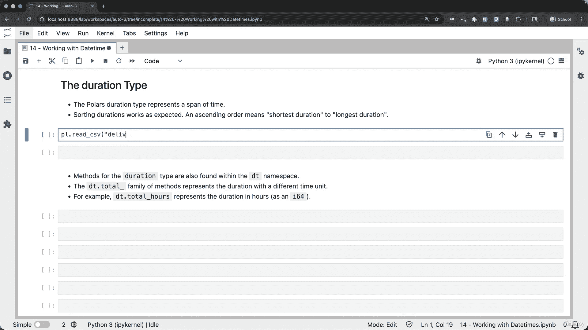

- 了解 duration 是什么，以及它和 date、time、datetime 的区别。
- 学会用两个日期列相减生成 duration 列。
- 学会对 duration 列排序。
- 学会使用 `dt.total_*` 方法把 duration 换算成天数、小时数或分钟数。

上一节我们回顾了日期列加减 duration，本节开头也已经说明了 duration 的基本定位。接下来，我们进入实际操作，先读取数据。

## 📥 Udemy - Data Analysis with Polars and Python：168：读取订单与交付日期数据

首先，我们使用 `read_csv` 函数把 `deliveries.csv` 文件再次读进来。可以想象，这是一份电商业务中订单交付给客户的数据集合。`order_date` 列表示客户下单的日期，`delivery_date` 列表示客户收到货物的日期。作为业务方，通常想计算每一单从下单到交付花了多长时间，也就是这两个日期之间的间隔。下面的代码展示读取数据。

```python
import polars as pl

deliveries = pl.read_csv("deliveries.csv")
```

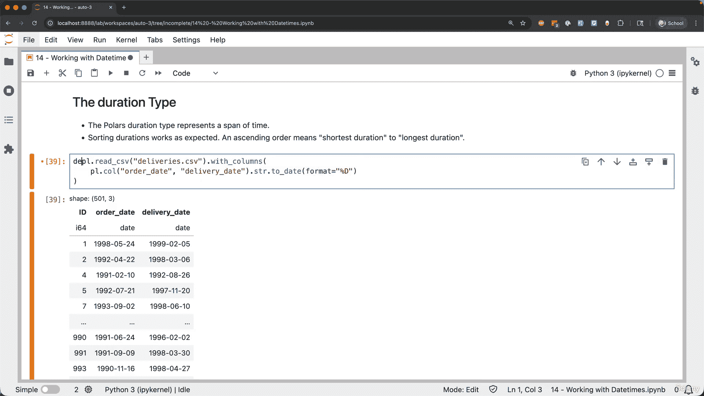

读取之后，我们还没有完成日期类型转换，所以下一步要把字符串列变成真正的日期列。上面的数据是后续所有计算的基础。

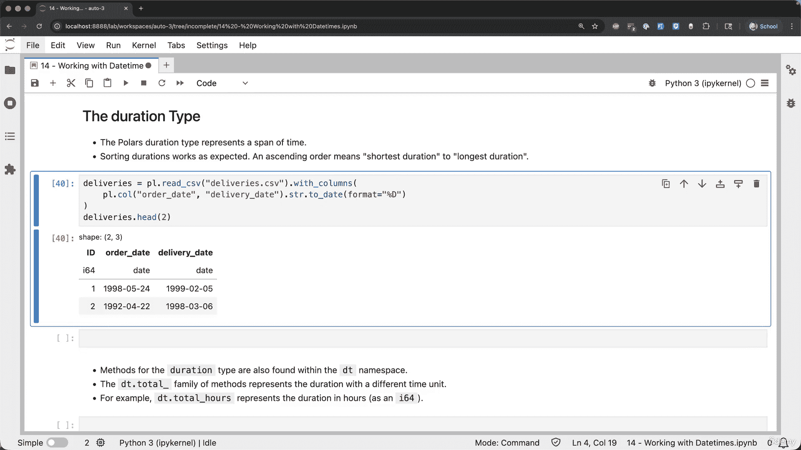

## 🔁 Udemy - Data Analysis with Polars and Python：168：把字符串列转换为日期列

接下来，我们要把 `order_date` 和 `delivery_date` 这两列从普通字符串转换为日期列。这里调用 `with_columns` 方法，并写一个同时作用于两列的表达式。这个表达式有效，因为它一次传入两个列名：先是 `order_date`，再是 `delivery_date`。然后访问字符串的 `str` 属性，再调用 `to_date` 方法，因为目标是日期值而不是日期时间值。最后提供格式参数，提醒一下，对于“月/日/年”格式，可以传入 `%D`，这样就可以了。下面是用代码完成转换。

```python
deliveries = deliveries.with_columns(
    pl.col("order_date", "delivery_date")
      .str.to_date(format="%D")
)
```

完成之后，我们确实得到两个日期值列。接着用 `head` 方法预览前几行，确认转换结果。转换完成后，就可以做日期相减了。

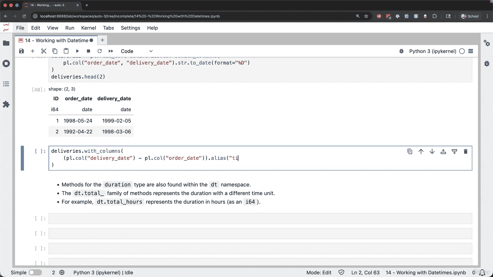

```python
deliveries.head()
```

## ➖ Udemy - Data Analysis with Polars and Python：168：用日期相减生成 duration 列

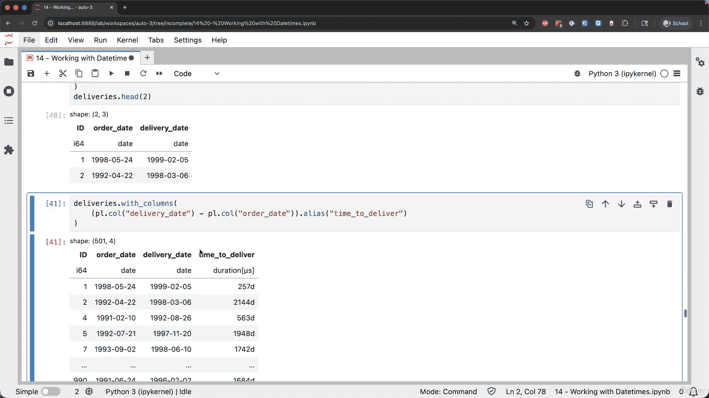

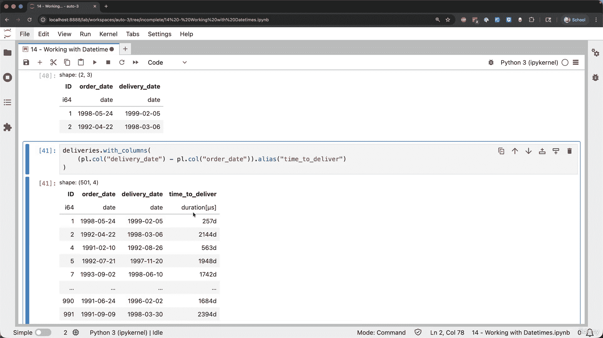

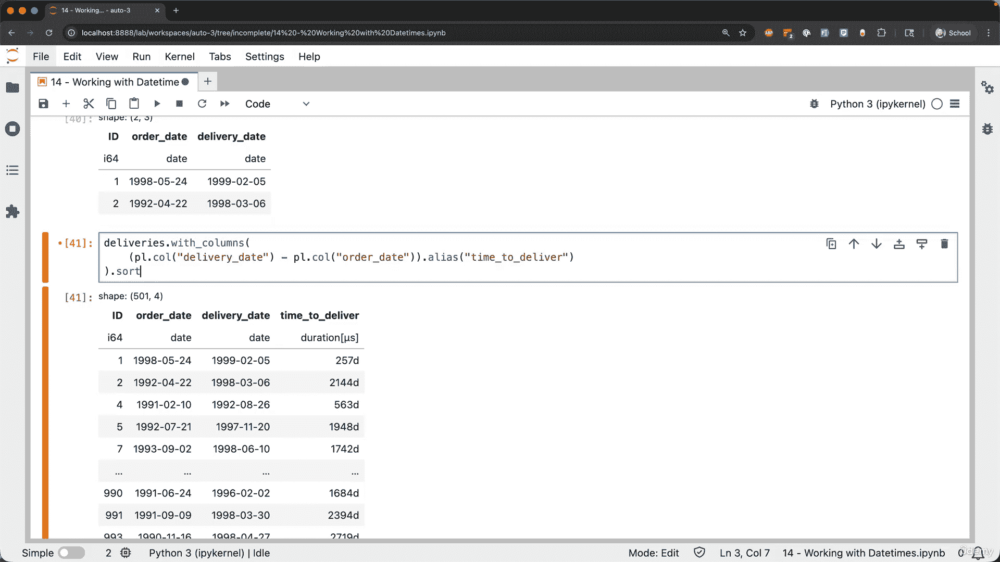

上一小节已经把两列转换成日期，本节我们看看如何得到交付耗时。下面继续对 `deliveries` 调用 `with_columns`，直接把一个日期列从另一个日期列中减去。具体来说，用 `delivery_date` 减去 `order_date`：把 `delivery_date` 作为起始日期，再减去 `order_date` 这个日期。Polars 会返回两者之间的距离，也就是 duration。这里用普通减号，而不是减去一个实际的 duration，因为减去 duration 是在减一段已知长度的时间；这里提供的是另一个日期列表达式，也就是 `order_date` 列。整个表达式外面加括号，新列命名为 `time_to_deliver`。代码如下。

```python
deliveries = deliveries.with_columns(
    (pl.col("delivery_date") - pl.col("order_date")).alias("time_to_deliver")
)
```

现在会得到一个名为 `time_to_deliver` 的列。注意它的类型不是 date、time 或 datetime，而是 duration 列。类型里的 `D` 表示 day，也就是天，所以每个值告诉我们这两个日期之间相差多少天。这个 duration 列在排序上遵循 Polars 里相同的排序原则。下面演示调用 `sort` 方法，按 `time_to_deliver` 新列排序。

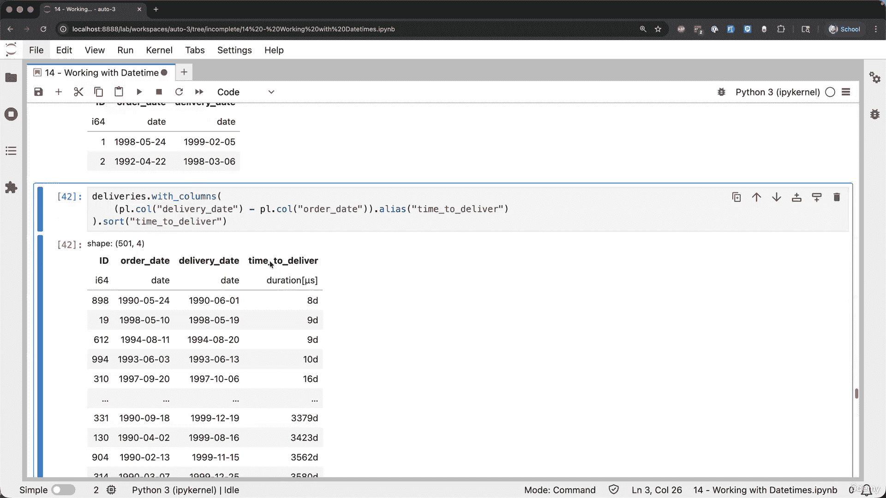

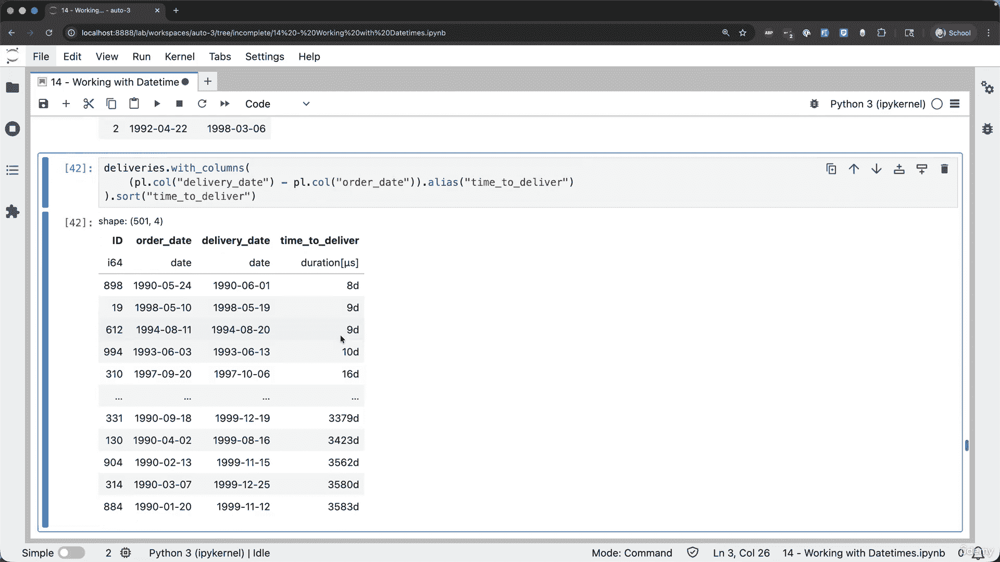

```python
deliveries.sort("time_to_deliver")
```

排序后可以看到升序结果：耗时最少的一单是 8 天；数据集最后则是耗时看起来长达 9 年的一单。这里的数据都是假数据，最后这一单实际是 3583 天。为了方便后续演示，我们把这个带有新 `time_to_deliver` 列的数据框赋值给新变量 `deliveries_with_durations`。这样后面就可以继续探索 duration 列的方法。

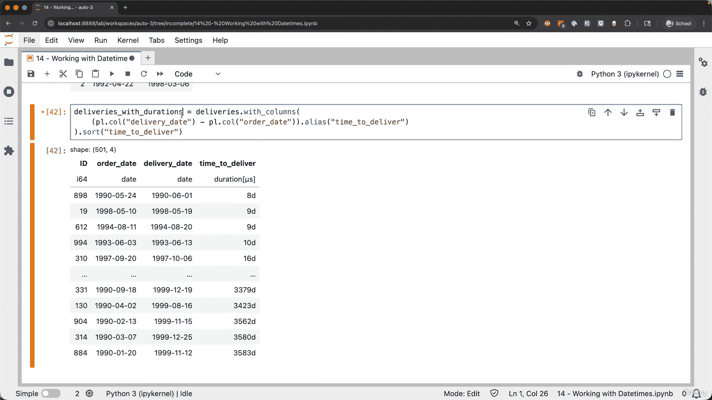

```python
deliveries_with_durations = deliveries.sort("time_to_deliver")
```

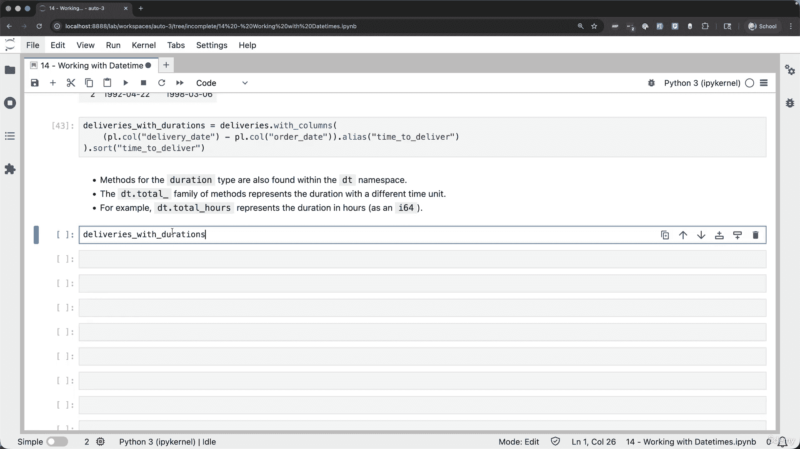

## ⏱️ Udemy - Data Analysis with Polars and Python：168：用 dt.total_* 提取 duration 的单位数值

前面我们生成了 duration 列并做了排序，本节来看看 duration 列自带的方法。如果一个列是 duration 类型，比如 `time_to_deliver`，那么可以在这个列上调用很多方法。和时间相关的方法一样，这些方法都放在 `dt` 命名空间下面。`dt` 命名空间包含日期列、时间列、日期时间列和 duration 列的方法，Polars 团队把这些功能统一打包在 `dt` 属性里。下面我们基于 `deliveries_with_durations` 调用 `with_columns`。在 duration 列下，也就是 `dt` 属性下，会看到一批以 `total` 开头的方法。`total` 是专门为 duration 列设计的，它会按指定单位给出持续时间的实际计数。默认情况下单位是天；如果想用小时或分钟表示，也有对应的方法。返回值不再是 duration 类型，而是实际的整数类型。下面是演示代码。

```python
deliveries_with_durations = deliveries_with_durations.with_columns(
    pl.col("time_to_deliver").dt.total_days().alias("total_days"),
    pl.col("time_to_deliver").dt.total_hours().alias("total_hours"),
    pl.col("time_to_deliver").dt.total_minutes().alias("total_minutes"),
)
```

上面的代码分别调用 `total_days` 方法生成 `total_days` 列，复制同样的表达式并调用 `total_hours` 方法生成 `total_hours` 列，最后调用 `total_minutes` 方法生成 `total_minutes` 列。查看结果时，例如某次交付耗时 8 天，整数列 `total_days` 就存储总天数 8；8 天等价于 192 小时，也就是 8 乘以 24；如果想把时间表示为分钟，可以用 `total_minutes` 方法提取出来，结果会放在对应列里。这些方法就是专门用于处理 duration 列，并把对应单位提取出来的。核心换算关系可以用下面的公式表示。

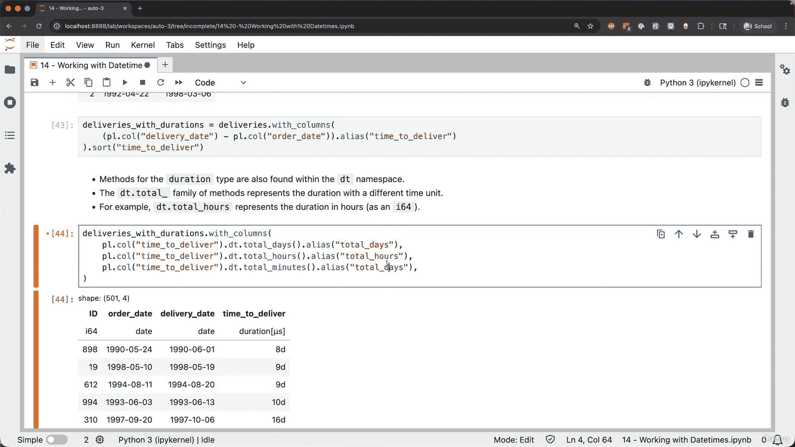

```text
总小时数 = 总天数 × 24
总分钟数 = 总小时数 × 60
```

回顾一下，本节从 duration 类型的概念开始，先读取订单数据，再把字符串列转成日期列，然后用日期相减得到 duration 列，接着按 duration 排序，最后用 `dt.total_*` 把 duration 换算成天、小时、分钟。下面做一个小结。

- duration 表示时间的流逝、间隔或跨度，不是某个具体日期或具体时刻。
- 两个日期列相减会得到 duration 列，类型中的 `D` 表示天。
- duration 列可以像普通列一样排序。
- `dt.total_days()`、`dt.total_hours()`、`dt.total_minutes()` 可以把 duration 转成整数单位值。

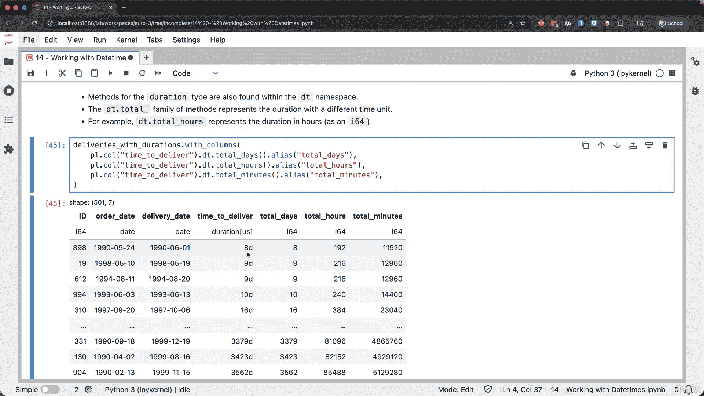

本节课中我们一起学习了 Polars 的 duration 类型：它不建模具体日期，也不建模具体时刻，而是建模一段时间的经过、一个时间间隔或时间跨度，并且以天为单位表示。到这里，duration 的快速入门就完成了。

