# 🗺️ Polars 与 Python 数据分析：第169节：时区基础 I

在本节课中，我们将学习 Polars 中的时区处理基础。前面我们已经接触过很多日期时间值，但这些值大多可以被称为“无时区时间”，也就是 naive datetime。本节会先说明什么是 naive datetime，再介绍 UTC 这个全球时间参考点，然后回到 Polars，看看它默认如何处理日期时间列。之后我们会用一个航班数据集做演示，把字符串列转换成日期时间列，再给日期时间列附加时区，最后在带时区的列上做时间偏移和时区替换。整个过程会尽量用大白话解释，让初学者也能跟上。

先记住两个核心概念，后面所有操作都围绕它们展开：

```text
naive_datetime = 一个日期时间值，不带任何时区信息

timezone_aware_datetime = datetime + time_zone
```

**🧭 什么是无时区时间（naive datetime）**

所谓 naive datetime，就是一个没有时区意识的时间值。它只告诉你“某年某月某日某时”，但不告诉你这个时间属于哪个地区。比如我们看到“2026 年 1 月 3 日下午 5 点”这样一个值，它没有说明这个下午 5 点是纽约的下午 5 点、伦敦的下午 5 点、东京的下午 5 点，还是世界上其他某个地方的下午 5 点。它只是一个日期或一个时间点，没有相对的地理参考。

在现实世界里，存储时间时通常会附带一个关联时区，这样我们才知道这个时间相对于哪里、代表什么。时区的作用就是给时间加上一个参照系。没有参照系的时间就像一句没有主语的句子，看起来完整，实际却缺少关键信息。理解这一点之后，我们再看 Polars 的默认行为就会清楚很多。

**🌍 UTC 作为全球时间参考点**

时区是相对于一个基础标准或参考点来工作的，这个参考点通常叫 UTC。下面用公式表示常见时区与 UTC 的关系：

```text
UTC+5 = UTC 时间 + 5 小时

UTC-4 = UTC 时间 - 4 小时
```

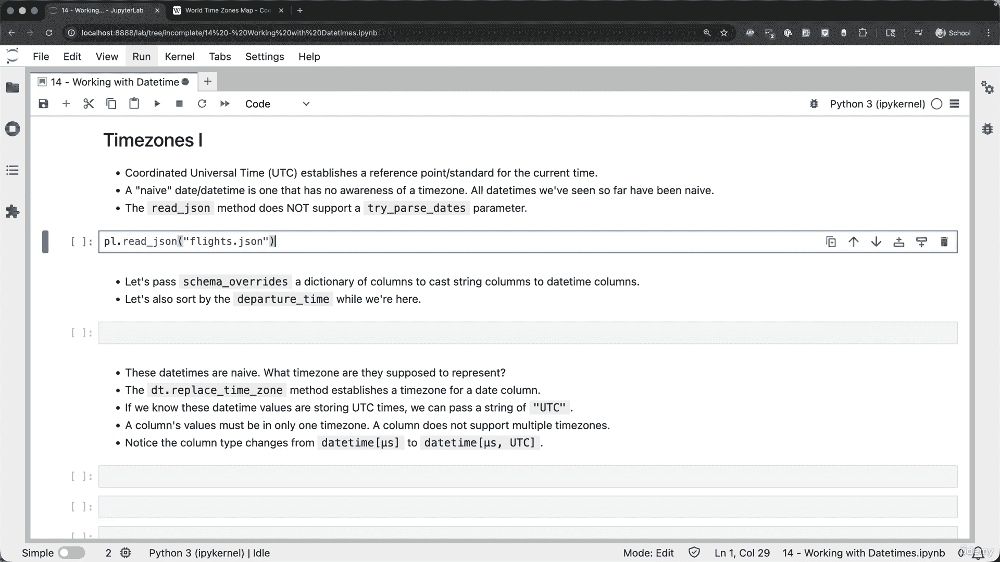

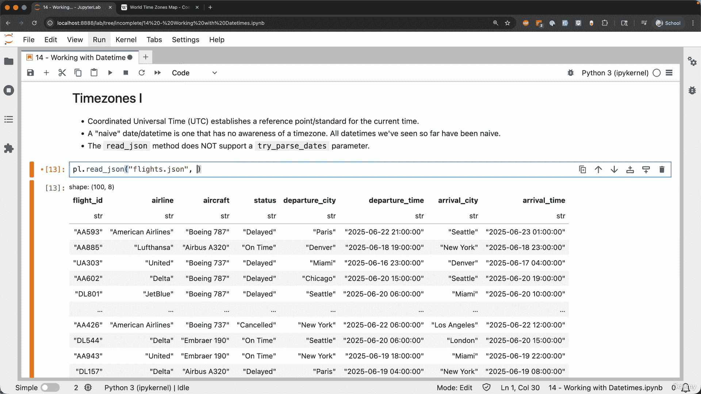

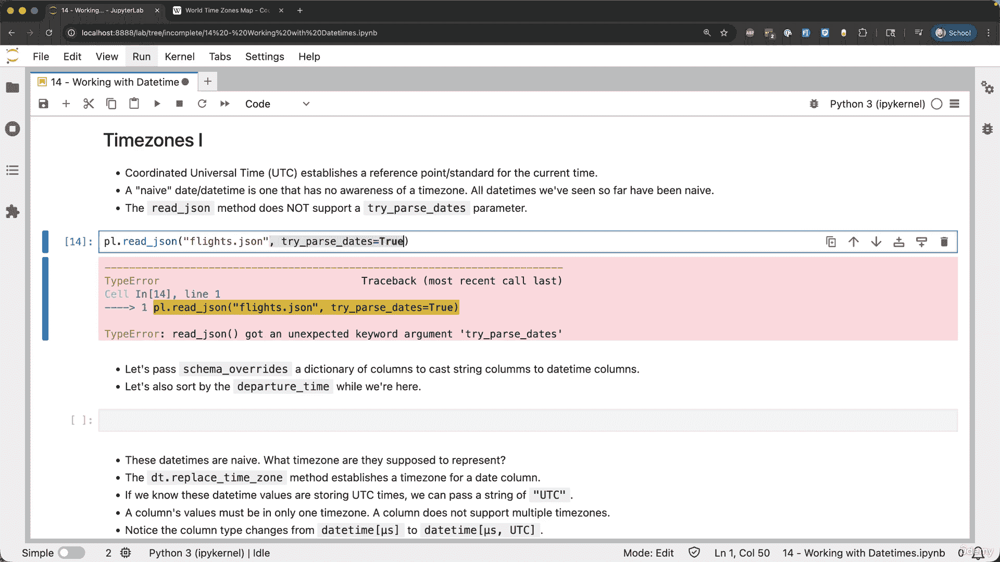

在世界标准时区地图上，绿色区域通常对应 UTC，它本身只是一个标准和参考点，存在的目的就是让其他时区可以和它比较。比如标记为 +5 的区域比 UTC 快 5 小时：如果 UTC 是某个时间，这个区域就是那个时间再加 5 小时。标记为 -4 的区域比 UTC 慢 4 小时：如果 UTC 是中午 12 点，这个区域就是上午 8 点。理解了这种相对关系，后面给列附加时区和转换时区就不会显得神秘。

**🐻‍❄️ Polars 默认行为与两件基本操作**

默认情况下，Polars 把字符串转换成 datetime 时，不会附加任何时区，也不会对数据所在地做任何假设。它只是把字符串解析成一个日期时间值，至于这个值属于哪个时区，它不管。因此，刚转换出来的列通常是 naive datetime 列，列类型里也看不到时区信息。

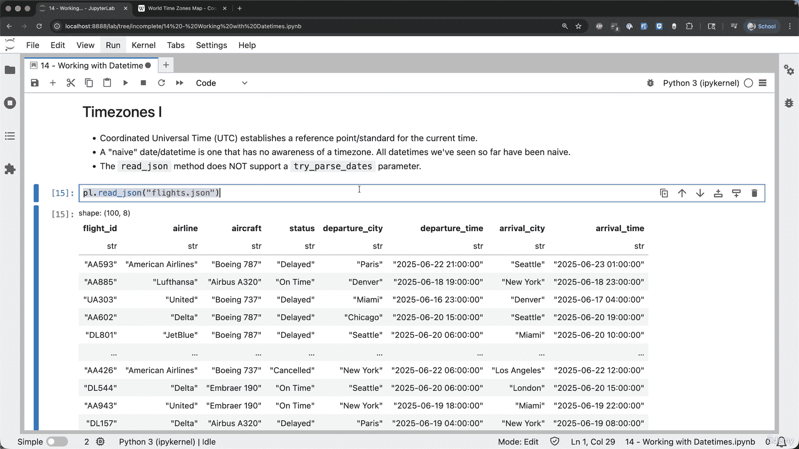

在 Polars 中，围绕时区最基础的操作可以分成两步，下面是这两步的说明：

- 第一步，给一个日期时间列附加时区，建立一个明确的参考点。
- 第二步，以这个带时区的日期时间列为基准，把时间转换到世界上另一个时区。

这个参考点不一定是 UTC，也可以是数据实际所在的时区。关键是要知道数据原本代表哪个时区，然后才能有依据地把它翻译或转换成其他地方的时间。接下来我们就一步步操作，先导入数据，再把字符串列转成日期时间列。

**📂 导入 flights.json 并查看数据结构**

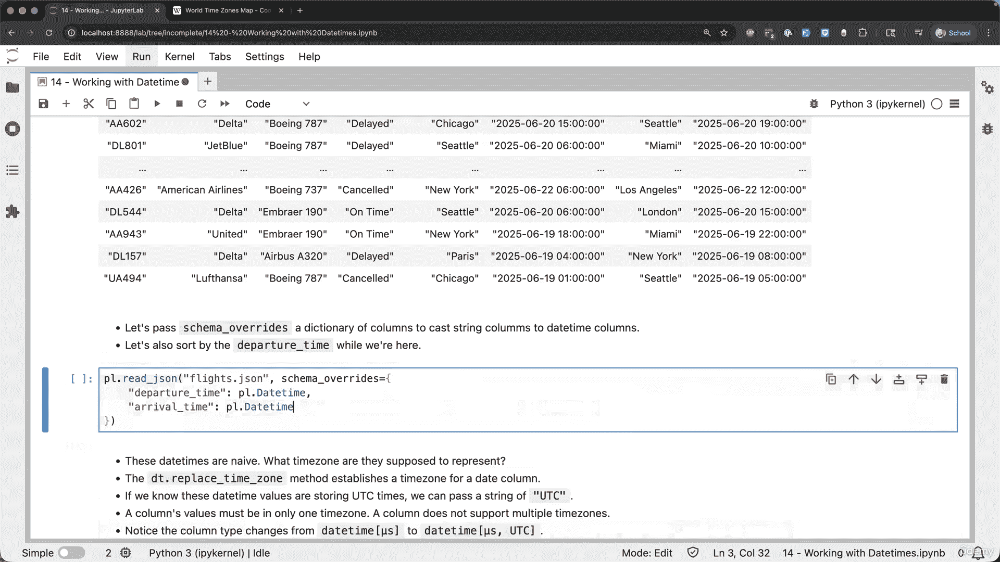

我们进入 Jupyter Notebook，先导入一个新的数据集。这个数据集保存在一个名为 `flights.json` 的 JSON 文件里，因此可以使用 `read_json` 函数读取。需要注意，`read_json` 并不支持 `try_parse_dates` 参数；如果传入这个参数并设为 `True`，程序会直接报错，因为这个参数不是它接受的参数。解决方式是用 `schema_overrides` 参数，把原本是字符串的列转换成日期时间类型。

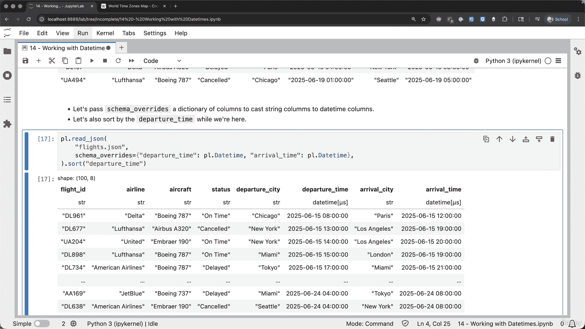

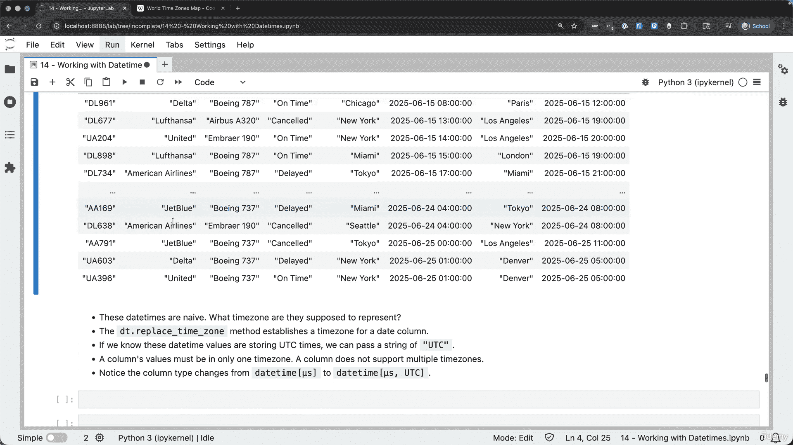

先看看这个数据集长什么样。它是一组虚构航班数据，每条航班包含以下信息：

- 航班 ID。
- 关联航空公司。
- 飞机。
- 航班状态。
- 出发城市。
- 到达城市。
- 出发时间列，目前以字符串形式保存，但可以被解释为日期时间。
- 到达时间列，目前也以字符串形式保存，但可以被解释为日期时间。

其中最关键的是 `departure_time` 和 `arrival_time` 这两列，因为它们现在还是字符串。我们首先要做的，就是把这两列转换成日期时间。转换之后，按照默认行为，我们会得到一个 naive datetime 列，也就是没有附加时区的列。下面先演示错误写法和正确写法，方便初学者避开这个坑：

```python
import polars as pl

# 下面这样写会报错：read_json 不接受 try_parse_dates 参数
# df = pl.read_json("flights.json", try_parse_dates=True)

df = pl.read_json(
    "flights.json",
    schema_overrides={
        "departure_time": pl.Datetime,
        "arrival_time": pl.Datetime,
    },
)
```

这段代码通过 `schema_overrides` 指定两列的类型为 `pl.Datetime`，其中 `Datetime` 的首字母是大写 `D`。执行后，`departure_time` 和 `arrival_time` 就变成了日期时间列。此时查看列类型，会发现里面没有任何时区信息，这说明它们仍然是 naive datetime。为了更直观地观察数据，我们还可以按 `departure_time` 排序，让更早的航班排在前面：

```python
df = df.sort("departure_time")
```

排序之后，数据会按照出发时间从早到晚排列，阅读起来更自然。到这里，我们只是完成了“字符串转日期时间”，还没有附加时区。下一步才是本节的重点：如何给一个已经有日期时间值的列附加关联时区。

**📌 给列附加时区：replace_time_zone**

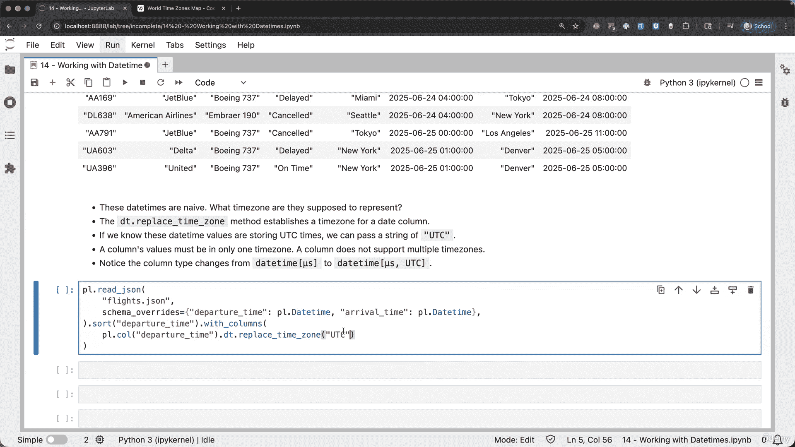

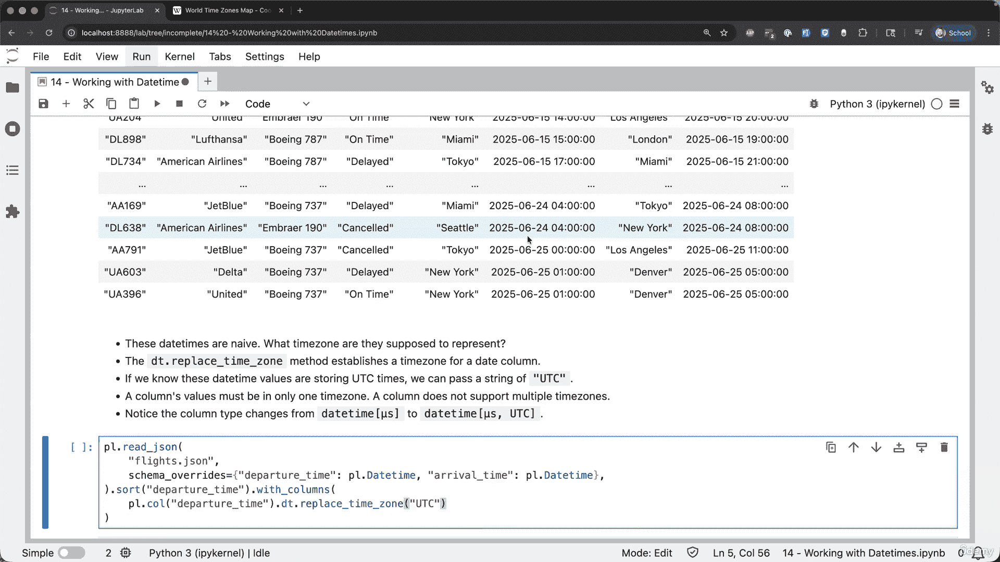

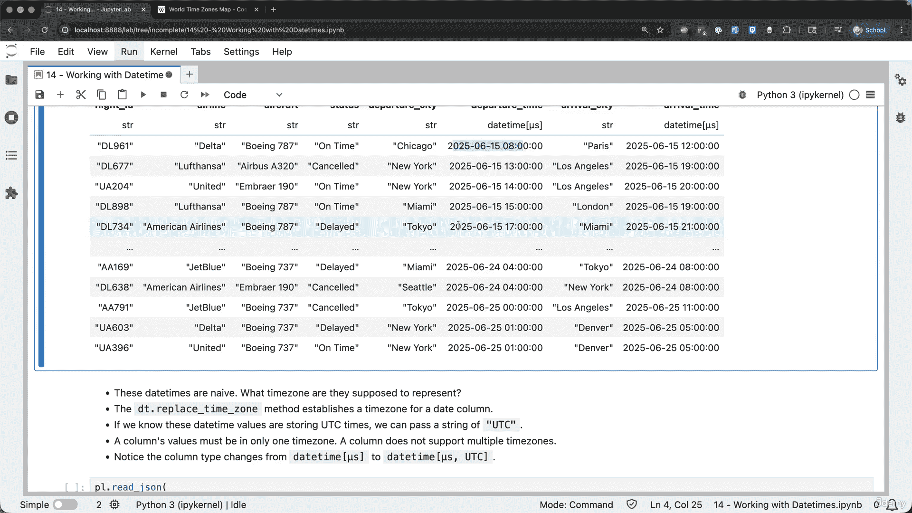

给已有日期时间列附加时区，可以使用 `with_columns` 配合 `dt.replace_time_zone`。这个方法名字可能有点让人困惑：当前列明明没有时区，为什么叫“replace”？可以这样理解：它把“无时区状态”替换成一个明确的指定时区，也就是给原本不感知时区的日期时间列补上时区信息。这个操作不会改变底层日期时间的数字，只会改变它的时区语义。

需要特别强调，我们传入的时区不是随便猜的，而是必须根据数据来源系统来判断。比如我们假设这些数据来自某个数据库，并且知道数据库用 UTC 存储时间，那么这里就传 `UTC`。如果数据库实际用的是其他时区，就传那个时区。方法本身不会替我们做逻辑推断，它只是把我们已知的时区信息附加到列上。示例代码如下：

```python
df = df.with_columns(
    pl.col("departure_time").dt.replace_time_zone("UTC"),
    pl.col("arrival_time").dt.replace_time_zone("UTC"),
)
```

执行后，列里的具体日期时间值不会变化。比如原来是 2025 年 6 月 15 日上午 8 点，现在仍然是 2025 年 6 月 15 日上午 8 点，但它的含义变成了“UTC 时区的上午 8 点”。这时列类型会从单纯的 datetime 扩展为带时区说明的 datetime，例如 `datetime[UTC]`。同一个列里的所有值必须属于同一个时区，不能在同一列中混放多个不同时区的值，也不能混放两种以上时区。现在 Polars 已经知道这一列的每个时间都是 UTC 时间，UTC 也成为列数据类型的一部分。既然列已经变成时区感知的，我们就可以继续使用之前学过的各种日期时间方法。

**⏩ 在带时区列上做时间偏移**

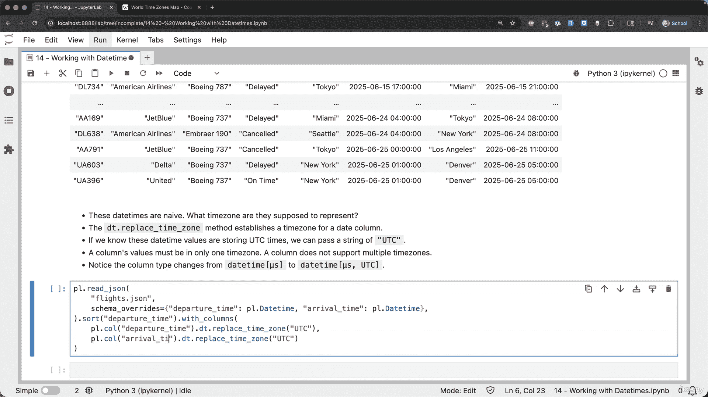

附加 UTC 之后，我们可以随意使用 Polars 提供的日期时间方法，包括之前见过的偏移方法。比如使用 `dt.offset_by` 可以给时间加上或减去一段时间。假设我们想把所有时间都往后推 4 小时，就可以传入 `"4h"`。Polars 会保留原列的数据类型，也就是带 UTC 时区的 datetime，然后把时间向前移动 4 小时，结果列仍然是 UTC 时区。示例代码如下：

```python
df = df.with_columns(
    pl.col("departure_time").dt.offset_by("4h"),
    pl.col("arrival_time").dt.offset_by("4h"),
)
```

这个操作背后的逻辑很直接：Polars 知道当前时间是 UTC，因此它知道“加 4 小时”是在 UTC 时间线上加 4 小时。得到的新时间比原来快 4 小时，并且仍然标记为 UTC。时区信息现在已经成为列类型的一部分，所以后续计算不会丢失这个参照系。理解这一点之后，我们再换一个完全不同的时区来演示。

**🗽 换成纽约时区**

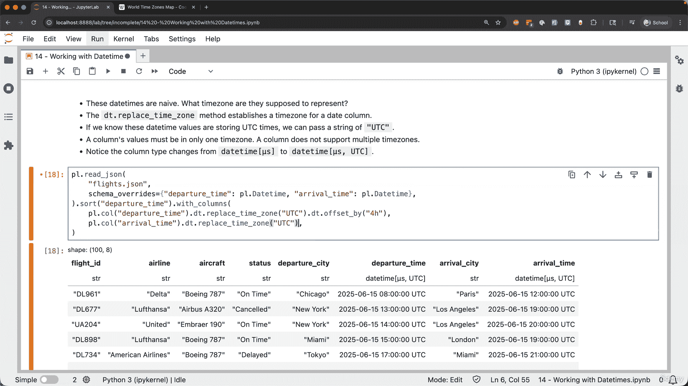

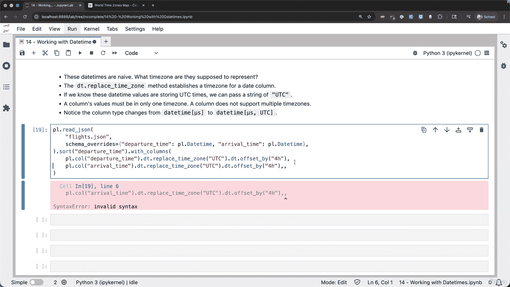

假设这些值实际存储的是纽约时间，而不是 UTC 时间，那么我们在附加时区时就可以传入 `America/New_York`。很多城市时区会按照对应的国家、大洲或世界区域分组，因此不同城市会有相似但不同的名称，这样可以用来建模不同地理位置的时间。示例代码如下：

```python
df = df.with_columns(
    pl.col("departure_time").dt.replace_time_zone("America/New_York"),
    pl.col("arrival_time").dt.replace_time_zone("America/New_York"),
)
```

在这个例子里，时间数字本身仍然保持原样，比如上午 8 点再加 4 小时会变成纽约时间的中午 12 点。不同时区下，同样的数字可能代表一天中不同的实际时刻，这正是时区复杂的地方。时区本身是一个非常复杂的问题，也很容易产生 bug，本节只是打基础。我们已经知道了如何给列附加时区，也知道了附加时区后如何做偏移，接下来做一个小结。

**🧾 本节小结**

本节课中我们一起学习了 Polars 时区处理的基础。默认情况下，把字符串列转换成日期时间时，Polars 会得到 naive datetime 值，这些值不感知时区，只是某个时刻，比如 2026 年 1 月 3 日凌晨 3 点。我们可以用 `dt.replace_time_zone` 给这些值附加时区，让列变成时区感知的列。附加之后，Polars 在计算时就知道这些时间代表哪个地理区域、哪个时区，因此可以继续做偏移、转换等操作。核心操作可以概括为下面的代码：

```python
# 附加时区
df = df.with_columns(
    pl.col("departure_time").dt.replace_time_zone("UTC"),
)

# 在带时区列上偏移时间
df = df.with_columns(
    pl.col("departure_time").dt.offset_by("4h"),
)

# 换成另一个时区
df = df.with_columns(
    pl.col("departure_time").dt.replace_time_zone("America/New_York"),
)
```

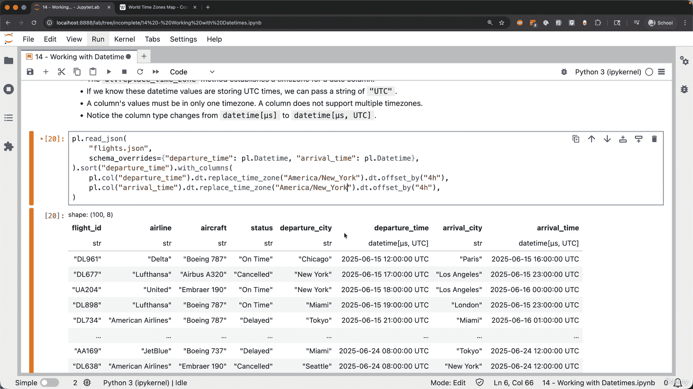

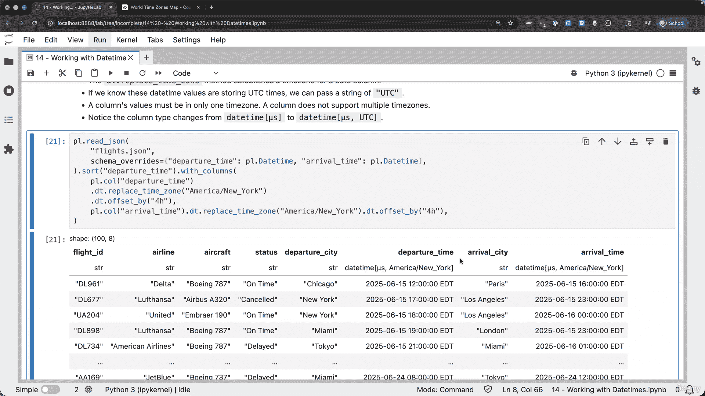

下一节课还会继续介绍更多与时区相关的内容。本节先把“naive datetime 是什么”“如何附加时区”“附加后如何计算”这三件事弄清楚，后面的内容就会更容易理解。

