# 📊 使用Polars和Python进行数据分析：170：时区转换 II

在本节课中，我们将继续深入时区相关操作，主要了解三件事：第一，如何查看所有可用的时区字符串；第二，如何判断一个时区名称是否有效；第三，如何用 `convert_time_zone` 方法在时区之间进行转换。我们会结合 Python 标准库中的 `zoneinfo` 模块和 Polars 的 `dt` 命名空间，用实际代码来演示整个过程。

## 🌍 查看所有可用的时区

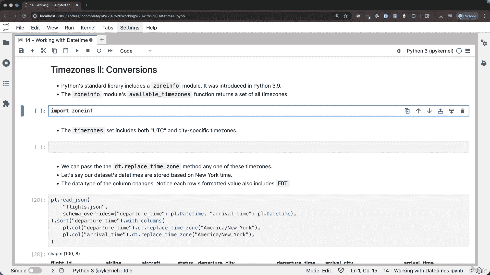

上一节我们使用了 `replace_time_zone` 方法，它需要传入一个表示时区的字符串。你可能会好奇，到底有哪些字符串可以传？其实完整的列表就藏在 Python 标准库的 `zoneinfo` 模块里。这里我们快速演示一下怎么找到它。

首先，用 `import` 关键字导入 `zoneinfo` 模块。这个模块从 Python 3.9 开始就内置在标准库里了。在这个模块中，有一个函数叫 `available_timezones()`，它会返回一个 Python 集合（set），里面包含了世界上所有可能的时区名称。

```python
import zoneinfo

zoneinfo.available_timezones()
```

运行这段代码后，你会看到输出结果里从非洲（Africa）开头的时区，一直到美洲（America）开头的时区，数量非常多。而且有些时区名称是多层嵌套的。比如在美洲下面，你会看到阿根廷（Argentina）下的具体城市或地区。继续往下翻，当然还会碰到亚洲（Asia）、欧洲（Europe）等等。

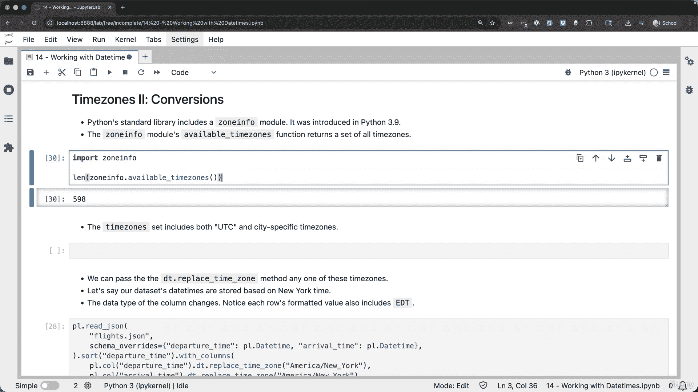

因为返回结果是一个 Python 集合，我们很快可以把它传给 Python 的 `len()` 函数，看看到底有多少个时区。当前这个版本的 Python 库里，一共有 598 个可表示的时区。

```python
len(zoneinfo.available_timezones())
# 598
```

为了方便后面使用，我们把这个集合赋值给一个变量，名字就叫 `time_zones`。

```python
time_zones = zoneinfo.available_timezones()
```

## 🔍 检查一个时区名称是否有效

有了这个集合之后，我们就可以利用 Python 的 `in` 运算符来检查某个时区名称是否存在于集合中。如果你不确定某个时区字符串到底该怎么写，这个方法非常管用。只要用 `in` 运算符判断一下，就能知道这个名称是否合法。

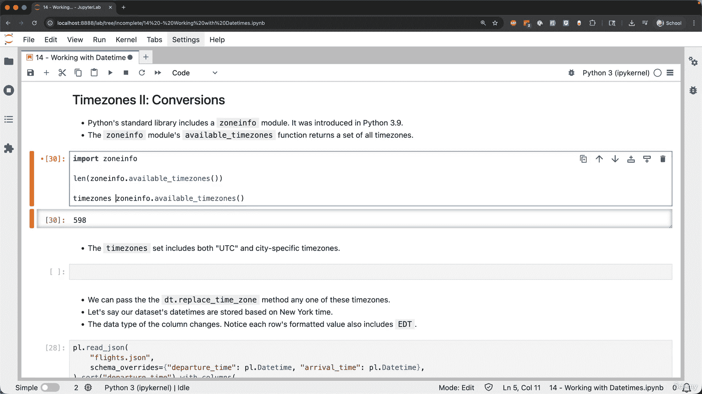

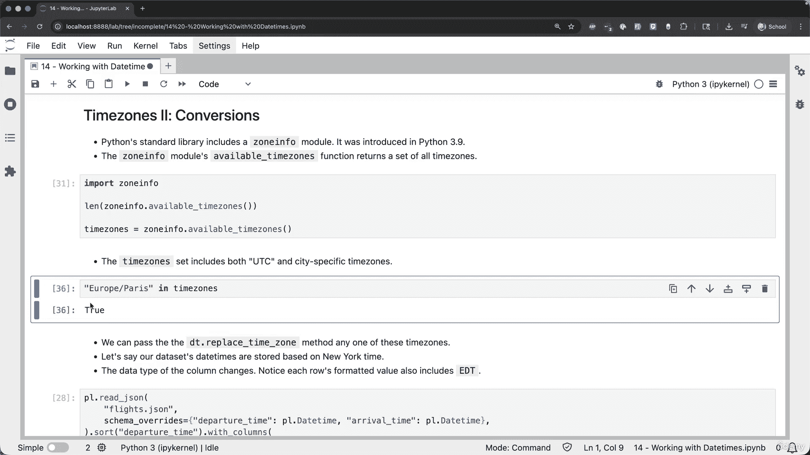

比如，我们可以检查 `"UTC"` 是否在上面的时区集合里。你会看到返回结果是 `True`，说明它是合法的。再举个例子，上一节课我们用到过 `"America/New_York"`，这个当然也是合法的。还有一个例子是巴黎（Paris），它其实被嵌套在欧洲（Europe）下面，所以单独写 `"Paris"` 是不行的。

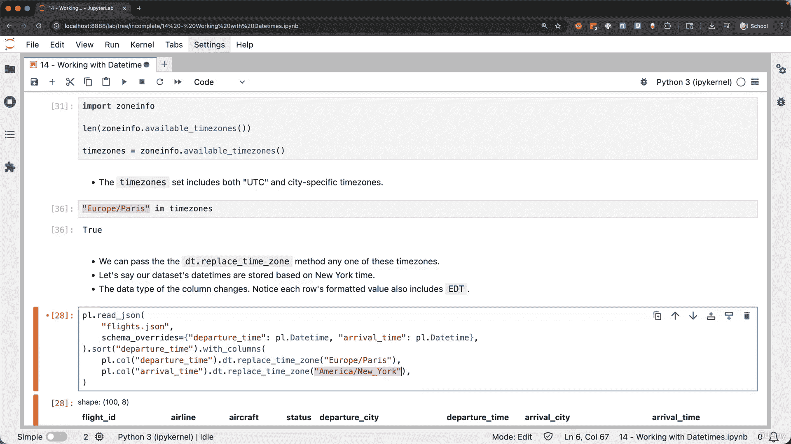

```python
"UTC" in time_zones
# True

"America/New_York" in time_zones
# True

"Paris" in time_zones
# False

"Europe/Paris" in time_zones
# True
```

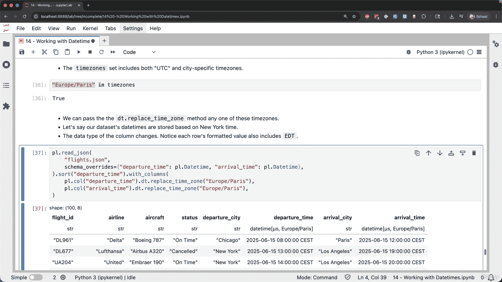

你看，如果我们直接问“巴黎在我的集合里吗”，答案是 `False`，这就说明它很可能用了另一种名称存储。结合前面的提示，你会意识到：需要提供一个像“Europe”这样的地理位置前缀，才能找到合法的时区值。一旦你拿到了合法的时区名称，就可以直接把它用在 `replace_time_zone` 方法里了。

## 🕒 用 `replace_time_zone` 设置巴黎时区

那么接下来，我们就实际操作一下。把上面得到的 `"Europe/Paris"` 传给 `replace_time_zone` 方法。这段代码和上一节课的基本一样，唯一不同的地方就是时区字符串换成了巴黎。执行单元格之后，你会看到 `departure_time` 和 `arrival_time` 列的时区现在都基于巴黎时间了。

```python
flights = flights.with_columns(
    pl.col("departure_time").dt.replace_time_zone("Europe/Paris"),
    pl.col("arrival_time").dt.replace_time_zone("Europe/Paris"),
)
```

这里我们把新生成的 DataFrame 重新赋值给 `flights` 变量，方便后面继续使用。

## 🔄 用 `convert_time_zone` 转换时区

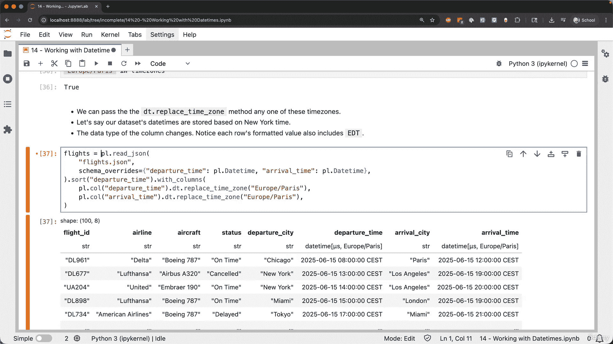

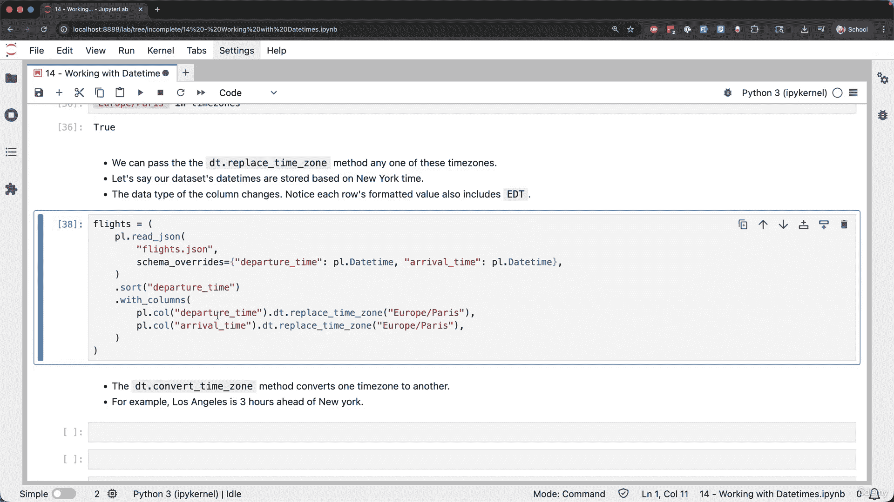

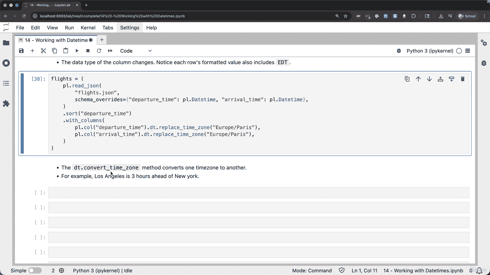

现在我们已经有了带时区的列，接下来看看如何从一个时区转换到另一个时区。给定一列带有时区的时间，我们怎样把它转换成世界另一个地方的等价时间呢？这就要用到 `dt` 属性下的另一个方法，也就是 `convert_time_zone`。这个方法会接收一个与你当前存储时区不同的另一个时区，然后返回该时间在目标时区下的表示形式。

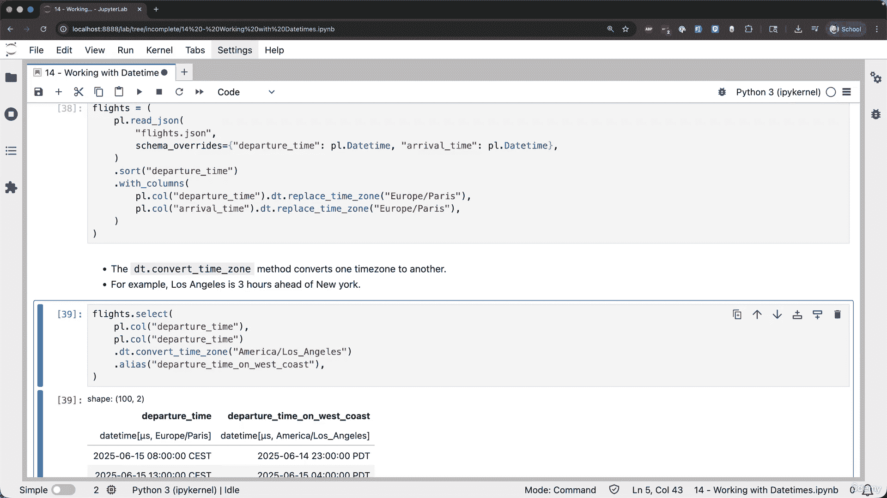

我们来看一个具体的例子。先从 `flights` 里单独选出 `departure_time` 这一列，把它作为比较的基础，其他列暂时不关心。然后，针对完全相同的 `departure_time` 列，调用 `dt.convert_time_zone` 方法，并传入另一个时区，比如 `"America/Los_Angeles"`。注意洛杉矶这里两个词之间要用下划线连接。最后，我们用 `alias` 方法给这个新列一个不同的名字，比如 `departure time on West Coast`。

```python
flights.select(
    pl.col("departure_time"),
    pl.col("departure_time")
    .dt.convert_time_zone("America/Los_Angeles")
    .alias("departure time on West Coast"),
)
```

看看运行结果。这里是我们原本的巴黎时间，6 月 15 日早上 8 点。而对应的洛杉矶时间，也就是用洛杉矶时区表示的时间，实际上是 6 月 14 日晚上 11 点。从结果中可以看到，洛杉矶时间比巴黎时间整整晚了 9 个小时，所以日期都变到前一天了。其实这两个时间表示的是同一个时刻，只是用两个不同时区来表达而已。

我们再来一个例子。再次针对相同的 `departure_time` 列，访问 `dt` 命名空间下的 `convert_time_zone` 方法，这次想看伦敦的等价时间，所以传入 `"Europe/London"`，然后给列起个新名字，例如 `departure time in London`。

```python
flights.select(
    pl.col("departure_time"),
    pl.col("departure_time")
    .dt.convert_time_zone("Europe/London")
    .alias("departure time in London"),
)
```

现在可以看到，同样一个时刻，分别用巴黎、洛杉矶和伦敦三种时区来表示，结果一目了然。巴黎是 15 日早上 8 点，伦敦是 15 日早上 7 点。这是因为伦敦使用英国标准时间（BST）时，比巴黎晚一个小时，所以伦敦会显示为早上 7 点。因此，只要你给列建立了一个确定的时区，就可以用 `convert_time_zone` 方法查看每个值在另一个时区下的等价表示。

## 📝 总结

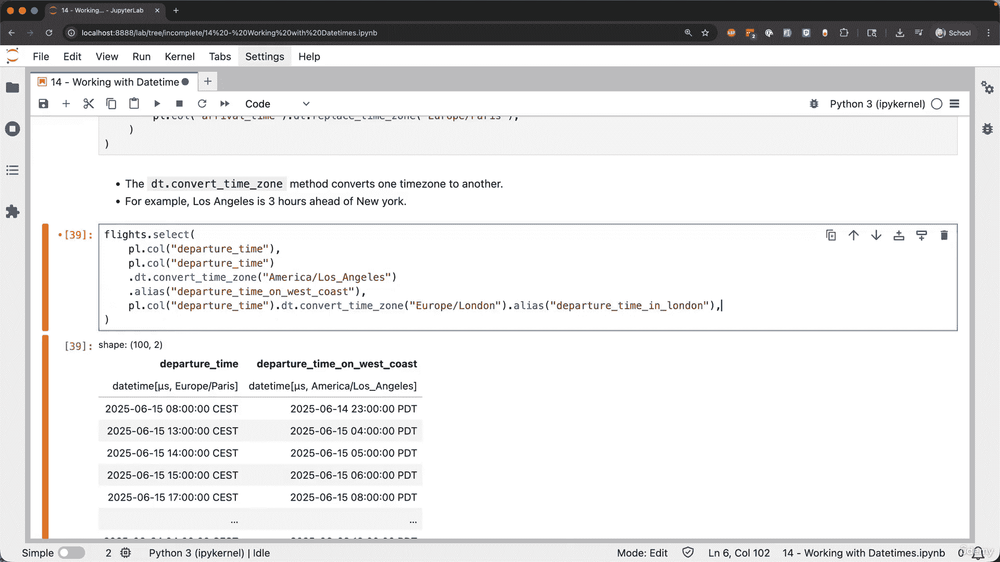

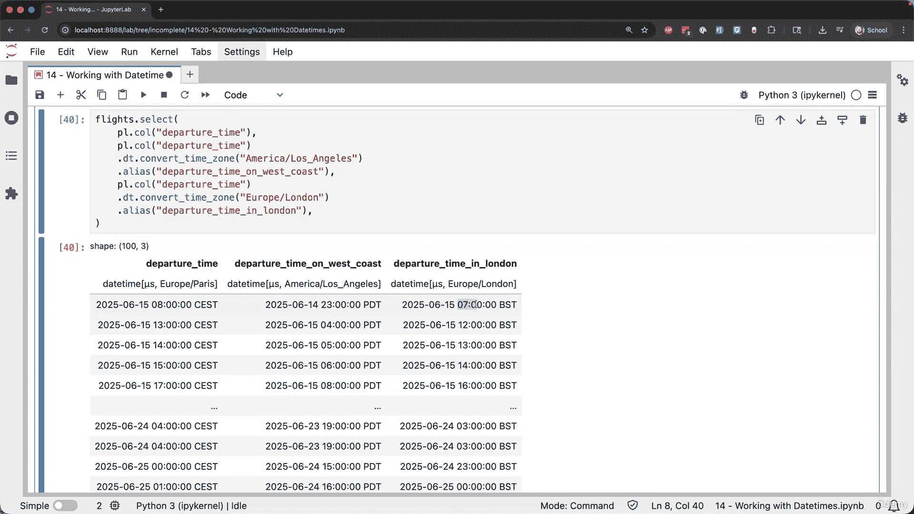

本节课我们一起学习了时区转换的进阶内容。我们首先了解了如何通过 `zoneinfo.available_timezones()` 获取所有可用时区，并且知道目前一共有 598 个时区。接着，我们使用了 `in` 运算符来检查某个时区名称是否合法，还特别强调了大洲前缀的重要性。然后，我们复习了如何用 `replace_time_zone` 把列设置为巴黎时区。最后，我们重点介绍了 `dt.convert_time_zone` 方法，并用洛杉矶和伦敦两个例子演示了如何把同一时刻表示成不同时区的时间。掌握这些方法之后，你在处理跨时区数据时就会更加得心应手了。
