# 🎯 Polars 与 Python 数据分析（第二部分）：第171节（p71）：目标列选择策略回顾

在本节课中，我们将要学习 Polars 中一个专门用于定位列的特殊模块，也就是 `selectors`（选择器）模块。这个模块可以让我们在表达式里用更多方式去指定要操作的列。欢迎来到课程的下一节，本节标题就是 `selectors`。

在此之前，我们主要依赖 `pl.col` 函数，以及 `pl.exclude` 和 `pl.all` 这些函数来定位列。本节会先回顾这些已经学过的用法，再引出 `selectors` 模块带来的更多可能性。虽然本节内容偏向专门主题，不一定每天都会用到，但它属于 Polars 库 API 的一部分，值得了解。

以下是本节会涉及的主题。

- 按列的索引位置或位置关系定位列。

- 按较宽泛的数据类型定位列，例如定位所有整数类型，而不是只定位某一个具体整数类型。

- 比较两组列，定位其中一组存在而另一组不存在的列，以及更多类似操作。

`selectors` 模块的核心思路没有改变：我们仍然是在构建表达式，然后把操作应用到列上。真正变化的是定位列的方式，也就是我们可以用更多手段去指定目标列。

---

## 📌 本节准备工作：新建 Notebook 并导入模块

本节会使用一个全新的 Jupyter Notebook，名字叫 `15_selectors`。请打开这个 Notebook，然后像往常一样先导入 Polars 库，并把它命名为 `pl`。

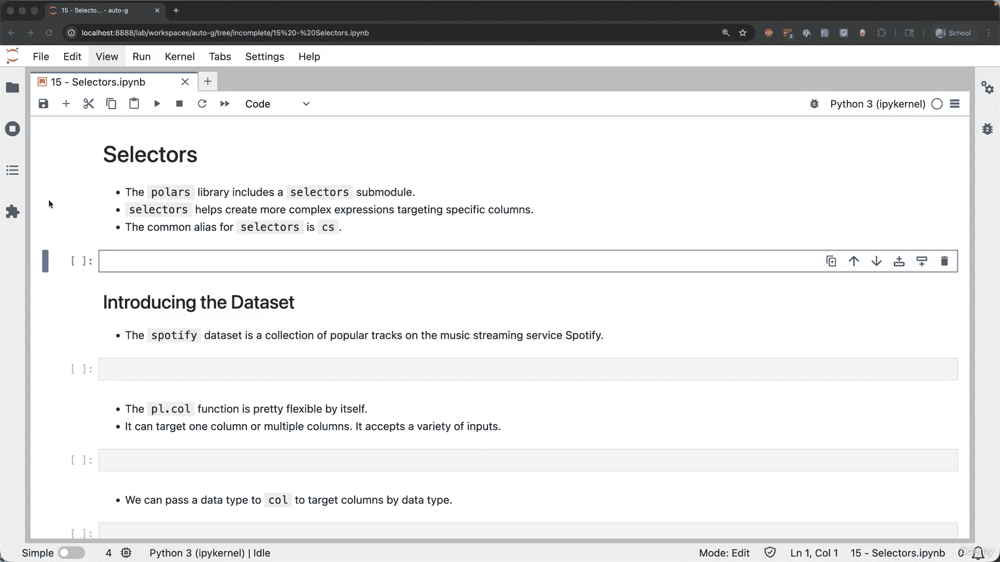

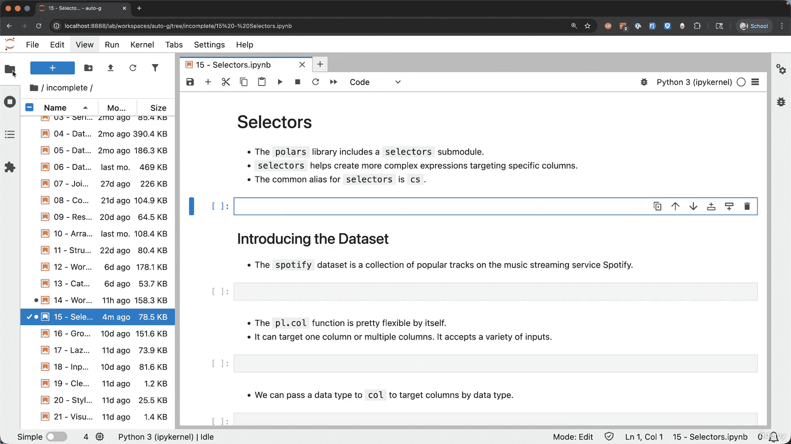

本节还会从 Polars 库内部再导入一个模块。这个导入不是严格必需的，但它可以让我们给 Polars 内部的嵌套模块起一个别名，方便后面写代码时引用。

你可以把这个嵌套模块理解成 Polars 内部的一个功能目录，它的名字叫 `selectors`。我们会把它命名为 `cs`，你可以把 `cs` 理解成 column selectors，也就是列选择器。

```python
import polars as pl
import polars.selectors as cs
```

以后代码里出现 `cs`，它指的就是 `polars.selectors` 这个模块。当然，你也可以每次都把完整路径写出来，但使用别名 `cs` 会更省事，代码也更短。

上一节我们完成了导入和工具准备，接下来看看本节要使用的数据集。

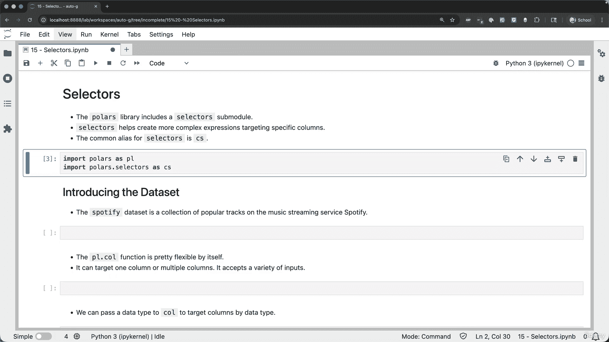

---

## 🎵 数据集介绍：Spotify 热门歌曲

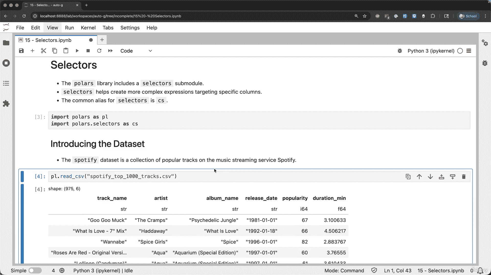

接下来介绍本节要使用的数据集。它是一组 Spotify 音乐流媒体平台上的热门歌曲数据，文件名是 `spotify_top_1000_tracks.csv`，文件名里带有下划线。

这个数据集里有一个发布日期列，里面存储的是日期。因此导入数据时，我们直接传入 `try_parse_dates=True`，让 Polars 尝试解析日期。

```python
music = pl.read_csv(
    "spotify_top_1000_tracks.csv",
    try_parse_dates=True,
)

music.head()
```

我们来看一下这个数据集里有哪些内容。它有歌曲名或曲目名、表演艺术家、专辑名、歌曲发布日期、流行度，以及歌曲时长（分钟）。这里的流行度可以理解成 1 到 100 之间的排名，反映歌曲被收听的频繁程度。

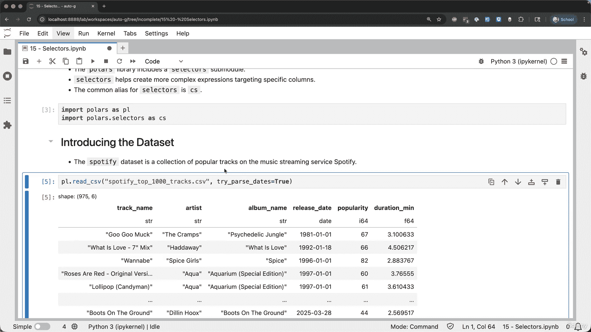

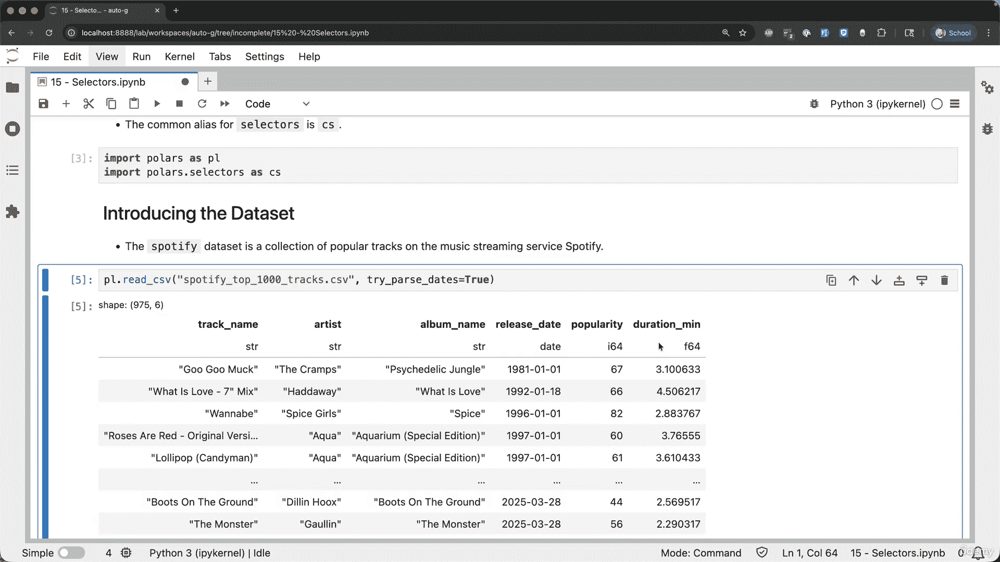

这个数据集的一个好处是数据类型比较丰富，包含字符串、日期、整数和浮点数。我们把数据赋给变量 `music`，然后用 `head` 方法预览前几行。

数据准备好之后，在进入更自定义的选择器之前，我们先快速回顾一下目前已经学过的列定位策略。

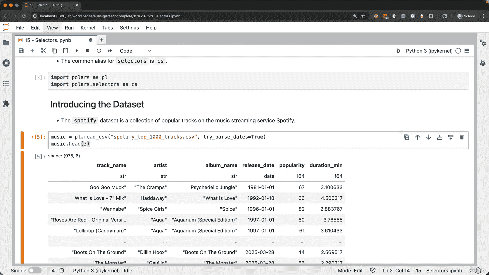

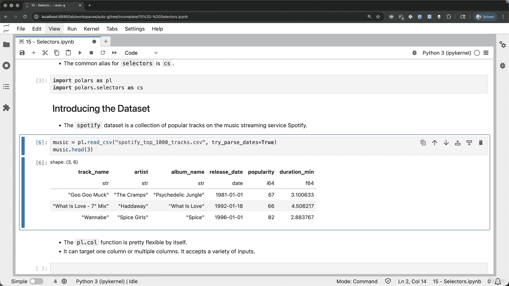

---

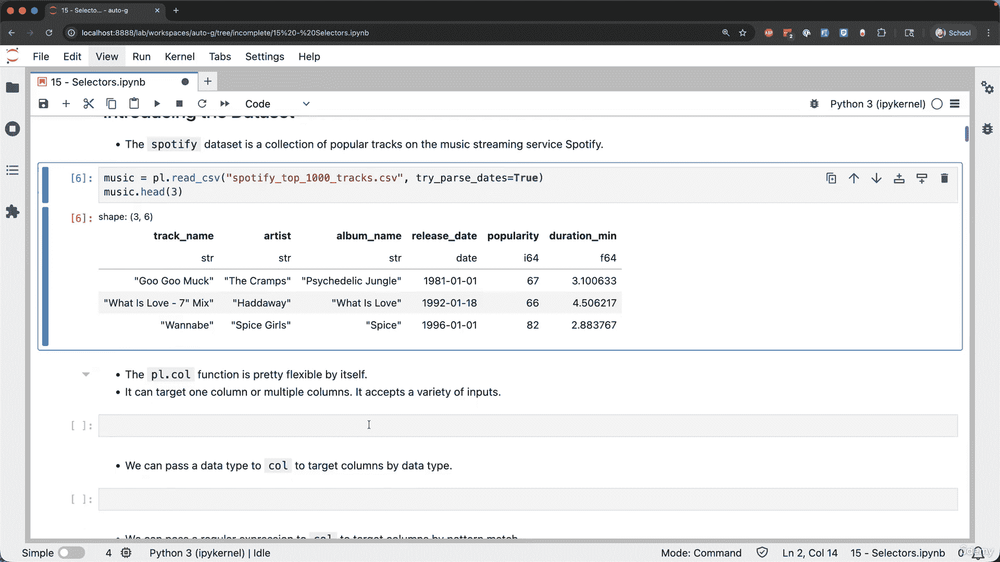

## 🧭 回顾 `pl.col`：定位单列和多列

下面先快速回顾 Polars 顶层的 `pl.col` 函数，也就是原文所说的 call function 或 column function。我们会从 `select` 方法开始。

`pl.col` 本身很灵活。我们可以用它单独定位某一列，然后把这个表达式作为基础，继续构建更复杂的操作并应用到这一列上。下面的例子只定位 `track_name` 这一列。

```python
music.select(pl.col("track_name"))
```

我们也可以给 `select` 方法传入多个表达式。例如下面同时定位 `track_name` 和 `artist`。这种写法适合你想对每个新列应用不同操作的情况。比如你想对这一列做大写转换，对另一列做小写转换，就可以创建两个独立表达式，也就是两个独立的构建块，然后分别构建不同操作。

```python
music.select(
    pl.col("track_name").str.to_uppercase(),
    pl.col("artist").str.to_lowercase(),
)
```

如果你想把完全相同的操作应用到多个列上，也可以给单个 `pl.col` 调用传入多个参数。例如在顶层 `pl.col` 中传入 `track_name` 和 `artist`，它会创建一个同时定位这两列的表达式。这样当你只想做统一的大写转换时，一个表达式就够了，不需要写两个表达式。

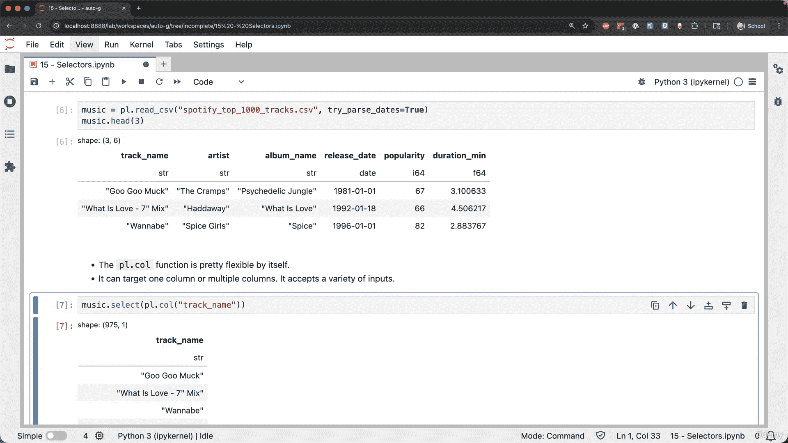

```python
music.select(
    pl.col("track_name", "artist").str.to_uppercase()
)
```

`pl.col` 还支持传入列表参数。如果你在程序运行过程中动态构建了一个列名列表，也可以把它作为参数传进去。下面就是把包含两个列名的列表传给 `pl.col` 的例子。

```python
columns = ["track_name", "artist"]

music.select(
    pl.col(columns).str.to_uppercase()
)
```

以上就是 `pl.col` 在定位单列、多列和动态列表时的常见用法。接下来我们看看如何一次性定位所有列。

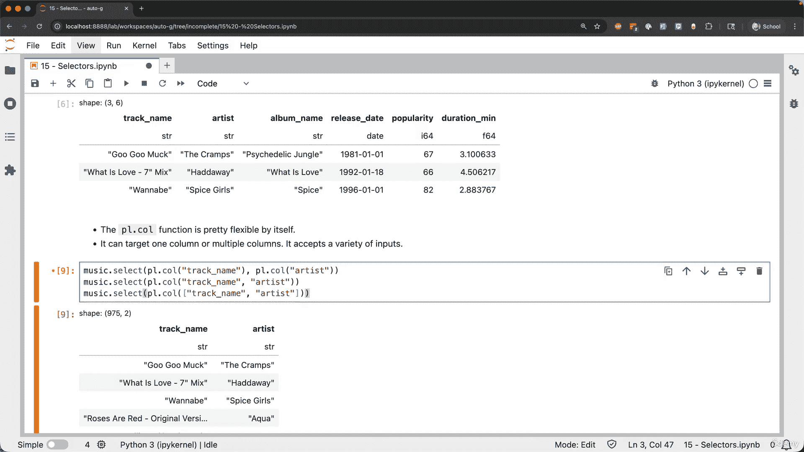

---

## 🧱 回顾 `pl.all`：定位所有列

除了 `pl.col`，还有一个函数叫 `pl.all`，它会创建一个定位数据框中每一列的表达式。单独使用它时，基本会得到和原始数据框一样的结果，但它是一个很方便的快捷方式，可以避免你手动输入每一列的名字。

如果你要定位每一列，比如有 10 列并且它们都是字符串，你可以直接写 `pl.all`，然后对所有列执行统一操作，例如把所有字符转成大写。

```python
music.select(
    pl.all().str.to_uppercase()
)
```

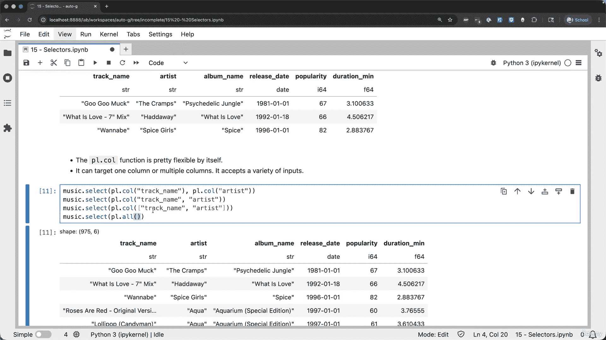

这里需要注意，这个例子假设所有列都能做字符串大写转换。实际数据里如果包含日期、整数或浮点数，就需要根据数据类型选择合适操作。

上一节我们回顾了如何定位单列和多列，本节中我们来看看如何按数据类型定位列。

---

## 🧮 回顾 `pl.col` 按数据类型定位列

`pl.col` 还有一个很有用的能力：可以把数据类型作为参数传进去，这样就会定位所有具有该数据类型的列。

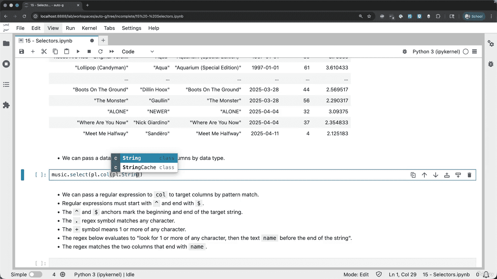

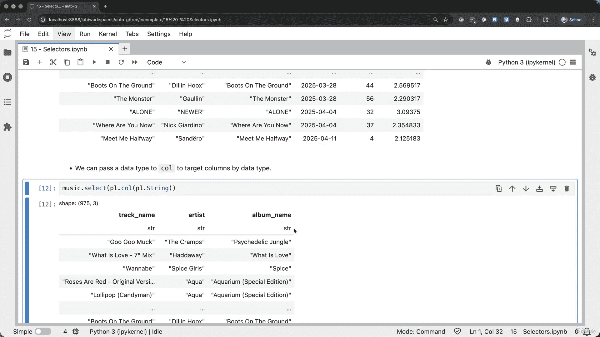

例如在 `select` 方法中调用 `pl.col`，然后访问一个数据类型。所有数据类型都位于 Polars 顶层，也就是 `pl` 命名空间下面。下面选择所有字符串类型的列，这会取出 `track_name`、`artist` 和 `album_name` 这三列。

```python
music.select(
    pl.col(pl.String)
)
```

这个能力还可以更强。我们还可以给 `pl.col` 传入正则表达式，也就是一个动态搜索模式，用来匹配一个或多个满足搜索条件的列。

---

## 🔎 回顾正则表达式定位列

下面是一个简单例子。我们再次调用 `select` 方法，用 `pl.col` 创建表达式，并使用原始字符串，也就是在字符串前加 `r`。这里的正则表达式是 `^.+name$`。

```python
music.select(
    pl.col(r"^.+name$")
)
```

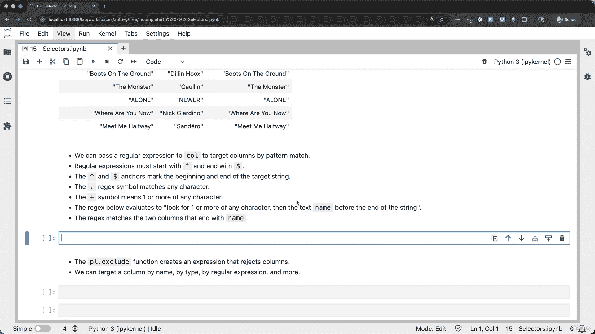

这个正则表达式里，开头的 `^` 表示列名或字符串的开头。接着 `.+` 表示一个或多个任意字符。然后写上 `name`，表示列名里要包含 `name` 这个词。最后的 `$` 表示字符串结尾。

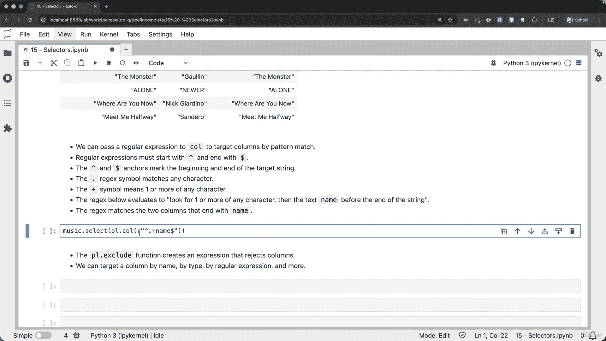

因此，这个模式会匹配那些“以一个或多个字符开头，后面跟着 `name`，然后结束”的列名。它正好能匹配少数几列，你可以看到这些列名确实都是一个或多个字符后面跟着 `name`，然后到达字符串结尾。

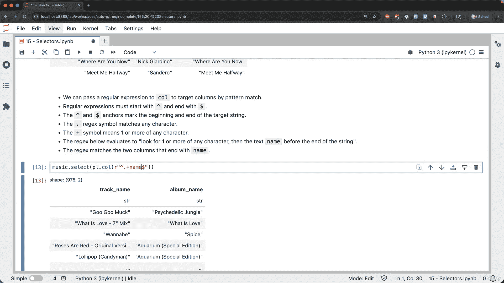

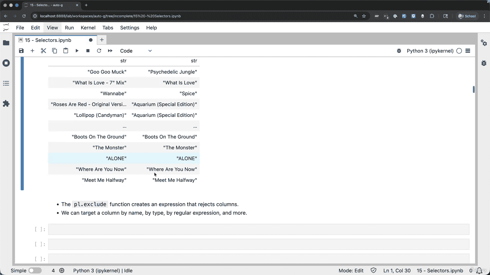

使用这种搜索模式，也就是正则表达式，可以动态匹配多个列。这些列不一定有相同数量的字符，也不一定有完全相同的数据内容，但根据命名结构和搜索模式，我们可以识别并取出这些列。

正则表达式定位列已经比较灵活，接下来我们看看如何反向操作，也就是排除某些列。

---

## 🚫 回顾 `pl.exclude`：排除列

本节还要提醒一个顶层函数 `pl.exclude`。它会创建一个拒绝某些列的表达式，也就是定位除了被排除列之外的所有列。

例如在 `select` 中调用 `pl.exclude`，排除 `release_date` 列，这样就会取出除了 `release_date` 之外的所有列。

```python
music.select(
    pl.exclude("release_date")
)
```

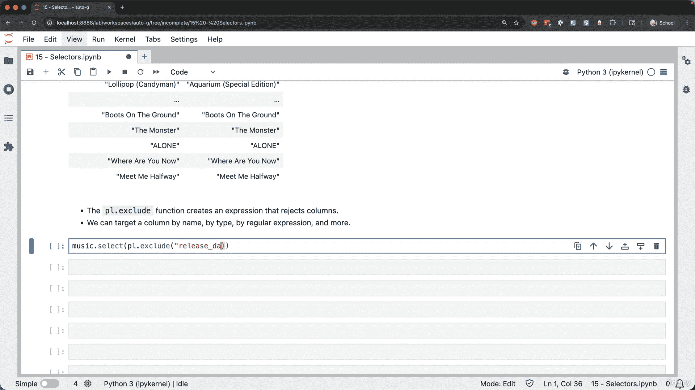

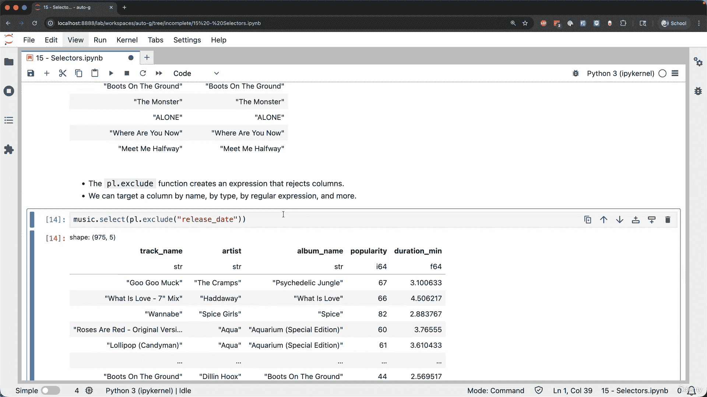

`pl.exclude` 也支持数据类型。比如传入 `pl.Int64`，也就是 64 位整数类型，就表示定位所有列，但排除存储 64 位整数的列。这样会取出字符串列、日期列和 64 位浮点列，同时排除掉那个整数列，因为它的类型正是 64 位整数。

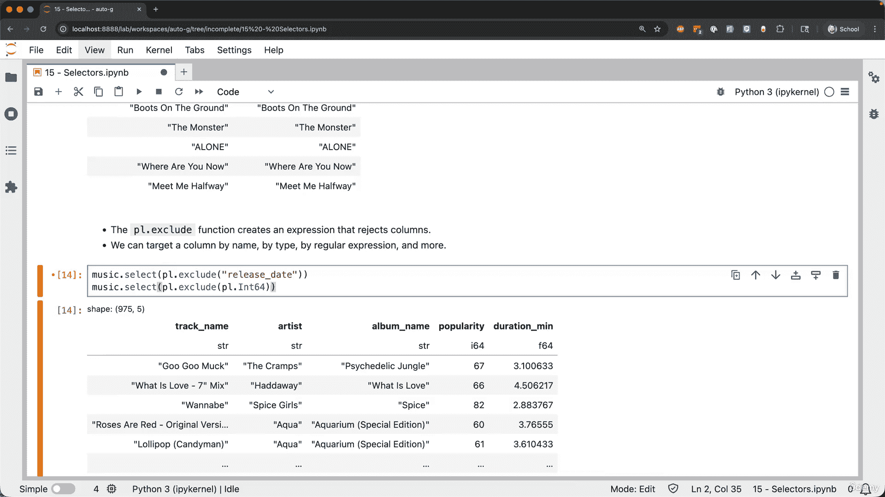

```python
music.select(
    pl.exclude(pl.Int64)
)
```

> 注意：`pl.exclude(pl.Int64)` 不是排除所有可能的整数列，而只排除精确的 64 位整数类型列。后面的课程会看到更灵活的选择器，可以排除或定位任何整数类型的列，例如 32 位、64 位、128 位等，而不需要关心精确数据类型。

我们再展示一个 `pl.exclude` 的例子。这里同样可以给 `pl.exclude` 传入正则表达式。把前面用过的正则表达式复制过来，就可以排除任何匹配该正则表达式的列，也就是排除那些“一些字符组合后面跟着 `name`”的列。

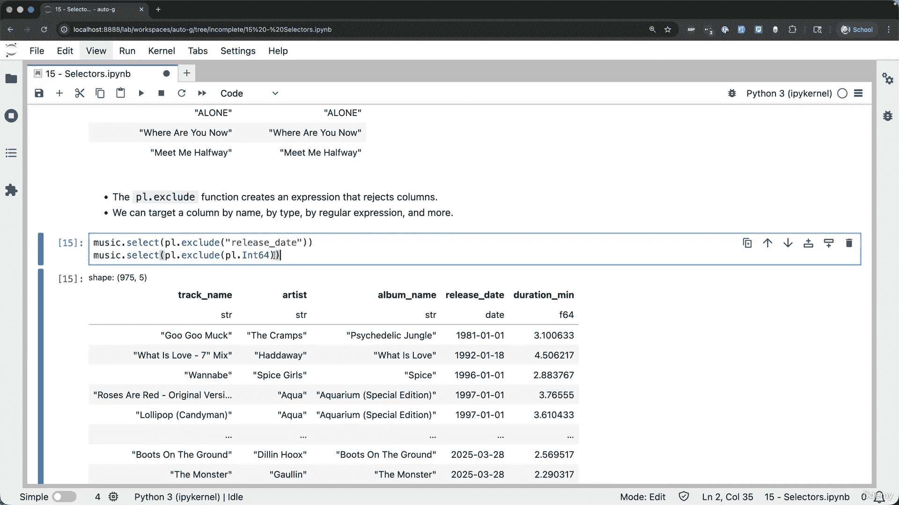

```python
music.select(
    pl.exclude(r"^.+name$")
)
```

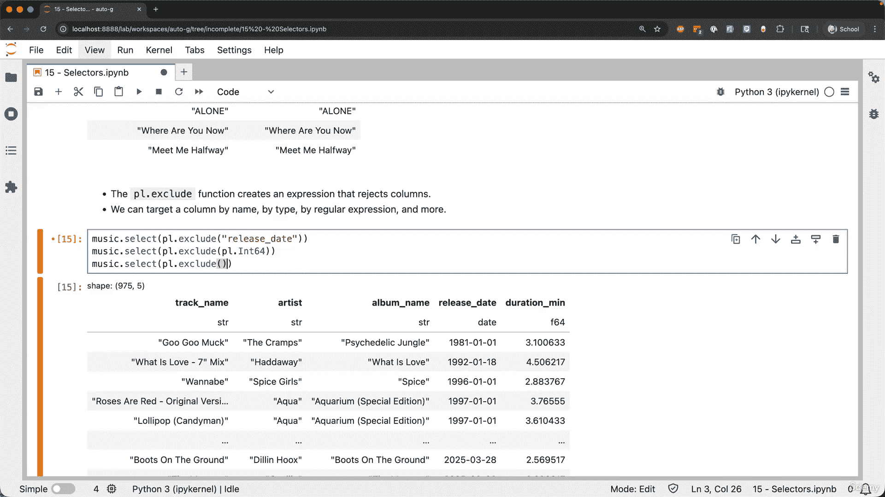

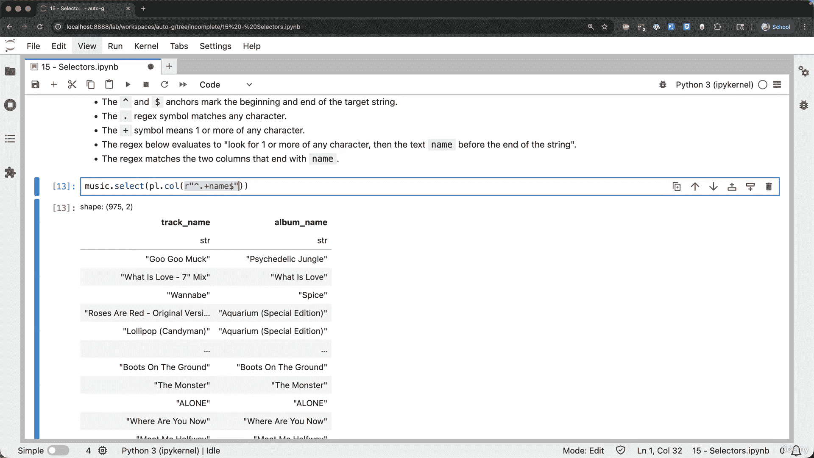

这样就会取出四个不匹配该正则表达式的列，正好是前面正则匹配结果的相反结果。

到这里，我们已经快速回顾了目前探索过的多种列定位方式，包括 `pl.col`、`pl.all`、按数据类型定位、按正则表达式定位，以及 `pl.exclude`。接下来在本节后续内容中，我们会看到从最开始导入的 `cs` 模块里可以使用的自定义选择器，后面还有很多有趣内容。

---

## ✅ 小结

本节课中，我们一起学习了 Polars 中定位列的不同策略。我们先回顾了 `pl.col` 如何定位单列、多列、传入列表以及按数据类型定位列。然后回顾了 `pl.all` 如何定位所有列，正则表达式如何按列名模式动态匹配列，以及 `pl.exclude` 如何排除指定列、排除指定数据类型和排除匹配正则表达式的列。

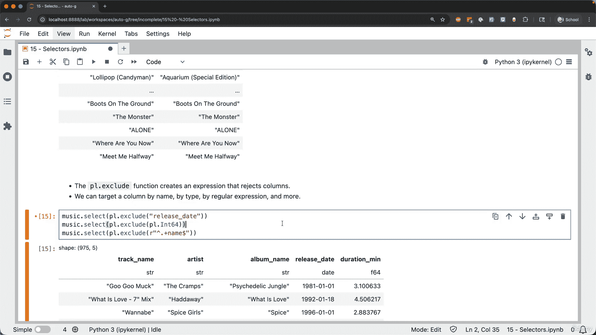

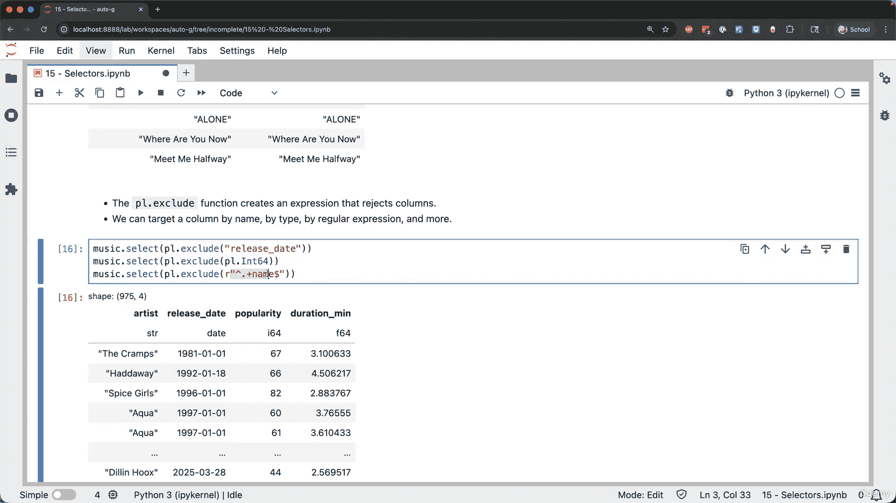

这些内容构成了后面学习 `selectors` 模块的基础。下一节我们会继续使用本节导入的 `cs` 模块，看看更多自定义选择器如何帮助我们更灵活地定位列。

