# 🧭 Polars 与 Python 数据分析：第72节：初识选择器


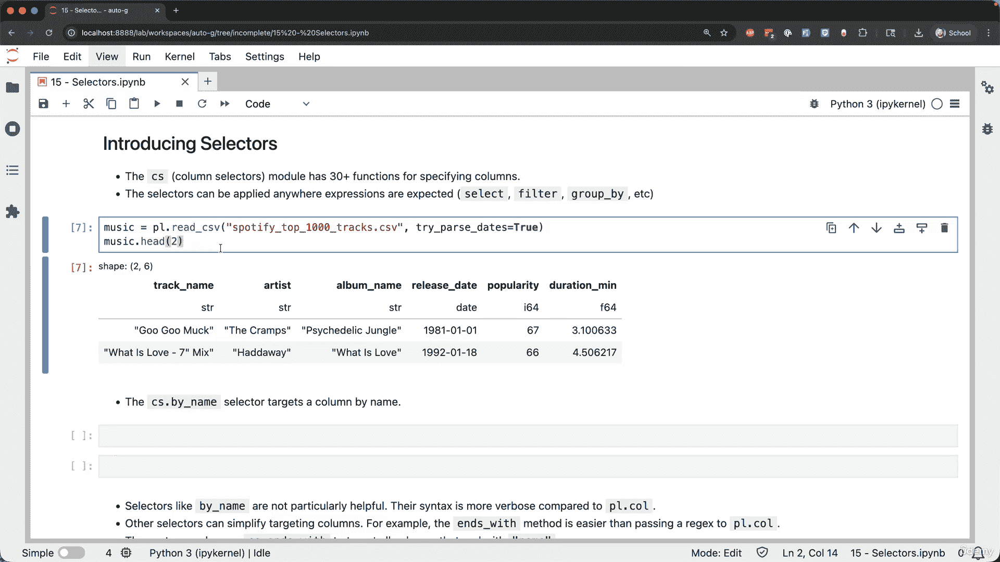

在本节课中，我们将要学习 Polars 里的 `selectors` 模块，也就是列选择器。上一课已经导入这个模块并赋值了别名 `CS`，本节先执行 music 数据框的导入代码，再查看 `CS` 模块里有哪些顶层功能，然后用 `by_name`、`ends_with`、`starts_with` 这几个选择器来按列名取列。我们会看到，选择器本身只是描述“要选哪些列”，并不会立刻产生结果；只有把它交给 `select` 或 `with_columns` 这样的方法，表达式才会真正执行。下面从导入和别名开始，一步步看这些选择器怎么用。


## 📥 导入选择器模块与别名


上一节我们已经导入了 `selectors` 模块，并把它赋值给别名 `CS`。本节先执行之前课程里导入 music 数据框的代码，让数据准备好。执行完成后，`CS` 这个别名在代码里就可以直接使用，它代表的就是列选择器子模块。代码如下，其中 `CS` 就是原文里的别名写法。


```python
import polars.selectors as CS
# 执行之前课程中的 music 数据框导入代码
```


数据框准备好以后，我们就可以在 `CS` 后面输入一个点，看看这个模块里有哪些内容。下一节先查看它的顶层功能，再进入具体的列选择器。


## 🧰 查看 CS 模块的顶层功能


在 `CS` 后面输入点并按 Tab 键，会看到这个模块的所有顶层功能。这些顶层功能包括函数、模块和类，它们都放在 `CS` 这个列选择器子模块里面。`by_name` 就是其中一个函数例子，它属于按列名定位列的选择器。以下是 `CS` 模块顶层功能包含的几类内容，初学者可以先记住这个结构，后面再慢慢熟悉具体函数。


- 函数：例如 `by_name`，用来生成按列名选择列的表达式。
- 模块：`CS` 内部还可以包含子模块。
- 类：`CS` 内部也包含类，这些类共同组成选择器的功能。


知道顶层功能有哪些之后，本节先看最直观的 `by_name`。它和常见的 `col` 函数差别不大，但可以作为理解选择器对象的一个入口。


## 🎯 使用 by_name 选择器按列名取列


`by_name` 这个函数并不算特别革命性的功能，它和 `col` 函数差别不大。它的作用是让我们按列名来定位一列，是 `CS` 模块里嵌套功能的一个例子。它并不比 `col`（column）函数更有优势，语法上甚至更啰嗦，但它是理解选择器对象的好例子。下面是 `by_name` 的基本写法，传入的列名是 `track_name`。


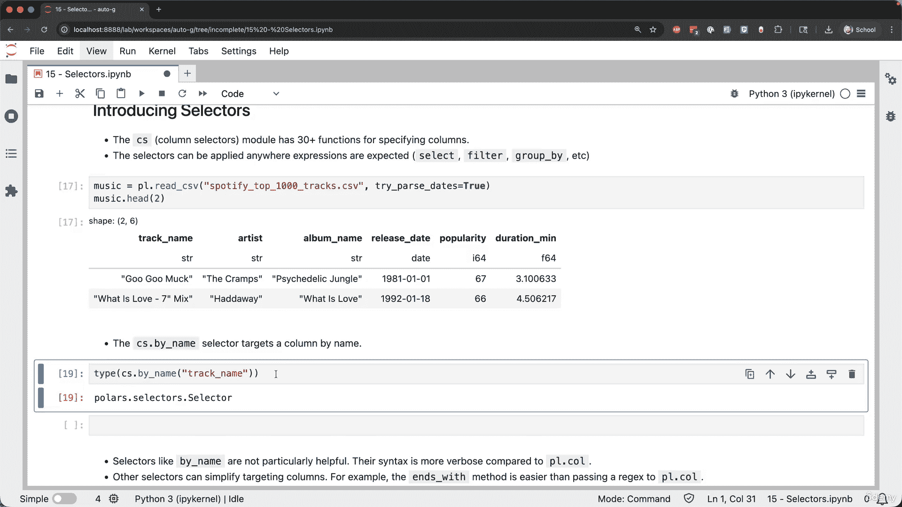

```python
CS.by_name("track_name")
```


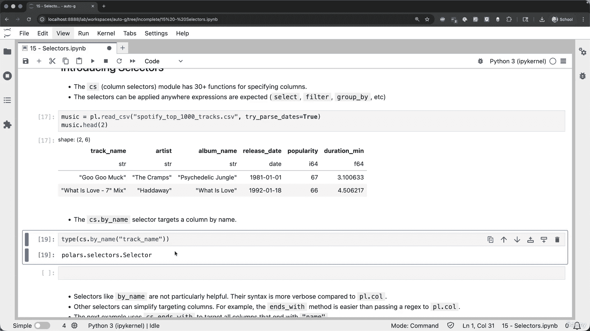

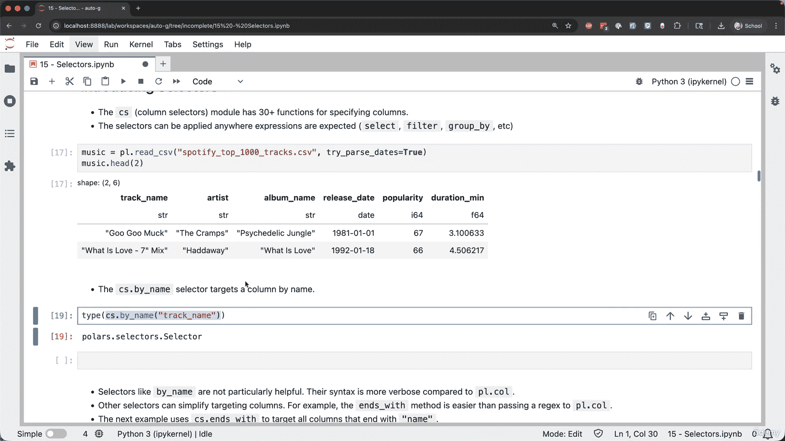

执行这个表达式后，它的效果和用 `col` 函数创建的表达式很像。需要注意，选择器对象本身没有值，只有和 `select` 或 `with_columns` 这类方法结合以后，才会真正执行表达式计划，得到结果列。这个关系可以简单写成下面的形式。


> 选择器对象 + `select` / `with_columns` → 结果列


如果把 `CS.by_name("track_name")` 传给 Python 的 `type` 函数，可以看到它得到的是一个选择器类型，和普通表达式类型很相似。代码和结果示意如下。


```python
expr = CS.by_name("track_name")
type(expr)
# 返回 selector 类型，和普通表达式类型很相似
```


选择器的工作方式和课程里一直使用的方法一致：我们还是调用 `select`，只是不再传入由 `pl.col` 或 `pl.exclude` 创建的对象，而是把一个选择器对象传给 `select`。下面是调用 `select` 并传入 `CS.by_name("track_name")` 的写法，它会单独取出 `track_name` 这一列。


```python
music.select(CS.by_name("track_name"))
```


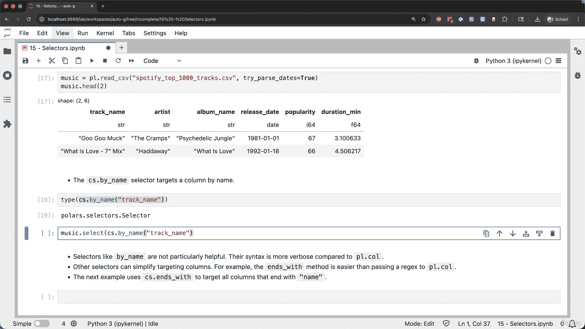

这个 `by_name` 选择器本身不算特别有用，因为这种写法比直接使用普通的 `col` 函数更冗长。不过，`CS` 模块里还有其他选择器，可以大大简化按列定位的操作。下一节就来看一个按列名后缀取列的例子。


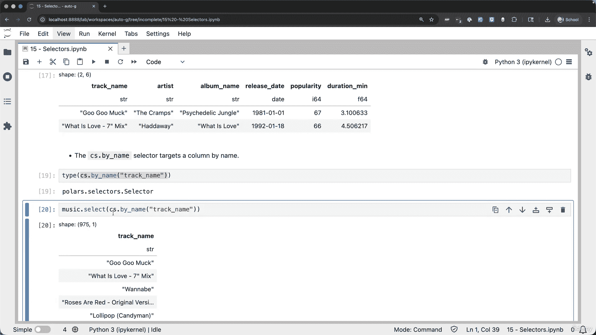

## 🔚 使用 ends_with 选择以 name 结尾的列


假设要取出所有以 `name` 结尾的列。上一课已经看过一种办法，就是用正则表达式；但那种办法需要构造一个比较复杂的搜索模式，去匹配完整的列名。现在用 `CS` 模块里的 `ends_with` 选择器，就能更轻松地得到相同结果。下面这段代码会在 music 数据框上调用 `select`，并在 `CS` 这个列选择器子模块下调用 `ends_with`，传入 `name`。


```python
music.select(CS.ends_with("name"))
```


这段代码的目标是所有列名以 `name` 结尾的列。执行后可以很容易地取出那两列，不需要再担心正则表达式、原始字符串和特殊字符。操作就是这么直接。后缀匹配之后，下一节再看一个和它互补的前缀匹配选择器。


## 🔛 使用 starts_with 选择以指定字母开头的列


`starts_with` 是 `CS` 子模块里一个和 `ends_with` 互补的函数。同样在 music 数据框上调用 `select`，再使用列选择器子模块里的 `starts_with`，传入小写字母 `a`，就能取出所有以 `a` 开头的列。代码如下。


```python
music.select(CS.starts_with("a"))
```


执行后，我们会取出以 `a` 开头的列，其中包括 `artist` 和 `album name` 这两列。通过这些例子可以看到，`CS` 子模块提供了一定的灵活性，可以按照不同的明确标准来专门定位列。后续课程还会介绍更多选择器用法。到这里，本节关于选择器入门的内容就完整了。


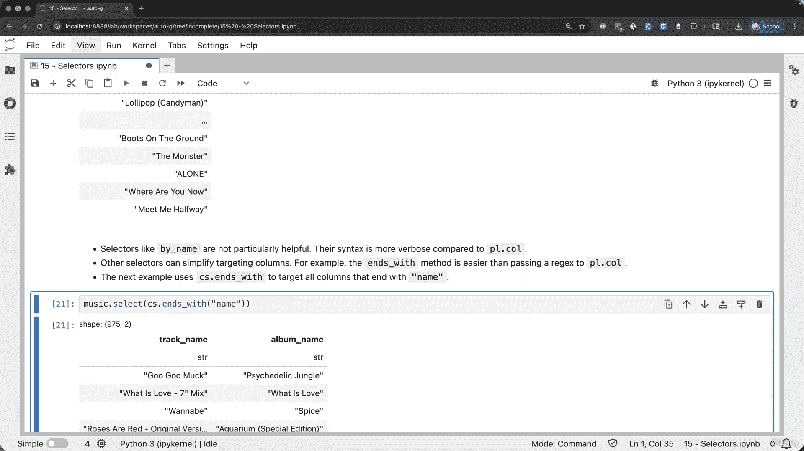

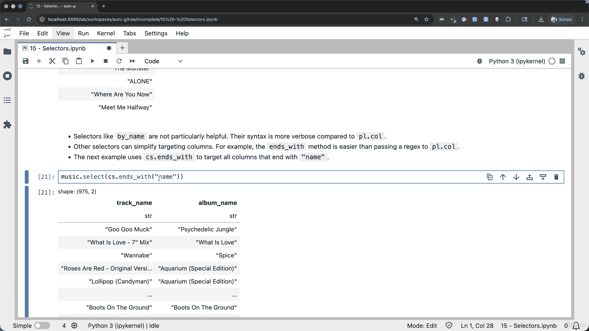

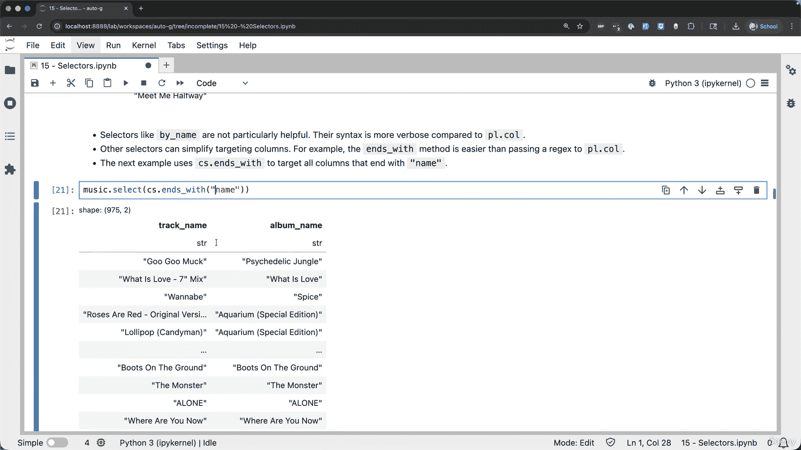

## 🧾 总结


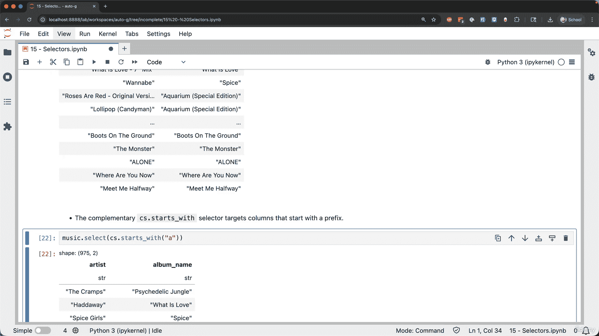

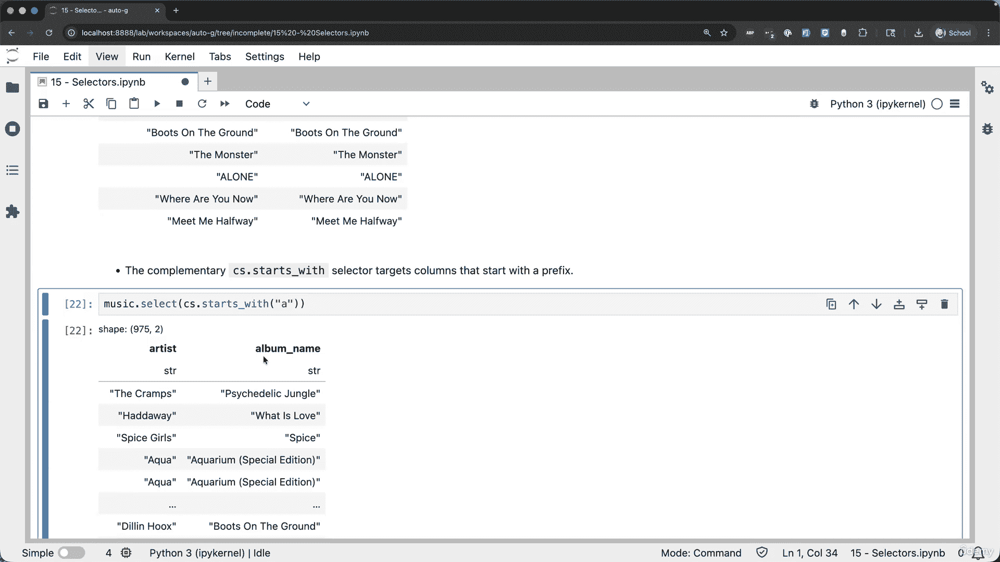

本节课中，我们一起学习了 Polars 的 `selectors` 模块和 `CS` 别名。我们先执行了 music 数据框的导入代码，然后查看 `CS` 模块的顶层功能，包括函数、模块和类。接着用 `by_name` 按列名取列，理解了选择器对象在没有和 `select` 或 `with_columns` 结合前不会产生值，并且它的类型和普通表达式类型很相似。之后用 `ends_with` 取出以 `name` 结尾的列，避免复杂正则表达式；又用 `starts_with` 取出以 `a` 开头的列。整体上，这些选择器让按不同标准定位列更方便，后续课程还会继续扩展这部分内容。

