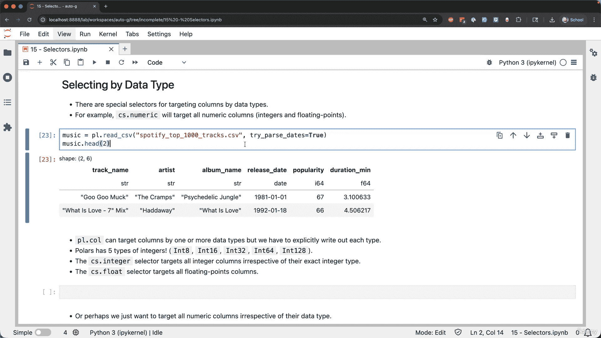

# 📊 Polars 与 Python 数据分析：第73章：按数据类型选择列

在本节课中我们将要学习如何使用 Polars 的选择器按数据类型选择列。选择器通常比普通的列函数灵活得多，因为它们可以按数据类型族来匹配列，而不是只匹配某一个精确的数据类型。对于初学者来说，可以先把选择器理解成一套“筛选规则”：你告诉 Polars 要哪一类列，Polars 就帮你把符合这一类规则的列找出来。下面我们会从普通列函数的限制讲起，再依次看数值类型选择器、时间类型选择器，以及按列名字符选择列的选择器。

**一、普通列函数按精确类型匹配的限制**

上一节我们说明了选择列的基本思路，本节中我们来看看普通列函数在按数据类型选择列时会遇到什么问题。首先导入数据。如果使用普通的列函数按数据类型定位列，问题在于它会和指定的精确数据类型绑定在一起。例如，请求 32 位整数列时，只会得到精确为 32 位整数的列，Polars 不会把 64 位整数列或 8 位整数列包含进来。随着数据集越来越大，列中很可能存储不同种类的整数或不同种类的浮点数，目的通常是减少总内存消耗。

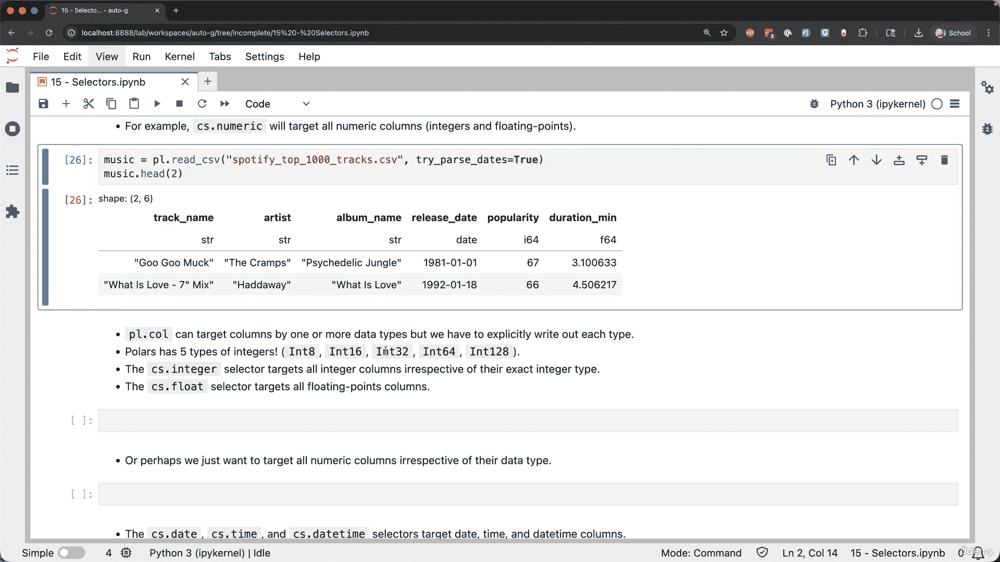

核心匹配规则可以直白地写成下面的形式。

```text
普通列函数：匹配精确数据类型
数据类型选择器：匹配数据类型族
```

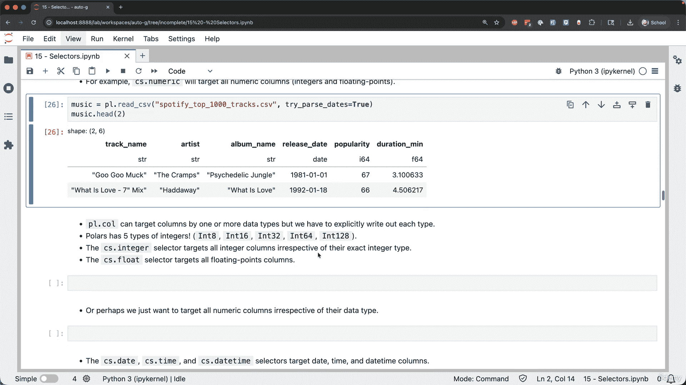

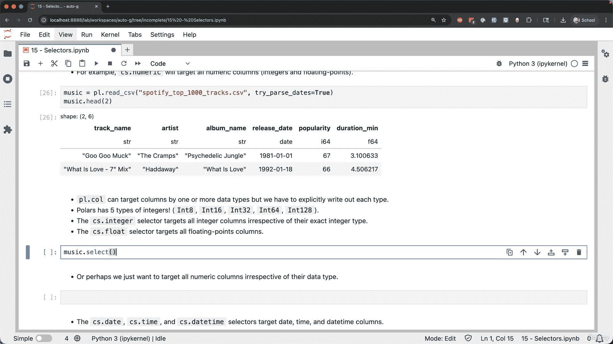

仍然可以使用普通列函数，但如果想定位任意一种整数列，就会遇到类型数量的问题。Polars 有五种整数类型，因此需要在普通列函数中把这五种可能的整数类型全部指定出来。这样的写法会越来越长，也不够灵活。下面用一个简化代码表示普通列函数需要写很多精确类型。

```python
# 普通列函数按精确类型匹配时，往往需要枚举多个类型
df.select(
    pl.col(pl.Int8),
    pl.col(pl.Int16),
    pl.col(pl.Int32),
    pl.col(pl.Int64),
    # 其他整数类型也需要继续列出
)
```

**二、用数值类型选择器匹配整数和浮点数**

上一节我们看到了普通列函数需要枚举精确类型，本节中我们来看看选择器如何解决这个问题。替代方案是使用 Polars 的选择器。例如调用 `select` 方法，在 `cs` 选择器子模块中有方便的 `integer` 函数，它会定位任意类型的整数值列，包括 8 位、16 位、32 位等整数类型。当前数据中只有一个整数列，但如果存在五个不同整数类型的列，`integer` 选择器会把它们全部选出来。

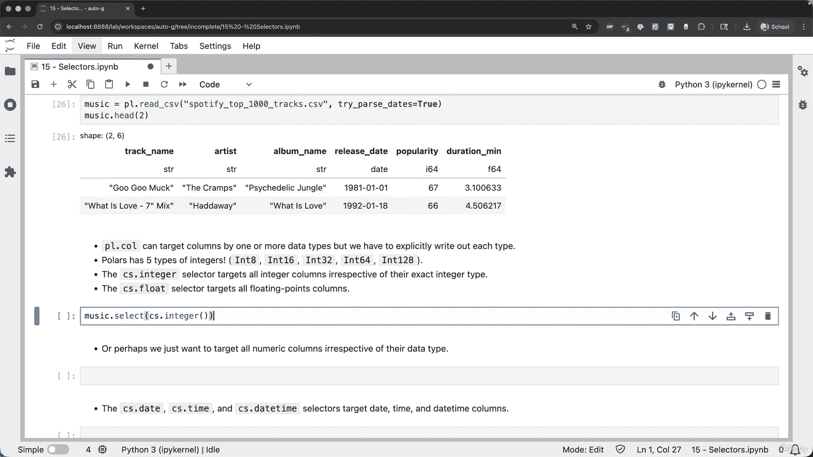

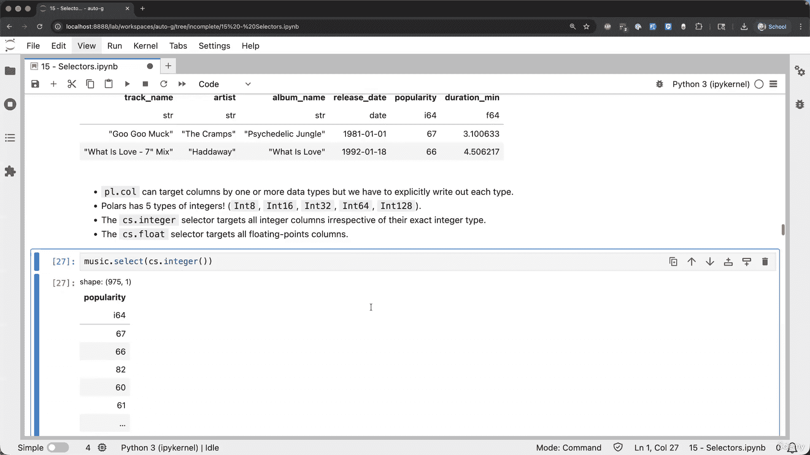

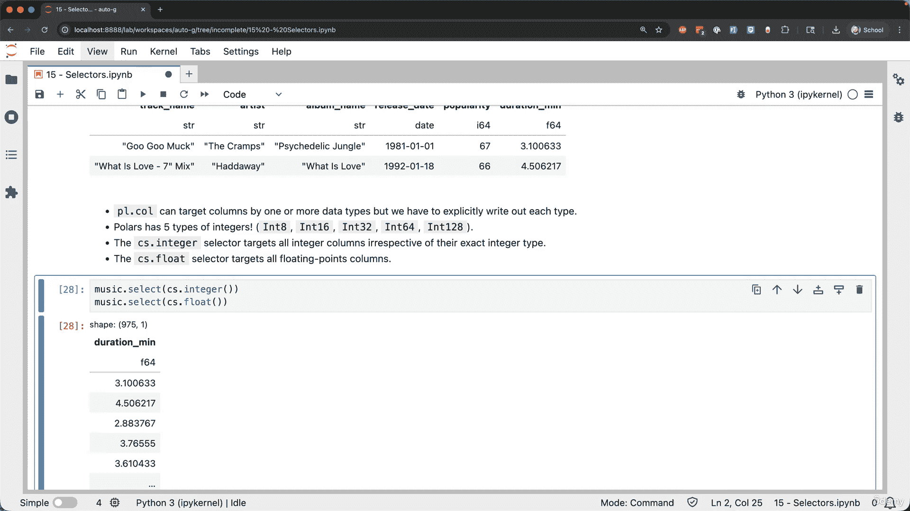

以下是整数、浮点和数值选择器的基本用法。

```python
import polars as pl
import polars.selectors as cs

# 选择所有整数类型的列
df.select(cs.integer())

# 选择所有浮点类型的列
df.select(cs.float())

# 选择所有数值类型的列
df.select(cs.numeric())
```

与 `integer` 对应的还有一个互补函数 `float`，它会选出所有浮点列，不管这些列是 32 位浮点还是 64 位浮点。若不在乎某列是整数还是浮点数，只想定位任何存储数值的列，无论它是整数还是小数，就可以使用名为 `numeric` 的便捷选择器。调用 `numeric` 函数或 `numeric` 选择器后，Polars 会同时选出整数列和浮点列，覆盖整数与浮点的各种可能组合。用公式表示就是：`数值列集合 = 整数列集合 ∪ 浮点列集合`。

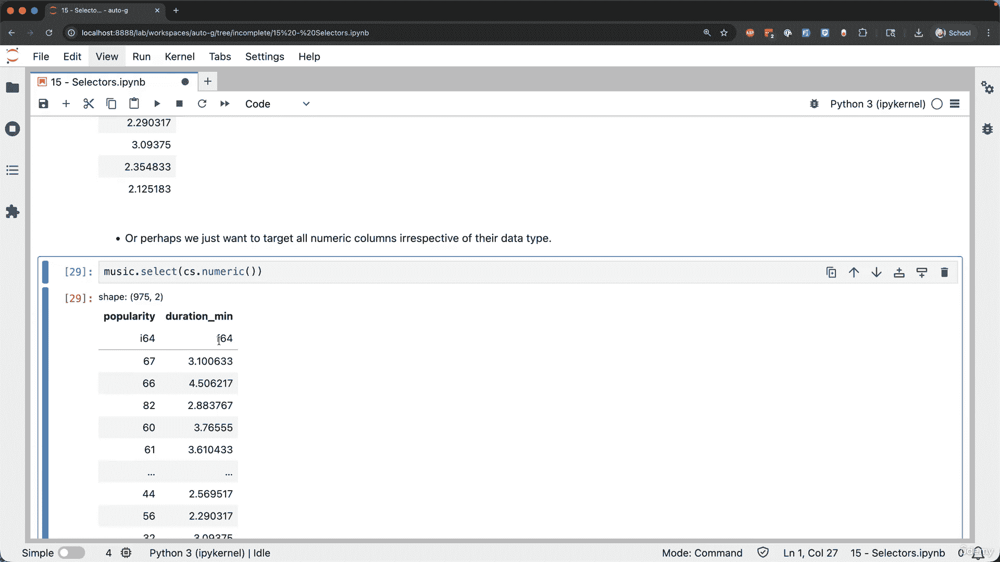

**三、用时间类型选择器匹配日期、时间和日期时间**

上一节我们介绍了数值类型选择器，本节中我们来看看时间相关类型的选择器。Polars 也为其他数据类型提供了互补选择器，尤其是有多种变体的数据类型。下面展示几个快速示例。可以定位所有包含日期的列，这里使用 `date` 选择器或 `date` 函数，结果会选出类型为日期的单个列。类似地，还有互补的 `time` 选择器；当前数据没有精确的时间列，因此会得到空结果集。还有互补的 `datetime` 函数；当前数据没有日期时间列，因此同样会产生空结果集。

以下是时间类型选择器的示例列表。

```python
# 选择日期列
df.select(cs.date())

# 选择时间列
df.select(cs.time())

# 选择日期时间列
df.select(cs.datetime())

# 选择所有时间类列：日期、时间、日期时间
df.select(cs.temporal())
```

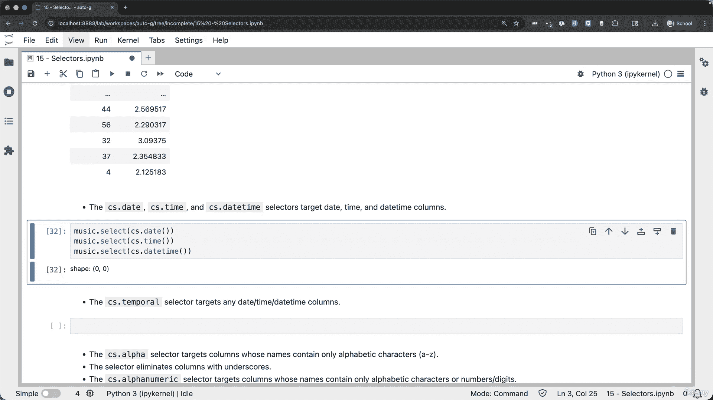

如果只想查看所有时间类列，而不在乎具体是日期、时间还是日期时间类型，只想定位任何建模时间的列，就可以使用便捷的 `temporal` 选择器。调用 `temporal` 函数后，可以很容易地定位所有存储日期、时间或日期时间的列。用公式表示就是：`时间列集合 = 日期列 ∪ 时间列 ∪ 日期时间列`。

**四、按列名中的字符选择列**

上一节我们按数据类型选择了时间类列，本节中我们来看看如何按列名中的字符选择列。这些选择器的用法同样简单。`alpha` 选择器会根据列名是否包含特定字符来定位列，准确地说，`alpha` 只定位列名中包含 A 到 Z 字母字符的列。可以检查它是否真的能选出列。查看 `alpha` 的结果时，会选出 `artist` 和 `popularity`，因为这两个列名只由字母字符组成。一旦列名中出现下划线这类字符，下划线会被视为非字母字符，因此该列会被排除。

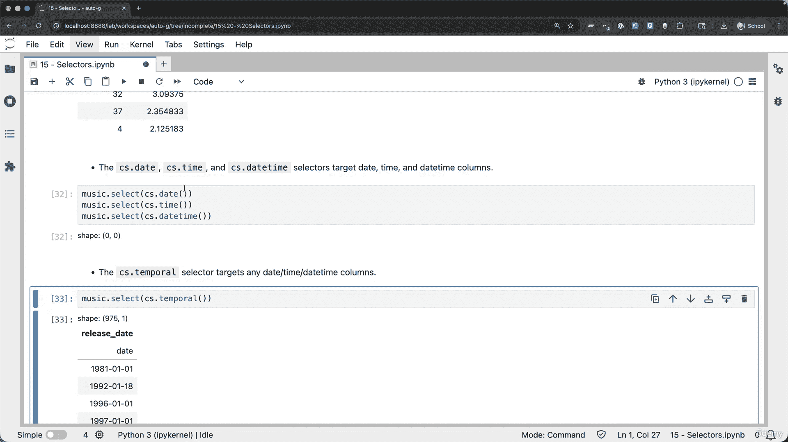

以下是按列名字符选择列的示例列表。

```python
# 选择列名只包含 alphabetic characters A-Z 的列
df.select(cs.alpha())

# 选择列名包含字母或数字的列
df.select(cs.alphanumeric())
```

另一个例子是互补选择器 `alphanumeric`，它会定位列名中包含字母字符、数字或数位的列，也就是列名可以包含字母字符或数值字符，这就是它被称为 alphanumeric 的原因。查看结果可以看到，这里会得到同样的两个列。这个选择器在定位列时更复杂一些，也更细致、更灵活。用大白话说，`alpha` 只看列名里的字母，`alphanumeric` 同时允许字母和数字，所以两者的筛选范围不同。

**五、本课总结**

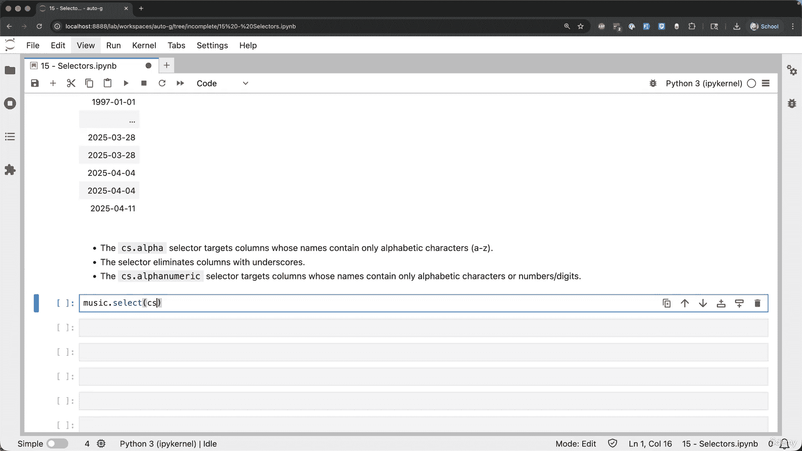

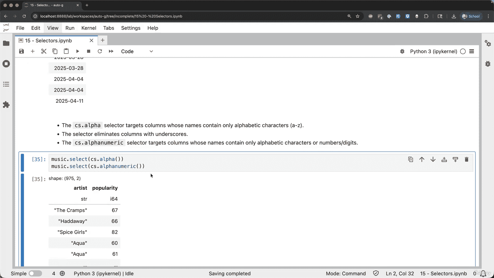

本节课中我们一起学习了 Polars 中按数据类型选择列的方法。我们先把普通列函数和选择器做了对比，普通列函数会匹配精确数据类型，选择器会匹配数据类型族，因此在大数据集中面对多种整数和浮点类型时更灵活。接着我们看了 `integer`、`float`、`numeric` 这些数值类型选择器，又看了 `date`、`time`、`datetime`、`temporal` 这些时间类型选择器，最后看了 `alpha` 和 `alphanumeric` 这种按列名字符选择列的选择器。掌握这些选择器后，就可以用更直白、更短小的代码定位一整类列，而不需要把每一个精确类型都枚举出来。

