# 📊 Polars 与 Python 数据分析：第174节：按列位置选择

在本节课中我们将要学习如何使用 Polars 的 `selectors` 模块按列的位置来选择列。前面我们已经接触过按列名选择数据的方式，本节会把重点放在“列排在第几位”这件事上，也就是按索引位置提取列。我们会介绍索引从0开始计数、`by_index` 选择器、无效索引报错、一次传入多个位置、负索引、正负索引混合，以及 `first` 和 `last` 这两个辅助函数。大白话来说，列的位置就是列在数据框里排队的序号，只要知道序号，就能把想要的列拎出来。

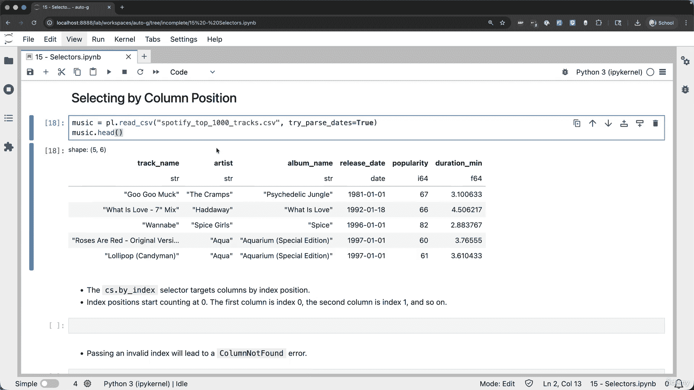

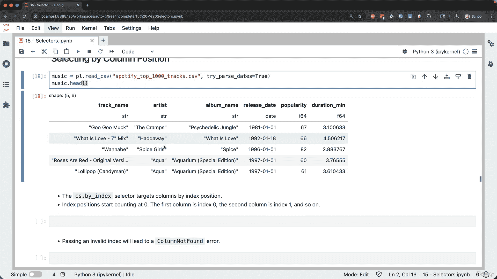

## 🧭 Polars 与 Python 数据分析：第174节：列索引从0开始

上一节我们介绍了按列选择的基本思路，本节中我们来看看按列位置选择时最基础的一点，也就是索引从哪里开始数。`selectors` 模块可以基于列在数据中的顺序索引位置来定位列。提醒一下，索引位置从0开始计数。以示例数据为例，最靠左的 track name 列占据索引0，artist 是索引1，album name 是索引2，后面的列依此类推。索引公式可以写成下面这样，方便初学者记忆：

```python
# 索引位置从 0 开始
# track_name -> 0
# artist     -> 1
# album_name -> 2
```

在下面的示例中，这个选择器叫 `by_index`。这里可以使用 `cs` 别名，它代表 `selectors` 模块。模块里有一个函数叫 `by_index`。如果给 `by_index` 传入值0，就会取出索引0的列，也就是 track name 列。示例代码如下：

```python
import polars.selectors as cs

df.select(cs.by_index(0))
```

这样就把按列位置选择的基本用法跑通了。理解索引从0开始之后，接下来我们看看如果传入一个不存在的索引，程序会有什么反应。

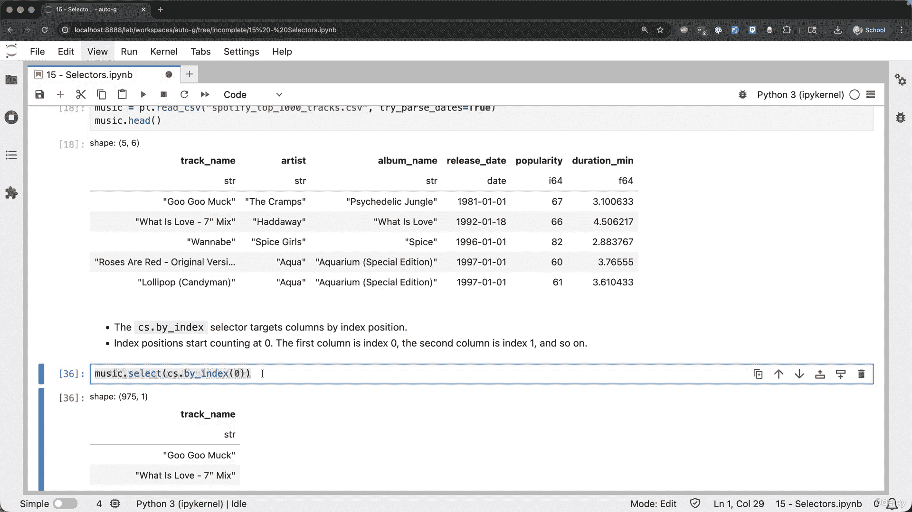

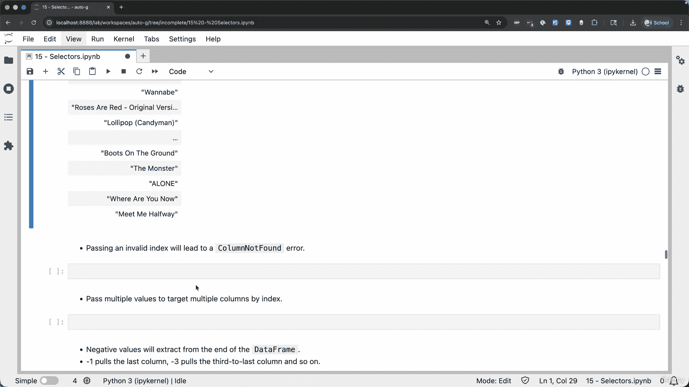

## ⚠️ Polars 与 Python 数据分析：第174节：无效索引会报错

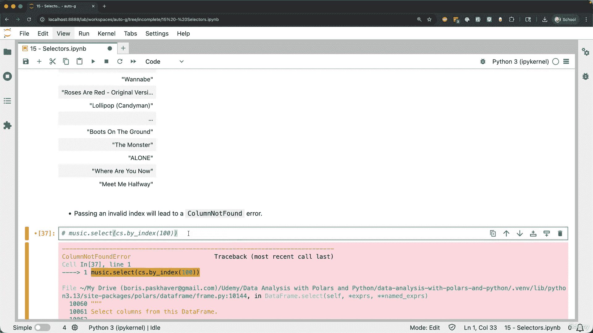

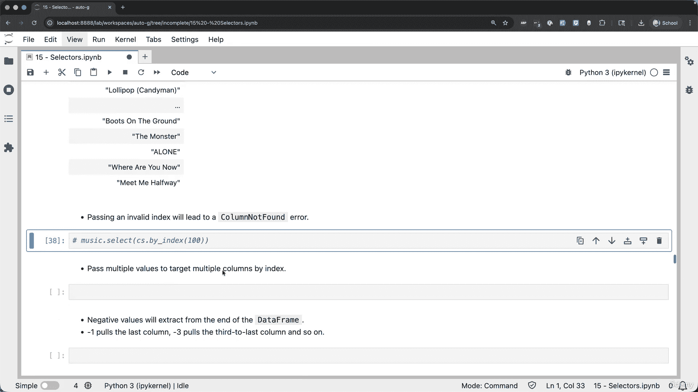

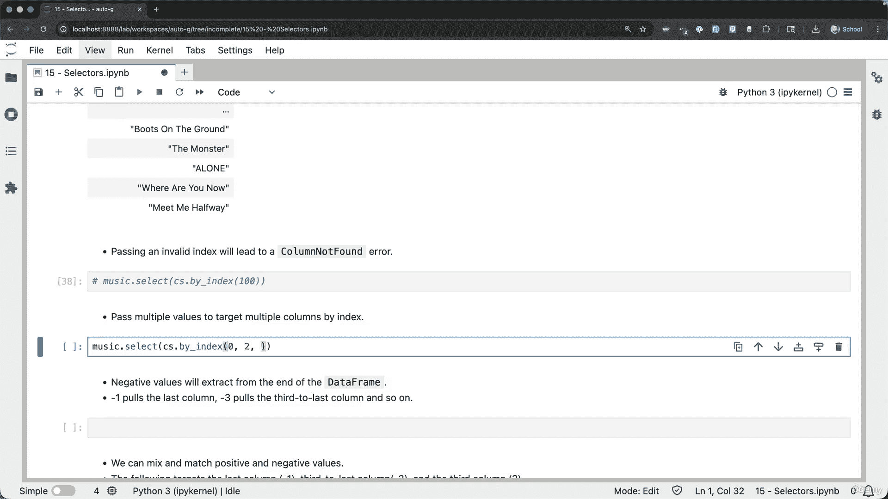

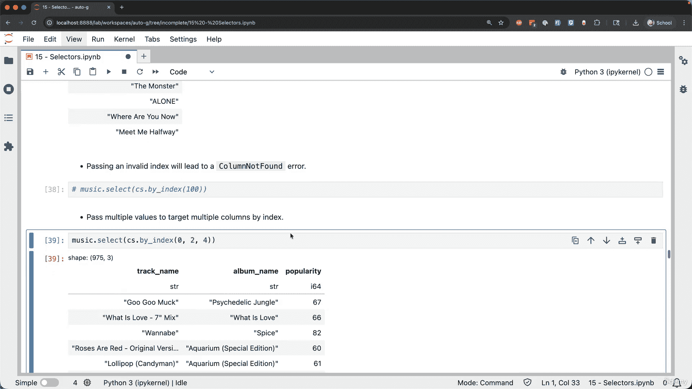

上一节我们介绍了用0取第一列，本节中我们来看看索引不存在时的表现。如果给 `by_index` 提供无效索引，也就是不存在的索引，这个函数会失败。例如下面的数据没有101列，所以索引100不存在，程序会报错。这个现象不是问题，把对应代码删掉即可。示例代码如下：

```python
# 假设 df 没有 101 列
df.select(cs.by_index(100))  # 会失败
```

知道单个位置怎么选、无效位置会报错之后，我们继续看一次传入多个位置该怎么写。

## 🔢 Polars 与 Python 数据分析：第174节：一次选择多个位置

上一节我们介绍了无效索引的处理，本节中我们来看看 `by_index` 更强大的地方，也就是一次传入多个值。我们可以向 `by_index` 传入多个值。在下面的示例中，把旧代码贴到这里。可以按顺序逐个传参，也可以把参数放进列表。这里选择索引0、2、4，也就是原始数据框中的第一列、第三列和第五列。以下是两种写法示例：

```python
# 顺序传参：取索引 0、2、4
df.select(cs.by_index(0, 2, 4))

# 列表传参：取索引 0、2、4
df.select(cs.by_index([0, 2, 4]))
```

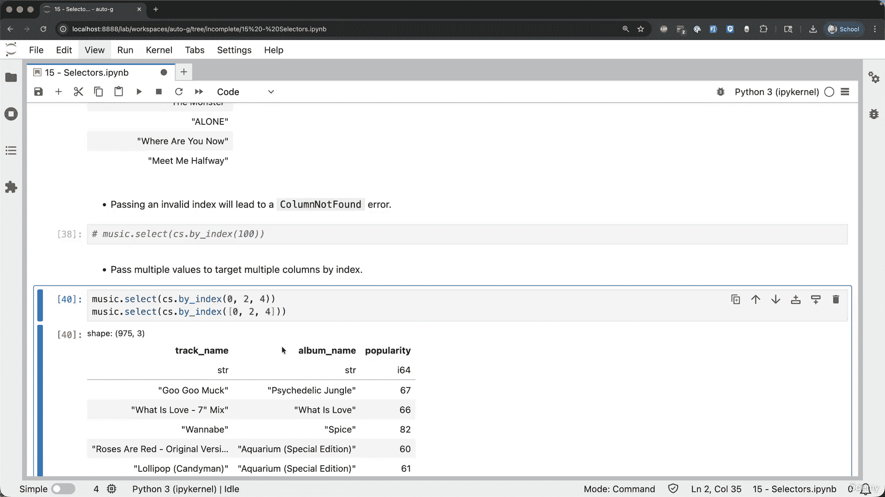

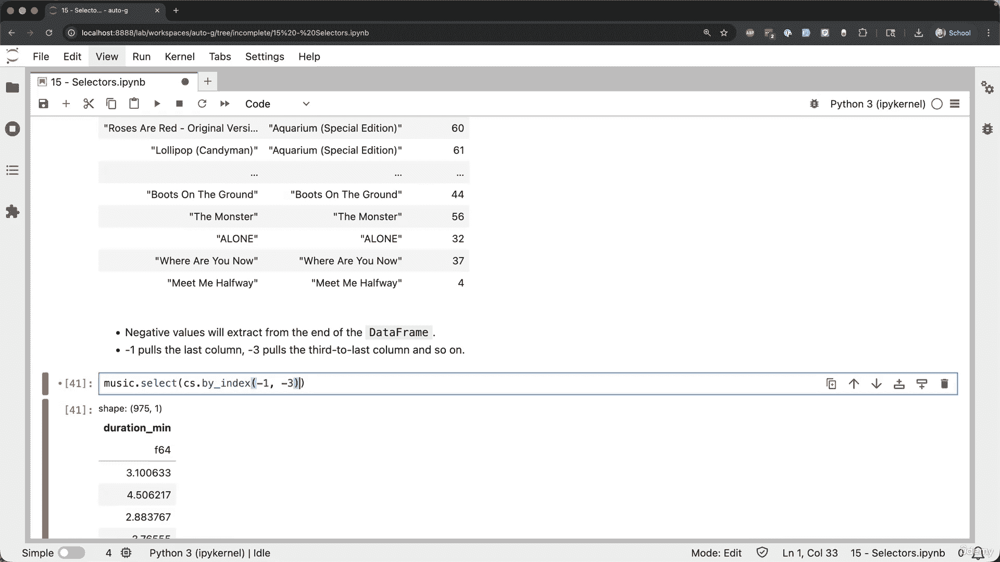

这里非常灵活。如果数据集有某种逻辑结构，例如每一列代表一个日期，并且想每隔一天取数据，就可以把这种逻辑应用到按位置提取列上，发挥创造力。正索引可以从开头数，负索引则可以从末尾数，接下来我们看看负索引的用法。

## ➖ Polars 与 Python 数据分析：第174节：使用负索引从末尾选择

上一节我们介绍了正索引多值选择，本节中我们来看看负索引。`by_index` 也接受负值，用于从列列表末尾开始提取。例如在下面传入 -1，表示取数据框最后一列；最后一列是 duration in minutes 列。这里也可以传多个参数，例如同时取最后一列和倒数第三列，就传入 -1 和 -3。示例如下：

```python
df.select(cs.by_index(-1))        # 最后一列
df.select(cs.by_index(-1, -3))    # 最后一列和倒数第三列
```

这样会得到 release date 列，它是倒数第三列。更进一步，可以在一次 `by_index` 调用中混合正数和负数。例如要最后一列传 -1，要倒数第三列传 -3，要索引位置2也就是第三列传2，这些列都能被提取。示例代码如下：

```python
df.select(cs.by_index(-1, -3, 2))
```

需要注意，使用 `select` 方法时，每个产出的列名必须唯一。如果意外出现重名重叠，就会报错。除此之外，这个函数支持正负值混合使用。正负索引都介绍完之后，我们来看看不想数位置时可以用哪两个辅助函数。

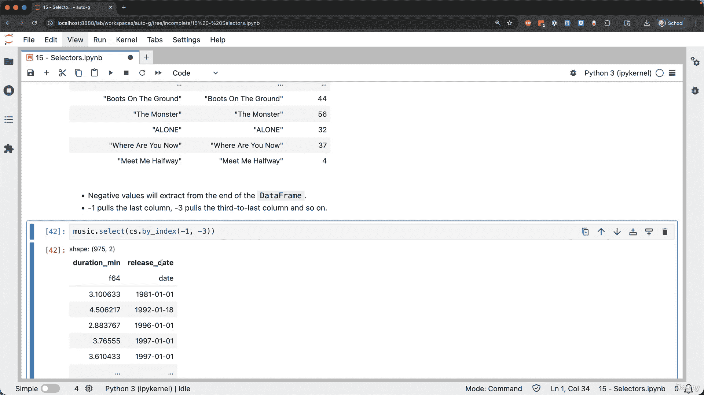

## 🧰 Polars 与 Python 数据分析：第174节：first 与 last 辅助函数

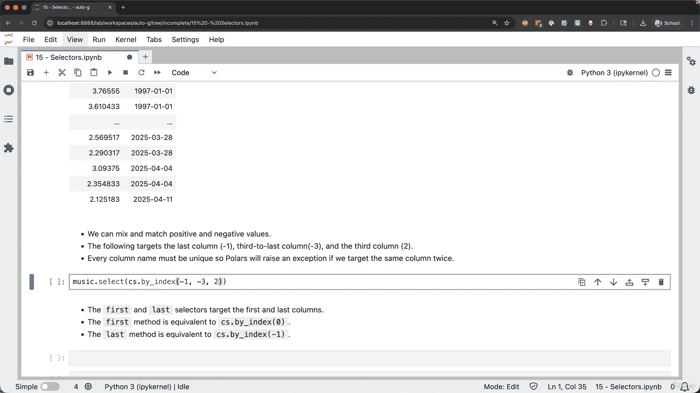

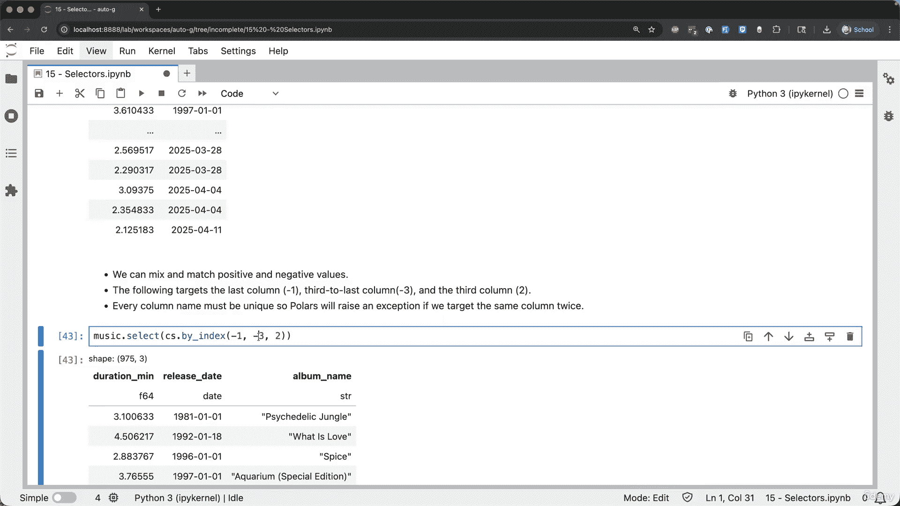

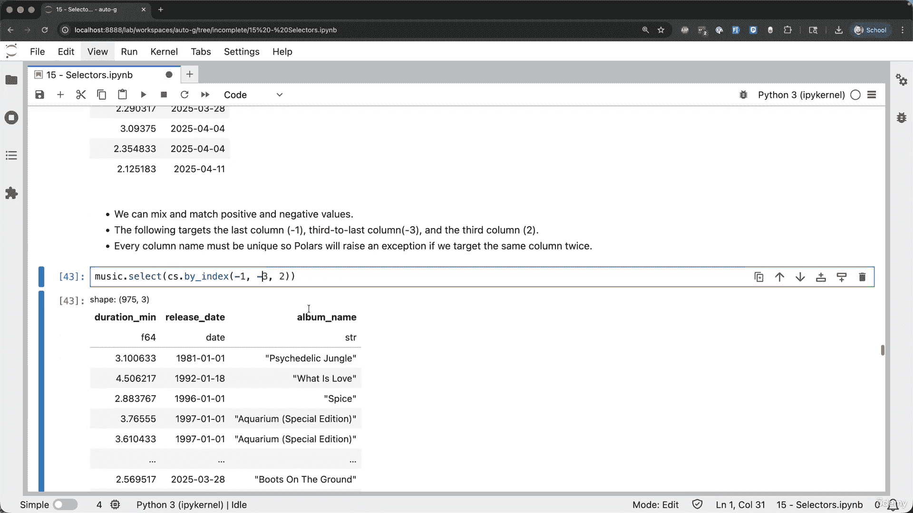

上一节我们介绍了正负索引混合，本节中我们来看看更省事的辅助函数。如果不想处理索引位置，有两个好用的辅助函数：一个是 `first`，直接取数据框第一列；另一个是 `last`，直接取数据框最后一列。以下是两个辅助函数的用法：

```python
df.select(cs.first())  # 第一列
df.select(cs.last())   # 最后一列
```

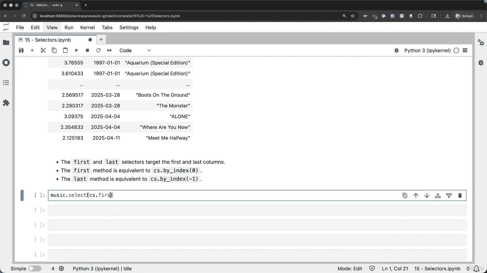

作为向 `by_index` 传0的替代方案，可以同样使用 `cs` selectors 模块并调用 `first` 函数，取数据框第一列。取最后一列的互补函数是 `last`，它也在 `cs` 命名空间下。到这里，我们已经有多种按数值索引位置定位列的方式。再次强调，如果列在数据集中的位置与要解决的问题相关、有上下文，这种方式会特别有帮助，可以借助这些特殊选择器完成普通 `col` 函数无法支持的目标。

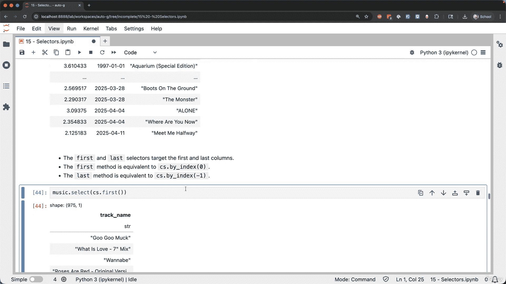

## ✅ Polars 与 Python 数据分析：第174节：本节总结

本节课中我们一起学习了 Polars selectors 模块按列位置选择的方法。我们知道了索引从0开始，`by_index` 可以选单列、多列、负索引，还能混合正负索引；无效索引会报错；使用 `select` 时列名必须唯一；`first` 和 `last` 可以快速取首列和末列。以下是核心代码汇总，便于初学者复习：

```python
import polars.selectors as cs

df.select(cs.by_index(0))          # 第一列
df.select(cs.by_index(0, 2, 4))    # 第1、3、5列
df.select(cs.by_index(-1, -3))     # 最后一列和倒数第三列
df.select(cs.first())              # 第一列
df.select(cs.last())               # 最后一列
```

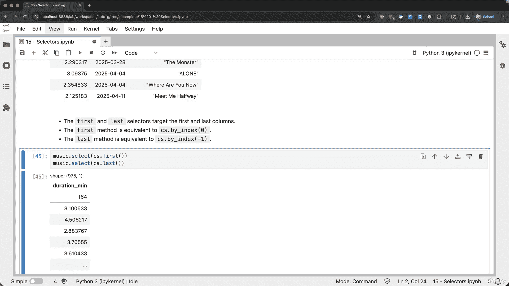

这些方法适合列位置本身有业务含义的场景，能让按位置提取列更直接。

