# 🐻 Polars 与 Python 数据分析：75：选择器的集合运算


在本节课中，我们将要学习如何把集合运算应用到 Polars 的列选择器上。集合是来自数学的一种数据类型，它表示无序且不重复的值集合。Python 语言本身也有 `set` 类型，这个类型在需要比较多个集合时很有用。例如，我们可能想找出存在于一个集合但不存在于另一个集合的值，或者找出同时存在于两个集合中的值。集合之间可以做多种数学或逻辑运算，而这些逻辑运算同样可以用在 Polars 的选择器上，用来定位 DataFrame 中的列。这个主题初看有些复杂，但通过几个例子会很快变得清晰。


下面先列出五种常用集合操作及对应符号，方便建立整体印象。这里的 \(A\) 和 \(B\) 可以理解为两组被选择器挑出来的列。


- 并集：\(A \cup B\)，对应代码中的 `A | B`，表示满足 A 或满足 B 的列。
- 交集：\(A \cap B\)，对应代码中的 `A & B`，表示同时满足 A 和 B 的列。
- 差集：\(A - B\)，对应代码中的 `A - B`，表示满足 A 但不满足 B 的列。
- 对称差：\(A \triangle B\)，对应代码中的 `A ^ B`，表示只满足 A 或只满足 B、但不同时满足两者的列。
- 排除或取反：\(\neg A\)，对应代码中的 `~A`，表示不满足 A 的列。


> 提示：这些集合运算处理的是“列的选择范围”，不会改变列里的数据内容，只是帮助我们更灵活地挑出目标列。


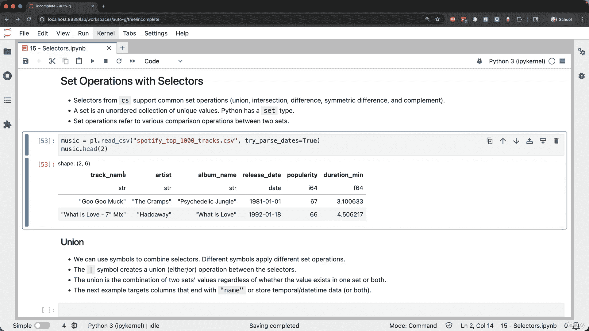

上一节我们建立了集合运算与列选择器的基本关系，本节中我们来看看如何准备示例数据。首先重新执行 Spotify 数据集的导入代码，把数据读入 Polars DataFrame。下面的代码里，`cs` 表示 Polars 的选择器子模块，后续示例都会围绕它展开。


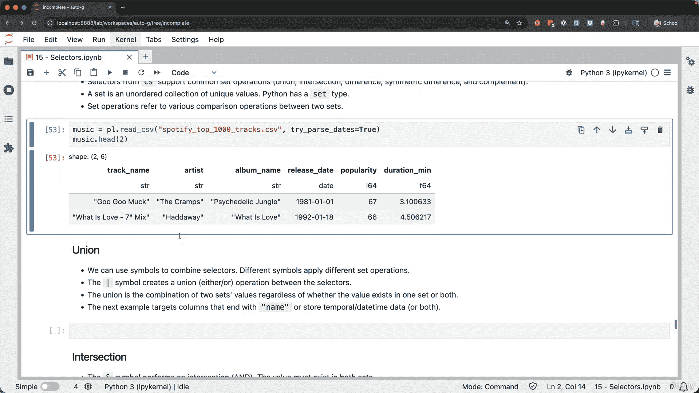

```python
import polars as pl
import polars.selectors as cs

# 重新执行导入 Spotify 数据集的代码
# df = ...
```


数据准备好后，第一个要看的操作是并集。并集会创建两个集合值的组合，也就是把两个集合里的值合并到一起。无论某个值只存在于第一个集合、只存在于第二个集合，还是同时存在于两个集合，它都会被包含进来。举个例子，我们想选择所有列名以 `name` 结尾的列，例如 `album name` 和 `track name`，再把这些列与所有时间日期类型的列合并起来。


下面是并集示例的操作拆解，按步骤理解即可。


- 使用 `select` 方法开始选择列。
- 第一个选择器使用 `cs.ends_with("name")`，挑出列名以 `name` 结尾的列。
- 第二个选择器使用 `cs.temporal()`，挑出存储日期时间数据的列。
- 在两个选择器之间使用竖线 `|`，表示并集，把两个集合的列合并起来。
- 最终结果包含所有列名以 `name` 结尾的列，或者所有时间日期列。


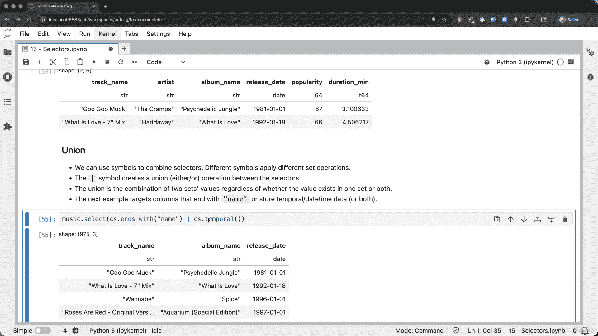

```python
df.select(
    cs.ends_with("name") | cs.temporal()
)
```


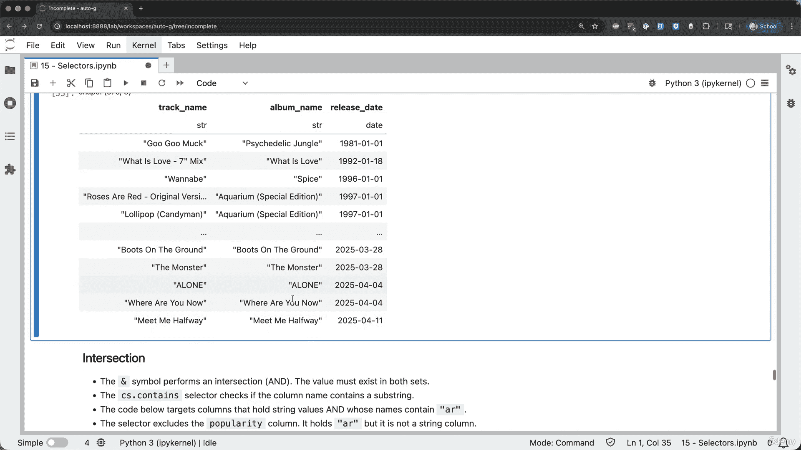

这里的竖线 `|` 就是并集符号，它表示把两个集合中的所有值合并到一个集合中。因此，这段代码会提取所有列名以 `name` 结尾的列，以及所有时间日期列。介绍完并集，本节中我们接着看看交集，它关注的是两个集合共有的部分。


交集与并集不同，交集会找出同时存在于两个集合中的值。如果一个值只存在于一个集合而不存在于另一个集合，它就不会被包含。也就是说，交集关注的是两个集合共同拥有的列。


下面是交集示例的拆解，重点看两个条件如何同时成立。


- 使用 `select` 方法开始选择列。
- 第一个选择器使用 `cs.string()`，挑出所有字符串类型的列。
- 第二个选择器使用 `cs.contains("AR")`，挑出列名中包含文本 `AR` 的列。
- 使用 `&` 符号连接两个选择器，表示交集，两个条件必须同时满足。
- 最终结果只保留既是字符串列、列名又包含 `AR` 的列。


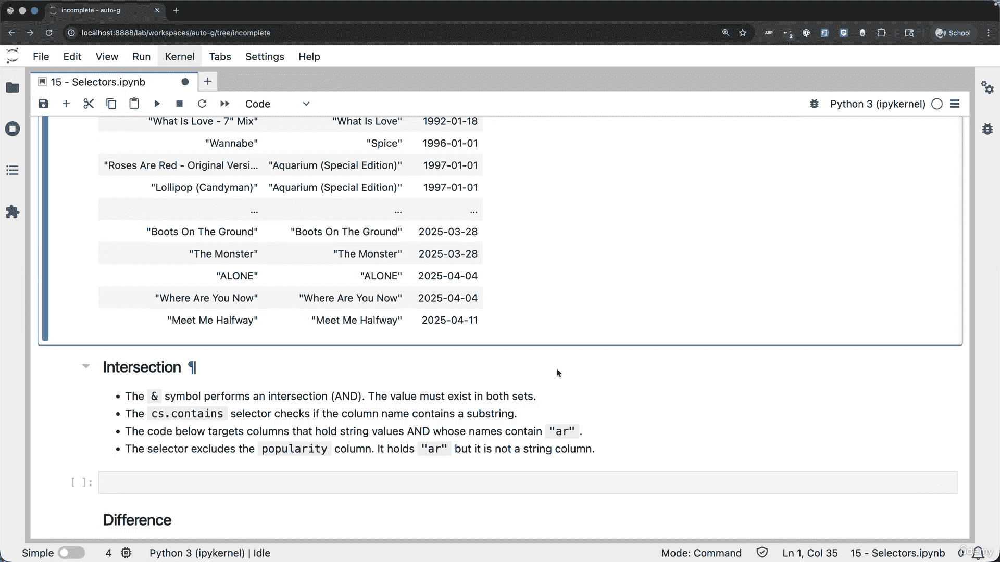

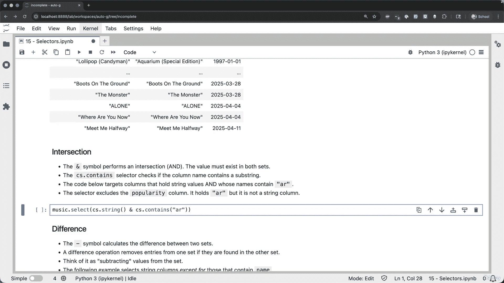

```python
df.select(
    cs.string() & cs.contains("AR")
)
```


在这个例子里，`art` 是唯一一个既存储字符串数据、列名又包含 `AR` 的列。可以把交集理解为“并且”逻辑：必须同时满足两个条件才会被选中。并集则可以理解为“或者”逻辑：满足其中一个条件就会被选中。接下来我们看看差集，它是在一个集合中排除另一个集合里的值。


差集要寻找的是存在于一个集合、但不存在于另一个集合的值。可以把它想成做减法：先拿到一组列，再从这组列里去掉另一组列。


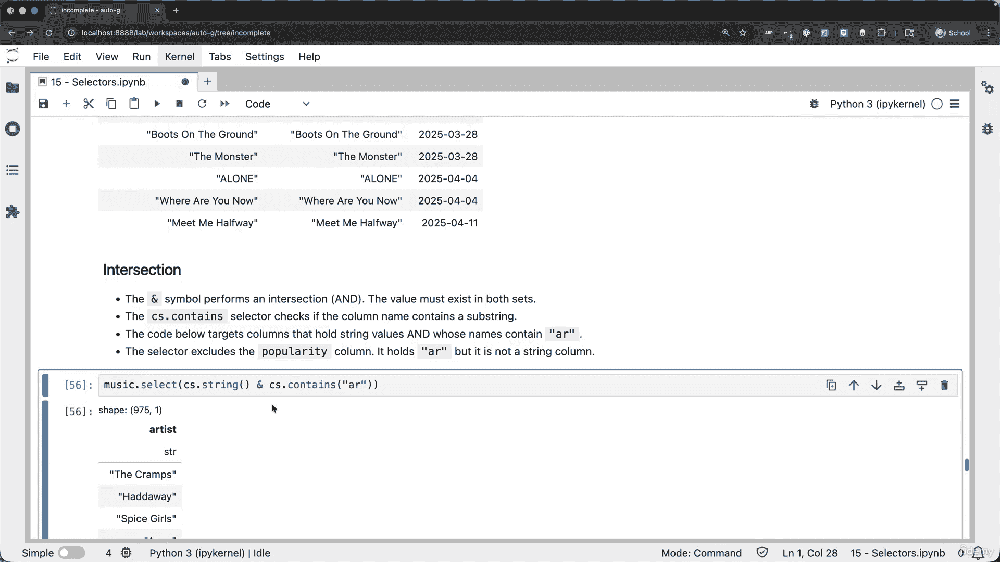

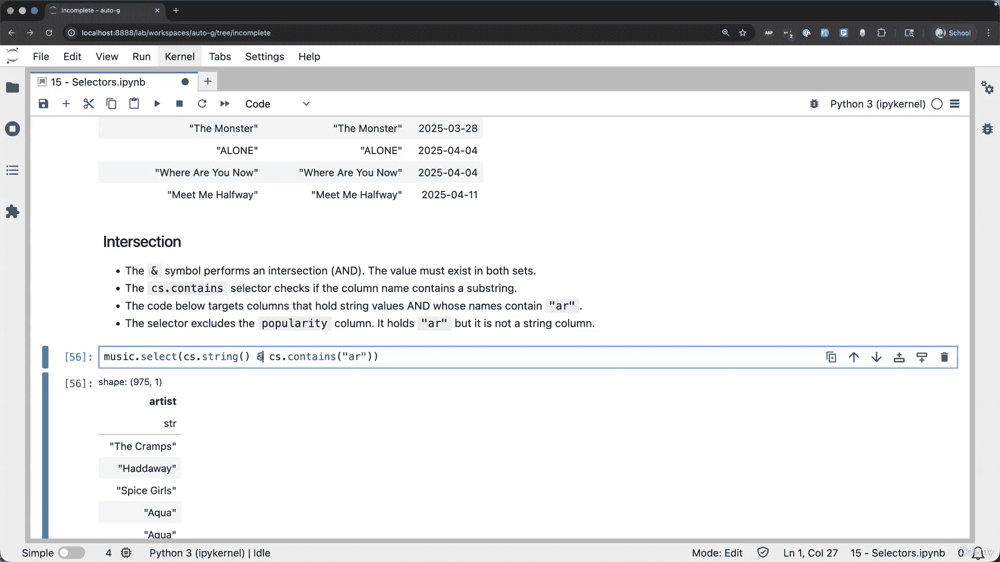

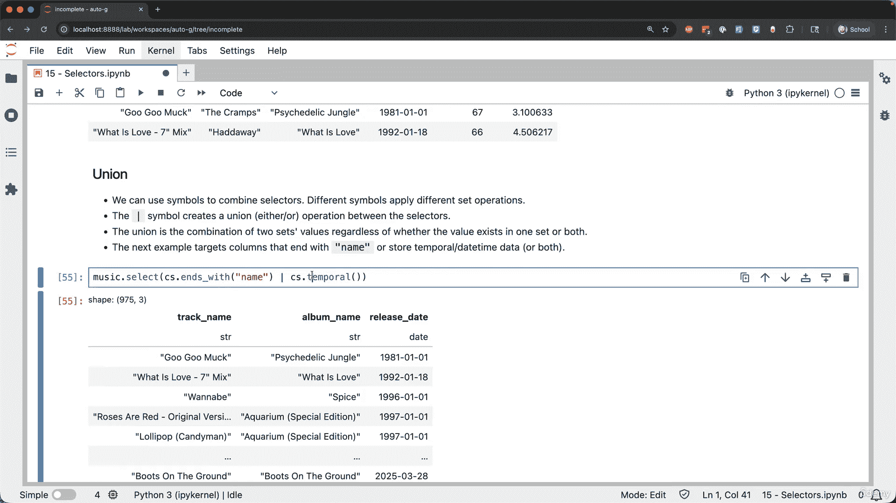

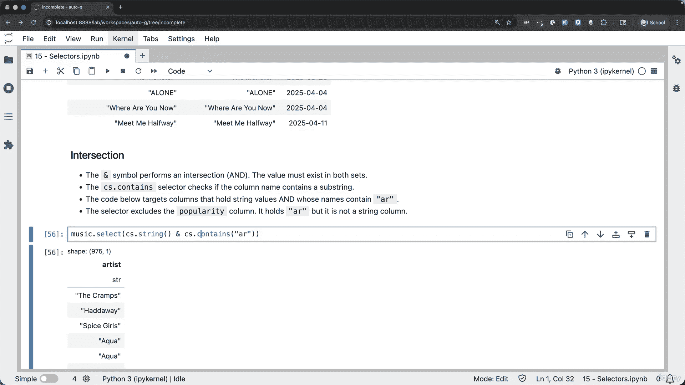

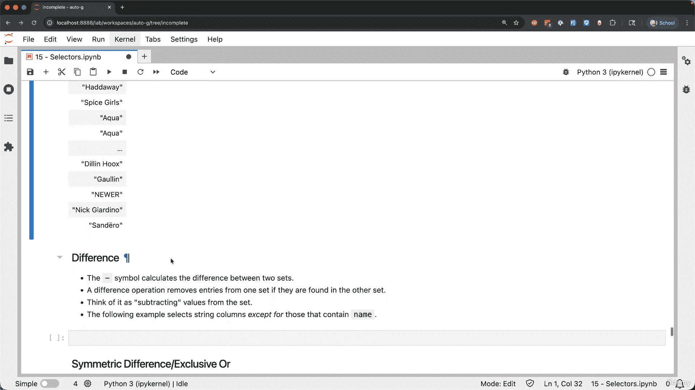

下面是差集示例的拆解，可以把它理解成从一组列里减掉另一组列。


- 使用 `cs.string()` 选出所有字符串列。
- 使用减号 `-` 表示差集运算。
- 使用 `cs.contains("art")` 选出列名包含 `art` 的列。
- 差集会从字符串列集合中排除包含 `art` 的列。
- 最终结果是所有不包含 `art` 的字符串列。


```python
df.select(
    cs.string() - cs.contains("art")
)
```


差集运算会把一个集合中、同时出现在另一个集合里的条目移除。上面这段代码会保留字符串列中不含 `art` 的列，同时去掉字符串列中含 `art` 的列。介绍完差集，本节中我们来看对称差，也叫异或运算。


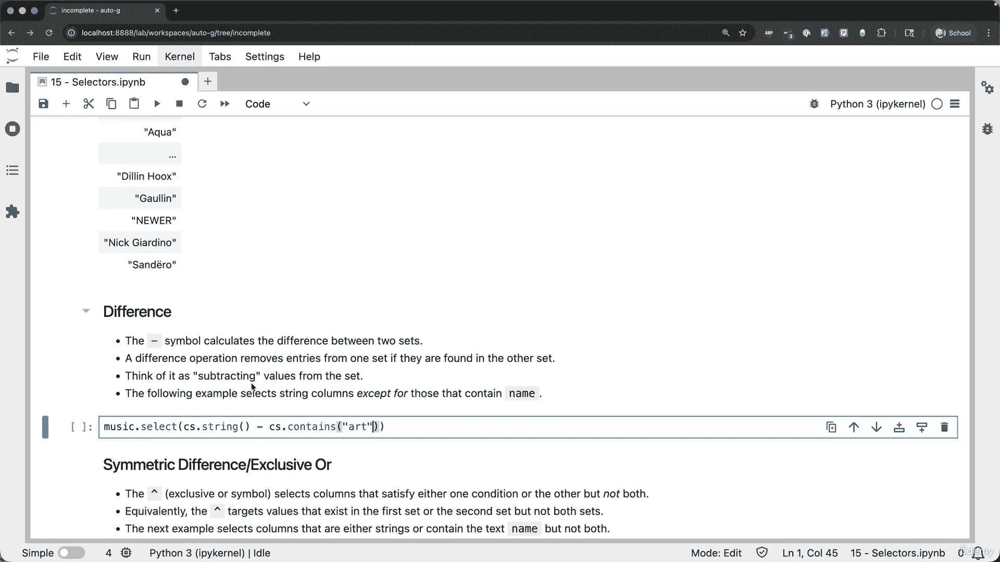

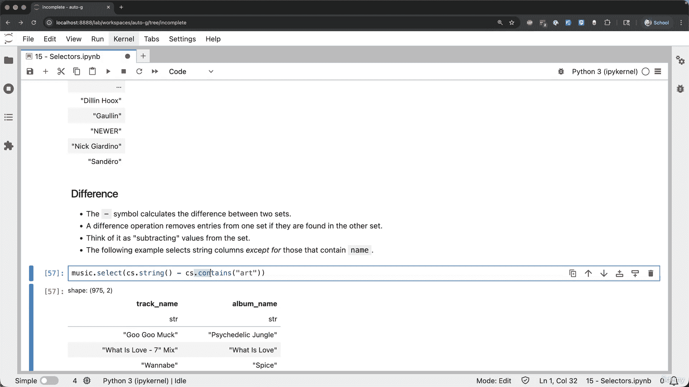

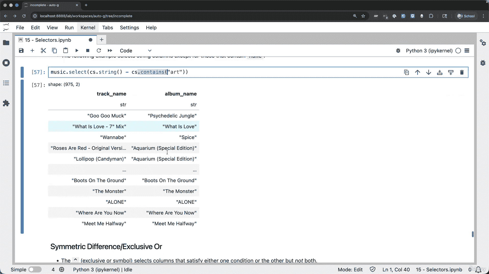

对称差使用 `^` 符号，目标是选择存在于一个集合或另一个集合、但不同时存在于两个集合中的值。如果两个条件同时满足，该列就不会被包含；只有只满足其中一个选择器、而不满足另一个选择器的列才会被提取出来。这个符号在键盘上通常用 `Shift + 6` 输入。


下面是对称差示例的拆解，注意两个条件不能同时成立。


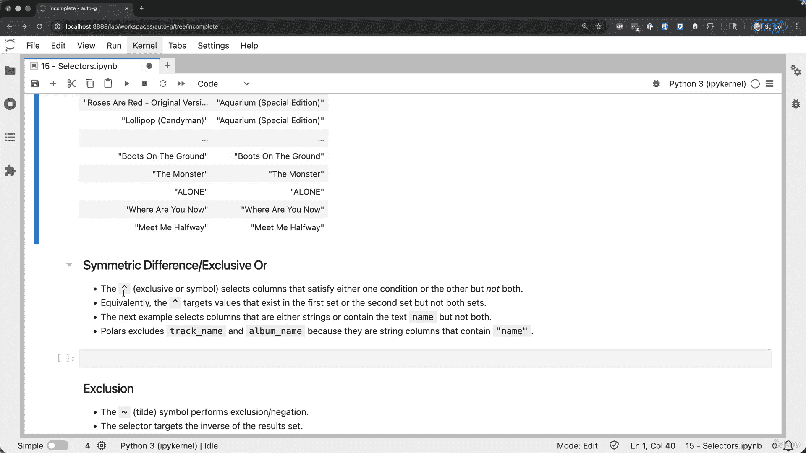

- 使用 `cs.string()` 选出所有字符串列。
- 使用 `^` 表示对称差或异或运算。
- 使用 `cs.contains("name")` 选出列名包含 `name` 的列。
- 最终结果是“字符串列”或“列名包含 `name`”二者选其一，但不能同时满足。
- 因此，`track name` 和 `album name` 会被排除，因为它们既是字符串列，列名又包含 `name`，同时满足两个条件。


```python
df.select(
    cs.string() ^ cs.contains("name")
)
```


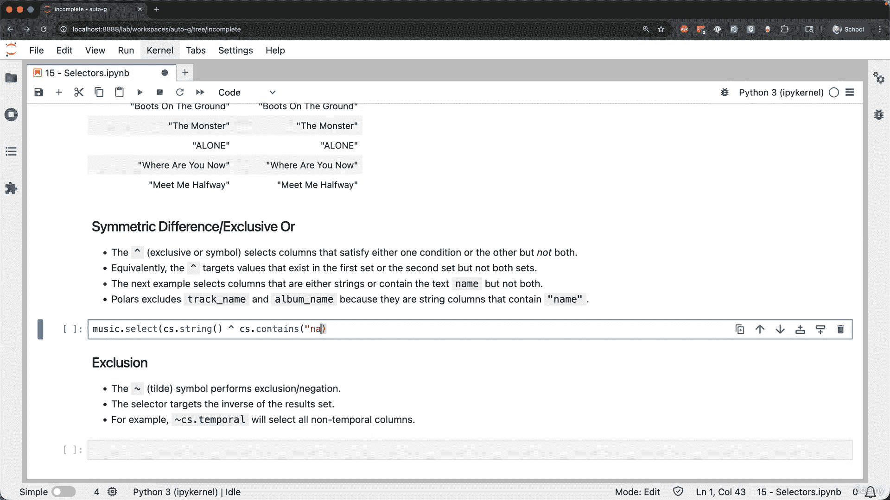

这段代码表达的是：选取字符串列或者列名包含 `name` 的列，但不能两者都满足。由于 `track name` 和 `album name` 既是字符串列又包含 `name`，它们会被排除。接下来我们看排除操作，也叫取反或否定，它用于选择某个选择器结果的反面。


排除操作会创建一个给定查询或选择器的反向结果，用来定位与原始条件相反的列。一个简单例子是选择所有时间日期列，然后对它取反。代码中使用波浪号 `~`，这个符号在多数键盘上位于数字 `1` 的左边。取反后，原本的时间日期列会被排除，最终选择所有不是日期、时间或日期时间类型的列，例如字符串列、整数列、浮点列等。


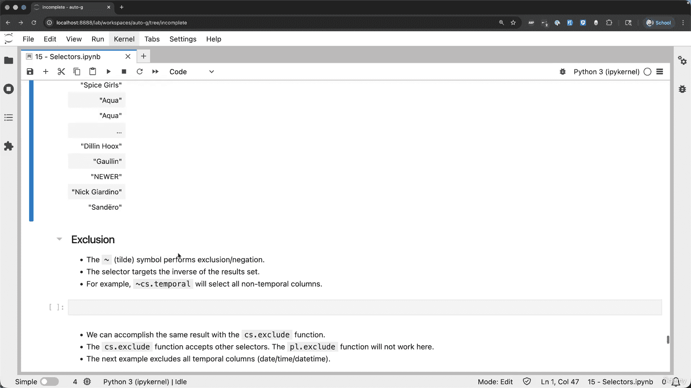

下面是排除操作的拆解，先看最直接的取反写法。


- 使用 `cs.temporal()` 选出时间日期列。
- 在它前面加上 `~`，表示对结果取反。
- 最终结果是所有不属于时间日期类型的列。
- 字符串列、整数列、浮点列等都会被保留，日期时间列会被排除。


```python
df.select(
    ~cs.temporal()
)
```


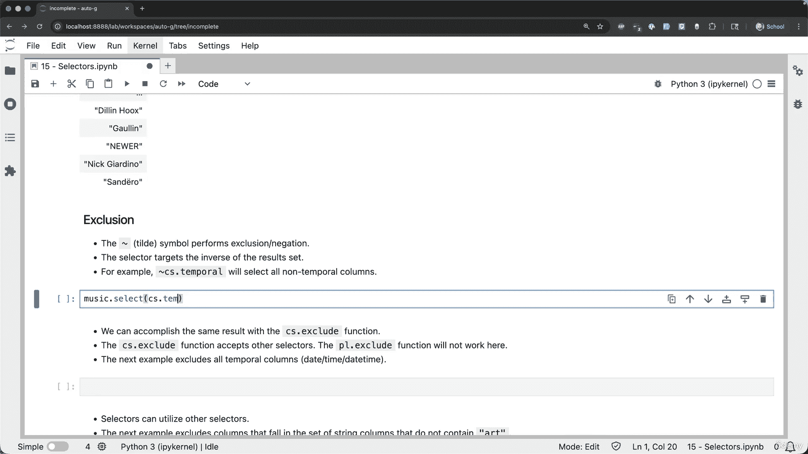

把所有时间日期列取反，得到的就是所有非时间日期列。除了波浪号，Polars 还提供了另一种表达方式。Polars 有一个顶层的 `exclude` 函数，但顶层 `exclude` 不能直接和选择器配合使用；不过选择器子模块里有一个互补的 `exclude` 函数可以使用。下面看看如何用选择器模块的 `exclude` 完成同样的目标。


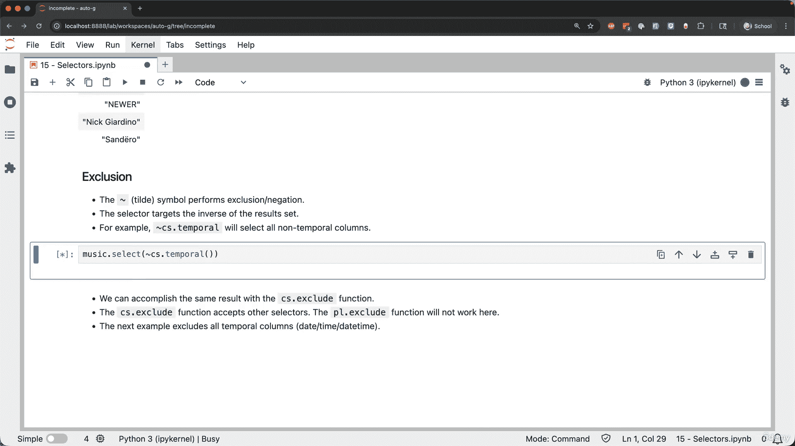

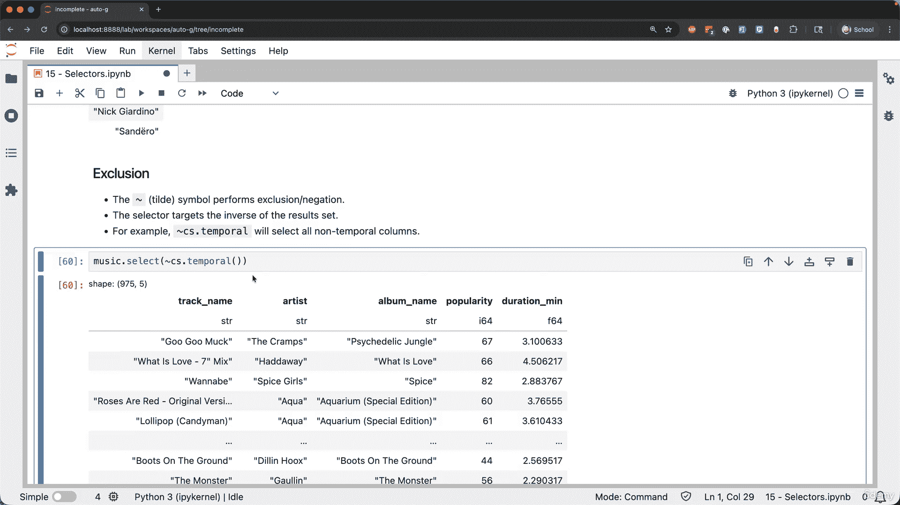

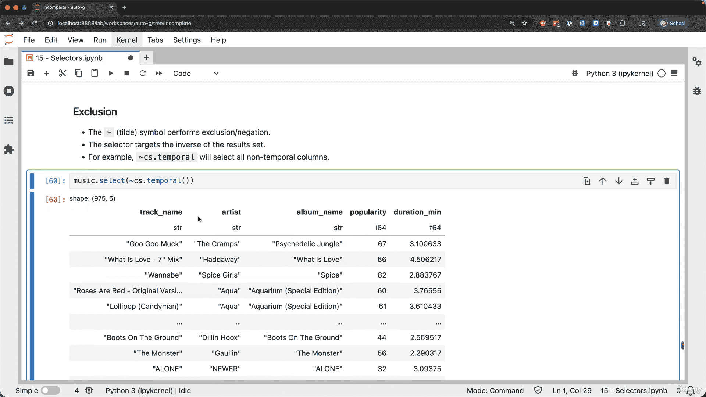

下面是使用选择器模块 `exclude` 完成同样目标的拆解。


- 使用 `select` 方法开始选择列。
- 不使用顶层的 `pl.exclude`，而是使用选择器子模块中的 `cs.exclude`。
- 把 `cs.temporal()` 作为参数传给 `cs.exclude`，表示排除所有时间日期列。
- 最终结果是所有不存储日期时间数据的列。


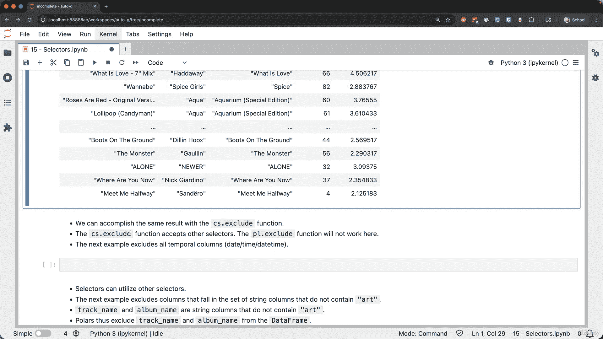

```python
df.select(
    cs.exclude(cs.temporal())
)
```


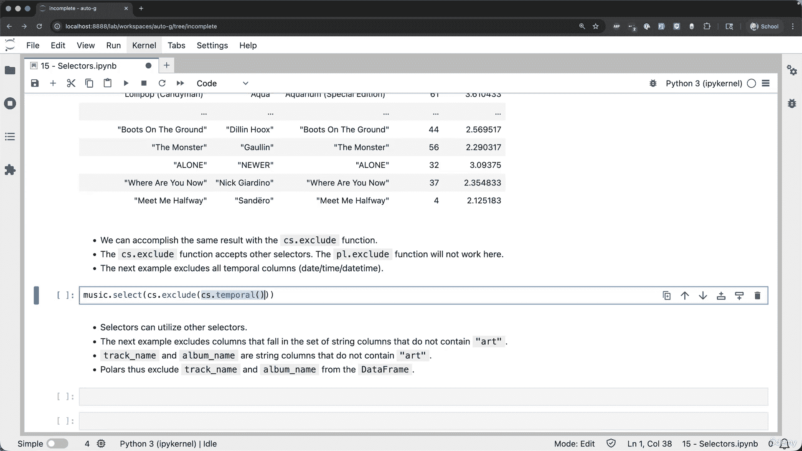

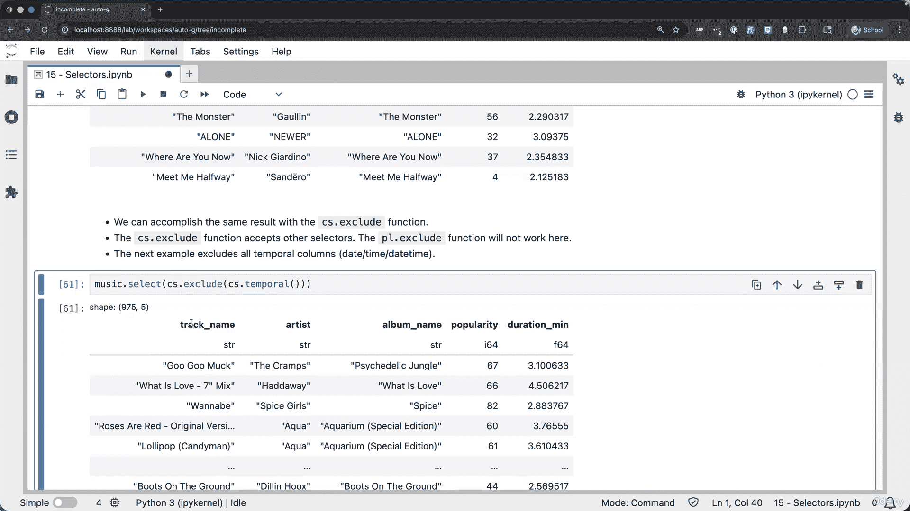

这段代码要求 Polars 选择所有非时间日期列，排除所有存储日期时间信息的列，保留其他列。这个结果与前面使用 `~cs.temporal()` 的结果一致。介绍完基础的排除写法，本节中我们进一步看看选择器嵌套，把多个集合运算组合起来。


选择器可以嵌套在其他选择器里。客观地说，作者并不确定什么具体场景一定会用到这种写法，但这个例子可以展示把各种选择器组合起来后能实现什么。下面先用 `select`，再使用刚刚见过的 `cs.exclude`。`exclude` 会排除满足某个条件的列，并保留与这个条件相反的列。这里可以在 `exclude` 的参数中放入一个集合运算，例如差集。


下面是嵌套选择器示例的拆解，顺序是先算内层差集，再在外层取反。


- 内层使用 `cs.string() - cs.contains("art")`，得到所有字符串列中不含 `art` 的列。
- 外层使用 `cs.exclude(...)`，对刚刚得到的集合取反。
- 因此，`track name` 和 `album name` 会被排除，因为它们是字符串列且不含 `art`，正好属于内层集合。
- `artist` 会被保留，因为它是字符串列但包含 `art`，不属于内层差集，因此不会被外层排除。
- 这个例子展示了如何混合搭配选择器，构建更复杂、更精细的列定位方式。


```python
df.select(
    cs.exclude(cs.string() - cs.contains("art"))
)
```


这里的关键是分清内外两层：内层先算出“字符串列且不含 `art`”的集合，外层再对这个集合取反。于是，字符串列中不含 `art` 的列被排除，字符串列中含 `art` 的列则可能被保留。这样的逻辑看起来复杂，但它说明选择器可以像积木一样组合，形成更细致的列选择规则。


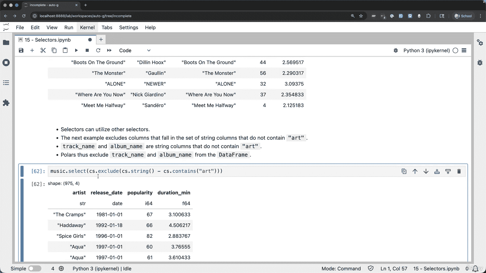

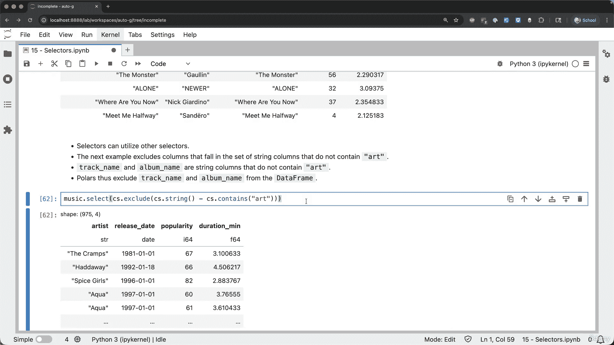

到这里，主要操作都介绍完了，下面对本节课做总结。本节课中我们一起学习了 Polars 选择器的集合运算，包括并集 `|`、交集 `&`、差集 `-`、对称差 `^`、排除取反 `~`，以及选择器模块中的 `cs.exclude`。我们还看到了选择器嵌套的写法，理解了这些操作可以组合起来，形成更复杂但仍然清晰的列定位逻辑。掌握这些符号后，就可以更灵活地从 DataFrame 中挑选需要的列。
