# 📊 Polars与Python数据分析：第76节：引入数据集

在本节课中我们将要学习下一部分课程的开头内容，这一部分的课程名称是“Group by”，也就是“分组”。我们会探索如何把某一列中相同的值整理成一组，你可以把这些组理解成一个个“桶”，然后在这些组上执行聚合操作。Group by 是一个很有用的工具：当你想对一列里所有不同的值分别做计算时，不需要自己手动创建这些组或桶。我们会从一个全新的 Jupyter notebook 开始这一部分，这个 notebook 叫 `16_group_by`。和往常一样，我们首先导入 Polars 库，并把它起别名为 `pl`。接着介绍第一个数据集 `retail_sales.csv`，看看它长什么样，并在导入时做几项优化，为后续学习分组操作打好基础。最后我们会预览数据，并把这段导入代码作为本节剩余课程的起始代码。

## 🧺 Polars与Python数据分析：第76节：分组的基本概念

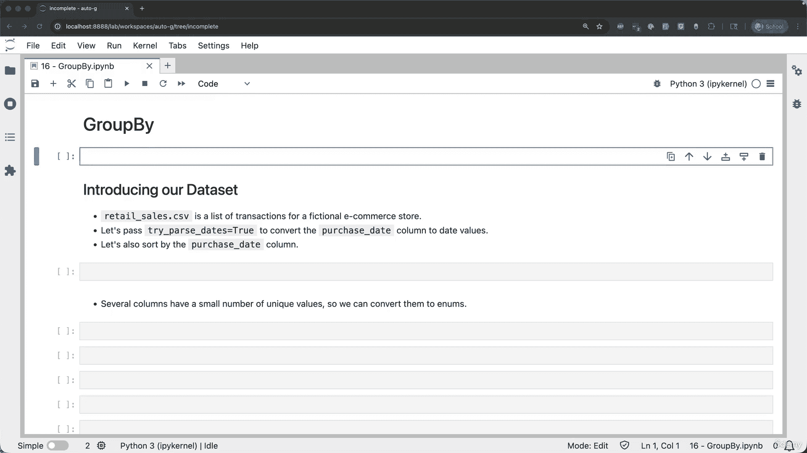

上一节我们说明了这一部分课程的主题是 Group by，本节中我们来看看分组到底在做什么。Group by 的核心含义可以用一个很直白的公式来描述：先按某一列的值把数据行放进不同的组，再对每个组执行聚合计算。写成代码形式就是 `df.group_by("分组列").agg(聚合表达式)`。这里的“组”也可以叫“桶”，你不需要自己一个个创建桶，Polars 会按照列里的不同值自动帮你分好。这样你就可以一次性对一列中所有不同值分别做统计，而不必手动筛选和重复计算。

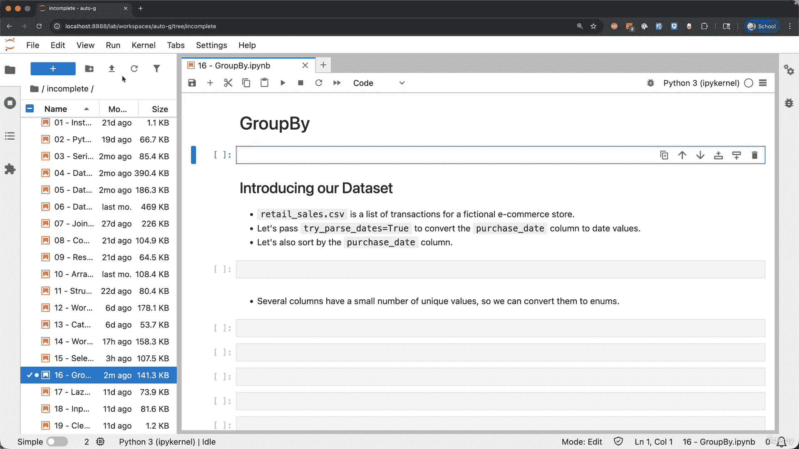

## 🧪 Polars与Python数据分析：第76节：新建笔记本并导入Polars

上一节我们介绍了分组的基本概念，本节中我们来看看实际操作的第一步。我们新建一个全新的 Jupyter notebook，名称叫 `16_group_by`，然后像往常一样导入 Polars 库，并把别名设为 `pl`。下面是起始导入代码，后面所有操作都会基于这个别名来进行。

```python
import polars as pl
```

导入完成后，我们就可以读取第一个数据集，并开始检查数据结构和列类型。

## 🛒 Polars与Python数据分析：第76节：认识零售销售数据集

上一节我们完成了 Polars 的导入，本节中我们来看看第一个数据集。这个数据集叫 `retail_sales.csv`，它是一家虚构电商商店的交易记录集合。每一笔交易都包含若干信息，包括交易本身的编号、销售发生的地区、产品类别、产品编号、购买日期、销售渠道、购买数量、单价以及整笔交易的总价。以下是这个数据集包含的字段说明：

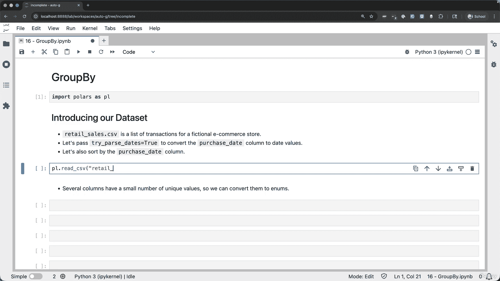

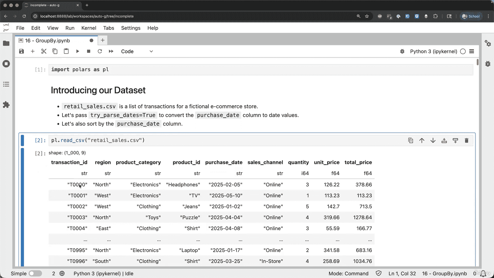

- `transaction_id`：每笔交易唯一的交易 ID；
- `region`：销售发生的地区；
- `product_category`：产品类别，例如电子产品；
- `product_id`：唯一的产品 ID；
- `purchase_date`：交易发生的购买日期；
- `sales_channel`：销售渠道，取值为线上或线下；
- `quantity`：购买的数量；
- `price_per_unit`：每单位的价格；
- `total_price`：整笔交易支付的总价。

这些字段构成了后续分析的基础。继续往下操作之前，我们还有几项优化要做，这样可以让数据占用更少内存，也能让后面的分组计算更顺畅。

## 🗓️ Polars与Python数据分析：第76节：把购买日期解析成日期类型

上一节我们认识了数据集中的字段，本节中我们来看看第一项导入优化。现在 `purchase_date` 这一列存储的是字符串，我们希望把它转换成日期值。做法是在读取 CSV 时添加 `try_parse_dates` 参数，并把它设置为 `True`。这样 Polars 会尝试自动解析日期，通常可以正常工作。下面是读取代码示例。

```python
sales = pl.read_csv("retail_sales.csv", try_parse_dates=True)
```

完成日期解析后，数据中的日期列就不再是普通字符串，而是日期类型。接下来我们还要看看哪些列适合转换成分类类型或枚举类型。

## 🔢 Polars与Python数据分析：第76节：用n_unique找出适合枚举的列

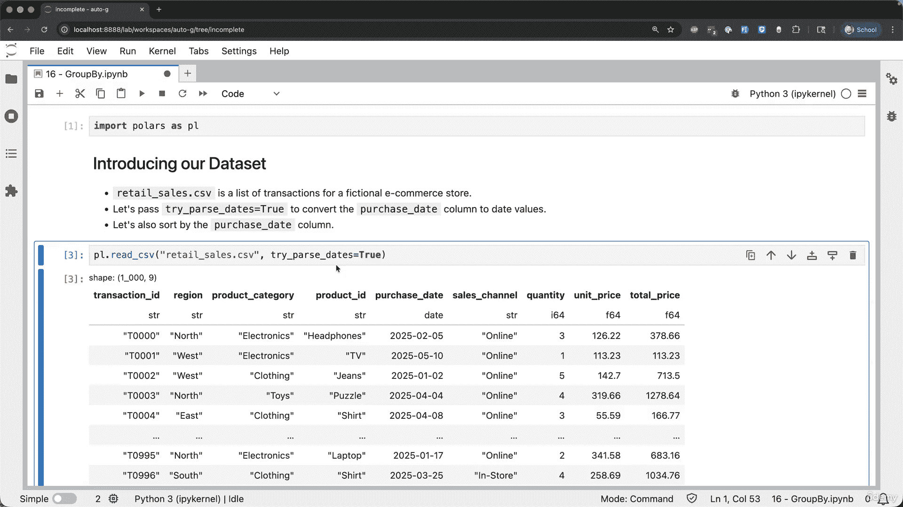

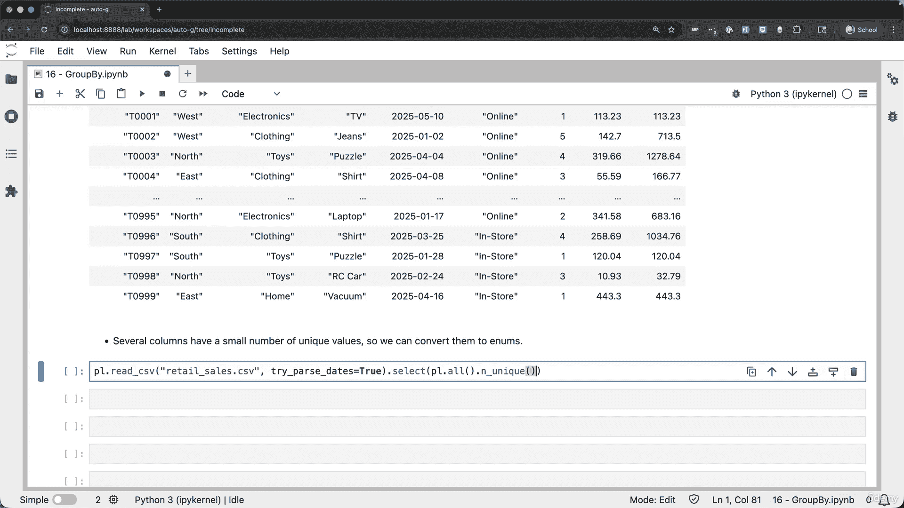

上一节我们把购买日期解析成了日期类型，本节中我们来看看第二项优化。数据集里有些列的唯一值数量很少，这类列很适合转换成 `categorical` 或 `enum` 类型。为了找出哪些列符合条件，我们可以复制已有数据框的代码，调用 `select` 方法，并使用 `all` 函数创建一个针对所有列的表达式，然后调用 `n_unique` 方法。`n_unique` 是“number of unique”的缩写，作用是统计每一列中有多少个不同的值。下面是示例代码。

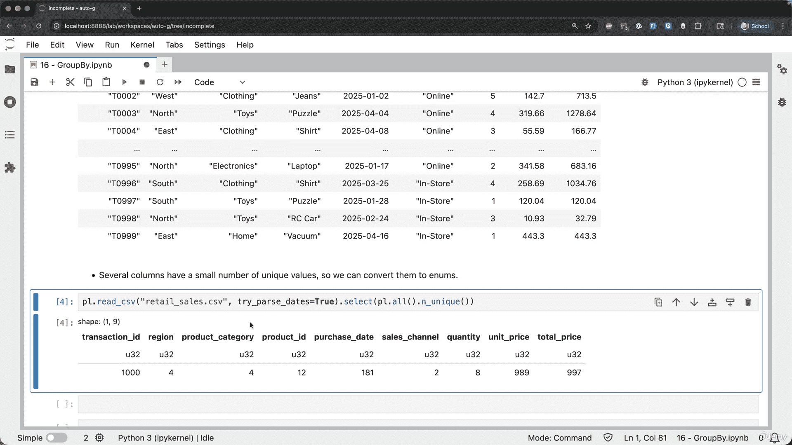

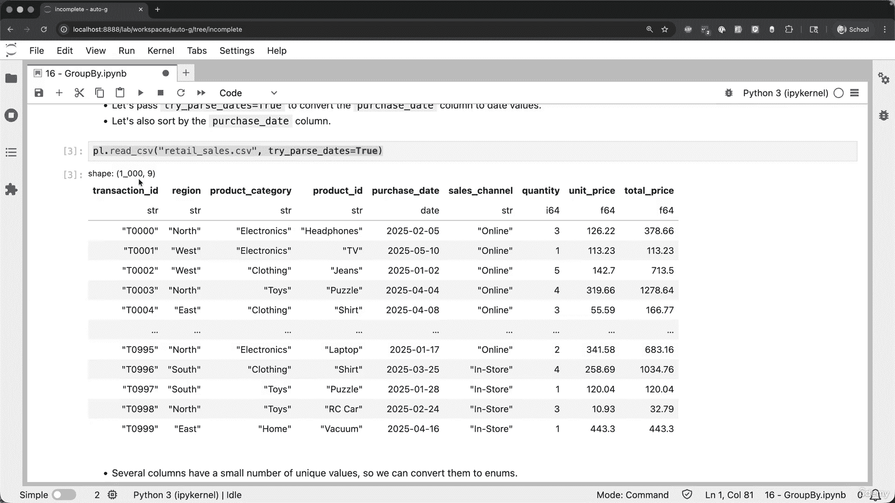

```python
sales.select(pl.all().n_unique())
```

这段代码会返回一个只有一行的数据框，告诉我们每一列中唯一值的数量。原句提到数据框共有100行，并展示为10行×9列的结构，这里重点是总列数为9列。统计结果显示，`region` 列只有4个唯一值，`product_category` 列也只有4个唯一值，`sales_channel` 列只有2个唯一值。因此这三列都是很好的候选列，可以转换成 `categorical` 或 `enum` 类型。需要提醒的是，如果你能写出一个 `enum` 中所有具体的值，那么与 `categorical` 相比，`enum` 通常还能进一步减少内存占用。下面我们就快速找出每一列的所有唯一值，声明对应的枚举，再声明正确的列类型。

## 🔍 Polars与Python数据分析：第76节：逐个查看每列唯一值

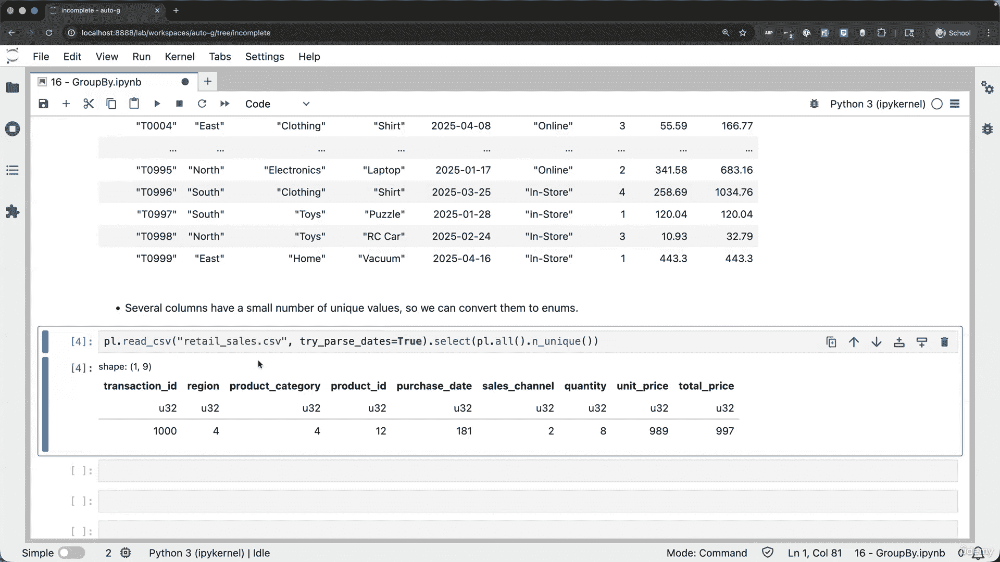

上一节我们找到了三列适合转换成枚举的候选列，本节中我们来看看如何查看它们的具体唯一值。我们再次复制相关代码，调用 `select` 方法，并一次只针对一列创建表达式，先从 `region` 列开始。这里要调用的是 `unique` 方法，而不是 `n_unique`。`unique` 会返回一个只包含单列的数据框，里面是该列的所有唯一值。示例代码如下。

```python
sales.select(pl.col("region").unique())
```

不能在这里同时为另外两列添加表达式，原因是如果不同生成列的唯一值数量不一样，Polars 就无法把高度不同的列合并起来，会直接报错。例如 `region` 有4个唯一值，而 `sales_channel` 只有2个唯一值，Polars 无法顺利地把这两列合并成一个数据框。因此我们需要一列一列地处理。下面我们声明一个变量，可以叫它 `region_enum`。需要提醒的是，在 Polars 顶层有一个 `Enum` 类，我们可以用括号创建它的实例，并传入一个 Python 列表，列表里放这一列的所有唯一值。根据上面得到的结果，这些值是 `east`、`west`、`north` 和 `south`。

## 🏷️ Polars与Python数据分析：第76节：声明Region枚举

上一节我们说明了为什么要逐个查看唯一值，本节中我们来看看如何声明 `region` 的枚举。我们使用 Polars 的 `Enum` 类创建实例，括号中传入包含所有唯一值的 Python 列表。这样做的目的，是提前告诉 Polars 这一列只可能出现这四种值，从而在导入时直接使用更节省内存的枚举类型。下面是 `region_enum` 的声明代码。

```python
region_enum = pl.Enum(["east", "west", "north", "south"])
```

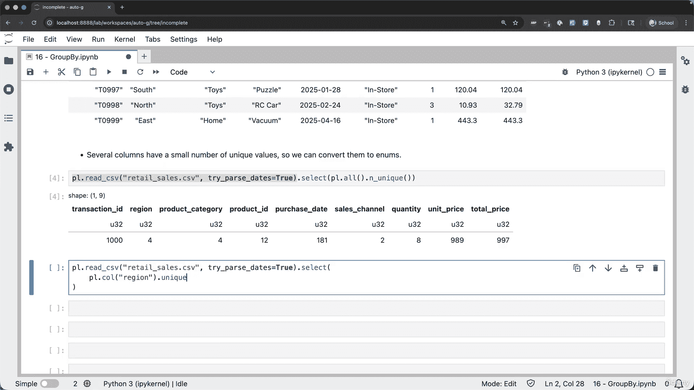

声明好 `region` 的枚举后，我们继续用同样的方法处理另外两列唯一值较少的列。

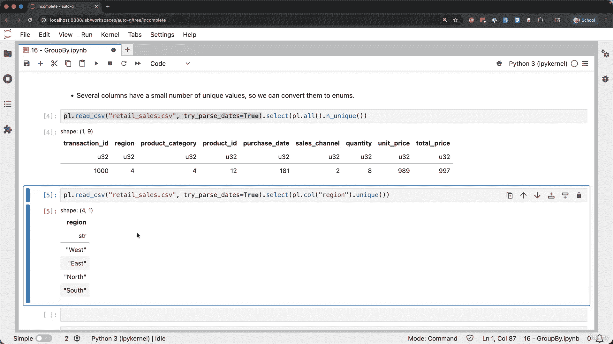

## 🧸 Polars与Python数据分析：第76节：声明ProductCategory枚举和SalesChannel枚举

上一节我们声明了 `region` 的枚举，本节中我们来看看另外两列。下一步处理 `product_category` 列，先查看它的值，可以看到这里只有4个唯一值。然后我们声明 `product_category_enum`，原则和前面一样：用括号实例化 `Enum`，并传入包含四个值的 Python 列表，这四个值是 `home`、`electronics`、`toys` 和 `clothing`。示例代码如下。

```python
product_category_enum = pl.Enum(["home", "electronics", "toys", "clothing"])
```

最后处理第三列 `sales_channel`，这一列只有两个唯一值：`in store` 和 `online`。我们声明 `sales_channel_enum`，同样用括号实例化枚举，并传入包含这两个字符串的 Python 列表。这里要特别注意，列表中的字符串必须和原始数据中的值完全匹配，大小写和空格都要一致。示例代码如下。

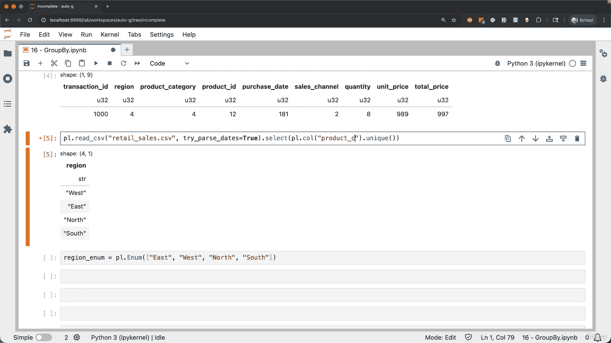

```python
sales_channel_enum = pl.Enum(["in store", "online"])
```

三个枚举都声明好之后，我们就可以在读取 CSV 时把它们应用到对应的列上。

## 📥 Polars与Python数据分析：第76节：用schema_overrides在导入时应用枚举

上一节我们声明了三个枚举，本节中我们来看看如何在导入数据时使用它们。现在回到前面的导入代码，不再把这三列当作普通字符串处理，而是指定 `schema_overrides` 参数。这个参数接收一个字典，字典里对我们想要覆盖类型的三列分别指定类型，类型值就是上面声明的枚举实例。下面是完整的导入代码示例。

```python
sales = pl.read_csv(
    "retail_sales.csv",
    try_parse_dates=True,
    schema_overrides={
        "region": region_enum,
        "product_category": product_category_enum,
        "sales_channel": sales_channel_enum,
    },
)
```

在这段代码中，`region` 列会被 Polars 按 `region_enum` 类型处理，`product_category` 列会按 `product_category_enum` 类型处理，`sales_channel` 列会按 `sales_channel_enum` 类型处理。如果前面的枚举值都写对了，数据导入就会顺利完成。导入之后可以看到这三列的数据类型都变成了枚举类型，数据框的总内存占用也会明显下降。接下来我们把最终结果赋值给 `sales` 变量，并用 `head` 方法预览前三行。这段代码会成为本节剩余课程的起始导入代码。

## 👀 Polars与Python数据分析：第76节：赋值给sales并预览前三行

上一节我们完成了带枚举类型的导入，本节中我们来看看最后的预览步骤。我们将最终结果赋值给 `sales` 变量，然后调用 `head` 方法查看前三行，确认数据导入和类型转换都符合预期。示例代码如下。

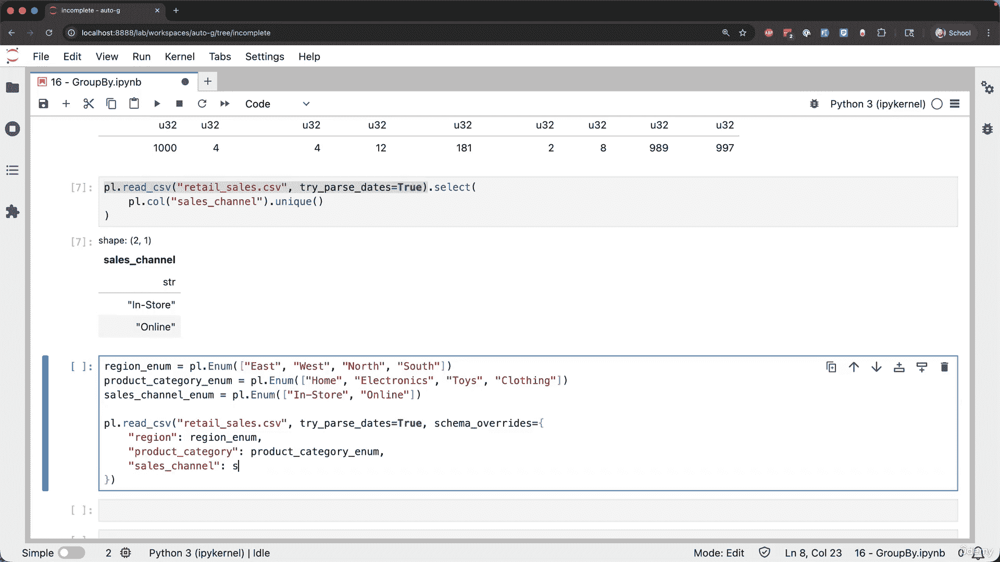

```python
sales.head(3)
```

完成这些导入优化后，数据已经准备好供后续课程使用。下一节课中，我们就可以查看 Group by 对象，并开始真正使用分组功能。

## ✅ Polars与Python数据分析：第76节：本节总结

本节课中我们一起学习了如何为 Group by 部分准备数据集。以下是本节内容的要点回顾：

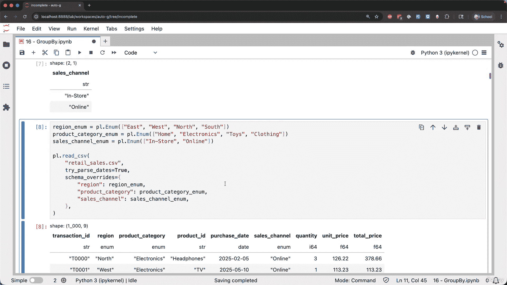

- Group by 可以按列中的不同值自动把数据分成组或桶，再对每组执行聚合计算；
- 我们新建了 `16_group_by` notebook，并导入 Polars 库，别名为 `pl`；
- 认识了虚构电商交易数据集 `retail_sales.csv`，包括交易 ID、地区、产品类别、产品 ID、购买日期、销售渠道、数量、单价和总价等字段；
- 使用 `try_parse_dates=True` 把购买日期从字符串解析成日期类型；
- 使用 `select(pl.all().n_unique())` 找出每列唯一值数量，发现 `region`、`product_category` 和 `sales_channel` 适合转换成枚举；
- 因为不同列唯一值数量不同，不能一次合并查看，所以使用 `unique` 逐列查看唯一值；
- 使用 `pl.Enum([...])` 声明了 `region_enum`、`product_category_enum` 和 `sales_channel_enum`；
- 使用 `schema_overrides` 在读取 CSV 时把三列直接转换成枚举类型，降低内存占用；
- 最后把结果赋值给 `sales`，并用 `head(3)` 预览前三行。

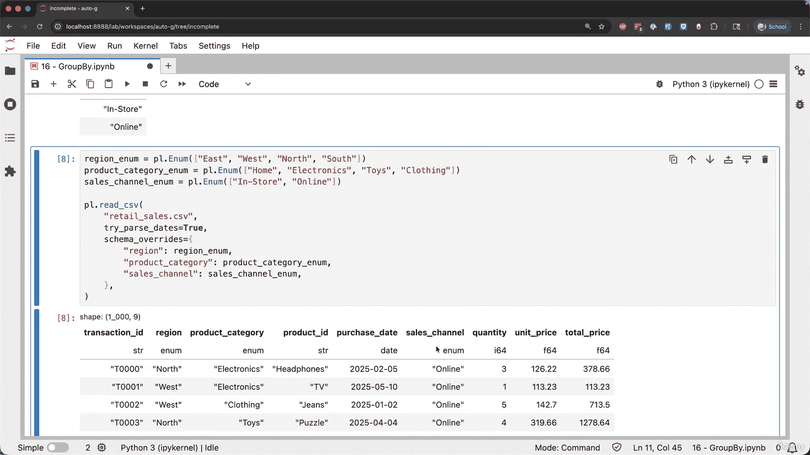

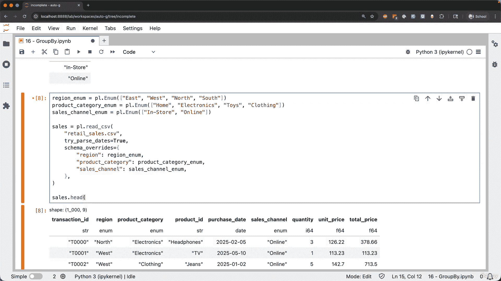

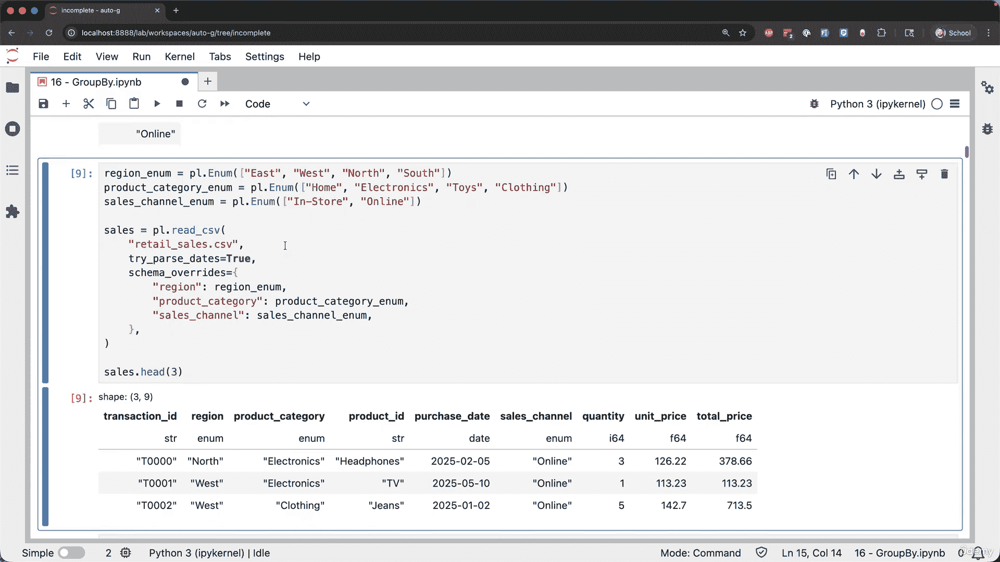

本节完成了数据导入和优化，下一节课我们将查看 Group by 对象，开始学习如何对分组结果进行聚合操作。

