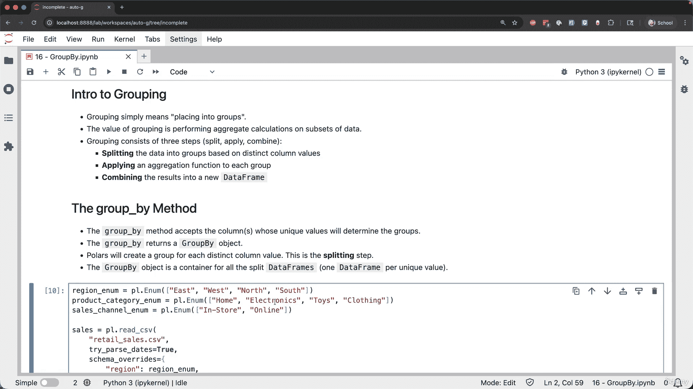
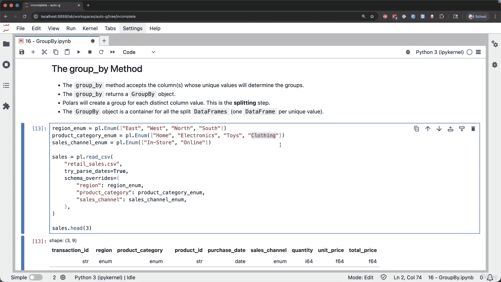
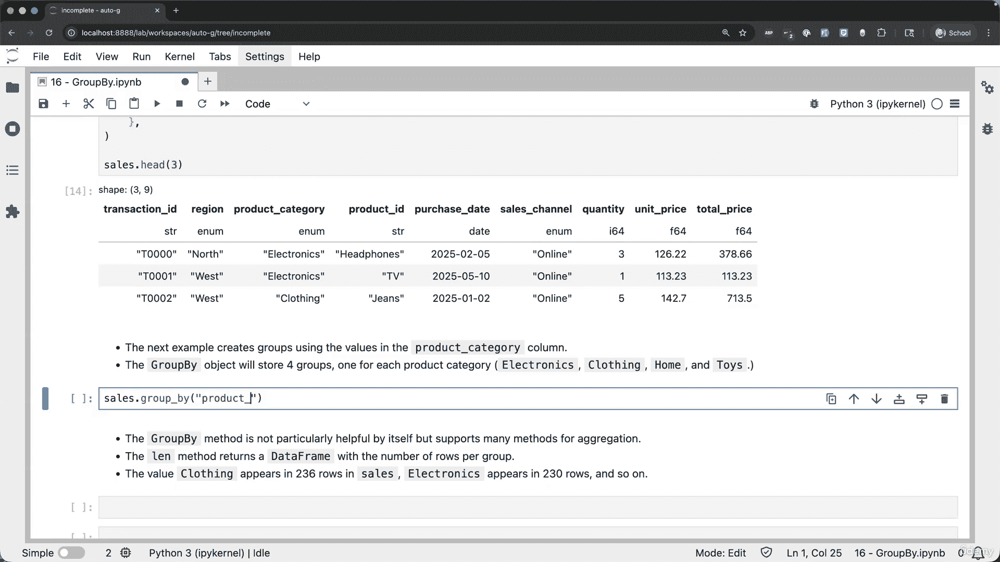
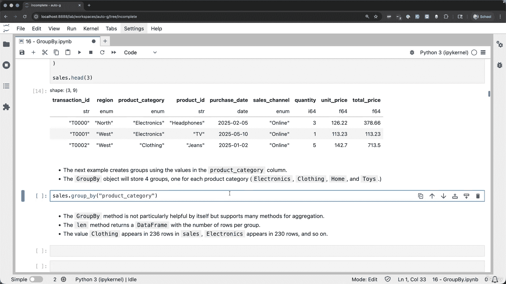
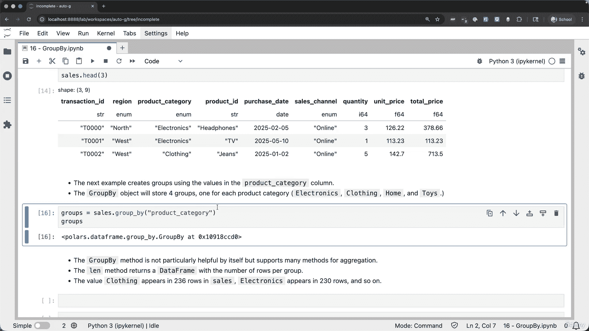
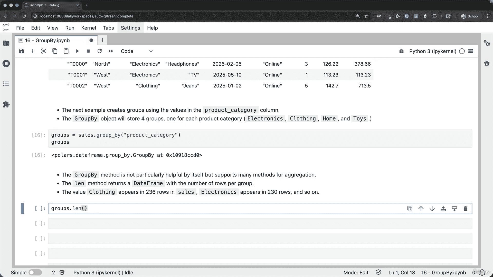
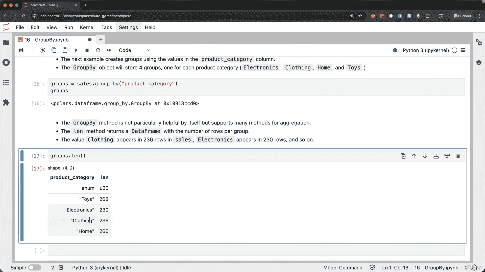

# 📊 Polars与Python数据分析：177：分组入门

在本节课中我们将要学习 Polars 中分组的基本思路，也就是 group by 对象是什么、它如何把数据拆成组，以及如何创建它并查看每个组里有多少行。我们会从最基础的三步流程讲起，然后说明为什么需要 group by 对象，最后用代码把整个流程串起来，让初学者能够直白地理解分组到底在做什么。

## 🧩 Polars与Python数据分析：177.1：分组的三步流程

在开头概述里我们知道了本节课会围绕分组展开，本节中我们来看看分组过程本身。分组过程可以拆成三个步骤，理解这三个步骤之后，再看 Polars 代码就不会觉得抽象。核心概念可以用下面这个公式来描述：

\[
\text{分组过程} = \text{拆分（Split）} + \text{应用（Apply）} + \text{合并（Combine）}
\]

第一步是识别一列，这一列中的不同值会成为分组依据。这个步骤叫拆分步骤，也就是根据某一列中的不同值把数据拆开。例如我们想按产品类别分析业务，可能想计算四个产品类别各自的收入总和，这些类别就是想要的分组，它们也正好是产品类别这一列中的唯一值。首先，我们把数据按这一列拆成多个组，Polars 会替我们完成这个拆分动作。为了更清楚，下面是三步流程的简要列表：

- 拆分：找到一列，用这一列的不同值把数据分成多个组。

- 应用：对每个组执行聚合函数或聚合操作，例如求和、平均值或中位数。



- 合并：把每个组的计算结果合并成一个新的 DataFrame，形成按组汇总的结果。

上面这个列表把三步流程串了起来。接下来看第二步，当我们已经有例如“家居”产品类别的所有行，以及“电子”产品类别的所有行之后，可能想求另一列所有值的总和，或者求另一列值的平均值，或者求中位数。这个操作就是对每个可能的组应用聚合操作，而这些组都包含在一个更大的 group by 对象中。group by 对象可以理解为一个容器，它把每个组存在里面，一列中每一个不同值对应一个组。然后当我们应用某种聚合操作时，最后一步就是 Polars 把所有结果合并成一个全新的 DataFrame，给你一份按组计算的清晰汇总。

## 🛠️ Polars与Python数据分析：177.2：为什么需要group by对象

上面我们知道了分组有三步，本节中我们来看看为什么需要 group by 对象，而不是自己手动写很多代码。这里要强调 group by 对象的价值：我们接下来要做的很多事情，其实用普通的 Polars 代码也能完成，但如果没有 group by 对象提供的功能，就需要我们自己写更多手动代码。例如，如果我想分析产品类别为“家居”的行，我可以使用 filter 方法把所有具有这个值的行提取出来，然后选中另一列并执行某种计算。但是接着我还必须对“电子”“玩具”“服装”重复完全相同的 filter 逻辑。可以想象，如果有 100 个不同值，或者等价地说有 100 个不同组需要计算，代码很快就会变得非常冗长。因此，group by 对象存在的目的，就是帮助我们对一个较大集合中的子组执行这类计算，同时效率更高、代码更少。下面是手动方式与 group by 方式的对比列表，帮助初学者理解这个差别：

- 手动方式：对每个类别分别写 filter，再分别写聚合计算，组数越多代码越长。



- group by 方式：先创建一个 group by 对象，再统一调用聚合方法，让 Polars 处理分组和合并。

通过这个对比可以看到，group by 对象不是多余的概念，而是为了减少重复代码。理解了这个价值之后，下面我们进入代码，看看如何真正创建和使用它。

## 🐍 Polars与Python数据分析：177.3：创建与查看group by对象

上一节我们说明了 group by 对象的价值，本节中我们来看看如何在代码中创建它。下面我们就执行代码，先看看上一节课留下的代码。接下来，我拿 sales 这个 DataFrame，调用 group by 方法，并传入一个字符串，这个字符串就是用来创建分组的列名。这里传入 product_category 列，这一列有四个唯一值：electronics、clothing、home 和 toys。创建 group by 对象的核心代码可以写成下面这样：

```python
groups = sales.group_by("product_category")
```





这段代码的含义很直接：从 sales 数据中，按照 product_category 这一列的不同值建立分组容器，并把结果保存到 groups 变量中。因此这个 group by 对象在这里看起来可能不太起眼，但它是一个容器，现在存储了四个组，并且根据原始列中存在的四个值，把对应的行分割并隔离到每个组里。这个对象就是 group by 对象，它的视觉输出同样看起来不太起眼。但是一旦有了这个对象，我们就可以在它上面调用更多方法，对这四个组执行聚合计算。所以我把这个对象赋值给一个变量，叫 groups。这个对象本质上就是一个 group by 对象，所以单独看它并不会特别有帮助。下面展示一个方法，它可以立即告诉我们原始数据的一些信息，这个方法就是 len 方法，它会告诉我们每个组中有多少行。对应的代码是：

```python
groups.len()
```





执行后可以看到，结果里有 product_category 列中的四个不同值，以及每个组中的条目数量，或者等价地说，是原始 sales DataFrame 中具有该产品类别的行数。具体来说，sales 中有 268 行的产品类别是 toys，所以 toys 就是存储在 group by 对象中的一个组，也可以叫一个桶。类似地，electronics 是另一个桶，它对应原始 sales 中的 230 行，其他类别也按同样方式对应。下面的列表总结了这一段代码观察结果：

- product_category 列提供四个分组值：electronics、clothing、home、toys。

- len 方法返回每个组的行数，用来快速了解每个类别有多少条记录。

- toys 组对应 268 行，electronics 组对应 230 行，其他组也各有自己的行数。



到这里，我们已经搭建好了基础设施，也就是 group by 对象这个容器，它根据四个不同值把所有行分割并分桶。下一节课我们会看看如何在这些组上执行聚合计算。本节课中我们一起学习了分组的三步流程、group by 对象的意义、如何创建 group by 对象，以及如何用 len 方法查看每个组的行数。掌握这些内容之后，再学习聚合计算就会更容易理解。

